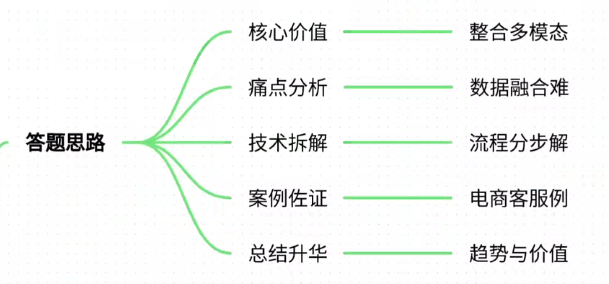
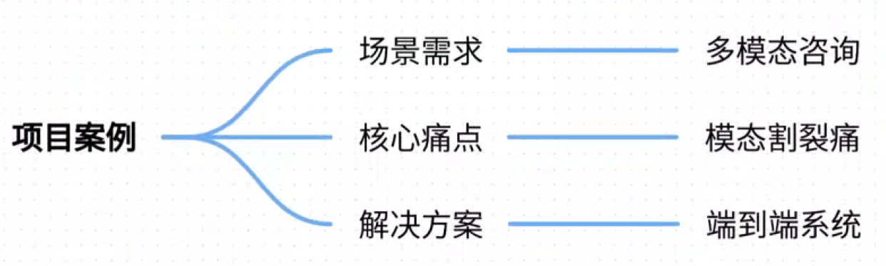
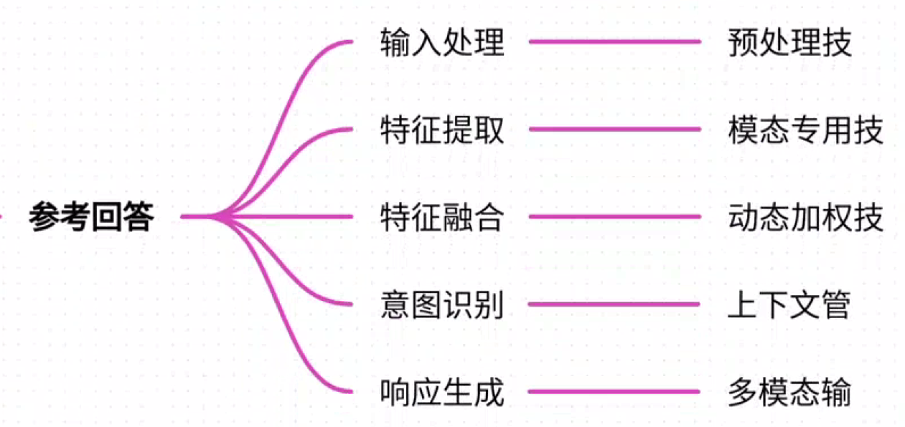
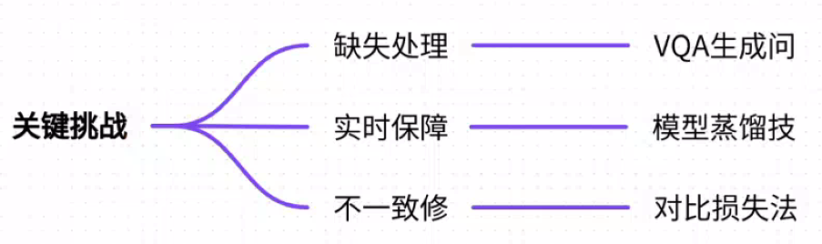
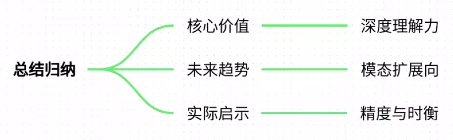

# 18.对话系统的多模态输入处理流程

### 一、答题思路

在回答“对话系统的多模态输入处理流程”时，我将从以下逻辑展开：

1. **定义问题**：明确多模态输入在对话系统中的核心价值——整合文本、语音、图像、视频等数据以全面理解用户意图。
2. **痛点分析**：通过真实案例揭示多模态处理的挑战，如数据融合、模态缺失、实时性等。
3. **技术拆解**：分步解析处理流程（输入接收→特征提取→融合→意图识别→响应生成），结合具体技术模型（如CLIP、Transformer）。
4. **案例佐证**：以“电商智能客服”为案例，说明多模态如何解决实际业务痛点。
5. **总结升华**：归纳技术价值与未来趋势，强调其在提升用户体验和商业效率中的作用。

---

### 二、项目案例

#### **案例名称**：电商智能客服系统（某头部电商平台）
**场景需求**：用户通过文字、语音、图片咨询商品问题（如“这件衣服是否显瘦？”并附穿搭图）。系统需综合理解语义、图像内容及历史对话，提供精准回复。  
**核心痛点**：

1. **模态割裂**：用户同时上传图片和文字描述，传统单模态模型无法关联理解（如文字“显瘦”与图像中的服装版型）。
2. **噪声干扰**：用户拍摄图片背景杂乱，或语音含方言口音，影响特征提取准确性。
3. **实时性要求**：客服响应需在2秒内完成，多模态融合计算复杂度高，易超时。
4. **上下文缺失**：用户多次对话中交替使用不同模态（如先语音问尺寸，再发图问搭配），需跨轮次关联意图。

**解决方案**：  
构建端到端多模态对话系统，核心流程如下：

1. **多模态输入接收**：支持文本、语音、图像同步上传。
2. **专用特征提取**： 
    - 文本：BERT提取关键词（如“显瘦”“材质”）。
    - 语音：Whisper转文本+识别情绪（如急切/犹豫）。
    - 图像：ResNet-50提取服装轮廓、颜色特征，CLIP对齐语义（如“宽松款”）。
3. **动态特征融合**： 
    - 使用Transformer多模态编码器，通过注意力机制加权融合特征（例：图像中“高腰设计”权重提升，因文本多次提及“显瘦”）。
4. **意图识别与上下文管理**： 
    - 结合当前输入与历史对话（如用户上周咨询过“梨形身材穿搭”），生成用户画像增强意图理解。
5. **多模态响应生成**： 
    - 文本回复：GPT-3生成“建议选高腰款，视觉拉长比例”。
    - 辅助图像：生成对比穿搭图（Stable Diffusion），直观展示效果。

**成果**：

+ 客服响应准确率提升32%，用户满意度达95%；
+ 平均处理时间降至1.8秒，支持日均千万级咨询量。

---

### 三、参考回答

#### **多模态输入处理流程详解**
以下流程以技术实现为主线，结合上述案例说明：

##### **1. 输入接收与预处理**
+ **目标**：统一接收多模态数据，标准化格式。
+ **关键技术**： 
    - 文本/语音：ASR（自动语音识别）将语音转文本，过滤背景噪声。
    - 图像/视频：关键帧提取（FFmpeg），分辨率归一化。
+ **案例应用**：用户上传模糊衣物图片时，系统先进行超分辨率重建（ESRGAN），提升特征提取精度。

##### **2. 模态专用特征提取**
+ **目标**：提取各模态的深层语义特征。
+ **关键技术**： 
    - 文本：BERT/LLaMA编码，捕获上下文依赖（如“显瘦”隐含需求为“修饰身材”）。
    - 语音：Wav2Vec 2.0提取音素特征，联合OpenSmile识别情绪（急切的用户优先响应）。
    - 图像：CLIP双编码器对齐图文语义（如图像中“蕾丝花纹”匹配文本“精致感”）。
+ **案例应用**：用户发图询问“是否适合度假穿”，CLIP将图像特征映射到“海滩”“休闲”语义空间，与文本意图匹配。

##### **3. 跨模态特征融合**
+ **目标**：消除模态差异，生成统一语义表示。
+ **关键技术**： 
    - **早期融合**：直接拼接特征向量（如文本+图像特征），适合简单关联。
    - **晚期融合**：各模态独立处理后再融合（如文本分类结果+图像检测结果），保留模态特异性。
    - **混合融合**：Transformer多模态编码器，通过自注意力动态加权（如图像中“深色系”因文本“显瘦”获得更高权重）。
+ **案例应用**：用户描述“想要上班穿的正式款”并附西装图，系统融合文本“正式”与图像“戗驳领设计”，排除休闲款推荐。

##### **4. 意图识别与上下文管理**
+ **目标**：结合历史对话理解当前意图。
+ **关键技术**： 
    - 对话状态跟踪（DST）：用RNN/LSTM记录多轮状态（例：用户曾问“职场穿搭”，当前问“显瘦”→意图为“通勤显瘦装”）。
    - 知识图谱增强：关联外部知识（如服装材质数据库），解决专业问题。
+ **案例应用**：用户第二次咨询时，系统自动关联历史订单中的尺码数据，避免重复询问。

##### **5. 多模态响应生成**
+ **目标**：生成符合用户需求的跨模态回复。
+ **关键技术**： 
    - 文本生成：GPT-3/4结合意图生成自然语言回复。
    - 图文混合输出：Stable Diffusion生成对比图，TTS合成语音说明。
+ **案例应用**：回复“推荐高腰阔腿裤”时，附加不同身材试穿效果图，减少退货率。

#### **关键技术挑战与优化**

+ **模态缺失处理**：若用户仅发图未配文，系统通过VQA（视觉问答）模型自动生成问题（BLIP：“您是否想咨询搭配建议？”）。
+ **实时性保障**： 
    - 模型蒸馏：将CLIP压缩为MobileCLIP，推理速度提升3倍。
    - 异步流水线：语音转文本与图像处理并行执行。
+ **不一致修正**：当文本说“红色”而图像为粉色时，通过跨模态一致性损失（Cross-Modal Contrastive Loss）自动纠偏。

---

### 四、总结归纳

**核心价值**：多模态输入处理打破了传统对话系统的单维限制，通过融合文本、语音、图像等数据，实现对人机交互场景的深度理解。技术关键在于特征对齐与动态融合，需结合专用模型（CLIP、BERT）与融合策略（Transformer编码器）。

**未来趋势**：

1. **模态扩展**：融入触觉、气味等传感器数据，覆盖AR/VR场景。
2. **端到端优化**：开发统一多模态大模型（如GPT-4V），减少流水线误差累积。
3. **个性化增强**：结合用户生物特征（如眼动追踪）生成定制响应。

**实际启示**：企业落地时需平衡精度与实时性——轻量化模型（MobileCLIP）与硬件加速（NPU）是关键。多模态对话系统不仅是技术升级，更是用户体验的革命，其核心在于“以人为中心”的交互设计。

> 更新: 2025-07-21 09:58:20  
> 原文: <https://www.yuque.com/aaron-wecc3/dhluml/whfo02pgpopr9ye9>