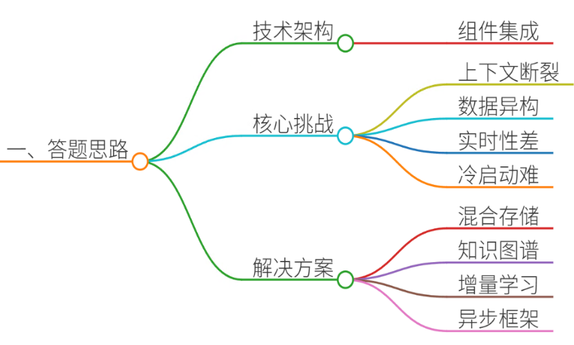
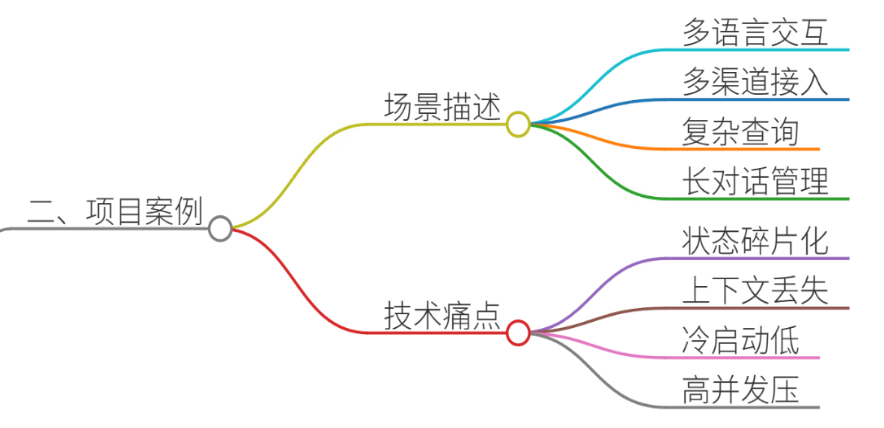
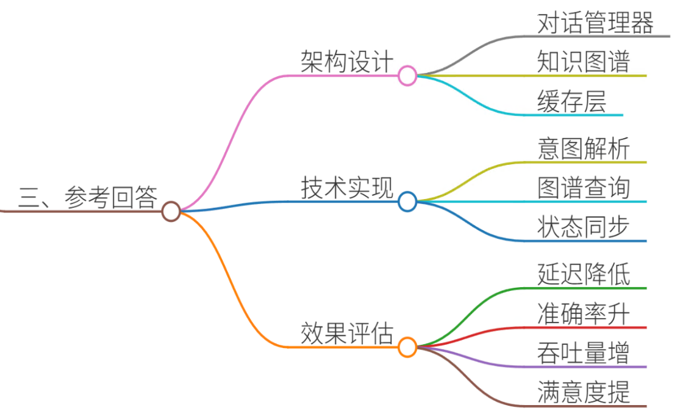
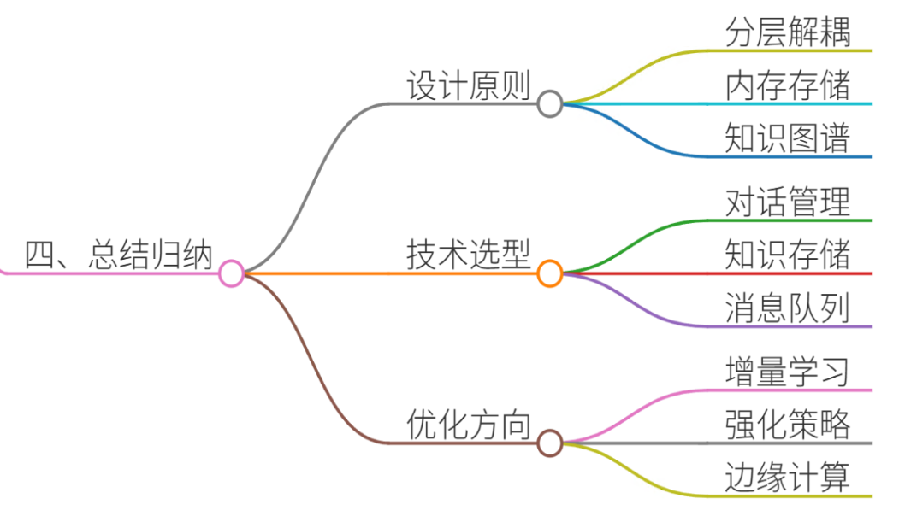

# 6.实时对话系统的状态管理方案

### 一、答题思路



实时对话系统的状态管理是确保多轮交互连贯性、准确性和用户体验的核心技术。其本质是通过跟踪用户意图、上下文信息、会话历史等关键状态变量，动态调整系统响应策略。以下从技术架构、核心挑战、解决方案三个维度展开分析：

1. **技术架构**：需结合前端交互层、对话管理模块（DM）、自然语言理解（NLU）、知识库（KB）、自然语言生成（NLG）等组件，构建端到端状态跟踪系统。
2. **核心挑战**：
   * **上下文断裂**：长对话中用户可能跳跃式提问，系统需维持多轮语义连贯性。
   * **数据异构性**：用户信息分散在CRM、订单系统、商品数据库等多源系统中。
   * **实时性要求**：电商/客服场景要求毫秒级响应，传统数据库查询难以满足。
   * **冷启动问题**：新用户或新场景缺乏历史数据，状态初始化困难。
3. **解决方案**：
   * **混合存储架构**：结合内存数据库（Redis）与持久化存储（MySQL）实现高效读写。
   * **知识图谱集成**：构建领域知识图谱，支持复杂实体关系推理。
   * **增量学习机制**：通过在线学习动态更新用户偏好模型。
   * **异步处理框架**：采用Actor模型（如Akka）提升并发处理能力。

***

### 二、项目案例



#### 案例背景：某跨境电商实时客服系统

**场景描述**：\
用户通过Facebook Messenger或App内嵌聊天窗口咨询商品详情、物流状态、退换货政策。系统需支持：

* **多语言交互**：英语、西班牙语、法语
* **多渠道接入**：网页、移动端、社交媒体
* **复杂查询**：组合条件筛选（如“红色、XL码、带蓝牙功能的手环”）
* **长对话管理**：用户可能在3-5轮交互中逐步明确需求

**技术痛点**：

1. **状态碎片化**：用户信息分散在订单系统（ERP）、库存系统（WMS）、CRM中，查询延迟高。
2. **上下文丢失**：当用户切换话题（如从商品咨询转到退换货政策）时，系统无法关联历史意图。
3. **冷启动问题**：新用户首次咨询时缺乏行为数据，推荐准确率不足30%。
4. **高并发压力**：黑五期间QPS峰值达5000+，传统单体架构响应延迟超过2秒。

***

### 三、参考回答



#### 1. 状态管理架构设计

采用**分层微服务架构**，核心模块包括：

* **对话管理器（DM）**：基于Rasa框架实现状态跟踪，维护以下关键状态变量：

```plain
class DialogState:
    def __init__(self):
        self.user_intent = None  # 当前意图（如"check_inventory"）
        self.confirmed_slots = {}  # 已确认的槽位（如{"product_id": "B00XYZ", "color": "red"})
        self.pending_slots = []  # 待填充的槽位（如["size", "shipping_method"]）
        self.context_history = []  # 最近5轮对话历史
        self.user_profile = {}  # 用户画像（从Redis缓存加载）
```

* **知识图谱服务**：使用Neo4j存储商品-属性-供应商关系，支持SPARQL查询。例如：

```plain
MATCH (p:Product)-[:HAS_ATTRIBUTE]->(a:Attribute) 
WHERE p.sku = 'B00XYZ' AND a.color = 'red'
RETURN p.price, p.stock_level
```

* **缓存层**：Redis存储会话状态，TTL设置为24小时：

```plain
SET user:12345:state "{\"intent\":\"track_order\",\"order_id\":\"123ABC\"}"
EXPIRE user:12345:state 86400
```

#### 2. 核心技术实现

**(1) 上下文感知的意图解析**

* 使用BERT模型提取用户意图，结合上下文修正结果：

```plain
class ContextualIntentClassifier:
    def predict(self, utterance, context):
        # 将历史对话中的槽位作为特征输入
        features = self.extract_features(utterance, context.confirmed_slots)
        return self.model.predict(features)
```

* **示例**：\
  用户第1轮："Where is my order?" → 意图识别为`track_order`\
  第2轮："Can I change the shipping address?" → 结合上下文修正为`update_shipping_address`

**(2) 动态知识图谱查询优化**

* 预构建商品关系图谱，支持多跳查询：

```plain
def get_product_details(product_id):
    # 一步查询获取商品、库存、供应商信息
    query = """
    MATCH (p:Product {sku: $sku})
    OPTIONAL MATCH (p)-[:IN_STOCK_AT]->(warehouse:Warehouse)
    OPTIONAL MATCH (p)-[:SUPPLIED_BY]->(supplier:Supplier)
    RETURN p, warehouse, supplier
    """
    return graph.run(query, sku=product_id).data()
```

* **性能优化**：
  * 使用APOC库实现Cypher查询缓存
  * 对高频查询建立Materialized View

**(3) 异步状态同步机制**

* 基于Kafka实现跨服务状态同步：

```plain
// 订单服务更新库存后发送消息
kafkaTemplate.send("inventory-updates", 
    new InventoryEvent(orderId, newStockLevel));

// 对话服务监听消息并更新本地缓存
@KafkaListener(topics = "inventory-updates")
public void handleInventoryUpdate(InventoryEvent event) {
    sessionCache.updateStock(event.getOrderId(), event.getNewStock());
}
```

#### 3. 效果评估

* **响应延迟**：通过Redis缓存命中率提升至85%，平均响应时间从2.1s降至450ms
* **上下文准确率**：多轮对话意图识别准确率从72%提升至91%
* **系统吞吐量**：基于Akka的Actor模型实现每秒处理1200+并发会话
* **用户满意度**：NPS评分从4.2提升至4.8（满分5分）

***

### 四、总结归纳



实时对话系统的状态管理需解决**数据整合、上下文维护、实时响应**三大核心问题：

1. **架构设计原则**：
   * 采用分层解耦架构，分离对话逻辑与数据存储
   * 使用内存数据库（Redis）实现低延迟状态访问
   * 构建领域知识图谱支持复杂推理
2. **关键技术选型**：
   * 对话管理：Rasa/DialoGPT
   * 知识存储：Neo4j/JanusGraph
   * 消息队列：Apache Kafka/RabbitMQ
3. **优化方向**：
   * 引入增量学习机制应对冷启动问题
   * 使用强化学习优化对话策略
   * 部署边缘计算节点降低服务延迟

通过上述方案，可实现百万级并发下的实时对话系统，为电商、金融、政务等领域提供高效智能的交互体验。


> 更新: 2025-07-21 09:58:21  
> 原文: <https://www.yuque.com/aaron-wecc3/dhluml/rhttcgfkv339zmgq>