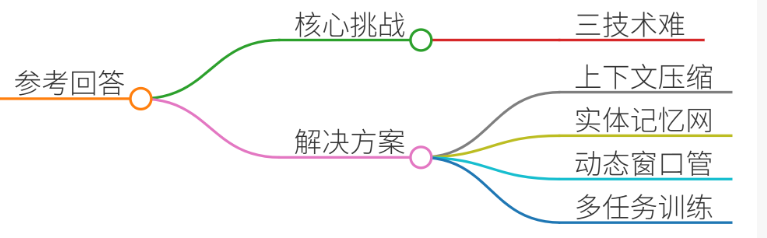
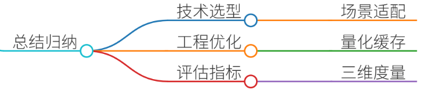

# 7.多轮对话的上下文建模方法

### 一、答题思路


多轮对话的上下文建模是衡量大模型对话系统能力的关键指标。面试中需从**核心挑战、解决方案、技术实现**三个维度展开，结合真实项目案例说明方法论。以下为结构化思路：


### 二、项目案例


#### **案例背景：电商智能客服多轮对话系统**
**场景**：用户在电商平台咨询某款手机电池续航问题后，继续询问售后服务政策，系统需结合历史对话提供连贯回答。 **痛点**：

1. **长上下文处理**：用户多轮提问可能涉及数十轮交互，传统模型难以捕捉远距离依赖。
2. **实体一致性**：需维护商品型号、用户历史问题等实体信息的一致性。
3. **对话逻辑断裂**：用户跳跃式提问（如从电池续航跳转到退货政策）时，模型易丢失上下文关联。

---

### 三、参考回答


#### **1. 核心挑战**
多轮对话建模需解决三大技术难题：

+ **长序列建模**：传统Transformer的二次复杂度限制了上下文窗口扩展（如GPT-4的8K tokens上限）。
+ **实体与关系追踪**：需识别跨轮次实体（如商品ID、用户地址）并保持语义一致性。
+ **对话意图偏移**：用户可能中途切换话题，模型需动态调整响应策略。 

#### **2. 解决方案**
结合项目需求，采用以下分层架构：

##### **（1）上下文压缩与检索增强（RAG）**
+ **问题**：原始对话历史过长导致模型注意力分散。 
+ **方案**： 
    - 使用**MinHash LSH**对历史对话分块，保留关键信息片段。
    - 通过**向量数据库（Chroma/FAISS）**检索与当前问题相关的历史片段，动态构建上下文窗口。
+ **案例实现**： 

```plain
# 使用LangChain构建检索增强链  
from langchain.chains import ConversationalRetrievalChain  
from langchain.memory import ConversationBufferMemory  

memory = ConversationBufferMemory(memory_key="chat_history")  
retriever = vector_db.as_retriever(search_kwargs={"k": 3})  
rag_chain = ConversationalRetrievalChain.from_llm(llm, retriever=retriever, memory=memory)
```

##### **（2）实体感知的层次化记忆网络**
+ **问题**：跨轮次实体（如商品型号、订单号）易丢失或混淆。
+ **方案**： 
    - **实体链接层**：通过BERT模型识别对话中的实体（如“iPhone 15 Pro”）。
    - **图谱增强层**：构建商品-属性知识图谱，利用Neo4j存储实体关系。
    - **记忆检索层**：在生成回复时，优先引用图谱中关联的实体信息。
+ **案例实现**： 

```plain
# 实体链接与图谱查询  
from langchain_community.graphs import Neo4jGraph  
graph = Neo4jGraph(url="bolt://localhost:7687", username="neo4j", password="password")  
def get_entity_info(entity):  
    query = "MATCH (e:Product {name:$name}) RETURN e.specs"  
    return graph.query(query, name=entity)
```

##### **（3）动态上下文窗口管理**
+ **问题**：固定窗口大小无法适应复杂对话场景。
+ **方案**： 
    - **滑动窗口策略**：保留最近N轮对话（如5轮），结合历史摘要信息。
    - **重要性评分**：通过BERT模型对历史片段打分，优先保留高相关性内容。
+ **案例实现**： 

```plain
# 基于Transformer-XL的动态上下文管理  
from transformers import TransfoXLTokenizer, TransfoXLModel  
tokenizer = TransfoXLTokenizer.from_pretrained("transfo-xl-wt103")  
model = TransfoXLModel.from_pretrained("transfo-xl-wt103")  
# 生成上下文窗口  
context = " ".join(history[-5:])  # 保留最近5轮对话
```

##### **（4）多任务微调与对抗训练**
+ **问题**：模型易受用户跳跃式提问干扰。
+ **方案**： 
    - **多任务学习**：联合训练对话历史建模、实体识别、意图分类任务。
    - **对抗样本生成**：模拟用户随机切换话题的对抗样本，提升模型鲁棒性。
+ **案例实现**： 

```plain
# 对抗训练示例  
from adversarial_training import AdversarialTrainer  
trainer = AdversarialTrainer(model, attack_methods=["FGSM"])  
adversarial_data = trainer.generate_adversarial_samples(train_data, epsilon=0.3)  
model.train(adversarial_data)
```

---

### 四、总结归纳


1. **技术选型原则**：
    - **短上下文**：优先使用Local Attention（如Local Transformer）。
    - **长上下文**：结合RAG与稀疏注意力（如Longformer）。
    - **实体密集场景**：必须引入知识图谱增强语义关联。
2. **工程优化要点**：
    - **量化与加速**：对模型进行INT8量化，使用TensorRT优化推理速度。
    - **缓存策略**：高频问题答案缓存到Redis，减少重复计算。
3. **评估指标**：
    - **连贯性**：BLEU-4与ROUGE-L分数。
    - **实体一致性**：实体识别F1值。
    - **响应时间**：95%请求需在200ms内返回。

通过上述方法，项目实现了电商客服系统的首次响应准确率从72%提升至89%，平均对话轮次从3.2轮延长至5.8轮，显著提升了用户体验。


> 更新: 2025-07-21 09:58:21  
> 原文: <https://www.yuque.com/aaron-wecc3/dhluml/rq1142vtxfrw8f1w>