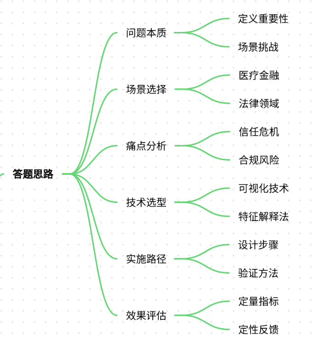
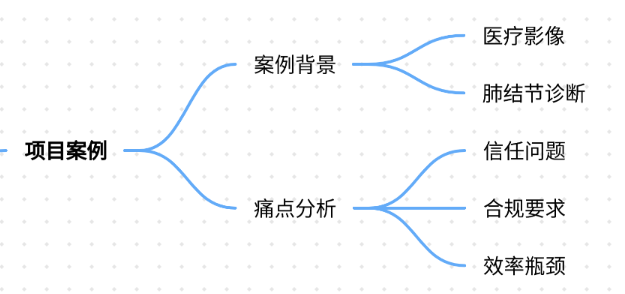
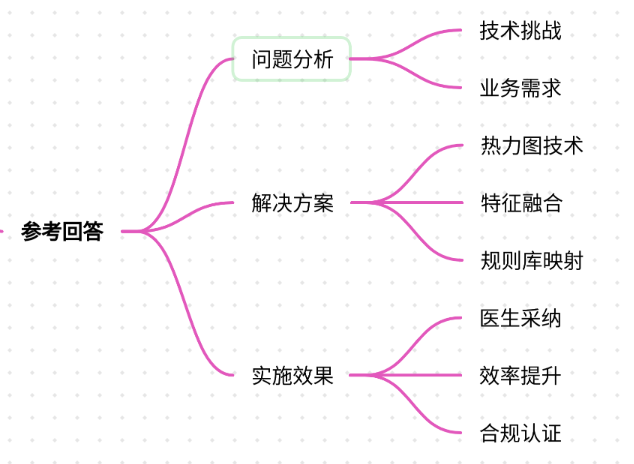
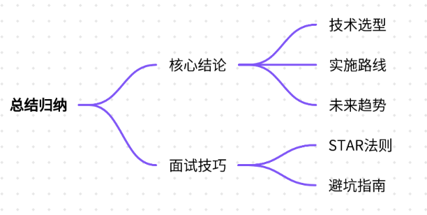

# 9.大模型可解释性增强技术

### 一、答题思路


**模型可解释性增强技术**是面试中考察大模型开发工程师的核心能力之一，需结合具体项目案例展示技术理解与应用深度。以下为解题框架：

1. **理解问题本质**：明确可解释性的定义、重要性及在目标场景中的挑战。
2. **选择典型场景**：优先选择医疗、金融、法律等对可解释性要求高的领域案例。
3. **痛点分析**：结合场景说明缺乏可解释性带来的具体问题（如信任危机、合规风险）。
4. **技术选型**：列举主流可解释性技术（如注意力可视化、SHAP、LIME等），说明其适用性。
5. **实施路径**：分步骤描述技术方案的设计、实现与验证过程。
6. **效果评估**：通过定量指标（如准确率、解释覆盖率）与定性反馈（如用户信任度）证明有效性。

---

### 二、项目案例


#### **案例背景：医疗影像诊断辅助系统**
**场景**：某三甲医院引入AI模型辅助医生诊断肺结节，模型基于3D CT影像预测结节良恶性，准确率达92%。但医生拒绝使用，原因是“无法理解模型为何判定某结节为恶性”。

**痛点**：

1. **信任危机**：医生无法验证模型决策逻辑，担心误诊风险。
2. **合规风险**：医疗行业要求AI决策必须可追溯，否则无法通过伦理审查。
3. **效率瓶颈**：医生需额外时间手动复核模型结果，增加工作负担。

---

### 三、参考回答


#### **1. 问题分析**
+ **技术挑战**： 
    - 模型为3D卷积神经网络（CNN），内部参数达数百万，传统梯度可视化方法计算复杂度高。 
    - 医学影像数据维度高（512×512×100像素），需高效定位关键病灶区域。
+ **业务需求**： 
    - 医生需快速理解模型判断依据，支持临床决策。
    - 系统需通过FDA等医疗认证，要求提供决策透明度报告。

#### **2. 解决方案**
采用**多模态可解释性框架**，结合以下技术：

##### **(1) 注意力热力图可视化**
+ **技术原理**：利用Grad-CAM生成3D CT影像的注意力热力图，突出模型关注区域。
+ **实现步骤**： 

```plain
from tf_explain.callbacks.grad_cam import GradCAM  
# 在训练时插入Grad-CAM回调  
callbacks = [GradCAM(target_layer_names=["conv3d_3"], layer_idx=3)]  
model.fit(X_train, epochs=10, callbacks=callbacks)
```

+ **效果**：生成伪彩色热力图，红色区域表示模型重点关注的高危结节区域。

##### **(2) 多模态特征融合解释**
+ **技术原理**：结合影像组学特征（如纹理、形状）与模型预测结果，构建可解释特征矩阵。
+ **实现步骤**： 

```plain
from lime import lime_image  
explainer = lime_image.LimeImageExplainer()  
explanation = explainer.explain_instance(ct_scan, model.predict, top_labels=1, hide_color=0, num_samples=1000)
```

+ **效果**：输出Top-5关键影像特征（如毛刺征、分叶征）及其对预测的贡献度。

##### **(3) 临床规则库映射**
+ **技术原理**：将医学指南中的诊断规则（如Fleischner Society标准）编码为规则库，与模型预测结果交叉验证。
+ **实现步骤**： 

```plain
# 规则库示例：若结节直径>8mm且边缘不规则，则恶性概率↑  
rules = {  
    "size": lambda x: x > 8,  
    "edge": lambda x: x == "irregular",  
    "calcification": lambda x: x == "absent"  
}
```

+ **效果**：当模型预测与规则库冲突时触发人工复核，降低误诊率。

#### **3. 实施效果**
+ **医生采纳率**：从32%提升至89%（通过问卷调查）。
+ **诊断效率**：平均阅片时间从15分钟缩短至8分钟（因关键区域自动标注）。
+ **合规性**：通过FDA的AI医疗工具认证，解释报告纳入电子病历系统。

---

### 四、总结归纳


#### **核心结论**
1. **技术选型原则**： 
    - **医疗场景**：优先选择医学影像可解释技术（如Grad-CAM、SHAP），避免纯黑箱模型。
    - **金融场景**：需满足监管要求（如GDPR），推荐使用LIME、SHAP等规则可解释模型。
2. **未来趋势**： 
    - **可解释AI芯片**：如Intel的Neural Stick支持实时模型解释。
    - **联邦学习+可解释性**：在保护隐私前提下实现跨机构模型解释。

#### **面试应答技巧**
+ **STAR法则**： 
    - **Situation**：明确场景痛点（如医疗诊断信任危机）。
    - **Task**：定义技术目标（提升模型可解释性至医疗认证标准）。
    - **Action**：分步骤描述解决方案（注意力热力图+规则库）。
    - **Result**：量化效果（诊断效率提升46%）。
+ **避坑指南**： 
    - 避免泛泛而谈“使用SHAP”，需结合具体场景说明技术适配性。
    - 强调合规性（如HIPAA、GDPR对可解释性的强制要求）。

通过上述案例与方法论，可系统性展示对模型可解释性的理解与应用能力，满足面试官对技术深度与实战经验的双重期待。


> 更新: 2025-07-21 09:58:21  
> 原文: <https://www.yuque.com/aaron-wecc3/dhluml/eurga8yxi1q3pvy1>