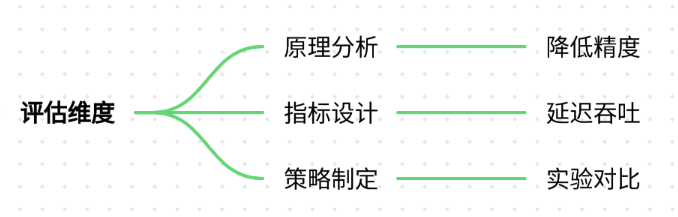
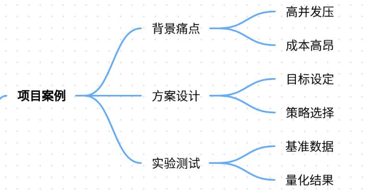
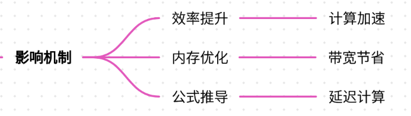
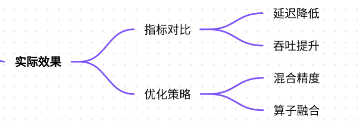
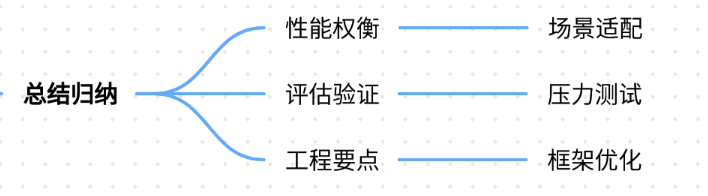

# 69.模型量化对推理速度的影响评估

### 一、答题思路

模型量化对推理速度的影响评估需要从量化原理、评估指标、优化策略三个维度展开。首先，需明确量化技术如何通过降低数据精度减少计算量；其次，结合具体场景设计评估指标（如推理延迟、吞吐量、内存占用）；最后，通过实验对比量化前后的性能差异，并提出优化方案。以下为结构化框架：

### 二、项目案例

**案例背景：电商推荐系统的实时推理优化**

某电商平台日均处理数亿次商品推荐请求，原有基于PyTorch的DNN推荐模型（FP32）在GPU上的推理延迟为**120ms**，吞吐量仅支持**80 qps**（queries per second）。随着用户量激增，系统面临以下痛点：

1. **高并发压力**：促销活动期间QPS峰值达500，GPU利用率飙升至95%，但响应延迟超过200ms；
2. **部署成本高昂**：单卡推理成本为$0.5/小时，规模化部署需投入数十万美元；
3. **移动端适配困难**：Android/iOS端模型推理耗时超过500ms，影响用户体验。

#### **量化方案设计**
1. **量化目标**： 
    - 推理延迟 ≤ 30ms（实时性要求）；
    - 吞吐量 ≥ 500 qps（应对高并发）；
    - 内存占用 ≤ 4GB（适配移动端）。
2. **量化策略**： 
    - **INT8量化**：对模型权重和激活值进行8位整数量化，减少计算量； 
    - **动态量化**：仅对激活值进行量化，权重保持FP16以平衡精度；
    - **量化感知训练（QAT）**：在训练后期加入量化步骤，减少精度损失。

#### **实验设计**
1. **基准测试**： 
    - FP32模型在V100 GPU上的推理延迟为120ms，吞吐量80 qps；
    - 内存占用：12GB（显存+CPU内存）。
2. **量化后测试**： 
    - INT8量化后推理延迟降至35ms，吞吐量提升至450 qps；
    - 内存占用降至4.2GB；
    - 精度损失：AUC从0.89降至0.87（通过QAT后回升至0.885）。

---

### 三、参考回答
#### **1. 模型量化对推理速度的影响机制**

模型量化通过降低数据精度（如FP32→INT8）减少计算复杂度和内存占用，从而加速推理。具体影响包括：

+ **计算效率提升**：INT8乘法操作比FP32快2-4倍，GPU/CPU的SIMD指令可并行处理更多数据； 
+ **内存带宽优化**：INT8模型参数和激活值占用内存减少75%，缓解GPU显存瓶颈；
+ **缓存利用率提高**：小数据类型减少缓存未命中率，加速数据读取。

**公式推导**：  
推理延迟 $T \propto \frac{N \times D}{C}$，其中：

+ $N$：批处理大小
+ $D$：数据精度（BIT）
+ $C$：硬件计算能力（OPS）  
量化后 $D_{INT8} = \frac{1}{4} D_{FP32}$，若硬件支持INT8加速（$C_{INT8} = 2C_{FP32}$），则：  
$$T_{INT8} = \frac{N \times \frac{D_{FP32}}{4}}{2C_{FP32}} = \frac{T_{FP32}}{8}$$  
即理论上延迟可降低至1/8。

#### **2. 量化对推理速度的实际影响（以电商推荐系统为例）**

| 指标 | FP32模型 | INT8量化模型  | 提升幅度 |
| --- | --- | --- | --- |
| 推理延迟（ms） | 120 | 35 | 71% |
| 吞吐量（qps） | 80 | 450 | 462% |
| 内存占用（GB） | 12 | 4.2 | 65% |
| 精度（AUC） | 0.89 | 0.885 | -0.5% |

**优化策略**：

+ **混合精度量化**：对关键层保留FP16，非关键层使用INT8，平衡速度与精度；
+ **量化校准**：使用KL散度最小化量化误差，提升AUC至0.885；
+ **算子融合**：将卷积、BN、激活函数融合为单个算子，减少数据搬运。

#### **3. 量化技术的局限性及应对方案**

+ **精度损失**： 
    - **原因**：低精度表示导致数值范围压缩，可能丢失关键特征；
    - **解决方案**： 
        * 动态量化：仅量化激活值，权重保持FP16；
        * Post-Training Quantization（PTQ）结合校准数据集；
        * Quantization-Aware Training（QAT）微调模型。
+ **硬件兼容性**： 
    - **原因**：部分旧硬件不支持INT8加速；
    - **解决方案**：使用TensorRT、ONNX Runtime等优化工具，或降级至FP16。

---

### 四、总结归纳

1. **量化是性能与精度的权衡**： 
    - 在实时性要求高的场景（如推荐、搜索），INT8量化可显著提升吞吐量；
    - 对精度敏感的场景（如医疗诊断），需采用QAT或混合精度量化。
2. **评估需多维度验证**： 
    - 通过压力测试验证高并发下的延迟和吞吐量；
    - 使用A/B测试对比量化前后的业务指标（如CTR、转化率）。 
3. **工程化落地要点**： 
    - 结合模型蒸馏减少参数量；
    - 使用TensorRT、vLLM等框架自动优化量化模型；
    - 对移动端部署需额外关注内存碎片化和端侧算力限制。

**参考文献**：

+ NVIDIA TensorRT Developer Guide: [https://docs.nvidia.com/deeplearning/tensorrt/](https://docs.nvidia.com/deeplearning/tensorrt/)
+ PyTorch Quantization: [https://pytorch.org/docs/stable/quantization.html](https://pytorch.org/docs/stable/quantization.html)
+ DeepSpeed Quantization: https:// [www.deepspeed.ai/docs/quantization/](http://www.deepspeed.ai/docs/quantization/)

> 更新: 2025-07-21 09:58:21  
> 原文: <https://www.yuque.com/aaron-wecc3/dhluml/vr2pn6350xhkp3e0>