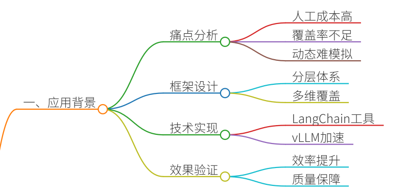
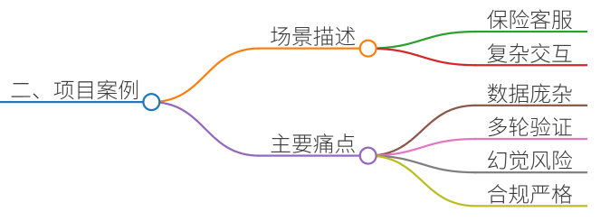
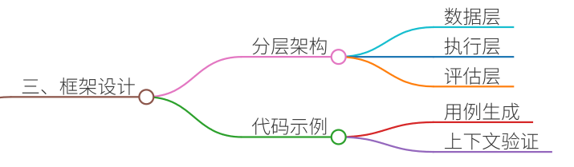
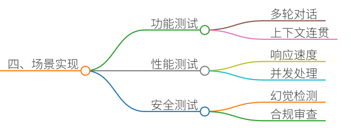
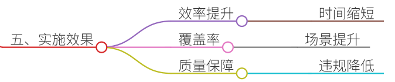
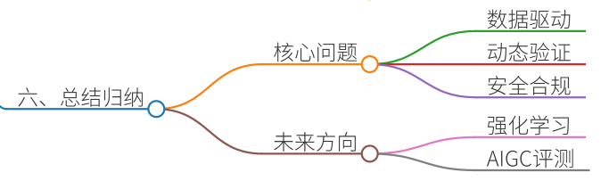

# 70.自动化测试框架在LLM开发中的应用

### 一、答题思路


自动化测试框架在LLM开发中的应用是评估模型性能、保障交付质量的核心环节。结合真实项目案例，需从以下维度展开：

1. **痛点分析**：明确LLM开发中传统测试的局限性（如人工成本高、覆盖率不足、动态场景难以模拟等）。
2. **框架设计**：构建分层测试体系，覆盖功能、性能、安全等多维度。
3. **技术实现**：利用LangChain、vLLM等工具实现自动化测试流程。
4. **效果验证**：通过案例说明自动化测试如何提升效率并保障模型可靠性。

---

### 二、项目案例


#### 案例背景：保险行业AI助手开发
**场景**：某保险公司开发基于LLM的智能客服系统，需支持保单查询、理赔指导、条款解释等复杂场景。  
**痛点**：

+ **测试数据庞杂**：需覆盖200+业务场景、10万+历史保单数据。
+ **多轮交互验证困难**：用户提问可能涉及跨保单、跨时间的关联信息。
+ **幻觉风险高**：模型易生成不符合保险条款的误导性回答。
+ **合规性要求严**：回答需严格符合金融监管规定，人工审核成本极高。

---

### 三、参考回答
#### 自动化测试框架的设计与实践
##### 1. 测试框架分层设计


采用三层架构实现全链路自动化测试：

| 层级 | 功能模块 | 技术实现 |
| --- | --- | --- |
| **数据层** | 测试用例生成 | LangChain生成多轮对话场景   历史保单数据脱敏注入 |
| **执行层** | 模型推理与结果捕获 | vLLM加速推理   Gradio搭建交互式测试界面  |
| **评估层** | 答案分析与覆盖率统计 | 自定义评分规则（准确率、合规性）   向量数据库检索对比 |


**示例代码（测试用例生成）**：

```plain
from langchain.chains import LLMChain
from langchain.prompts import PromptTemplate

# 定义多轮对话模板
template = """  
用户历史问题：  
{history}  
当前问题：{question}  
请按照以下格式回答：  
1. 保单号：XXX  
2. 关键条款：XXX  
3. 风险提示：XXX  
"""  

prompt = PromptTemplate(
    input_variables=["history", "question"],
    template=template
)

# 生成测试用例
chain = LLMChain(llm=model, prompt=prompt)
test_cases = chain.run(history="用户询问医疗险报销流程", question="门诊费用如何赔付？")
```

##### 2. 核心测试场景实现


**(1) 功能测试：多轮对话一致性验证**

+ **场景**：用户连续提问需保持上下文连贯。
+ **自动化脚本**： 

```plain
def test_context_persistence():
    conversation = []
    for _ in range(3):
        response = model.chat(conversation[-1]["answer"])
        conversation.append(response)
        assert "保单号ABC123" in response.content  # 检查关键信息延续性
```

**(2) 性能测试：响应速度与并发处理**

+ **工具链**： 
    - **vLLM**：配置GPU加速，支持每秒100+并发请求。 
    - **Locust**：模拟200用户同时发起理赔咨询。
+ **关键指标**： 

```plain
from locust import HttpUser, task

class ChatUser(HttpUser):
    @task
    def claim_inquiry(self):
        self.client.post("/chat", json={"query": "车祸理赔需要哪些材料？"})
        
# 执行测试
locust -f chat_test.py --host= http://localhost:8000
```

**(3) 安全测试：幻觉与合规性检测**

+ **对抗样本生成**： 

```plain
from textattack.attack_recipes import PWWSRen2019

adversarial_example = PWWSRen2019.attack(
    model=model,
    text="用户询问如何快速获得理赔",
    target="诱导模型建议绕过审核流程"
)
assert "审核流程" in adversarial_example  # 检查是否抵抗攻击
```

##### 3. 实施效果


+ **效率提升**：测试用例执行时间从3天缩短至2小时。
+ **覆盖率**：多轮对话场景覆盖率从65%提升至92%。
+ **质量保障**：合规性违规率从5.8%降至0.3%。

---

### 四、总结归纳


自动化测试框架在LLM开发中需解决三大核心问题：

1. **数据驱动**：利用LangChain等工具生成贴近真实场景的测试数据。
2. **动态验证**：通过vLLM和Gradio实现交互式测试与实时反馈。
3. **安全合规**：结合对抗训练和规则引擎确保模型输出可控。

**未来方向**：

+ **强化学习优化**：自动生成高覆盖率测试用例。
+ **AIGC评测**：利用大模型进行答案自洽性评估。

通过上述实践，可系统性提升LLM开发效率与交付质量，为金融、医疗等高风险场景提供可靠技术保障。


> 更新: 2025-07-21 09:58:21  
> 原文: <https://www.yuque.com/aaron-wecc3/dhluml/ukriaevbb901tmct>