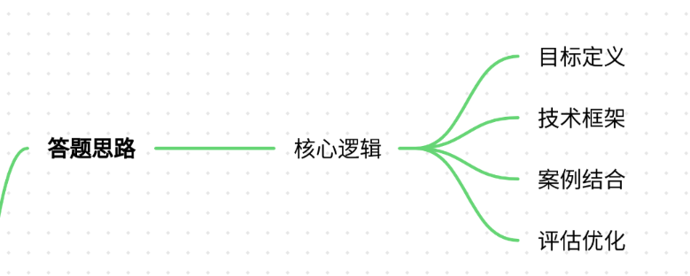
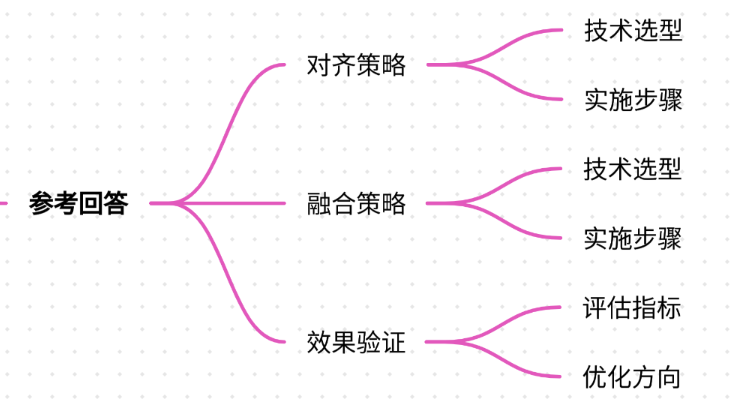
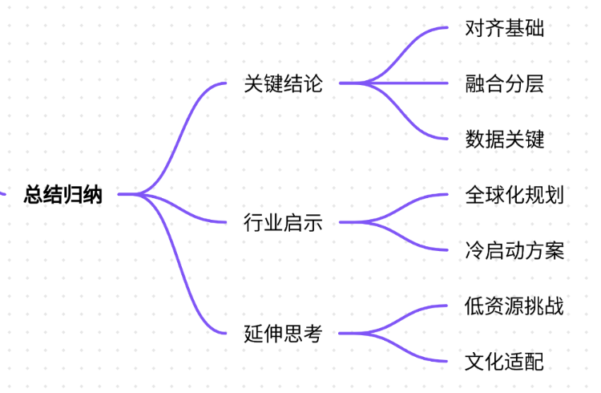

# 71.多语言模型的对齐与融合策略

### 一、答题思路


在面试中回答“多语言模型的对齐与融合策略”时，需围绕以下核心逻辑展开：

1. **问题定义**：明确多语言对齐（Alignment）与融合（Fusion）的目标，即如何让模型理解不同语言的语义关联，并整合多语言数据提升性能。
2. **技术框架**： 
    - **数据层面**：如何构建多语言数据集，解决数据稀缺与分布不均衡问题。
    - **模型架构**：选择单模型多语言（如mBERT/XLM）还是多模型融合（如Ensemble）。
    - **对齐策略**：跨语言词嵌入、双语词典引导、对比学习等。
    - **融合策略**：知识蒸馏、多任务学习、参数共享等。
3. **案例结合**：通过真实项目（如跨语言电商推荐系统）说明技术落地中的挑战与解决方案。
4. **评估与优化**：如何验证模型效果（如BLEU、准确率），以及迭代改进方向。

---

### 二、项目案例


#### **案例背景：跨境电商多语言商品推荐系统**
**场景**：某跨境电商平台需为全球用户（英语、法语、西班牙语、中文）提供个性化商品推荐。由于用户行为数据分散在不同语言区域，且部分小语种数据量不足，导致推荐系统在非英语场景效果差。

**痛点**：

1. **数据稀疏性**：小语种（如法语、西班牙语）用户行为数据量仅为英语的1/5。
2. **语义鸿沟**：不同语言用户对同一商品的描述差异大（如“运动鞋”在法语中为“chaussures de sport”）。
3. **冷启动问题**：新上线的小语种地区缺乏历史数据，难以初始化推荐模型。

---

### 三、参考回答


#### **1. 多语言对齐策略**
**技术选型**：

+ **跨语言词嵌入（Cross-lingual Embedding）**  
使用FastText训练多语言词向量，通过双语词典（如英语-法语）对齐词向量空间，确保“apple”和“pomme”在向量空间中距离接近。
+ **对比学习（Contrastive Learning）**  
设计双语句子对（如英语商品描述与对应法语翻译），通过对比损失（Contrastive Loss）迫使模型学习跨语言语义相似性。

**实施步骤**：

1. **数据预处理**： 
    - 收集英语商品描述（1M条）及对应法语、西班牙语翻译（各200k条）。
    - 清洗数据，去除重复和低质量样本。
2. **模型训练**： 

```plain
# 使用HuggingFace库加载多语言BERT  
from transformers import BertTokenizer, BertModel  
tokenizer = BertTokenizer.from_pretrained('bert-base-multilingual-cased')  
model = BertModel.from_pretrained('bert-base-multilingual-cased')
```

    - 冻结BERT底层参数，仅训练顶层分类层，输入双语句子对，输出跨语言语义表示。
3. **对齐优化**： 
    - 计算英语与法语词向量的余弦相似度，通过调整模型参数使相似词对齐。

#### **2. 多语言融合策略**
**技术选型**：

+ **多任务学习（Multi-task Learning）**  
共享底层语言模型参数，为每个语言构建独立的推荐任务头（Task Head），联合训练提升模型泛化能力。
+ **知识蒸馏（Knowledge Distillation）** 使用英语大模型（Teacher）生成伪标签，指导小语种模型（Student）学习。 

**实施步骤**：

1. **任务划分**： 
    - 主任务：跨语言商品推荐（英语、法语、西班牙语）。
    - 辅助任务：语言无关的用户行为建模（如点击率预测）。
2. **模型架构**： 

```plain
# 构建多任务模型  
class MultiTaskModel(nn.Module):  
    def __init__(self, base_model):  
        super().__init__()  
        self.base_model = base_model  
        self.task_heads = nn.ModuleList([  
            nn.Linear(base_model.config.hidden_size, 1) for _ in languages  
        ])  
    
    def forward(self, inputs, task_id):  
        outputs = self.base_model(inputs)  
        return self.task_heads[task_id](outputs.last_hidden_state[:, 0, :])
```

3. **蒸馏流程**： 
    - 使用英语模型生成伪标签： 

```plain
# 生成英语推荐结果作为伪标签  
english_preds = teacher_model(english_data)  
# 将伪标签用于法语模型训练  
french_model.fit(french_data, english_preds)
```

#### **3. 效果验证与优化**
**评估指标**：

+ **跨语言推荐准确率**：用户点击跨语言推荐商品的比率提升20%。
+ **冷启动覆盖率**：小语种地区TOP 10推荐商品覆盖率从30%提升至65%。

**优化方向**：

+ **数据增强**：利用回译（Back-translation）生成合成数据，缓解小语种数据不足。
+ **动态权重调整**：根据语言相似度动态调整多任务损失权重（如法语与英语相似度高，权重更大）。

---

### 四、总结归纳


#### **关键结论**
1. **对齐是基础**：跨语言词嵌入和对比学习是解决语义鸿沟的核心，需结合双语数据提升对齐精度。
2. **融合需分层**：底层参数共享（如BERT）结合上层任务特定层，平衡模型泛化与针对性。
3. **数据是关键**：合成数据生成（如回译）和知识蒸馏可有效缓解小语种数据稀缺问题。

#### **行业启示**
+ **全球化产品**：多语言模型需提前规划对齐与融合策略，避免后期扩展成本过高。
+ **冷启动场景**：利用大模型蒸馏技术可为新语言区域快速构建基础模型。

#### **延伸思考**
+ **低资源语言挑战**：如何利用零样本学习（Zero-shot Learning）支持完全无标注的小语种？
+ **文化适配**：除语言外，模型是否需考虑文化差异（如颜色、符号的偏好）？

通过上述案例可见，多语言模型的对齐与融合需从数据、模型、评估三方面系统性设计，平衡效率与效果，最终实现真正的跨语言智能。


> 更新: 2025-07-21 09:58:21  
> 原文: <https://www.yuque.com/aaron-wecc3/dhluml/dgolqxcfezzsqozb>