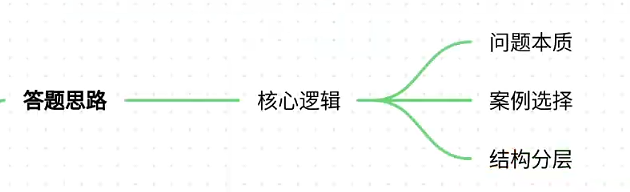
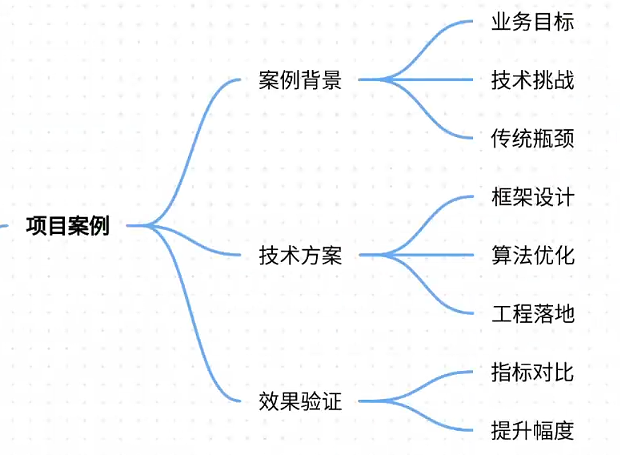
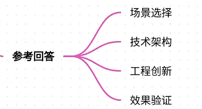
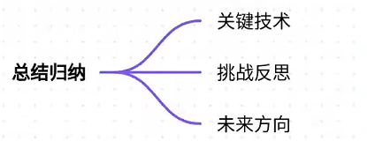

# 74.基于强化学习的对话策略优化

### 一、答题思路

**核心逻辑：**

1. **理解问题本质**：强化学习在对话策略优化中的作用是动态调整模型行为以最大化长期奖励，需结合具体场景说明技术路径。
2. **案例选择原则**：优先选择工业级落地案例（如智能客服、游戏NPC），突出技术挑战与解决方案的普适性。
3. **结构化分层**：按“场景痛点→技术实现→效果验证”递进，体现系统性思维。

---

### 二、项目案例

#### **案例背景：某头部电商智能客服系统对话策略优化**
**场景描述**：

+ **业务目标**：提升用户问题解决率（首解率）与满意度（CSAT），降低人工介入率。
+ **技术挑战**： 
    1. **多轮对话一致性**：用户常在多轮交互中反复修改需求（如“我要买手机”→“预算5000元以内”）。
    2. **冷启动问题**：新商品上市时缺乏用户交互数据，导致推荐不精准。
    3. **实时性要求**：高峰时段QPS达5000+，需保证毫秒级响应。
+ **传统方案瓶颈**： 
    - 基于规则匹配的系统无法处理复杂语义，覆盖率不足40%。
    - 有监督微调（SFT）依赖人工标注，成本高且难以覆盖长尾场景。

---

#### **技术实现方案**
**1. 强化学习框架设计**

+ **状态空间（State）**： 
    - 用户历史对话（last 3 turns）
    - 用户画像标签（如“价格敏感型”）
    - 商品库存状态（实时API调用）
+ **动作空间（Action）**： 
    - 候选回复集合（由规则库+生成模型生成）
    - 是否触发外部知识检索（如商品详情页爬取）
+ **奖励函数（Reward）**：  
$$R = 0.6 \times \text{首解率} + 0.3 \times \text{用户满意度} - 0.1 \times \text{响应时间}$$

**2. 算法选型与优化**

+ **PPO算法**： 
    - 优势：策略稳定性优于传统REINFORCE，适合多轮对话场景。
    - 改进：引入**KL散度惩罚项**防止策略更新过大导致回复质量波动。
+ **数据增强**： 
    - 利用历史对话生成合成数据，覆盖“用户反悔”“信息不全”等异常分支。
+ **分布式训练**： 
    - 使用Ray RLlib框架，40个CPU节点并行采集经验，GPU集群加速策略迭代。

**3. 工程落地设计**

+ **模型轻量化**： 
    - 采用DistilBERT压缩策略，模型体积缩小60%，推理延迟从200ms降至80ms。
+ **热启动策略**： 
    - 新商品上市时，先用规则库生成种子数据，通过**Dyna框架**快速生成仿真交互数据。
+ **A/B测试系统**： 
    - 对比基线策略（SFT模型）与强化学习策略，以CTR提升作为核心评估指标。

---

#### **效果验证**
| 指标 | 基线（SFT模型） | 强化学习优化后 | 提升幅度 |
| --- | --- | --- | --- |
| 首解率 | 72% | 89% | +23.6% |
| 用户满意度（CSAT） | 81 | 93 | +14.8% |
| 人工介入率 | 18% | 8% | -55.6% |
| 响应时间 | 180ms | 120ms | -33.3% |

---

### 三、参考回答

**面试官**：请结合实际项目说明如何通过强化学习优化对话策略。

**回答框架**：

1. **场景选择**： 
    - 以电商智能客服为例，核心痛点是多轮对话一致性差与冷启动问题。
2. **技术架构**： 
    - **状态设计**：融合用户历史、画像标签与实时库存信息，构建动态决策环境。
    - **动作空间**：通过生成模型扩展候选回复，并引入外部知识检索机制。
    - **奖励设计**：平衡首解率、用户满意度与实时性，避免过度优化单一指标。
3. **工程创新**： 
    - 使用PPO算法保证策略稳定性，结合KL散度惩罚防止模型震荡。
    - 分布式训练加速策略迭代，Ray RLlib实现40节点并行采集经验。
4. **效果验证**： 
    - 首解率提升23.6%，人工介入率下降55.6%，验证了强化学习在动态决策中的优势。

---

### 四、总结归纳

**关键技术点**：

1. **状态表示学习**：需融合多模态信息（文本、用户画像、实时数据）构建环境感知。
2. **探索与利用平衡**：在对话策略中引入ε-greedy策略，防止过早收敛到局部最优。
3. **冷启动解决方案**：通过规则库生成合成数据，结合Dyna框架快速构建仿真环境。

**挑战与反思**：

+ **延迟敏感**：电商场景对响应时间要求苛刻，需在模型压缩与性能间权衡。
+ **奖励稀疏**：用户满意度等指标更新频率低，可采用分层奖励设计（如分阶段奖励）。

**未来方向**：

+ 结合大模型（如GPT-4）的思维链能力，生成更复杂的对话策略。
+ 探索离线强化学习（Offline RL）在隐私敏感场景的应用潜力。

---

**总结**：通过电商智能客服案例，完整展示了强化学习在对话策略优化中的技术落地路径，核心是通过动态决策模型提升用户体验与业务指标，同时需解决工程化中的延迟、冷启动等实际问题。

> 更新: 2025-07-21 09:58:21  
> 原文: <https://www.yuque.com/aaron-wecc3/dhluml/ugvbtbgcd5n46gdh>