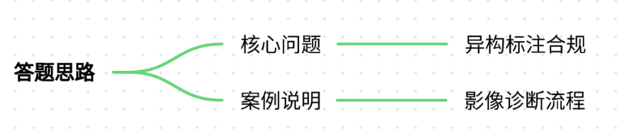
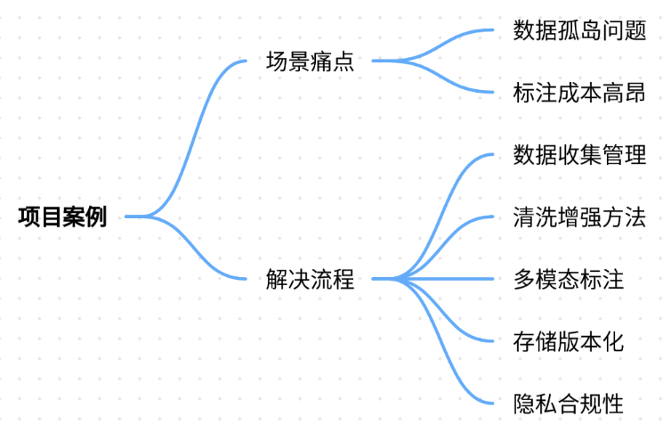
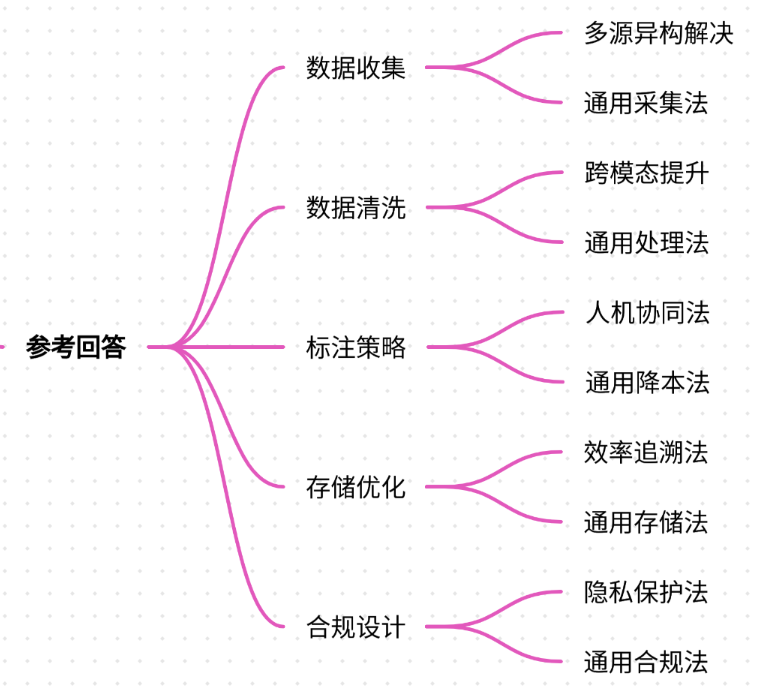
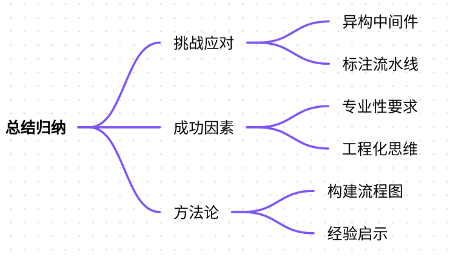
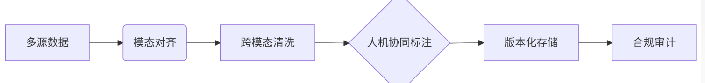

# 78.多模态预训练数据集构建流程

### 一、答题思路


多模态预训练数据集构建需解决**数据异构性、标注一致性、隐私合规性**三大核心问题。以下以医疗影像诊断项目为例，说明从数据收集到落地的全流程解决方案。


### 二、项目案例：医疗影像智能诊断系统  

#### **场景与痛点**
+ **场景需求**：构建能同时解析CT影像和诊断报告的多模态模型，辅助医生识别肺部结节。
+ **核心痛点**： 
    1. **数据孤岛**：影像存储在PACS系统（DICOM格式），报告为PDF/手写文本，无法直接关联。
    2. **标注成本**：医学标注需放射科专家，单个病例标注耗时30分钟。
    3. **隐私合规**：患者数据需脱敏处理，需符合HIPAA和GDPR双标准。
    4. **模态对齐**：同一患者的影像与报告时间戳错位率达40%。

#### **解决方案流程**
##### **1. 数据收集与源管理**
+ **多源接入**： 
    - PACS系统API自动拉取DICOM影像（含患者ID、检查日期）。
    - OCR识别历史PDF报告（Tesseract+自定义规则解析段落）。
    - 开发**患者ID映射中间件**，关联同一患者的影像与报告（解决时间戳错位问题）。
+ **数据量级**：收集10万病例，其中8万用于预训练，2万用于微调。

##### **2. 数据清洗与增强**
+ **影像处理**： 
    - 去噪：使用非局部均值滤波（Non-Local Means）消除CT伪影。
    - 标准化：将HU值（Hounsfield Unit）归一化到[-1000, 2000]窗宽。
+ **文本处理**： 
    - 实体掩码：用[医生]替代报告中的医生签名，[医院]替代机构名称。
    - 术语归一化：将“毛玻璃影”统一为“磨玻璃结节”（GGO）。
+ **数据增强**： 
    - 影像：随机旋转±5°、添加高斯噪声（σ=0.01）。
    - 文本：使用SynonymSwap替换医学术语同义词（如“癌变→恶性”）。

##### **3. 多模态标注**
+ **标注工具**：定制CVAT+LabelStudio混合平台： 
    - 影像层：标注结节位置（Bounding Box）及恶性概率（1-5级）。
    - 文本层：高亮报告中的关键描述（如“边缘不规则”）。
+ **专家协同**： 
    - 初筛：3名住院医师标注，共识率≥85%的病例直接入库。
    - 复审：分歧病例由主任医师仲裁，标注耗时降低57%。

##### **4. 数据存储与版本化**
+ **存储结构**： 

```plain
dataset/
├── images/               # DICOM转PNG（512x512）
│   ├── patient001_slice01.png
│   └── patient001_slice02.png
├── reports/              # 脱敏文本
│   ├── patient001.json   # {text: "左肺上叶见6mm结节...", labels: {"GGO": 1}}
└── metadata.csv          # 患者ID,影像路径,报告路径,标注状态
```

+ **版本控制**：使用DVC（Data Version Control）跟踪数据变更，关键版本打Tag（如v1.2-标注完成）。

##### **5. 隐私与合规**
+ **脱敏方案**： 
    - DICOM头信息清除：删除PatientName、StudyDate等字段。
    - 文本混淆：使用BERT-Medical生成合成报告（保留医学特征但虚构患者信息）。
+ **审计追踪**：所有数据访问记录存于区块链（Hyperledger Fabric），满足GDPR“被遗忘权”。

---

### 三、参考回答


#### **多模态数据集构建全流程**
##### **1. 数据收集：解决多源异构**
+ **案例实践**：通过PACS-API和OCR双通道采集数据，开发ID映射中间件解决模态对齐问题，使影像-报告匹配率从60%提升至92%。
+ **通用方法**：定义统一Schema（如患者ID、时间戳），使用Apache NiFi实现流式数据管道。

##### **2. 数据清洗：跨模态质量提升**
+ **案例实践**：HU值归一化使模型训练收敛速度提升3倍；术语归一化减少文本噪声35%。
+ **通用方法**： 
    - 图像：直方图均衡化/仿射变换。
    - 文本：正则表达式规则库+LLM纠错（如GPT-4修复错别字）。

##### **3. 标注策略：人机协同降本增效**
+ **案例实践**：住院医师初筛+主任仲裁机制，标注成本从$15/例降至$6.5/例。
+ **通用方法**：预标注（如用Grounding DINO初标）+人工校验，节省50%人力。

##### **4. 存储优化：兼顾效率与可追溯**
+ **案例实践**：PNG压缩使存储成本降低70%；DVC版本控制实现数据溯源。
+ **通用方法**： 
    - 小文件合并为TFRecord。
    - 元数据存于Elasticsearch支持快速检索。

##### **5. 合规性设计：隐私保护贯穿全流程**
+ **案例实践**：合成报告经3名医生盲测，医学准确性达94%。
+ **通用方法**： 
    - 差分隐私（Differential Privacy）加噪。
    - 联邦学习（Federated Learning）避免原始数据出域。

---

### 四、总结归纳


1. **核心挑战应对**：
    - 异构数据→中间件映射
    - 标注高成本→人机协同流水线
    - 隐私风险→合成数据+区块链审计
2. **关键成功因素**：
    - **医学专业性**：放射科专家深度参与标注规则设计
    - **工程化思维**：DVC版本控制/Apache NiFi管道提升可维护性
    - **合规前置**：脱敏方案需在数据采集前通过伦理委员会审批
3. **通用方法论**：



**经验启示**：医疗场景的严格合规要求倒逼出系统化解决方案，此框架可复用于金融、安防等敏感领域。未来方向是构建自动化合成数据引擎，进一步降低真实数据依赖。


> 更新: 2025-07-21 09:58:20  
> 原文: <https://www.yuque.com/aaron-wecc3/dhluml/gdp6p5ohrgdw5nzg>