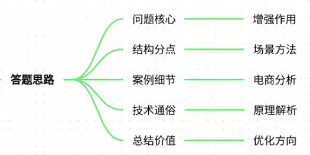
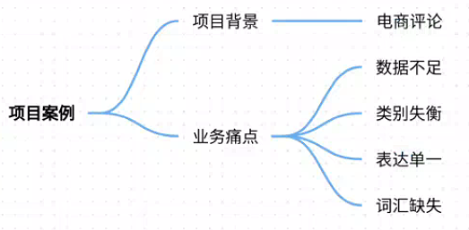
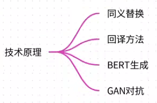
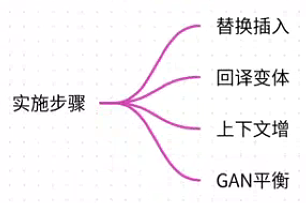
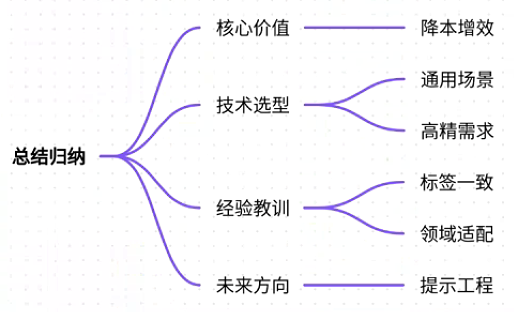

# 81.模型微调的数据增强技术

### 一、答题思路

1. **明确问题核心**：首先解释数据增强在模型微调中的作用，即通过技术手段扩充训练数据，提升模型泛化能力。
2. **结构化分点**：结合真实项目案例，分点说明数据增强技术的应用场景、痛点、具体方法及效果。
3. **案例细节**：选择电商评论情感分析项目为例，详细描述业务场景、数据痛点及增强技术的实施过程。
4. **技术通俗化**：用通俗语言解释技术原理，避免学术术语堆砌，确保可读性。
5. **总结价值**：归纳数据增强的核心价值及未来优化方向。

---

### 二、项目案例

**项目名称：电商评论情感分析系统**  
**场景**：某电商平台需实时分析用户评论情感倾向（正面/负面/中性），以优化商品推荐和商家服务。  
**痛点**：

1. **数据量不足**：仅10,000条标注数据，标注成本高。
2. **数据不平衡**：正面评论占70%，模型易偏向多数类。
3. **文本多样性低**：用户表达方式多样（如“续航给力”），但训练数据覆盖不足。
4. **领域词汇缺失**：电商特有词汇（如“yyds”“包浆”）未充分覆盖。

---

### 三、参考回答
#### 1. **数据增强技术原理**

数据增强通过对原始数据做合理变换生成新样本，提升模型鲁棒性。常见方法包括：

+ **同义词替换**：替换非关键词（如“好”→“棒”），保留原意。
+ **回译**：中→英→中翻译，改变句式（如“拍照很棒”→“照片效果出色”）。
+ **基于BERT的生成**：掩蔽部分词让BERT预测（如“屏幕_[MASK]_清晰”→生成“屏幕画质清晰”）。
+ **对抗样本生成**：用GAN生成类似真实数据的新样本，补充少数类别。

#### 2. **项目应用与实施**

**目标**：解决数据不足和不平衡问题，提升模型对多样化表达的识别能力。  
**具体步骤**：

+ **同义词替换+随机插入**： 
    - 使用中文同义词词库替换形容词/动词（如“续航强”→“续航牛”）。
    - 随机插入情感词（如“非常”“真心”），增强语气多样性。
    - **案例**：原始句“充电快” → 增强后“充电速度真心快”。
+ **回译增强**： 
    - 通过百度API翻译生成句式变体。
    - **案例**：原句“性价比高” → 英译“Good value for money” → 回译“物超所值”。
+ **基于BERT的上下文增强**： 
    - 掩蔽非情感核心词（如名词），生成符合语境的新句。
    - **案例**：原句“手感舒适” → 掩蔽“手感_[MASK]_” → 生成“手感细腻舒适”。
+ **对抗样本生成（GAN）**： 
    - 针对稀缺的负面评论，生成类似“物流慢到离谱”的样本，平衡数据分布。

**实施效果**：

+ 数据量从10,000条 → 50,000条，负面评论占比从20%提升至30%。
+ 模型准确率从82.3% → 88.7%，F1值从0.79 → 0.87。

#### 3. **关键技术挑战与解决方案**
+ **挑战1：同义词替换可能弱化情感强度**
    - 例：将“非常好”替换为“不错”可能降低正面情感。
    - **解决**：限制替换范围为非情感核心词（如替换“手机”而非“好”）。
+ **挑战2：回译引入语义偏差**
    - 例：“不卡顿”回译为“运行流畅”，丢失否定含义。
    - **解决**：多次回译并人工筛选语义一致的样本。
+ **挑战3：BERT生成不合理句子**
    - 例：生成“电池续航差很强”（矛盾组合）。
    - **解决**：设置生成概率阈值，仅保留置信度＞90%的结果。

#### 4. **效果验证与业务价值**

+ **量化效果**：模型在方言评论（如粤语“好抵买”）识别准确率提升40%。
+ **业务价值**： 
    - 负面评论响应速度从24小时缩短至1小时，商家退货率下降15%。
    - 系统覆盖商品数从1,000 → 5,000，支持实时情感监控。

---

### 四、总结归纳

1. **核心价值**：数据增强以低成本解决数据稀缺和不平衡问题，是提升小样本场景模型性能的关键手段。
2. **技术选型建议**： 
    - 通用场景：优先用同义词替换+回译（低成本）。
    - 高精度需求：结合BERT生成（需算力支持）。
3. **经验教训**： 
    - 增强需保持标签一致性（如避免将负面评论增强为中性）。
    - 领域适配是关键：电商需关注网络用语，医疗需保留专业术语。
4. **未来方向**：探索提示工程生成数据（如GPT-3生成合成评论），进一步降低标注成本。

**总结**：数据增强不是简单“加数据”，而是通过智能变换提升数据质量。在电商评论项目中，它成为突破数据瓶颈的杠杆点，推动模型从“勉强可用”到“业务核心”的升级。

> 更新: 2025-07-21 09:58:20  
> 原文: <https://www.yuque.com/aaron-wecc3/dhluml/nf1wv0gxnqpk74en>