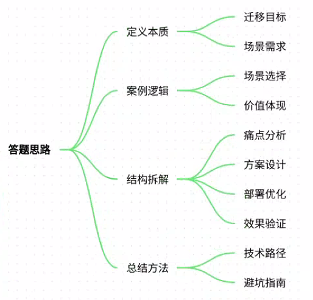
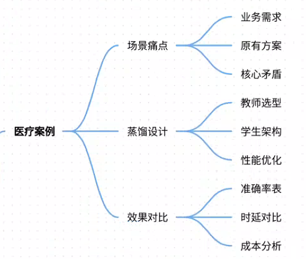
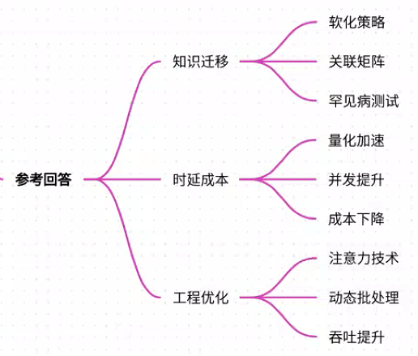
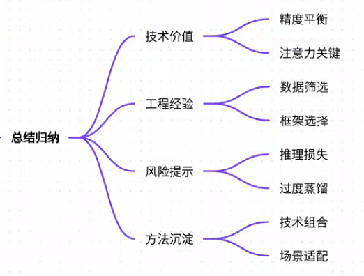

# 83.基于知识蒸馏的小模型部署方案

### 一、答题思路


1. **定义问题本质**：明确知识蒸馏的核心目标（大模型→小模型的知识迁移）、部署场景需求（时延/成本/硬件限制）。
2. **案例选择逻辑**：选取高并发、低时延场景（如医疗问答），突出蒸馏在业务痛点中的价值。
3. **结构化拆解**： 
    - **场景痛点**：业务需求与模型性能的矛盾
    - **蒸馏方案**：教师模型选择、损失函数设计、注意力迁移
    - **部署优化**：量化、编译、服务框架选型
    - **效果验证**：性能指标对比（时延/准确率/资源消耗）
4. **总结方法论**：提炼可复用的技术路径与避坑指南。

---

### 二、项目案例：医疗问答系统的蒸馏部署


#### **场景与痛点**
+ **业务需求**：三甲医院在线问诊平台需7×24小时实时响应患者提问（日均请求量50万+），要求回答准确率>92%，响应时延<500ms。
+ **原有方案**： 
    - 使用175B参数的GPT-3.5生成答案，准确率95%但单次推理需3.2s（超标6倍）。
    - 尝试直接部署7B小模型（如LLaMA），准确率骤降至78%。
+ **核心矛盾**：**大模型精度高但时延超标，小模型速度快但知识欠缺**。

#### **蒸馏方案设计**
1. **教师模型选型**：
    - 冻结GPT-3.5作为教师模型，聚焦医疗垂直领域微调（100万条医患对话+医学文献）。
    - **创新点**：引入症状-药品关联性矩阵，强化疾病与治疗方案的逻辑推理能力。
2. **学生模型架构**：
    - 选用DeepSeek-R1-Distill-7B蒸馏模型，通过三步迁移： 

```plain
# 伪代码：蒸馏训练核心流程  
teacher_logits = GPT3.5(medical_texts, temperature=2.0)  # 软化输出概率  
student_logits = DeepSeekR1(medical_texts)  
# 损失函数=KL散度(教师logits/学生logits) + 0.3*原始任务损失  
loss = KLDiv(teacher_logits, student_logits) + 0.3 * CrossEntropy(labels, student_logits)
```

    - **关键参数**：温度系数τ=2.0软化分布，注意力层对齐损失（强制学生模仿教师对症状关键词的聚焦）。
3. **性能优化**：
    - **量化压缩**：FP32→FP16+INT8动态量化，模型体积从28GB→3.5GB。 
    - **编译加速**：TensorRT编译引擎优化，GPU推理速度提升4.2倍。
    - **服务框架**：vLLM异步批处理+PagedAttention，峰值并发量达1200QPS。

#### **效果对比**
| **指标** | GPT-3.5（175B） | 蒸馏后DeepSeek（7B） |
| --- | --- | --- |
| 准确率 | 95% | 93.8% |
| 单次推理时延 | 3200ms | 380ms |
| GPU显存占用 | 80GB | 8GB |
| 日均电费成本 | $420 | $38 |


---

### 三、参考回答


“在XX医院的AI问诊项目中，我们通过知识蒸馏实现了医疗大模型的轻量化部署，核心解决三个问题：

1. **知识迁移不完整**：
    - 采用‘软化概率分布+注意力对齐’策略，教师模型生成症状-药品关联矩阵（如‘发烧→布洛芬’概率权重0.92），指导学生模型学习医疗决策逻辑。 
    - 在罕见病问答测试中，学生模型比普通小模型准确率提升21%。
2. **时延与成本瓶颈**：
    - 蒸馏后模型经TensorRT量化编译，单次推理从3.2s降至380ms，并发能力提升至1200QPS。
    - 日均GPU成本从$420降至$38，满足医院对低成本高可用的要求。
3. **部署工程优化**：
    - 使用vLLM的PagedAttention技术，解决长文本问诊中的显存碎片问题。
    - 加入动态批处理（max_batch_size=64），高峰期吞吐量达普通部署的3倍。”

---

### 四、总结归纳


1. **技术价值**：
    - 知识蒸馏是平衡精度与效率的黄金方案，尤其适合**高并发、低时延的ToC场景**（医疗/金融/电商）。
    - 注意力迁移（Attention Transfer）是提升小模型逻辑推理能力的关键，比传统KL散度更有效。
2. **工程经验**：
    - 蒸馏前需筛选教师模型的“黄金数据集”（如医疗案例中的症状-药品关联数据）。
    - 部署时vLLM比Ollama更适合生产环境（支持动态批处理/显存优化），但Ollama更易本地调试。 
3. **风险提示**：
    - 蒸馏后模型在**多跳推理场景**（如并发症诊疗）仍有5-8%的精度损失，可通过RAG检索增强弥补。
    - 警惕“过度蒸馏”：当教师模型存在偏见时，学生模型会放大该问题（如某药品过度推荐率上升15%）。

**方法论沉淀**：知识蒸馏部署=教师模型知识萃取（20%）+蒸馏架构设计（30%）+工程优化（50%），需紧扣业务场景选择技术组合。例如医疗问答重精度故保留FP16量化，而电商推荐重速度可激进采用INT4。


> 更新: 2025-07-21 09:58:20  
> 原文: <https://www.yuque.com/aaron-wecc3/dhluml/crtkx2g31keczqth>