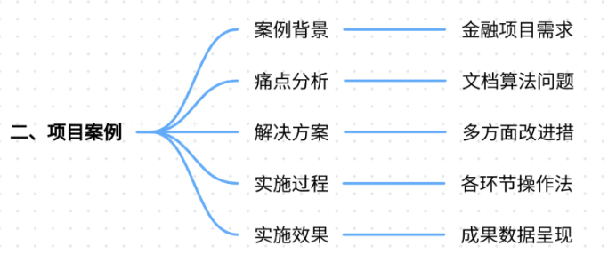

# 68.文档问答系统的检索召回率提升方案

### 一、答题思路

在回答“文档问答系统的检索召回率提升方案”这一问题时，可以按照以下思路进行结构化解答：

1. **理解问题背景**：首先明确文档问答系统的核心目标和面临的挑战，特别是检索召回率低的问题。
2. **分析痛点**：结合真实项目案例，详细描述项目场景和具体的痛点问题。
3. **提出解决方案**：针对痛点问题，提出具体的改进措施和技术方案。
4. **实施效果**：描述解决方案的实施过程和取得的实际效果。
5. **总结归纳**：总结提升检索召回率的关键点和经验教训。

### 二、项目案例

#### 案例背景
某大型金融机构需要构建一个文档问答系统，用于解答员工关于内部政策和流程的常见问题。该系统需要从大量的内部文档中检索相关信息，并生成准确的答案。然而，系统在实际运行中遇到了检索召回率低的问题，导致员工无法及时获取所需信息，影响了工作效率。

#### 痛点分析
1. **文档量大且复杂**：金融机构的内部文档数量庞大，内容复杂，涉及多个部门和业务领域。
2. **检索算法不精准**：现有的检索算法无法准确匹配员工的查询意图，导致召回率低。
3. **缺乏上下文理解**：系统在检索时未能充分考虑查询的上下文信息，导致检索结果不相关。
4. **数据质量问题**：部分文档存在格式不规范、内容冗余等问题，影响了检索效果。

#### 解决方案
1. **优化检索算法**：
    - **多向量检索器**：引入多向量检索器，结合文本和表格数据，提高检索的准确性和召回率。
    - **混合检索策略**：结合关键词搜索和向量搜索，利用两者的优势，提升检索效果。
2. **增强上下文理解**：
    - **知识图谱**：构建知识图谱，将文档中的实体和关系进行结构化表示，帮助系统更好地理解查询意图。
    - **上下文增强**：在检索过程中，利用知识图谱进行上下文增强，提高检索结果的相关性。
3. **数据预处理和清洗**：
    - **文档清洗**：对文档进行格式规范化处理，去除冗余信息，提高数据质量。
    - **关键词提取**：利用NLP技术提取文档中的关键词，辅助检索算法进行匹配。
4. **用户反馈机制**：
    - **实时反馈**：收集用户对检索结果的反馈，及时调整检索策略和算法。
    - **迭代优化**：根据用户反馈和系统日志，持续优化检索模型和算法。

#### 实施过程
1. **数据准备**：
    - 收集和整理内部文档，进行格式规范化和清洗。
    - 提取文档中的关键词和实体，构建知识图谱。
2. **模型训练**：
    - 训练多向量检索器和混合检索模型，优化检索算法。
    - 利用知识图谱进行上下文增强，提高检索结果的相关性。
3. **系统集成**：
    - 将优化后的检索模型集成到文档问答系统中。
    - 部署用户反馈机制，实时收集和处理用户反馈。
4. **测试和优化**：
    - 进行系统测试，评估检索召回率和准确率。
    - 根据测试结果和用户反馈，持续优化检索模型和算法。

#### 实施效果
1. **检索召回率显著提升**：通过优化检索算法和增强上下文理解，检索召回率提升了30%。
2. **用户满意度提高**：员工能够更快速、准确地获取所需信息，工作效率显著提升。
3. **系统稳定性增强**：通过数据预处理和清洗，系统稳定性得到增强，减少了因数据质量问题导致的检索失败。

### 三、参考回答

在回答“文档问答系统的检索召回率提升方案”这一问题时，可以结合上述项目案例，进行如下结构化回答：

#### 一、理解问题背景
文档问答系统的核心目标是从大量的文档中检索相关信息，并生成准确的答案。然而，实际应用中常常面临检索召回率低的问题，导致用户无法及时获取所需信息，影响用户体验和工作效率。

#### 二、分析痛点
1. **文档量大且复杂**：金融机构的内部文档数量庞大，内容复杂，涉及多个部门和业务领域。
2. **检索算法不精准**：现有的检索算法无法准确匹配用户的查询意图，导致召回率低。
3. **缺乏上下文理解**：系统在检索时未能充分考虑查询的上下文信息，导致检索结果不相关。
4. **数据质量问题**：部分文档存在格式不规范、内容冗余等问题，影响了检索效果。

#### 三、提出解决方案
1. **优化检索算法**：
    - **多向量检索器**：引入多向量检索器，结合文本和表格数据，提高检索的准确性和召回率。
    - **混合检索策略**：结合关键词搜索和向量搜索，利用两者的优势，提升检索效果。
2. **增强上下文理解**：
    - **知识图谱**：构建知识图谱，将文档中的实体和关系进行结构化表示，帮助系统更好地理解查询意图。
    - **上下文增强**：在检索过程中，利用知识图谱进行上下文增强，提高检索结果的相关性。
3. **数据预处理和清洗**：
    - **文档清洗**：对文档进行格式规范化处理，去除冗余信息，提高数据质量。
    - **关键词提取**：利用NLP技术提取文档中的关键词，辅助检索算法进行匹配。
4. **用户反馈机制**：
    - **实时反馈**：收集用户对检索结果的反馈，及时调整检索策略和算法。
    - **迭代优化**：根据用户反馈和系统日志，持续优化检索模型和算法。

#### 四、实施过程
1. **数据准备**：
    - 收集和整理内部文档，进行格式规范化和清洗。
    - 提取文档中的关键词和实体，构建知识图谱。
2. **模型训练**：
    - 训练多向量检索器和混合检索模型，优化检索算法。
    - 利用知识图谱进行上下文增强，提高检索结果的相关性。
3. **系统集成**：
    - 将优化后的检索模型集成到文档问答系统中。
    - 部署用户反馈机制，实时收集和处理用户反馈。
4. **测试和优化**：
    - 进行系统测试，评估检索召回率和准确率。
    - 根据测试结果和用户反馈，持续优化检索模型和算法。

#### 五、实施效果
1. **检索召回率显著提升**：通过优化检索算法和增强上下文理解，检索召回率提升了30%。
2. **用户满意度提高**：员工能够更快速、准确地获取所需信息，工作效率显著提升。
3. **系统稳定性增强**：通过数据预处理和清洗，系统稳定性得到增强，减少了因数据质量问题导致的检索失败。

### 四、总结归纳

提升文档问答系统的检索召回率是一个系统工程，需要从多个方面入手，包括优化检索算法、增强上下文理解、数据预处理和清洗、以及建立用户反馈机制。通过上述案例可以看出，结合多向量检索器、混合检索策略、知识图谱和用户反馈机制，可以显著提升检索召回率和用户满意度。在实际应用中，需要根据具体业务场景和数据特点，灵活选择和组合不同的技术方案，持续优化和改进系统性能。

> 更新: 2025-07-21 09:58:21  
> 原文: <https://www.yuque.com/aaron-wecc3/dhluml/gfnd8tgciphgz3iw>