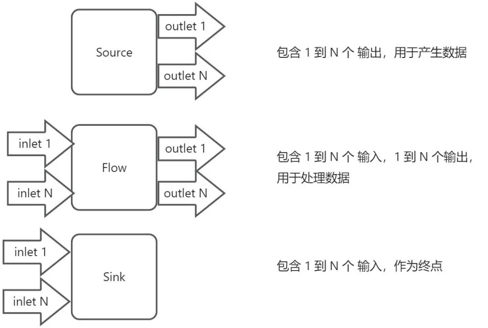
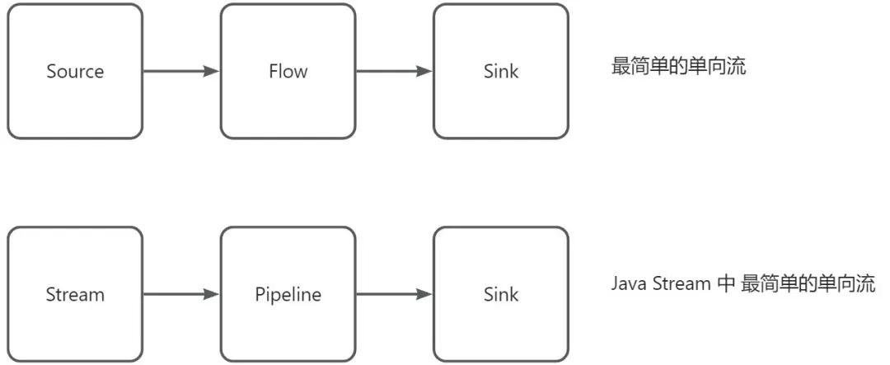
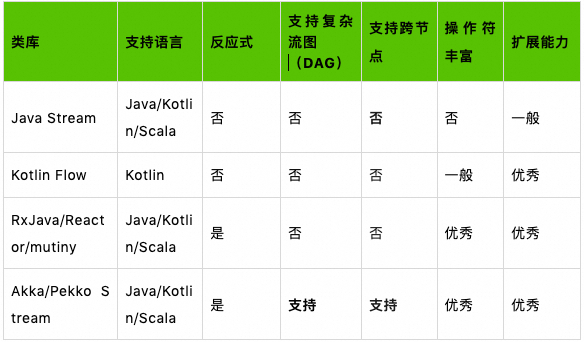
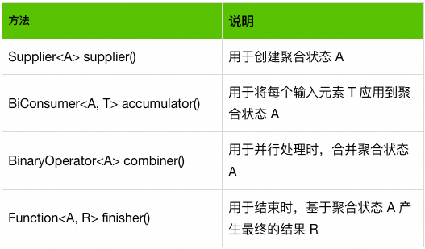
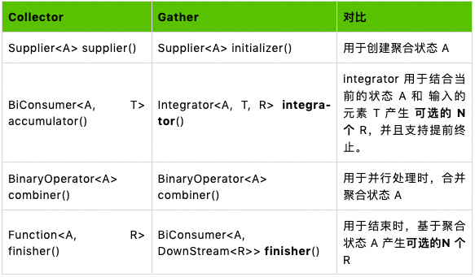
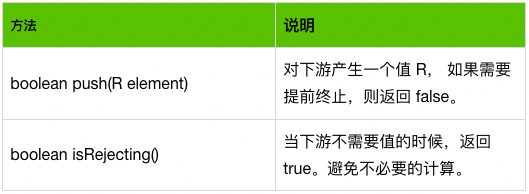
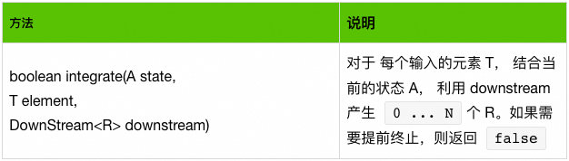
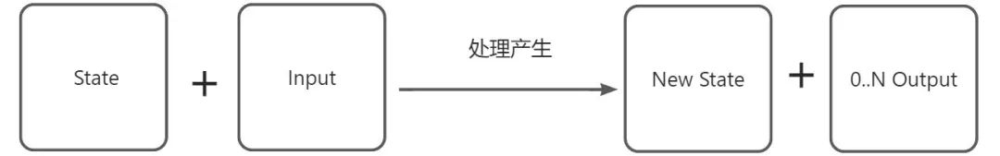

# 14.巧用Java Stream Gather利器，让你的效率翻个倍

**示例代码**

[gather-demo.zip](https://www.yuque.com/attachments/yuque/0/2024/zip/2424104/1713851578975-6c373772-854a-491e-b989-a90c7c61e384.zip)

****

**分享内容**

一、Stream 发展背景

二、什么 是 Stream ?

三、各种库有什么不一样

四、为什么需要 Stream Gather API (Java 22)？

五、Stream和Gather对比

六、总结

## 一、背景
Java Stream 自从 Java 1.8 引入以来，迅速成为了各位开发者手中信手拈来的工具，大家日常在工作中谈论起来也是如数家珍。但由于 Java Stream 的操作符不足够的丰富，经常会遇到捉襟见肘的情况。对于此，大家可能会继而采用操作符更加丰富的库来作为替代。作为 Java 标准库的一部分，Oracle 的 Java 架构师们也一直以来都在探索如何更好的适应日益增长的用户需求和语言的可维护性，随着Java 22 Stream Gather API 的到来，这个情况得到了极大的改善，下面让我结合自身经验，和大家分享 Java Stream Gather API。

## 二、什么 是 Stream ?
在编程语言生态中，Stream 是一个抽象的概念，代表了一组连续地对数据的处理的操作及流经其的数据，类似汽车生产流水线一样，下面用 “流”来指代。通常来说，”流 “可以分为“有限流” 和“无限流”。如 长江（滚滚长江东逝水） 可以看做一个”无限流 “，沿途的各种水电站可以看做 “流” 中的中间处理节点。通常来说，拆分细致的库可能会将流拆分为 “Source（源）”、“Flow（流处理）”、”Sink（终点）“三个部分，不过在 API 层不一定体现。如下所示：



这些 “Source”、“Flow” 和 “Sink” 的组合，最终形成了一个复杂的处理流图。也就是我们的代码业务逻辑。通常来说，在 Java 中，我们使用的标准库中的 Stream 则可以看做是一个最简单的单向流，如下图所示：



现在我们应该对什么 是 “流” 有了一个清晰的认识了。通常我们如果不需要自己开发 Java Stream 的操作符，因此几乎接触不到 AbstractPipeline 和 Sink 这两个类，当然截止 Java 22， Java Stream 也没有足够的扩展点。

## 三、各种库有什么不一样
在目前日常工作中，作为 Java 开发者，我们可能会用到多种面向 “流” 的工具包，简单对比如下：



从上可以看到，虽然 Java 标准库的 Stream API 开箱即用，但是在很多特定场景下，我们也不得不选用其他的库；为了改善这一点，Viktor Klang 提出了 Stream Gather API，作为除 Stream Collector 之外的另一个扩展点，来弥补 Java Stream 的短板。

题外话：Viktor Klang 之前是 Akka 的开发团队的一员。

## 四、为什么需要 Stream Gather API？
### **问题空间**
Java Stream API 目前主要缺乏丰富的 操作符，而如果像其他的库一样添加很多的操作符到 Stream API，又会有较大的维护负担，如果希望只添加有限的操作符，却可以解决绝大部分的问题。则新的操作符需要支持下面的特性：

1. 支持多种类型的数据转换：1 ：1， 如 map 操作符1 ：N， 如 filterN ：1, 如 foldN：M， 如 windowFixed
2. 支持 “有限流” 和 “无限流”
3. 支持 “有状态” 和 “无状态” 操作
4. 支持 “提前终止” 和 “全量消费”
    - 提前终止（Premature termination）：这是指在Stream的处理过程中，由于某些条件，处理被提前中断。例如，在使用limit()方法时，Stream会在达到指定的元素数量后提前终止。
    - 全量消费（Full consumption）:这是指Stream的元素被完全处理，没有任何元素被提前忽略或跳过。例如，在使用forEach()方法时，Stream中的所有元素都会被消费。
5. 支持 “单线程顺序处理” 和 “多线程并行处理”
6. 支持感知 “结束”，如实现一个 fold 操作符

### **Stream Collector & Gather**
Java Stream 目前仅提供的了一个扩展点：Collector <T, A, R>, 其包含下面几个部分：

T：stream中的元素类型；  
A：累加器的类型，可以想象成一个容器。比如T要累加，转化为List，A就是List类型。  
R：最终返回值类型



基于上面的说明，在处理过程中我们只会用到 accumulator 返回的 BiConsumer 和 finisher 返回的 Function<A, R>, 所以只能最终产生 1 个值 （N ：1）。比如我们的 Collectors.toList() 只会在流结束的时候产生一个 List, 所以 并不能满足我们实现 map、filter、buffer、scan 、zipWithIndex 等操作符的要求。

为此，在 JEP 461 应运而生，API 和 Stream Collector 有点类似，具体的对比如下：



上面最大的变化在于，integrator 和 finisher 都可以产生 1 : N 地产生元素 R。这个可选的 0 ... N 个 R 通过 DownStream 来传递给下游。如果直接在方法的返回值中返回，则仅可以表达 0 ...  1 个 R 的情况。DownStream 的定义了两个核心方法，push和isRejecting



integrator 主要用于结合当前的状态 A 和 输入的元素 T，利用了 DownStream 的 能力来产生 可选的 N 个 R。核心的方法如下：



结合目前的信息，我们可以发现整个 Gather API 的设计其实还挺复杂的，因为引入了太多的中间接口名称，同时支持了单线程和多线程等情况，并且有一些隐藏的约束。下面让我们庖丁解牛，细细道来。

## 五、分析和对比
### **Stream Gather API 拆解**
结合上面的信息和其他类库中的经验，我们其实知道，“流” 的任意中间处理过程都可以看做一个函数， 如下图所示：



而上面的整个 GatherAPI 其实是在这个基础上做的变体。具体来说：

1. supplier：产生最初的 State
2. integrator + downstream：转换 和 传递值；

finisher 主要用于终止信号处理， combiner 主要用于并行流。这样一看整个 API 就简化很多了。在实现特定的 操作符的时候，我们可以只关心特定部分。比如下面分别实现 map 和  filter 操作符（无状态）。

**map** 操作符无状态的一对一地产生元素

```java
Gatherer<String, ?, Integer> map() {
  return Gatherer.of(Gatherer.Integrator.ofGreedy((_, element, downstream) -> {
    return downstream.push(element.length());
  }));
}
```

**filter** 操作符无状态的 1 : 0 ... 1 地产生元素

```java
Gatherer<String, ?, String> filter() {
  return Gatherer.of(Gatherer.Integrator.ofGreedy((_, element, downstream) -> {
    if (element.endsWith("1")) {
      return downstream.push(element);
    }
    return true;
  }));
}
```

**fold**：有状态的多对一收集器，以增量方式建立聚合，并在没有更多输入元素存在时释放该聚合，将状态保持在了局部的 State 类中，并且在结束时，调用了 finisher 返回的方法，将最终的值推送给了流的下一个处理节点。

```java
Gatherer<String, ?, Integer> fold() {
  return Gatherer.ofSequential(
      () -> new Object() { int counter; },
      Gatherer.Integrator.ofGreedy((state, _, _) -> {
        state.counter++;
        return true;
      }),
      (state, downstream) -> {
        downstream.push(state.counter);
      }
  );
}
```

**windowFixed**：有状态的多对多收集器，它将输入项分组到所提供大小的列表中，满后输出窗口。

```java
Gatherer<String, ?, List<String>> windowFixed() {
  return Gatherer.ofSequential(
      () -> new Object() { List<String> list = new ArrayList<>(); },
      Gatherer.Integrator.ofGreedy((state, element, downstream) -> {
        if (state.list.size() == 2) {
          if (!downstream.push(state.list)) {
            return false;
          }
          state.list = new ArrayList<>();
        }
        state.list.add(element);
        return true;
      }),
      (state, downstream) -> {
        if (!state.list.isEmpty()) {
          downstream.push(state.list);
        }
        state.list = null;  // maybe ?
      }
  );
}
```

## 六、总结
随着 Stream Gather API 引入，补齐了 Stream API 在扩展性上的短板，同时降低了复杂度。未来一定会有一个开源的库来扩展各种各样的 Gather 操作符, 比如 zipWithIndex、zipWithNext、mapConcat、throttle 等。稍有遗憾的是由于 Java 目前不支持类似 Kotlin 的扩展方法，所以在 Stream API  DSL 的最终呈现上还不能是 Stream.zipWithIndex 而是 Stream.gather(MyGathers.zipWithIndex)。希望在 下一个 LTS 来临之前 Java 能够补齐扩展方法这个短板，方便我们更优雅的设计 DSL 扩展。


> 更新: 2024-04-23 13:53:01  
> 原文: <https://www.yuque.com/aaron-wecc3/dhluml/22c27d3a551656d4e3ea01b06ffdca61>