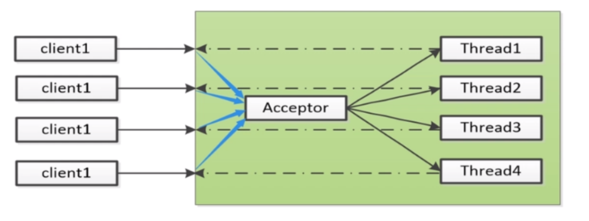
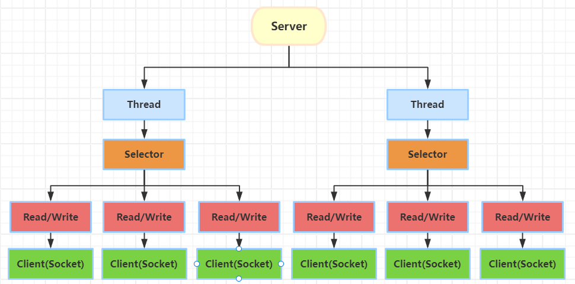
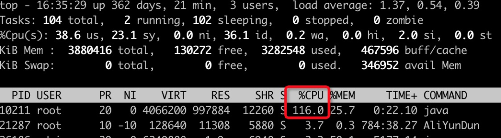
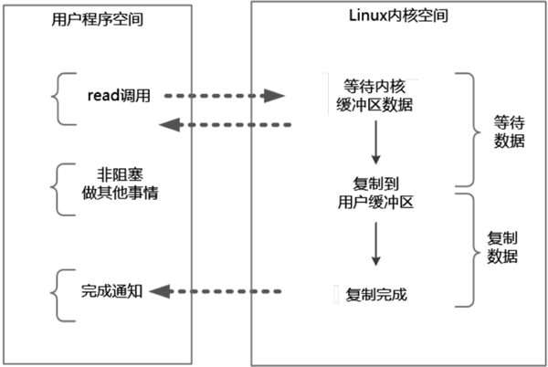

# 15.从操作系统底层彻底理解Java IO演进之路

**示例代码**

[io-demo.zip](https://www.yuque.com/attachments/yuque/0/2024/zip/2424104/1713851378092-ef03fca4-ff53-4703-89db-2a92ce542551.zip)

**分享内容**

1. BIO优缺点和适用场景
2. NIO优缺点和适用场景
3. IO多路复用优缺点
4. AIO优缺点和适用场景

## **前言**
以操作系统实际调用角度（以 CentOS Linux release 7.5 操作系统为示例），看 IO 的每一步操作到底发生了什么。

关于如何查看系统调用，Linux 可以使用 strace 来查看任何软件的系统调动（这是个很好的分析学习方法）：strace -ff -o ./out java Test.Java

## **一  BIO**
BIO（Blocking I/O）：同步阻塞型IO

BIO 是 Java 中最早的一种 I/O 模式，它的特点是 I/O 操作会阻塞线程，直到 I/O 操作完成。BIO 的缺点是并发性能较差，因为每个线程都会阻塞等待 I/O 完成。BIO 适用于连接数较少的网络应用，比如 Web 应用中的 Servlet。



分析BIO代码实现

```java
package io; 
import java.io.*;
import java.net.ServerSocket;
import java.net.Socket;

public class BIOSocket {
    public static void main(String[] args) throws IOException {
        ServerSocket serverSocket = new ServerSocket(8090);
        System.out.println("step1: new ServerSocket ");
        while (true) {
            Socket client = serverSocket.accept();
            System.out.println("step2: client\t" + client.getPort());
            new Thread(() -> {
                try {
                    InputStream in = client.getInputStream();
                    BufferedReader reader = new BufferedReader(new InputStreamReader(in));
                    while (true) {
                        System.out.println(reader.readLine());
                    }
                } catch (IOException e) {
                    e.printStackTrace();
                }
            }).start();
        }
    }
}
```

### 1  发生的系统调用
**启动时**

执行strace -ff -o ./out java BIOSocket.Java

```bash
socket(AF_INET, SOCK_STREAM, IPPROTO_IP) = 5
bind(5, {sa_family=AF_INET, sin_port=htons(8090), sin_addr=inet_addr("0.0.0.0")}, 16) = 0
listen(5, 50)                           = 0
poll([{fd=5, events=POLLIN|POLLERR}], 1, -1) = 1 ([{fd=5, revents=POLLIN}])
```

poll 函数会阻塞直到其中任何一个 FD 发生事件。

_FD：Java中FileDescriptor 可以被用来表示开放文件、开放套接字等。具体到NIO中，则用来操作socket套接字，文件描述符在形式上是一个非负整数。实际上，它是一个索引值，指向内核为每一个进程所维护的该进程打开文件的记录表。 当程序打开一个现有文件或者创建一个新文件时，内核向进程返回一个文件描述符。 在程序设计中，一些涉及底层的程序编写往往会围绕着文件描述符展开。文件描述符这一概念往往只适用于UNIX、Linux这样的操作系统。_

**有客户端连接后**

```bash
accept(5, {sa_family=AF_INET, sin_port=htons(10253), sin_addr=inet_addr("127.0.0.1")}, [16]) = 6
clone(child_stack=0x7f013e5c4fb0, flags=CLONE_VM|CLONE_FS|CLONE_FILES|CLONE_SIGHAND|CLONE_THREAD|CLONE_SYSVSEM|CLONE_SETTLS|CLONE_PARENT_SETTID|CLONE_CHILD_CLEARTID, parent_tidptr=0x7f013e5c59d0,         tls=0x7f013e5c5700, child_tidptr=0x7f013e5c59d0) = 13168
poll([{fd=5, events=POLLIN|POLLERR}], 1, -1
```

抛出线程（即我们代码里的 new Thread() ）后，继续 poll 阻塞等待连接。

**客户端发送数据后**

strace -ff -o ./out java BIOClient.Java

```bash
recvfrom(6, "hello,bio\n", 8192, 0, NULL, NULL) = 10
```

关于对 recvfrom 函数的说明，其中第四个参数 0 表示这是一个阻塞调用。

### 2  优缺点
**优点**

代码简单，逻辑清晰。

**缺点**

+ 由于 stream 的 read 操作是阻塞读，面对多个连接时 每个连接需要线程。无法处理大量连接
+ 误区：可见 JDK1.8 中对于最初的 BIO，在 Linux OS 下仍然使用的 poll，poll 本身也是相对比较高效的多路复用函数（支持非阻塞、多个 socket 同时检查 event），只是限于 JDK 最初的 stream API 限制，无法支持非阻塞读取。

## **二  NIO（non block）**
NIO（Non-blocking I/O 同步非阻塞 ）：NIO 是 Java 中的一种 I/O 模式，它的特点是 I/O 操作不会阻塞线程，但是需要轮询操作系统的 I/O 事件来判断是否有 I/O 操作完成。NIO 可以让应用程序在等待 I/O 完成时执行其他任务，提高了系统的并发性能。NIO 适用于连接数较多、并发性要求较高的网络应用，比如高性能的服务器应用、网关应用等，比如Netty等框架。它允许一个线程处理多个I/O操作。NIO使用了选择器（Selector）来监听多个通道的事件，从而减少了线程的数量。在NIO中，应用程序可以异步地发起I/O操作，然后继续执行其他任务，而不需要等待I/O操作完成。

改进：对比BIO，使用 NIO API，将阻塞变为非阻塞， 不需要大量线程。



分析NIOSocket代码实现

```java
package io;
import java.io.IOException;
import java.net.InetSocketAddress;
import java.nio.ByteBuffer;
import java.nio.channels.ServerSocketChannel;
import java.nio.channels.SocketChannel;
import java.util.LinkedList;

public class NIOSocket {
    private static LinkedList<SocketChannel> clients = new LinkedList<>();
    private static void startClientChannelHandleThread(){
        new Thread(() -> {
            while (true){
                ByteBuffer buffer = ByteBuffer.allocateDirect(4096);
                //处理客户端连接
                for (SocketChannel c : clients) {
                    // 非阻塞, >0 表示读取到的字节数量, 0或-1表示未读取到或读取异常
                    int num = 0;
                    try {
                        num = c.read(buffer);
                    } catch (IOException e) {
                        e.printStackTrace();
                    }
                    if (num > 0) {
                        buffer.flip();
                        byte[] clientBytes = new byte[buffer.limit()];
                        //从缓冲区 读取到内存中
                        buffer.get(clientBytes);
                        System.out.println(c.socket().getPort() + ":" + new String(clientBytes));
                        //清空缓冲区
                        buffer.clear();
                    }
                }
            }
        }).start();
    }
    public static void main(String[] args) throws IOException {
        //new socket,开启监听
        ServerSocketChannel socketChannel = ServerSocketChannel.open();
        socketChannel.bind(new InetSocketAddress(9090));
        //设置阻塞接受客户端连接
        socketChannel.configureBlocking(true);
        //开始client处理线程
        startClientChannelHandleThread();
        while (true) {
            //接受客户端连接; 非阻塞，无客户端返回null(操作系统返回-1)
            SocketChannel client = socketChannel.accept();
            if (client == null) {
                //System.out.println("no client");
            } else {
                //设置读非阻塞
                client.configureBlocking(false);
                int port = client.socket().getPort();
                System.out.println("client port :" + port);
                clients.add(client);
            }
        }
    }
}
```

### 1  发生的系统调用
**主线程**

strace -ff -o ./out java NIOSocket.Java

```bash
socket(AF_INET, SOCK_STREAM, IPPROTO_IP) = 4
bind(4, {sa_family=AF_INET, sin_port=htons(9090), sin_addr=inet_addr("0.0.0.0")}, 16) = 0
listen(4, 50)                           = 0
fcntl(4, F_SETFL, O_RDWR|O_NONBLOCK)    = 0
accept(4, 0x7fe26414e680, 0x7fe26c376710) = -1 EAGAIN (Resource temporarily unavailable)
```

**有连接后，子线程**

```bash
read(6, 0x7f3f415b1c50, 4096)           = -1 EAGAIN (Resource temporarily unavailable)
read(6, 0x7f3f415b1c50, 4096)           = -1 EAGAIN (Resource temporarily unavailable)
...
```

资源使用情况：



### 2  优缺点
**优点**

线程数大大减少。

**缺点**

需要程序自己扫描 每个连接 read，需要 O(n) 时间复杂度系统调用 （此时可能只有一个连接发送了数据），高频系统调用（导致 CPU 用户态内核态切换）高。导致 CPU 消耗很高。

## **三  IO多路复用（select、poll、epoll）**
IO多路复用（IO Multiplexing）：即经典的Reactor设计模式，有时也称为异步阻塞IO，Java中的Selector和Linux中的epoll都是这种模型。

改进：不需要用户扫描所有连接，由 kernel 给出哪些连接有数据，然后应用从有数据的连接读取数据。

在 IO 多路复用模型中通过 select/epoll 系统调用，单个应用程序的线程可以不断地轮询成百上千的 socket 连接的就绪状态，当某个或者某些 socket 网络连接有 IO 就绪状态时就返回这些就绪的状态（或者说就绪事件）。


### 1  epoll
```java
import java.net.InetSocketAddress;
import java.nio.ByteBuffer;
import java.nio.channels.SelectionKey;
import java.nio.channels.Selector;
import java.nio.channels.ServerSocketChannel;
import java.nio.channels.SocketChannel;
import java.util.Iterator;
import java.util.LinkedList;
import java.util.Set;
/**
 * 多路复用socket
 */
public class MultiplexingSocket {
    static ByteBuffer buffer = ByteBuffer.allocateDirect(4096);
    public static void main(String[] args) throws Exception {
        LinkedList<SocketChannel> clients = new LinkedList<>();
        //1.启动server
        //new socket,开启监听
        ServerSocketChannel socketChannel = ServerSocketChannel.open();
        socketChannel.bind(new InetSocketAddress(9090));
        //设置非阻塞，接受客户端
        socketChannel.configureBlocking(false);
        //多路复用器（JDK包装的代理，select /poll/epoll/kqueue）
        Selector selector = Selector.open(); //java自动代理，默认为epoll
        //Selector selector = PollSelectorProvider.provider().openSelector();//指定为poll
        //将服务端socket 注册到 多路复用器
        socketChannel.register(selector, SelectionKey.OP_ACCEPT);
        //2. 轮训多路复用器
        // 先询问有没有连接,如果有则返回数量以及对应的对象(fd)
        while (selector.select() > 0) {
            System.out.println();
            Set<SelectionKey> selectionKeys = selector.selectedKeys();
            Iterator<SelectionKey> iter = selectionKeys.iterator();
            while (iter.hasNext()) {
                SelectionKey key = iter.next();
                iter.remove();
                //2.1 处理新的连接
                if (key.isAcceptable()) {
                    //接受客户端连接; 非阻塞，无客户端返回null(操作系统返回-1)
                    SocketChannel client = socketChannel.accept();
                    //设置读非阻塞
                    client.configureBlocking(false);
                    //同样，把client也注册到selector
                    client.register(selector, SelectionKey.OP_READ);
                    System.out.println("new client : " + client.getRemoteAddress());
                }
                //2.2 处理读取数据
                else if (key.isReadable()) {
                    readDataFromSocket(key);
                }
            }
        }
    }
    protected static void readDataFromSocket(SelectionKey key) throws Exception {
        SocketChannel socketChannel = (SocketChannel) key.channel();
        // 非阻塞, >0 表示读取到的字节数量, 0或-1表示未读取到或读取异常
        // 请注意：这个例子降低复杂度，不考虑报文大于buffer size的情况
        int num = socketChannel.read(buffer);
        if (num > 0) {
            buffer.flip();
            byte[] clientBytes = new byte[buffer.limit()];
            //从缓冲区 读取到内存中
            buffer.get(clientBytes);
            System.out.println(socketChannel.socket().getPort() + ":" + new String(clientBytes));
            //清空缓冲区
            buffer.clear();
        }
    }
}
```

### 2  发生的系统调用
**启动**

strace -ff -o ./out java MultiplexingSocket.Java

```bash
socket(AF_INET, SOCK_STREAM, IPPROTO_IP) = 4
bind(4, {sa_family=AF_INET, sin_port=htons(9090), sin_addr=inet_addr("0.0.0.0")}, 16) = 0
listen(4, 50)
fcntl(4, F_SETFL, O_RDWR|O_NONBLOCK)    = 0
epoll_create(256)                       = 7
epoll_ctl(7, EPOLL_CTL_ADD, 5, {EPOLLIN, {u32=5, u64=4324783852322029573}}) = 0
epoll_ctl(7, EPOLL_CTL_ADD, 4, {EPOLLIN, {u32=4, u64=158913789956}}) = 0
epoll_wait(7
```

关于对 epoll_create（对应着 Java 的 Selector selector = Selector.open()） 的说明，本质上是在内存的操作系统保留区，创建一个 epoll 数据结构。用于后面当有 client 连接时，向该 epoll 区中添加监听。

**有连接**

```bash
epoll_wait(7,[{EPOLLIN, {u32=4, u64=158913789956}}], 8192, -1) = 1
accept(4, {sa_family=AF_INET, sin_port=htons(29597), sin_addr=inet_addr("192.168.1.1")}, [16]) = 8
fcntl(8, F_SETFL, O_RDWR|O_NONBLOCK)    = 0
epoll_ctl(7, EPOLL_CTL_ADD, 8, {EPOLLIN, {u32=8, u64=3212844375897800712}}) = 0
```

关于 epoll_ctl （对应着 Java 的 client.register(selector, SelectionKey.OP_READ) ）。其中 EPOLLIN 恰好对应着 Java 的 SelectionKey.OP_READ 即监听数据到达读取事件。

**客户端发送数据**

strace -ff -o ./out java MultiplexingClient.Java

```bash
epoll_wait(7,[{EPOLLIN, {u32=8, u64=3212844375897800712}}], 8192, -1) = 1
read(8, "hello,multiplex\n", 4096)      = 16
epoll_wait(7,
```

note：epoll_wait 第四个参数 - 1 表示 block。

### 3  优缺点
**优点**

+ 线程数同样很少，甚至可以把 acceptor 线程和 worker 线程使用同一个。
+ 时间复杂度低，Java 实现的 Selector（在 Linux OS 下使用的 epoll 函数）支持多个 clientChannel 事件的一次性获取，且时间复杂度维持在 O(1)。
+ CPU 使用低：得益于 Selector，我们不用向 “2.NIO” 中需要自己一个个 ClientChannel 手动去检查事件，因此使得 CPU 使用率大大降低。

**缺点**

+ 数据处理麻烦：目前 socketChannel.read 读取数据完全是基于字节的，当我们需要需要作为 HTTP 服务网关时，对于 HTTP 协议的处理完全需要自己解析，这是个庞大、烦杂、容易出错的工作。
+ 性能问题：现有 socket 数据的读取（socketChannel.read(buffer)）全部通过一个 buffer 缓冲区来接受，一旦连接多起来，这无疑是一个单线程读取，性能无疑是个问题。
+ 那么此时 buffer 我们每次读取都重新 new 出来呢？如果每次都 new 出来，这样的内存碎片对于 GC 无疑是一场灾难。如何平衡地协调好 buffer 的共享，既保证性能，又保证线程安全，这是个难题。

## **四  AIO**
AIO（异步 I/O）：AIO 是 Java NIO 2 中新增的一种 I/O 模式，它的特点是 I/O 操作不会阻塞线程，而是在后台由操作系统完成，完成后会通知应用程序。AIO 可以让应用程序在等待 I/O 完成时执行其他任务，提高了系统的并发性能。AIO 适用于高并发的网络应用，比如聊天室、多人在线游戏等。

异步 IO 模型的基本流程是：用户线程通过系统调用向内核注册某个 IO 操作。内核在整个 IO 操作（包括数据准备、数据复制）完成后通知用户程序，用户执行后续的业务操作。

在异步 IO 模型中，在整个内核的数据处理过程（包括内核将数据从网络物理设备（网卡）读取到内核缓冲区、将内核缓冲区的数据复制到用户缓冲区）中，用户程序都不需要阻塞。



### 1  启动
**main 线程**

strace -ff -o ./out java AIOSocket.Java

```bash
epoll_create(256)                       = 5
epoll_ctl(5, EPOLL_CTL_ADD, 6, {EPOLLIN, {u32=6, u64=11590018039084482566}}) = 0
##创建BOSS 线程(Proactor)
clone(child_stack=0x7f340ac06fb0, flags=CLONE_VM|CLONE_FS|CLONE_FILES|CLONE_SIGHAND|CLONE_THREAD|CLONE_SYSVSEM|CLONE_SETTLS|CLONE_PARENT_SETTID|CLONE_CHILD_CLEARTID, parent_tidptr=0x7f340ac079d0, tls=0x7f340ac07700, child_tidptr=0x7f340ac079d0) = 22704
socket(AF_INET6, SOCK_STREAM, IPPROTO_IP) = 8
setsockopt(8, SOL_IPV6, IPV6_V6ONLY, [0], 4) = 0
setsockopt(8, SOL_SOCKET, SO_REUSEADDR, [1], 4) = 0
bind(8, {sa_family=AF_INET6, sin6_port=htons(9090), inet_pton(AF_INET6, "::", &sin6_addr), sin6_flowinfo=0, sin6_scope_id=0}, 28) = 0
listen(8, 50)
accept(8, 0x7f67d01b3120, 0x7f67d9246690) = -1
epoll_ctl(5, EPOLL_CTL_MOD, 8, {EPOLLIN|EPOLLONESHOT, {u32=8, u64=15380749440025362440}}) = -1 ENOENT (No such file or directory)
epoll_ctl(5, EPOLL_CTL_ADD, 8, {EPOLLIN|EPOLLONESHOT, {u32=8, u64=15380749440025362440}}) = 0
read(0,
```

**22704(BOSS 线程 (Proactor))**

```bash
epoll_wait(5,  <unfinished ...>
```

### 2  请求连接
**22704(BOSS 线程 (Proactor)) 处理连接**

```bash
epoll_wait(5,[{EPOLLIN, {u32=9, u64=4294967305}}], 512, -1) = 1
accept(8, {sa_family=AF_INET6, sin6_port=htons(55320), inet_pton(AF_INET6, "::ffff:36.24.32.140", &sin6_addr), sin6_flowinfo=0, sin6_scope_id=0}, [28]) = 9
clone(child_stack=0x7ff35c99ffb0, flags=CLONE_VM|CLONE_FS|CLONE_FILES|CLONE_SIGHAND|CLONE_THREAD|CLONE_SYSVSEM|CLONE_SETTLS|CLONE_PARENT_SETTID|CLONE_CHILD_CLEARTID, parent_tidptr=0x7ff35c9a09d0, tls=0x7ff35c9a0700, child_tidptr=0x7ff35c9a09d0) = 26241
epoll_wait(5,  <unfinished ...>
```

**26241**

```bash
#将client 连接的FD加入到BOSS的epoll中，以便BOSS线程监听网络事件
epoll_ctl(5, EPOLL_CTL_MOD, 9, {EPOLLIN|EPOLLONESHOT, {u32=9, u64=4398046511113}}) = -1 ENOENT (No such file or directory)
epoll_ctl(5, EPOLL_CTL_ADD, 9, {EPOLLIN|EPOLLONESHOT, {u32=9, u64=4398046511113}}) = 0
accept(8, 0x7ff3440008c0, 0x7ff35c99f4d0) = -1 EAGAIN (Resource temporarily unavailable)
epoll_ctl(5, EPOLL_CTL_MOD, 8, {EPOLLIN|EPOLLONESHOT, {u32=8, u64=8}}) = 0
```

### 3  客户端发送数据
strace -ff -o ./out java AIOClient.Java

**22704(BOSS 线程 (Proactor)) 处理连接**

```bash
epoll_wait(5,[{EPOLLIN, {u32=9, u64=4294967305}}], 512, -1) = 1
##数据读出
read(9, "daojian111\r\n", 1024)         = 12
##数据处理交给其他线程，这里由于线程池为空，需要先clone线程
clone(child_stack=0x7ff35c99ffb0, flags=CLONE_VM|CLONE_FS|CLONE_FILES|CLONE_SIGHAND|CLONE_THREAD|CLONE_SYSVSEM|CLONE_SETTLS|CLONE_PARENT_SETTID|CLONE_CHILD_CLEARTID, parent_tidptr=0x7ff35c9a09d0, tls=0x7ff35c9a0700, child_tidptr=0x7ff35c9a09d0) = 26532
```

**复制线程处理，线程号 26532**

```bash
write(1, "pool-1-thread-2-10received : dao"..., 41) = 41
write(1, "\n", 1)
accept(8, 0x7f11c400b5f0, 0x7f11f42fd4d0) = -1 EAGAIN (Resource temporarily unavailable)
epoll_ctl(5, EPOLL_CTL_MOD, 8, {EPOLLIN|EPOLLONESHOT, {u32=8, u64=8}}) = 0
```

### 4  原理
+ 从系统调用角度，Java 的 AIO 事实上是以多路复用（Linux 上为 epoll）等同步 IO 为基础，自行实现了异步事件分发。
+ BOSS Thread 负责处理连接，并分发事件。
+ WORKER Thread 只负责从 BOSS 接收的事件执行，不负责任何网络事件监听。

### 5  优缺点
**优点**

相比于前面的 BIO、NIO，AIO 已经封装好了任务调度，使用时只需关心任务处理。

**缺点**

+ 事件处理完全由 Thread Pool 完成，对于同一个 channel 的多个事件可能会出现并发问题。
+ 相比 netty，buffer API 不友好容易出错；编解码工作复杂。

## 五 总结
BIO 的特点是 I/O 操作会阻塞线程，直到 I/O 操作完成。BIO 的缺点是并发性能较差，因为每个线程都会阻塞等待 I/O 完成。BIO 适用于连接数较少的网络应用，比如 Web 应用中的 Servlet。

NIO的特点是 I/O 操作不会阻塞线程，对比BIO，使用 NIO API，将阻塞变为非阻塞， 不需要大量线程。但是需要轮询操作系统的 I/O 事件来判断是否有 I/O 操作完成。NIO 适用于连接数较多、并发性要求较高的网络应用，比如高性能的服务器应用、网关应用等，比如Netty等框架。它允许一个线程处理多个I/O操作

IO多路复用（IO Multiplexing）：即经典的Reactor设计模式，有时也称为异步阻塞IO，Java中的Selector和Linux中的epoll都是这种模型，不需要用户扫描所有连接，由 kernel 给出哪些连接有数据，然后应用从有数据的连接读取数据。

AIO的特点是 I/O 操作不会阻塞线程，而是在后台由操作系统完成，完成后会通知应用程序。AIO 可以让应用程序在等待 I/O 完成时执行其他任务，提高了系统的并发性能。AIO 适用于高并发的网络应用，比如聊天室、多人在线游戏等。


> 更新: 2024-04-23 13:53:10  
> 原文: <https://www.yuque.com/aaron-wecc3/dhluml/1ef0736ce959dd977a61e591a68ac9ed>