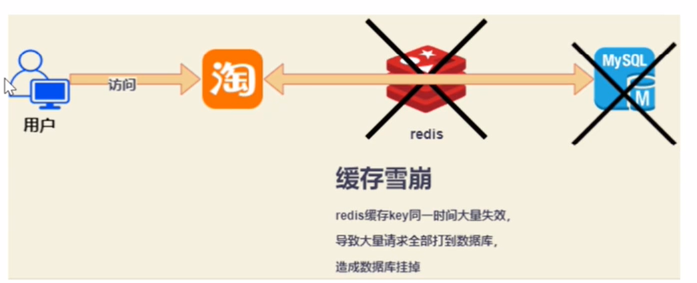
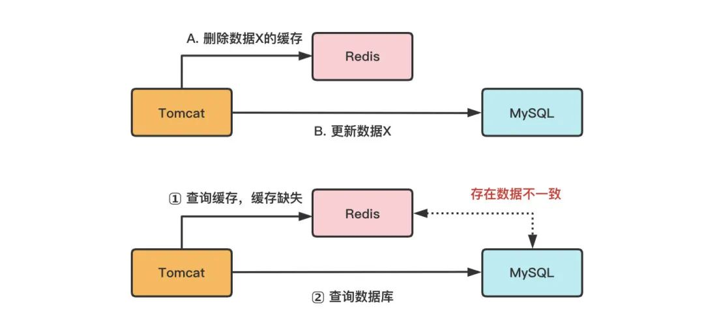
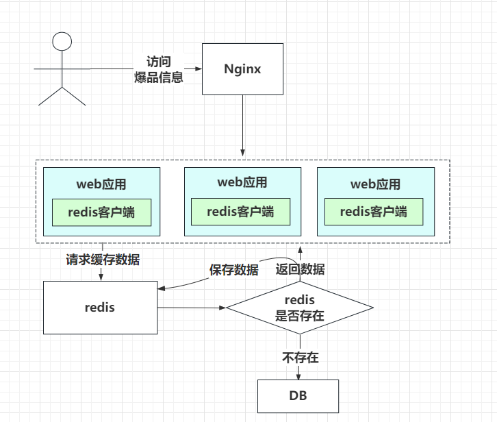

# 17.你必须知道的Redis缓存七大陷阱

**本次分享内容**

1. 缓存雪崩
2. 缓存穿透
3. 缓存击穿
4. 数据不一致
5. 数据并发竞争
6. 热点key问题
7. BigKey问题

# 缓存雪崩
指缓存同一时间大面积的失效，所以，后面的请求都会落到数据库上，造成数据库短时间内承受大量请求而崩掉。

解决方案：

1. Redis 高可用，主从+哨兵，Redis cluster，避免全盘崩溃
2. 本地 ehcache 缓存 + hystrix 限流&降级，避免 MySQL 被打死
3. 缓存数据的过期时间设置随机，防止同一时间大量数据过期现象发生。
4. 逻辑上永不过期给每一个缓存数据增加相应的缓存标记，缓存标记失效则更新数据缓存
5. 多级缓存，失效时通过二级更新一级，由第三方插件更新二级缓存。

# 缓存穿透
缓存穿透是指缓存和数据库中都没有的数据，导致所有的请求都落到数据库上，造成数据库短时间内承受大量请求而崩掉。

解决方案：

1. 接口层增加校验，如用户鉴权校验，id做基础校验，id<=0的直接拦截；
2. 从缓存取不到的数据，在数据库中也没有取到，这时也可以将key-value对写为key-null，缓存有效时间可以设置短点，如30秒。这样可以防止攻击用户反复用同一个id暴力攻击；
3. 采用布隆过滤器，将所有可能存在的数据哈希到一个足够大的 bitmap 中，一个一定不存在的数据会被这个 bitmap 拦截掉，从而避免了对底层存储系统的查询压力。（宁可错杀一千不可放过一人）

# 缓存击穿
这时由于并发用户特别多，同时读缓存没读到数据，又同时去数据库去取数据，引起数据库压力瞬间增大，造成过大压力。和缓存雪崩不同的是，缓存击穿指并发查同一条数据，缓存雪崩是不同数据都过期了，很多数据都查不到从而查数据库

解决方案：

1. 设置热点数据永远不过期，异步线程处理。
2. 加写回操作加互斥锁，查询失败默认值快速返回。
3. 缓存预热

系统上线后，将相关可预期（例如排行榜）热点数据直接加载到缓存。写一个缓存刷新页面，手动操作热点数据（例如广告推广）上下线。

# 数据不一致
在缓存机器的带宽被打满，或者机房网络出现波动时，缓存更新失败，新数据没有写入缓存，就会导致缓存和 DB 的数据不一致。缓存 rehash 时，某个缓存机器反复异常，多次上下线，更新请求多次 rehash。这样，一份数据存在多个节点，且每次 rehash 只更新某个节点，导致一些缓存节点产生脏数据。

1. Cache 更新失败后，可以进行重试，则将重试失败的 key 写入mq，待缓存访问恢复后，将这些 key 从缓存删除。这些 key 在再次被查询时，重新从 DB 加载，从而保证数据的一致性
2. 缓存时间适当调短，让缓存数据及早过期后，然后从 DB 重新加载，确保数据的最终一致性。
3. 不采用 rehash 漂移策略，而采用缓存分层策略，尽量避免脏数据产生。

**缓存的层次**

本地Cache （瓶颈在宿主机本身），本地Cache的缓存组件有Ehcache、Guava Cache等，开发者自己也可以用Map、Set等轻松构建一个自己专用的本地Cache。

进程间Cache（业务进程与缓存进程的资源竞争）进程间Cache和远程Cache的缓存组件相同，只是部署位置的差异罢了，这类缓存组件有Memcached、Redis、Pika等。

远程Cache。（瓶颈在带宽）

内存型缓存将数据存储在内存，读写性能很高，但缓存系统重启或Crash后，内存数据会丢失。

持久化型缓存将数据存储到SSD/Fusion-IO硬盘中，相同成本下，这种缓存的容量会比内存型缓存大1个数量级以上，而且数据会持久化落地，重启不丢失，但读写性能相对低1～2个数量级。Memcached是典型的内存型缓存，而Pika以及其他基于RocksDB开发的缓存组件等则属于持久化型缓存。

# 数据并发竞争
数据并发竞争在大流量系统也比较常见，比如车票系统，如果某个火车车次缓存信息过期，但仍然有大量用户在查询该车次信息。又比如微博系统中，如果某条微博正好被缓存淘汰，但这条微博仍然有大量的转发、评论、赞。上述情况都会造成并发竞争读取的问题。

1. 加写回操作加互斥锁，查询失败默认值快速返回。
2. 对缓存数据保持多个备份，减少并发竞争的概率

# 热点key问题
明星结婚、离婚、出轨这种特殊突发事件，比如奥运、春节这些重大活动或节日，还比如秒杀、双12、618 等线上促销活动，都很容易出现 Hot key 的情况。

如何提前发现HotKey？

1. 对于重要节假日、线上促销活动这些提前已知的事情，可以提前评估出可能的热 key 来。
2. 而对于突发事件，无法提前评估，可以通过 Spark，对应流任务进行实时分析，及时发现新发布的热点 key。而对于之前已发出的事情，逐步发酵成为热 key 的，则可以通过 Hadoop 对批处理任务离线计算，找出最近历史数据中的高频热 key。

解决方案：

1. 这 n 个 key 分散存在多个缓存节点，然后 client 端请求时，随机访问其中某个后缀的 hotkey，这样就可以把热 key 的请求打散，避免一个缓存节点过载
2. 缓存集群可以单节点进行主从复制和垂直扩容
3. 利用应用内的前置缓存，但是需注意需要设置上限
4. 延迟不敏感，定时刷新，实时感知用主动刷新
5. 和缓存穿透一样，限制逃逸流量，单请求进行数据回源并刷新前置
6. 无论如何设计，最后都要写一个兜底逻辑，千万级流量说来就来

# BigKey问题
比如互联网系统中需要保存用户最新 1万 个粉丝的业务，比如一个用户个人信息缓存，包括基本资料、关系图谱计数、发 feed 统计等。微博的 feed 内容缓存也很容易出现，一般用户微博在 140 字以内，但很多用户也会发表 1千 字甚至更长的微博内容，这些长微博也就成了大 key

1. 首先Redis底层数据结构里，根据Value的不同，会进行数据结构的重新选择
2. 可以扩展新的数据结构，进行序列化构建，然后通过 restore 一次性写入
3. 将大 key 分拆为多个 key，设置较长的过期时间

> 更新: 2024-05-05 22:32:51  
> 原文: <https://www.yuque.com/aaron-wecc3/dhluml/xv5ovy4snzwk52rw>