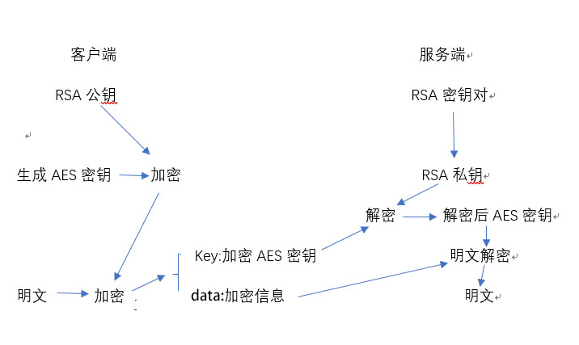
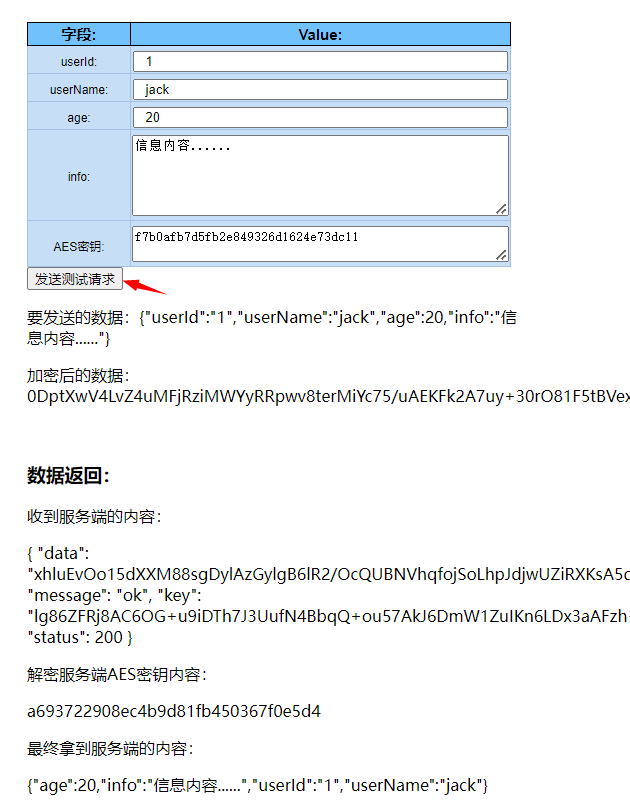
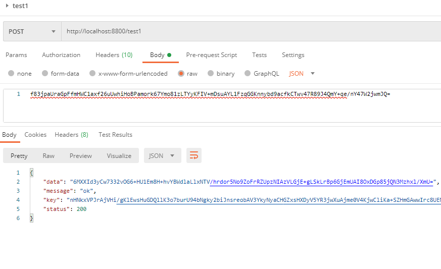

# 20.充值接口被薅羊毛，老板让我做接口加密

**示例代码**

[encrypt-demo.zip](https://www.yuque.com/attachments/yuque/0/2024/zip/2424104/1715734300997-2d09ac7c-110c-4eeb-b07d-3635f7d3fd95.zip)

jdk版本：1.8.0_181

***

**本次分享内容**

1. 接口为什么要加密
2. 前后端加密流程
3. 加密算法(RAS非对称加密+AES对称加密)

### <font style="color:rgb(85, 85, 85);">一、接口为什么要加密</font>

<font style="color:rgb(85, 85, 85);">接口加密传输，主要作用：</font>

* <font style="color:rgb(85, 85, 85);">敏感数据防止泄漏、</font>
* <font style="color:rgb(85, 85, 85);">保护隐私、</font>
* <font style="color:rgb(85, 85, 85);">防伪装攻击、</font>
* <font style="color:rgb(85, 85, 85);">防篡改攻击、</font>
* <font style="color:rgb(85, 85, 85);">防重放攻击</font>
* <font style="color:rgb(85, 85, 85);">等等…</font>
* <font style="color:rgb(85, 85, 85);">4个字概括：</font>**<font style="color:rgb(85, 85, 85);">保护数据！</font>**

<font style="color:rgb(85, 85, 85);">当然不是说接口加密后，就能完完全全的保护我们的数据，但至少能防一部分人拿到我们的数据。</font>

### <font style="color:rgb(85, 85, 85);">二、加密思路</font>

#### <font style="color:rgb(85, 85, 85);">1、加密简介</font>

<font style="color:rgb(85, 85, 85);">加密算法有很多，在能加密又能解密的算法可分为：</font>

* <font style="color:rgb(85, 85, 85);">非对称加密算法，常见：</font><font style="color:rgb(85, 85, 85);background-color:rgb(238, 238, 238);">RSA</font><font style="color:rgb(85, 85, 85);">、</font><font style="color:rgb(85, 85, 85);background-color:rgb(238, 238, 238);">DSA</font><font style="color:rgb(85, 85, 85);">、</font><font style="color:rgb(85, 85, 85);background-color:rgb(238, 238, 238);">ECC</font><font style="color:rgb(85, 85, 85);">\
  </font><font style="color:rgb(85, 85, 85);">特点：算法复杂，加解密速度慢，但安全性高，一般与对称加密结合使用(对称加密对内容加密，非对称对对称所使用的密钥加密)</font>

RSA：非对称加密aesKey，编码为Base64，公钥加密，私钥解密：防止aesKey泄密，导致业务数据被破译

参考资料：RSA加密算法原理 <https://blog.csdn.net/a745233700/article/details/102341542>

* <font style="color:rgb(85, 85, 85);">对称加密算法，常见：</font><font style="color:rgb(85, 85, 85);background-color:rgb(238, 238, 238);">AES</font><font style="color:rgb(85, 85, 85);">、</font><font style="color:rgb(85, 85, 85);background-color:rgb(238, 238, 238);">3DES</font><font style="color:rgb(85, 85, 85);">、</font><font style="color:rgb(85, 85, 85);background-color:rgb(238, 238, 238);">DES</font><font style="color:rgb(85, 85, 85);">、</font><font style="color:rgb(85, 85, 85);background-color:rgb(238, 238, 238);">Blowfish</font><font style="color:rgb(85, 85, 85);">、</font><font style="color:rgb(85, 85, 85);background-color:rgb(238, 238, 238);">IDEA</font><font style="color:rgb(85, 85, 85);">、</font><font style="color:rgb(85, 85, 85);background-color:rgb(238, 238, 238);">RC5</font><font style="color:rgb(85, 85, 85);">、</font><font style="color:rgb(85, 85, 85);background-color:rgb(238, 238, 238);">RC6</font><font style="color:rgb(85, 85, 85);">\
  </font><font style="color:rgb(85, 85, 85);">特点：加密解密效率高，速度快，适合进行大数据量的加解密</font>

AES：对称加密业务数据，编码为Base64：防止敏感数据明文传输

参考资料：AES 加密算法原理详解 <https://blog.csdn.net/u012581020/article/details/131246733>

AES向量：IV可以有效提升安全性，但是在实际的使用场景中，它不能像密钥KEY那样直接保存在配置文件或固定写死在代码中，一般正确的处理方式为：在加密端将IV设置为一个16位的随机值，然后和加密文本一起返给解密端即可。

#### <font style="color:rgb(85, 85, 85);">2、加密流程</font>

**<font style="color:rgb(85, 85, 85);">思路：</font>**<font style="color:rgb(85, 85, 85);">\
</font><font style="color:rgb(85, 85, 85);">假设现在客户端是A，服务端是B，现在A要去B请求接口</font>

* <font style="color:rgb(85, 85, 85);">1、A要向B发送信息，A和B都要产生一对用于加密的非对称加密公私钥（AB各自生成自己的公私钥）</font>
* <font style="color:rgb(85, 85, 85);">2、A的私钥保密，A的公钥告诉B；B的私钥保密，B的公钥告诉A。(AB互换公钥)</font>
* <font style="color:rgb(85, 85, 85);">3、A要给B发送信息时，A用B的公钥加密信息，因为A知道B的公钥。(公钥加密只有私钥能解)</font>
* <font style="color:rgb(85, 85, 85);">4、A将这个消息发给B（已经用B的公钥加密消息）。</font>
* <font style="color:rgb(85, 85, 85);">5、B收到这个消息后，B用自己的私钥解密A的消息。其他人收到这个报文都无法解密，因为只有B才有B的私钥。</font>



<font style="color:rgb(85, 85, 85);">虽然这样就实现了接口的加密方式，但是呢，非对称加密的加解密速度相比对称加密速度很慢，当传输的数据很大时就更加明显了。\
</font><font style="color:rgb(85, 85, 85);">所以我们对称与非对称一起用，理解上面的流程之后，我们在其基础稍微改下：</font>

* <font style="color:rgb(85, 85, 85);">在A给B发信息的时候，随机生成一个对称加密的密钥，然后用刚生成的密钥加密信息，然后用B的公钥加密刚生成的对称密钥。</font>
* <font style="color:rgb(85, 85, 85);">A把加密的两个信息发送给B。B收到数据之后，先用自己的私钥解开得到对称密钥，然后再用解开的对称密钥解开对称加密的信息，最终得到A传来的信息。</font>

### <font style="color:rgb(85, 85, 85);">三、代码实现</font>

* <font style="color:rgb(85, 85, 85);">在当下Java还是SpringBoot为主流框架工作面试必备，今天还是以它来举例。</font>
* <font style="color:rgb(85, 85, 85);">加解密代码怎么写，这个时候网上已经有很多现成的库了，不用我们操心，我们想的是如何在接口加解密的时候不影响我们自己的业务，也就是不用更改我们已经写好的代码。</font>
* <font style="color:rgb(85, 85, 85);">很多人的第一反应应该就是AOP吧，对的没错可以使用AOP进行环绕增强。也可以使用</font><font style="color:rgb(85, 85, 85);background-color:rgb(238, 238, 238);">@ControllerAdvice</font><font style="color:rgb(85, 85, 85);"> </font><font style="color:rgb(85, 85, 85);">对Controller进行增强（本文以它来做为例子）。</font>
* <font style="color:rgb(85, 85, 85);">Spring 提供两个接口</font><font style="color:rgb(85, 85, 85);background-color:rgb(238, 238, 238);">RequestBodyAdvice</font><font style="color:rgb(85, 85, 85);">、</font><font style="color:rgb(85, 85, 85);background-color:rgb(238, 238, 238);">ResponseBodyAdvice</font><font style="color:rgb(85, 85, 85);">。实现它们，即可对</font><font style="color:rgb(85, 85, 85);background-color:rgb(238, 238, 238);">Controller</font><font style="color:rgb(85, 85, 85);">进行增强，第一个是在controller之前增强，第二个就是对controller 的返回值进行增强。</font>
* <font style="color:rgb(85, 85, 85);">在spring启动的时候会对</font><font style="color:rgb(85, 85, 85);background-color:rgb(238, 238, 238);">RequestMappingHandlerAdapter</font><font style="color:rgb(85, 85, 85);">的</font><font style="color:rgb(85, 85, 85);background-color:rgb(238, 238, 238);">initControllerAdviceCache()</font><font style="color:rgb(85, 85, 85);">方法进行初始化。会去把有</font><font style="color:rgb(85, 85, 85);background-color:rgb(238, 238, 238);">@ControllerAdvice</font><font style="color:rgb(85, 85, 85);">的类进行注入。</font>

#### <font style="color:rgb(85, 85, 85);">1、自定义类</font>

<font style="color:rgb(85, 85, 85);">下面就来实现上面的两个接口实现类代码</font>

##### <font style="color:rgb(85, 85, 85);">EncryptRequestAdvice.java</font>

* <font style="color:rgb(85, 85, 85);">这个类的功能就是在请求到controller之前就把前端传上来的数据解密好</font>
* <font style="color:rgb(85, 85, 85);">我们还要校验是否有必要解密</font>

| <code>java /**  * 请求参数到controller之前的处理  */ @ControllerAdvice(basePackages = {"com.example.encrypt.controller"}) public class EncryptRequestAdvice implements RequestBodyAdvice {      @Autowired     private KeyConfig keyConfig;      /**      * 是否需要解码      */     private boolean isDecode;      @Override     public boolean supports(MethodParameter methodParameter, Type type, Class<? extends HttpMessageConverter<?>> aClass) {         // 方法或类上有注解         if (MethodUtils.hasMethodAnnotation(methodParameter,new Class[]{Encrypt.class, Decode.class})) {             isDecode=true;             // 这里返回true 才支持             return true;         }         return false;     }      @Override     public HttpInputMessage beforeBodyRead(HttpInputMessage httpInputMessage, MethodParameter methodParameter, Type type, Class<? extends HttpMessageConverter<?>> aClass) throws IOException {         if(isDecode){             return new DecodeInputMessage(httpInputMessage, keyConfig);         }         return httpInputMessage;     }      @Override     public Object afterBodyRead(Object obj, HttpInputMessage httpInputMessage, MethodParameter methodParameter, Type type, Class<? extends HttpMessageConverter<?>> aClass) {         // 这里就是已经读取到body了，obj就是         return obj;     }      @Override     public Object handleEmptyBody(Object obj, HttpInputMessage httpInputMessage, MethodParameter methodParameter, Type type, Class<? extends HttpMessageConverter<?>> aClass) {         // body 为空的时候调用         return obj;     } } </code>  |
| --- |

* <font style="color:rgb(85, 85, 85);">在上面实现类中需要重写：</font><font style="color:rgb(85, 85, 85);background-color:rgb(238, 238, 238);">supports()</font><font style="color:rgb(85, 85, 85);">、</font><font style="color:rgb(85, 85, 85);background-color:rgb(238, 238, 238);">beforeBodyRead()</font><font style="color:rgb(85, 85, 85);">、</font><font style="color:rgb(85, 85, 85);background-color:rgb(238, 238, 238);">afterBodyRead()</font><font style="color:rgb(85, 85, 85);">、</font><font style="color:rgb(85, 85, 85);background-color:rgb(238, 238, 238);">handleEmptyBody()</font><font style="color:rgb(85, 85, 85);"> </font><font style="color:rgb(85, 85, 85);">方法</font>
* <font style="color:rgb(85, 85, 85);">只有在</font><font style="color:rgb(85, 85, 85);background-color:rgb(238, 238, 238);">supports()</font><font style="color:rgb(85, 85, 85);"> </font><font style="color:rgb(85, 85, 85);">返回</font><font style="color:rgb(85, 85, 85);background-color:rgb(238, 238, 238);">true</font><font style="color:rgb(85, 85, 85);"> </font><font style="color:rgb(85, 85, 85);">后面的方法才会支持执行。在</font><font style="color:rgb(85, 85, 85);background-color:rgb(238, 238, 238);">RequestResponseBodyAdviceChain</font><font style="color:rgb(85, 85, 85);">有判断</font>
* <font style="color:rgb(85, 85, 85);">我们可以在</font><font style="color:rgb(85, 85, 85);background-color:rgb(238, 238, 238);">beforeBodyRead()</font><font style="color:rgb(85, 85, 85);">这个方法进行解密处理。</font>
* <font style="color:rgb(85, 85, 85);">在上面的代码中，我加了自定义注解，因为可能需求是这样的，有些接口加密有些接口不加密，用自定义注解比较方便。</font>
* <font style="color:rgb(85, 85, 85);">然后</font><font style="color:rgb(85, 85, 85);background-color:rgb(238, 238, 238);">DecodeInputMessage</font><font style="color:rgb(85, 85, 85);"> </font><font style="color:rgb(85, 85, 85);">这个类是自定义实现了</font><font style="color:rgb(85, 85, 85);background-color:rgb(238, 238, 238);">HttpInputMessage</font><font style="color:rgb(85, 85, 85);">接口，解码逻辑都在里面。如下：</font>

##### <font style="color:rgb(85, 85, 85);">DecodeInputMessage.java</font>

<font style="color:rgb(85, 85, 85);">这个类就是具体的解码逻辑了</font>

| <code>java /**  * 解码处理  */ @Slf4j public class DecodeInputMessage implements HttpInputMessage {      private HttpHeaders headers;      private InputStream body;      public DecodeInputMessage(HttpInputMessage httpInputMessage, KeyConfig keyConfig) {         long startTime = System.currentTimeMillis();         // 这里是body 读取之前的处理         this.headers = httpInputMessage.getHeaders();         String encodeAesKey = "";         List<String> keys = this.headers.get(Result.KEY);         if (keys != null && keys.size() > 0) {             encodeAesKey = keys.get(0);         }         try {             // 1、解码得到aes 密钥             String decodeAesKey = RsaUtils.decodeBase64ByPrivate(keyConfig.getRsaPrivateKey(), encodeAesKey);             // 2、从inputStreamReader 得到aes 加密的内容             String encodeAesContent = new BufferedReader(new InputStreamReader(httpInputMessage.getBody())).lines().collect(Collectors.joining(System.lineSeparator()));             // 3、AES通过密钥CBC解码             String aesDecode = AesUtils.decodeBase64(encodeAesContent, decodeAesKey, keyConfig.getAesIv().getBytes(), AesUtils.CIPHER_MODE_CBC_PKCS5PADDING);             if (!StringUtils.isEmpty(aesDecode)) {                 // 4、重新写入到controller                 this.body = new ByteArrayInputStream(aesDecode.getBytes());             }         } catch (Exception e) {             e.printStackTrace();         }         System.out.println("解密时间：" + (System.currentTimeMillis() - startTime));     }      @Override     public InputStream getBody() throws IOException {         return body;     }      @Override     public HttpHeaders getHeaders() {         return headers;     } } </code>  |
| --- |

* <font style="color:rgb(85, 85, 85);">上面的代码注释我觉得都写的清楚了，不多介绍。</font>

##### <font style="color:rgb(85, 85, 85);">EncryptResponseAdvice.java</font>

* <font style="color:rgb(85, 85, 85);">这个类的主要功能就是对返回值进行加密操作</font>
* <font style="color:rgb(85, 85, 85);">直接在</font><font style="color:rgb(85, 85, 85);background-color:rgb(238, 238, 238);">beforeBodyWrite()</font><font style="color:rgb(85, 85, 85);">里面执行具体的加密操作即可</font>
* <font style="color:rgb(85, 85, 85);background-color:rgb(238, 238, 238);">supports()</font><font style="color:rgb(85, 85, 85);">方法也是需要返回</font><font style="color:rgb(85, 85, 85);background-color:rgb(238, 238, 238);">true</font><font style="color:rgb(85, 85, 85);">,在</font><font style="color:rgb(85, 85, 85);background-color:rgb(238, 238, 238);">RequestResponseBodyAdviceChain.processBody()</font><font style="color:rgb(85, 85, 85);">中有个判断只有</font><font style="color:rgb(85, 85, 85);background-color:rgb(238, 238, 238);">supports()</font><font style="color:rgb(85, 85, 85);">返回</font><font style="color:rgb(85, 85, 85);background-color:rgb(238, 238, 238);">true</font><font style="color:rgb(85, 85, 85);">才会执行</font><font style="color:rgb(85, 85, 85);background-color:rgb(238, 238, 238);">beforeBodyWrite()</font>

| <code>java /**  * 接口返回对象加密  */ @Slf4j @ControllerAdvice(basePackages = {"com.example.encrypt.controller"}) public class EncryptResponseAdvice implements ResponseBodyAdvice<Object> {      @Autowired     private KeyConfig keyConfig;      @Override     public boolean supports(MethodParameter methodParameter, Class<? extends HttpMessageConverter<?>> aClass) {         // return true 有效         return true;     }      /**      * 返回结果加密      * @param obj 接口返回的对象      * @param methodParameter method      * @param mediaType  mediaType      * @param aClass HttpMessageConverter class      * @param serverHttpRequest request      * @param serverHttpResponse response      * @return obj      */     @Override     public Object beforeBodyWrite(Object obj, MethodParameter methodParameter, MediaType mediaType, Class<? extends HttpMessageConverter<?>> aClass, ServerHttpRequest serverHttpRequest, ServerHttpResponse serverHttpResponse) {         long startTime = System.currentTimeMillis();         // 方法或类上有注解         if (MethodUtils.hasMethodAnnotation(methodParameter,new Class[]{Encrypt.class, Encode.class})) {             // 这里假设已经定义好返回的model就是Result             if (obj instanceof Result) {                 try {                     // 1、随机aes密钥                     String randomAesKey = AesUtils.generateSecret(256);                     // 2、数据体                     Object data = ((Result) obj).getData();                     // 3、转json字符串                     String jsonString = JSON.toJSONString(data);                     // 4、aes加密数据体                     String aesEncode = AesUtils.encodeBase64(jsonString, randomAesKey,keyConfig.getAesIv().getBytes(),AesUtils.CIPHER_MODE_CBC_PKCS5PADDING);                     // 5、重新设置数据体                     ((Result) obj).put(Result.DATA,aesEncode);                     // 6、使用前端的rsa公钥加密 aes密钥 返回给前端                     ((Result) obj).put(Result.KEY, RsaUtils.encodeBase64PublicKey(keyConfig.getFrontRsaPublicKey(),randomAesKey));                     // 7、返回                     System.out.println("加密时间："+(System.currentTimeMillis() - startTime));                     return obj;                 } catch (Exception e) {                     log.error("加密失败：",e);                 }             }         }         return obj;     } } </code>  |
| --- |

<font style="color:rgb(85, 85, 85);">看代码注释，不说了。</font>

#### <font style="color:rgb(85, 85, 85);">2、加密工具类</font>

javax.crypto.Cipher：RSA加密库

```java
//rsa公钥加密
public static byte[] encryptByPublicKey(String publicKey, byte[] data) throws Exception {
    Cipher cipher = getCipher(1, getPublicKey(publicKey));
    return segmentBytes(cipher, data, 117);
}

//rsa私钥解密
public static byte[] decryptByPrivateKey(String privateKey, byte[] encryptedData) throws Exception {
    Cipher cipher = getCipher(Cipher.DECRYPT_MODE, getPrivateKey(privateKey));
    return segmentBytes(cipher, encryptedData, MAX_DECRYPT_BLOCK);
}
```

<font style="color:rgb(85, 85, 85);">javax.crypto.Cipher：AES加密库</font>

```java
//AES加密
public static String encodeBase64(String content, String pwdKey, byte[] iv, String transformMode) throws GeneralSecurityException, UnsupportedEncodingException {
    return Base64.encodeBase64String(encryptByIv(content, pwdKey, iv, transformMode));
}

public static byte[] encryptByIv(String content, String pwdKey, byte[] iv, String transformMode) throws GeneralSecurityException, UnsupportedEncodingException {
    Cipher cipher = getCipher(Cipher.ENCRYPT_MODE, pwdKey, iv, transformMode);
    return cipher.doFinal(content.getBytes(CHARSET_NAME));
}

//AES解密
public static String decodeBase64(String content, String pwdKey, byte[] iv, String transformMode) throws GeneralSecurityException, UnsupportedEncodingException {
    return new String(decryptByIv(Base64.decodeBase64(content), pwdKey, iv, transformMode), CHARSET_NAME);
}

public static byte[] decryptByIv(byte[] content, String pwdKey, byte[] iv, String transformMode) throws GeneralSecurityException, UnsupportedEncodingException {
    Cipher cipher = getCipher(Cipher.DECRYPT_MODE, pwdKey, iv, transformMode);
    return cipher.doFinal(content);
}


```

#### <font style="color:rgb(85, 85, 85);">3、前端代码</font>

<font style="color:rgb(85, 85, 85);">前端在Github有对应的两个库：</font>

* [jsencrypt](https://github.com/lsxlsxxslxsl/encryptlong)<font style="color:rgb(85, 85, 85);">\
  </font><font style="color:rgb(85, 85, 85);">这个是RSA加密库，这个是在原版的</font><font style="color:rgb(85, 85, 85);background-color:rgb(238, 238, 238);">jsencrypt</font><font style="color:rgb(85, 85, 85);">进行增强修改，原版的我用过太长数据加密失败，多此加密解密失败，所以就用了这个库。</font>
* [CryptoJS](https://github.com/sytelus/CryptoJS)<font style="color:rgb(85, 85, 85);">\
  </font><font style="color:rgb(85, 85, 85);">AES加密库，这个库是Google开源的，有AES、MD5、SHA 等加密方法</font>

<font style="color:rgb(85, 85, 85);">然后使用Vue写的简单页面（业余前端）</font>

##### <font style="color:rgb(85, 85, 85);">html</font>

| <code>html <!DOCTYPE html> <html lang="en" xmlns:th="http://www.thymeleaf.org"> <head>     <meta charset="UTF-8">     <title>请求</title>      <style>         #app {             width: 500px;             height: 500px;             margin: 100px auto;         }          .mytable {             border: 1px solid #A6C1E4;             font-family: Arial;             border-collapse: collapse;         }          table th {             border: 1px solid black;             background-color: #71c1fb;             width: 100px;             height: 20px;             font-size: 15px;         }          table td {             border: 1px solid #A6C1E4;             text-align: center;             height: 15px;             padding-top: 5px;             font-size: 12px;         }          .double {             background-color: #c7dff6;         }          input {             width: 95%;             padding-left: 10px;         }     </style> </head> <body> <div id="app">     <table class="mytable">         <tr class="double">             <th>字段:</th>             <th>Value:</th>         </tr>         <tr class="double">             <td>userId:</td>             <td><input v-model="userInfo.userId"></td>         </tr>         <tr class="double">             <td>userName:</td>             <td><input v-model="userInfo.userName"></td>         </tr>         <tr class="double">             <td>age:</td>             <td><input type="number" v-model="userInfo.age"></td>         </tr>         <tr class="double">             <td>info:</td>             <td>                 <textarea v-model="userInfo.info" cols="50" rows="5" placeholder="随便输一点"></textarea>             </td>         </tr>         <tr class="double">             <td>AES密钥:</td>             <td>                 <textarea v-model="aes.key" cols="50" rows="2" placeholder="AES密钥"></textarea>             </td>         </tr> <!--        <tr class="double">--> <!--            <td>AES向量:</td>--> <!--            <td>--> <!--                <textarea v-model="aes.iv" cols="50" rows="1" placeholder="向量的长度为16位"></textarea>--> <!--            </td>--> <!--        </tr>-->     </table>     <button @click="testRequest">发送测试请求</button>     <br>     <div>         <p>要发送的数据：<span>{{parameter}}</span></p>         <p>加密后的数据：{{encodeContent}}</p>         <br>         <h3>数据返回：</h3>         <p>收到服务端的内容：<p>{{result}}</p></p>         <p>解密服务端AES密钥内容：<p>{{decodeAes}}</p></p>         <p>最终拿到服务端的内容：<p>{{decodeContent}}</p></p>      </div> </div> <script src="../static/js/vue.min.js" th:src="@{js/vue.min.js}"></script> <script src="../static/js/rsa/jsencrypt.min.js" th:src="@{js/rsa/jsencrypt.min.js}"></script> <script src="../static/js/aes/aes.js" th:src="@{js/aes/aes.js}"></script> <script src ="https://unpkg.com/axios/dist/axios.min.js"></script> <script>     window.onload = function () {         var vm = new Vue({             el: '#app',             data: {                 rsa: {                     // 自己的rsa公私钥                     mePublicKey: "MIGfMA0GCSqGSIb3DQEBAQUAA4GNADCBiQKBgQCf0B4Al2wIuGK9Bj9Ao23siR2mMfkvdrxEGu2j0tNeA1LSyKOuw7FLmreRMYLCQMI4BTJNYsxUqvdS8IxFpD5hOx9mx6OqY2GQSIZq5a1lt3Rx4SpDiuuVGm7h5uuLN7bvMfaLBW3g4E5DAKapuZ/u5ULO+y2jczVXkaSb1IjNnwIDAQAB",                     mePrivateKey:"MIICdQIBADANBgkqhkiG9w0BAQEFAASCAl8wggJbAgEAAoGBAJ/QHgCXbAi4Yr0GP0CjbeyJHaYx+S92vEQa7aPS014DUtLIo67DsUuat5ExgsJAwjgFMk1izFSq91LwjEWkPmE7H2bHo6pjYZBIhmrlrWW3dHHhKkOK65UabuHm64s3tu8x9osFbeDgTkMApqm5n+7lQs77LaNzNVeRpJvUiM2fAgMBAAECgYAq4FxcTkPm5wleq4Fm5zIDxxnUUA4J5PJH122wiUy6KWwcL0ZzCf/UR/M+Gil50oQJIaPITVyCzsfCUdVgjdtKL7x8e1dQwlI3/DLEat02Njj4fl6KsMq9EqLyleq0UdgYtevZOOoi+ZKXlqZjkM3yOsbwyu9u0D+s77KfHihwuQJBAODhWKTLywJwSXPC6CvlSoyCjscWgUadk8IN+ELyLq591DYFCQllYQPyMj8Cy0dY5OC9GvwRLZurs9LGi6C9d0UCQQC17a76RNHqmmGKsEEGIx3XIzvDrjSRmE3v+NLMcf+JUaUJiKmedDZeWnJuxIXVmFbHi2bzCb2NXUYqhuXsuJ2TAkBHxSO5VKEx4gxPOcFHYSJtva07tN8FXn0tza+SDiD/54C2zNyZdxWDYOTQX1/pIWHKqA/YqtLXf/EgL+WYI1/RAkAk+RwRgsECo8NlEzLz01kyKtfvicznNgPI3FHC+PwM5UncKSkHqeiOvmT5O/lTEnW4cg1HIVijjSxAYlACDvb/AkBmwlv6+gLoKpCU6h7+J6OxB9GKM2Hjs3Mh5tgXgveCwMg2Knz+RPIj92jq7CLm20xs2654yYnyHc4V+kzr3Zu1",                     // 后端的rsa公钥                     backPublicKey: "MIGfMA0GCSqGSIb3DQEBAQUAA4GNADCBiQKBgQCJvCDW9GIBsiv9ma9r2btffIxQQHB98Pl1S2RV2PrQsK1O2yFSUf8P43l5EfAh+jiEn/k5egKEoeMRLdDZkt5afNgPYbNjiRFJP8NZTw4f3Yxp91+d04GGkeFcj59QIn/rqqHo2JLOESNae8IC1tKKQTqkwVIjLRwTIDcVmsq9NwIDAQAB"                 },                 aes: {                     iv: "123456789abcdefh",                     key:"",                     encodeKey:""                 },                 userInfo: {                     userId: "1",                     userName: "jack",                     age: 20,                     info: "信息内容......",                 },                 parameter: "",                 encodeContent: "",                 decodeContent: "",                 decodeAes: "",                 result: ""             },             http: {                 root: '/',                 headers: {                     loginToken: "asdb",                 }             },             methods: {                 testRequest: function () {                     // 随机生成32位  aes 密钥                     this.aes.key=generateKey();                     // 参数转json 字符串                     this.parameter = JSON.stringify(this.userInfo);                     // aes 加密                     this.encodeContent = aesEncode(this.parameter,this.aes.iv,this.aes.key);                     // rsa 后端公钥加密aes密钥                     let encodeAesKey = rsaEncode(this.rsa.backPublicKey,this.aes.key);                     this.aes.encodeKey=encodeAesKey;                     console.log("encodeAeskey:",this.aes.encodeKey);                     axios.post('http://localhost:8800/test1', this.encodeContent,{                         headers: {                             "Content-Type": "application/json;charset=utf-8",                             key:encodeAesKey                         }                     }).then(function (response) {                         console.log("response:",response);                         // 1、服务端返回的数据                         vm.result=response.data;                         // 2、rsa 解密拿到aes密钥                         vm.decodeAes = rsaDecode(vm.rsa.mePrivateKey,vm.result.key);                         // 3、aes 解密                         vm.decodeContent = aesDecode(vm.result.data,vm.aes.iv,vm.decodeAes);                     }).catch(function (error) {                         console.log("error:",error);                     });                 }             }         });     }      // aes 加密     function aesEncode(content,iv,aesKey){         iv = CryptoJS.enc.Utf8.parse(iv);         aesKey = CryptoJS.enc.Utf8.parse(aesKey);         let encrypted = CryptoJS.AES.encrypt(content, aesKey, {             iv: iv,             mode: CryptoJS.mode.CBC,             padding: CryptoJS.pad.Pkcs7         });         return  encrypted.toString();     }      // aes 解密     function aesDecode(encrypted,iv,aesKey){         iv = CryptoJS.enc.Utf8.parse(iv);         aesKey = CryptoJS.enc.Utf8.parse(aesKey);         var decrypted = CryptoJS.AES.decrypt(encrypted, aesKey, {             iv: iv,             mode: CryptoJS.mode.CBC,             padding: CryptoJS.pad.Pkcs7         });         // 转换为 utf8 字符串         return CryptoJS.enc.Utf8.stringify(decrypted);     }      // rsa 公钥加密     function rsaEncode(publicKey,content){         // 加密+base64         const encrypt = new JSEncrypt();         // 设置公钥         encrypt.setPublicKey('-----BEGIN PUBLIC KEY-----' + publicKey + '-----END PUBLIC KEY-----');         return encrypt.encryptLong(content);     }      // rsa 私钥解密     function rsaDecode(privateKey,content){         // 加密+base64         const encrypt = new JSEncrypt();         encrypt.setPrivateKey(privateKey);         return encrypt.decryptLong(content);     }      //随机生成aes 密钥     function generateKey(){         return CryptoJS.lib.WordArray.random(128/8).toString();     }  </script> </body> </html> </code>  |
| --- |

<font style="color:rgb(85, 85, 85);">主要看</font><font style="color:rgb(85, 85, 85);background-color:rgb(238, 238, 238);">testRequest()</font><font style="color:rgb(85, 85, 85);"> </font><font style="color:rgb(85, 85, 85);">这个方法就行了，都有代码注释。</font>

##### <font style="color:rgb(85, 85, 85);">注意点</font>

* <font style="color:rgb(85, 85, 85);">后端需要注意的就是，controller参数需要用</font><font style="color:rgb(85, 85, 85);background-color:rgb(238, 238, 238);">@RequestBody</font><font style="color:rgb(85, 85, 85);">包起来,如下：</font>

| `plain @PostMapping("/test1") @ResponseBody public Object test1(@RequestBody(required = false) TestDto dto){ 	System.out.println("dto="+dto); 	return Result.ok(dto); } `  |
| --- |

* <font style="color:rgb(85, 85, 85);">而前端传上来的时候</font><font style="color:rgb(85, 85, 85);background-color:rgb(238, 238, 238);">header</font><font style="color:rgb(85, 85, 85);">需要设置</font><font style="color:rgb(85, 85, 85);background-color:rgb(238, 238, 238);">"Content-Type": "application/json;charset=utf-8"</font>

##### <font style="color:rgb(85, 85, 85);">最终效果</font>



**<font style="color:rgb(85, 85, 85);">在上面的postman中</font>**

* <font style="color:rgb(85, 85, 85);background-color:rgb(238, 238, 238);">data</font><font style="color:rgb(85, 85, 85);">：里面的数据就是aes加密后的数据</font>
* <font style="color:rgb(85, 85, 85);background-color:rgb(238, 238, 238);">key</font><font style="color:rgb(85, 85, 85);">：里面就是前端RSA公钥加密后的AES密钥(前端需要用私钥解密得到aes密钥，然后再用密钥解开data里面的数据)</font>
* <font style="color:rgb(85, 85, 85);background-color:rgb(238, 238, 238);">status</font><font style="color:rgb(85, 85, 85);">：这个是状态码，如果报错了就不是200，不然报错了返回的数据，前端解几百年都解不开。</font>

### <font style="color:rgb(85, 85, 85);">四、总结</font>

1. 非对称加密一般与对称加密结合使用，对称加密对内容加密，非对称对对称所使用的密钥加密
2. 熟悉加密流程中的关键处理
3. 使用成熟的加密工具库：javax.crypto.Cipher、CryptoJS
4. <font style="color:rgb(85, 85, 85);">Spring 提供两个接口</font><font style="color:rgb(85, 85, 85);background-color:rgb(238, 238, 238);">RequestBodyAdvice</font><font style="color:rgb(85, 85, 85);">、</font><font style="color:rgb(85, 85, 85);background-color:rgb(238, 238, 238);">ResponseBodyAdvice</font><font style="color:rgb(85, 85, 85);">。实现它们，即可对</font><font style="color:rgb(85, 85, 85);background-color:rgb(238, 238, 238);">Controller</font><font style="color:rgb(85, 85, 85);">进行增强，第一个是在controller之前增强，第二个就是对controller 的返回值进行增强。</font>


> 更新: 2024-05-15 08:51:41  
> 原文: <https://www.yuque.com/aaron-wecc3/dhluml/ofw84w8eggvlky10>