# 21.一口气讲完OAuth2四种授权模式

**示例代码**

[oauth-demo.zip](https://www.yuque.com/attachments/yuque/0/2024/zip/2424104/1715734317687-b7ebc1ea-727e-4d55-b751-0d1670d6bd0c.zip)

jdk版本：1.8.0_181

****

**本次分享内容**

1. OAuth2概念和流程
2. OAuth2项目实战
3. OAuth2四种授权模式(授权码模式、简化模式、密码模式、客户端模式)
4. 总结

## <font style="color:rgb(51, 51, 51);">理论</font>
<font style="color:rgb(51, 51, 51);background-color:rgb(243, 244, 244);">OAuth</font><font style="color:rgb(51, 51, 51);">是一个关于授权（</font><font style="color:rgb(51, 51, 51);background-color:rgb(243, 244, 244);">authorization</font><font style="color:rgb(51, 51, 51);">）的开放网络标准，用来授权第三方应用获取用户数据，是目前最流行的授权机制，它当前的版本是 2.0。</font>

### <font style="color:rgb(51, 51, 51);">应用场景</font>
<font style="color:rgb(51, 51, 51);">假如你正在 “网站 A” 上冲浪，看到一篇帖子表示非常喜欢，当你情不自禁的想要点赞时，它会提示你进行登录操作。</font>

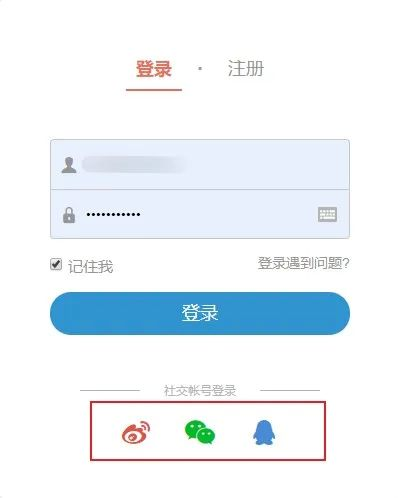

<font style="color:rgb(51, 51, 51);">打开登录页面你会发现，除了最简单的账户密码登录外，还为我们提供了微博、微信、QQ 等快捷登录方式。假设选择了快捷登录，它会提示我们扫码或者输入账号密码进行登录。</font>

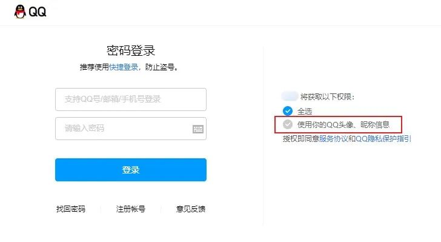

<font style="color:rgb(51, 51, 51);">登录成功之后便会将 QQ / 微信的昵称和头像等信息回填到 “网站 A” 中，此时你就可以进行点赞操作了。</font>

### <font style="color:rgb(51, 51, 51);">名词定义</font>
<font style="color:rgb(51, 51, 51);">在详细讲解</font><font style="color:rgb(51, 51, 51);background-color:rgb(243, 244, 244);">oauth2</font><font style="color:rgb(51, 51, 51);">之前，我们先来了解一下它里边用到的名词定义吧：</font>

+ <font style="color:rgb(51, 51, 51);">Client：客户端，它本身不会存储用户快捷登录的账号和密码，只是通过资源拥有者的授权去请求资源服务器的资源，即例子中的网站 A；</font>
+ <font style="color:rgb(51, 51, 51);">Resource Owner：资源拥有者，通常是用户，即例子中拥有 QQ / 微信账号的用户；</font>
+ <font style="color:rgb(51, 51, 51);">Authorization Server：认证服务器，可以提供身份认证和用户授权的服务器，即给客户端颁发</font><font style="color:rgb(51, 51, 51);background-color:rgb(243, 244, 244);">token</font><font style="color:rgb(51, 51, 51);">和校验</font><font style="color:rgb(51, 51, 51);background-color:rgb(243, 244, 244);">token</font><font style="color:rgb(51, 51, 51);">；</font>
+ <font style="color:rgb(51, 51, 51);">Resource Server：资源服务器，存储用户资源的服务器，即例子中的 QQ / 微信存储的用户信息；</font>

### <font style="color:rgb(51, 51, 51);">认证流程</font>
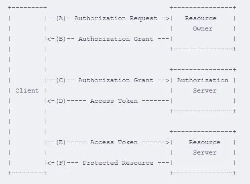

<font style="color:rgb(51, 51, 51);">如图是</font><font style="color:rgb(51, 51, 51);background-color:rgb(243, 244, 244);">oauth2</font><font style="color:rgb(51, 51, 51);">官网的认证流程图，我们来分析一下：</font>

+ <font style="color:rgb(51, 51, 51);">A 客户端向资源拥有者发送授权申请；</font>
+ <font style="color:rgb(51, 51, 51);">B 资源拥有者同意客户端的授权，返回授权码；</font>
+ <font style="color:rgb(51, 51, 51);">C 客户端使用授权码向认证服务器申请令牌</font><font style="color:rgb(51, 51, 51);background-color:rgb(243, 244, 244);">token</font><font style="color:rgb(51, 51, 51);">；</font>
+ <font style="color:rgb(51, 51, 51);">D 认证服务器对客户端进行身份校验，认证通过后发放令牌；</font>
+ <font style="color:rgb(51, 51, 51);">E 客户端拿着认证服务器颁发的令牌去资源服务器请求资源；</font>
+ <font style="color:rgb(51, 51, 51);">F 资源服务器校验令牌的有效性，返回给客户端资源信息；</font>

<font style="color:rgb(51, 51, 51);">为了大家更好的理解，我们看下面这张图</font>

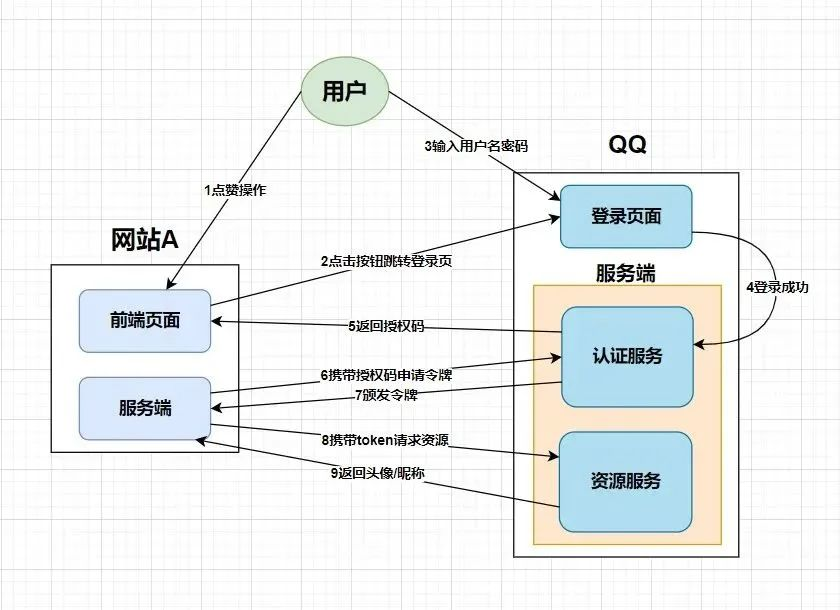

<font style="color:rgb(51, 51, 51);">到这儿，相信大家对理论知识已经掌握的差不多了，接下来我们就进入实战训练吧。</font>

## <font style="color:rgb(51, 51, 51);">实战</font>
<font style="color:rgb(51, 51, 51);">在正式开始搭建项目之前我们先来做一些准备工作：要想使用</font><font style="color:rgb(51, 51, 51);background-color:rgb(243, 244, 244);">oauth2</font><font style="color:rgb(51, 51, 51);">的服务，我们得先创建几张表。</font>

### <font style="color:rgb(51, 51, 51);">数据库</font>
<font style="color:rgb(51, 51, 51);background-color:rgb(243, 244, 244);">oauth2</font><font style="color:rgb(51, 51, 51);">相关的建表语句可以参考官方初始化 sql，也可以查看项目中的 </font>**<font style="color:rgb(51, 51, 51);">init.sql</font>**<font style="color:rgb(51, 51, 51);"> 文件</font>

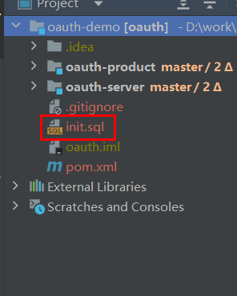

<font style="color:rgb(51, 51, 51);">至于表结构，大家可以先大体了解下，其中字段的含义，在 </font>**<font style="color:rgb(51, 51, 51);">init.sql</font>**<font style="color:rgb(51, 51, 51);"> 文件中已经做了说明。</font>

+ <font style="color:rgb(51, 51, 51);">oauth_client_details：存储客户端的配置信息，操作该表的类主要是</font><font style="color:rgb(51, 51, 51);background-color:rgb(243, 244, 244);">JdbcClientDetailsService.java</font><font style="color:rgb(51, 51, 51);">；</font>
+ <font style="color:rgb(51, 51, 51);">oauth_access_token：存储生成的令牌信息，操作该表的类主要是</font><font style="color:rgb(51, 51, 51);background-color:rgb(243, 244, 244);">JdbcTokenStore.java</font><font style="color:rgb(51, 51, 51);">；</font>
+ <font style="color:rgb(51, 51, 51);">oauth_client_token：在客户端系统中存储从服务端获取的令牌数据，操作该表的类主要是</font><font style="color:rgb(51, 51, 51);background-color:rgb(243, 244, 244);">JdbcClientDetailsService.java</font><font style="color:rgb(51, 51, 51);">；</font>
+ <font style="color:rgb(51, 51, 51);">oauth_code：存储授权码信息与认证信息，即只有</font><font style="color:rgb(51, 51, 51);background-color:rgb(243, 244, 244);">grant_type</font><font style="color:rgb(51, 51, 51);">为</font><font style="color:rgb(51, 51, 51);background-color:rgb(243, 244, 244);">authorization_code</font><font style="color:rgb(51, 51, 51);">时，该表才会有数据，操作该表的类主要是</font><font style="color:rgb(51, 51, 51);background-color:rgb(243, 244, 244);">JdbcAuthorizationCodeServices.java</font><font style="color:rgb(51, 51, 51);">；</font>
+ <font style="color:rgb(51, 51, 51);">oauth_approvals：存储用户的授权信息；</font>
+ <font style="color:rgb(51, 51, 51);">oauth_refresh_token：存储刷新令牌的</font><font style="color:rgb(51, 51, 51);background-color:rgb(243, 244, 244);">refresh_token</font><font style="color:rgb(51, 51, 51);">，如果客户端的</font><font style="color:rgb(51, 51, 51);background-color:rgb(243, 244, 244);">grant_type</font><font style="color:rgb(51, 51, 51);">不支持</font><font style="color:rgb(51, 51, 51);background-color:rgb(243, 244, 244);">refresh_token</font><font style="color:rgb(51, 51, 51);">，那么不会用到这张表，操作该表的类主要是</font><font style="color:rgb(51, 51, 51);background-color:rgb(243, 244, 244);">JdbcTokenStore</font><font style="color:rgb(51, 51, 51);">；</font>

<font style="color:rgb(51, 51, 51);">在</font><font style="color:rgb(51, 51, 51);background-color:rgb(243, 244, 244);">oauth_client_details</font><font style="color:rgb(51, 51, 51);">表中添加一条数据</font>

```java
client_id:cheetah_one //客户端名称，必须唯一
resource_ids:product_api //客户端所能访问的资源id集合,多个资源时用逗号(,)分隔
client_secret:$2a$10$h/TmLPvXozJJHXDyJEN22ensJgaciomfpOc9js9OonwWIdAnRQeoi //客户端的访问密码
scope:read,write //客户端申请的权限范围,可选值包括read,write,trust。若有多个权限范围用逗号(,)分隔
authorized_grant_types:client_credentials,implicit,authorization_code,refresh_token,password //指定客户端支持的grant_type,可选值包括authorization_code,password,refresh_token,implicit,client_credentials, 若支持多个grant_type用逗号(,)分隔
web_server_redirect_uri:http://www.baidu.com //客户端的重定向URI,可为空, 当grant_type为authorization_code或implicit时, 在Oauth的流程中会使用并检查与注册时填写的redirect_uri是否一致
access_token_validity:43200 //设定客户端的access_token的有效时间值(单位:秒),可选, 若不设定值则使用默认的有效时间值(60 * 60 * 12, 12小时)
autoapprove:false //设置用户是否自动Approval操作, 默认值为 'false', 可选值包括 'true','false', 'read','write'
```

<font style="color:rgb(51, 51, 51);">数据库中对密码进行了加密处理，大家可以在此路径下自行生成</font>

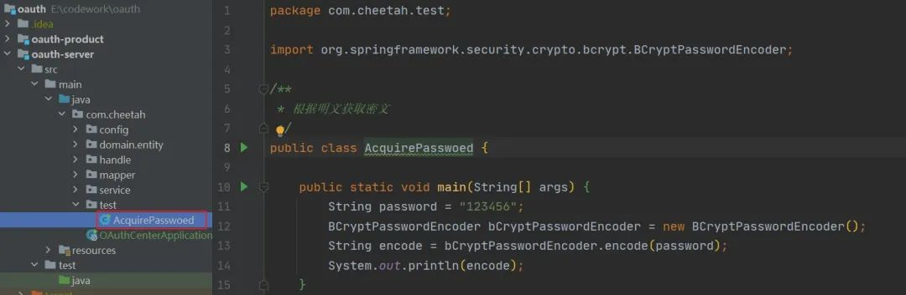

<font style="color:rgb(51, 51, 51);">用户角色相关的表也在 </font>**<font style="color:rgb(51, 51, 51);">init.sql</font>**<font style="color:rgb(51, 51, 51);"> 文件中，表结构非常简单，大家自行查阅。我的初始化数据为</font>

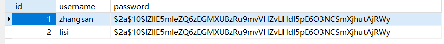

### <font style="color:rgb(51, 51, 51);">依赖引入</font>
```xml
<dependency>
  <groupId>org.springframework.boot</groupId>
  <artifactId>spring-boot-starter-web</artifactId>
</dependency>
<dependency>
  <groupId>org.springframework.cloud</groupId>
  <artifactId>spring-cloud-starter-security</artifactId>
</dependency>
<dependency>
  <groupId>org.springframework.cloud</groupId>
  <artifactId>spring-cloud-starter-oauth2</artifactId>
</dependency>
<dependency>
  <groupId>org.springframework.security</groupId>
  <artifactId>spring-security-jwt</artifactId>
</dependency>
```

<font style="color:rgb(51, 51, 51);">至于其它依赖，大家可以根据需要自行引入，不再赘述</font>

### <font style="color:rgb(51, 51, 51);">资源服务</font>
<font style="color:rgb(51, 51, 51);">配置文件对服务端口、应用名称、数据库、</font><font style="color:rgb(51, 51, 51);background-color:rgb(243, 244, 244);">mybatis</font><font style="color:rgb(51, 51, 51);">和日志进行了配置。</font>

<font style="color:rgb(51, 51, 51);">写了一个简单的控制层代码，用来模拟资源访问</font>

```java
@RestController
@RequestMapping("/product")
public class ProductController {

    @GetMapping("/findAll")
    public String findAll(){
        return "产品列表查询成功";
    }
}
```

<font style="color:rgb(51, 51, 51);">接着创建配置类继承</font><font style="color:rgb(51, 51, 51);background-color:rgb(243, 244, 244);">ResourceServerConfigurerAdapter</font><font style="color:rgb(51, 51, 51);">并增加</font><font style="color:rgb(51, 51, 51);background-color:rgb(243, 244, 244);">@EnableResourceServer</font><font style="color:rgb(51, 51, 51);">注解开启资源服务，重写两个</font><font style="color:rgb(51, 51, 51);background-color:rgb(243, 244, 244);">configure</font><font style="color:rgb(51, 51, 51);">方法</font>

```java
/**
 * 指定token的持久化策略
 * InMemoryTokenStore 表示将token存储在内存中
 * RedisTokenStore 表示将token存储在redis中
 * JdbcTokenStore 表示将token存储在数据库中
 * @return
 */
@Bean
public TokenStore jdbcTokenStore(){
    return new JdbcTokenStore(dataSource);
}

/**
 * 指定当前资源的id和token的存储策略
 * @param resources
 * @throws Exception
 */
@Override
public void configure(ResourceServerSecurityConfigurer resources) throws Exception {
    //此处的id可以写在配置文件中，这里我们先写死
    resources.resourceId("product_api").tokenStore(jdbcTokenStore());
}


/**
 * 设置请求权限和header处理
 * @param http
 * @throws Exception
 */
@Override
public void configure(HttpSecurity http) throws Exception {
    //固定写法
    http.authorizeRequests()
    //指定不同请求方式访问资源所需的权限，一般查询是read，其余都是write
    .antMatchers(HttpMethod.GET,"/**").access("#oauth2.hasScope('read')")
    .antMatchers(HttpMethod.POST,"/**").access("#oauth2.hasScope('write')")
    .antMatchers(HttpMethod.PATCH,"/**").access("#oauth2.hasScope('write')")
    .antMatchers(HttpMethod.PUT,"/**").access("#oauth2.hasScope('write')")
    .antMatchers(HttpMethod.DELETE,"/**").access("#oauth2.hasScope('write')")
    .and()
    .headers().addHeaderWriter((request,response) -> {
        //域名不同或者子域名不一样并且是ajax请求就会出现跨域问题
        //允许跨域
        response.addHeader("Access-Control-Allow-Origin","*");
        //跨域中会出现预检请求，如果不能通过，则真正请求也不会发出
        //如果是跨域的预检请求，则原封不动向下传递请求头信息，否则预检请求会丢失请求头信息（主要是token信息）
        if(request.getMethod().equals("OPTIONS")){
            response.setHeader("Access-Control-Allow-Methods",request.getHeader("Access-Control-Allow-Methods"));
            response.setHeader("Access-Control-Allow-Headers",request.getHeader("Access-Control-Allow-Headers"));
        }
    });
}
```

<font style="color:rgb(51, 51, 51);">当然我们也可以配置忽略校验的</font><font style="color:rgb(51, 51, 51);background-color:rgb(243, 244, 244);">url</font><font style="color:rgb(51, 51, 51);">，在上边的</font><font style="color:rgb(51, 51, 51);background-color:rgb(243, 244, 244);">public void configure(HttpSecurity http) throws Exception</font><font style="color:rgb(51, 51, 51);">中进行配置</font>

```java
ExpressionUrlAuthorizationConfigurer<HttpSecurity>
.ExpressionInterceptUrlRegistry config = http.requestMatchers().anyRequest()
.and()
.authorizeRequests();
properties.getUrls().forEach(e -> {
    config.antMatchers(e).permitAll();
});
```

<font style="color:rgb(51, 51, 51);">因为我们是需要进行校验的，所以我把对应的代码给注释掉了</font>

<font style="color:rgb(51, 51, 51);">然后将实现了</font><font style="color:rgb(51, 51, 51);background-color:rgb(243, 244, 244);">UserDetails</font><font style="color:rgb(51, 51, 51);">的</font><font style="color:rgb(51, 51, 51);background-color:rgb(243, 244, 244);">SysUser</font><font style="color:rgb(51, 51, 51);">和实现了</font><font style="color:rgb(51, 51, 51);background-color:rgb(243, 244, 244);">GrantedAuthority</font><font style="color:rgb(51, 51, 51);">的</font><font style="color:rgb(51, 51, 51);background-color:rgb(243, 244, 244);">SysRole</font><font style="color:rgb(51, 51, 51);">放到项目中，当请求发过来时，</font><font style="color:rgb(51, 51, 51);background-color:rgb(243, 244, 244);">oauth2</font><font style="color:rgb(51, 51, 51);">会帮我们自行校验。</font>

### <font style="color:rgb(51, 51, 51);">认证服务</font>
<font style="color:rgb(51, 51, 51);">配置文件对服务端口、应用名称、数据库、</font><font style="color:rgb(51, 51, 51);background-color:rgb(243, 244, 244);">mybatis</font><font style="color:rgb(51, 51, 51);">和日志进行了配置。</font>

**<font style="color:rgb(51, 51, 51);">Security 配置</font>**

<font style="color:rgb(51, 51, 51);">①将继承了</font><font style="color:rgb(51, 51, 51);background-color:rgb(243, 244, 244);">UserDetailsService</font><font style="color:rgb(51, 51, 51);">的</font><font style="color:rgb(51, 51, 51);background-color:rgb(243, 244, 244);">ISysUserService</font><font style="color:rgb(51, 51, 51);">的实现类</font><font style="color:rgb(51, 51, 51);background-color:rgb(243, 244, 244);">SysUserServiceImpl</font><font style="color:rgb(51, 51, 51);">重写</font><font style="color:rgb(51, 51, 51);background-color:rgb(243, 244, 244);">loadUserByUsername</font><font style="color:rgb(51, 51, 51);">方法</font>

```java
@Override
public UserDetails loadUserByUsername(String username) throws UsernameNotFoundException {
    return this.baseMapper.selectOne(new LambdaQueryWrapper<SysUser>().eq(SysUser::getUsername, username));
}
```

<font style="color:rgb(51, 51, 51);">②继承</font><font style="color:rgb(51, 51, 51);background-color:rgb(243, 244, 244);">WebSecurityConfigurerAdapter</font><font style="color:rgb(51, 51, 51);">类，增加</font><font style="color:rgb(51, 51, 51);background-color:rgb(243, 244, 244);">@EnableWebSecurity</font><font style="color:rgb(51, 51, 51);">注解并重写方法</font>

```java
/**
 * 指定认证对象的来源和加密方式
 * @param auth
 * @throws Exception
 */
@Override
public void configure(AuthenticationManagerBuilder auth) throws Exception {
    auth.userDetailsService(userService).passwordEncoder(passwordEncoder());
}

/**
 * 安全拦截机制（最重要）
 * @param httpSecurity
 * @throws Exception
 */
@Override
public void configure(HttpSecurity httpSecurity) throws Exception {
    httpSecurity
    //CSRF禁用，因为不使用session
    .csrf().disable()
    .authorizeRequests()
    //登录接口和静态资源不需要认证
    .antMatchers("/login*","/css/*").permitAll()
    //除上面的所有请求全部需要认证通过才能访问
    .anyRequest().authenticated()
    //返回HttpSecurity以进行进一步的自定义,证明是一次新的配置的开始
    .and()
    .formLogin()
    //如果未指定此页面，则会跳转到默认页面
    //                .loginPage("/login.html")
    .loginProcessingUrl("/login")
    .permitAll()
    //认证失败处理类
    .failureHandler(customAuthenticationFailureHandler);
}

/**
 * AuthenticationManager 对象在OAuth2.0认证服务中要使用，提前放入IOC容器中
 * @return
 * @throws Exception
 */
@Override
@Bean
public AuthenticationManager authenticationManagerBean() throws Exception {
return super.authenticationManagerBean();
}
```

**<font style="color:rgb(51, 51, 51);">AuthorizationServer 配置</font>**

<font style="color:rgb(51, 51, 51);">①继承</font><font style="color:rgb(51, 51, 51);background-color:rgb(243, 244, 244);">AuthorizationServerConfigurerAdapter</font><font style="color:rgb(51, 51, 51);">类，增加</font><font style="color:rgb(51, 51, 51);background-color:rgb(243, 244, 244);">@EnableAuthorizationServer</font><font style="color:rgb(51, 51, 51);">注解开启认证服务</font>

<font style="color:rgb(51, 51, 51);">②依赖注入，注入 7 个实例</font><font style="color:rgb(51, 51, 51);background-color:rgb(243, 244, 244);">Bean</font><font style="color:rgb(51, 51, 51);">对象</font>

```java
/**
 * 数据库连接池对象
 */
private final DataSource dataSource;

/**
 * 认证业务对象
 */
private final ISysUserService userService;

/**
 * 授权码模式专用对象
 */
private final AuthenticationManager authenticationManager;

/**
 * 客户端信息来源
 * @return
 */
@Bean
public JdbcClientDetailsService jdbcClientDetailsService(){
    return new JdbcClientDetailsService(dataSource);
}

/**
 * token保存策略
 * @return
 */
@Bean
public TokenStore tokenStore(){
    return new JdbcTokenStore(dataSource);
}

/**
 * 授权信息保存策略
 * @return
 */
@Bean
public ApprovalStore approvalStore(){
    return new JdbcApprovalStore(dataSource);
}

/**
 * 授权码模式数据来源
 * @return
 */
@Bean
public AuthorizationCodeServices authorizationCodeServices(){
    return new JdbcAuthorizationCodeServices(dataSource);
}
```

<font style="color:rgb(51, 51, 51);">③重写方法进行配置</font>

```java
/**
 * 用来配置客户端详情服务（ClientDetailsService）
 * 客户端详情信息在这里进行初始化
 * 指定客户端信息的数据库来源
 * @param clients
 * @throws Exception
 */
@Override
public void configure(ClientDetailsServiceConfigurer clients) throws Exception {
    clients.withClientDetails(jdbcClientDetailsService());
}

/**
 * 检测 token 的策略
 * @param security
 * @throws Exception
 */
@Override
public void configure(AuthorizationServerSecurityConfigurer security) throws Exception {
    security
    //允许客户端以form表单的方式将token传达给我们
    .allowFormAuthenticationForClients()
    //检验token必须需要认证
    .checkTokenAccess("isAuthenticated()");
}


/**
 * OAuth2.0的主配置信息
 * @param endpoints
 * @throws Exception
 */
@Override
public void configure(AuthorizationServerEndpointsConfigurer endpoints) throws Exception {
    endpoints
    //刷新token时会验证当前用户是否已经通过认证
    .userDetailsService(userService)
    .approvalStore(approvalStore())
    .authenticationManager(authenticationManager)
    .authorizationCodeServices(authorizationCodeServices())
    .tokenStore(tokenStore());
}
```

<font style="color:rgb(51, 51, 51);">其它关于用户表和权限表的代码可参考源码</font>

## <font style="color:rgb(51, 51, 51);">模式</font>
### <font style="color:rgb(51, 51, 51);">授权码模式</font>
<font style="color:rgb(51, 51, 51);">我们前边所讲的内容都是基于授权码模式，授权码模式被称为最安全的一种模式，它获取令牌的操作是在两个服务端进行的，极大的减小了令牌泄漏的风险。</font>

<font style="color:rgb(51, 51, 51);">启动两个服务，当我们再次请求</font>[http://127.0.0.1:9002/product/findAl](http://127.0.0.1:9002/product/findAl)<font style="color:rgb(51, 51, 51);">l接口时会提示以下错误</font>

```json
{
  "error": "unauthorized",
  "error_description": "Full authentication is required to access this resource"
}
```

<font style="color:rgb(51, 51, 51);">①调用接口获取授权码</font>

<font style="color:rgb(51, 51, 51);">发送</font>[http://127.0.0.1:9001/oauth/authorize?response_type=code&client_id=cheetah_one](http://127.0.0.1:9001/oauth/authorize?response_type=code&client_id=cheetah_one)<font style="color:rgb(51, 51, 51);">请求，前边的路径是固定形式的，</font><font style="color:rgb(51, 51, 51);background-color:rgb(243, 244, 244);">response_type=code</font><font style="color:rgb(51, 51, 51);">表示获取授权码，</font><font style="color:rgb(51, 51, 51);background-color:rgb(243, 244, 244);">client_id=cheetah_one</font><font style="color:rgb(51, 51, 51);">表示客户端的名称是我们数据库配置的数据。</font>

<font style="color:rgb(51, 51, 51);">账号：lisi</font>

<font style="color:rgb(51, 51, 51);">密码：123456</font>

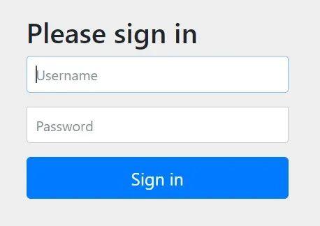

<font style="color:rgb(51, 51, 51);">该页面是</font><font style="color:rgb(51, 51, 51);background-color:rgb(243, 244, 244);">oauth2</font><font style="color:rgb(51, 51, 51);">的默认页面，输入用户的账户密码点击登录会提示我们进行授权，这是数据库</font><font style="color:rgb(51, 51, 51);background-color:rgb(243, 244, 244);">oauth_client_details</font><font style="color:rgb(51, 51, 51);">表我们设置</font><font style="color:rgb(51, 51, 51);background-color:rgb(243, 244, 244);">autoapprove</font><font style="color:rgb(51, 51, 51);">为</font><font style="color:rgb(51, 51, 51);background-color:rgb(243, 244, 244);">false</font><font style="color:rgb(51, 51, 51);">起到的效果。</font>

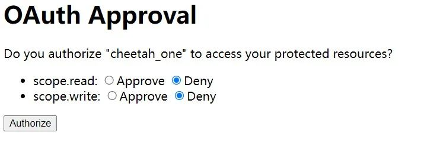

<font style="color:rgb(51, 51, 51);">选择</font><font style="color:rgb(51, 51, 51);background-color:rgb(243, 244, 244);">Approve</font><font style="color:rgb(51, 51, 51);">点击</font><font style="color:rgb(51, 51, 51);background-color:rgb(243, 244, 244);">Authorize</font><font style="color:rgb(51, 51, 51);">按钮，会发现我们设置的回调地址（</font><font style="color:rgb(51, 51, 51);background-color:rgb(243, 244, 244);">oauth_client_details</font><font style="color:rgb(51, 51, 51);">表中的</font><font style="color:rgb(51, 51, 51);background-color:rgb(243, 244, 244);">web_server_redirect_uri</font><font style="color:rgb(51, 51, 51);">）后边拼接了</font><font style="color:rgb(51, 51, 51);background-color:rgb(243, 244, 244);">code</font><font style="color:rgb(51, 51, 51);">值，该值就是授权码。</font>


<font style="color:rgb(51, 51, 51);">查看数据库发现</font><font style="color:rgb(51, 51, 51);background-color:rgb(243, 244, 244);">oauth_approvals</font><font style="color:rgb(51, 51, 51);">和</font><font style="color:rgb(51, 51, 51);background-color:rgb(243, 244, 244);">oauth_code</font><font style="color:rgb(51, 51, 51);">表已经存入数据了。</font>

<font style="color:rgb(51, 51, 51);">拿着授权码去获取</font><font style="color:rgb(51, 51, 51);background-color:rgb(243, 244, 244);">token</font>

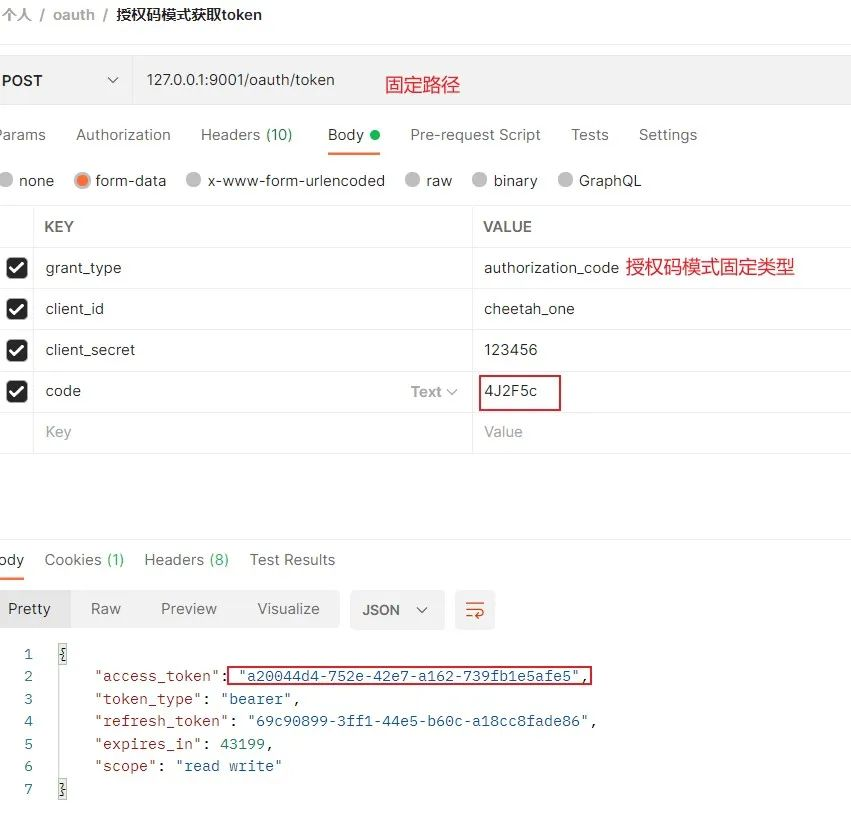

<font style="color:rgb(51, 51, 51);">获取到</font><font style="color:rgb(51, 51, 51);background-color:rgb(243, 244, 244);">token</font><font style="color:rgb(51, 51, 51);">之后</font><font style="color:rgb(51, 51, 51);background-color:rgb(243, 244, 244);">oauth_access_token</font><font style="color:rgb(51, 51, 51);">和</font><font style="color:rgb(51, 51, 51);background-color:rgb(243, 244, 244);">oauth_refresh_token</font><font style="color:rgb(51, 51, 51);">表中会存入数据以用于后边的认证。而</font><font style="color:rgb(51, 51, 51);background-color:rgb(243, 244, 244);">oauth_code</font><font style="color:rgb(51, 51, 51);">表中的数据被清除了，这是因为</font><font style="color:rgb(51, 51, 51);background-color:rgb(243, 244, 244);">code</font><font style="color:rgb(51, 51, 51);">值是直接暴漏在网页链接上的，</font><font style="color:rgb(51, 51, 51);background-color:rgb(243, 244, 244);">oauth2</font><font style="color:rgb(51, 51, 51);">为了防止他人拿到</font><font style="color:rgb(51, 51, 51);background-color:rgb(243, 244, 244);">code</font><font style="color:rgb(51, 51, 51);">非法请求而特意设置为仅用一次。</font>

<font style="color:rgb(51, 51, 51);">拿着获取到的</font><font style="color:rgb(51, 51, 51);background-color:rgb(243, 244, 244);">token</font><font style="color:rgb(51, 51, 51);">去请求资源服务的接口，此时有两种请求方式</font>

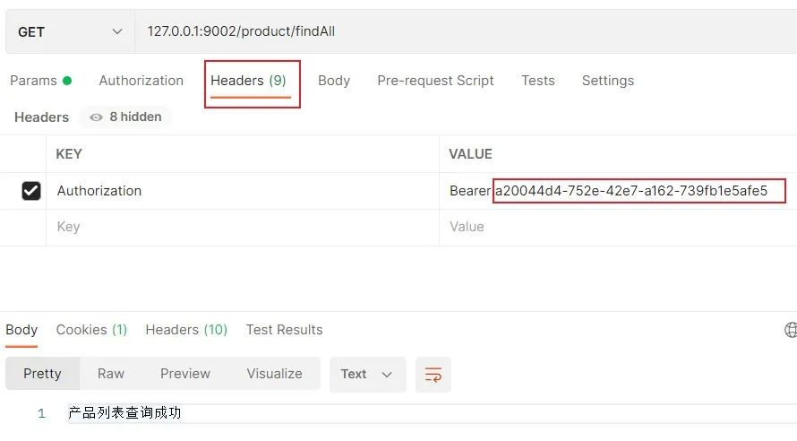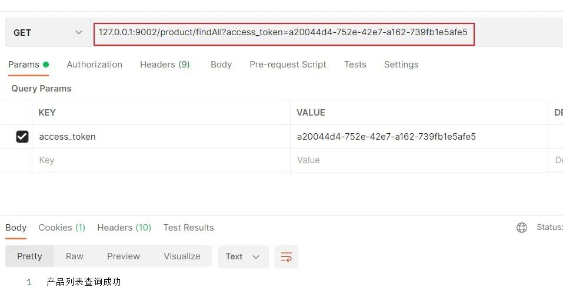

<font style="color:rgb(51, 51, 51);">接下来我们再来看一下</font><font style="color:rgb(51, 51, 51);background-color:rgb(243, 244, 244);">oauth2</font><font style="color:rgb(51, 51, 51);">的其它模式。</font>

### <font style="color:rgb(51, 51, 51);">简化模式</font>
<font style="color:rgb(51, 51, 51);">所谓简化模式是针对授权码模式进行的简化，它将授权码模式中获取授权码的步骤省略了，直接去请求获取</font><font style="color:rgb(51, 51, 51);background-color:rgb(243, 244, 244);">token</font><font style="color:rgb(51, 51, 51);">。</font>

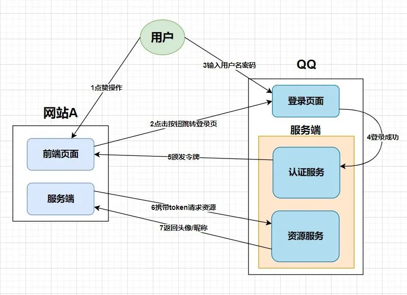

<font style="color:rgb(51, 51, 51);">流程：发送请求</font>[http://127.0.0.1:9001/oauth/authorizeresponse_type=token&client_id=cheetah_one](http://127.0.0.1:9001/oauth/authorize?response_type=token&client_id=cheetah_one)

<font style="color:rgb(51, 51, 51);">跳转到登录页进行登录，</font><font style="color:rgb(51, 51, 51);background-color:rgb(243, 244, 244);">response_type=token</font><font style="color:rgb(51, 51, 51);">表示获取</font><font style="color:rgb(51, 51, 51);background-color:rgb(243, 244, 244);">token</font><font style="color:rgb(51, 51, 51);">。</font>

<font style="color:rgb(51, 51, 51);">输入账号密码登录之后会直接在浏览器返回</font><font style="color:rgb(51, 51, 51);background-color:rgb(243, 244, 244);">token</font><font style="color:rgb(51, 51, 51);">，我们就可以像授权码方式一样携带</font><font style="color:rgb(51, 51, 51);background-color:rgb(243, 244, 244);">token</font><font style="color:rgb(51, 51, 51);">去请求资源了。</font>


<font style="color:rgb(51, 51, 51);">该模式的弊端就是</font><font style="color:rgb(51, 51, 51);background-color:rgb(243, 244, 244);">token</font><font style="color:rgb(51, 51, 51);">直接暴漏在浏览器中，非常不安全，</font>**<font style="color:rgb(51, 51, 51);">不建议使用</font>**<font style="color:rgb(51, 51, 51);">。</font>

### <font style="color:rgb(51, 51, 51);">密码模式</font>
<font style="color:rgb(51, 51, 51);">密码模式下，用户需要将账户和密码提供给客户端向认证服务器申请令牌，所以该种模式需要用户高度信任客户端。</font>

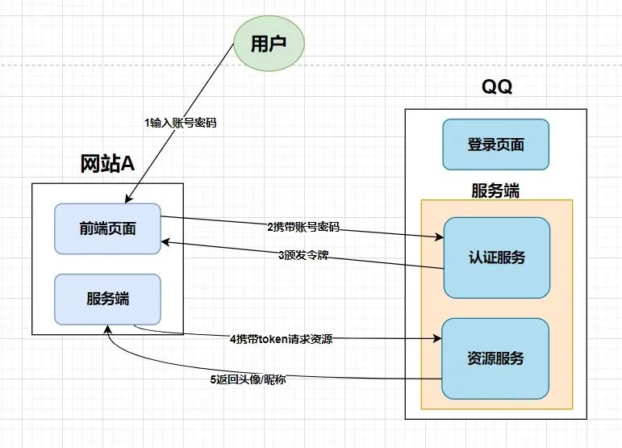

<font style="color:rgb(51, 51, 51);">流程：请求如下</font>

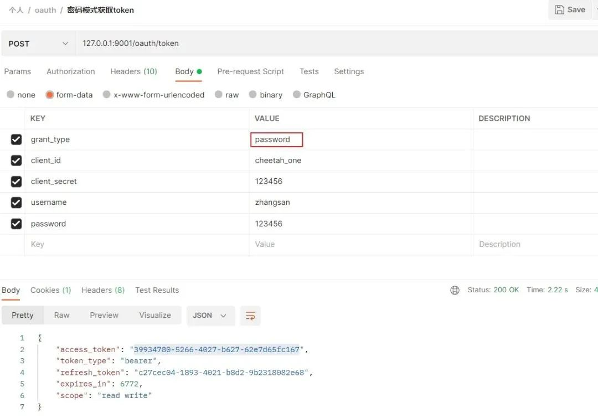

<font style="color:rgb(51, 51, 51);">获取成功之后可以去访问资源了。</font>

### <font style="color:rgb(51, 51, 51);">客户端模式</font>
<font style="color:rgb(51, 51, 51);">客户端模式已经不太属于</font><font style="color:rgb(51, 51, 51);background-color:rgb(243, 244, 244);">oauth2</font><font style="color:rgb(51, 51, 51);">的范畴了，用户直接在客户端进行注册，然后客户端去认证服务器获取令牌时不需要携带用户信息，完全脱离了用户，也就不存在授权问题了。</font>

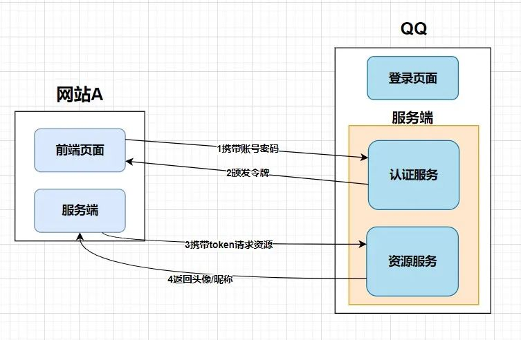

<font style="color:rgb(51, 51, 51);">发送请求如下</font>

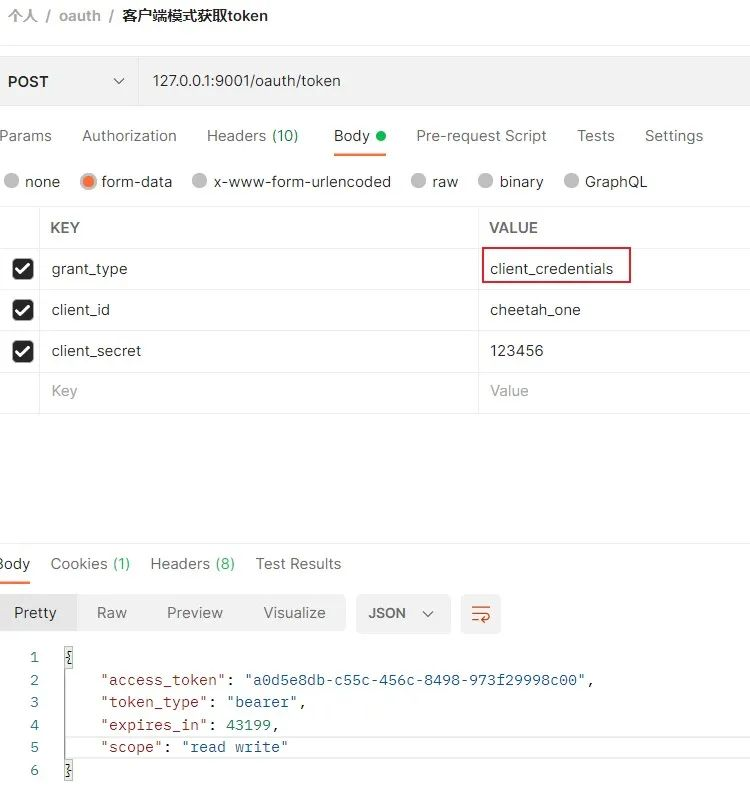

<font style="color:rgb(51, 51, 51);">获取成功之后可以去访问资源了。</font>

### <font style="color:rgb(51, 51, 51);">刷新 token</font>
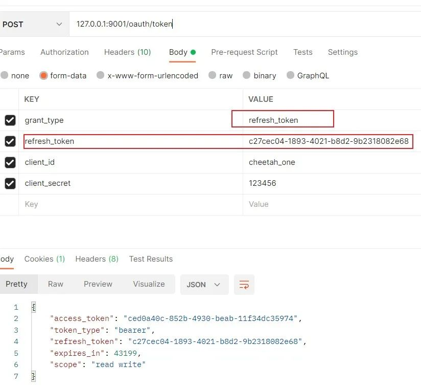

### <font style="color:rgb(51, 51, 51);">权限校验</font>
<font style="color:rgb(51, 51, 51);">除了我们在数据库中为客户端配置资源服务外，我们还可以动态的给用户分配接口的权限。</font>

<font style="color:rgb(51, 51, 51);">①开启</font><font style="color:rgb(51, 51, 51);background-color:rgb(243, 244, 244);">Security</font><font style="color:rgb(51, 51, 51);">内置的动态配置</font>

<font style="color:rgb(51, 51, 51);">在开启资源服务时给</font><font style="color:rgb(51, 51, 51);background-color:rgb(243, 244, 244);">ResourceServerConfig</font><font style="color:rgb(51, 51, 51);">类增加注解</font><font style="color:rgb(51, 51, 51);background-color:rgb(243, 244, 244);">@EnableGlobalMethodSecurity(securedEnabled = true,prePostEnabled = true)</font>

<font style="color:rgb(51, 51, 51);">②给接口增加权限</font>

```java
@GetMapping("/findAll")
@Secured("ROLE_PRODUCT")
public String findAll(){
    return "产品列表查询成功";
}
```

<font style="color:rgb(51, 51, 51);">③在用户登录时设置用户权限</font>

```java
@Override
public UserDetails loadUserByUsername(String username) throws UsernameNotFoundException {
    SysUser sysUser = this.baseMapper.selectOne(new LambdaQueryWrapper<SysUser>().eq(SysUser::getUsername, username));
    sysUser.setRoleList(AuthorityUtils.commaSeparatedStringToAuthorityList("ROLE_PRODUCT"));
    return sysUser;
}
```

<font style="color:rgb(51, 51, 51);">然后测试会发现可以正常访问。</font>


## <font style="color:rgb(51, 51, 51);">总结</font>
<font style="color:rgb(51, 51, 51);">从原理、应用场景、认证流程出发，对</font><font style="color:rgb(51, 51, 51);background-color:rgb(243, 244, 244);">oauth2</font><font style="color:rgb(51, 51, 51);">进行了基本的讲解，并且给大家讲解了项目的搭建。</font>

<font style="color:rgb(51, 51, 51);">大家在对授权码模式、简化模式、密码模式、客户端模式进行测试的同时要将重点放到授权码模式上。</font>


> 更新: 2024-05-15 08:51:57  
> 原文: <https://www.yuque.com/aaron-wecc3/dhluml/lk58e2ycwiiui2gh>