# 23.阿里内部MySQL索引优化最佳实践

**本次分享内容**

1、Explain工具

2、Explain中的列

3、索引优化最佳实践


MySQL版本：8.2.0

在数据库优化中，索引优化是一种重要的技术。在MySQL中，我们可以使用Explain工具来分析SQL查询，从而更好地理解查询的执行计划，找出可能的性能瓶颈，进行相应的优化。

# Explain工具
Explain是MySQL提供的一种工具，可以用来分析SQL查询的执行计划。使用Explain工具，我们可以看到MySQL如何使用索引来处理SQL查询，包括哪些索引被使用，如何被使用，以及数据的检索顺序等信息。

使用Explain的基本语法是：

```sql
EXPLAIN SELECT * FROM table_name;
```

这将显示出查询的执行计划。

好的，这是按照您的要求修改后的SQL建表语句和INSERT语句。

## 示例表格
创建名为demo的数据库的SQL脚本：

```sql
CREATE DATABASE demo CHARACTER SET utf8 COLLATE utf8_general_ci;
```

假设我们有以下三个表：游戏（game）、玩家（player）和玩家记录表（player_record）。

```sql
-- 游戏表
DROP TABLE IF EXISTS game;
CREATE TABLE game (
  id INT PRIMARY KEY,
  name VARCHAR(50),
  KEY `idx_name` (`name`)
) ENGINE=InnoDB DEFAULT CHARSET=utf8;

-- 玩家表
DROP TABLE IF EXISTS player;
CREATE TABLE player (
  id INT PRIMARY KEY,
  name VARCHAR(50)
) ENGINE=InnoDB DEFAULT CHARSET=utf8;

-- 玩家记录表
DROP TABLE IF EXISTS player_record;
CREATE TABLE player_record (
    id INT  PRIMARY KEY AUTO_INCREMENT,
    player_id INT,
    game_id INT,
    play_times INT,
    KEY `idx_game_player_id` (`game_id`,`player_id`)
) ENGINE=InnoDB DEFAULT CHARSET=utf8;

INSERT INTO game (id, name) VALUES (1, 'Game1'), (2, 'Game2'), (3, 'Game3');
INSERT INTO player (id, name) VALUES (1, 'Player1'), (2, 'Player2'), (3, 'Player3');
INSERT INTO player_record (id, player_id, game_id, play_times) VALUES (1, 1, 1, 10);
INSERT INTO player_record (id, player_id, game_id, play_times) VALUES (2, 2, 2, 8);
INSERT INTO player_record (id, player_id, game_id, play_times) VALUES (3, 3, 3, 12);
```

## Explain两个变种
Explain有两个变种：EXPLAIN FORMAT=JSON(MySQL 5.6引入) 和 EXPLAIN FORMAT=TREE(MySQL 8.0.16引入)。这两个变种提供了更详细的查询执行计划信息。

注意：EXPLAIN EXTENDED 是在 MySQL 4.1 版本中引入的。这个命令可以提供关于 MySQL 如何执行 SQL 查询的更多信息。然而，从 MySQL 8.0.23 开始，EXPLAIN EXTENDED 已经被弃用，因为它们的功能已经被包含在 EXPLAIN FORMAT=JSON 和 EXPLAIN FORMAT=TREE 中。

### EXPLAIN FORMAT=JSON
EXPLAIN FORMAT=JSON 提供了JSON格式的查询执行计划。例如：

```sql
EXPLAIN FORMAT=JSON SELECT * FROM game;
```

输出结果：

```json
{
  "query_block": {
    "select_id": 1,
    "cost_info": {
      "query_cost": "0.55"
    },
    "table": {
      "table_name": "game",
      "access_type": "ALL",
      "rows_examined_per_scan": 3,
      "rows_produced_per_join": 3,
      "filtered": "100.00",
      "cost_info": {
        "read_cost": "0.25",
        "eval_cost": "0.30",
        "prefix_cost": "0.55",
        "data_read_per_join": "480"
      },
      "used_columns": [
        "id",
        "name"
      ]
    }
  }
}
```

### EXPLAIN FORMAT=TREE
EXPLAIN FORMAT=TREE 提供了树状图的查询执行计划。例如：

```sql
EXPLAIN FORMAT=TREE SELECT player.id,player.NAME,play_times FROM player JOIN player_record ON player.id=player_id WHERE play_times> 100;
```

输出结果：

```sql
-> Nested loop inner join  (cost=0.9 rows=1)
    -> Filter: ((player_record.play_times > 100) and (player_record.player_id is not null))  (cost=0.55 rows=1)
        -> Table scan on player_record  (cost=0.55 rows=3)
    -> Single-row index lookup on player using PRIMARY (id=player_record.player_id)  (cost=0.35 rows=1)
```

### SHOW WARNINGS
SHOW WARNINGS; 是一个MySQL命令，用于显示在最后一个SQL语句执行过程中产生的错误、警告和注意信息。如果你执行了一个SQL语句，然后立即执行 SHOW WARNINGS;，那么它将显示与刚才执行的SQL语句相关的所有警告和错误信息。

例如：

```sql
SELECT  CAST(name AS UNSIGNED) FROM game;
SHOW WARNINGS;
```

在这个查询中，我们尝试将name字段（一个字符串）转换为无符号整数。由于name是一个字符串，这会导致转换失败，并产生一个警告。我们可以通过 SHOW WARNINGS; 来查看这个警告：

以下显示上一个 SELECT 语句产生的所有警告：

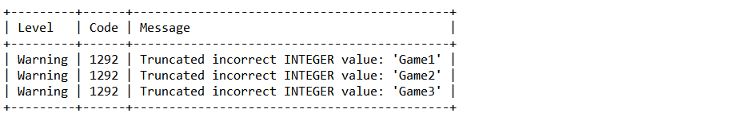

另外一个用法是通过SHOW WARNINGS查询优化后的语句

```sql
EXPLAIN FORMAT=JSON SELECT * FROM game where id =1;
SHOW WARNINGS;
```

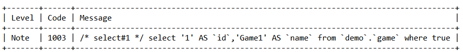

## Explain中的列
在Explain的结果中，有以下几个重要的列：

+ id: 查询的标识符
+ select_type: 查询的类型
+ table: 查询的表
+ type: 查询使用的索引的类型
+ possible_keys: 可能使用的索引
+ key: 实际使用的索引
+ key_len: 使用的索引的长度
+ ref: 使用哪个列或常量与key进行比较
+ rows: 预计需要检索的行数
+ Extra: 额外的信息

## 列的详细描述
### id
查询的标识符，如果是单个查询，则id为1。对于复杂的查询，比如子查询或者union查询，id的值会有所不同。

在 MySQL 的 EXPLAIN 语句中，id 列的含义可能会引起一些混淆。id 列的值并不直接表示执行的优先级，而是表示查询的执行顺序或者查询的层次结构。以下是一些关于 id 列的规则：

1. **相同 ****id**** 值的查询块**：这通常发生在 JOIN 操作中，在这种情况下，行的顺序就决定了表的读取和检查的顺序。在同一个 id 值的行中，先出现的行先执行。

```sql
EXPLAIN SELECT player.id,player.NAME,play_times FROM player JOIN player_record ON player.id=player_id WHERE play_times> 100;
```

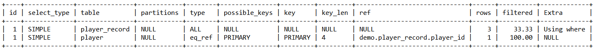

2. **不同 ****id**** 值的查询块**：这通常发生在子查询中，例如在这个查询中，主查询（SELECT player.id, ... FROM player）和子查询（SELECT MAX(play_times) FROM player_record WHERE player.id = player_record.player_id）在 EXPLAIN 输出中会有不同的 id 值。值较大的 id（在这个例子中是子查询的 id）将先执行。

```sql
EXPLAIN SELECT player.id,(SELECT MAX(play_times) FROM player_record WHERE player.id=player_record.player_id) AS max_times FROM player;
```

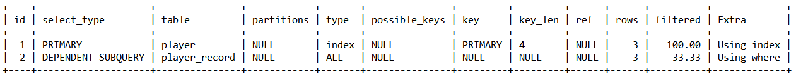

3. **UNION 或 UNION ALL 操作**：例如：，第一个 SELECT 的 id 为 1，接下来的 SELECT 的 id 会递增

```sql
EXPLAIN SELECT id FROM player WHERE id = 1 UNION SELECT id FROM game WHERE id = 1;
```

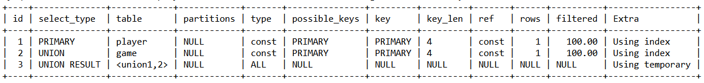

总的来说，id 列的值并不直接表示执行的优先级，而是表示查询的执行顺序和查询的层次结构。

### select_type
查询的类型，常见的类型有SIMPLE（简单查询）、PRIMARY（主查询）、SUBQUERY（子查询）、DERIVED (衍生查询) 、UNION等。

SIMPLE 是 MySQL EXPLAIN 输出中 select_type 列的一种可能值。SIMPLE 表示查询不包含任何 UNION 操作或子查询，或者如果查询是 UNION 操作或子查询的一部分，那么这个查询就是外部查询。

换句话说，如果查询没有任何复杂的部分（例如，UNION、子查询或派生表），那么 select_type 列的值就是 SIMPLE。

例如，以下查询的 select_type 值就是 SIMPLE：

```sql
EXPLAIN SELECT * FROM game WHERE id = 1;
```

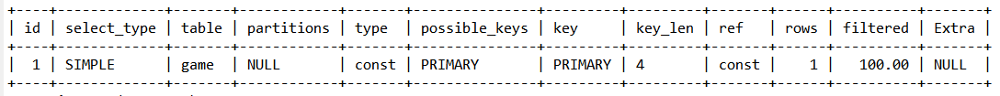

这是因为这个查询没有使用 UNION 操作，也没有包含任何子查询或派生表。

注意：MySQL 5.7 引入了一个新特性，即对衍生表（derived tables）和视图进行合并的优化。这种优化可以在某些情况下提高查询性能，但在其他情况下可能会导致性能下降。如果你想关闭这个优化，可以将 optimizer_switch 系统变量的 derived_merge 值设置为 off。

这条命令会在关闭对衍生表的合并优化

```sql
SET optimizer_switch='derived_merge=off';
```

这条命令会在开启对衍生表的合并优化

```sql
set session optimizer_switch='derived_merge=on';
```

例如，对于以下子查询，我们可以看到三个不同的select_type，分别对应主查询和子查询。

```sql
SET optimizer_switch='derived_merge=off';
EXPLAIN SELECT (SELECT 1 FROM game WHERE id = 1) FROM (SELECT * FROM player WHERE id = 1) temp;
```

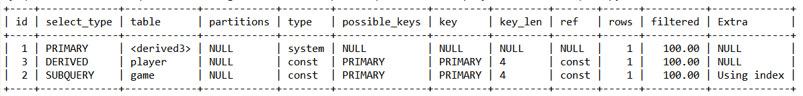

这个查询包含两个子查询：一个在 SELECT 列表中，另一个在 FROM 子句中。因此，EXPLAIN 的输出将包含三行，每行对应查询中的一个 SELECT。

以下是你可能会看到的 EXPLAIN 输出的 select_type 列的值：

1. PRIMARY：这对应查询的最外层。在这个例子中，最外层的查询是 SELECT (SELECT 1 FROM game WHERE id = 1) FROM temp。这个查询是在 temp 这个派生表上进行的。
2. SUBQUERY：这对应 SELECT 列表中的子查询。在这个例子中，子查询是 (SELECT 1 FROM game WHERE id = 1)。这个子查询是在 game 表上进行的，它是依赖于外部查询的。
3. DERIVED：这对应 FROM 子句中的子查询，也就是派生表。在这个例子中，派生表是 (SELECT * FROM player WHERE id = 1) temp。这个查询是在 player 表上进行的，它生成一个临时表 temp，然后在这个临时表上进行外部查询。

所以，PRIMARY、SUBQUERY 和 DERIVED 的区别在于它们分别表示查询的不同部分：PRIMARY 表示最外层的查询，SUBQUERY 表示 SELECT 列表中的子查询，而 DERIVED 表示 FROM 子句中的子查询（派生表）。

当你在查询中使用 UNION 或 UNION ALL 操作符时，EXPLAIN 的 select_type 列会显示 UNION。

以下是一个使用 UNION 的查询示例：

```sql
EXPLAIN SELECT id FROM player WHERE id = 1 UNION SELECT id FROM game WHERE id = 1;
```

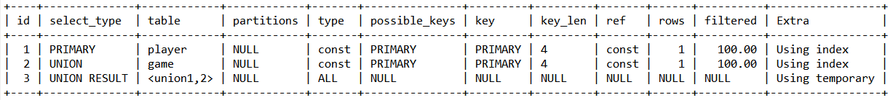

在这个查询中，我们将两个 SELECT 查询的结果合并在一起。第一个 SELECT 查询从 player 表中选择 id 为 1 的行，第二个 SELECT 查询从 game 表中选择 id 为 1 的行。

EXPLAIN 的输出将包含三行，每行对应查询中的一个 SELECT。

以下是你可能会看到的 EXPLAIN 输出的 select_type 列的值：

1. PRIMARY：这对应查询的最外层。在这个例子中，最外层的查询是 SELECT id FROM player WHERE id = 1。
2. UNION：这对应 UNION 或 UNION ALL 操作符后面的查询。在这个例子中，UNION 查询是 SELECT id FROM game WHERE id = 1。
3. UNION RESULT：这对应 UNION 或 UNION ALL 操作的结果。在这个例子中，UNION RESULT 对应的是整个 UNION 查询的结果。

所以，PRIMARY、UNION 和 UNION RESULT 的区别在于它们分别表示查询的不同部分：PRIMARY 表示 UNION 查询的第一部分，UNION 表示 UNION 查询的后续部分，而 UNION RESULT 表示整个 UNION 查询的结果。

### table
table 列显示了正在访问的表的名称。对于子查询，MySQL 将在 EXPLAIN 输出中为每个子查询生成一个单独的行，并在 table 列中显示子查询访问的表的名称。

如果子查询在 FROM 子句中，也就是派生表（DERIVED），那么 table 列将显示派生表的别名（如果提供了别名）。例如，对于查询 SELECT * FROM (SELECT * FROM player WHERE id = 1) AS temp，EXPLAIN 输出的 table 列将显示 derived.，这是派生表的别名。

如果子查询在 SELECT、WHERE 或 HAVING 子句中，也就是子查询（SUBQUERY），那么 table 列将显示子查询访问的表的名称。例如，对于查询 SELECT (SELECT name FROM player WHERE id = 1)，EXPLAIN 输出的 table 列将显示 player，这是子查询访问的表的名称。

对于 UNION 查询，table 列将显示每个 UNION 分支访问的表的名称，以及 UNION RESULT 行的 <unionM,N>，其中 M 和 N 是 UNION 分支的 id 值。

总的来说，table 列显示了查询中正在访问的表的名称，包括子查询和 UNION 查询中的表。

例如，对于以下的查询：

```sql
EXPLAIN SELECT * FROM game JOIN player_record ON game.id = player_record.game_id;
```

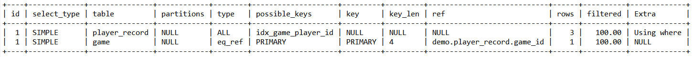

我们可以看到两个不同的table，分别对应game和player_record表。

### type
**type表示访问类型或连接类型**，也就是MySQL如何在表中找到数据行的方法，以及搜寻数据行的大致范围。

从最优到最差的顺序为：**system > const > eq_ref > ref > range > index > ALL**

通常，我们**至少要让查询达到range级别，如果能达到ref级别那就更好了**。

+ NULL：在某些情况下，MySQL 可以在查询优化阶段就解析并处理查询，这样在执行阶段就不需要再访问表或索引。比如，查询某个索引列的最大值，可以直接通过查找索引完成，无需再去访问表。

```sql
EXPLAIN select max(id) from game;
```

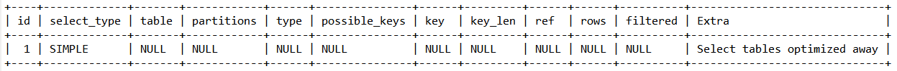

+ const, system：在某些情况下，MySQL 能够将查询的一部分进行优化，将其转换为一个常量。当查询条件是基于主键或唯一键的全部列与常数的比较时，最多只有一行匹配，这种情况下，查询速度非常快。system 是 const 的特殊情况，当表中只有一行匹配时，就会出现 system

```sql
EXPLAIN select * from (select * from game where id = 1) tmp;
```

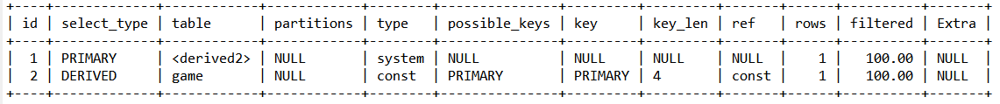

+ eq_ref：当连接使用到了主键或唯一键索引的所有部分，最多只返回一条符合条件的记录。除了 const，这可能是最高效的联接类型。但在简单的 select 查询中不会出现这种类型。

```sql
EXPLAIN SELECT * FROM player_record pr JOIN player p ON pr.player_id = p.id;
```

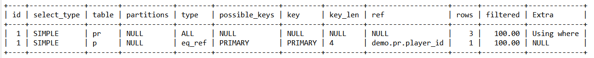

+ ref：与 eq_ref 类似，但是它使用的不是唯一索引，而是普通索引或者唯一性索引的部分前缀。它会返回多个符合条件的行。1.简单 select 查询，name是普通索引（非唯一索引）

```sql
EXPLAIN select * from game where name = 'Game1';
```

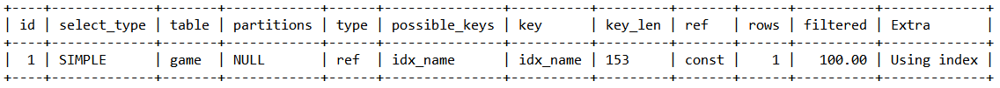

	2.关联表查询，idx_game_player_id是game_id和player_id的联合索引，这里使用到了player_record的左边前缀game_id部分。

```sql
explain select game_id from game left join player_record on game.id = player_record.game_id;
```

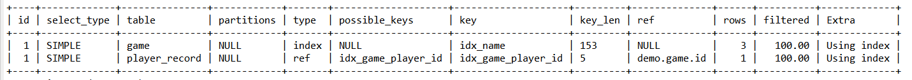

+ range：当查询条件涉及到范围时，如 in(), between ,> ,<, >= 等操作，会使用索引进行范围扫描。

```sql
EXPLAIN SELECT * FROM player WHERE id BETWEEN 1 AND 100;
```

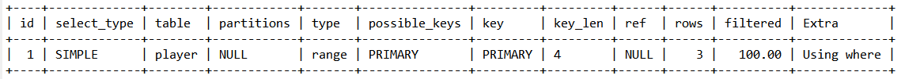

+ index：只扫描全索引就能得到结果。这通常涉及到扫描某个二级索引，这种扫描会直接遍历和扫描二级索引的叶子节点，速度相对较慢。这种查询通常使用覆盖索引，因为二级索引通常较小，所以这种方式通常比 ALL 快一些。

```sql
EXPLAIN SELECT * FROM game;
```

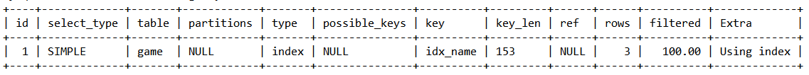

+ ALL：即全表扫描，扫描整个聚簇索引的所有叶子节点。通常情况下，这意味着需要增加索引来提高查询效率。

```sql
EXPLAIN SELECT * FROM player;
```

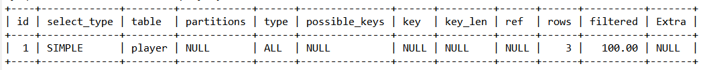

### possible_keys
可能使用的索引，如果为空，表示没有可能的索引。

例如，对于以下的查询：

```sql
EXPLAIN SELECT * FROM game WHERE id = 1;
```

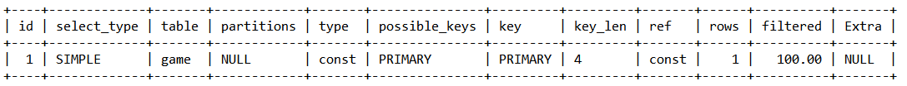

我们可以看到possible_keys为PRIMARY，表示可能使用id这个主键索引。

### key
实际使用的索引，如果为空，表示没有使用索引。

例如，对于以下的查询：

```sql
EXPLAIN SELECT * FROM game WHERE id = 1;
```

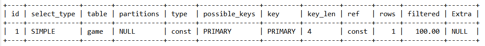

我们可以看到key为PRIMARY，表示实际使用了id这个主键索引。

### key_len
使用的索引的长度，长度越短，扫描越快。

例如，对于以下的查询：

```sql
EXPLAIN SELECT * FROM game WHERE id = 1;
```

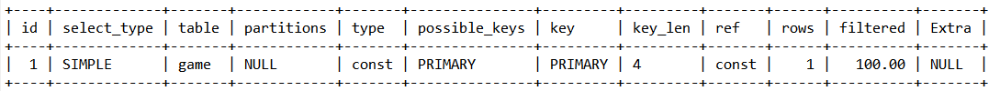

我们可以看到key_len的值，表示使用的索引的长度。

key_len计算规则如下：

+ 字符串，char(n)和varchar(n)，5.0.3以后版本中，**n均代表字符数，而不是字节数，**如果是utf-8，一个数字或字母占1个字节，一个汉字占3个字节
+ char(n)：如果存汉字长度就是 3n 字节
+ varchar(n)：如果存汉字则长度是 3n + 2 字节，加的2字节用来存储字符串长度，因为varchar是变长字符串
+ 数值类型
+ tinyint：1字节，带符号的范围是-128到127。无符号的范围是0到255。
+ smallint：2字节，带符号的范围是-32768到32767；无符号的范围是0到65535。
+ mediumin，3字节，带符号的范围是-8388608到8388607；无符号的范围是0到16777215。
+ int：4字节，带符号的范围是-2147483648到2147483647；无符号的范围是0到4294967295。
+ bigint：8字节，带符号的范围是-9223372036854775808到9223372036854775807；无符号的范围是0到18446744073709551615。
+ 时间类型
+ date：3字节
+ timestamp：4字节
+ datetime：8字节
+ 如果字段允许为 NULL，需要1字节记录是否为 NULL

索引最大长度是768字节，当字符串过长时，mysql会做一个类似左前缀索引的处理，将前半部分的字符提取出来做索引。

### ref
这一列展示了在索引中用于查找值的列或常量，例如：const（常量），字段名（如：player.id）。

```sql
EXPLAIN SELECT * FROM game WHERE id = 1;
```

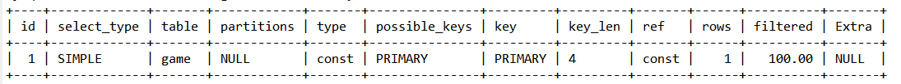

### rows
这是预测需要检查的行数，但这**并不代表结果集的行数**。

例如，在以下查询中：

```sql
EXPLAIN SELECT * FROM game;
```

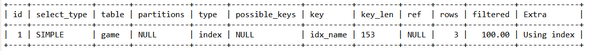

我们可以看到rows的值，这是预测需要检查的行数。

### **filtered 列**
这一列是一个百分比，通过 rows * filtered/100 可以**估计**将要与 explain 中前一个表进行连接的行数（前一个表是在 explain 中id值小于当前表id的表）。在以下例子中，如果表 player 中有三条记录，而查询优化器预测只有一条记录满足 name = 'John' 的条件，那么 filtered 列的值就是：filtered=1/3×100=33.33。

```sql
EXPLAIN SELECT * FROM player WHERE name = 'John';
```

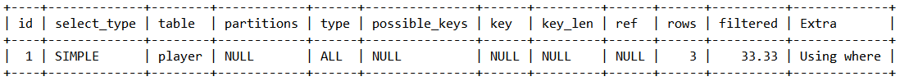

### Extra
当然，这里是修正后的内容：

1）**Using index**：表示查询使用了覆盖索引。

**覆盖索引定义**：如果查询的所有字段都可以从索引中获取，那么这个索引就被称为覆盖索引。这种情况下，MySQL 可以仅通过索引就获取到所有需要的信息，无需再去访问表。

```sql
EXPLAIN SELECT game_id FROM player_record WHERE game_id = 1;
```

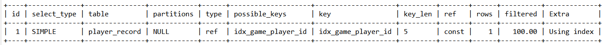

2）**Using where**：表示结果需要通过 WHERE 条件进行过滤，且查询的字段没有被索引覆盖。

```sql
EXPLAIN SELECT * FROM player WHERE name = 'John';
```


3）**Using index condition**：表示查询的字段并未完全被索引覆盖，而且 WHERE 条件中包含了一个前导列的范围。

```sql
EXPLAIN SELECT * FROM player_record WHERE game_id > 1;
```

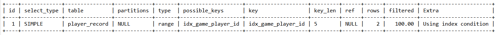

4）**Using temporary**：表示 MySQL 需要创建一个临时表来处理查询。这通常表示查询需要优化，比如通过添加索引。

1. player.name 没有索引，此时需要创建一个临时表来进行 distinct 操作。

```sql
EXPLAIN SELECT DISTINCT name FROM player;
```

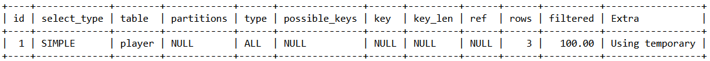

1. game.name 已经建立了索引，此时查询时不需要创建临时表。

```sql
EXPLAIN SELECT DISTINCT name FROM game;
```

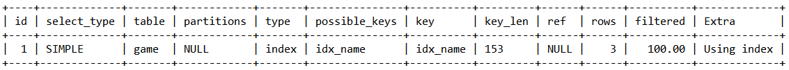

5）**Using filesort**：表示需要进行外部排序而非通过索引排序。如果数据量小，排序会在内存中完成，否则需要在磁盘上完成排序。这种情况通常需要通过添加索引来优化。

1. player.name 没有索引，会扫描整个 player 表，保存排序关键字 name 和对应的 id，然后对 name 进行排序并检索行。

```sql
EXPLAIN SELECT * FROM player ORDER BY name;
```

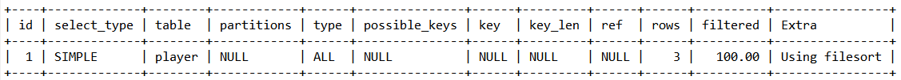

1. game.name 已经建立了索引，此时查询时不需要进行文件排序。

```sql
EXPLAIN SELECT * FROM game ORDER BY name;
```

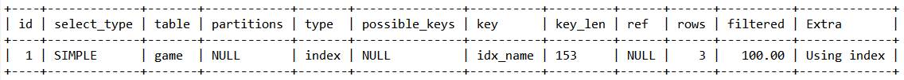

6）**Select tables optimized away**：在访问包含索引的字段时使用了某些聚合函数（如 max、min）。

```sql
EXPLAIN SELECT MIN(id) FROM game;
```

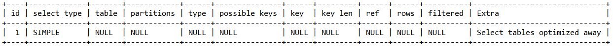

# 索引最佳实践
在数据库设计和使用中，索引是一种重要的优化手段。它能提高数据的检索速度，但同时也会增加数据的维护成本。因此，理解并掌握索引的使用技巧是非常重要的。

以下，我们将以users表为例，来探讨索引的最佳实践。

## 示例表格
```sql
DROP TABLE IF EXISTS users;
CREATE TABLE `users` (
  `id` int(11) NOT NULL AUTO_INCREMENT,
  `name` varchar(24) NOT NULL DEFAULT '' COMMENT '姓名',
  `age` int(11) NOT NULL DEFAULT '0' COMMENT '年龄',
  `type` varchar(20) NOT NULL DEFAULT '' COMMENT '用户类型',
  `register_time` timestamp NOT NULL DEFAULT CURRENT_TIMESTAMP COMMENT '注册时间',
  PRIMARY KEY (`id`)
) ENGINE=InnoDB AUTO_INCREMENT=1 DEFAULT CHARSET=utf8 COMMENT='用户表';

ALTER TABLE users ADD INDEX idx_name_age_type (name, age, type);

INSERT INTO users(name, age, type, register_time) VALUES('Alice', 25, 'admin', NOW());
INSERT INTO users(name, age, type, register_time) VALUES('Musk', 24, 'member', NOW());
INSERT INTO users(name, age, type, register_time) VALUES('Tim', 26, 'guest', NOW());
```

## 索引使用技巧
### 全值匹配
**全值匹配**：当查询条件与索引列完全匹配时，MySQL可以高效地使用索引。

```sql
EXPLAIN SELECT * FROM users WHERE name= 'Alice';
```

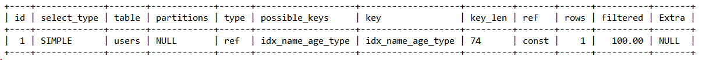

```sql
EXPLAIN SELECT * FROM users WHERE name= 'Alice' AND age = 25;
```

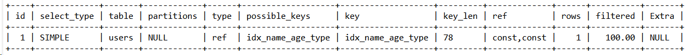

```sql
EXPLAIN SELECT * FROM users WHERE name= 'Alice' AND age = 25 AND type ='admin';
```

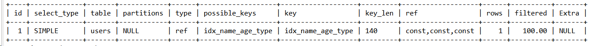

### 最左前缀原则
最左前缀原则：当查询条件从索引的最左列开始，并且不跳过索引中的列时，MySQL可以使用索引。

```sql
EXPLAIN SELECT * FROM users WHERE name = 'Musk' and age = 24;
```

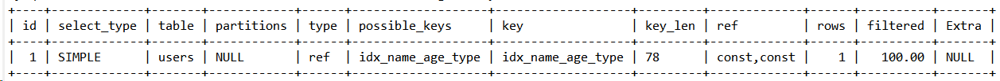

```sql
EXPLAIN SELECT * FROM users WHERE age = 24 AND type = 'member';
```

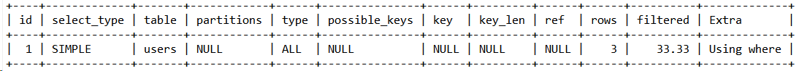

```sql
EXPLAIN SELECT * FROM users WHERE type = 'guest';
```

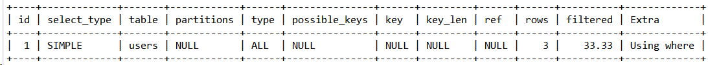

### 避免索引列操作
避免在索引列上进行操作：在索引列上进行计算、函数操作、类型转换等操作，会导致索引失效，转为全表扫描。

```sql
EXPLAIN SELECT * FROM users WHERE name = 'Alice';
```

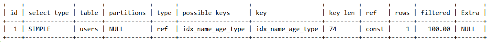

```sql
-- 计算、函数操作导致索引失效
EXPLAIN SELECT * FROM users WHERE left(name, 3) = 'Ali';
```

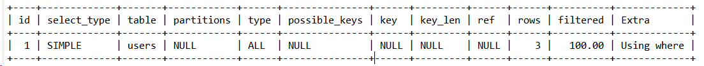

```sql
-- 给register_time增加一个普通索引
ALTER TABLE `users` ADD INDEX `idx_register_time` (`register_time`) USING BTREE ;
```

```sql
-- date类型转换导致索引失效
EXPLAIN  select * from users where date(register_time) ='2024-02-29';
```

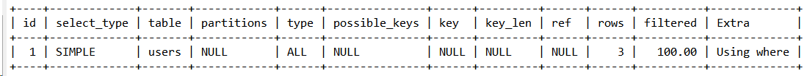

```sql
-- 转化为日期范围查询，有可能会走索引：
EXPLAIN  select * from users where register_time >='2024-02-29 00:00:00'  and  register_time <='2024-02-29 23:59:59';
```

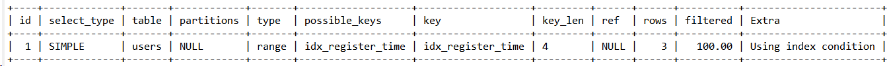

```sql
-- 还原最初索引状态
ALTER TABLE `users` DROP INDEX `idx_register_time`;
```

### 索引列范围查询
范围条件右侧的索引列无法使用：当在索引列上使用范围条件时，该条件右侧的索引列无法被使用。

```sql
EXPLAIN SELECT * FROM users WHERE name= 'Alice' AND age = 25 AND type ='admin';
```

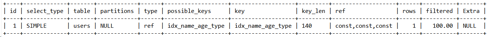

```sql
-- age使用了范围条件，导致右侧索引列无法使用
EXPLAIN SELECT * FROM users WHERE name= 'Alice' AND age > 25 AND type ='admin';
```

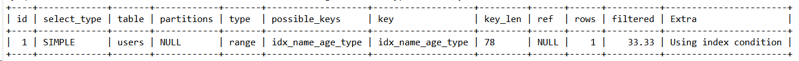

### 覆盖索引
尽量使用覆盖索引：只访问索引的查询（索引列包含查询列），可以减少select *语句的使用，提高查询效率。

```sql
-- 只查询索引列，可以提高查询效率
EXPLAIN SELECT name,age FROM users WHERE name= 'Alice' AND age = 25 AND type ='admin';
```

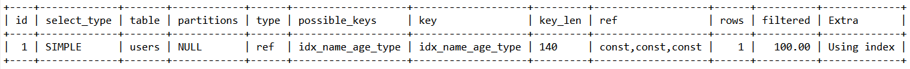

```sql
EXPLAIN SELECT * FROM users WHERE name= 'Alice' AND age = 25 AND type ='admin';
```

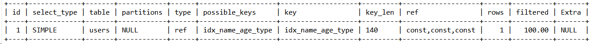

### 注意!=、not in、not exists
避免使用 (!=、not in、not exists)等操作：这些操作可能会让索引列失效，或者无法命中索引，导致全表扫描。

```sql
EXPLAIN SELECT * FROM users WHERE name = 'Alice';
```

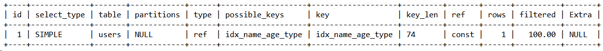

```sql
EXPLAIN SELECT * FROM users WHERE name != 'Alice';
```

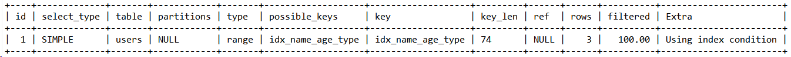

### 注意is null、is not null
避免使用is null、is not null操作：一般情况下，这些操作无法使用索引。

```sql
EXPLAIN SELECT * FROM users WHERE name is null;
```

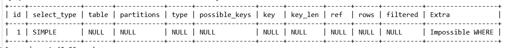

### 避免通配符开头like查询
避免使用以通配符开头的like查询：以通配符开头的like查询无法使用索引，会导致全表扫描。

```sql
EXPLAIN SELECT * FROM users WHERE name like '%lice';
```

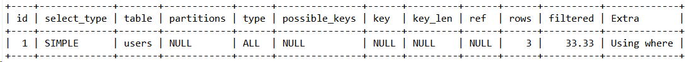

```sql
EXPLAIN SELECT * FROM users WHERE name like 'Ali%';
```

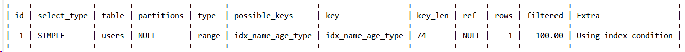

问题：如何解决LIKE '字符串%' 形式查询导致的索引失效问题？

a）实施覆盖索引策略，即确保查询涉及的所有字段都在同一覆盖索引中定义。

例如，以下查询就体现了覆盖索引的应用，因为所有查询字段（name, age, type）都在覆盖索引中定义：

```sql
EXPLAIN SELECT name, age, type FROM users WHERE name like '%lice';
```

b）如果覆盖索引策略无法实施，你可能需要考虑使用全文搜索引擎来优化查询。全文搜索引擎，如Elasticsearch或Solr，能更有效地处理此类模糊查询，尤其是在处理大量数据时。

### 注意字符串加单引号
字符串必须加单引号：否则，索引会失效。

```sql
EXPLAIN SELECT * FROM users WHERE name = '1000';
```

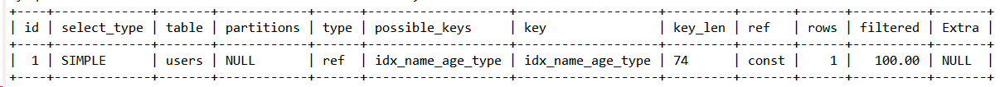

```sql
EXPLAIN SELECT * FROM users WHERE name = 1000;
```


### 避免使用or或in操作
尽量避免使用or或in操作：这些操作可能无法使用索引，具体是否使用索引取决于MySQL内部优化器的评估结果。

```sql
EXPLAIN SELECT * FROM users WHERE name = 'Alice' or name = 'Mike';
```


### 注意范围查询
范围查询优化：如果范围过大，可以将大范围拆分为多个小范围进行查询，提高查询效率。

```sql
-- 创建批量插入users表数据的存储过程
DELIMITER //
CREATE PROCEDURE InsertUsers(IN num_rows INT)
BEGIN
  DECLARE i INT DEFAULT 0;
  DECLARE random_name VARCHAR(24);
  DECLARE random_age INT;
  DECLARE random_type VARCHAR(20);

  WHILE i < num_rows DO
    SET random_name = CONCAT('User', FLOOR(RAND() * 1000000));
    SET random_age = FLOOR(RAND() * 100) + 1;
    SET random_type = CASE FLOOR(RAND() * 3)
                        WHEN 0 THEN 'admin'
                        WHEN 1 THEN 'member'
                        ELSE 'guest'
                      END;

    INSERT INTO users(name, age, type, register_time) 
    VALUES(random_name, random_age, random_type, NOW());

    SET i = i + 1;
  END WHILE;
END//
DELIMITER ;
```

```sql
-- 批量插入10000数据，方便验证范围查询
CALL InsertUsers(10000);
-- 给年龄添加单值索引
ALTER TABLE `users` ADD INDEX `idx_age` (`age`) USING BTREE ;
```

```sql
-- 执行大范围查询，索引失效
explain select * from users where age >=1 and age <=1000;
```


```sql
-- 缩小范围查询，命中索引
explain select * from users where age >=1 and age <=10;
```


```sql
-- 缩小范围查询，命中索引
explain select * from users where age >=10 and age <=20;
```


```sql
-- 还原最初索引状态
ALTER TABLE `users` DROP INDEX `idx_age`;
```

## 


> 更新: 2024-05-24 10:13:19  
> 原文: <https://www.yuque.com/aaron-wecc3/dhluml/ndtdwaaprdh9758l>