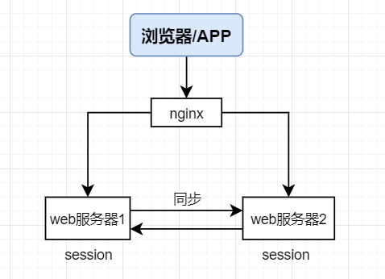
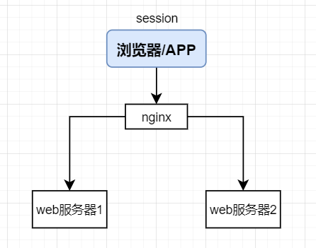
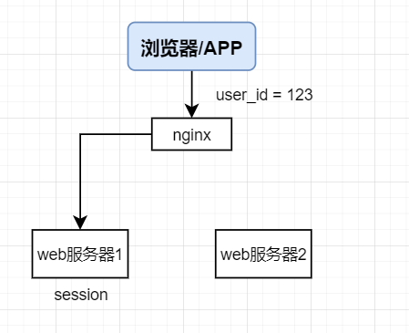
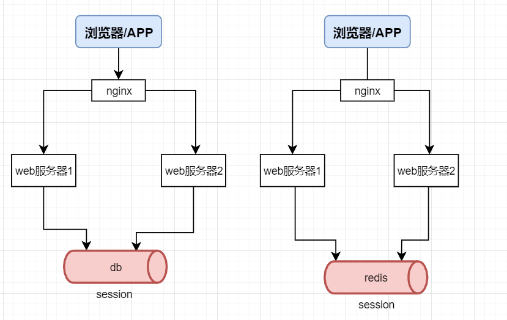

# 26.一节课讲透分布式session一致性问题

**示例代码**

[session-demo.ppt](https://www.yuque.com/attachments/yuque/0/2024/ppt/2424104/1717594440824-f85d0f1b-e327-437e-86cf-5f829e394bbf.ppt)

_<font style="color:#DF2A3F;">注：将ppt后缀名改为zip后解压</font>_

jdk版本：1.8.0_181


**本次分享内容**

1. 什么是session一致性问题?
2. 常见session一致性解决方案
3. 基于Redis实现session共享方案
4. 总结

## 1. 什么是session一致性问题?
### 1.1 什么是session?
Session 是服务器用来保存用户操作的一系列会话信息，由Web容器进行管理。最常见的，会把用户的登录信息、用户信息存储在 session 中，以保持登录状态。

Cookie技术是http状态保持在客户端的解决方案，Cookie就是由服务器发给客户端的特殊信息，而这些信息以文本文件的方式存放在客户端，然后客户端每次向服务器发送请求的时候都会带上这些特殊的信息。

cookie的内容主要包括：名字，值，过期时间，路径和域。路径与域合在一起就构成了cookie的作用范围。

### 1.2 session的创建
在会话开始时，分配一个唯一的会话标识 SessionID（sessionid 是一个会话的key，浏览器第一次访问服务器会在服务器端生成一个 session，有一个 sessionId 和它对应。），并通过 Cookie 将这个标识告诉浏览器（客户端会将 sessionID 保存在 cookie 中。），以后每次请求的时候，浏览器都会带上这个会话标识SessionID来告诉Web服务器这个请求是属于哪个会话的。在Web服务器上，各个会话都有独立的存储，保存不同会话的信息。如果遇到禁用Cookie的情况，一般的做法就是把这个会话标识放到URL的参数中。

### 1.3 session一致性问题
分布式情况下，如果每台服务器都session存在自己的内存中，不同服务器之间就会造成数据不一致问题，

这时候就需要session共享。单机情况下，不存在Session共享的情况。分布式情况下，

如果不进行Session共享会出现数据不一致，比如：会导致请求落到不同服务器要重复登录的情况。

只要用户不重启浏览器，每次http短连接请求，理论上服务端都能定位到session，保持会话。


## 2. 常见session一致性解决方案
### 2.1 session同步
思路：多个web-server之间相互同步session，这样每个web-server之间都包含全部的session  
优点：web-server支持的功能，应用程序不需要修改代码  
不足：session的同步需要数据传输，占内网带宽，有时延  
所有web-server都包含所有session数据，数据量受内存限制，无法水平扩展，有更多web-server时要歇菜




### 2.2 客户端存储法
思路：服务端存储所有用户的session，内存占用较大，可以将session存储到浏览器cookie中，每个端只要存储一个用户的数据了  
优点：服务端不需要存储  
不足：每次http请求都携带session，占外网带宽  
数据存储在端上，并在网络传输，存在泄漏、篡改、窃取等安全隐患  
session存储的数据大小受cookie限制



### 2.3 反向代理hash一致性
思路：反向代理使用http协议中的某些业务属性来做hash，例如sid，city_id，user_id等，能够更加灵活的实施hash策略，以保证同一个浏览器用户的请求落在同一个web-server上  
优点：只需要改nginx配置，不需要修改应用代码  
负载均衡，只要hash属性是均匀的，多台web-server的负载是均衡的  
可以支持web-server水平扩展（session同步法是不行的，受内存限制）  
不足：如果web-server重启，一部分session会丢失，产生业务影响，例如部分用户重新登录  
如果web-server水平扩展，rehash后session重新分布，也会有一部分用户路由不到正确的session



### 2.4 后端统一集中存储
思路：将session存储在web-server后端的存储层，数据库或者缓存  
优点：没有安全隐患  
可以水平扩展，数据库/缓存水平切分即可  
web-server重启或者扩容都不会有session丢失  
不足：增加了一次网络调用，并且需要修改应用代码




## 3. 基于Redis实现session共享方案
### 3.1 引入maven依赖
```xml
<dependency>
    <groupId>org.springframework.boot</groupId>
    <artifactId>spring-boot-starter-data-redis</artifactId>
</dependency>
<dependency>
    <groupId>org.springframework.session</groupId>
    <artifactId>spring-session-data-redis</artifactId>
</dependency>
```

### 3.2 配置redis连接参数
```properties
server.port=9001
server.servlet.session.timeout=30s
#redis
spring.redis.host=127.0.0.1
spring.redis.port=6379
spring.redis.password=
spring.session.store-type=redis
```

### 3.3 配置redis Configuration
```java
@Configuration
public class RedisSessionConfig extends RedisHttpSessionConfiguration {

    //初始化参数
    @PostConstruct
    @Override
    public void init() {
        super.init();
        super.setMaxInactiveIntervalInSeconds(10);//session超时时间，单位为秒
    }
}
```

### 
## 4. 总结
1. **session同步方案**，优点是web-server支持的功能，应用程序不需要修改代码，不足是session的同步需要数据传输，占内网带宽，有时延
2. **客户端存储法**，优点是服务端不需要存储，不足是每次http请求都携带session，占外网带宽
3. **反向代理hash一致性**，优点是只需要改nginx配置，不需要修改应用代码，负载均衡，只要hash属性是均匀的，多台web-server的负载是均衡的，不足是如果web-server重启，一部分session会丢失，产生业务影响，例如部分用户重新登录
4. **后端统一集中存储方案**，优点是没有安全隐患，可以水平扩展，数据库/缓存水平切分即可，web-server重启或者扩容都不会有session丢失，使用Redis存储用户信息的好处：安全性高、扩展性好、防止session丢失，不足是增加了一次网络调用，并且需要修改应用代码


> 更新: 2024-06-05 21:35:51  
> 原文: <https://www.yuque.com/aaron-wecc3/dhluml/dbc8smoogyq7ig49>