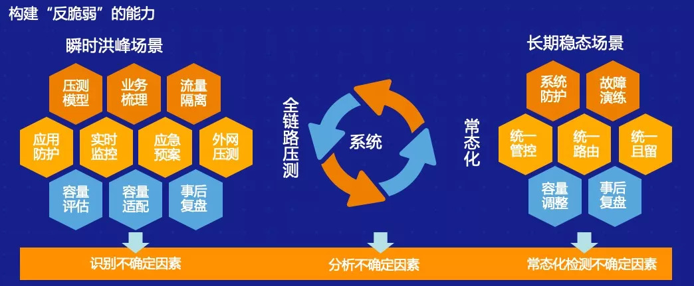
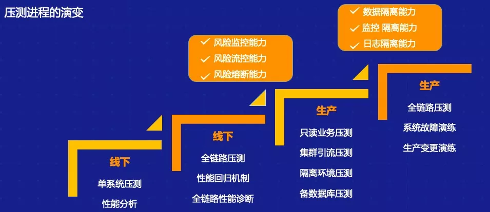
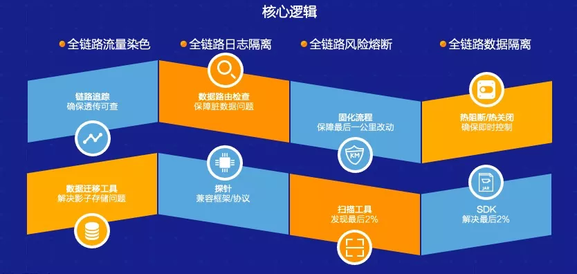
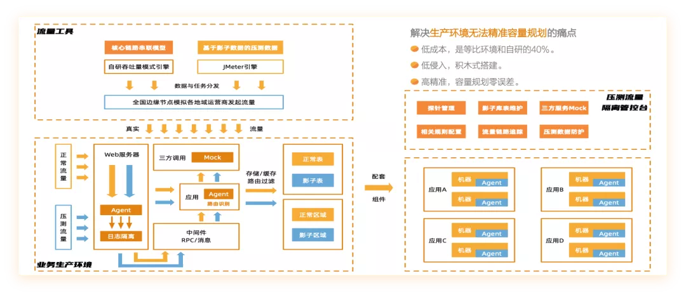
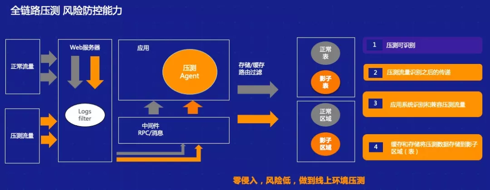
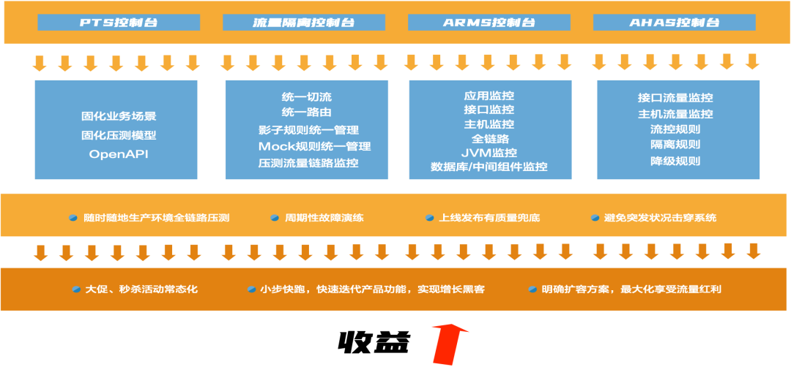
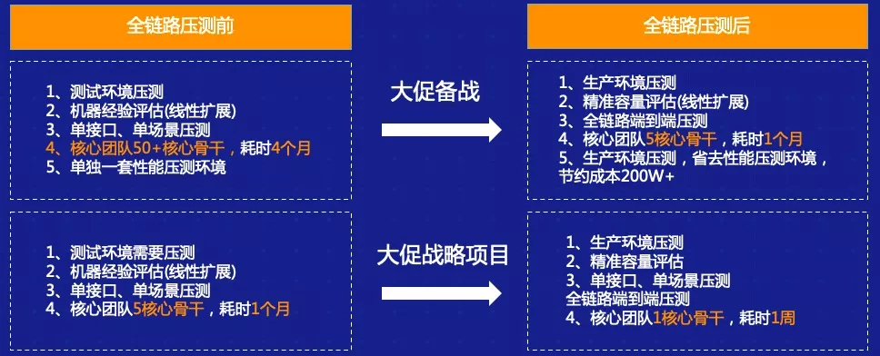
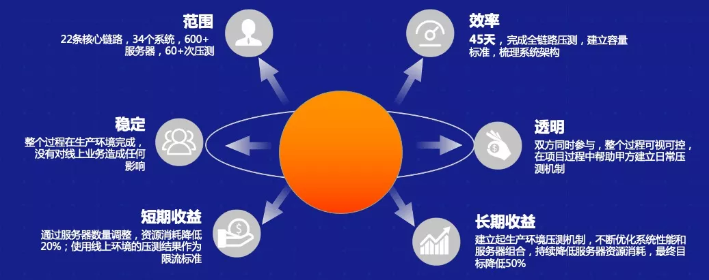

# 42.阿里全链路压测方案最佳实践

**分享内容**

1. 业务背景与全链路压测的意义
2. 全链路压测落地的技术点和解决方案
3. 生产过程中做全链路压测流程上的建议
4. 如何助力第三方实现生产环境全链路压测

## 业务背景
在阿里淘宝双 11 的过程中，长期以来都是在生产环节做全链路压测的，通过实践我们发现在生产环境中做压测，实际上会和一个 IT 组织的结构、成熟度、流程等紧密相关，所以我们把全链路压测从简单的制作范围内脱离出来，变成整个业务连续性的方案。

## 全链路压测的意义

上图显示了三个问题，实际上是不同的 IT 组织在和测试交流的时候，这三个问题是比较有代表性的。

1. 很多测试同行说他们线下也做过性能测试，但是到了线上之后还是存在很多问题，因为不太可能会在线下模拟一个跟线上 1：1 的环境。在有很多第三方接口的情况下，大家也很少会去模拟线上整个场景。因此我们在线下做了很多测试工作后，总结出了为什么很多从线下容量推导到线上容量的公司却最终效果不是很好，就是这样的原因。
2. 现在所有的 IT 组织都在搞 DevOps，我们的功能从一个月迭代一次到现在一周迭代一次，留给测试的时间越来越短。功能测试时间从之前的一周、两周缩短到现在三四天、两三天的时间，那性能测试就没有办法按时上线，很有可能会出现各种各样的性能问题，这会直接影响到企业的品牌影响力。
3. 平时线上水位比较低，很少达到高峰期，但是会出现一些突发情况。比如像去年的疫情使得很多公司的业务变成在线业务。比如教育行业，之前是课堂上老师面对面的教育，现在选择线上在线平台来做，这类突发的情况会使测试工程师，包括开发运维团队受到很大的困扰。在这之前我先介绍一个概念，这个概念是由《黑天鹅》的原作者 Nassim Nicholas Taleb 提出，概念中心是**脆弱与反脆弱**。

什么是脆弱？脆弱就像玻璃，大家知道玻璃很脆易碎。脆弱的反义词是什么？不是强韧也不是坚韧，可能是反脆弱。什么是反脆弱呢？比如乒乓球，大家知道乒乓球在地上不用很大的力就可以破坏掉，踩一脚就破坏掉了，但是高速运动的情况下，乒乓球我们施加的力度越大，它的反弹力度越大，说明乒乓球在运动过程中有反脆弱的特性。

我们的 IT 系统实际上也是这样的。不管什么代码都不能保证是完全没有问题的，我们的基础设施可能也是脆弱的，像服务器、数据库等总会有局限。我们的框架也总是脆弱的，将这些问题综合在一起，我们希望通过某些手段，比如通过预案、风险的识别，或者通过一些熔断的手段，最终把这些东西组合在一起，让整个 IT 系统有反脆弱的特性。总之，我们希望通过一些手段使得 IT 系统有足够的冗余，而且有足够多的预案应对突发的不确定性风险。

如何打造 IT 系统反脆弱能力呢？我们希望通过一些手段，比如说像线上的压测能力，提供不确定的因素，接着通过在这个过程中实时监控，包括预案的能力，最终把这些不确定性的因素识别出来，并且在线上生产压测过程中对它做一些处理，更多可能会通过事后复盘等方式，做到对不确定性因素的识别。接着我们可能会在生产环境中通过之前的手段，在生产环境上做一个稳定性的常态化压测，实现长期稳定的场景，最终我们可能达到反脆弱能力所需要的整体监控的能力、运营防护能力，以及管控路由能力，这会让整个 IT 系统具备反脆弱的特性。

## 全链路压测解决方案
如何在生产环境上做全链路压测？它需要用到哪些技术手段？

### 压测进程演变

一般情况下，测试是怎么样从线下一点点往线上演变的？我把它分为**四个阶段**：

1. 目前绝大多数 IT 可以做到的是线下单系统压测，即针对单个接口或者单个场景做压测，同时也会做系统分析和性能分析。但在复杂的业务场景之下，我们可能没办法去充分发现问题，很多都是由开发或者测试同学自发进行的活动。
2. 我们成立了一个类似于测试实验室或者测试组织的机构，这样一个大的部门可能会构造出一批类似于生产环境的性能测试环境，在这上面我们可能会做更多的事情，比如说做一个线下环境的全链路压测，并且我们可以根据之前积累的经验在上面做一些线下的回归，包括性能的诊断等。其实这一步相当于整个测试往前再走一步，对测试环境中的链路做一些分析，在上面演变一些能力，比如说风险的控制等等。
3. 目前绝大部分 IT 企业和互联网企业愿意尝试线上生产环境的业务压测。这部分实际上和之前的第二阶段相差不多，但是在这个过程中人为的把它分为了两层：第一层是单纯的做全链路压测，很多 IT 公司已经在非生产环节中做了只读业务的压测，因为这样不会对数据造成污染。而再往下一层 ，有些组织可能会在正常生产时段中做进一步的全链路压测，这种情况下我们就会要求这个组织拥有更高的能力。

比如说我们需要对整个压测流量做一些染色，能够区分出来正常的业务数据，正常的流量和非正常的压测流量，可能有的会做一些环境的隔离，而在业务生产期间内我们做生产的压测，需要考虑到整个流量的偏移、限流，包括熔断机制等。不管怎样做业务，可能都会对最终的生产业务造成一定的影响，真正出现问题的时候可能需要有快速的熔断机制。

4. 做到压缩熔断渲染，包括对熔断的机制——有了这样的能力之后，最后一个阶段就是整个生产链路的全链路压测，包括读写，它就具备了基本能力。这个方面我们其实更多的是通过引入库表，加上技术手段，在这个生产上做全链路压测，包括读业务、写业务等，同时我们有系统故障演练和生产变更演练的能力，在这种情况下我们可能最终具备了数据隔离能力、监控隔离能力和日志隔离能力。

### 全链路压测关键技术

对于整个全链路压测来说，我们需要几个关键的技术：

+ 全链路流量染色

可能通过在压缩机上做一些标识，比如加一个后缀，或者通过一些标识手段把流量读出来，分散到相关的表里去。同时在全链路流量展示过程中我们还需要做流量的识别，对于压测流量经过的每一个中间件，每一个服务我们都希望能够准确的识别出来，这个流量是来自于压测机还是来自于正常流量，这是第一步。

+ 全链路的数据隔离

我们需要通过哪些手段，比如通过影子库，通过运维的同学做一个和生产上面同样的影子库，然后切到影子库上，或者在生产库上做一个相同的影子表，来做数据隔离。第一种方式安全度高一些，但是缺点在于我们用影子库的时候整个生产环境是不可用的。生产影子库不能完全模拟出整个线上的情况，因为影子表需要我们有更高的技术水平，能够保障整个链路可追踪，包括整个数据如果一旦出错数据恢复能力等等。

+ 全链路风险管控机制

也就是风险熔断机制，一旦真的发现生产环境的线上压测对我们的业务造成了影响，我们需要通过一些规则或者其他的指标来自动触发风险熔断，包括管控等等这样的手段，不管是提供施压机的流量，还是把生产系统损坏的部分做业务隔离，这样的手段都是我们做生产过程中全链路压测的必要手段。

+ 全链路日志日志隔离

其实日志本身不会对全链路造成太大的影响，但是因为做数字化水平的提升，日志基本上是 BI 同学包括运营的同学对整个业务分析最重要的数据来源，如果我们不做日志隔离很有可能会对 BI 决策造成一定的影响，比如压测过程中我们会大量采用某个地域的流量对生产环境做访问，BI 的同学可能会通过日志分析发现某一个地区做大，导致他错误的运营决策，所以说对于生产过程中的全链路压测来说，我们需要在整个生产过程中做一定的日志隔离，区分出来正常的生产流量和压测流量之间的存储。

### 全链路压测和业务连续性平台核心功能

这部分是真正想作为全链路压测和业务连续性平台所需要的功能。

1. 首先是有来自于全地域的压测流量工具，这个流量工具具备的功能包括全地域流量挖掘、流量改造相关的功能。
2. 整个压测识别，包括影子存储一部分的功能。黄色的部分是正常流量，蓝色的部分是压测的流量，我们可能通过施压机的改造让蓝色的部分加入一些标识，通过 Agent 的技术，它可以标识出带有的流量，通过底层的 Agent 技术将这些落到相应的影子库或者影子表里去，或者是缓存的影子区里。
3. 做熔断的规则管理，所以需要有合理的控制台，这里可能会做一些安装探针管理，包括整个架构的管理、库表的维护、规则的维护、熔断机制的维护等。
4. 最后是真正的施压部分。这里可能会安装一些探针或者是 Agent，这些 Agent 的作用是能够让这些流量落到相应的影子表里去，还有是通过相应的监控指标，比如说我们的错误达到 1%，或者是检查时间超过了一定的阈值之后，Agent 会及时上报，通过规则配置起到限流的作用。

**通过这套架构，我们现在可以做到目前比按照整体环境大约节省成本是 40% 左右，基本上对整个生产业务没有任何切入。**

### 全链路压测风险防控能力

下面来具体谈一谈如何做一个影子数据库，包括整个流量识别。橙色的部分是真正的压测流量，这部分我们会在施压机上做一个标识，现在是会加一个后缀。另外还会在服务器做 filter，它其实是拦截器，我们会拦截到流量里面相关的标识，然后把它做区分、做染色，并且做跟踪，每一个请求基本上可以真正做到在任何中间件以及项目堆里都是透明可见的。真正在压测过程中通过 Agent 字节码结束将它直接改写，将字节的条件替换成压缩的条件。当然要先把影子库建好，通过底层的追踪我们可以把相应的流量，如果数据库就会走得比较明确，之后我们会做流量的测试，看看是否比较明确，而且我们可以做到整个测试数据带有标识，一旦真的没有走到诊断里面去，我们也可以在正常的表里做删除，并且每一个经过的区域对我们来说都是可见的。通过这样的方式，目前绝大部分 IT 组织是分三个阶段，当然有一些非常成熟的是分为两个阶段：

1. 在上线之前发现问题，大多是由线下的开发或者测试调试过程中发现问题，然后做到整个接口的优化，确保最后没有代码的问题，包括 DNS 问题。这类问题基本上是在线下的环境，开发的环境解决掉。
2. 在部署过程中，我们会做第三方插件比如安全等等问题，但是目前随着容器的发展，开发部署环境会被逐渐淡化掉。
3. 在线上真正做生产环境的压测，这部分可能会做容量规划或者是压测，其他像整个大环境，比如说 CDN 或者 DNS 问题，或者是整个线上系统容量评估等等问题。

这些是我们目前在整个测试生命周期里希望在各个阶段实现的目的。

## 压测流程的建议
考虑到各个组织的成熟度不一样，我们提供的这些建议不一定适用于所有的 IT 组织，但大家可以根据自身情况参考一下。

我们一般为第三方实施全链路压测，线上生产压测，会经历**五个阶段**：

**首先是和第三方一起梳理业务的阶段**，我们会做以下几件事情：

1. 根据过往系统使用情况评估业务系统的性能指标、容量指标； 
2. 对现有信息系统做系统架构的梳理，确定整个被染色流量的路径途径； 
3. 对压测时长，包括间隔等做沟通，确认相关的压测场景设计； 
4. 生产数据脱敏，如果有一部分涉及到生产数据可能会做生产数据的脱敏等相关工作。

这部分做完是做**第二部分**，对某些应用进行改造。比如说做流量打标工作，通过监控的流量确定业务系统，可能在业务系统里会做相关监控的接入，相关的第三方组件会进行 Mock，整个压测场景的创建会和第三方沟通好。包括流量表建设和预案等等接入。

**三是整个压测的过程**，整个生产状态下的全链路压测，会对整个系统进行性能优化及容量评估。

**四是将线上全链路压测常态化**，这里面会有一些事情，比如说限流、降级、混沌工程验收，包括生产发布的事情。

**五是对于整个活动做复盘**，看应急预案是否生效，还有哪些地方需要优化，这是生产环节全链路压测的生命周期。

我们现在做一些更深入的东西，整个开发过程中，目前大家都使用 DevOps，可能单接口的性能测试在过程中就已经用到了，目前我们给企业打造的都包含了接口级别的单机性能测试，使用单机测试工具，在发布过程中开始验收单接口的性能问题，保证这个接口发到线上不会有代码级别错误，最终会省掉集成压测包括测试环境中压测的步骤，直接走到线上压测这个过程。单接口阶段我们会支持相应主流的框架压测，目前我们也在不断做测试环境集群的压测支持，还是希望直接用户跳过这个步骤开始在线上直接做流量隔离的压测。

上图是我们认为一个完整的业务连续性平台需要的功能。

1. 压测流量发起的控制台，流量发起端，这块实际上是管理整个压测流量和场景设计； 
2. 流量隔离控制台，这部分希望能够做到统一切流，当出现问题的时候可以一下把压测流量切掉，统一路由； 
3. 压测过程中有整个流量监控包括系统监控；压测过程中对于整个应用的性能监控平台，包括链路监控、JVM 监控、组件监控等等； 
4. 真正的混沌工程，包括流控规则、隔离规则、降级规则等等平台，这里会维护相应的规则。

最终我们希望这个平台能够达到的目的是：随时随地以低成本实现全链路压测；对于运维平台可以进行周期性的故障演练，并把这种能力给运维团队，让他们随时随地发起变更；为整个上线活动包括大促做一些兜底，可以避免突发活动击穿。因为长期固化生产压测会为我们带来容量和水位的极限，在演练过程中进行预案的实施，突发过程中会有更好的手段去避免，去做防护。

以阿里为例，现在基本上可以做到以按月为主，因为大家知道淘宝每个月都有活动，每年有三个大活动：6.18、双 11、双 12。我们目前可以做小的演练，以周为实施单位做 双 11、双 12 或者 6.18 的大促，而且我们可以很清晰的组织 BU 内或者跨 BU 的压测活动，并能够很明确扩容方案。

## 客户案例
下面是我们给第三方的实施案例。

**案例一**

“四通一达” 的案例接入，我们对他们的系统进行了应用的分解，最开始确认的压缩场景大概有 4 个，后来通过流量渲染、流量染色、流量跟踪发现整个染色大概有 23 个，通过线上建立影子表的方式，建完影子表之后通过小规模的流量染色，顺着把整个影子库、影子表的方案接入生产环境，并且在生产压测过程中没有造成任何影响，并且通过我们压测的 23 个场景，在去年的 双 11 里没有出现任何问题，包括爆仓或者是超单的现象出现。

他们前年做这个事的时候，大概有 50 多个人花费了四个月时间，他们维护了一套单独环境，这个环境还是有一定的差别，上线之后还是出现了订单积压的现象，通过我们做全链路压测了之后，现在基本上一个月时间用了 5 个核心骨干做了全链路压测，基本上已经具备了随时上线应用，自己复制，做流量应用、流量染色，测试的周期也是以天为单位，一个比较小的迭代上线基本上一天到两天就可以完成整个线上的性能回归。对于大的流量，双 11、双 12 大促活动基本上一周时间就可以完成整个主链路的性能回归，并且完全可以评估出目前生产环境的容量，包括扩容、生产环境变更等等这样的功能。

**案例二**

某美妆行业客户，所有的系统基本上是由第三方开发的，没有做过性能评估，基本什么都不知道，最关键的问题在于更换的几次第三方导致整个应用比较复杂，出现的问题是下线一个功能导致整个系统崩溃不能用。我们评估了一下，每一单成交之后硬件成本大概是 0.18 元，正好我在 2012 年就在淘宝做压测，他们这个指标大概是 2014 年淘宝花费的 9-10 倍，最关键的问题在于他们还有很多未知的风险，比如说他们上线了一个新应用，想做一个推广，结果直接出了故障，导致秒杀系统崩溃了，基本上那个推广活动没有起到任何效果。

我们大概用一个多月的时间帮他们做线上环境，给他们梳理了 22 个核心链路，22 个系统，大概 600 多台服务器，我们花费的时间，第一个生产链路建设的时间比较长，大概花了半个月左右的时间，后续是他们自己实施的，总共 22 条链路花了 55 天时间，把整个操作系统线上的容量全部厘清，在整个过程中我们没有对生产环节的数据做污染，包括整个日志做了日志的隔离。在整个过程中我们本着共建的态度，帮助客户建立了日常线上压测的回归机制。

从短期收益来看，可能我们对应用的服务器数量做了一些调整，把有些服务器从收益比较低的链路调整到收益比较高的链路上，**最终把他们整个资源的消耗率降到了 20% 左右**，并且我们做了全链路压测之后，给他们做了一个基线，他们每次以这个基线为基础做性能的迭代。

目前他们已经完全掌握了整个生产环境压测的流程，每次上线基本上都可以按照自己的规划来做。他们今年的目标是要把整个服务器的资源降低**至少 50% 左右**，现在也正在为此而努力。

> 更新: 2024-07-12 09:07:32  
> 原文: <https://www.yuque.com/aaron-wecc3/dhluml/gzzvepdo46m7meri>