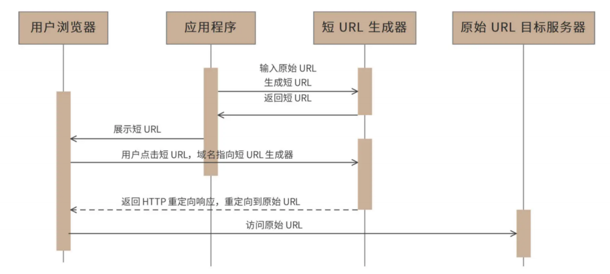
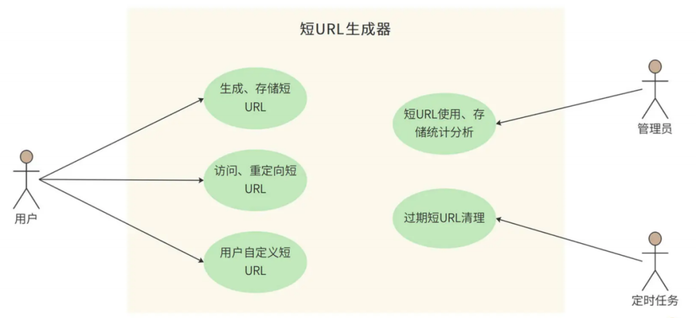
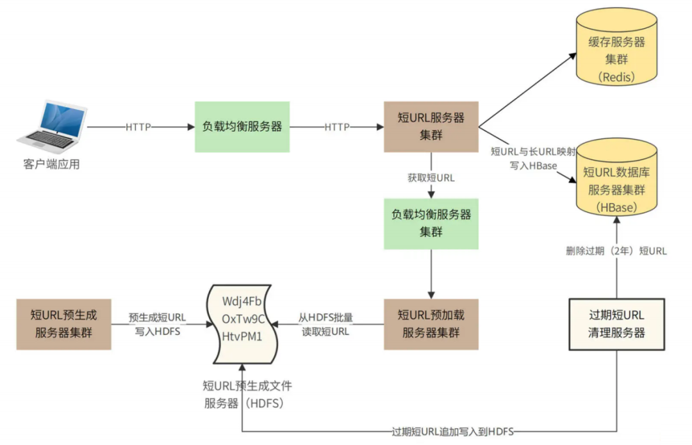
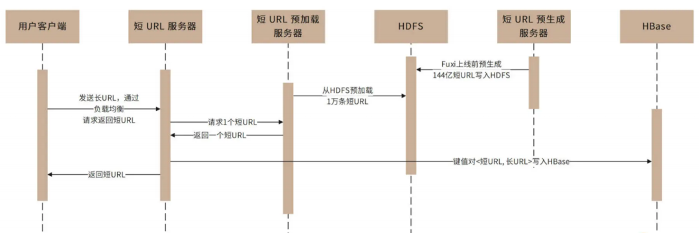
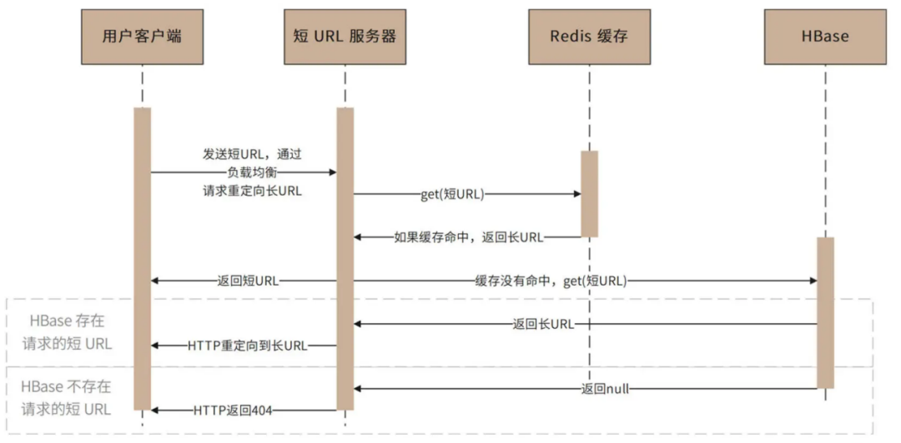
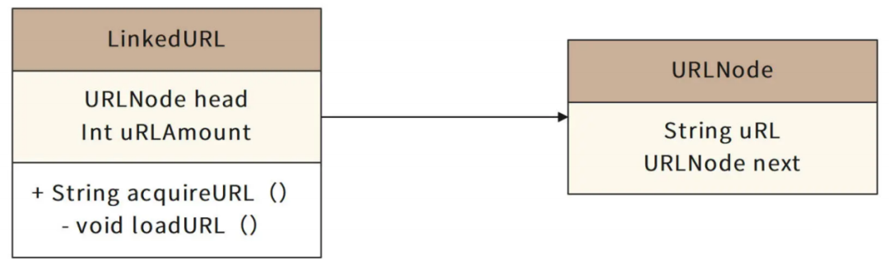
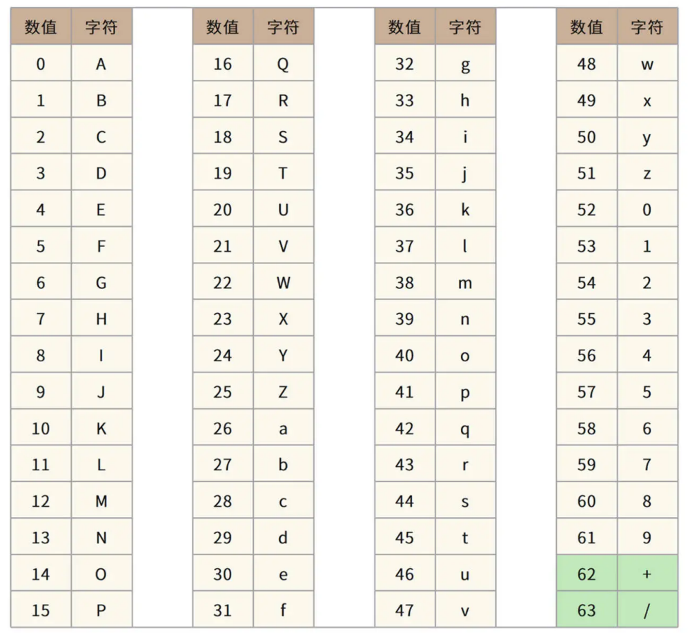
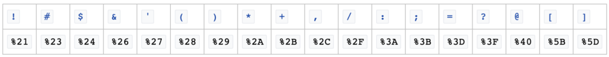
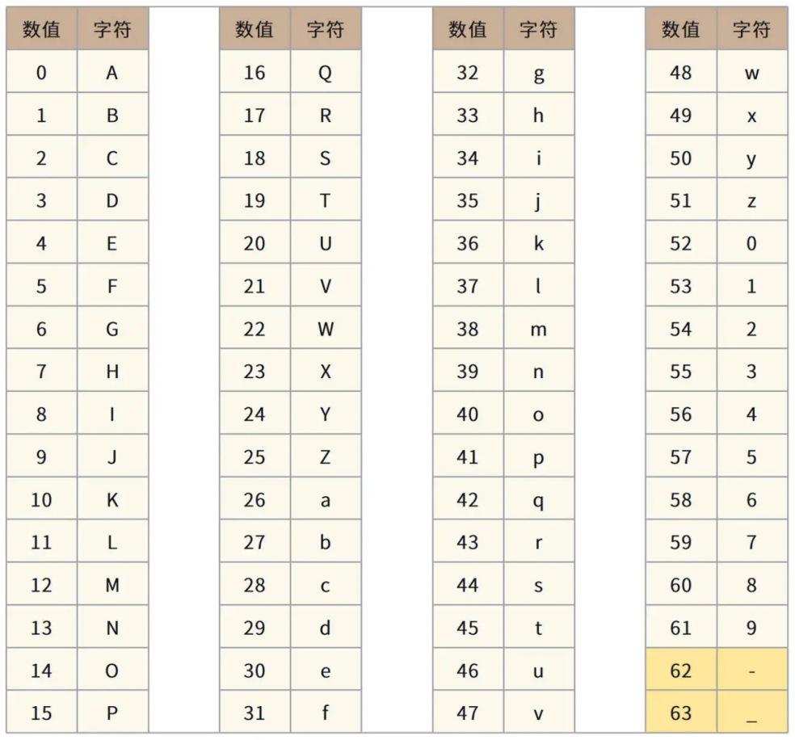

# 45.如何实现百亿级短URL生成器

**示例代码**

[url-demo.ppt](https://www.yuque.com/attachments/yuque/0/2024/ppt/2424104/1720877900691-ab55928c-c023-4a70-bc1c-e0490c47cba3.ppt)

_<font style="color:#DF2A3F;">注：将ppt后缀名改为zip后解压</font>_

jdk版本：1.8.0_181


**分享内容**

1. 短URL生成器业务介绍
2. 短URL生成器需求分析(存储空间、吞吐量、网络带宽)
3. 短URL生成器概要设计(生成算法、预生成、部署模型)
4. 短URL生成器详细设计(重定向问题、自定义生成、Base64编码生成)
5. 总结

## 业务介绍
<font style="color:rgb(51, 51, 51);">我们先来看看，当高并发遇到海量数据处理时的架构。在社交媒体上，人们经常需要分享一些 URL，但是有些 URL 可能会很长，比如： </font>

https://example.com/hybrid/pvip?utm_source=pcdiscover-banner&utm_term=pc-discover-banner

<font style="color:rgb(51, 51, 51);">这样长的 URL 显然体验并不友好。我们期望分享的是一些更短、更易于阅读的短 URL，比如像 https://link.com/6sINa6QMGeOUEI 这样的。当用户点击这个短 URL 的时候，可以重定向访问到原始的链接地址。为此我们将设计开发一个短 URL 生成器，产品名称是 “Fuxi（伏羲）”。</font>

<font style="color:rgb(51, 51, 51);">我们预计 Fuxi 需要管理的短 URL 规模在百亿级别，并发吞吐量达到数万级别。这个量级的数据对应的存储方案是什么样的？用传统的关系数据库存储，还是有其他更简单的办法？此外，如何提升系统的并发处理能力呢？这些是我们今天要重点考虑的问题。</font>

## <font style="color:rgb(51, 51, 51);">1、需求分析</font>
<font style="color:rgb(51, 51, 51);">短 URL 生成器，也称作短链接生成器，就是将一个比较长的 URL 生成一个比较短的 URL，当浏览器通过短 URL 生成器访问这个短 URL 的时候，重定向访问到原始的长 URL 目标服务器，访问时序图如下:</font>

<font style="color:rgb(51, 51, 51);"></font>

<font style="color:rgb(51, 51, 51);">对于需要展示短 URL 的应用程序，由该应用调用短 URL 生成器生成短 URL，并将该短 URL 展示给用户，用户在浏览器中点击该短 URL 的时候，请求发送到短 URL 生成器（短 URL 生成器以 HTTP 服务器的方式对外提供服务，短 URL 域名指向短 URL 生成器），短 URL 生成器返回 HTTP 重定向响应，将用户请求重定向到最初的原始长 URL，浏览器访问长 URL 服务器，完成请求服务。</font>

### <font style="color:rgb(51, 51, 51);">1、短 URL 生成器的用例图</font>
<font style="color:rgb(51, 51, 51);"></font>

1. <font style="color:rgb(51, 51, 51);">用户 client 程序可以使用短 URL 生成器 Fuxi 为每个长 URL 生成唯一的短 URL，并存储起来。</font>
2. <font style="color:rgb(51, 51, 51);">用户可以访问这个短 URL，Fuxi 将请求重定向到原始长 URL。</font>
3. <font style="color:rgb(51, 51, 51);">生成的短 URL 可以是 Fuxi 自动生成的，也可以是用户自定义的。用户可以指定一个长 URL 对应的短 URL 内容，只要这个短 URL 还没有被使用。</font>
4. <font style="color:rgb(51, 51, 51);">管理员可以通过 web 后台检索、查看 Fuxi 的使用情况。</font>
5. <font style="color:rgb(51, 51, 51);">短 URL 有有效期（2 年），后台定时任务会清理超过有效期的 URL，以节省存储资源，同时回收短 URL 地址链接资源。</font>

### <font style="color:rgb(51, 51, 51);">2、性能指标估算</font>
<font style="color:rgb(51, 51, 51);">Fuxi 的存储容量和并发量估算如下：</font>

<font style="color:rgb(51, 51, 51);">预计每月新生成短 URL 5 亿条，短 URL 有效期 2 年，那么总 URL 数量 120 亿</font>

<font style="color:rgb(51, 51, 51);">5亿 × 12月 × 2年 = 120亿</font>

#### <font style="color:rgb(51, 51, 51);">1、存储空间</font>
<font style="color:rgb(51, 51, 51);">每条短 URL 数据库记录大约 1KB，那么需要总存储空间 12TB（不含数据冗余备份）：</font>

<font style="color:rgb(51, 51, 51);">120 亿 × 1_KB_ = 12_TB_</font>

#### <font style="color:rgb(51, 51, 51);">2、吞吐量</font>
<font style="color:rgb(51, 51, 51);">每条短 URL 平均读取次数 100 次，那么平均访问吞吐量（每秒访问次数）2 万：</font>

<font style="color:rgb(51, 51, 51);">（5 亿 × 100） ÷ （30 × 24 × 60 × 60） ≈ 20000</font>

<font style="color:rgb(51, 51, 51);">一般系统高峰期访问量是平均访问量的 2 倍，因此系统架构需要支持的吞吐能力应为 4 万。</font>

#### <font style="color:rgb(51, 51, 51);">3、网络带宽</font>
<font style="color:rgb(51, 51, 51);">短 URL 的重定向响应包含长 URL 地址内容，长 URL 地址大约 500B，HTTP 响应头其他内容大约 500B，所以每个响应 1KB，高峰期需要的响应网络带宽 40MB</font>

<font style="color:rgb(51, 51, 51);">4 万（每秒）次请求 × 1_KB_ = 40_MB_</font>

<font style="color:rgb(51, 51, 51);">Fuxi 的</font>**<font style="color:rgb(51, 51, 51);">短 URL 长度估算</font>**<font style="color:rgb(51, 51, 51);">如下:</font>

1. <font style="color:rgb(51, 51, 51);">短 URL 采用 Base64 编码，如果短 URL 长度是 7 个字符的话，大约可以编码 4 万亿个短 URL</font>


<font style="color:rgb(51, 51, 51);">如果短 URL 长度是 6 个字符的话，大约可以编码 680 亿个短 URL。</font>


<font style="color:rgb(51, 51, 51);">按我们前面评估，总 URL 数 120 亿，6 个字符的编码就可以满足需求。因此 Fuxi 的短 URL 编码长度 6 个字符，形如 https://link.com/ScW4dt 。</font>

### <font style="color:rgb(51, 51, 51);">3、非功能需求</font>
1. <font style="color:rgb(51, 51, 51);">系统需要保持高可用，不因为服务器、数据库宕机而引起服务失效。</font>
2. <font style="color:rgb(51, 51, 51);">系统需要保持高性能，服务端 80% 请求响应时间应小于 5ms，99% 请求响应时间小于 20ms，平均响应时间小于 10ms。</font>
3. <font style="color:rgb(51, 51, 51);">短 URL 应该是不可猜测的，即不能猜测某个短 URL 是否存在，也不能猜测短 URL 可能对应的长 URL 地址内容。</font>

## <font style="color:rgb(51, 51, 51);">2、概要设计</font>
<font style="color:rgb(51, 51, 51);">短 URL 生成器的设计核心就是短 URL 的生成，即长 URL 通过某种函数，计算得到一个 6 个字符的短 URL。短 URL 有几种不同的生成算法。</font>

### <font style="color:rgb(51, 51, 51);">1、单项散列函数生成短 URL</font>
<font style="color:rgb(51, 51, 51);">通常的设计方案是，将长 URL 利用 MD5 或者 SHA256 等单项散列算法，进行 Hash 计算，得到 128bit 或者 256bit 的 Hash 值。然后对该 Hash 值进行 Base64 编码，得到 22 个或者 43 个 Base64 字符，再截取前面的 6 个字符，就得到短 URL 了，如图</font>

<font style="color:rgb(51, 51, 51);"></font>

<font style="color:rgb(51, 51, 51);">但是这样得到的短 URL，可能会发生 Hash 冲突，即不同的长 URL，计算得到的短 URL 是相同的（MD5 或者 SHA256 计算得到的 Hash 值几乎不会冲突，但是 Base64 编码后再截断的 6 个字符有可能会冲突）。所以在生成的时候，需要先校验该短 URL 是否已经映射为其他的长 URL，如果是，那么需要重新计算（换单向散列算法，或者换 Base64 编码截断位置）。重新计算得到的短 URL 依然可能冲突，需要再重新计算。但是这样的冲突处理需要多次到存储中查找 URL，无法保证 Fuxi 的性能要求。</font>

### <font style="color:rgb(51, 51, 51);">2、自增长短 URL</font>
<font style="color:rgb(51, 51, 51);">一种免冲突的算法是用自增长自然数来实现，即维持一个自增长的二进制自然数，然后将该自然数进行 Base64 编码即可得到一系列的短 URL。这样生成的的短 URL 必然唯一，而且还可以生成小于 6 个字符的短 URL，比如自然数 0 的 Base64 编码是字符 “A”，就可以用 https://link.com/A 作为短 URL。</font>

<font style="color:rgb(51, 51, 51);">但是这种算法将导致短 URL 是可猜测的，如果某个应用在某个时间段内生成了一批短 URL，那么这批短 URL 就会集中在一个自然数区间内。只要知道了其中一个短 URL，就可以通过自增（以及自减）的方式请求访问其他 URL。Fuxi 的需求是不允许短 URL 可预测。</font>

### <font style="color:rgb(51, 51, 51);">3、预生成短 URL</font>
<font style="color:rgb(51, 51, 51);">因此，Fuxi 采用预生成短 URL 的方案。即预先生成一批没有冲突的短 URL 字符串，当外部请求输入长 URL 需要生成短 URL 的时候，直接从预先生成好的短 URL 字符串池中获取一个即可。</font>

<font style="color:rgb(51, 51, 51);">预生成短 URL 的算法可以采用随机数来实现，6 个字符，每个字符都用随机数产生（用 0~63 的随机数产生一个 Base64 编码字符）</font>

<font style="color:rgb(51, 51, 51);">为了避免随机数产生的短 URL 冲突，需要在预生成的时候检查该 URL 是否已经存在（用布隆过滤器检查）。因为预生成短 URL 是</font>

<font style="color:rgb(51, 51, 51);">离线的，所以这时不会有性能方面的问题。事实上，Fuxi 在上线之前就已经生成全部需要的 144 亿条短 URL 并存储在文件系统中（预估需要短 URL120 亿，Fuxi 预生成的时候进行了 20% 的冗余，即 144 亿。）</font>

<font style="color:rgb(51, 51, 51);">代码实现如下：</font>

```java
import java.util.Random;
public class RandomBase64 {
    public static void main(String[] args) {
        StringBuilder shortUrl = new StringBuilder();
        Random random = new Random();
        for (int i = 0; i < 6; i++) {
            int randomNumber = random.nextInt(64);
            shortUrl.append(Base64Encoder(randomNumber));
        }
        System.out.println("生成的短URL: " + shortUrl.toString());
    }

    public static char Base64Encoder(int number) {
        char[] base64Chars = "ABCDEFGHIJKLMNOPQRSTUVWXYZabcdefghijklmnopqrstuvwxyz0123456789+/".toCharArray();
        return base64Chars[number];
    }
}
```

### <font style="color:rgb(51, 51, 51);">4、Fuxi 的整体部署模型</font>
<font style="color:rgb(51, 51, 51);">Fuxi 的业务逻辑比较简单，相对比较有挑战的就是</font>**<font style="color:rgb(51, 51, 51);">高并发的读请求如何处理、预生成的短 URL 如何存储以及访问</font>**<font style="color:rgb(51, 51, 51);">。高并发访问主要通过负载均衡与分布式缓存解决，而海量数据存储则通过 HDFS 以及 HBase 来完成。具体架构图如下。</font>



<font style="color:rgb(51, 51, 51);">系统调用可以分成两种情况，一种是用户请求生成短 URL 的过程；另一种是用户访问短 URL，通过 Fuxi 跳转到长 URL 的过程。</font>

<font style="color:rgb(51, 51, 51);">对于用户请求生成短 RUL 的过程，在短 URL 系统 Fuxi 上线前，已经通过随机数算法预生成 144 亿条短 URL 并将其存储在 HDFS 文件系统中。系统上线运行后，应用程序请求生成短 URL 的时候（即输入长 URL，请求返回短 URL），请求通过负载均衡服务器被发送到短 URL 服务器集群，短 URL 服务器再通过负载均衡服务器调用短 URL 预加载服务器集群。</font>

<font style="color:rgb(51, 51, 51);">短 URL 预加载服务器此前已经从短 URL 预生成文件服务器（HDFS）中加载了一批短 URL 存放在自己的内存中，这时，只需要从内存中返回一个短 URL 即可，同时将短 URL 与长 URL 的映射关系存储在 HBase 数据库中，时序图如下。</font>

<font style="color:rgb(51, 51, 51);"></font>

<font style="color:rgb(51, 51, 51);">对于用户通过客户端请求访问短 URL 的过程（即输入短 URL，请求返回长 URL），请求通过负载均衡服务器发送到短 URL 服务器集群，短 URL 服务器首先到缓存服务器中查找是否有该短 URL，如果有，立即返回对应的长 URL，短 URL 生成服务器构造重定向响应返回给客户端应用。</font>

<font style="color:rgb(51, 51, 51);">如果缓存没有用户请求访问的短 URL，短 URL 服务器将访问 HBase 短 URL 数据库服务器集群。如果数据库中存在该短 URL，短 URL 服务器会将该短 URL 写入缓存服务器集群，并构造重定向响应返回给客户端应用。如果 HBase 中没有该短 URL，短 URL 服务器将构造 404 响应返回给客户端应用，时序图如下。</font>

<font style="color:rgb(51, 51, 51);"></font>

<font style="color:rgb(51, 51, 51);">过期短 URL 清理服务器会每个月启动一次，将已经超过有效期（2 年）的 URL 数据删除，并将这些短 URL 追加写入到短 URL 预生成文件中。</font>

<font style="color:rgb(51, 51, 51);">为了保证系统</font>**<font style="color:rgb(51, 51, 51);">高可用</font>**<font style="color:rgb(51, 51, 51);">，Fuxi 的应用服务器、文件服务器、数据库服务器都采用集群部署方案，单个服务器故障不会影响 Fuxi 短 URL 的可用性。</font>

<font style="color:rgb(51, 51, 51);">对于 Fuxi 的</font>**<font style="color:rgb(51, 51, 51);">高性能</font>**<font style="color:rgb(51, 51, 51);">要求，80% 以上的访问请求将被设计为通过缓存返回。Redis 的缓存响应时间 1ms 左右，服务器端请求响应时间小于 3ms，满足 80% 请求小于 5ms 的性能目标。对于缓存没有命中的数据，通过 HBase 获取，HBase 平均响应时间 10ms，也可以满足设计目标中的性能指标。</font>

<font style="color:rgb(51, 51, 51);">对于 Redis 缓存</font>**<font style="color:rgb(51, 51, 51);">内存空间</font>**<font style="color:rgb(51, 51, 51);">估算，业界一般认为，超过 80% 请求集中在最近 6 天生成的短 URL 上，Fuxi 主要缓存最近六天生成的短 URL 即可。根据需求容量估计，最近 6 天生成的短 URL 数量约 1 亿条，因此需要 Redis 缓存服务器内存空间：1 亿 × 1_KB_ = 100_GB_</font>

## <font style="color:rgb(51, 51, 51);">3、详细设计</font>
<font style="color:rgb(51, 51, 51);">详细设计关注重定向响应码、短 URL 预生成文件及加载、用户自定义短 URL 等几个关键设计点。</font>

### <font style="color:rgb(51, 51, 51);">1、重定向响应码</font>
<font style="color:rgb(51, 51, 51);">满足短 URL 重定向要求的 HTTP 重定向响应码有 301 和 302 两种，其中 301 表示永久重定向，即浏览器一旦访问过该短 URL，就将重定向的原始长 URL 缓存在本地，此后不再请求短 URL 生成器，直接根据缓存在浏览器（HTTP 客户端）的长 URL 路径进行访问。302 表示临时重定向，每次访问短 URL 都需要访问短 URL 生成器。</font>

<font style="color:rgb(51, 51, 51);">一般说来，使用 301 状态码可以降低 Fuxi 服务器的负载压力，但无法统计短 URL 的使用情况，而 Fuxi 的架构设计完全可以承受这些负载压力，因此 Fuxi 使用 302 状态码构造重定向响应。</font>

### <font style="color:rgb(51, 51, 51);">2、短 URL 预生成文件及预加载</font>
<font style="color:rgb(51, 51, 51);">Fuxi 的短 URL 是在系统上线前全部预生成的，并存储在 HDFS 文件中。共 144 亿个短 URL，每个短 URL 6 个字符，文件大小 ：144 亿 × 6_B_ = 86.4_GB_。</font>

<font style="color:rgb(51, 51, 51);">文件格式就是直接将 144 亿个短 URL 的 ASC 码无分割地存储在文件中，如下是存储了 3 个短 URL 的文件示例：</font>

```plain
Wdj4FbOxTw9CHtvPM1
```

<font style="color:rgb(51, 51, 51);">所以如果短 URL 预加载服务器第一次启动的时候加载 1 万个短 URL，那么就从文件头读取 60K 数据，并标记当前文件偏移量 60K。下次再加载 1 万个短 URL 的时候，再从文件 60K 偏移位置继续读取 60K 数据即可。</font>

<font style="color:rgb(51, 51, 51);">因此，Fuxi 除了需要一个在 HDFS 记录预生成短 URL 的文件外，还需要一个记录偏移量的文件，记录偏移量的文件也存储在 HDFS 中。同时，由于预加载短 URL 服务器集群部署多台服务器，会出现多台服务器同时加载相同短 URL 的情况，所以还需要利用偏移量文件对多个服务器进行互斥操作，即</font>**<font style="color:rgb(51, 51, 51);">利用文件系统写操作锁的互斥性实现多服务器访问互斥</font>**<font style="color:rgb(51, 51, 51);">。</font>

**<font style="color:rgb(51, 51, 51);">应用程序的文件访问流程应该是</font>**<font style="color:rgb(51, 51, 51);">：写打开偏移量文件 -> 读偏移量 -> 读打开短 URL 文件 -> 从偏移量开始读取 60K 数据 -> 关闭短 URL 文件 -> 修改偏移量文件 -> 关闭偏移量文件。</font>

<font style="color:rgb(51, 51, 51);">由于写打开偏移量文件是一个互斥操作，所以第一个预加载短 URL 服务器写打开偏移量文件以后，其他预加载短 URL 服务器无法再写打开该文件，也就无法完成读 60K 短 URL 数据及修改偏移量的操作，这样就能保证这两个操作是并发安全的。</font>

<font style="color:rgb(51, 51, 51);">加载到预加载短 URL 服务器的 1 万个短 URL 会以链表的方式存储，每使用一个短 URL，链表头指针就向后移动一位，并设置前一个链表元素的 next 对象为 null。这样用过的短 URL 对象可以被垃圾回收。</font>

<font style="color:rgb(51, 51, 51);">当剩余链表长度不足 2000 的时候，触发一个异步线程，从文件中加载 1 万个新的短 URL，并链接到链表的尾部。</font>

<font style="color:rgb(51, 51, 51);">与之对应的 URL 链表类图如下。</font>

<font style="color:rgb(51, 51, 51);"></font>

+ **<font style="color:rgb(51, 51, 51);">URLNode</font>**<font style="color:rgb(51, 51, 51);">：URL 链表元素类，成员变量 uRL 即短 URL 字符串，next 指向下一个链表元素。</font>
+ **<font style="color:rgb(51, 51, 51);">LinkedURL</font>**<font style="color:rgb(51, 51, 51);">：URL 链表主类，成员变量 head 指向链表头指针元素，uRLAmount 表示当前链表剩余元素个数。acquireURL() 方法从链表头指针指向的元素中取出短 URL 字符串，并执行 urlAmount-- 操作。当 urlAmount < 2000 的时候，调用私有方法 loadURL()，该方法调用一个线程从文件中加载 1 万个短 URL 并构造成链表添加到当前链表的尾部，并重置 uRLAmount。</font>

### <font style="color:rgb(51, 51, 51);">3、用户自定义短 URL</font>
<font style="color:rgb(51, 51, 51);">Fuxi 允许用户自己定义短 URL，即在生成短 URL 的时候，由用户指定短 URL 的内容。为了避免预生成的短 URL 和用户指定的短 URL 冲突，Fuxi 限制用户自定义短 URL 的字符个数，不允许用户使用 6 个字符的自定义短 URL，且 URL 长度不得超过 20 个字符。</font>

<font style="color:rgb(51, 51, 51);">但是用户自定义短 URL 依然可能和其他用户自定义短 URL 冲突，所以 Fuxi 生成自定义短 URL 的时候需要到数据库中检查冲突，是否指定的 URL 已经被使用，如果发生冲突，要求用户重新指定。</font>

### <font style="color:rgb(51, 51, 51);">4、URL Base64 编码</font>
<font style="color:rgb(51, 51, 51);">标准 Base64 编码表如下：</font>



<font style="color:rgb(51, 51, 51);">其中 “+” 和“/”在 URL 中会被编码为 “%2B” 以及 “%2F”，而“%” 在写入数据库的时候又和 SQL 编码规则冲突，需要进行再编码，因此直接使用标准 Base64 编码进行短 URL 编码并不合适。URL 保留字符编码表如下。</font>

<font style="color:rgb(51, 51, 51);"></font>

<font style="color:rgb(51, 51, 51);">所以，我们需要针对 URL 场景对 Base64 编码进行改造，使用 URL 保留字符表以外的字符对 Base64 编码表中的 62，63 进行编码：将 “+” 改为 “-”，将“/” 改为“_”，Fuxi 最终采用的 URL Base64 编码表如下。</font>



## <font style="color:rgb(51, 51, 51);">4、总结</font>
<font style="color:rgb(51, 51, 51);">我们开头提到，Fuxi 是一个高并发（2 万 QPS）、海量存储（144 亿条数据）、还需要 10ms 的高性能平均响应时间的系统。但是我们后面看到，Fuxi 的架构并不复杂。</font>

<font style="color:rgb(51, 51, 51);">这一方面是源于 Fuxi 的业务逻辑非常简单，只需要完成短 URL 与长 URL 的映射关系生成与获取就可以了。另一方面则是源于开源技术体系的成熟，比如一个 HDFS 集群可支持百万 TB 规模的数据存储，而我们需要的存储空间只有区区不到 100GB，都有点大材小用了。事实上，Fuxi 选择 HDFS 更多的考量是利用 HDFS 的高可用，HDFS 的自动备份策略为我们提供了</font>**<font style="color:rgb(51, 51, 51);">高可用的数据存储解决方案</font>**<font style="color:rgb(51, 51, 51);">。</font>

<font style="color:rgb(51, 51, 51);">同理，高并发也是如此，2 万 QPS 看起来不小，但实际上，由于业务逻辑简单，单个数据都很小，加上大部分请求数据可以通过 Redis 缓存获取，所以实际响应时间是非常短的，10ms 的平均响应时间使得 Fuxi 真正承受的并发压力只有 200。对于这样简单的业务逻辑以及 200 这样的并发压力，我们使用配置高一点的服务器的话，只需要一台短 URL 服务器其实就可以满足了。所以，我们在短 URL 服务器之前使用负载均衡服务器，这也是更多地为</font>**<font style="color:rgb(51, 51, 51);">高可用</font>**<font style="color:rgb(51, 51, 51);">服务。</font>


> 更新: 2024-07-13 21:39:07  
> 原文: <https://www.yuque.com/aaron-wecc3/dhluml/seqkwf4yuuh3fg2g>