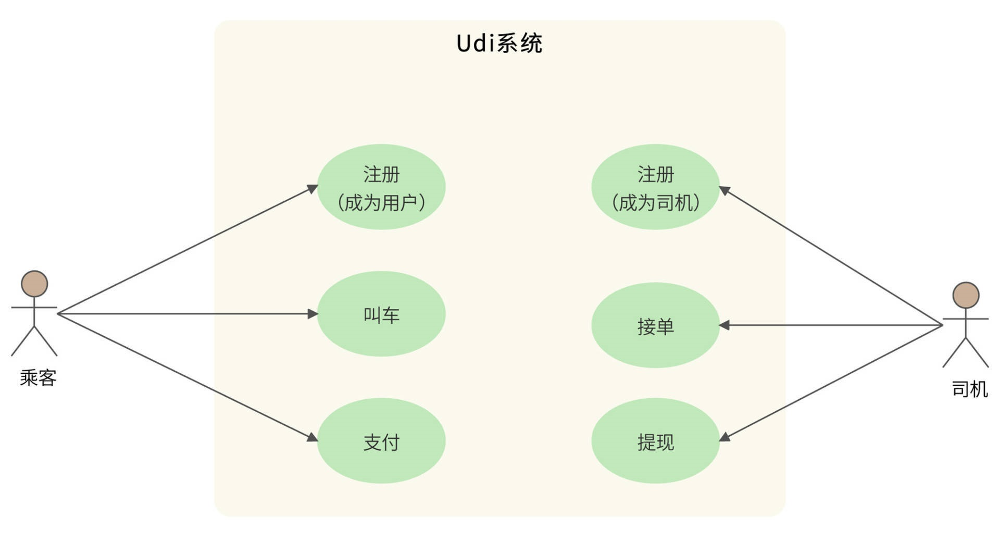
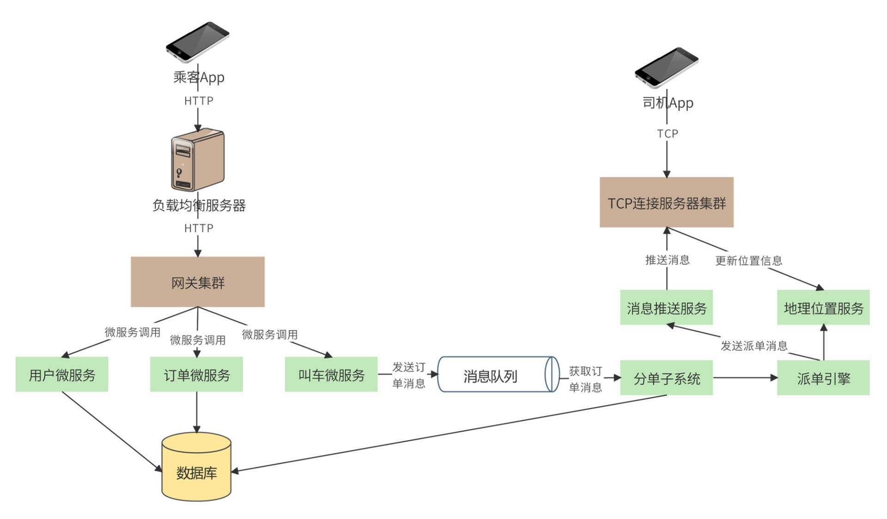
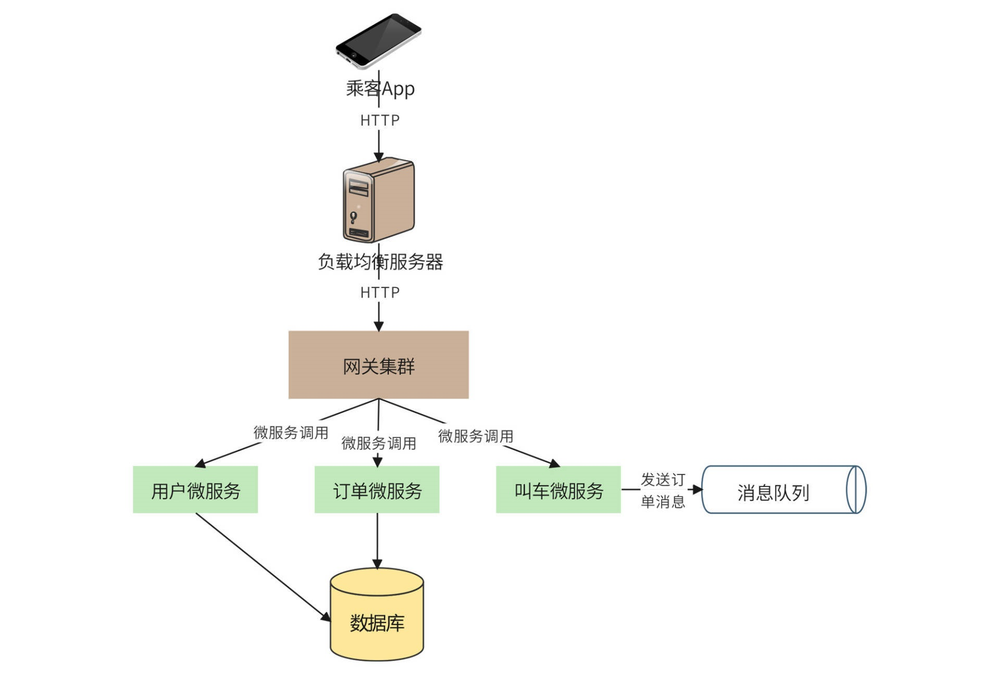
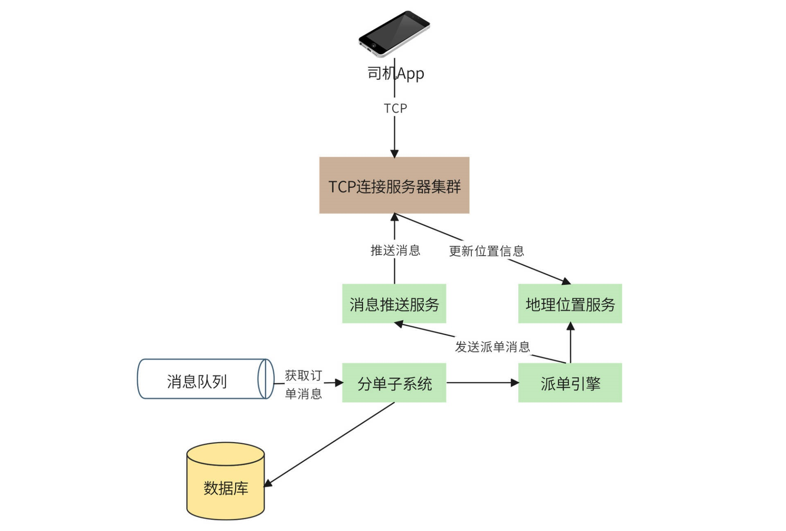
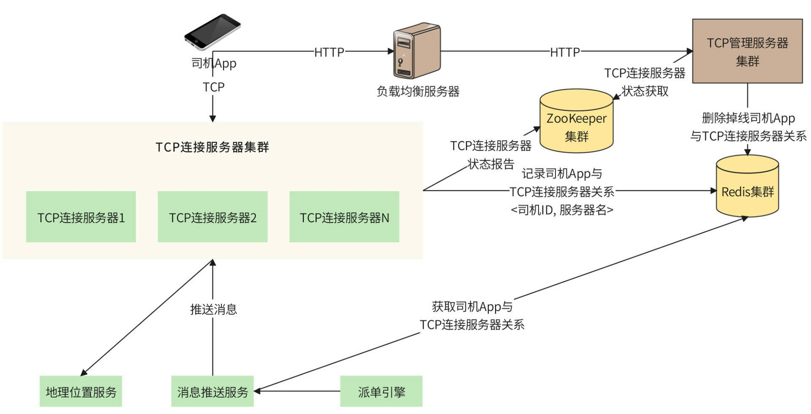
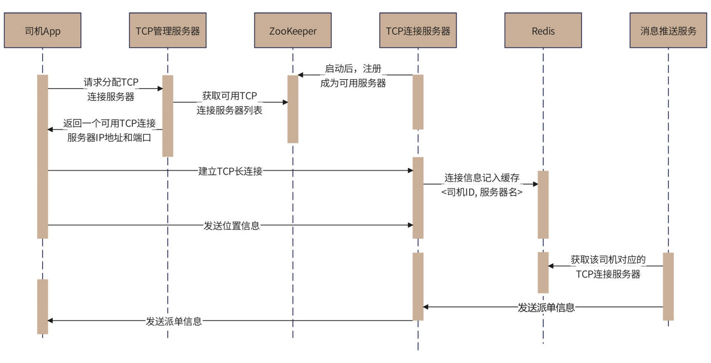
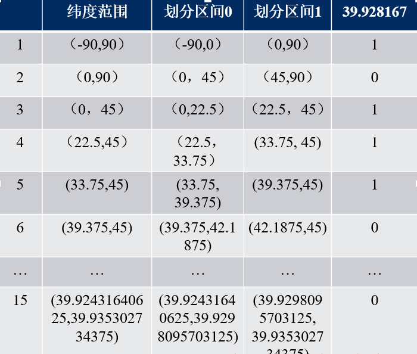
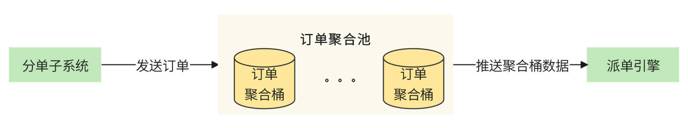
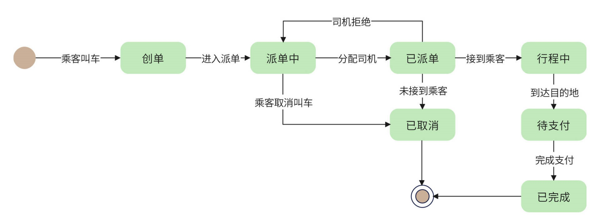

# 46.如何设计亿级用户网约车系统

**分享内容**

1. 网约车业务介绍
2. 网约车系统需求分析
3. 网约车系统概要设计(乘客端、司机端)
4. 网约车系统详细设计(长连接管理、距离计算、派单算法、订单状态模型)

## <font style="color:rgb(51, 51, 51);">业务介绍</font>
<font style="color:rgb(51, 51, 51);">网约车的官方定义是：“以互联网技术为依托，构建服务平台，整合供需信息，使用符合条件的车辆和驾驶员，提供非巡游的预约出租汽车服务的经营活动。” 通俗地说就是：利用互联网技术平台，将乘客的乘车信息发送给合适的司机，由司机完成接送乘客的服务。网约车包含专车、快车、拼车等多种形式。</font>

<font style="color:rgb(51, 51, 51);">中国目前网约车用户规模约 5 亿，我们准备开发一个可支撑目前全部中国用户使用的网约车平台，应用名称为 “Udi”。</font>

## <font style="color:rgb(51, 51, 51);">需求分析</font>
<font style="color:rgb(51, 51, 51);">Udi 是一个网约车平台，核心功能是将乘客的叫车订单发送给附近的网约车司机，司机接单后，到上车点接乘客并送往目的地，到达后，乘客支付订单。根据平台的分成比例，司机提取一部分金额作为收益，用例图如下：</font>



<font style="color:rgb(51, 51, 51);">Udi 平台预计注册乘客 5 亿，日活用户 5 千万，平均每个乘客 1.2 个订单，日订单量 6 千万。平均客单价 30 元，平台每日总营收 18 亿元。平台和司机按 3：7 的比例进行分成，那么平台每天可赚 5.4 亿元。</font>

<font style="color:rgb(51, 51, 51);">另外，平台预计注册司机 5 千万，日活司机 2 千万。</font>

## <font style="color:rgb(51, 51, 51);">概要设计</font>
<font style="color:rgb(51, 51, 51);">网约车平台是共享经济的一种，目的就是要将乘客和司机撮合起来，所以需要开发两个 App 应用，一个是给乘客的，用来叫车；一个是给司机的，用来接单。Udi 整体架构如下图：</font>



<font style="color:rgb(51, 51, 51);">相应的，Udi 的系统也可以分成两个部分，一个部分是面向乘客的。乘客通过手机 App 注册成为用户，然后就可以在手机上选择出发地和目的地，进行叫车了。乘客叫车的 HTTP 请求首先通过一个负载均衡服务器集群，到达网关集群，再由网关集群调用相关的微服务，完成请求处理，如下图：</font>



<font style="color:rgb(51, 51, 51);">网关处理叫车请求的过程是：网关首先调用订单微服务，为用户的叫车请求创建一个订单，订单微服务将订单记录到数据库中，并将订单状态设置为 “创建”。然后网关调用叫车微服务，叫车微服务将用户信息、出发地、目的地等数据封装成一个消息，发送到消息队列，等待系统为订单分配司机。</font>

<font style="color:rgb(51, 51, 51);">Udi 系统的另一部分是面向司机的，司机需要不停将自己的位置信息发送给平台，同时，还需要随时接收来自平台的指令。因此，不同于用户通过 HTTP 发送请求给平台，司机 App 需要通过 TCP 长连接和平台服务器保持通信，如下图：</font>



<font style="color:rgb(51, 51, 51);">Udi 司机 App 每 3 秒向平台发送一次当前的位置信息，包括当前车辆经纬度，车头朝向等。位置信息通过 TCP 连接到达平台的 TCP 连接服务器集群，TCP 连接服务器集群的作用类似网关，只不过是以 TCP 长连接的方式向 App 端提供接入服务。TCP 连接服务器将司机的位置信息更新到地理位置服务。</font>

<font style="color:rgb(51, 51, 51);">对于前面已经写入到消息队列的乘客叫车订单信息，分单子系统作为消息消费者，从消息队列中获取并处理。分单子系统首先将数据库中的订单状态修改为 “派单中”，然后调用派单引擎进行派单。派单引擎根据用户的上车出发地点，以及司机上传的地理位置信息进行匹配，选择最合适的司机进行派单。派单消息通过一个专门的消息推送服务进行发送，消息推送服务利用 TCP 长连接服务器，将消息发送给匹配到的司机，同时分单子系统更新数据库订单状态为 “已派单”。</font>

## <font style="color:rgb(51, 51, 51);">详细设计</font>
<font style="color:rgb(51, 51, 51);">关于 Udi 的详细设计，我们将关注网约车平台一些独有的技术特点：长连接管理、派单算法、距离计算。此外，因为订单状态模型是所有交易类应用都非常重要的一个模型，所以我们也会在这里讨论 Udi 的订单状态模型。</font>

### <font style="color:rgb(51, 51, 51);">长连接管理</font>
<font style="color:rgb(51, 51, 51);">因为司机 App 需要不断向 Udi 系统发送当前位置信息，以及实时接收 Udi 推送的派单请求，所以司机 App 需要和 Udi 系统保持长连接。因此，我们选择让司机 App 和 Udi 系统直接通过 TCP 协议进行长连接。</font>

<font style="color:rgb(51, 51, 51);">TCP 连接和 HTTP 连接不同。HTTP 是无状态的，每次 HTTP 请求都可以通过负载均衡服务器，被分发到不同的网关服务器进行处理，正如乘客 App 和服务器的连接那样。也就是说，HTTP 在发起请求的时候，无需知道自己要连接的服务器是哪一台。</font>

<font style="color:rgb(51, 51, 51);">而 TCP 是长连接，一旦建立了连接，连接通道就需要长期保持，</font>**<font style="color:rgb(51, 51, 51);">不管是司机 App 发送位置信息给服务器，还是服务器推送派单信息给司机 App，都需要使用这个特定的连接通道</font>**<font style="color:rgb(51, 51, 51);">。也就是说，司机 App 和服务器的连接是特定的，司机 App 需要知道自己连接的服务器是哪一台，而 Udi 给司机 App 推送消息的时候，也需要知道要通过哪一台服务器才能完成推送。</font>

<font style="color:rgb(51, 51, 51);">所以，司机端的 TCP 长连接需要进行专门管理，处理司机 App 和服务器的连接信息，具体架构如下图。</font>



**<font style="color:rgb(51, 51, 51);">处理长连接的核心是 TCP 管理服务器集群</font>**<font style="color:rgb(51, 51, 51);">。司机 App 会在启动时通过负载均衡服务器，与 TCP 管理服务器集群通信，请求分配一个 TCP 长连接服务器。</font>

<font style="color:rgb(51, 51, 51);">TCP 管理服务器检查 ZooKeeper 服务器，获取当前可以服务的 TCP 连接服务器列表，然后从这些服务器中选择一个，返回其 IP 地址和通信端口给司机 App。这样，司机 App 就可以直接和这台 TCP 连接服务器建立长连接，并发送位置信息了。</font>

<font style="color:rgb(51, 51, 51);">TCP 连接服务器启动的时候，会和 ZooKeeper 集群通信，报告自己的状态，便于 TCP 管理服务器为其分配连接。司机 App 和 TCP 连接服务器建立长连接后，TCP 连接服务器需要向 Redis 集群记录这个长连接关系，记录的键值对是 <司机 ID, 服务器名>。</font>

<font style="color:rgb(51, 51, 51);">当 Udi 系统收到用户订单，派单引擎选择了合适的司机进行派单时，系统就可以通过消息推送服务给该司机发送派单消息。消息推送服务器通过 Redis 获取该司机 App 长连接对应的 TCP 服务器，然后消息推送服务器就可以通过该 TCP 服务器的长连接，将派单消息推送给司机 App 了。</font>

<font style="color:rgb(51, 51, 51);">长连接管理的主要时序图如下：</font>



<font style="color:rgb(51, 51, 51);">如果 TCP 服务器宕机，那么司机 App 和它的长连接也就丢失了。司机 App 需要重新通过 HTTP 来请求 TCP 管理服务器为它分配新的 TCP 服务器。TCP 管理服务器收到请求后，一方面返回新的 TCP 服务器的 IP 地址和通信端口，一方面需要从 Redis 中删除原有的 <司机 ID, 服务器名> 键值对，保证消息推送服务不会使用一个错误的连接线路推送消息。</font>

### <font style="color:rgb(51, 51, 51);">距离计算</font>
<font style="color:rgb(51, 51, 51);">乘客发起一个叫车请求时，Udi 需要为其寻找合适的司机并进行派单，所谓合适的司机，最主要的因素就是距离。Udi 直接使用 Redis 的 GeoHash 进行邻近计算。司机的位置信息实时更新到 Redis 中，并直接调用 Redis 的 GeoHash 命令 georadius 计算乘客的邻近司机。</font>

<font style="color:rgb(51, 51, 51);">但是 Redis 使用跳表存储 GeoHash，Udi 日活司机两千万，每 3 秒更新一次位置信息，平均每秒就需要对跳表做将近 7 百万次的更新，如此高并发地在一个跳表上更新，是系统不能承受的。所以，我们需要将司机以及跳表的粒度拆得更小。</font>

<font style="color:rgb(51, 51, 51);">Udi 以城市作为地理位置的基本单位，也就是说，每个城市在 Redis 中建立一个 GeoHash 的 key，这样，一个城市范围内的司机存储在一个跳表中。对于北京这样的超级城市，还可以更进一步，以城区作为 key，进一步降低跳表的大小和单个跳表上的并发量。</font>

#### <font style="color:rgb(79, 79, 79);">Geohash算法</font>
<font style="color:rgb(77, 77, 77);">Geohash算法一共有三步。</font>

**<font style="color:rgb(79, 79, 79);">首先将经纬度变成二进制。</font>**

<font style="color:rgb(79, 79, 79);">比如这样一个点（39.923201, 116.390705）</font>

<font style="color:rgb(79, 79, 79);">纬度的范围是（-90，90），其中间值为0。对于纬度39.923201，在区间（0，90）中，因此得到一个1；（0，90）区间的中间值为45度，纬度39.923201小于45，因此得到一个0，依次计算下去，即可得到纬度的二进制表示，如下表：</font>



<font style="color:rgb(77, 77, 77);">最后得到纬度的二进制表示为：</font>

```plain
10111000110001111001
```

<font style="color:rgb(77, 77, 77);">同理可以得到经度116.390705的二进制表示为：</font>

```plain
11010010110001000100
```

**<font style="color:rgb(79, 79, 79);">第2步，就是将经纬度合并。</font>**

<font style="color:rgb(77, 77, 77);">经度占偶数位，纬度占奇数位，注意，0也是偶数位。</font>

```plain
11100 11101 00100 01111 00000 01101 01011 00001
```

**<font style="color:rgb(79, 79, 79);">第3步，按照Base32进行编码</font>**

<font style="color:rgb(77, 77, 77);">Base32编码表的其中一种如下，是用0-9、b-z（去掉a, i, l, o）这32个字母进行编码。具体操作是先将上一步得到的合并后二进制转换为10进制数据，然后对应生成Base32码。需要注意的是，将5个二进制位转换成一个base32码。上例最终得到的值为</font>

```plain
wx4g0ec1
```

<font style="color:rgb(77, 77, 77);">Geohash比直接用经纬度的高效很多，而且使用者可以发布地址编码，既能表明自己位于北海公园附近，又不至于暴露自己的精确坐标，有助于隐私保护。</font>

+ <font style="color:rgb(51, 51, 51);">GeoHash用一个字符串表示经度和纬度两个坐标。在数据库中可以实现在一列上应用索引（某些情况下无法在两列上同时应用索引）</font>
+ <font style="color:rgb(51, 51, 51);">GeoHash表示的并不是一个点，而是一个矩形区域</font>
+ <font style="color:rgb(51, 51, 51);">GeoHash编码的前缀可以表示更大的区域。例如wx4g0ec1，它的前缀wx4g0e表示包含编码wx4g0ec1在内的更大范围。 这个特性可以用于附近地点搜索</font>

<font style="color:rgb(77, 77, 77);">编码越长，表示的范围越小，位置也越精确。因此我们就可以通过比较GeoHash匹配的位数来判断两个点之间的大概距离。</font>

### <font style="color:rgb(51, 51, 51);">派单算法</font>
<font style="color:rgb(51, 51, 51);">前面说过，派单就是寻找合适的司机，而合适的主要因素就是距离，所以最简单的派单算法就是直接通过 Redis 获取距离乘客上车点最近的空闲网约车即可。</font>

<font style="color:rgb(51, 51, 51);">但是这种算法效果非常差，因为 Redis 计算的是两个点之间的空间距离，但是司机必须沿道路行驶过来，在复杂的城市路况下，也许几十米的空间距离行驶十几分钟也未可知。</font>

<font style="color:rgb(51, 51, 51);">因此，我们必须用行驶距离代替空间距离，即 Udi 必须要依赖一个地理系统，对司机当前位置和上车点进行路径规划，计算司机到达上车点的距离和时间。事实上，我们主要关注的是时间，也就是说，派单算法需要从 Redis 中获取多个邻近用户上车点的空闲司机，然后通过地理系统来计算每个司机到达乘客上车点的时间，最后将订单分配给花费时间最少的司机。</font>

<font style="color:rgb(51, 51, 51);">如果附近只有一个乘客，那么为其分配到达时间最快的司机就可以了。但如果附近有多个乘客，那么就需要考虑所有人的等待时间了。</font>

<font style="color:rgb(51, 51, 51);">比如附近有乘客 1 和乘客 2，以及司机 X 和司机 Y。</font>

<font style="color:rgb(51, 51, 51);">司机 X 接乘客 1 的时间是 2 分钟，接乘客 2 的时间是 3 分钟；</font>

<font style="color:rgb(51, 51, 51);">司机 Y 接乘客 1 的时间是 3 分钟，接乘客 2 的时间是 5 分钟。</font>

<font style="color:rgb(51, 51, 51);">如果按照单个乘客最短时间选择，</font>

<font style="color:rgb(51, 51, 51);">给乘客 1 分配司机 X，那么乘客 2 只能分配司机 Y 了，乘客总的等待时间就是 7 分钟。</font>

<font style="color:rgb(51, 51, 51);">如果给乘客 1 分配司机 Y，乘客 2 分配司机 X，乘客总等待时间就是 6 分钟。</font>

<font style="color:rgb(51, 51, 51);">司机的时间就是平台的金钱，显然，后者这样的派单更节约所有司机的整体时间，也能为公司带来更多营收，同时也为整体用户带来更好的体验。</font>

<font style="color:rgb(51, 51, 51);">这样，我们就不能一个订单一个订单地分别分配司机，我们需要将一批订单聚合在一起，统一进行派单，如下图：</font>



<font style="color:rgb(51, 51, 51);">分单子系统收到用户的叫车订单后，不是直接发送给派单引擎进行派单，而是发给一个订单聚合池，订单聚合池里有一些订单聚合桶。订单写完一个聚合桶，就把这个聚合桶内的全部订单推送给派单引擎，由派单引擎根据整体时间最小化原则进行派单。</font>

<font style="color:rgb(51, 51, 51);">这里的 “写完一个聚合桶”，有两种实现方式，一种是间隔一段时间算写完一个桶，一种是达到一定数量算写完一个桶。最后 Udi 选择间隔 3 秒写一个桶。</font>

<font style="color:rgb(51, 51, 51);">这里需要关注的是，派单的时候需要依赖地理系统进行路径规划。事实上，乘客到达时间和金额预估、行驶过程导航、订单结算与投诉处理，都需要依赖地理系统。Udi 初期会使用第三方地理系统进行路径规划，但是将来必须要建设自己的地理系统。</font>

### <font style="color:rgb(51, 51, 51);">订单状态模型</font>
<font style="color:rgb(51, 51, 51);">对于交易型系统而言，订单是其最核心的数据，主要业务逻辑也是围绕订单展开。在订单的生命周期里，订单状态会多次变化，每次变化都是由于核心的业务状态发生了改变，也因此在前面设计的多个地方都提到订单状态。但是这种散乱的订单状态变化无法统一描述订单的完整生命周期，因此我们设计了订单状态模型，如下图：</font>



<font style="color:rgb(51, 51, 51);">用户叫车后，系统即为其创建一个订单，订单进入 “创单” 状态。然后该订单通过消息队列进入分单子系统，分单子系统调用派单引擎为其派单，订单状态进入“派单中”。派单引擎分配到司机，一方面发送消息给司机，一方面修改订单状态为“已派单”。</font>

<font style="color:rgb(51, 51, 51);">如果司机去接到乘客，订单状态就改为 “行程中”；如果司机拒绝接单，就需要为乘客重新派单，订单重新进入消息队列，同时订单状态也改回为“派单中”；如果司机到达上车点，但是联系不到乘客，没有接到乘客，那么订单就会标记为“已取消”。如果在派单中，乘客自己选择取消叫车，订单也进入“已取消” 状态。“已取消”是订单的一种最终状态，订单无法再转变为其他状态。</font>

<font style="color:rgb(51, 51, 51);">司机到达目的地后，通过 App 确认送达，订单进入 “待支付” 状态，等待用户支付订单金额。用户支付后，完成订单生命周期，订单状态为“已完成”。</font>

<font style="color:rgb(51, 51, 51);">订单状态模型可以帮助我们总览核心业务流程，在设计阶段，可以通过状态图发现业务流程不完备的地方，在开发阶段，可以帮助开发者确认流程实现是否有遗漏。</font>


> 更新: 2024-07-16 21:42:16  
> 原文: <https://www.yuque.com/aaron-wecc3/dhluml/poderziwswvy09ki>