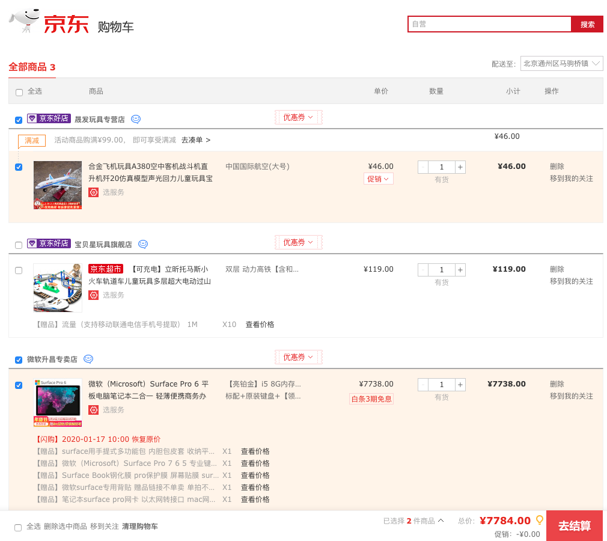
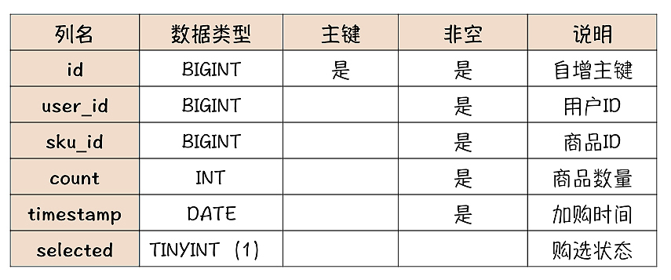

# 47.互联网大厂购物车系统设计

**分享内容**

1. 购物车系统主要业务
2. 购物车系统主要属性
3. 购物车系统设计原则(未登录和登录加购)
4. 暂存购物车存储设计
5. 用户购物车存储设计
6. 总结

****

### <font style="color:rgb(51, 51, 51);">1 主要功能</font>
<font style="color:rgb(51, 51, 51);">在用户选购商品时，下单前，暂存用户想购买的商品。</font>

<font style="color:rgb(51, 51, 51);">购物车对数据可靠性要求不高，性能也无特别要求，在整个电商系统是相对容易设计和实现的一个子系统。</font>

<font style="color:rgb(51, 51, 51);">购物车系统的主要功能：</font>

+ <font style="color:rgb(51, 51, 51);">把商品加入购物车（后文称 “加购”）</font>
+ <font style="color:rgb(51, 51, 51);">购物车列表页</font>
+ <font style="color:rgb(51, 51, 51);">发起结算下单</font>
+ <font style="color:rgb(51, 51, 51);">在所有界面都要显示的购物车小图标</font>

<font style="color:rgb(51, 51, 51);">支撑这些功能，存储模型如何设计？</font>

<font style="color:rgb(51, 51, 51);">只要一个 “购物车” 实体。</font>

### <font style="color:rgb(51, 51, 51);">2 主要属性</font>
<font style="color:rgb(51, 51, 51);">打开京东</font>[<font style="color:rgb(51, 51, 51);">购物车页面</font>](https://so.csdn.net/so/search?q=%E8%B4%AD%E7%89%A9%E8%BD%A6%E9%A1%B5%E9%9D%A2&spm=1001.2101.3001.7020)<font style="color:rgb(51, 51, 51);">：SKUID（商品 ID）、数量、加购时间和勾选状态</font>



<font style="color:rgb(51, 51, 51);">“勾选状态” 属性，即在购物车界面，每件商品前面的那个勾选按钮，表示在结算下单时，是否要包含这件商品。至于商品价格和总价、商品介绍等都能实时从其他系统获取，无需购物车系统保存。</font>

<font style="color:rgb(51, 51, 51);">购物车功能简单，但设计购物车系统的存储时，仍有一些问题需考虑。</font>

### <font style="color:rgb(51, 51, 51);">3 原则</font>
#### <font style="color:rgb(51, 51, 51);">3.1 思考</font>
##### <font style="color:rgb(51, 51, 51);">3.1.1 用户未登录，在浏览器中加购，关闭浏览器再打开，刚才加购的商品还在吗？</font>
<font style="color:rgb(51, 51, 51);">存在。</font>

<font style="color:rgb(51, 51, 51);">若用户未登录，加购的商品也会被保存在用户的电脑。即使关闭浏览器再打开，购物车的商品仍存在。</font>

##### <font style="color:rgb(51, 51, 51);">3.1.2 用户未登录，在浏览器中加购，然后登录，刚才加购的商品还在吗？</font>
<font style="color:rgb(51, 51, 51);">存在。</font>

<font style="color:rgb(51, 51, 51);">若用户先加购，再登录。登录前加购的商品就会被自动合并到用户名下，所以登录后购物车中仍有登录前加购的商品。</font>

##### <font style="color:rgb(51, 51, 51);">3.1.3 关闭浏览器再打开，上一步加购的商品还在吗？</font>
<font style="color:rgb(51, 51, 51);">不存在。</font>

<font style="color:rgb(51, 51, 51);">关闭浏览器再打开，这时又变为未登录状态，但是之前未登录时加购的商品已经被合并到刚刚登录的用户名下了，所以购物车是空的。</font>

##### <font style="color:rgb(51, 51, 51);">3.1.4 再打开手机，用相同的用户登录，第二步加购的商品还在吗？</font>
<font style="color:rgb(51, 51, 51);">存在。使用手机登录相同的用户，看到的就是该用户的购物车，这时无论你在手机 App、电脑还是微信中登录，只要相同用户，看到就是同一购物车，所以第 2 步加购的商品是存在的。</font>

<font style="color:rgb(51, 51, 51);">若不仔细把这些问题考虑清楚，用户使用购物车时，就会感觉不好用，不是加购的商品莫名其妙丢了，就是购物车莫名其妙多出一些商品。</font>

<font style="color:rgb(51, 51, 51);">要解决上面这些问题，只要在存储设计时，把握如下</font>

#### <font style="color:rgb(51, 51, 51);">3.2 原则</font>
+ <font style="color:rgb(51, 51, 51);">若未登录，需临时暂存购物车的商品</font>
+ <font style="color:rgb(51, 51, 51);">用户登录时，把暂存购物车的商品合并到用户购物车，并清除暂存购物车</font>
+ <font style="color:rgb(51, 51, 51);">用户登录后，购物车中的商品，需在浏览器、手机 APP 和微信等等这些终端保持同步</font>

<font style="color:rgb(51, 51, 51);">购物车系统需保存两类购物车：</font>

+ <font style="color:rgb(51, 51, 51);">未登录情况下的 “暂存购物车”</font>
+ <font style="color:rgb(51, 51, 51);">登录后的 “用户购物车”</font>

### <font style="color:rgb(51, 51, 51);">4 “暂存购物车” 存储设计</font>
#### <font style="color:rgb(51, 51, 51);">4.1 保存在客户端 or 服务端？</font>
<font style="color:rgb(51, 51, 51);">若存在服务端，则每个暂存购物车都得有个全局唯一标识，这不易设计。保存在服务端，还要浪费服务端资源。所以，肯定保存在客户端：</font>

+ <font style="color:rgb(51, 51, 51);">节约服务器存储资源</font>
+ <font style="color:rgb(51, 51, 51);">无购物车标识问题</font>

<font style="color:rgb(51, 51, 51);">每个客户端就保存它自己唯一一个购物车即可，无需标识。</font>

<font style="color:rgb(51, 51, 51);">客户端存储可选择不多：</font>

+ <font style="color:rgb(51, 51, 51);">Session</font>

<font style="color:rgb(51, 51, 51);">不太合适。SESSION 保留时间短，且 SESSION 的数据实际上还是保存在服务端</font>

+ <font style="color:rgb(51, 51, 51);">Cookie</font>
+ <font style="color:rgb(51, 51, 51);">LocalStorage</font>

<font style="color:rgb(51, 51, 51);">浏览器的 LocalStorage 和 App 的本地存储类似，都以 LocalStorage 代表。Cookie、LocalStorage 都可用来保存购物车数据。</font>

<font style="color:rgb(51, 51, 51);">选择哪种更好？各有优劣。这场景中，使用 Cookie 和 LocalStorage 最关键区别：</font>

+ <font style="color:rgb(51, 51, 51);">客户端、服务端的每次交互，都会自动带着 Cookie 数据往返，这样服务端可读写客户端 Cookie 中的数据</font>
+ <font style="color:rgb(51, 51, 51);">LocalStorage 里的数据，只能由客户端访问</font>

<font style="color:rgb(51, 51, 51);">使用 Cookie 存储，实现简单，加减购物车、合并购物车过程，由于服务端可读写 Cookie，这样全部逻辑都可在服务端实现，并且客户端和服务端请求的次数也相对少。</font>

<font style="color:rgb(51, 51, 51);">使用 LocalStorage 存储，实现相对复杂，客户端和服务端都要实现业务逻辑，但 LocalStorage 好在其存储容量比 Cookie 的 4KB 上限大得多，而且不用像 Cookie 那样，无论用不用，每次请求都要带着，可节省带宽。</font>

<font style="color:rgb(51, 51, 51);">所以，选择 Cookie 或 LocalStorage 存储 “暂存购物车” 都行，根据优劣势选型即可：</font>

+ <font style="color:rgb(51, 51, 51);">设计的是个小型电商，Cookie 存储实现起来更简单</font>
+ <font style="color:rgb(51, 51, 51);">你的电商是面那种批发的行业用户，用户需加购大量商品，Cookie 可能容量不够用，选择 LocalStorage 更合适</font>

<font style="color:rgb(51, 51, 51);"></font>

#### <font style="color:rgb(51, 51, 51);">4.2 数据格式</font>
<font style="color:rgb(51, 51, 51);">不管哪种存储，暂存购物车保存的都一样。参照实体模型设计，JSON 表示：</font>

```json
{
  "cart": [
    {
      "SKUID": 8888,
      "timestamp": 1578721136,
      "count": 1,
      "selected": true
    },
    {
      "SKUID": 6666,
      "timestamp": 1578721138,
      "count": 2,
      "selected": false
    }
  ]
}
```

### <font style="color:rgb(51, 51, 51);">5 用户购物车 存储设计</font>
<font style="color:rgb(51, 51, 51);">用户购物车须保证多端数据同步，数据须保存在服务端。常规思路：设计一张购物车表，把数据存在 MySQL。表结构同样参照实体模型：</font>



<font style="color:rgb(51, 51, 51);">需在 user_id 建索引，因为查询购物车表，都以 user_id 作为查询条件。</font>

<font style="color:rgb(51, 51, 51);">也可选择更快的 Redis 保存购物车数据：</font>

+ <font style="color:rgb(51, 51, 51);">用户 ID=Key</font>
+ <font style="color:rgb(51, 51, 51);">Redis 的 HASH=Value，保存购物车中的商品</font>

<font style="color:rgb(51, 51, 51);">如：</font>

```json
{
  "KEY": 6666,
  "VALUE": [
    {
      "FIELD": 8888,
      "FIELD_VALUE": {
        "timestamp": 1578721136,
        "count": 1,
        "selected": true
      }
    },
    {
      "FIELD": 6666,
      "FIELD_VALUE": {
        "timestamp": 1578721138,
        "count": 2,
        "selected": false
      }
    }
  ]
}
```

<font style="color:rgb(51, 51, 51);">为便理解，用 JSON 表示 Redis 中 HASH 的数据结构:</font>

+ <font style="color:rgb(51, 51, 51);">KEY 中的值 6666 是用户 ID</font>
+ <font style="color:rgb(51, 51, 51);">FIELD 存放商品 ID</font>
+ <font style="color:rgb(51, 51, 51);">FIELD_VALUE 是个 JSON 字符串，保存加购时间、商品数量和勾选状态</font>

<font style="color:rgb(51, 51, 51);">读写性能，Redis 比 MySQL 快得多，Redis 就一定比 MySQL 好吗？</font>

#### <font style="color:rgb(51, 51, 51);">5.1 MySQL V.S Redis 存储</font>
+ <font style="color:rgb(51, 51, 51);">Redis 性能比 MySQL 高出至少一个量级，响应时间更短，支撑更多并发请求</font>
+ <font style="color:rgb(51, 51, 51);">MySQL 数据可靠性好于 Redis，因为 Redis 异步刷盘，若服务器掉电，Redis 有可能丢数据。但考虑到购物车里的数据，对可靠性要求不高，丢少量数据的后果也就是，个别用户的购物车少了几件商品，问题不大。所以，购物车场景，Redis 数据可靠性不高这个缺点，不是不能接受</font>
+ <font style="color:rgb(51, 51, 51);">MySQL 另一优势：支持丰富的查询方式和事务机制，但对购物车核心功能无用。但每个电商系统都有它个性化需求，若需以其他方式访问购物车数据，如统计今天加购的商品总数，这时，使用 MySQL 存储数据，易实现，而使用 Redis 存储，查询麻烦且低效</font>

<font style="color:rgb(51, 51, 51);">综合比较下来，考虑到需求变化，推荐 MySQL 存储购物车数据。若追求性能或高并发，也可选择使用 Redis。</font>

<font style="color:rgb(51, 51, 51);">设计存储架构过程就是不断抉择过程。很多情况下，可选择方案不止一套，选择时需考虑实现复杂度、性能、系统可用性、数据可靠性、可扩展性等。这些条件每一个都不是绝对不可以牺牲的，不要让一些 “所谓的常识” 禁锢思维。</font>

<font style="color:rgb(51, 51, 51);">比如，一般认为数据绝不可丢，即不能牺牲数据可靠性。但用户购物车存储，使用 Redis 替代 MySQL，就是牺牲数据可靠性换取高性能。很低概率的丢失少量数据可接受。性能提升带来的收益远大于丢失少量数据而付出的代价，这选择就值得。</font>

<font style="color:rgb(51, 51, 51);">如果说不考虑需求变化这个因素，牺牲一点点数据可靠性，换取大幅性能提升，Redis 是最优解。</font>

### <font style="color:rgb(51, 51, 51);">6 总结</font>
+ <font style="color:rgb(51, 51, 51);">购物车系统的主要功能包括：加购、购物车列表页和结算下单</font>
+ <font style="color:rgb(51, 51, 51);">核心实体：只有一个 “购物车” 实体</font>
+ <font style="color:rgb(51, 51, 51);">至少包括：SKUID、数量、加购时间和勾选状态属性</font>

<font style="color:rgb(51, 51, 51);">在给购物车设计存储时，为确保：</font>

+ <font style="color:rgb(51, 51, 51);">购物车内的数据在多端一致</font>
+ <font style="color:rgb(51, 51, 51);">用户登录前后购物车内商品能无缝衔接</font>

<font style="color:rgb(51, 51, 51);">除了每个用户的 “用户购物车”，还要实现一个“暂存购物车” 保存用户未登录时加购的商品，并在用户登录后自动合并 “暂存购物车” 和“用户购物车”。</font>

<font style="color:rgb(51, 51, 51);">暂存购物车存储在客户端浏览器或 App，可存放到 Cookie 或 LocalStorage。用户购物车保存在服务端，可以选择使用：</font>

+ <font style="color:rgb(51, 51, 51);">Redis 存储会有更高的性能，可以支撑更多的并发请求</font>
+ <font style="color:rgb(51, 51, 51);">MySQL 是更常规通用的方式，便于应对变化，系统扩展性更好</font>

**<font style="color:rgb(51, 51, 51);">思考</font>**

<font style="color:rgb(51, 51, 51);">既然用户的购物车数据存放在MySQL或Redis各有优劣。那能否把购物车数据存在MySQL，并用Redis缓存？不就兼顾二者优势？若可行，如何保证Redis中的数据和MySQL数据一致性？</font>

<font style="color:rgb(51, 51, 51);">用Redis给购物车库做缓存，技术可行。但考虑：</font>

<font style="color:rgb(51, 51, 51);">• 值得吗？每个人的购物车都不一样，所以这个缓存它的读写比差距不会很大，缓存命中率不会太高，缓存收益有限，为维护缓存，还会增加系统复杂度。所以我们就要自行权衡一下，是不是值得的问题。除非超大规模系统，否则没必要设置这缓存</font>

<font style="color:rgb(51, 51, 51);">• 若非要做这样一个缓存，用什么缓存更新策略？</font>


> 更新: 2024-07-16 21:42:38  
> 原文: <https://www.yuque.com/aaron-wecc3/dhluml/te6zgcyih3izhhbq>