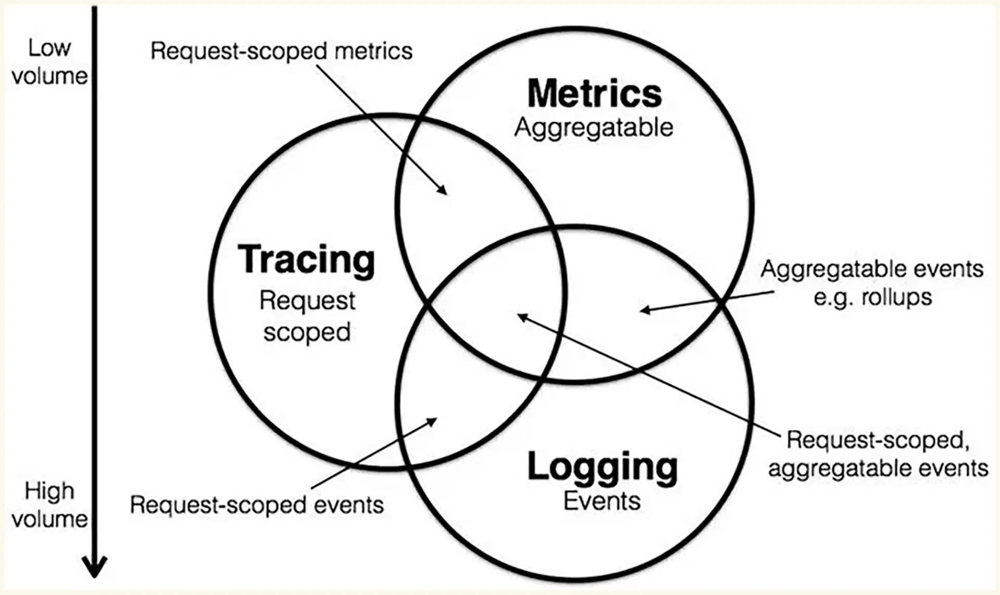
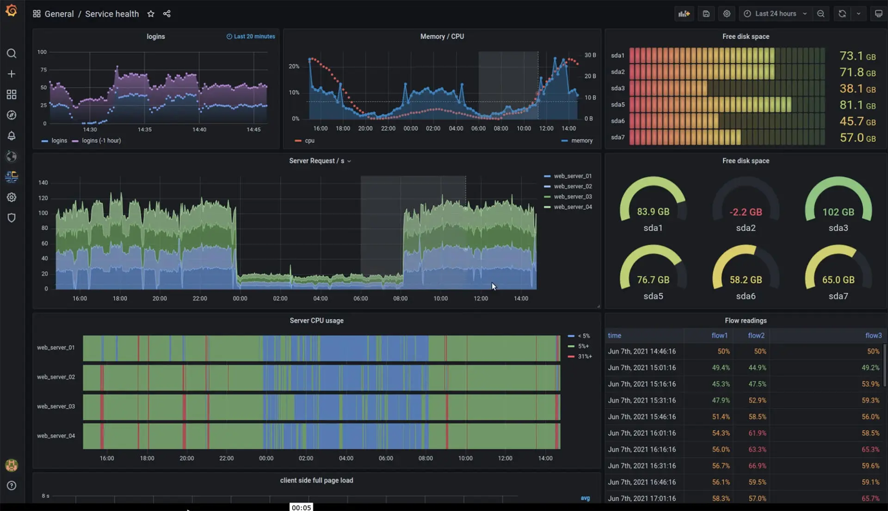
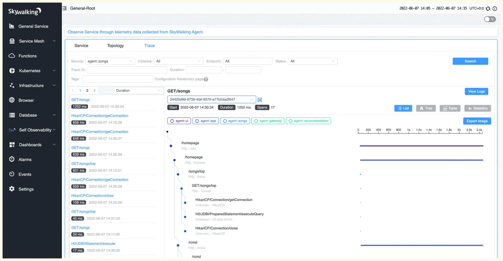
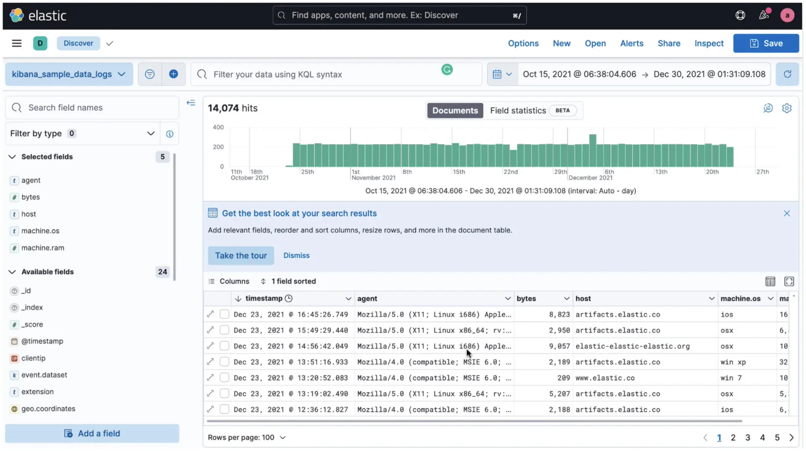
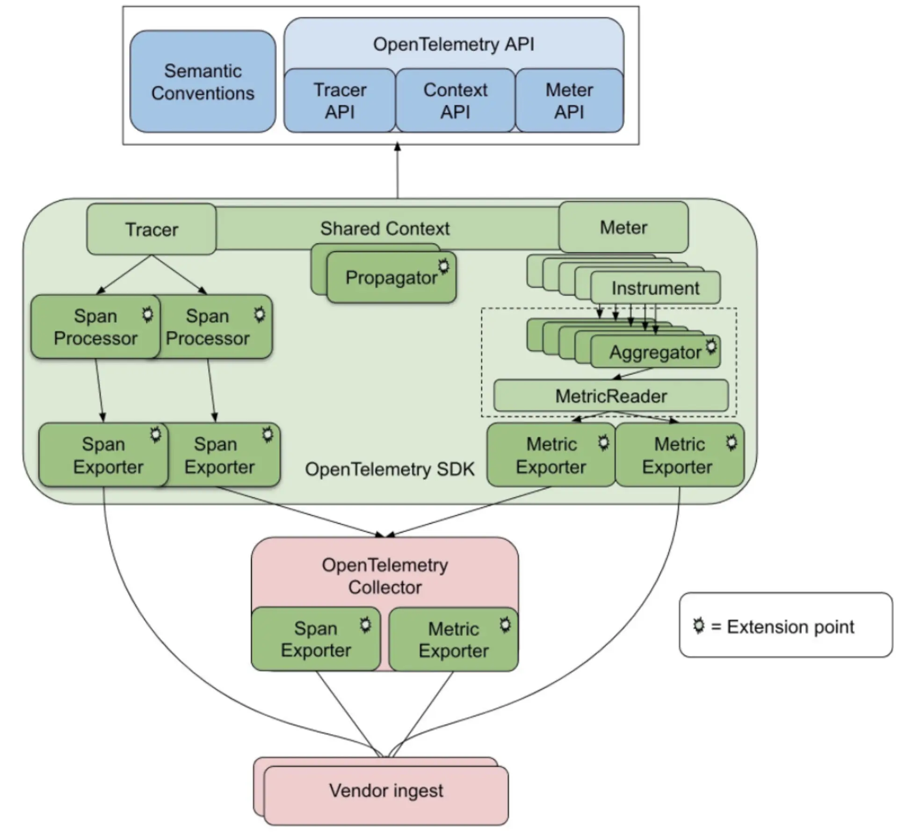
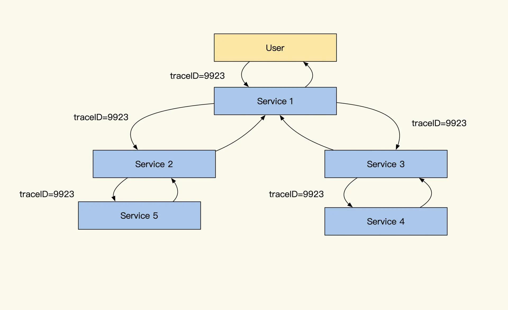
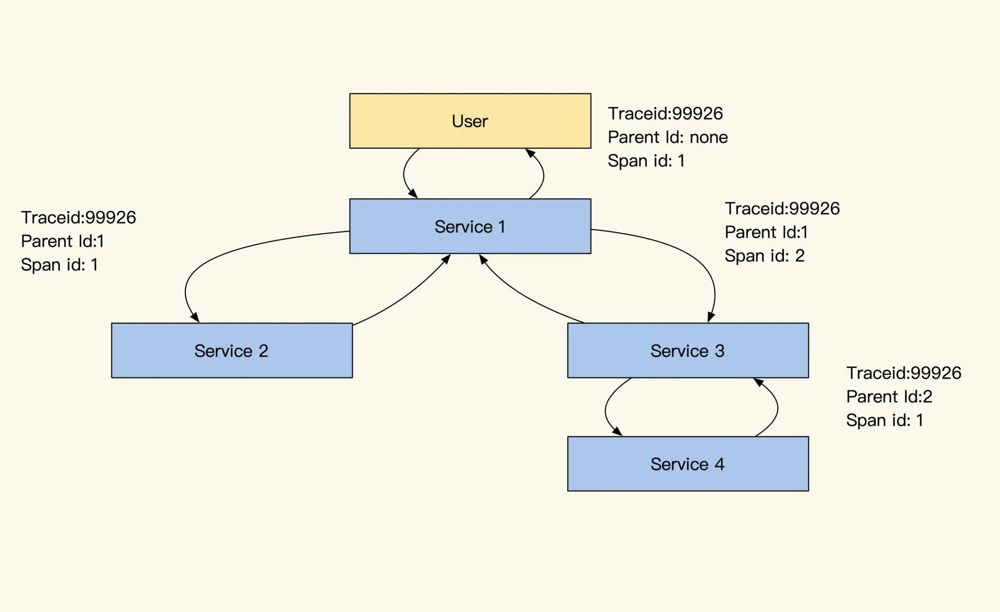
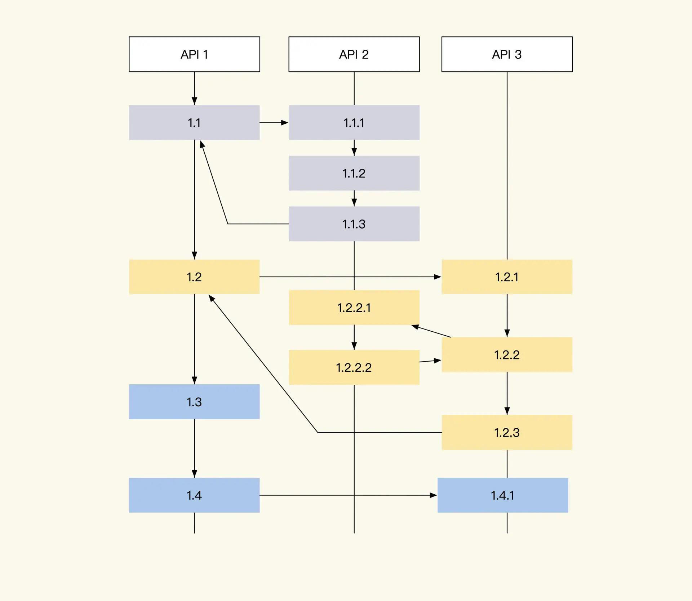
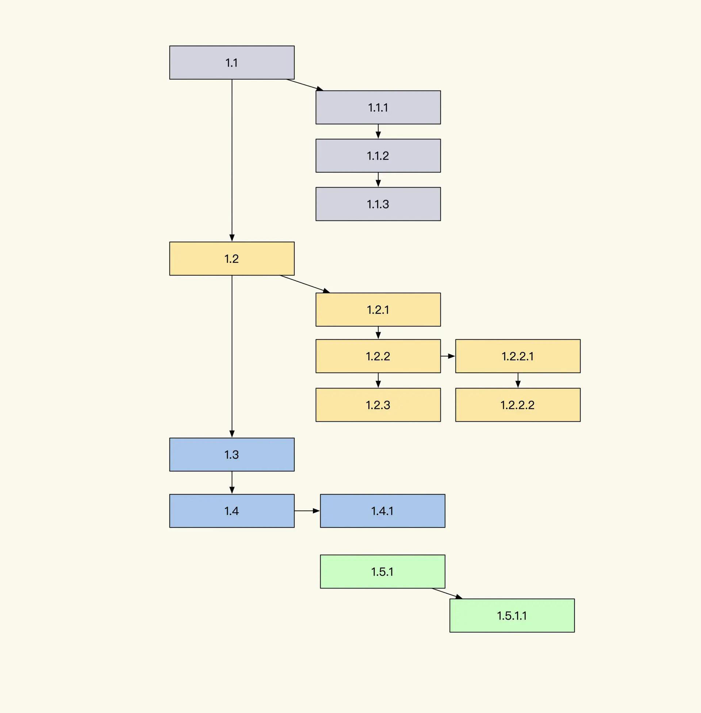

# 48.如何设计一个分布式链路跟踪系统

**分享内容**

1. 监控行业发展现状
2. TracelD 单次请求标识
3. RPCID 与 SpanlD 链路标识
4. 日志类型定义
5. 日志格式样例
6. 侵入式埋点 SDK 与 AOP 方式埋点
7. 总结

<font style="color:rgb(53, 53, 53);"></font>

<font style="color:rgb(53, 53, 53);">分布式链路跟踪服务属于</font>**<font style="color:rgb(53, 53, 53);">写多读少</font>**<font style="color:rgb(53, 53, 53);">的服务，是我们线上排查问题的重要支撑。我经历过的一个系统，同时支持着多条业务线，实际用上的服务器有两百台左右，这种量级的系统想排查故障，难度可想而知。</font>

<font style="color:rgb(53, 53, 53);">因此，我结合 ELK 特性设计了一套十分简单的全量日志分布式链路跟踪，把日志串了起来，大大降低了系统排查难度。</font>

<font style="color:rgb(53, 53, 53);">目前市面上开源提供的分布式链路跟踪都很抽象，当业务复杂到一定程度的时候，为核心系统定制一个符合自己业务需要的链路跟踪，还是很有必要的。</font>

<font style="color:rgb(53, 53, 53);">事实上，实现一个分布式链路跟踪并不难，而是难在埋点、数据传输、存储、分析上，如果你的团队拥有这些能力，也可以很快制作出一个链路跟踪系统。所以下面我们一起看看，如何实现一个简单的定制化分布式链路跟踪。</font>

## 监控行业发展现状
<font style="color:rgb(53, 53, 53);">在学习如何制作一个简单的分布式链路跟踪之前，为了更好了解这个链路跟踪的设计特点，我们先简单了解一下监控行业的现状。</font>

<font style="color:rgb(53, 53, 53);">最近监控行业有一次大革新，现代的链路跟踪标准已经不拘泥于请求的链路跟踪，目前已经开始进行融合，新的标准和我们定制化的分布式链路跟踪的设计思路很相似，即 Trace、Metrics、日志合并成一套系统进行建设。</font>



<font style="color:rgb(178, 178, 178);">三种监控各有千秋</font>

**<font style="color:rgb(0, 0, 0);">在此之前，常见监控系统主要有三种类型：Metrics、Tracing 和 Logging。</font>**



<font style="color:rgb(178, 178, 178);">Granfana官网展示的 Metrics</font>

<font style="color:rgb(53, 53, 53);">常见的开源 Metrics 有 Zabbix、Nagios、Prometheus、InfluxDb、OpenFalcon，主要做各种量化指标汇总统计，比如监控系统的容量剩余、每秒请求量、平均响应速度、某个时段请求量多少。</font>

<font style="color:rgb(53, 53, 53);">常见的开源链路跟踪有 Jaeger、Zipkin、Pinpoint、Skywalking，主要是通过分析每次请求链路监控分析的系统，我们可以通过 TraceID 查找一次请求的依赖及调用链路，分析故障点和传导过程的耗时。</font>



<font style="color:rgb(178, 178, 178);">Skywalking官方trace界面</font>



<font style="color:rgb(178, 178, 178);">kibana（ELK）官网，日志查找</font>

<font style="color:rgb(53, 53, 53);">而常见的开源 Logging 有 ELK、Loki、Loggly，主要是对文本日志的收集归类整理，可以对错误日志进行汇总、警告，并分析系统错误异常等情况。</font>

<font style="color:rgb(53, 53, 53);">这三种监控系统可以说是大服务集群监控的主要支柱，它们各有优点，但一直是分别建设的。这让我们的系统监控存在一些割裂和功能重复，而且每一个标准都需要独立建设一个系统，然后在不同界面对同一个故障进行分析，排查问题时十分不便。</font>

<font style="color:rgb(53, 53, 53);">随着行业发展，三位一体的标准应运而生，这就是 </font><font style="color:rgb(250, 137, 25);">OpenTelemetry</font><font style="color:rgb(53, 53, 53);"> 标准（集成了 OpenCensus、OpenTracing 标准）。这个标准将 Metrics+Tracing+Logging 集成一体，这样我们监控系统的时候就可以通过三个维度综合观测系统运转情况。</font>

<font style="color:rgb(53, 53, 53);">常见 OpenTelemetry 开源项目中的 Prometheus、Jaeger 正在遵循这个标准逐步改进实现 OpenTelemetry 实现的结构如下图所示：</font>



<font style="color:rgb(178, 178, 178);">OpenTelemetry标准架构</font>


### OpenTelemetry技术名词
#### <font style="color:rgb(53, 53, 53);">OpenTelemetry API</font>
+ **含义**<font style="color:rgb(53, 53, 53);">：一组标准化的接口，用于生成和操作可观测性数据。</font>
+ **作用**<font style="color:rgb(53, 53, 53);">：为开发者提供工具来创建和管理追踪、指标和日志数据，确保跨语言和跨平台的一致性。</font>

#### <font style="color:rgb(53, 53, 53);">Semantic Conventions</font>
+ **含义**<font style="color:rgb(53, 53, 53);">：对追踪、指标和日志数据中使用的属性和标签的标准化命名约定。</font>
+ **作用**<font style="color:rgb(53, 53, 53);">：确保不同服务和工具之间的数据具有一致性和可理解性，便于分析和监控。</font>

#### <font style="color:rgb(53, 53, 53);">Tracer</font>
+ **含义**<font style="color:rgb(53, 53, 53);">：用于创建和管理追踪数据的对象。</font>
+ **作用**<font style="color:rgb(53, 53, 53);">：生成和记录追踪数据（traces），每个追踪由一个或多个跨度（spans）组成。</font>

#### <font style="color:rgb(53, 53, 53);">Span Processor</font>
+ **含义**<font style="color:rgb(53, 53, 53);">：处理和导出跨度数据的组件。</font>
+ **作用**<font style="color:rgb(53, 53, 53);">：在跨度数据生成后立即处理这些数据，如过滤、修改或将其传递给导出器（exporter）。</font>

#### <font style="color:rgb(53, 53, 53);">Tracer API</font>
+ **含义**<font style="color:rgb(53, 53, 53);">：用于创建和操作追踪和跨度的编程接口。</font>
+ **作用**<font style="color:rgb(53, 53, 53);">：提供开发者工具来生成和管理追踪数据。</font>

#### <font style="color:rgb(53, 53, 53);">Context API</font>
+ **含义**<font style="color:rgb(53, 53, 53);">：用于管理上下文信息的接口。</font>
+ **作用**<font style="color:rgb(53, 53, 53);">：在不同的代码段和服务之间传递追踪和其他关联信息，确保关联性和一致性。</font>

#### <font style="color:rgb(53, 53, 53);">Meter API</font>
+ **含义**<font style="color:rgb(53, 53, 53);">：用于创建和操作指标（metrics）的编程接口。</font>
+ **作用**<font style="color:rgb(53, 53, 53);">：提供开发者工具来生成和管理应用程序的性能和行为指标。</font>

#### <font style="color:rgb(53, 53, 53);">Shared Context</font>
+ **含义**<font style="color:rgb(53, 53, 53);">：在不同服务和组件之间共享的上下文信息。</font>
+ **作用**<font style="color:rgb(53, 53, 53);">：保持追踪和指标的关联性，确保在分布式系统中能够正确关联事件和操作。</font>

#### <font style="color:rgb(53, 53, 53);">Propagator</font>
+ **含义**<font style="color:rgb(53, 53, 53);">：用于在不同服务之间传递上下文信息的组件。</font>
+ **作用**<font style="color:rgb(53, 53, 53);">：在分布式系统中传递追踪上下文和其他关联信息，确保跨服务的追踪和监控。</font>

#### <font style="color:rgb(53, 53, 53);">Meter</font>
+ **含义**<font style="color:rgb(53, 53, 53);">：用于生成和管理指标数据的对象。</font>
+ **作用**<font style="color:rgb(53, 53, 53);">：提供创建和记录应用程序性能和行为指标的能力。</font>

#### <font style="color:rgb(53, 53, 53);">Instrument</font>
+ **含义**<font style="color:rgb(53, 53, 53);">：用于度量特定类型指标的工具（如计数器、测量器等）。</font>
+ **作用**<font style="color:rgb(53, 53, 53);">：记录特定类型的指标数据，如计数、直方图等。</font>

#### <font style="color:rgb(53, 53, 53);">Aggregator</font>
+ **含义**<font style="color:rgb(53, 53, 53);">：用于聚合指标数据的组件。</font>
+ **作用**<font style="color:rgb(53, 53, 53);">：汇总和计算指标数据，以便更高效地存储和分析。</font>

#### <font style="color:rgb(53, 53, 53);">MetricReader</font>
+ **含义**<font style="color:rgb(53, 53, 53);">：读取和处理指标数据的组件。</font>
+ **作用**<font style="color:rgb(53, 53, 53);">：从仪表中收集指标数据并将其传递给导出器或其他处理组件。</font>

#### <font style="color:rgb(53, 53, 53);">Span Exporter</font>
+ **含义**<font style="color:rgb(53, 53, 53);">：用于将跨度数据导出到外部系统的组件。</font>
+ **作用**<font style="color:rgb(53, 53, 53);">：将生成的追踪数据发送到监控和分析系统，如日志管理工具或 APM 平台。</font>

#### <font style="color:rgb(53, 53, 53);">OpenTelemetry SDK</font>
+ **含义**<font style="color:rgb(53, 53, 53);">：OpenTelemetry 的软件开发工具包，包含 API、实现和默认配置。</font>
+ **作用**<font style="color:rgb(53, 53, 53);">：提供一整套工具和库，帮助开发者更容易地集成 OpenTelemetry 到他们的应用程序中。</font>

#### <font style="color:rgb(53, 53, 53);">Metric Exporter</font>
+ **含义**<font style="color:rgb(53, 53, 53);">：用于将指标数据导出到外部系统的组件。</font>
+ **作用**<font style="color:rgb(53, 53, 53);">：将生成的指标数据发送到监控和分析系统，如时间序列数据库或监控平台。</font>

#### <font style="color:rgb(53, 53, 53);">OpenTelemetry Collector</font>
+ **含义**<font style="color:rgb(53, 53, 53);">：独立的进程，用于接收、处理和导出可观测性数据。</font>
+ **作用**<font style="color:rgb(53, 53, 53);">：集中收集来自多个来源的追踪、指标和日志数据，并将其导出到不同的后端系统。</font>

#### <font style="color:rgb(53, 53, 53);">Extension Point</font>
+ **含义**<font style="color:rgb(53, 53, 53);">：允许扩展 OpenTelemetry 功能的接口或机制。</font>
+ **作用**<font style="color:rgb(53, 53, 53);">：提供一种方式，使开发者可以定制和扩展 OpenTelemetry 的功能，以满足特定需求。</font>

#### <font style="color:rgb(53, 53, 53);">Vendor Ingest</font>
+ **含义**<font style="color:rgb(53, 53, 53);">：将可观测性数据导入到特定供应商的监控和分析平台。</font>
+ **作用**<font style="color:rgb(53, 53, 53);">：确保 OpenTelemetry 生成的数据能够无缝地集成到各种供应商的工具和服务中，实现统一的监控和分析。</font>

<font style="color:rgb(53, 53, 53);"></font>

<font style="color:rgb(53, 53, 53);">事实上，分布式链路跟踪系统及监控主要提供了以下支撑服务：</font>

<font style="color:rgb(53, 53, 53);">监控日志标准</font>

<font style="color:rgb(53, 53, 53);">埋点 SDK（AOP 或侵入式）</font>

<font style="color:rgb(53, 53, 53);">日志收集</font>

<font style="color:rgb(53, 53, 53);">分布式日志传输</font>

<font style="color:rgb(53, 53, 53);">分布式日志存储</font>

<font style="color:rgb(53, 53, 53);">分布式检索计算</font>

<font style="color:rgb(53, 53, 53);">分布式实时分析</font>

<font style="color:rgb(53, 53, 53);">个性化定制指标盘</font>

<font style="color:rgb(53, 53, 53);">系统警告</font>

<font style="color:rgb(53, 53, 53);">我建议使用 ELK 提供的功能去实现分布式链路跟踪系统，因为它已经完整提供了如下功能：</font>

<font style="color:rgb(53, 53, 53);">日志收集（Filebeat）</font>

<font style="color:rgb(53, 53, 53);">日志传输（Kafka+Logstash）</font>

<font style="color:rgb(53, 53, 53);">日志存储（Elasticsearch）</font>

<font style="color:rgb(53, 53, 53);">检索计算（Elasticsearch + Kibana）</font>

<font style="color:rgb(53, 53, 53);">实时分析（Kibana）</font>

<font style="color:rgb(53, 53, 53);">个性定制表格查询（Kibana）</font>

<font style="color:rgb(53, 53, 53);">这样一来，我只需要制定日志格式、埋点 SDK，即可实现一个具有分布式链路跟踪、Metrics、日志分析系统。</font>

<font style="color:rgb(53, 53, 53);">事实上，Log、Metrics、trace 三种监控体系最大的区别就是日志格式标准，底层实现其实是很相似的。既然 ELK 已提供我们需要的分布式相关服务，下面我简单讲讲日志格式和 SDK 埋点，通过这两个点我们就可以窥见分布式链路跟踪的全貌。</font>

## TraceID 单次请求标识
<font style="color:rgb(53, 53, 53);">可以说，要想构建一个简单的 Trace 系统，我们首先要做的就是生成并传递 TraceID。</font>



<font style="color:rgb(178, 178, 178);">TraceID在各个服务中的传递</font>

<font style="color:rgb(53, 53, 53);">分布式链路跟踪的原理其实很简单，就是在请求发起方发送请求时或服务被请求时生成一个 UUID，被请求期间的业务产生的任何日志（Warning、Info、Debug、Error）、任何</font>**<font style="color:rgb(0, 0, 0);">依赖资源请求</font>**<font style="color:rgb(53, 53, 53);">（MySQL、Kafka、Redis）、任何内部接口调用（Restful、Http、RPC）都会带上这个 UUID。</font>

<font style="color:rgb(53, 53, 53);">这样，当我们把所有拥有同样 UUID 的日志收集起来时，就可以根据时间（有误差）、RPCID（后续会介绍 RPCID）或 SpanID，将它们按依赖请求顺序串起来。</font>

<font style="color:rgb(53, 53, 53);">只要日志足够详细，我们就能监控到系统大部分的工作状态，比如用户请求一个服务会调用多少个接口，每个数据查询的 SQL 以及具体耗时调用的内网请求参数是什么、调用的内网请求返回是什么、内网被请求的接口又做了哪些操作、产生了哪些异常信息等等。</font>

<font style="color:rgb(53, 53, 53);">同时，我们可以通过对这些日志做归类分析，分析项目之间的调用关系、项目整体健康程度、对链路深挖自动识别出故障点等，帮助我们主动、快速地查找问题。</font>

## RPCID 与 SpanlD 链路标识
<font style="color:rgb(53, 53, 53);">那么如何将汇总起来的日志串联起来呢？有两种方式：span（链式记录依赖）和 RPCID（层级计数器）。我们在记录日志带上 UUID 的同时，也带上 RPCID 这个信息，通过它帮我们把日志关联关系串联起来，那么这两种方式有什么区别呢？</font>

<font style="color:rgb(53, 53, 53);">我们先看看 span 实现，具体如下图：</font>



<font style="color:rgb(178, 178, 178);">span图</font>

<font style="color:rgb(53, 53, 53);">结合上图，我们分析一下 span 的链式依赖记录方式。对于代码来说，写的很多功能会被封装成功能模块（Service、Model），我们通过组合不同的模块实现业务功能，并且记录这两个模块、两个服务间或是资源的调用依赖关系。</font>

<font style="color:rgb(53, 53, 53);">span 这个设计会通过记录自己上游依赖服务的 SpanID 实现上下游关系关联（放在 Parent ID 中），通过整理 span 之间的依赖关系就能组合成一个调用链路树。</font>

<font style="color:rgb(53, 53, 53);">那 RPCID 方式是什么样的呢？RPCID 也叫层级计数器，为了方便理解，我们来看下面这张图：</font>



<font style="color:rgb(178, 178, 178);">RPCID层级依赖计数器</font>

<font style="color:rgb(53, 53, 53);">你看，RPCID 的层级计数器实现很简单，第一个接口生成 RPCID 为 </font>**<font style="color:rgb(0, 0, 0);">1.1</font>**<font style="color:rgb(53, 53, 53);"> ，RPCID 的</font>**<font style="color:rgb(0, 0, 0);">前缀</font>**<font style="color:rgb(53, 53, 53);">是 1，</font>**<font style="color:rgb(0, 0, 0);">计数器</font>**<font style="color:rgb(53, 53, 53);">是 1（日志记录为 1.1）。</font>

<font style="color:rgb(53, 53, 53);">当所在接口请求其他接口或数据服务（MySQL、Redis、API、Kafka）时，</font>**<font style="color:rgb(0, 0, 0);">计数器</font>**<font style="color:rgb(53, 53, 53);">+1，并在请求当中带上 1.2 这个数值（因为当前的</font>**<font style="color:rgb(0, 0, 0);">前缀</font>**<font style="color:rgb(53, 53, 53);"> + “.” + </font>**<font style="color:rgb(0, 0, 0);">计数器值 = 1.2）</font>**<font style="color:rgb(53, 53, 53);">，等到返回结果后，继续请求下一个资源时继续 +1，期间产生的任何日志都会记录当前 </font>**<font style="color:rgb(0, 0, 0);">前缀</font>**<font style="color:rgb(53, 53, 53);">+“.”+</font>**<font style="color:rgb(0, 0, 0);">计数器值</font>**<font style="color:rgb(53, 53, 53);">。</font>

<font style="color:rgb(53, 53, 53);">每一层收到了前缀后，都在后面加了一个累加的计数器，实际效果如下图所示：</font>



<font style="color:rgb(178, 178, 178);">累加计数器</font>

<font style="color:rgb(53, 53, 53);">而被请求的接口收到请求时，如果请求传递了 TraceID，那么被请求的服务会继续使用传递过来的 TraceID，如果请求没有 TraceID 则自己生成一个。同样地，如果传递了 RPCID，那么被请求的服务会将传递来的 RPCID 当作前缀，计数器从 1 开始计数。</font>

<font style="color:rgb(53, 53, 53);">相对于 span，通过这个层级计数器做出来的 RPCID 有两个优点。</font>

**<font style="color:rgb(53, 53, 53);">第一个优点是我们可以记录请求方日志</font>**<font style="color:rgb(53, 53, 53);">，如果被请求方没有记录日志，那么还可以通过请求方日志观测分析被调用方性能（MySQL、Redis）。</font>

**<font style="color:rgb(53, 53, 53);">另一个优点是哪怕日志收集得不全，丢失了一些，我们还可以通过前缀有几个分隔符，判断出日志所在层级进行渲染</font>**<font style="color:rgb(53, 53, 53);">。举个例子，假设我们不知道上图的 1.5.1 是谁调用的，但是根据它的 UUID 和层级 1.5.1 这些信息，渲染的时候，我们仍旧可以渲染它大概的链路位置。</font>

<font style="color:rgb(53, 53, 53);">除此之外，我们可以利用 AOP 顺便将各个模块做一个 Metrics 性能统计分析，分析各个模块的耗时、调用次数做周期统计。</font>

<font style="color:rgb(53, 53, 53);">同时，通过这个维度采样统计数据，能够帮助我们分析这个模块的性能和错误率。由于 Metrics 这个方式产生的日志量很小，有些统计是每 10 秒才会产生一条 Metrics 统计日志，统计的数值很方便对比，很有参考价值。</font>

<font style="color:rgb(53, 53, 53);">但是你要注意，</font>**<font style="color:rgb(53, 53, 53);">对于一个模块内有多个分支逻辑时，Metrics 很多时候取的是平均数，偶发的超时在平均数上看不出来，所以我们需要另外记录一下最大最小的延迟，才可以更好地展现。</font>**<font style="color:rgb(53, 53, 53);">同时，这种统计只是让我们知道这个模块是否有性能问题，但是无法帮助我们分析具体的原因。</font>

<font style="color:rgb(53, 53, 53);">回到之前的话题，我们前面提到，请求和被请求方通过传递 TraceID 和 RPCID（或 SpanID）来实现链路的跟踪，我列举几个常见的方式供你参考：</font>

<font style="color:rgb(53, 53, 53);">HTTP 协议放在 Header；</font>

<font style="color:rgb(53, 53, 53);">RPC 协议放在 meta 中传递；</font>

<font style="color:rgb(53, 53, 53);">队列可以放在消息体的 Header 中，或直接在消息体中传递；</font>

<font style="color:rgb(53, 53, 53);">其他特殊情况下可以通过网址请求参数传递。</font>

<font style="color:rgb(53, 53, 53);">那么应用内多线程和多协程之间如何传递 TraceID 呢？一般来说，我们会通过复制一份 Context 传递进入线程或协程，并且如果它们之前是并行关系，我们复制之后需要对下发之前的 RPCID 计数器加 1，并把前缀和计数器合并成新的前缀，以此区分并行的链路。</font>

<font style="color:rgb(53, 53, 53);">除此之外，我们还做了一些特殊设计，当我们的请求中带一个特殊的密语，并且设置类似 X-DEBUG Header 等于 1 时，我们可以开启在线 debug 模式，在被调用接口及所有依赖的服务都会输出 debug 级别的日志，这样我们临时排查线上问题会更方便。</font>

## 日志类型定义
<font style="color:rgb(53, 53, 53);">可以说，只要让日志输出当前的 TraceId 和 RPCID（SpanID），并在请求所有依赖资源时把计数传递给它们，就完成了大部分的分布式链路跟踪。下面是我定制的一些日志类型和日志格式，供你参考：</font>

```python
## 日志类型
* request.info 当前被请求接口的相关信息，如被请求接口，耗时，参数，返回值，客户端信息
* mysql.connect mysql连接时长
* mysql.connect.error mysql链接错误信息
* mysql.request mysql执行查询命令时长及相关信息
* mysql.request.error mysql操作时报错的相关信息
* redis.connect redis 链接时长
* redis.connect.error redis链接错误信息
* redis.request redis执行命令
* redis.request.error redis操作时错误
* memcache.connect
* memcache.connect.error
* memcache.request.error
* http.get 另外可以支持restful操作get put delete 
* http.post
* http.*.error
## Metric日志类型
* metric.counter
...略
## 分级日志类型
* log.debug: debug log
* log.trace: trace log
* log.notice: notice log
* log.info: info log
* log.error: application error log
* log.alarm: alarm log
* log.exception: exception log
```

<font style="color:rgb(53, 53, 53);">你会发现，所有对依赖资源的请求都有相关日志，这样可以帮助我们分析所有依赖资源的耗时及返回内容。此外，我们的分级日志也在 trace 跟踪范围内，通过日志信息可以更好地分析问题。而且，如果我们监控的是静态语言，还可以像之前说的那样，对一些模块做 Metrics，定期产生日志。</font>

## 日志格式样例
<font style="color:rgb(53, 53, 53);">日志建议使用 JSON 格式，所有字段除了标注为 string 的都建议保存为字符串类型，每个字段必须是固定数据类型，选填内容如果没有内容就直接不输出。</font>

<font style="color:rgb(53, 53, 53);">这样设计其实是为了适配 Elasticsearch+Kibana，Kibana 提供了日志的聚合、检索、条件检索和数值聚合，但是对字段格式很敏感，不是数值类型就无法聚合对比。</font>

<font style="color:rgb(53, 53, 53);">下面我给你举一个例子用于链路跟踪和监控，你主要关注它的类型和字段用途。</font>

```json
{
  "name": "string:全量字段介绍,必填，用于区分日志类型，上面的日志列表内容写这里",
  "trace_id": "string:traceid，必填",
  "rpc_id": "string:RPCID，服务端链路必填，客户端非必填",
  "department":"部门缩写如client_frontend 必填",
  "version": "string:当前服务版本 cpp-client-1.1 php-baseserver-1.4 java-rti-1.9，建议都填",
  "timestamp": "int:日志记录时间，单位秒，必填",
  "duration": "float:消耗时间，浮点数 单位秒，能填就填",
  "module": "string:模块路径，建议格式应用名称_模块名称_函数名称_动作，必填",
  "source": "string:请求来源 如果是网页可以记录ref page，选填",
  "uid": "string:当前用户uid，如果没有则填写为 0长度字符串，可选填，能够帮助分析用户一段时间行为",
  "pid": "string:进程pid，如果没有填写为 0长度字符串，如果有线程可以为pid-tid格式，可选填",
  "server_ip": "string 当前服务器ip，必填",
  "client_ip": "string 客户端ip，选填",
  "user_agent": "string curl/7.29.0 选填",
  "host": "string 链接目标的ip及端口号，用于区分环境12.123.23.1:3306，选填",
  "instance_name": "string 数据库连接配置的标识，比如rti的数据库连接，选填",
  "db": "string 数据库名称如：peiyou_stastic，选填",
  "code": "string:各种驱动或错误或服务的错误码，选填，报错误必填",
  "msg": "string 错误信息或其他提示信息，选填，报错误必填",
  "backtrace": "string 错误的backtrace信息，选填，报错误必填",
  "action": "string 可以是url、sql、redis命令、所有让远程执行的命令，必填",
  "param": "string 通用参数模板，用于和script配合，记录所有请求参数，必填",
  "file": "string userinfo.php，选填",
  "line": "string 232，选填",
  "response": "string:请求返回的结果，可以是本接口或其他资源返回的数据，如果数据太长会影响性能，选填",
  "response_length": "int:相应内容结果的长度，选填",
  "dns_duration": "float dns解析时间，一般http mysql请求域名的时候会出现此选项，选填",
  "extra": "json 放什么都可以,用户所有附加数据都扔这里"
}
## 样例
被请求日志
{
  "x_name": "request.info",
  "x_trace_id": "123jiojfdsao",
  "x_rpc_id": "0.1",
  "x_version": "php-baseserver-4.0",
  "x_department":"tal_client_frontend",
  "x_timestamp": 1506480162,
  "x_duration": 0.021,
  "x_uid": "9527",
  "x_pid": "123",
  "x_module": "js_game1_start",
  "x_user_agent": "string curl/7.29.0",
  "x_action": "http://testapi.speiyou.com/v3/user/getinfo?id=9527",
  "x_server_ip": "192.168.1.1:80",
  "x_client_ip": "192.168.1.123",
  "x_param": "json string",
  "x_source": "www.baidu.com",
  "x_code": "200",
  "x_response": "json:api result",
  "x_response_len": 12324
}
### mysql 链接性能日志
{
  "x_name": "mysql.connect",
  "x_trace_id": "123jiojfdsao",
  "x_rpc_id": "0.2",
  "x_version": "php-baseserver-4",
  "x_department":"tal_client_frontend",
  "x_timestamp": 1506480162,
  "x_duration": 0.024,
  "x_uid": "9527",
  "x_pid": "123",
  "x_module": "js_mysql_connect",
  "x_instance_name": "default",
  "x_host": "12.123.23.1:3306",
  "x_db": "tal_game_round",
  "x_msg": "ok",
  "x_code": "1",
  "x_response": "json:****"
}
### Mysql 请求日志
{
  "x_name": "mysql.request",
  "x_trace_id": "123jiojfdsao",
  "x_rpc_id": "0.2",
  "x_version": "php-4",
  "x_department":"tal_client_frontend",
  "x_timestamp": 1506480162,
  "x_duration": 0.024,
  "x_uid": "9527",
  "x_pid": "123",
  "x_module": "js_game1_round_sigup",
  "x_instance_name": "default",
  "x_host": "12.123.23.1:3306",
  "x_db": "tal_game_round",
  "x_action": "select * from xxx where xxxx",
  "x_param": "json string",
  "x_code": "1",
  "x_msg": "ok",
  "x_response": "json:****"
}
### http 请求日志
{
"x_name": "http.post",
"x_trace_id": "123jiojfdsao",
"x_department":"tal_client_frontend",
"x_rpc_id": "0.3",
"x_version": "php-4",
"x_timestamp": 1506480162,
"x_duration": 0.214,
"x_uid": "9527",
"x_pid": "123",
"x_module": "js_game1_round_win_report",
"x_action": "http://testapi.speiyou.com/v3/game/report",
"x_param": "json:",
"x_server_ip": "192.168.1.1",
"x_msg": "ok",
"x_code": "200",
"x_response_len": 12324,
"x_response": "json:responsexxxx",
"x_dns_duration": 0.001
}
### level log info日志
{
"x_name": "log.info",
"x_trace_id": "123jiojfdsao",
"x_department":"tal_client_frontend",
"x_rpc_id": "0.3",
"x_version": "php-4",
"x_timestamp": 1506480162,
"x_duration": 0.214,
"x_uid": "9527",
"x_pid": "123",
"x_module": "game1_round_win_round_end",
"x_file": "userinfo.php",
"x_line": "232",
"x_msg": "ok",
"x_code": "201",
"extra": "json game_id lesson_num xxxxx"
}
### exception 异常日志
{
"x_name": "log.exception",
"x_trace_id": "123jiojfdsao",
"x_department":"tal_client_frontend",
"x_rpc_id": "0.3",
"x_version": "php-4",
"x_timestamp": 1506480162,
"x_duration": 0.214,
"x_uid": "9527",
"x_pid": "123",
"x_module": "game1_round_win",
"x_file": "userinfo.php",
"x_line": "232",
"x_msg": "exception:xxxxx call stack",
"x_code": "hy20001",
"x_backtrace": "xxxxx.php(123) gotError:..."
}
### 业务自发告警日志
{
"x_name": "log.alarm",
"x_trace_id": "123jiojfdsao",
"x_department":"tal_client_frontend",
"x_rpc_id": "0.3",
"x_version": "php-4",
"x_timestamp": 1506480162,
"x_duration": 0.214,
"x_uid": "9527",
"x_pid": "123",
"x_module": "game1_round_win_round_report",
"x_file": "game_win_notify.php",
"x_line": "123",
"x_msg": "game report request fail! retryed three time..",
"x_code": "201",
"x_extra": "json game_id lesson_num xxxxx"
}
### matrics 计数器
{
"x_name": "metrix.count",
"x_trace_id": "123jiojfdsao",
"x_department":"tal_client_frontend",
"x_rpc_id": "0.3",
"x_version": "php-4",
"x_timestamp": 1506480162,
"x_uid": "9527",
"x_pid": "123",
"x_module": "game1_round_win_click",
"x_extra": "json curl invoke count"
}
```

<font style="color:rgb(53, 53, 53);">这个日志不仅可以用在服务端，还可以用在客户端。客户端每次被点击或被触发时，都可以自行生成一个新的 TraceID，在请求服务端时就会带上它。通过这个日志，我们可以分析不同地域访问服务的性能，也可以用作用户行为日志，仅仅需添加我们的日志类型即可。</font>

<font style="color:rgb(53, 53, 53);">上面的日志例子基本把我们依赖的资源情况描述得很清楚了。另外，我补充一个技巧，性能记录日志可以将被请求的接口也记录成一个日志，记录自己的耗时等信息，方便之后跟请求方的请求日志对照，这样可分析出两者之间是否有网络延迟等问题。</font>

<font style="color:rgb(53, 53, 53);">除此之外，这个设计还有一个核心要点：研发并不一定完全遵守如上字段规则生成日志，业务只要保证项目范围内输出的日志输出所有必填项目（TraceID，RPCID/SpanID，TimeStamp），同时保证数值型字段功能及类型稳定，即可实现 trace。</font>

<font style="color:rgb(53, 53, 53);">我们完全可以汇总日志后，再对不同的日志字段做自行解释，定制出不同业务所需的统计分析，这正是 ELK 最强大的地方。</font>

<font style="color:rgb(53, 53, 53);">为什么大部分设计都是记录依赖资源的日志呢？原因在于在没有 IO 的情况下，程序大部分都是可控的（侧重计算的服务除外）。只有 IO 类操作容易出现不稳定因素，并且日志记录过多也会影响系统性能，通过记录对数据源的操作能帮助我们排查业务逻辑的错误。</font>

<font style="color:rgb(53, 53, 53);">我们刚才提到日志如果过多会影响接口性能，那如何提高日志的写吞吐能力呢？这里我为你归纳了几个注意事项和技巧：</font>

<font style="color:rgb(53, 53, 53);">1. 提高写线程的个数，一个线程写一个日志，也可以每个日志文件单独放一个磁盘，但是你要注意控制系统的 IOPS 不要超过 100；</font>

<font style="color:rgb(53, 53, 53);">2. 当写入日志长度超过 1kb 时，不要使用多个线程高并发写同一个文件。原因参考 </font><font style="color:rgb(250, 137, 25);">append is not Atomic</font><font style="color:rgb(53, 53, 53);">，简单来说就是文件的 append 操作对于写入长度超过缓冲区长度的操作不是原子性的，多线程并发写长内容到同一个文件，会导致日志乱序；</font>

<font style="color:rgb(53, 53, 53);">3. 日志可以通过内存暂存，汇总达到一定数据量或缓存超过 2 秒后再落盘，这样可以减少过小日志写磁盘系统的调用次数，但是代价是被强杀时会丢日志；</font>

<font style="color:rgb(53, 53, 53);">4. 日志缓存要提前 malloc 使用固定长度缓存，不要频繁分配回收，否则会导致系统整体缓慢；</font>

<font style="color:rgb(53, 53, 53);">5. 服务被 kill 时，记得拦截信号，快速 fsync 内存中日志到磁盘，以此减少日志丢失的可能。</font>

## 侵入式埋点 SDK 与 AOP 方式埋点
<font style="color:rgb(53, 53, 53);">最后，我们再说说 SDK。事实上，使用“ELK+ 自定义的标准”基本上已经能实现大多数的分布式链路跟踪系统，使用 Kibana 可以很快速地对各种日志进行聚合分析统计。</font>

<font style="color:rgb(53, 53, 53);">虽然行业中出现过很多链路跟踪系统服务公司，做了很多 APM 等类似产品，但是能真正推广开的服务实际占少数，究其原因，我认为是以下几点：</font>

<font style="color:rgb(53, 53, 53);">分布式链路跟踪的日志吞吐很大，需要耗费大量的资源，成本高昂；</font>

<font style="color:rgb(53, 53, 53);">通用分布式链路跟踪服务很难做贴近业务的个性化，不能定制的第三方服务不如用开源；</font>

<font style="color:rgb(53, 53, 53);">分布式链路跟踪的埋点库对代码的侵入性大，需要研发手动植入到业务代码里，操作很麻烦，而且不够灵活。</font>

<font style="color:rgb(53, 53, 53);">另外，这种做法对语言也有相关的限制，因为目前只有 Java 通过动态启动注入 agent，才实现了静态语言 AOP 注入。我之前推广时，也是统一了内网项目的开源框架，才实现了统一的链路跟踪。</font>

<font style="color:rgb(53, 53, 53);">那么如果底层代码不能更新，如何简单暴力地实现链路跟踪呢？</font>

<font style="color:rgb(53, 53, 53);">这时候我们可以</font>**<font style="color:rgb(53, 53, 53);">改造分级日志，让它每次在落地的时候都把 TraceId 和 RPCID（或 SpanID）带上</font>**<font style="color:rgb(53, 53, 53);">，就会有很好的效果。如果数据底层做了良好的封装，我们可以在发起请求部分中写一些符合标准性能的日志，在框架的统一异常处理中也注入我们的标准跟踪，即可实现关键点的监控。</font>

<font style="color:rgb(53, 53, 53);">当然如果条件允许，我们最好提</font>**<font style="color:rgb(53, 53, 53);">供一个标准的 SDK，让业务研发伙伴按需调用，这能帮助我们统一日志结构</font>**<font style="color:rgb(53, 53, 53);">。毕竟手写很容易格式错乱，需要人工梳理，不过即使混乱，也仍旧有规律可言，这是 ELK 架构的强大之处，它的全文检索功能其实不在乎你的输入格式，但是数据统计类却需要我们确保各个字段用途固定。</font>

<font style="color:rgb(53, 53, 53);">最后再讲点其他日志的注意事项，可能你已经注意到了，这个设计日志是全量的。很多链路跟踪其实都是做的采样方式，比如 Jaeger 在应用本地会部署一个 Agent，对数据暂存汇总，统计出每个接口的平均响应时间，对具有同样特征的请求进行归类汇总，这样可以大大降低服务端压力。</font>

<font style="color:rgb(53, 53, 53);">但这么做也有缺点，当我们有一些小概率的业务逻辑错误，在采样中会被遗漏。所以很多核心系统会记录全量日志，周边业务记录采样日志。</font>

<font style="color:rgb(53, 53, 53);">由于我们日志结构很简单，如有需要可以自行实现一个类似 Agent 的功能，降低我们存储计算压力。甚至我们可以在服务端本地保存原始日志 7 天，当我们查找某个 Trace 日志的时候，直接请求所有服务器在本地查找。事实上，在写多读少的情况下，为了追一个 Trace 详细过程而去请求 200 个服务器，这时候即使等十秒钟都是可以接受的。</font>

## 总结
<font style="color:rgb(53, 53, 53);">系统监控一直是服务端重点关注的功能，我们常常会根据链路跟踪和过程日志，去分析排查线上问题。也就是说，监控越是贴近业务、越定制化，我们对线上业务运转情况的了解就越直观。</font>

<font style="color:rgb(53, 53, 53);">不过，实现一个更符合业务的监控系统并不容易，因为基础运维监控只会监控线上请求流量、响应速度、系统报错、系统资源等基础监控指标，当我们要监控业务时，还需要人工在业务系统中嵌入大量代码。而且，因为这些服务属于开源，还要求我们必须对监控有较深的了解，投入大量精力才可以。</font>

<font style="color:rgb(53, 53, 53);">好在技术逐渐成熟，通用的简单日志传输索引统计服务开始流行，其中最强的组合就是 ELK。通过这类分布式日志技术，能让我们轻松实现个性化监控需求。日志格式很杂乱也没关系，只要将 </font>**<font style="color:rgb(0, 0, 0);">TraceID</font>**<font style="color:rgb(53, 53, 53);"> 和 </font>**<font style="color:rgb(0, 0, 0);">RPCID</font>**<font style="color:rgb(53, 53, 53);">（或 SpanID）在请求依赖资源时传递下去，并将沿途的日志都记录对应的字段即可。也正因如此，ELK 流行起来，很多公司的核心业务，都会依托 ELK 自定义一套自己的监控系统。</font>

<font style="color:rgb(53, 53, 53);">不过这么做，只能让我们建立起一个粗旷的跟踪系统，后续分析的难度和投入成本依然很大，因为 ELK 需要投入</font>**<font style="color:rgb(0, 0, 0);">大量硬件资源</font>**<font style="color:rgb(53, 53, 53);">来帮我们处理海量数据</font>


> 更新: 2024-09-01 10:09:22  
> 原文: <https://www.yuque.com/aaron-wecc3/dhluml/wfaa0ofdi9kp5a1x>