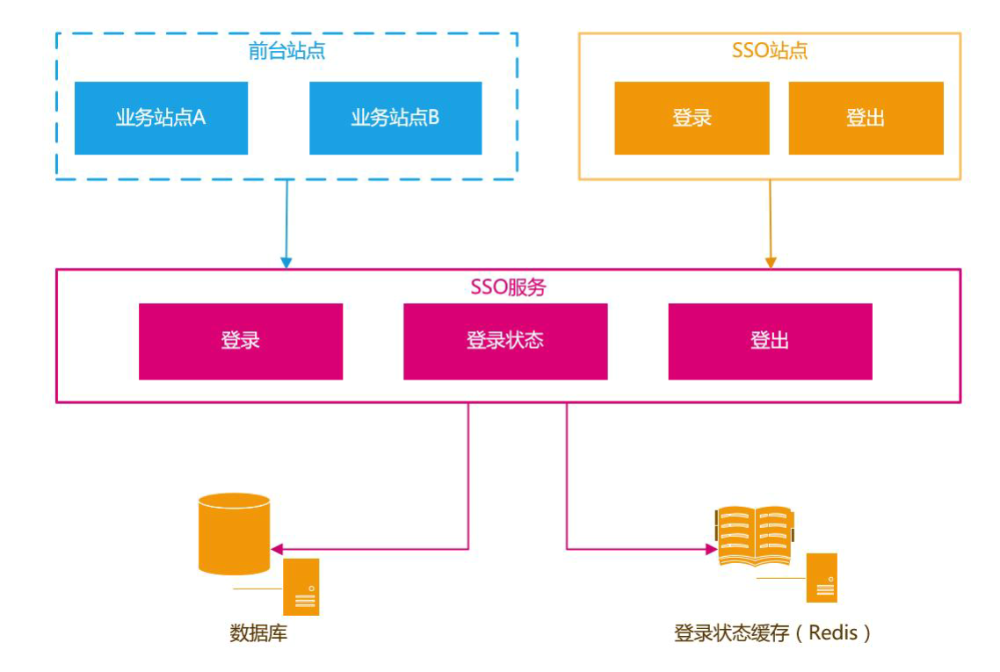
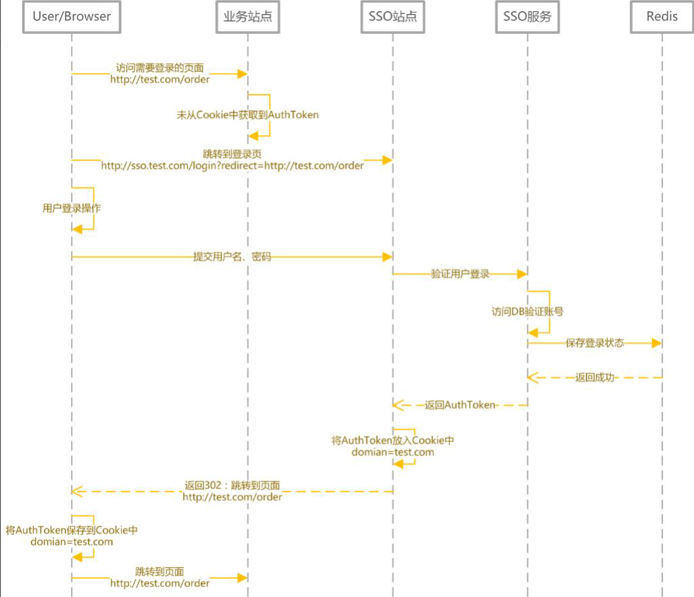
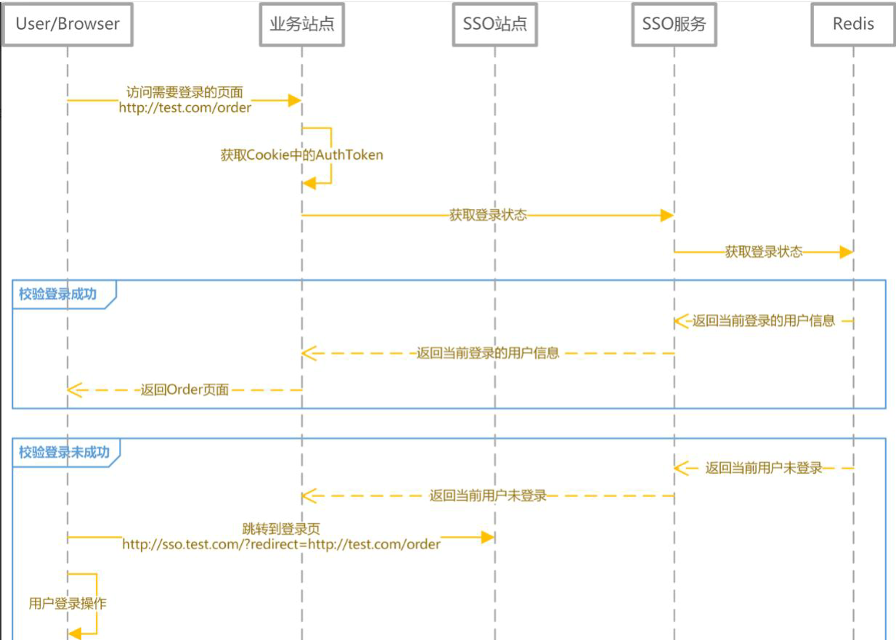
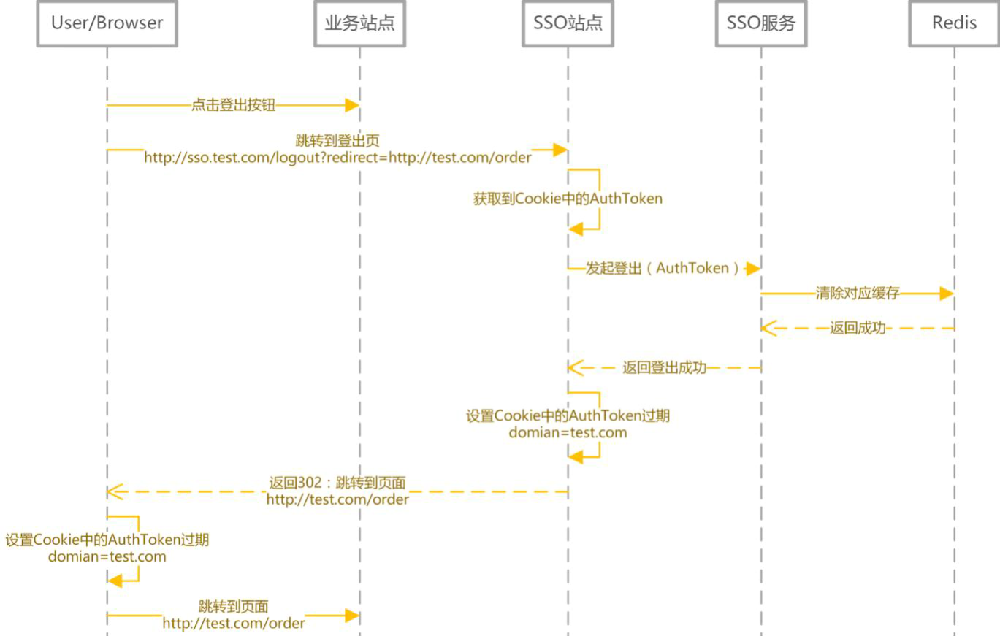
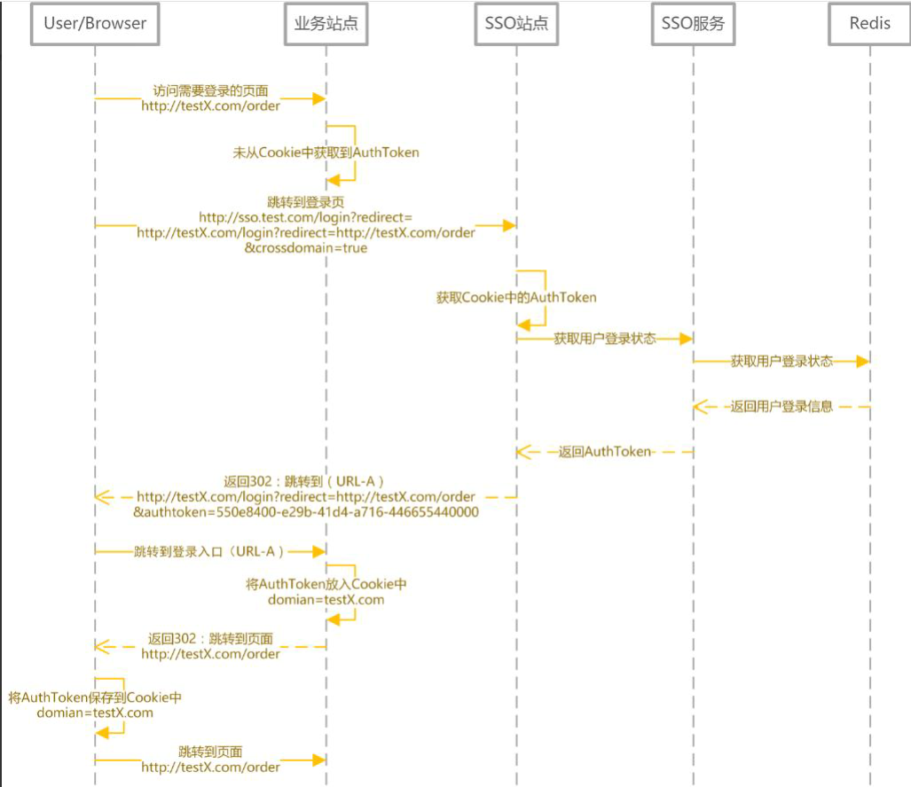
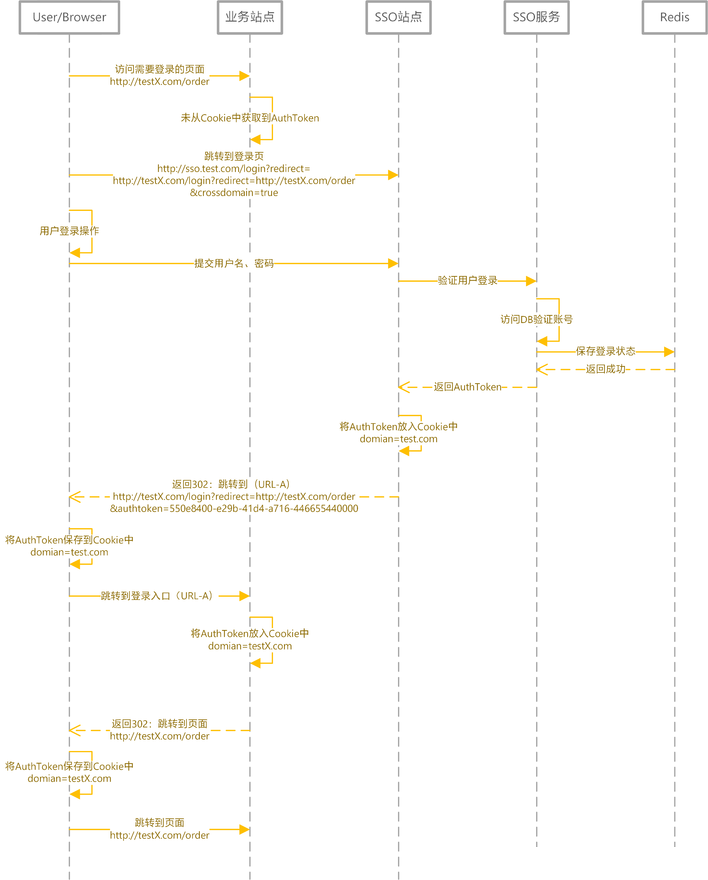
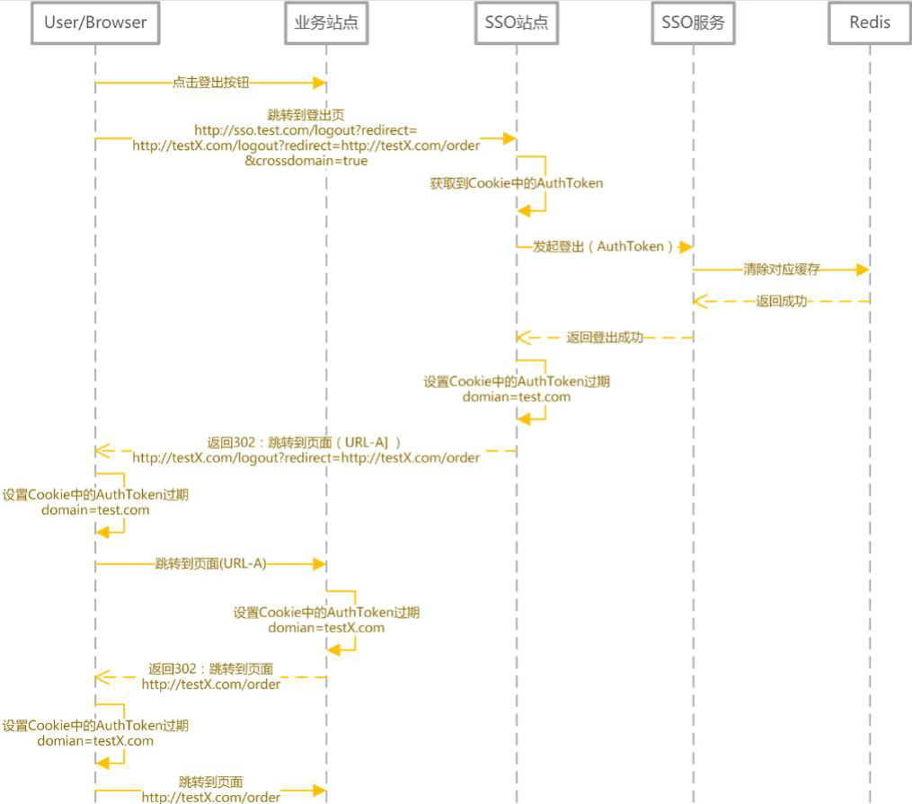

# 50.如何设计一个SSO单点登录系统

**分享内容**

1. SSO 说明
2. SSO 设计
3. SSO 实现
4. 总结

### 一、前言
#### 1、[SSO](https://so.csdn.net/so/search?q=SSO&spm=1001.2101.3001.7020) 说明
SSO 英文全称 Single Sign On，单点登录。SSO 是在多个应用系统中，用户只需要登录一次就可以访问所有相互信任的应用系统。

参考：[https://baike.baidu.com/item/SSO/3451380](https://baike.baidu.com/item/SSO/3451380)

例如访问在网易账号中心（[reg.163.com/](https://link.juejin.cn/?target=http%3A%2F%2Freg.163.com%2F) ）登录之后 访问以下站点都是登录状态

+ 网易直播 [v.163.com](https://link.juejin.cn/?target=http%3A%2F%2Fv.163.com%2F)
+ 网易博客 [blog.163.com](https://link.juejin.cn/?target=http%3A%2F%2Fblog.163.com%2F)
+ 网易花田 [love.163.com](https://link.juejin.cn/?target=http%3A%2F%2Flove.163.com%2F)
+ 网易考拉 [www.kaola.com](https://link.juejin.cn/?target=https%3A%2F%2Fwww.kaola.com%2F)
+ 网易 Lofter [www.lofter.com](https://link.juejin.cn/?target=http%3A%2F%2Fwww.lofter.com%2F)

#### 2、设计目标
本篇文章也主要是为了探讨如何设计 & 实现一个 SSO 系统

以下为需要实现的核心功能：

+ 单点登录
+ 单点登出
+ 支持跨域单点登录
+ 支持跨域单点登出

### 二、SSO 设计与实现
#### 1、核心应用与依赖

| **应用 / 模块 / 对象** | **说明** |
| :--- | :--- |
| 前台站点 | 需要登录的站点 |
| SSO 站点 - 登录 | 提供登录的页面 |
| SSO 站点 - 登出 | 提供注销登录的入口 |
| SSO 服务 - 登录 | 提供登录服务 |
| SSO 服务 - 登录状态 | 提供登录状态校验 / 登录信息查询的服务 |
| SSO 服务 - 登出 | 提供用户注销登录的服务 |
| 数据库 | 存储用户账户信息 |
| 缓存 | 存储用户的登录信息，通常使用 Redis |

#### 2、用户登录状态的存储与校验
常见的 [Web 框架](https://so.csdn.net/so/search?q=Web%E6%A1%86%E6%9E%B6&spm=1001.2101.3001.7020)对于 Session 的实现都是生成一个 SessionId 存储在浏览器 Cookie 中。然后将 Session 内容存储在服务器端内存中。

用户登录成功之后，生成 AuthToken 交给客户端保存。如果是浏览器，就保存在 Cookie 中。如果是手机 App 就保存在 App 本地缓存中。本篇主要探讨基于 Web 站点的 SSO。

用户在浏览需要登录的页面时，客户端将 AuthToken 提交给 SSO 服务校验登录状态 / 获取用户登录信息

对于登录信息的存储，建议采用 Redis，使用 Redis 集群来存储登录信息，既可以保证高可用，又可以线性扩充。同时也可以让 SSO 服务满足负载均衡 / 可伸缩的需求。

| **对象** | **说明** |
| :--- | :--- |
| AuthToken | 直接使用 UUID/GUID 即可，如果有验证 AuthToken 合法性需求，可以将 UserName + 时间戳加密生成，服务端解密之后验证合法性 |
| 登录信息 | 通常是将 UserId，UserName 缓存起来 |

#### 3、用户登录 / 登录校验
+ 登录时序图

按照上图，用户登录后 Authtoken 保存在 Cookie 中。 domian= test. com 浏览器会将 domain 设置成 .test.com， 这样访问所有 *.test.com 的 web 站点，都会将 Authtoken 携带到服务器端。 然后通过 SSO 服务，完成对用户状态的校验 / 用户登录信息的获取

+ 登录信息获取 / 登录状态校验

#### 4、用户登出
用户登出时要做的事情很简单：

1. 服务端清除缓存（Redis）中的登录状态
2. 客户端清除存储的 AuthToken
+ 登出时序图

#### 5、跨域登录、登出
前面提到过，核心思路是客户端存储 AuthToken，服务器端通过 Redis 存储登录信息。由于客户端是将 AuthToken 存储在 Cookie 中的。所以跨域要解决的问题，就是如何解决 Cookie 的跨域读写问题。

解决跨域的核心思路就是：

+ 登录完成之后通过回调的方式，将 AuthToken 传递给主域名之外的站点，该站点自行将 AuthToken 保存在当前域下的 Cookie 中。
+ 登出完成之后通过回调的方式，调用非主域名站点的登出页面，完成设置 Cookie 中的 AuthToken 过期的操作。
+ 跨域登录（主域名已登录）

+ 跨域登录（主域名未登录）

+ 跨域登出

### 三、总结
这次设计方案更多是提供实现思路。如果涉及到 APP 用户登录等情况，在访问 SSO 服务时，增加对 APP 的签名验证就好了。当然，如果有无线网关，验证签名不是问题。

> 更新: 2025-04-20 22:39:03  
> 原文: <https://www.yuque.com/aaron-wecc3/dhluml/lida7ygnlcrxx54i>