# 51.阿里内部性能优化方法论

**分享内容**

1. 性能优化的本质
2. 性能优化的核心思想(增加资源、减少耗时操作、提高资源利用率)
3. 总结

# 一、性能优化的本质
## 性能优化的根本目的是什么？
可能很多人没有认真思考过：“为什么我们需要进行性能优化？”这个问题。

在我看来，性能优化是为了”解决良好的用户体验和资源的有限性之间的矛盾”。

首先，我们性能优化一般都是追求更快的响应速度，通常最终目的是为了获得更好的用户体验。

这里所说的资源是指广义上的资源，“资源的有限性”包括：资金成本的有限性，人力资源的有限性，服务器等硬件资源的有限性，时间的有限性等。

如果资源是无限的，如开发周期很长，投入的人力很多，服务器资源充足，甚至服务器内存是无限大的，那么设计出来的产品可能就不需要花费太多精力去优化。

## 出现性能问题的主要原因
通常，产品发布早期由于用户量较少，不太容易出现性能问题或者通常不会太去关注性能问题；但随着业务的不断发展，性能问题就逐渐暴露出来。

导致性能问题的原因有很多，常见的原因有：

+ 项目工期紧张，设计阶段技术方案考虑不充分；
+ 项目中使用了不合理的数据结构或算法；
+ 系统架构设计不合理；
+ 同步执行耗时任务;
+ …

## 性能优化的核心环节
不知道大家有没有深入思考过，我们平时写代码到底在写什么？ 可能有些人会调侃地说：“无非就是  CURD”。

其实我们编码都是围绕着输入、处理和输出三个主要环节展开的。

因此，性能优化也要着重从这三点进行考虑。

如考虑如何更快地查询出数据，更快地对数据进行处理，更快地传输数据等。  通常来说，处理部分是其中最核心的环节，也是优化的重点。

## 寻找性能瓶颈
性能优化的前提是要找到性能瓶颈，通常需要通过自测、压测、耗时告警日志、数据库慢查询日志、调用链路追踪技术等手段，发现性能瓶颈。

通常在实际开发中，某个接口的响应时间过长影响用户体验，如果条件允许，就要考虑优化。

通常 2C 的业务更关注性能优化，2B 的业务相较于 2C 的业务通常来说性能问题只要不是太严重， 通常没那么紧迫。

产生性能瓶颈的原因有很多，如使用的算法时间复杂度较高、数据库查询语句没有覆盖到索引、调用链路过长等。

# 二、性能优化的核心思想
首先，建议大家采用先猜想后验证的方式进行学习。即看到下面标题或者文章目录时，先猜想一下该标题下大概会包括哪些案例，然后和给出的条目进行对比，学习效果更好。

## 增加资源
### 增加机器
比如由单个 WEB 服务器来响应用户请求，改为通过 Nginx 等负载均衡工具将请求分发到多台服务器。

这就相当于原本店铺里只有一个服务员，一个服务员同时只能接待 5 位客人，现在又多招聘几个服务员，这样能够同时接待顾客数量会更多一些。

或者为集群添加更多机器。

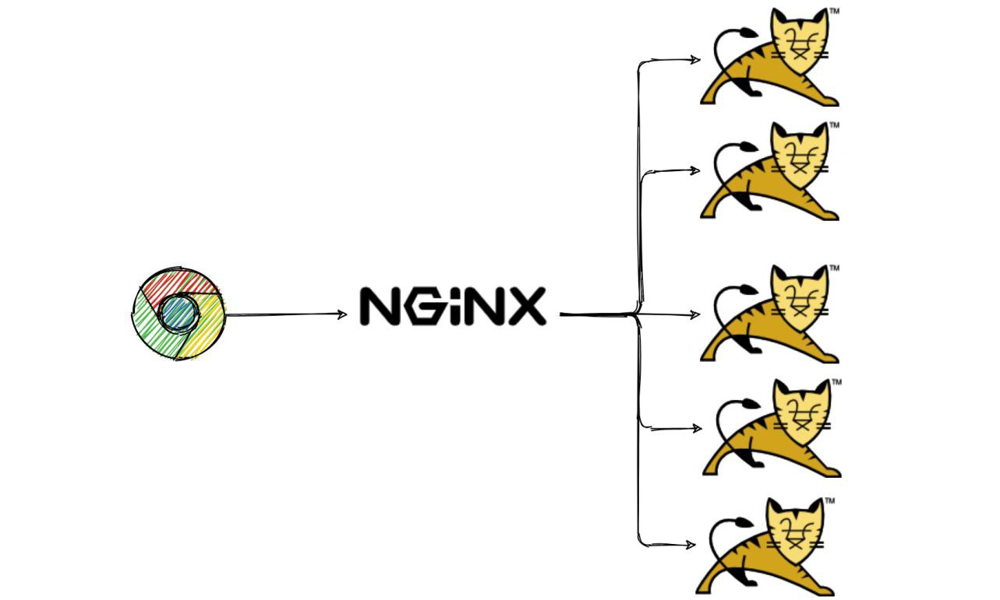

通常很多站点都会在某些大型活动（如限时秒杀、微博热帖、高考查成绩、热门直播等）前或过程中，通过手动或者自动”扩容” 增加更多机器的方式来支撑更多流量。

### 升级配置

增加配置，通常是更换性能更好的 CPU、增加内存、增加宽带、使用固态硬盘、增加磁盘空间等。下图为阿里云购买服务器页面的截图，其中的选项就是配置相关的关键指标。

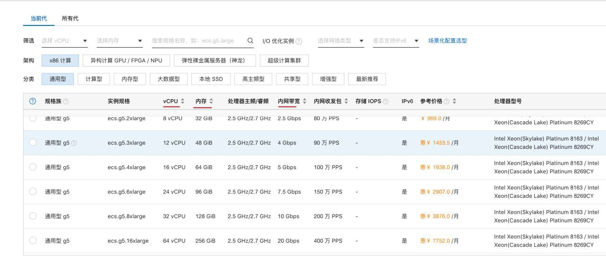

## 减少耗时操作
要提高性能，通常需要减少操作的耗时。想要减少耗时，就要了解常见传输媒介的耗时情况。   下图为各种操作的时间量级参考表：

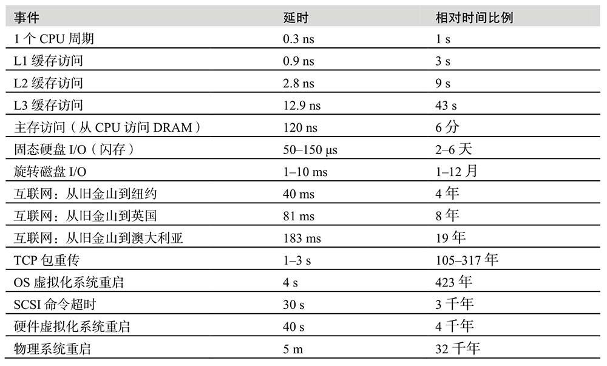

图片来源：《性能之巅》

这张图是我们后续很多性能优化方法的主要依据。

### 合并操作（化零为整）
合并操作是性能优化非常典型和重要的思想。

比如渲染某个前端页面，前端需要请求多个 js 文件，可以将多个 js 文件合并成一个，来减少向服务端发起请求的次数。

比如后端服务在某个请求中需要构造不同的请求，多次调用同一个二方接口，此时，可以使用批量查询接口，而不是 for 循环中执行单个请求再去处理。

如下图所示，某个功能，需要在循环中请求十几次甚至几十次二方或者三方接口：

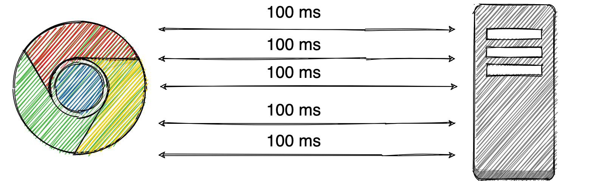

假设每次耗时 100ms, 请求 20 次，就是 2 秒钟。

如下图所示，可以通过调用批量接口，发起一次网络请求获取十几条数据或者几十条数据：

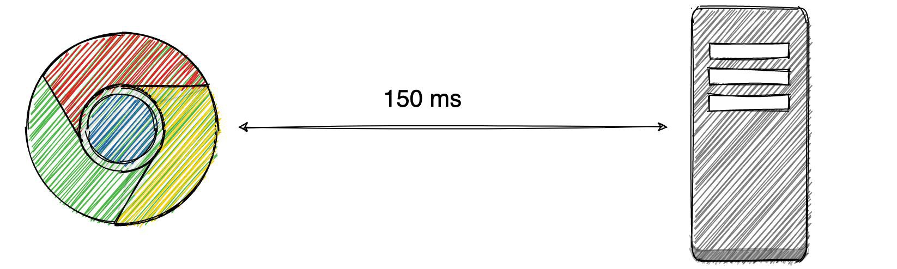同样的功能，可能 100 ms 更多一点就搞定了。很多中间件在设计时，也会提供一些批量接口。比如 Redis 中的 mget 命令，可以批量获取 key 的值；ES 中也提供了 mget 批量查询 api。

大家都知道 IO 操作通常和读写内存、CPU 缓存等相比非常耗时，如果想进行性能优化，就要考虑减少 IO 操作。

那么我们可以将多个写操作先写到内存缓冲区中，达到一定的条件再落盘。

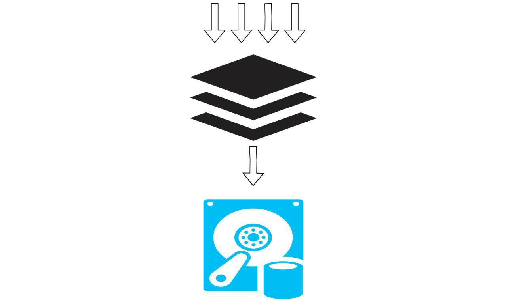

### 压缩
对要存储或传输的数据进行压缩，可以减少资源占用，提高传输速率。

比如前端可以对 js 或者 css 文件进行压缩，来减少传输的数据量，加快资源加载速度。也可以在使用资源时，默认对资源自动压缩。

如通过微信发送图片或者视频时，默认会自动压缩，必要时可以选择原图进行发送。

查看时只加载预览图，在必要时可以选择查看原图或者选择清晰度更高的视频。如 QQ 空间相册、爱奇艺/ B 站等视频的清晰度切换等。

比如后端可以对将要存储到 redis 中的大段文本数据进行压缩，然后再存储，使用前再解压。

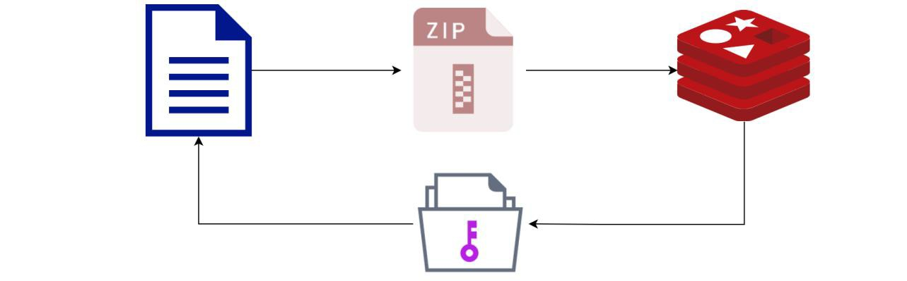

### 复用
复用是减少资源使用的非常经典的方式。包括 各种连接池、线程池在内的对象池模式是复用典型应用。

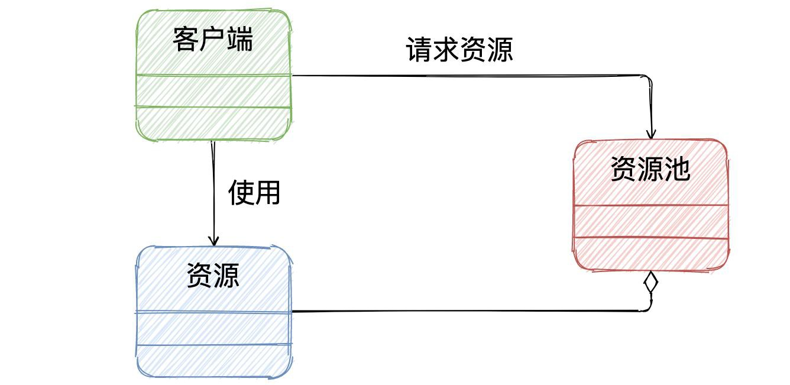它们的核心思想都是重用和共享创建代价比较昂贵的对象。 其结构如下：

基本思想：当客户端需要资源时，向资源池发起申请，资源池检查后获取第一个可用资源给客户端使用；客户端使用后归还资源到资源池重复使用。

比如 Http 长连接就是在同一个连接中发起多次请求来提高性能的； 数据库连接池，也是通过复用连接来提高性能的模式。

### 减少 IO 操作
下面只是给出几个实际中常见的具体案例，大家要根据实际情况进行举一反三。

**减少不必要的调用**

有时，前端由于架构设计不够合理等原因，会进行一些没有必要的同步调用，造成响应时间无辜被拖长。

此时，需要去掉不必要的调用（尤其是同步调用）。

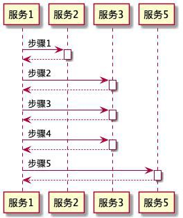

做新的项目时，有时候需要协调多个下游，如果有些接口没有必要调用，就要减少调用。

如果有些接口应该是你的下游给封装起来的，下游的服务应该对其进行封装，避免造成上游进行不必要的接口调用。

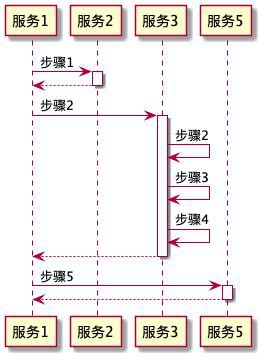

调用额外的接口增加耗时，而且很多场景下不符合迪米特法则。

注：迪米特法则又叫最小知道原则，一个类对其他类知道的越少越好，只和最直接的“朋友”对话

（talk only to your immediate friends）。本质上还是为了实现高内聚、弱耦合。

**减少不必要的日志输出**

大家在编写代码时，可能会（同步）打印一些没有必要的大文本日志，当请求量较多时也会影响性能，影响系统响应时间或者浪费存储空间。

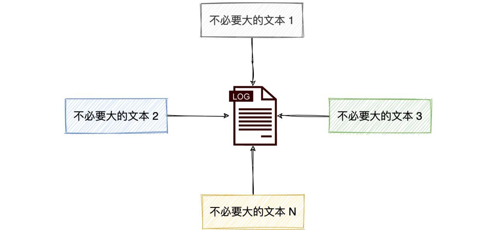

因此建议大家只打印必要的日志，对于大对象只打必要的字段。

### 合理设置等待时间
执行远程接口调用时，要设置合理的等待时间。

如果等待的时间过长，那么即使能够获得数据，也很影响用户体验。与其这样，比如设置用户能够接受的超时时间，超时时让用户重试。

## 提高资源利用率
### 空间换时间
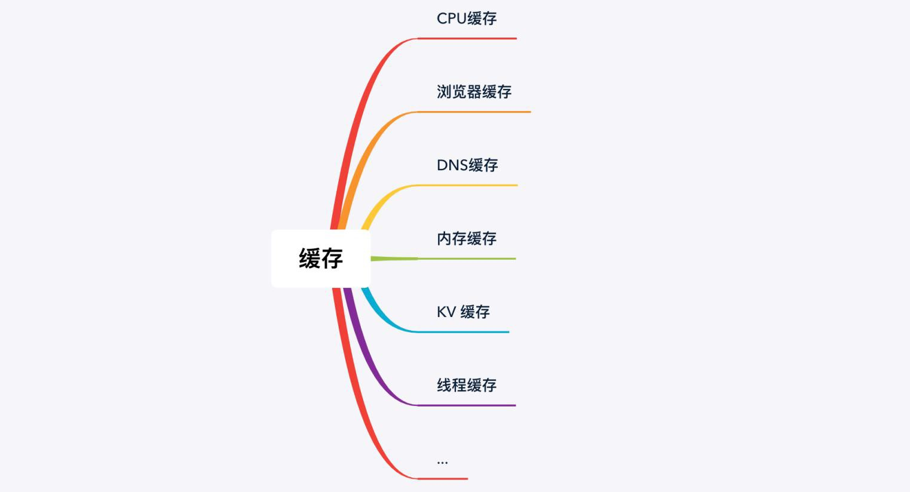空间换时间是性能优化最常用的手段之一。其中缓存就是空间换时间的一种典型应用。

CPU 缓存、浏览器缓存、CDN 缓存、DNS 缓存、内存缓存、 Redis 缓存等，它们都是将数据缓存在离使用者更近的地方，或者读取速度更快的存储介质中，通过空间换时间的方式实现性能优化的。

在展开讲解之前，大家想想如果电商平台自营商品都从中央仓库发货，近的用户收货时间会短一些， 远的用户收货时间可能会很长。

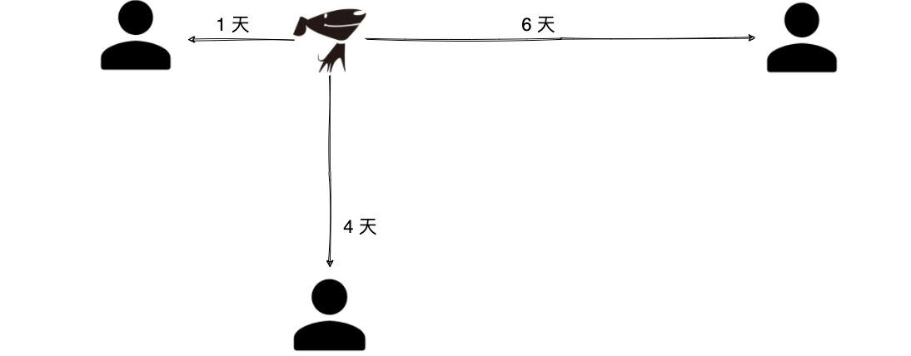

但是，很多朋友知道某东热门商品收货非常快，不知道大家是否知道原因。

据我了解，某东在全国热门城市建立仓库，每个仓库都有热门产品的储备。当用户下单后，通常会选择离用户最近的仓库发货。

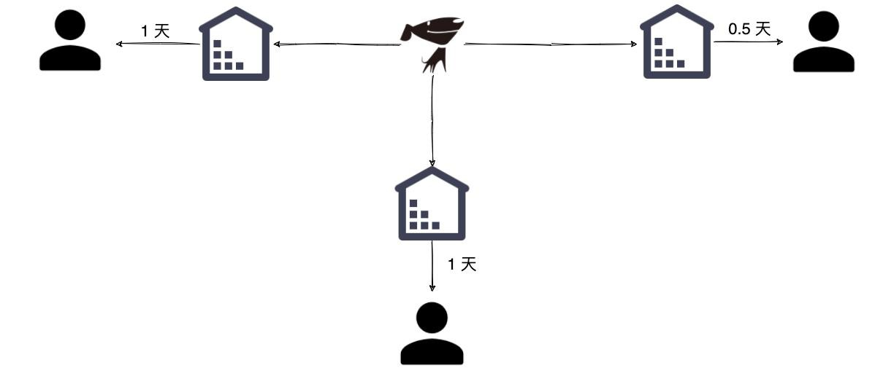

和上面的案例类似，如下图所示， CDN 加速也采用类似的机制。

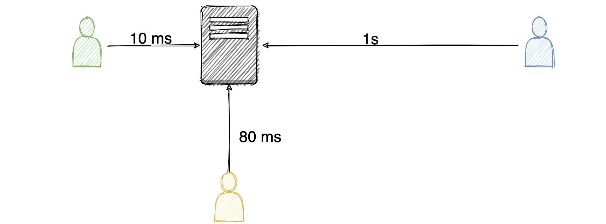

比如之前只有一个节点，较远的用户访问耗时为 1 秒钟，通过 CSN 加速之后，较远的用户也可以有较好的响应速度。

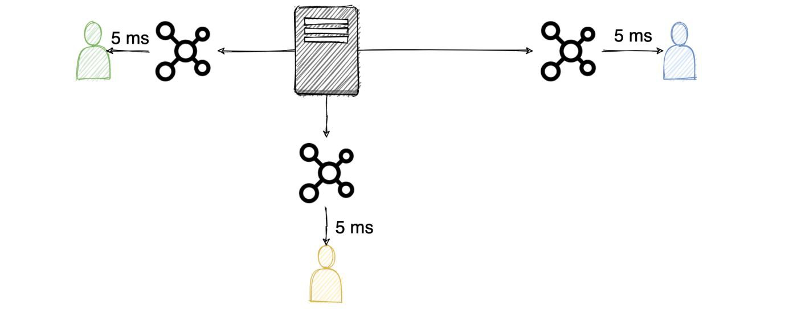

前面给出了不同系统组件的操作时差图，下面给出一张 CPU 缓存、内存和磁盘操作的时差

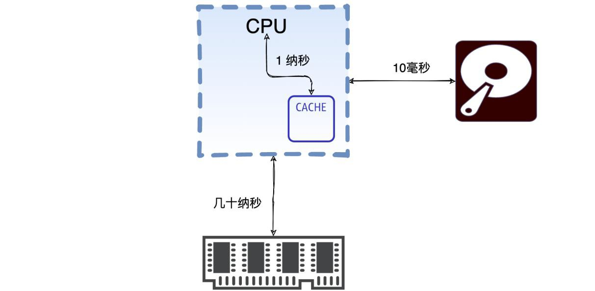

鉴于内存的读写速度比磁盘快很多，通常设计方案时会选择将热点数据缓存在内存中，这样就可以加快访问速度。

实际开发中最常用的是类似 Redis 的 KV 缓存或如 Guava 内存缓存。基本流程是先读缓存 ，如果未命中则读数据库，将数据缓存到缓存中。

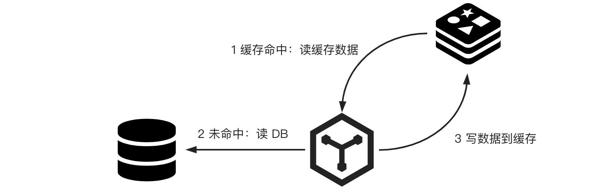

还有一种空间换时间的方式为预先处理/预热/   静态化（侧重时间维度）。

可以将一些不容易变动且瞬间访问量可能较大的数据，可以预先加载到缓存中。可以将不变动的热点页面静态化，放到 CDN 节点中加速访问。

比如在某个确定的环节，报表内容就已经可以确定下来，在用户需要下载报表之前提前将报表放在缓存或者专门的文件加速服务器中，这样用户来的时候就可以快速下载。

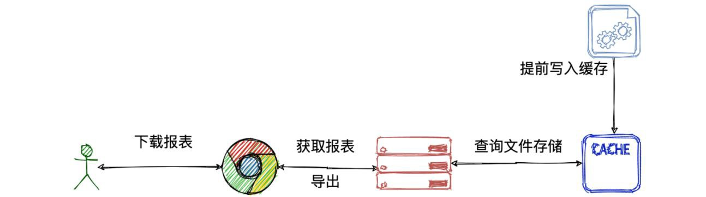

其实上面的某东快速送货的案例也体现出了预留的思想。一般来说，热门商品不可能用户买的时候再去生产厂家订做，都会提前在仓库中储备一定量的货物，用户下单时直接发货即可。

很多架构的设计都是用空间换时间的思想实现性能优化的，如集群架构、读写分离、分库分表、分布式架构。

由于单机承载量的有限性，可以通过加机器化整为零，分担请求。 然而，机器之间不同的组织方式形成了不同的架构模式。

通过 nginx 负载均衡将请求分发到不同的实例上，称为集群模式。通过写操作写主实例，读操作读从实例，通过主从复制读写分离的方式，提高了整体吞吐量。

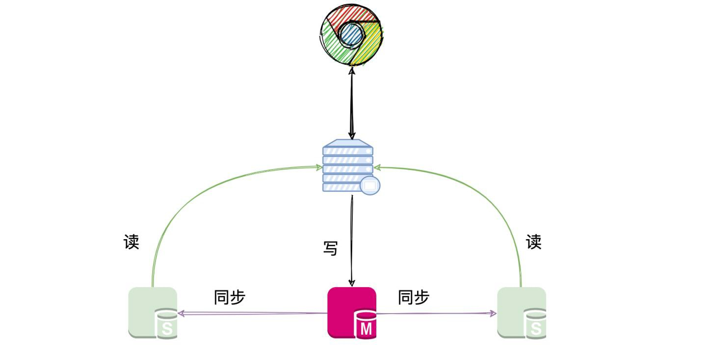

以上两种模式的共同点是每个节点都拥有相同的数据。

### 同步转异步
通常比较耗时或者不必放在主流程中执行的任务，可以考虑使用异步的方式来处理。

可以使用线程池或者结合 CountDownLatch 、CyclicBarrier 和 CompletableFuture 等 API 并发执行。

比如用户在系统上报名，后端在处理完报名逻辑后，如果报名成功需要给用户推送公众号发送报名成功的消息，此时直接返回给用户成功即可。

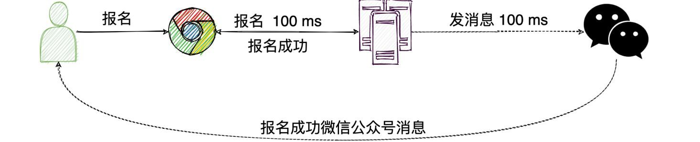

发送公众号消息的任务可以放在线程池中异步执行。

假如后端逻辑需要执行 100 毫秒，发送公众号消息需要执行 100 毫秒，如果同步发送消息，耗时

为 200 毫秒。如果发送公众号消息的环节采用异步的方式，那么对用户而言只需要等待 100 毫秒即可。

同步转异步还包括延迟加载。

比如在领域驱动设计时，某个聚合根中的实体并不是所有场景都需要用到，构造该实体需要查询其他表，此时可以采用延迟加载的方式，在获取该属性时再去查询构造该实体。

### 串行转并行
如果某个任务包含多个步骤，串行执行时间时每个步骤耗时相加才是最终的耗时，容易超时或者体验不好。

可以考虑将这些子任务使用 ForkJoinPool、 Stream 并行流操作。还可以将大任务拆分成多个小任务，通过消息队列或者大数据框架并行执行。

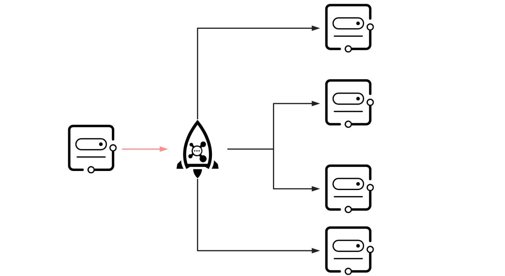

比如需要快速将 100 万条消息发送出去，可以每 100 条封装成一个子任务丢到 MQ 中，负载均衡到多个消费者服务器上，并行执行，而且每台机器还可以使用 10 个线程并发发送。

### 降低冲突的范围
常见的降低冲突范围的方法有：如偏向锁、分段加锁、读写锁、CopyOnWrite、使用乐观锁、隔离等。

为了实现没有多线程竞争情况下，减少传统重量级锁使用操作系统互斥量带来的性能损耗，JDK1.6之后还引入了轻量级锁。

为了提高性能， JDK 1.6 引入了偏向锁，它偏向于第一个获取它的线程，如果在接下来的执行过程中，没有被其他线程获取，则持有偏向锁的线程将永远不需要再进行同步。

对于临界资源的访问，如果不得不加锁，要尽量降低锁的范围。

如采用分段加锁机制，不在同一段的数据就不会因为这一段内有写操作而相互影响。

如数据库中能锁行就不要锁表。读锁和读锁之间并不互斥，读锁和写锁、写锁和写锁才互斥。

数据的操作一般就分为两类，一种是读，一种是写。在读多写少的场景下，可以通过读写锁、乐观锁的方式降低冲突的范围或者说降低冲突带来的性能损耗来提高性能。

为了更好地帮助大家理解什么是降低锁的范围，下面举一个栗子：

比如某个用户只能对某个商品下一个订单，为了防止用户重发下单一般需要先查询是否有订单，如果已经有一个订单则不允许再次下单。

在高并发场景下，不加锁，同时有两个并发下单请求过来，都查询订单表，发现没有数据，都插入下单记录，这就尴尬。

可能有经验的同学已经有思路了，加锁呗！

有些同学可能就开始设计了 key：userId +"_"+shopId。 ( 实际开发中可能很多人并不会这么傻，这里只是举个例子，帮助大家理解)

产品要求的是不能对同一个商品重复下单，没说是不能对同一个店铺的不同商品重复下单。   显然上面锁的范围扩大了。

应该将用户 id 和 商品 id 组合在一起构成分布式锁的 key： userId +"_"+goodsId。

### 空间局部性
先介绍下时间局部性和空间局部性的概念。

时间局部性：如果在某一点时访问了存储器的特定位置，则很可能在不久的将来将再次访问相同的位置。

空间局部性：如果特定存储位置在特定时间被访问，则很可能在不久的将来访问附近的存储位置。   其实时间局部性是加缓存的最主要依据。

那么我们如何利用空间局部性进行性能优化呢？ 我们先看一下 MySQL 中的一个案例：

我们知道读写磁盘的速度非常慢，和内存读写差了几个数量级。

如果我们想从表中读取一些数据时， InnoDB 存储引擎会一条一条把记录从磁盘中读出来吗？

InnoDB 采取的方式是：将数据划分为若干个页，以页作为磁盘和内存之间交互的基本单位，

InnoDB 中页的大小一般为 16 KB。也就是在一般情况下，一次最少从磁盘中读取 16KB 的内容到内存中，一次最少把内存中的 16KB 内容刷新到磁盘中。

其实 MySQL 的 InnoDB 存储引擎这么做的主要理论依据就是空间局部性，这点和合并操作非常类似。

# 三、总结
本次分享主要讲述性能优化的本质，性能优化的核心思想，还讲到性能优化的注意事项

性能优化没有标准答案，优秀的程序员应该灵活将多种优化方案结合一起灵活运用，根据实际的场景做出权衡。

另外，希望大家能够意识到，本专题所讲的性能优化方面的知识并非只是帮助我们去做技术方案， 还建议大家用性能优化的视角来学习中间件、源码，你将收获更多。

> 更新: 2025-04-20 22:39:03  
> 原文: <https://www.yuque.com/aaron-wecc3/dhluml/gpxn0f263bpvg4g1>