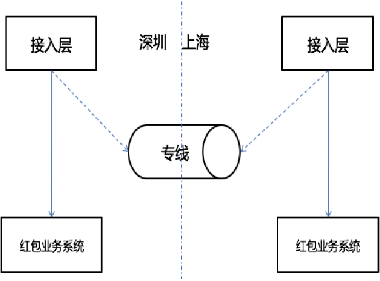
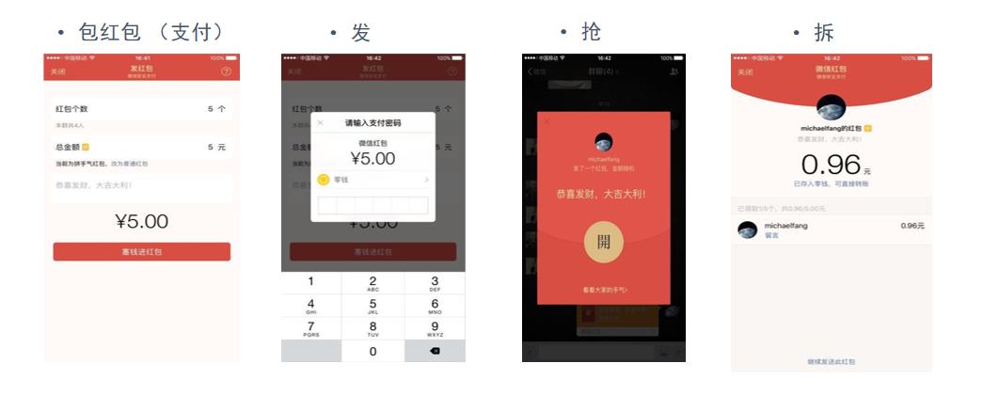

# 52.微信百亿级红包技术架构

**分享内容**

1. 微信红包概述
2. 微信红包架构(南北分布、拆包入账异步化、发拆落地)
3. 微信红包高并发处理(红包算法、柔性降级方案)

### 概述
话说每逢双十一节或春节等节假日，对大家来讲是最欢乐的日子，可以在微信群中收发红包，此外今年微信还推出了面对面红包，让大家拜年时可直接收发，对于用户来讲很爽也很方便。但对于技术架构侧的考量，这使得微信红包的收发数据成几何倍数上升，处理的复杂度也增加了很多。

2017 年微信红包发送量最大的时间段是除夕夜，达到了 142 亿个。

当达百亿级别的资金交易规模时，我们该怎样来保证系统的并发性能和交易安全？

与传统意义上的红包相比，近些年火起来的 “红包”，似乎才是如今春节的一大重头戏。历经上千年时代传承与变迁，春节发红包早已成为历史沉淀的文化习俗，融入了民族的血脉。按照各家公布的数据，除夕全天微信用户红包总发送量达到 80.8 亿个，红包峰值收发量为 40.9 万个 / 秒。春晚直播期间讨论春晚的微博达到 5191 万条，网友互动量达到 1.15 亿，网友抢微博红包的总次数超过 8 亿次。

微信红包在经过 15 年春晚摇一摇之后，2015 年上半年业务量一度呈指数级增长。尤其是微信红包活跃用户数的大量增长，使得 2016 除夕跨年红包成为极大挑战。为了应对 16 年春节可预知的红包海量业务，红包系统在架构上进行了一系列调整和优化。主要包括异地架构、cache 系统优化、拆红包并发策略优化、存储优化一系列措施，为迎接 2016 春节红包挑战做好准备。下面介绍最主要的一些思路。

### 架构
微信用户在国内有深圳、上海两个接入点，习惯性称之为南、北（即深圳为南，上海为北）。用户请求接入后，不同业务根据业务特性选择部署方式。微信红包在信息流上可以分为订单纬度与用户纬度。

其中订单是贯穿红包发、抢、拆、详情列表等业务的关键信息，属于交易类信息；而用户纬度指的是红包用户的收红包列表、发红包列表，属于展示类信息。红包系统在架构上，有以下几个方面：

#### 南北分布
**1、订单层南北独立体系，数据不同步**

用户就近接入，请求发红包时分配订单南北，并在单号打上南北标识。抢红包、拆红包、查红包详情列表时，接入层根据红包单号上的南北标识将流量分别引到南北系统闭环。根据发红包用户和抢红包用户的所属地不同，有以下四种情况：

1）深圳用户发红包，深圳用户抢

订单落在深圳，深圳用户抢红包时不需要跨城，在深圳完成闭环。

2）深圳用户发红包，上海用户抢

订单落在深圳，上海用户抢红包，在上海接入后通过专线跨城到深圳，最后在深圳闭环完成抢红包。

3）上海用户发红包，上海用户抢

订单落在上海，上海用户抢红包时不需要跨城，在上海完成闭环。

4）上海用户发红包，深圳用户抢

订单落在上海，深圳用户抢红包，从深圳接入后通过专线跨城到上海，最后在上海闭环完成抢红包。

系统这样设计，好处是南北系统分摊流量，降低系统风险。

**2、用户数据写多读少，全量存深圳，异步队列写入，查时一边跨城**

用户数据的查询入口，在微信钱包中，隐藏的很深。这决定了用户数据的访问量不会太大，而且也被视为可旁路的非关键信息，实时性要求不高。因此，只需要在发红包、拆红包时，从订单纬度拆分出用户数据写入请求，由 MQ 异步写入深圳。后台将订单与用户进行定时对账保证数据完整性即可。

**3、支持南北流量灵活调控**

红包系统南北分布后，订单落地到深圳还是上海，是可以灵活分配的，只需要在接入层上做逻辑。例如，可以在接入层中，实现让所有红包请求，都落地到深圳（无论用户从上海接入，还是深圳接入），这样上海的红包业务系统将不会有请求量。提升了红包系统的容灾能力。同时，实现了接入层上的后台管理系统，实现了秒级容量调控能力。可根据南北请求量的实时监控，做出对应的调配。

**4、DB 故障时流量转移能力 基于南北流量的调控能力，当发现 DB 故障时，可将红包业务流量调到另外一边，实现 DB 故障的容灾。**

预订单

支付前订单落 cache，同时利用 cache 的原子 incr 操作顺序生成红包订单号。优点是 cache 的轻量操作，以及减少 DB 废单。在用户请求发红包与真正支付之间，存在一定的转化率，部分用户请求发红包后，并不会真正去付款。

#### 拆红包入账异步化
信息流与资金流分离。

拆红包时，DB 中记下拆红包凭证，然后异步队列请求入账。

入账失败通过补偿队列补偿，最终通过红包凭证与用户账户入账流水对账，保证最终一致性。如下图所示：

这个架构设计，理论基础是快慢分离。

红包的入账是一个分布事务，属于慢接口。

而拆红包凭证落地则速度快。

实际应用场景中，用户抢完红包，只关心详情列表中谁是 “最佳手气”，很少关心抢到的零是否已经到账。

因为只需要展示用户的拆红包凭证即可。

#### 发拆落地，其他操作双层 cache
1、Cache 住所有查询，两层 cache

除了使用 ckv 做全量缓存，还在数据访问层 dao 中增加本机内存 cache 做二级缓存，cache 住所有读请求。

_注：ckv是腾讯自研高性能NoSQL KV数据库，兼容Redis、Memcached等_

查询失败或者查询不存在时，降级内存 cache；内存 cache 查询失败或记录不存在时降级 DB。

**DB 本身不做读写分离。**

2、DB 写同步 cache，容忍少量不一致， DB 写操作完成后，dao 中同步内存 cache，业务服务层同步 ckv，失败由异步队列补偿，

定时的 ckv 与 DB 备机对账，保证最终数据一致。

### 高并发
微信红包的并发挑战，主要在于微信大群，多人同时抢同一个红包。

以上这种情况，存在竞争 MySQL 行锁。为了控制这种并发，团队做了以下一些事情：

**1、请求按红包订单路由，逻辑块垂直 sticky，事务隔离**

按红包订单划分逻辑单元，单元内业务闭环。服务 rpc 调用时，使用红包订单号的 hash 值为 key 寻找下一跳地址。对同一个红包的所有拆请求、查询请求，都路由到同一台逻辑机器、同一台 DB 中处理。

**2、Dao 搭建本机 Memcache 内存 cache，控制同一红包并发个数**

在 DB 的接入机 dao 中，搭建本机内存 cache。以红包订单号为 key，对同一个红包的拆请求做原子计数，控制同一时刻能进 DB 中拆红包的并发请求数。

这个策略的实施，依赖于请求路由按红包订单 hash 值走，确保同一红包的所有请求路由到同一逻辑层机器。

**3、多层级并发量控制**

1）发红包控制

发红包是业务流程的入口，控制了这里的并发量，代表着控制了红包业务整体的并发量。在发红包的业务链路里，做了多层的流量控制，确保产生的有效红包量级在可控范围。

2）抢红包控制

微信红包领取时分为两个步骤，抢和拆。

抢红包这个动作本身就有控制拆并发的作用。因为抢红包时，只需要查 cache 中的数据，不需要请求 DB。

对于红包已经领完、用户已经领过、红包已经过期等流量可以直接拦截。而对于有资格进入拆红包的请求量，也做流量控制。通过这些处理，最后可进入拆环节的流量大大减少，并且都是有效请求。

3）拆时内存 cache 控制

针对同一个红包并发拆的控制

**4、DB 简化和拆分**

DB 的并发能力，有很多影响因素。红包系统结合红包使用情境，进行了一些优化。比较有借鉴意义的，主要有以下两点：

1）订单表只存关键字段，其他字段只在 cache 中存储，可柔性。

红包详情的展示中，除了订单关键信息（用户、单号、金额、时间、状态）外，还有用户头像、昵称、祝福语等字段。这些字段对交易来说不是关键信息，却占据大量的存储空间。

将这些非关键信息拆出来，只存在 cache，用户查询展示，而订单中不落地。

这样可以维持订单的轻量高效，同时 cache 不命中时，又可从实时接口中查询补偿，达到优化订单 DB 容量的效果。

2）DB 双重纬度分库表，冷热分离

使用订单 hash、订单日期，两个纬度分库表，也即 db_xxx.t_x_dd 这样的格式。

其中，x 表示订单 hash 值，dd 表示 01-31 循环日。

订单 hash 纬度，是为了将订单打散到不同的 DB 服务器中，均衡压力。

订单日期循环日纬度，是为了避免单表数据无限扩张，使每天都是一张空表。

另外，红包的订单访问热度，是非常典型的冷热型。

热数据集中在一两天内，且随时间急剧消减。

线上热数据库只需要存几天的数据，其他数据可以定时移到成本低的冷数据库中。

循环日表也使得历史数据的迁移变得方便。

#### 红包算法
**计算：**微信金额是拆的时候实时算出来，不是预先分配的，采用的是纯内存计算，不需要预算空间存储。采取实时计算金额的考虑：预算需要占存储，实时效率很高，预算才效率低。2014年微信红包使用数据库硬抗整个流量，2015年使用cache抗流量。

**实时性：**为什么明明抢到红包，点开后发现没有，2014年的红包一点开就知道金额，分两次操作，先抢到金额，然后再转账。2015年的红包的拆和抢是分离的，需要点两次，因此会出现抢到红包了，但点开后告知红包已经被领完的状况。进入到第一个页面不代表抢到，只表示当时红包还有。

**分配：**红包里的金额怎么算？为什么出现各个红包金额相差很大？答：随机，额度在0.01和(剩余平均值*2)之间。例如：发100块钱，总共10个红包，那么平均值是10块钱一个，那么发出来的红包的额度在0.01元～20元之间波动。当前面3个红包总共被领了40块钱时，剩下60块钱，总共7个红包，那么这7个红包的额度在：0.01～（60/7*2）=17.14之间。注意：这里的算法是每被抢一个后，剩下的会再次执行上面的这样的算法。这样算下去，会超过最开始的全部金额，因此到了最后面如果不够这么算，那么会采取如下算法：保证剩余用户能拿到最低1分钱即可。如果前面的人手气不好，那么后面的余额越多，红包额度也就越多，因此实际概率一样的。

**红包的设计：**微信从财付通拉取金额数据过来，生成个数/红包类型/金额放到redis集群里，app端将红包ID的请求放入请求队列中，如果发现超过红包的个数，直接返回。根据红包的逻辑处理成功得到令牌请求，则由财付通进行一致性调用，通过像比特币一样，两边保存交易记录，交易后交给第三方服务审计，如果交易过程中出现不一致就强制回归。

#### 柔性降级方案
系统到处存在发生异常的可能，需要对所有的环节做好应对的预案。

下面列举微信红包对系统异常的主要降级考虑。

**1、 下单 cache 故障降级 DB**

下单 cache 有两个作用，生成红包订单与订单缓存。

缓存故障情况下，降级为直接落地 DB，并使用 id 生成器独立生成订单号。

**2、 抢时 cache 故障降级 DB**

抢红包时，查询 cache，拦截红包已经抢完、用户已经抢过、红包已经过期等无效请求。当 cache 故障时，降级 DB 查询，同时打开 DB 限流保护开关，防止 DB 压力过大导致服务不可用。

另外，cache 故障降级 DB 时，DB 不存储用户头像、用户昵称等（上文提到的优化），此时一并降级为实时接口查询。查询失败，继续降级为展示默认头像与昵称。

**3、 拆时资金入账多级柔性**

拆红包时，DB 记录拆红包单据，然后执行资金转账。单据需要实时落地，而资金转账，这里做了多个层级的柔性降级方案：

大额红包实时转账，小额红包入队列异步转账 所有红包进队列异步转账 实时流程不执行转账，事后凭单据批量入账。

总之，单据落地后，真实入账可实时、可异步，最终保证一致即可。

**4、 用户列表降级**

用户列表数据在微信红包系统中，属于非关键路径信息，属于可被降级部分。

首先，写入时通过 MQ 异步写，通过定时对账保证一致性。

其次，cache 中只缓存两屏，用户查询超过两屏则查用户列表 DB。在系统压力大的情况下，可以限制用户只查两屏。

调整后的系统经过了 2016 年春节的实践检验，平稳地度过了除夕业务高峰，保障了红包用户的体验。

> 更新: 2025-04-20 22:39:03  
> 原文: <https://www.yuque.com/aaron-wecc3/dhluml/lon7bshh8nuq7qme>