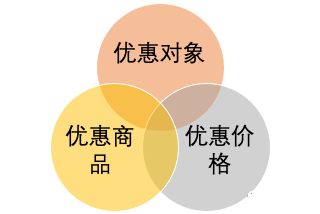
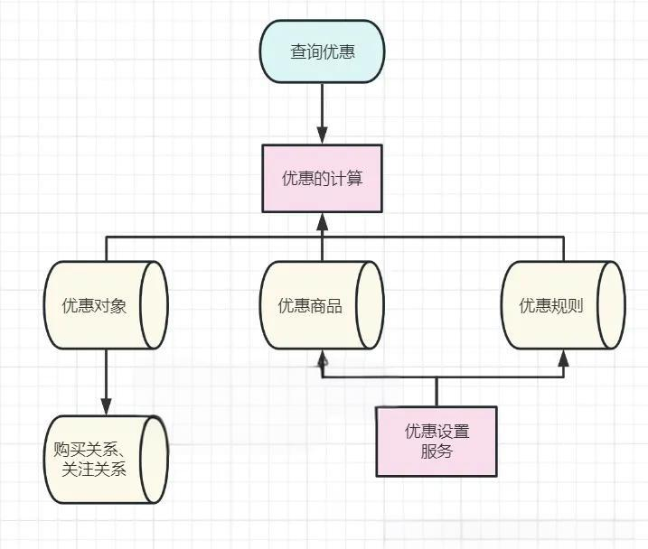
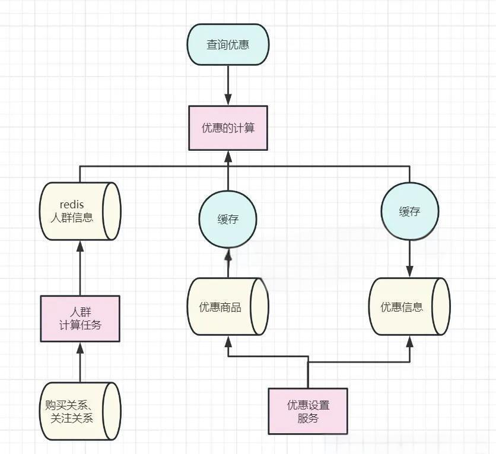
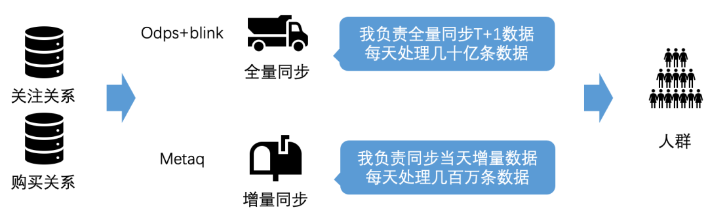
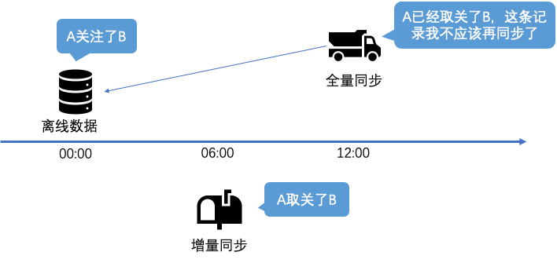
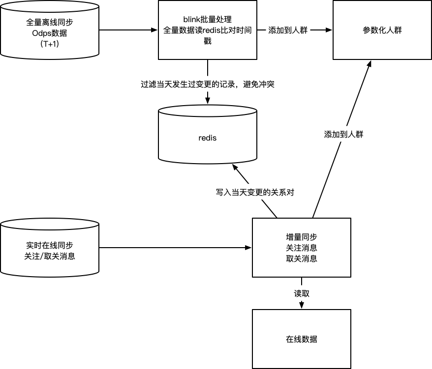

# 53.闲鱼优惠中台架构演进之路

**分享内容**

1. 优惠券业务的场景分析
2. 海量用户场景问题与挑战
3. 闲鱼的个性化优惠中台的技术演进
4. 阶段一：分解优惠的基本要素，实现优惠的基本表达和计算
5. 阶段二：对优惠对象的判定过程进行抽象和加速
6. 阶段三：在优惠对象制备的过程中，通过离线 + 实时的方式同步数据，保障数据一致性
7. 总结

### [优惠券](https://so.csdn.net/so/search?q=%E4%BC%98%E6%83%A0%E5%88%B8\&spm=1001.2101.3001.7020)业务的场景分析

优惠券业务，在大量的场景中，会有使用。

在我们日常生活中，常常会遇到下面这样的场景：优惠券业务是一种促销方式，通常由商家向消费者提供的折扣或者特价优惠，在推广和销售产品时具有重要的作用。

#### 优惠券业务主要使用场景分析

**场景 1：电商平台**

在电商平台上，商家可以通过发布优惠券来吸引更多用户购买商品，从而提高销售额。比如，在双十一或者 618 等大促销活动中，商家会发布各种优惠券，包括满减券、折扣券、免邮券等等，以达到促销的目的。

**场景 2：实体店铺**

实体店铺也可以通过发放优惠券来吸引更多顾客到店消费。

比如，在超市或者餐厅中，可以提供满减券、折扣券、赠品券等等，让消费者享受到更多的实惠，从而增加消费频次和消费金额。

**场景 3：O2O 平台**

在 O2O 平台中，商家可以通过发放优惠券来吸引用户使用其服务。

比如，在外卖平台上，商家可以发布满减券、新用户专属券等等，以吸引更多的用户尝试其服务；在打车平台上，也可以发布优惠券来吸引用户使用其服务。

**场景 4：品牌推广**

品牌推广也是优惠券业务的一个重要场景。

比如，在新品上市或者品牌促销活动中，可以通过发放折扣券或者礼品券等等，来吸引更多用户尝试品牌产品或者服务，提高品牌知名度和美誉度。

总之，优惠券业务在各个行业中都有广泛的应用，可以帮助商家提高销售额、增加用户粘性和忠诚度，同时也能为消费者提供更多的实惠和福利。

#### 优惠券场景的业务迭代

如何提升优惠券的引流能力。答案是：设计一个个性化的优惠券系统，为不同的粉丝群体，设置不同的优惠券价格。

为了设计一个个性化的优惠券系统，[闲鱼](https://so.csdn.net/so/search?q=%E9%97%B2%E9%B1%BC\&spm=1001.2101.3001.7020)团队需要考虑以下几个方面：

**粉丝群体分类**

首先，需要将粉丝群体进行分类，比如按照年龄、性别、地域、消费习惯等等进行分类。这样可以更好地理解不同群体的需求和行为特征，有针对性地推出不同的优惠券。

**优惠券类型**

其次，需要确定不同的优惠券类型，比如满减券、折扣券、免单券等等。根据不同的群体需求，设置不同的优惠力度和使用条件，例如对于高消费群体，可以设置更高额度的满减券或者更高折扣力度的折扣券。

**优惠券价格**

最后，需要考虑不同粉丝群体的经济实力和消费能力，合理设置优惠券价格。

例如，对于大学生群体，可以设置较低的价格，以吸引他们尝试新产品或服务；而对于高收入群体，则可以设置更高的价格，以提升产品或服务的价值感。

##### 优惠券的迭代分析：

除此之外，可以通过数据分析的方式，不断优化和调整优惠券系统，以达到更好的促销效果和用户满意度。

同时，还需要注意保障优惠券系统的安全性和有效性，例如设置使用期限、使用限制等措施，避免滥用和恶意操作。

#### 闲鱼的个性化优惠场景

闲鱼是一款二手交易平台 APP，主要面向年轻用户群体。以下是闲鱼 APP 的用户分析：

**年龄分布**

闲鱼 APP 的主要用户群体年龄在 18-35 岁之间，其中以 25-30 岁的用户占比最高。这个年龄段的用户更注重物品的性价比和实用性，同时也更善于使用互联网和移动设备进行购物。

**性别分布**

相比于其他二手交易平台 APP，闲鱼 APP 的用户男女比例较为接近，女性用户占比略高。这也反映出闲鱼 APP 对女性用户的吸引力较大，可能与其简单易用、社区氛围浓厚等特点有关。

**地域分布**

闲鱼 APP 的用户主要集中在一二线城市，尤以杭州、上海、北京等城市为主。这些城市的用户更注重生活品质和消费体验，对于二手商品的需求也更为广泛和多样化。

**用户行为特征**

闲鱼 APP 的用户通常具有以下几个行为特征：爱好交友、追求个性化、注重环保节能等等。他们不仅使用闲鱼 APP 进行二手交易，还会通过闲鱼社区分享生活经验、交流兴趣爱好等，形成了一种类似于社交媒体的共享氛围。

**用户需求和偏好**

闲鱼 APP 的用户需求和偏好主要集中在以下几个方面：时尚潮流、个性化定制、品质保障等。他们通常会在闲鱼 APP 上寻找一些独特而实用的物品，包括衣物、配饰、家居用品等等，同时也关注卖家的信誉度和商品质量。

总闲鱼 APP 的用户具有年轻、多样化、社交化等特点，商家可以根据这些特点进行针对性的营销策略和产品服务优化，提高用户满意度和购买转化率。

在闲鱼上，针对闲鱼交易中的 粉丝群体，提供了 专门的 优 策略，针对 粉丝购买和粉丝回购的优惠促销场景，提供了一种定向的 / 个性化的优惠价：

* 卖家可以按商品分别面向全部粉丝、老粉、已购粉设置不同的优惠价格。
* 买家在导购、下单等场景可以实时看到自己能够享受的最低优惠价格。

虽然闲鱼没有使用优惠券的概念，使用的优惠价格。 但是和 个性化的优惠券，本质是一样的。

所以，闲鱼的优惠中台的架构，对大家做 个性化的优惠券中台的架构，具有巨大的借鉴的架构。

### 海量用户场景问题与挑战

闲鱼 APP 的 DAU，注册用户数 2.5 个亿，日活跃用户数（DAU）为 2900 万左右。

按照高架构理论，吞吐量峰值至少在 30W qps+。

这么大的  海量用户场景， 在 优惠券计算、优惠券展示的过程中，存在巨大的技术难题:

* 难题 1：如何描述、存储和计算优惠，提供较好的业务可扩展性?
* 难题 2：**如何保障大流量下，优惠实时计算的性能?**
* 难题 3：为优惠查询加速做的数据同步，如何实现一致性?

### 闲鱼的个性化优惠中台的技术演进

闲鱼的个性化优惠中台的技术演进, 分为三个阶段来实现：

* 阶段 1：分解优惠的基本要素，实现优惠的基本表达和计算；
* 阶段 2：对优惠对象的判定过程进行抽象和加速

为了保障大流量下的优惠查询下性能和业务的可扩展性，对优惠对象的判定过程进行抽象和加速；

* 阶段 3：在优惠对象制备的过程中，通过离线 + 实时的方式同步数据，保障数据一致性。

### 阶段一：分解优惠的基本要素，实现优惠的基本表达和计算

#### 分解优惠的基本要素

一个优惠主要描述了 “谁对哪个商品享受什么优惠”，拆解为三个要素就是：

【优惠对象】+【优惠商品】+【优惠价格】。

在粉丝优惠的场景下，优惠对象是指卖家的粉丝、卖家的已购粉丝等，

优惠对象 如何存储呢？

一个卖家的全部粉丝，可以被描述为 “卖家 ID_all_fans” 的符号

一个卖家的已购用户，可以被描述为 “卖家 ID_buy_fans” 的符号 。

这样闲鱼团队可以得到一个优惠规则的描述大致如下：

**【卖家 A_all_fans】+【商品 1234】+【18.88 元】，**

对应的业务语义是：

**卖家 A 的所有粉丝，对于（卖家 A 的）商品 1234，可以以 18.88 元的优惠价格。**

#### 实现优惠的基本表达和计算的三个步骤

以这条优惠为例，当买家 B 访问商品 1234 时，闲鱼团队会执行这样的一个过程：

**第一步：根据商品，查询优惠规则**

查询商品 1234 上的优惠规则，发现一条【卖家 A_all_fans】+【商品 1234】+【18.88 元】的规则；

**第二步：分析 优惠对象的语义**

分析【卖家 A_all_fans】表达的含义，表示的是卖家 A 的全部粉丝可以享受优惠；

**第三步：根据规则的语义，计算当前用户的优惠价格**

确定买家 B 是否是卖家 A 的粉丝，如果是，则以 18.88 元的价格展示优惠或者成交。

#### 闲鱼的优惠中台的架构 1.0 版本

为了实现了优惠设置和计算的能力，闲鱼的优惠中台的架构 1.0 版本, 大致如下：

### 阶段二：对优惠对象的判定过程进行抽象和加速

#### 闲鱼的优惠中台的架构 1.0 版本存在两个问题：

* 问题 1：优惠对象语义分析，可扩展性差

优惠计算过程需要解析【优惠对象】这个符号背后所包含的业务语义，再由系统进行判断买家是否符合条件，随着业务规则的升级，系统的会变的非常复杂，可扩展性差。

* 问题 2：太多的 RPC 调用，性能差

每一次优惠查询，都需要访问用户的关注关系、购买关系，这整个查询过程非常长，性能低下，当面对大流量时，系统会陷入瘫痪。

#### 对优惠对象的计算进行抽取和解耦

为了解决这两个问题，闲鱼希望优惠计算过程不再需要理解【优惠对象】的语义，判定过程中也不要再去查询各个业务系统。

闲鱼团队发现，优惠对象的判定过程都是在回答 “用户是否属于某个群体”，于是，可以将这个关系进行抽象，提前制备并存储起来。

常见的技术手段中，表达一个用户是否属于某个群体有两种实现：

* 在用户对象上打上一个标记。
* 创建一个 “人群” 对象，将用户关联到人群。

一般情况下，第一种方式使用于群体较少可枚举的情况，第二种方案适用于群体较多的情况。在闲鱼的实现中，使用了第二种方案。

具体的措施是， 抽取出一个新的 实体：人群 ，并且提前进行 异步计算。

闲鱼将用于描述优惠对象的符号（例如 “卖家 A_all_fans”）作为人群的名称去定义一个人群。按照这个规则，平台为每个卖家的不同分组各定义这样一个人群。

闲鱼定义了人群的概念，并提供了一种实现人群的技术方案，这个架构中，人群在同时充当了 “协议” 和“缓存”的作用。

人群和用户的关系，如何存储呢？

方案一：可以通过 redis string 实现，设计一个类似：<code>${user_A}</code>  <code>${crowd_B}</code> 的 key 写入 redis。

在查询时，查询 <code>${user_A}</code>  <code>${crowd_B}</code> 这个 key 是否存在，就可以判定 user_A 是否属于 crowd_B。

方案二：可以通过 redis set 实现，设计一个类似 <code>${crowd_B}</code> 的 key 写入 redis,  然后把  <code>${user_A}</code> 的用户加入到 set 。

在查询时，查询 <code>${crowd_B}</code>，是否在 <code>${user_A}</code> 的集合中，就可以判定<code>user_A</code>是否属于<code>crowd_B</code>。

当然，上面仅仅是参考的案例，闲鱼设计中需要根据数据特性进行优化。

#### 闲鱼的优惠中台的架构 2.0 版本

这时闲鱼的得到的整体架构是这样的：

在上面的架构中，顺带缓存了一下优惠数据

事实上，在闲鱼基于中台的解决方案中，从一开始面临的就是这样的架构（实际中台的架构比这个会更复杂一些）。

如果尝试从头演进了这个系统，也得到这样的一个方案。

**从一定程度来说，这也是架构的必然性.**

具体来说，当我们从业务的可扩展性、系统的性能角度从头进行推演的时候，我们发现最终会回到类似的架构上来。

可以说，在特定的业务规模下，架构的演进有它历史的必然性。

### 阶段三：在优惠对象制备的过程中，通过离线 + 实时的方式同步数据，保障数据一致性

#### 闲鱼的优惠中台的架构 2.0 版本的问题

在实际落地的过程中，如何将业务系统中的关注和购买关系同步到人群中，并保证数据的一致性。

人群的同步整体上分为两个主要部分：

* 将离线业务数据通过 T+1 的方式，同步到人群服务中。
* 通过实时同步的方式，将当天实时产生的关注、取消关注等行为产生的变动，同步的更新到人群服务中。

这种结合的方式具有以下优点：

* 实时消费消息进行同步，保障了数据的实时性。
* 离线 T+1 的全量同步，保证实时同步过程中产生的数据不一致会被及时的纠正，保障了数据的最终一致。
* 离线同步解决了数据初始化过程中的全量同步问题。

但上述的两个过程中，会出现两类问题：

* 离线数据因为其数据存储的特征，只会记录存在的关注关系，如果是被删除的关注关系（取消关注），则不会出现在离线数据中。因此实时同步中，因未同步取消关注事件产生了不一致，数据无法被全量同步纠正。
* 离线同步和实时同步在实际实施过程中，会产生一种常见的数据冲突：用户 A 今天原本关注了用户 B，某天较早的时候取消关注了，如果这个时候的离线数据还没同步完成，全量同步会再次将 A 对 B 的关注关系写入到人群中，出现了与实际数据的不一致。

#### 闲鱼的优惠中台的架构 3.0 版本

针对上述的两个问题，分别给出了以下两个解决方案：

* 针对取关数据误差无法通过全量同步纠正的问题，同步过程中，写入人群的时候会添加一个过期时间，这个过期时间略长于离线全量同步的间隔，这样的好处是一旦在实时同步过程中，出现了取关但未同步到人群的情况，这条记录会自动过期，从而避免了不一致的数据在系统中积累。
* 针对同步过程中发生数据冲突的问题，通过在实时同步的过程中，取关的事件在 redis 写入一条临时记录，表示该数据近期发生过取关；在全量同步过程中，去比对 redis 中是否有取关记录，避免发生冲突。

通过上述两个解决方案，闲鱼实现了人群同步的最终一致性，最终实现的方式如图：

#### 闲鱼数据一致性方案的普适性

这样的同步方案，对于搜索、推荐等大流量的导购场景，提供了充分的数据一致性保障。

绝大多数情况下，数据实时一致，对于小概率出现数据实时同步不一致，通过全量同步保障数据最终一致，满足导购场景的一致性要求。

此外，针对交易这样的要求强一致性但访问规模较小的场景，闲鱼团队通过下单前对人群同步的数据进行核对，保障数据的实时完全一致。

### 总结

本次分享从三个部分介绍了优惠的实现：

1. 通过对优惠要素的拆解和人群的定义，我们在描述、存储和计算优惠的同时，提供较好的业务可扩展性。
2. 通过提前制备人群数据，我们保障了大流量下的优惠查询下性能，系统能够支持几十万 QPS 下的毫秒级响应。
3. 在人群同步的过程中，通过离线 + 实时的方式同步数据，保障了数据的最终一致性。

在优惠的实现过程中，直接面临了一个迭代了多年的优惠中台，需要闲鱼团队通过同步人群数据的方式进行接入。可能一开始会疑惑为什么需要执行一个复杂、高成本且会引入数据一致性风险的同步过程。

但当闲鱼团队从业务的可扩展性、系统的性能角度从头进行推演的时候，闲鱼团队发现最终会回到类似的架构上来。

可以说，在特定的业务规模下，架构的演进有它历史的必然性。

当然，也不是说这样的架构是适用于所有情况的，架构选型还是需要结合实际情况出发量身定制。

> 更新: 2025-04-20 22:39:03  
> 原文: <https://www.yuque.com/aaron-wecc3/dhluml/xphqt83uoruff1xw>