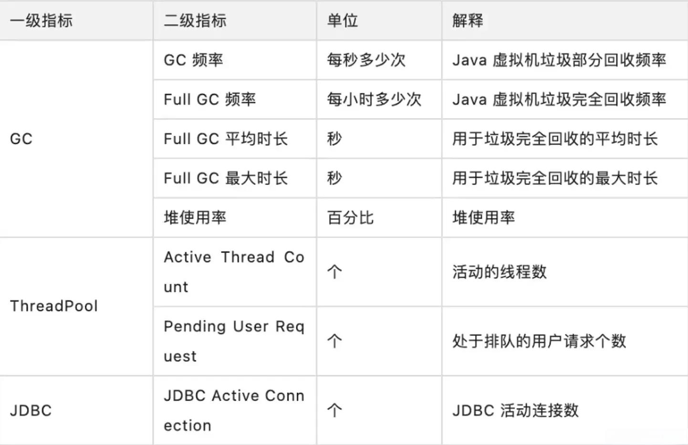
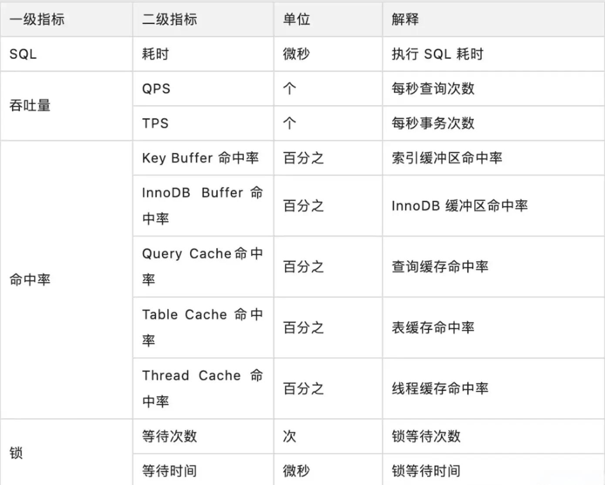
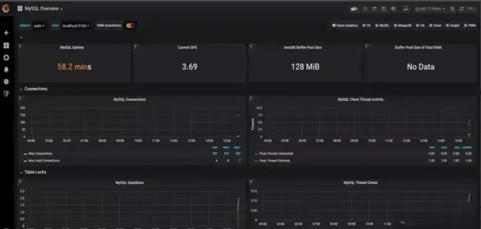
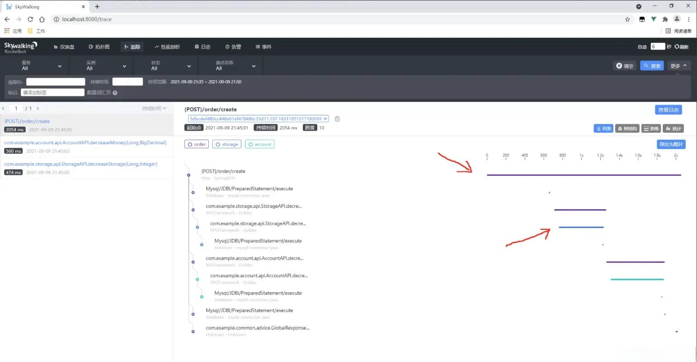
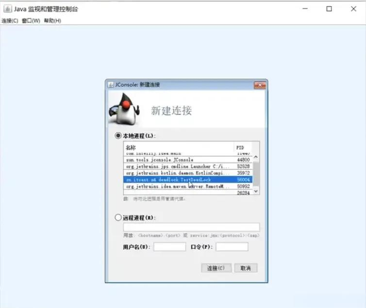
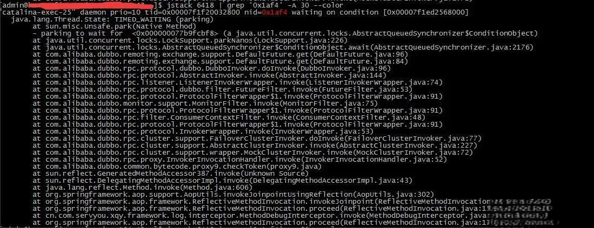

# 54.大厂线上接口排障常用技巧

**分享内容**

1. 定位问题
2. 压测监控核心指标
3. 链路追踪
4. 问题排查
5. 垃圾回收

### <font style="color:rgb(51, 51, 51);">1 定位问题</font>

#### <font style="color:rgb(51, 51, 51);">1.1 慢查询日志</font>

<font style="color:rgb(51, 51, 51);">通常情况下，为了定位 sql 的性能瓶颈，我们需要开启 mysql 的慢查询日志。把超过指定时间的 sql 语句，单独记录下来，方面以后分析和定位问题。</font>

<font style="color:rgb(51, 51, 51);">开启慢查询日志需要重点关注三个参数：</font>

* <code><font style="color:rgb(51, 51, 51);background-color:rgb(243, 244, 244);">slow_query_log</font></code><font style="color:rgb(51, 51, 51);"> 慢查询开关</font>
* <code><font style="color:rgb(51, 51, 51);background-color:rgb(243, 244, 244);">slow_query_log_file</font></code><font style="color:rgb(51, 51, 51);"> 慢查询日志存放的路径</font>
* <code><font style="color:rgb(51, 51, 51);background-color:rgb(243, 244, 244);">long_query_time</font></code><font style="color:rgb(51, 51, 51);"> 超过多少秒才会记录日志</font>

<font style="color:rgb(51, 51, 51);">通过 mysql 的</font><code><font style="color:rgb(51, 51, 51);background-color:rgb(243, 244, 244);">set</font></code><font style="color:rgb(51, 51, 51);">命令可以设置：</font>

```plain
set global slow_query_log='ON'; 
set global slow_query_log_file='/usr/local/mysql/data/slow.log';
set global long_query_time=2;
```

<font style="color:rgb(51, 51, 51);">设置完之后，如果某条 sql 的执行时间超过了 2 秒，会被自动记录到 slow.log 文件中。</font>

<font style="color:rgb(51, 51, 51);">当然也可以直接修改配置文件</font><code><font style="color:rgb(51, 51, 51);background-color:rgb(243, 244, 244);">my.cnf</font></code>

```plain
[mysqld]
slow_query_log = ON
slow_query_log_file = /usr/local/mysql/data/slow.log
long_query_time = 2
```

<font style="color:rgb(51, 51, 51);">但这种方式需要重启 mysql 服务。</font>

#### <font style="color:rgb(51, 51, 51);">1.2 监控</font>

<font style="color:rgb(51, 51, 51);">可观测性帮助企业在复杂的</font>[<font style="color:rgb(51, 51, 51);">分布式</font>](https://so.csdn.net/so/search?q=%E5%88%86%E5%B8%83%E5%BC%8F\&spm=1001.2101.3001.7020)<font style="color:rgb(51, 51, 51);">系统中更加快速的排查、定位问题，已经是分布式系统中必不可少的运维工具。</font>

<font style="color:rgb(51, 51, 51);">可观测性从传统监控场景不断延伸，逐渐覆盖 Metrics、Traces、Logs 三个维度并将之相互融合。在性能</font>[<font style="color:rgb(51, 51, 51);">压测</font>](https://so.csdn.net/so/search?q=%E5%8E%8B%E6%B5%8B\&spm=1001.2101.3001.7020)<font style="color:rgb(51, 51, 51);">领域中，可观测性更为重要，除了有助于定位性能问题，其中 Metrics 性能指标更直接决定了压测是否通过，系统最终是否可以上线，具体如下：</font>

* <font style="color:rgb(51, 51, 51);">Metrics - 监控指标</font>

<font style="color:rgb(51, 51, 51);">系统性能指标，包括请求成功率、系统吞吐量、响应时长</font>

<font style="color:rgb(51, 51, 51);">资源性能指标，衡量系统软硬件资源使用情况，配合系统性能指标，观察系统资源水位</font>

* <font style="color:rgb(51, 51, 51);">Logs - 日志</font>

<font style="color:rgb(51, 51, 51);">施压引擎日志，观察施压引擎是否健康，压测脚本执行是否有报错</font>

<font style="color:rgb(51, 51, 51);">采样日志，采样记录 </font>[<font style="color:rgb(51, 51, 51);">API</font>](https://so.csdn.net/so/search?q=API\&spm=1001.2101.3001.7020)<font style="color:rgb(51, 51, 51);"> 的请求和响应详情，辅助排查压测过程中的一些出错请求的参数是否正常，并通过响应详情，查看完整的错误信息</font>

* <font style="color:rgb(51, 51, 51);">Traces - 分布式链路追踪</font>

<font style="color:rgb(51, 51, 51);">用于性能问题诊断阶段，通过追踪请求在系统中的调用链路，定位报错 API 的报错系统和报错堆栈，快速定位性能问题点。</font>

### <font style="color:rgb(51, 51, 51);">2 压测监控核心指标</font>

<font style="color:rgb(51, 51, 51);">压测过程中，对系统硬件、中间件、数据库资源的监控也很重要，包括系统性能指标、资源指标、中间件指标、数据库指标、前端指标、稳定性指标、批量处理指标、可扩展性指标、可靠性指标等。</font>

#### <font style="color:rgb(51, 51, 51);">2.1 系统性能指标</font>

##### <font style="color:rgb(51, 51, 51);">2.1.1 交易响应时间</font>

**<font style="color:rgb(51, 51, 51);">定义</font>**<font style="color:rgb(51, 51, 51);"> ：响应时间指用户从客户端发起一个请求开始，到客户端接收到从服务器端返回的响应结束，整个过程所耗费的时间。在性能检测中一般以压力发起端至被压测服务器返回处理结果的时间为计量，单位一般为秒或毫秒。平均响应时间指系统稳定运行时间段内，同一交易的平均响应时间。一般而言，交易响应时间均指平均响应时间。</font>

**<font style="color:rgb(51, 51, 51);">简称</font>**<font style="color:rgb(51, 51, 51);"> ：Response Time: RT</font>

<font style="color:rgb(51, 51, 51);">参考标准不同行业不同业务可接受的响应时间是不同的</font>

* <font style="color:rgb(51, 51, 51);">互联网企业：500 毫秒以下，例如淘宝业务 10 毫秒左右</font>
* <font style="color:rgb(51, 51, 51);">金融企业：1 秒以下为佳，部分复杂业务 3 秒以下</font>
* <font style="color:rgb(51, 51, 51);">保险企业：3 秒以下为佳</font>
* <font style="color:rgb(51, 51, 51);">制造业：5 秒以下为佳</font>
* <font style="color:rgb(51, 51, 51);">时间窗口：即整个压测过程的时间，不同数据量则时间不一样，例如双 11 和 99 大促，数据量级不一样则时间窗口不同。大数据量的情况下，2 小时内可完成压测</font>

##### <font style="color:rgb(51, 51, 51);">2.1.2 系统处理能力</font>

**<font style="color:rgb(51, 51, 51);">定义</font>**<font style="color:rgb(51, 51, 51);"> ：系统处理能力是指系统在利用系统硬件平台和软件平台进行信息处理的能力。系统处理能力通过系统每秒钟能够处理的交易数量来评价，是技术测试活动中重要指标</font>

<font style="color:rgb(51, 51, 51);">简称一般情况下，用以下指标来度量：</font>

* <font style="color:rgb(51, 51, 51);">HPS（Hits Per Second） ：每秒点击次数，单位是次 / 秒</font>
* <font style="color:rgb(51, 51, 51);">TPS（Transaction per Second）：系统每秒处理交易数，单位是笔 / 秒。</font>
* <font style="color:rgb(51, 51, 51);">QPS（Query per Second）：系统每秒处理查询次数，单位是次 / 秒。对于互联网业务中，如果某些业务有且仅有一个请求连接，那么 TPS=QPS=HPS，一般情况下用 </font>**<font style="color:rgb(51, 51, 51);">TPS 来衡量整个业务流程</font>**<font style="color:rgb(51, 51, 51);">，用 </font>**<font style="color:rgb(51, 51, 51);">QPS 来衡量接口查询次数</font>**<font style="color:rgb(51, 51, 51);">，用 HPS 来表示对服务器单击请求</font>

<font style="color:rgb(51, 51, 51);">标准无论 TPS、QPS、HPS，</font>**<font style="color:rgb(51, 51, 51);">此指标是衡量系统处理能力非常重要的指标，越大越好，根据经验</font>**<font style="color:rgb(51, 51, 51);">，一般情况下：</font>

* <font style="color:rgb(51, 51, 51);">金融行业：1000 TPS~50000 TPS，不包括互联网化的活动</font>
* <font style="color:rgb(51, 51, 51);">保险行业：100 TPS~100000 TPS，不包括互联网化的活动</font>
* <font style="color:rgb(51, 51, 51);">制造行业：10 TPS~5000 TPS</font>
* <font style="color:rgb(51, 51, 51);">互联网电子商务：10000 TPS~1000000 TPS</font>
* <font style="color:rgb(51, 51, 51);">互联网中型网站：1000 TPS~50000 TPS</font>
* <font style="color:rgb(51, 51, 51);">互联网小型网站：500 TPS~10000 TPS</font>

##### <font style="color:rgb(51, 51, 51);">2.1.3 错误率</font>

**<font style="color:rgb(51, 51, 51);">定义</font>**<font style="color:rgb(51, 51, 51);"> ：错误率指系统在负载情况下，失败交易的概率。错误率＝（失败交易数 / 交易总数）×100%。稳定性较好的系统，其错误率应该由超时引起，即为超时率。</font>

<font style="color:rgb(51, 51, 51);">标准不同系统对错误率的要求不同，但一般不超出千分之六，即成功率不低于 99.4%</font>

#### <font style="color:rgb(51, 51, 51);">2.2 资源指标</font>

##### <font style="color:rgb(51, 51, 51);">2.2.1 CPU</font>

**<font style="color:rgb(51, 51, 51);">定义</font>**<font style="color:rgb(51, 51, 51);"> ：中央处理器是一块超大规模的集成电路，是一台计算机的运算核心（Core）和控制核心（ Control Unit）。它的功能主要是解释计算机指令以及处理计算机软件中的数据。</font>

##### <font style="color:rgb(51, 51, 51);">2.2.2 Memory</font>

**<font style="color:rgb(51, 51, 51);">定义</font>**<font style="color:rgb(51, 51, 51);"> 内存是计算机中重要的部件之一，它是与 CPU 进行沟通的桥梁。计算机中所有程序的运行都是在内存中进行的，因此内存的性能对计算机的影响非常大</font>

##### <font style="color:rgb(51, 51, 51);">2.2.3 磁盘吞吐量</font>

**<font style="color:rgb(51, 51, 51);">定义</font>**<font style="color:rgb(51, 51, 51);"> 磁盘吞吐量是指在无磁盘故障的情况下单位时间内通过磁盘的数据量</font>

##### <font style="color:rgb(51, 51, 51);">2.2.4 网络吞吐量</font>

**<font style="color:rgb(51, 51, 51);">定义</font>**<font style="color:rgb(51, 51, 51);"> 网络吞吐量是指在无网络故障的情况下单位时间内通过的网络的数据数量。单位为 Byte/s。网络吞吐量指标用于衡量系统对于网络设备或链路传输能力的需求。当网络吞吐量指标接近网络设备或链路最大传输能力时，则需要考虑升级网络设备</font>

##### <font style="color:rgb(51, 51, 51);">2.2.5 中间件指标</font>



##### <font style="color:rgb(51, 51, 51);">2.2.6 数据库指标</font>



<font style="color:rgb(51, 51, 51);">数据库监控中的命中率通常指的是缓存命中率，它表示在数据库访问中，请求能够从缓存中获取所需数据的比例。换句话说，命中率越高，就意味着数据库查询所需的数据越多地可以从缓存中获取，而不需要去访问磁盘或进行其他昂贵的操作。这通常被认为是一个性能指标，因为高命中率通常意味着更快的响应时间和更好的系统性能。</font>

##### <font style="color:rgb(51, 51, 51);">2.2.7 稳定性指标</font>

**<font style="color:rgb(51, 51, 51);">定义</font>**<font style="color:rgb(51, 51, 51);"> ：最短稳定时间：系统按照最大容量的 80% 或标准压力（系统的预期日常压力）情况下运行，能够稳定运行的最短时间。一般来说，对于正常工作日（8 小时）运行的系统，至少应该能保证系统稳定运行８小时以上。对于 7×24 运行的系统，至少应该能够保证系统稳定运行 24 小时以上。如果系统不能稳定的运行，上线后，随着业务量的增长和长时间运行，将会出现性能下降甚至崩溃的风险</font>

**<font style="color:rgb(51, 51, 51);">标准</font>**

* <font style="color:rgb(51, 51, 51);">TPS 曲线稳定，没有大幅度的波动</font>
* <font style="color:rgb(51, 51, 51);">各项资源指标没有泄露或异常情况</font>

##### <font style="color:rgb(51, 51, 51);">2.2.8 可扩展性指标</font>

**<font style="color:rgb(51, 51, 51);">定义</font>**<font style="color:rgb(51, 51, 51);"> ：指应用软件或操作系统以集群方式部署，增加的硬件资源与增加的处理能力之间的关系。计算公式为：（增加性能 / 原始性能）/（增加资源 / 原始资源）×100%。扩展能力应通过多轮测试获得扩展指标的变化趋势。一般扩展能力非常好的应用系统，扩展指标应是线性或接近线性的，现在很多大规模的分布式系统的扩展能力非常好。</font>

**<font style="color:rgb(51, 51, 51);">标准</font>**

* <font style="color:rgb(51, 51, 51);">理想的扩展能力是资源增加几倍，性能就提升几倍。</font>
* <font style="color:rgb(51, 51, 51);">扩展能力至少在 70% 以上。</font>

<font style="color:rgb(51, 51, 51);">目前业界使用比较多的开源监控系统是：</font><code><font style="color:rgb(51, 51, 51);background-color:rgb(243, 244, 244);">Prometheus</font></code><font style="color:rgb(51, 51, 51);">。</font>

<font style="color:rgb(51, 51, 51);">它提供了 </font><code><font style="color:rgb(51, 51, 51);background-color:rgb(243, 244, 244);">监控</font></code><font style="color:rgb(51, 51, 51);"> 和 </font><code><font style="color:rgb(51, 51, 51);background-color:rgb(243, 244, 244);">预警</font></code><font style="color:rgb(51, 51, 51);"> 的功能。</font>

<font style="color:rgb(51, 51, 51);">我们可以用它监控如下信息：</font>

* <font style="color:rgb(51, 51, 51);">接口响应时间</font>
* <font style="color:rgb(51, 51, 51);">调用第三方服务耗时</font>
* <font style="color:rgb(51, 51, 51);">慢查询 sql 耗时</font>
* <font style="color:rgb(51, 51, 51);">cpu 使用情况</font>
* <font style="color:rgb(51, 51, 51);">内存使用情况</font>
* <font style="color:rgb(51, 51, 51);">磁盘使用情况</font>
* <font style="color:rgb(51, 51, 51);">数据库使用情况</font>

<font style="color:rgb(51, 51, 51);">它的界面大概长这样子：</font>



<font style="color:rgb(51, 51, 51);">可以看到 mysql 当前 qps，活跃线程数，连接数，缓存池的大小等信息。</font>

<font style="color:rgb(51, 51, 51);">如果发现数据量连接池占用太多，对接口的性能肯定会有影响。</font>

<font style="color:rgb(51, 51, 51);">这时可能是代码中开启了连接忘了关，或者并发量太大了导致的，需要做进一步排查和系统优化。</font>

### <font style="color:rgb(51, 51, 51);">3 链路追踪</font>

<font style="color:rgb(51, 51, 51);">有时候某个接口涉及的逻辑很多，比如：查数据库、查 redis、远程调用接口，发 mq 消息，执行业务代码等等。</font>

<font style="color:rgb(51, 51, 51);">该接口一次请求的链路很长，如果逐一排查，需要花费大量的时间，这时候，我们已经没法用传统的办法定位问题了。</font>

<font style="color:rgb(51, 51, 51);">有没有办法解决这问题呢？</font>

<font style="color:rgb(51, 51, 51);">用分布式链路跟踪系统：</font><code><font style="color:rgb(51, 51, 51);background-color:rgb(243, 244, 244);">skywalking</font></code><font style="color:rgb(51, 51, 51);">。</font>

<font style="color:rgb(51, 51, 51);">通过 skywalking 定位性能问题：</font>


<font style="color:rgb(51, 51, 51);">在 skywalking 中可以通过</font><code><font style="color:rgb(51, 51, 51);background-color:rgb(243, 244, 244);">traceId</font></code><font style="color:rgb(51, 51, 51);">（全局唯一的 id），串联一个接口请求的完整链路。可以看到整个接口的耗时，调用的远程服务的耗时，访问数据库或者 redis 的耗时等等，功能非常强大。</font>

<font style="color:rgb(51, 51, 51);">之前没有这个功能的时候，为了定位线上接口性能问题，我们还需要在代码中加日志，手动打印出链路中各个环节的耗时情况，然后再逐一排查。</font>

### <font style="color:rgb(51, 51, 51);">4 问题排查</font>

#### <font style="color:rgb(51, 51, 51);">4.1 个别接口响应慢</font>

###### <font style="color:rgb(119, 119, 119);">4.1.1 链路追踪</font>

<font style="color:rgb(51, 51, 51);">使用 SkyWalking，展示出每一个与网络有关的耗时。比如：读写数据库、读写 Redis、SpringCloud 调用、Dubbo 调用等。这样就能立马定位是哪次操作耗时了。</font>

<font style="color:rgb(51, 51, 51);">同时，SkyWalking 可以记录每一个 SQL 语句，可以帮助定位。</font>

<font style="color:rgb(51, 51, 51);">例如：（如箭头所指处，最上边一个是总耗时，下边的线段是单个操作的耗时）</font>



##### <font style="color:rgb(51, 51, 51);">4.1.2 在链路上打印日志</font>

<font style="color:rgb(51, 51, 51);">在相应的链路上打印日志，然后查看日志，看是哪个地方耗时。</font>

##### <font style="color:rgb(51, 51, 51);">4.1.3 死锁问题</font>

<font style="color:rgb(51, 51, 51);">在这里重点讲一下出现死锁问题的排查经验吧</font>

<font style="color:rgb(51, 51, 51);">有这样的情况：一个线程需要同时获取多把锁，这时就容易发生死锁</font>

<font style="color:rgb(51, 51, 51);">t1 线程 获得 A 对象 锁，接下来想获取 B 对象 的锁 t2 线程 获得 B 对象 锁，接下来想获取 A 对象 的锁</font>

```java
Object A = new Object();
Object B = new Object();
Thread t1 = new Thread(() -> {
    synchronized (A) {
        log.debug("lock A");
        sleep(1);
        synchronized (B) {
            log.debug("lock B");
            log.debug("操作...");
        }
    }
}, "t1");
Thread t2 = new Thread(() -> {
    synchronized (B) {
        log.debug("lock B");
        sleep(0.5);
        synchronized (A) {
            log.debug("lock A");
            log.debug("操作...");
        }
    }
}, "t2");
t1.start();
t2.start();
```

```plain
12:22:06.962 [t2] c.TestDeadLock - lock B 
12:22:06.962 [t1] c.TestDeadLock - lock A
```

##### <font style="color:rgb(51, 51, 51);">4.1.4 定位死锁</font>

<font style="color:rgb(51, 51, 51);">检测死锁可以使用 jconsole 工具，或者使用 jps 定位进程 id，再用 jstack 定位死锁：</font>

###### <font style="color:rgb(119, 119, 119);">jps</font>

```shell
cmd > jps
Picked up JAVA_TOOL_OPTIONS: -Dfile.encoding=UTF-8
12320 Jps
22816 KotlinCompileDaemon
33200 TestDeadLock // JVM 进程
11508 Main
28468 Launcher
```

```shell
cmd > jstack 33200
        Picked up JAVA_TOOL_OPTIONS: -Dfile.encoding=UTF-8
        2018-12-29 05:51:40
        Full thread dump Java HotSpot(TM) 64-Bit Server VM (25.91-b14 mixed mode):
        "DestroyJavaVM" #13 prio=5 os_prio=0 tid=0x0000000003525000 nid=0x2f60 waiting on condition
        [0x0000000000000000]
        java.lang.Thread.State: RUNNABLE
        "Thread-1" #12 prio=5 os_prio=0 tid=0x000000001eb69000 nid=0xd40 waiting for monitor entry
        [0x000000001f54f000]
        java.lang.Thread.State: BLOCKED (on object monitor)
        at thread.TestDeadLock.lambda$main$1(TestDeadLock.java:28)
        - waiting to lock <0x000000076b5bf1c0> (a java.lang.Object)
        - locked <0x000000076b5bf1d0> (a java.lang.Object)
        at thread.TestDeadLock$$Lambda$2/883049899.run(Unknown Source)
        at java.lang.Thread.run(Thread.java:745)
        "Thread-0" #11 prio=5 os_prio=0 tid=0x000000001eb68800 nid=0x1b28 waiting for monitor entry
        [0x000000001f44f000]
        java.lang.Thread.State: BLOCKED (on object monitor)
        at thread.TestDeadLock.lambda$main$0(TestDeadLock.java:15)
        - waiting to lock <0x000000076b5bf1d0> (a java.lang.Object)
        - locked <0x000000076b5bf1c0> (a java.lang.Object)
        at thread.TestDeadLock$$Lambda$1/495053715.run(Unknown Source)
        at java.lang.Thread.run(Thread.java:745)
 
// 略去部分输出
        Found one Java-level deadlock:
        =============================
        "Thread-1":
        waiting to lock monitor 0x000000000361d378 (object 0x000000076b5bf1c0, a java.lang.Object),
        which is held by "Thread-0"
        "Thread-0":
        waiting to lock monitor 0x000000000361e768 (object 0x000000076b5bf1d0, a java.lang.Object),
        which is held by "Thread-1"
        Java stack information for the threads listed above:
        ===================================================
        "Thread-1":
        at thread.TestDeadLock.lambda$main$1(TestDeadLock.java:28)
        - waiting to lock <0x000000076b5bf1c0> (a java.lang.Object)
        - locked <0x000000076b5bf1d0> (a java.lang.Object)
        at thread.TestDeadLock$$Lambda$2/883049899.run(Unknown Source)
        at java.lang.Thread.run(Thread.java:745)
        "Thread-0":
        at thread.TestDeadLock.lambda$main$0(TestDeadLock.java:15)
        - waiting to lock <0x000000076b5bf1d0> (a java.lang.Object)
        - locked <0x000000076b5bf1c0> (a java.lang.Object)
        at thread.TestDeadLock$$Lambda$1/495053715.run(Unknown Source)
        at java.lang.Thread.run(Thread.java:745)
        Found 1 deadlock
```

<font style="color:rgb(51, 51, 51);">这里是两个线程 “Thread-0” 和 “Thread-1” 在互相等待对方释放锁，从而导致了死锁。</font>

<font style="color:rgb(51, 51, 51);">线程 “Thread-1” 试图获取对象 0x000000076b5bf1c0 的监视器锁（即 synchronized 关键字保护的那个对象），但是这个锁已经被线程 “Thread-0” 持有。因此，“Thread-1” 进入了等待状态，等待 “Thread-0” 释放这个锁。</font>

<font style="color:rgb(51, 51, 51);">同时，线程 “Thread-0” 试图获取对象 0x000000076b5bf1d0 的监视器锁，但是这个锁已经被线程 “Thread-1” 持有。因此，“Thread-0” 进入了等待状态，等待 “Thread-1” 释放这个锁。</font>

###### <font style="color:rgb(119, 119, 119);">jconsole</font>




#### <font style="color:rgb(51, 51, 51);">4.2 所有接口响应慢</font>

<font style="color:rgb(51, 51, 51);">如果线上出了问题，首先判断是业务问题还是整个系统的问题。如果是业务问题，就去看应用的日志等进行排查。如果出现了如下问题，就可能是整个系统的问题</font>

1. <font style="color:rgb(51, 51, 51);">大量接口都很慢</font>
2. <font style="color:rgb(51, 51, 51);">页面打不开</font>

**<font style="color:rgb(51, 51, 51);">如何得知系统出问题了？</font>**

<font style="color:rgb(51, 51, 51);">系统出问题时，我们需要进行详细排查，一般情况下，有以下场景我们可以得知线上出问题了：</font>

1. <font style="color:rgb(51, 51, 51);">用户反馈功能不能正常使用</font>
2. <font style="color:rgb(51, 51, 51);">监控系统的邮件或者短信提醒</font>

**<font style="color:rgb(51, 51, 51);">系统问题排查步骤</font>**

<font style="color:rgb(51, 51, 51);">以下按顺序进行</font>

1. <font style="color:rgb(51, 51, 51);">是否 CPU 占用过高</font>
2. <font style="color:rgb(51, 51, 51);">是否内存占用过高</font>
3. <font style="color:rgb(51, 51, 51);">是否磁盘占用过高</font>
4. <font style="color:rgb(51, 51, 51);">是否网络故障</font>
5. <font style="color:rgb(51, 51, 51);">查看后台日志</font>
6. <font style="color:rgb(51, 51, 51);">是否是数据库问题（比如：索引失效、死锁）</font>
7. <font style="color:rgb(51, 51, 51);">是否是垃圾回收导致</font>

##### <font style="color:rgb(51, 51, 51);">4.2.1 CPU 占用过高</font>

**<font style="color:rgb(51, 51, 51);">什么场景需要排查 CPU 占用？</font>**

1. <font style="color:rgb(51, 51, 51);">访问接口的响应速度很慢。</font>
2. <font style="color:rgb(51, 51, 51);">系统崩溃无响应</font>
3. <font style="color:rgb(51, 51, 51);">压测时要查看 CPU、内存、load、rt、qps 等指标</font>

**<font style="color:rgb(51, 51, 51);">步骤简述</font>**

1. <font style="color:rgb(51, 51, 51);">定位进程 （命令：top）</font>
2. <font style="color:rgb(51, 51, 51);">定位线程 （命令：top -Hp 进程号）</font>
3. <font style="color:rgb(51, 51, 51);">定位代码位置 （命令：jstack）</font>

**<font style="color:rgb(51, 51, 51);">排查方法详述</font>**

1. <font style="color:rgb(51, 51, 51);">找到占 CPU 最高的进程。</font>
   1. <font style="color:rgb(51, 51, 51);">top 命令，记下进程号（PID）。假设最高的是：1893</font>
2. <font style="color:rgb(51, 51, 51);">通过进程找到对应的线程。</font>
   1. <font style="color:rgb(51, 51, 51);">top -Hp 1893。假设最高的是：4519</font>
   2. <font style="color:rgb(51, 51, 51);">（因为 Java 是单进程多线程的）</font>
3. <font style="color:rgb(51, 51, 51);">通过线程定位到代码大概的位置信息。</font>
   1. <font style="color:rgb(51, 51, 51);">printf %x 4519。结果为：11a7</font>
   2. <font style="color:rgb(51, 51, 51);">jstack 1893 | grep 11a7 -A 30 –color 结果大概是这样的：</font>



##### **<font style="color:rgb(51, 51, 51);">4.2.2 可能导致 CPU 使用率飙升的操作</font>**

* <font style="color:rgb(51, 51, 51);">无限循环的 while</font>
* <font style="color:rgb(51, 51, 51);">经常使用 Young GC</font>
* <font style="color:rgb(51, 51, 51);">频繁的 GC</font>

<font style="color:rgb(51, 51, 51);">如果访问量很高，可能会导致频繁的 GC 甚至 Full GC。当调用量很大时，内存分配将如此之快以至于 GC 线程将连续执行，这将导致 CPU 飙升。</font>

* <font style="color:rgb(51, 51, 51);">序列化和反序列化</font>

<font style="color:rgb(51, 51, 51);">序列化和反序列化本身不会导致 CPU 使用率飙升。序列化是将对象转换为字节流的过程，而反序列化则是将字节流转换回对象的过程。这两个过程通常在内存中完成，并不直接导致 CPU 使用率的飙升。</font>

<font style="color:rgb(51, 51, 51);">然而，在某些情况下，序列化和反序列化可能会导致 CPU 使用率增加。例如，当需要大量的数据进行序列化或反序列化时，可能会消耗较多的 CPU 资源。此外，如果序列化和反序列化的操作频繁且耗时较长，也可能对 CPU 使用率产生一定影响。</font>

* <font style="color:rgb(51, 51, 51);">正则表达式</font>

<font style="color:rgb(51, 51, 51);">正则表达式本身不会导致 CPU 飙升，但是使用不当或者复杂的正则表达式可能会导致 CPU 负载增加。</font>

<font style="color:rgb(51, 51, 51);">正则表达式在处理大量文本时，特别是复杂的表达式或者需要进行大量回溯的情况下，可能会消耗大量的 CPU 资源。这是因为正则表达式引擎需要在文本中进行搜索和匹配，并且有些复杂的规则可能需要大量的计算才能找到匹配的结果。</font>

<font style="color:rgb(51, 51, 51);">因此，在编写正则表达式时，需要注意避免过于复杂或低效的表达式，尤其是在处理大量文本的场景下。另外，对于一些需要频繁执行的操作，可以考虑在代码中进行优化，以减少对 CPU 的负载影响。</font>

* <font style="color:rgb(51, 51, 51);">线程上下文切换</font>

##### <font style="color:rgb(51, 51, 51);">4.2.3 内存占用过高</font>

**<font style="color:rgb(51, 51, 51);">步骤简述</font>**

<font style="color:rgb(51, 51, 51);">定位 Java 程序内存使用过高或者内存泄漏的问题跟 CPU 也类似，可分为以下步骤：</font>

1. <font style="color:rgb(51, 51, 51);">定位进程 （命令：top）</font>
2. <font style="color:rgb(51, 51, 51);">定位线程 （命令：top -Hp 进程号）</font>
3. <font style="color:rgb(51, 51, 51);">定位代码位置 （命令：jmap 生成快照，</font>**<font style="color:rgb(51, 51, 51);">MAT</font>**<font style="color:rgb(51, 51, 51);"> / </font>**<font style="color:rgb(51, 51, 51);">jprofiler</font>**<font style="color:rgb(51, 51, 51);"> / VisualVM / jhat 查看快照数据）</font>

**<font style="color:rgb(51, 51, 51);">1. 定位进程</font>**

1. <font style="color:rgb(51, 51, 51);">top</font>
2. <font style="color:rgb(51, 51, 51);">按下 M（按内存占用由大到小排序）</font>
   1. <font style="color:rgb(51, 51, 51);">// 假设定位到的进程 ID 为 14279。</font>

**<font style="color:rgb(51, 51, 51);">2. 定位线程</font>**

<font style="color:rgb(51, 51, 51);">top -Hp 14279;</font>

<font style="color:rgb(51, 51, 51);">按下 M（按内存占用由大到小排序）</font>

```shell
top - 18:33:07 up 25 days,  7:48,  1 user,  load average: 0.17, 0.27, 0.23
Threads:  54 total,   1 running,  53 sleeping,   0 stopped,   0 zombie
%Cpu(s):  0.5 us,  0.7 sy,  0.0 ni, 98.8 id,  0.0 wa,  0.0 hi,  0.0 si,  0.0 st
KiB Mem :  8168236 total,   231696 free,  3660496 used,  4276044 buff/cache
KiB Swap:   969964 total,   969964 free,        0 used.  4197860 avail Mem
  PID USER      PR  NI    VIRT    RES    SHR S %CPU %MEM     TIME+ COMMAND
14293 weiping   20   0 4508772  97036  18112 S  10    12 152:35.42 java
14279 weiping   20   0 4508772  97036  18112 S  5.0  1.2   0:00.00 java
14282 weiping   20   0 4508772  97036  18112 S  0.0  1.2   0:00.37 java
```

<font style="color:rgb(51, 51, 51);">注意观察两点：</font>

1. <font style="color:rgb(51, 51, 51);">线程的数量</font>
   1. <font style="color:rgb(51, 51, 51);">可以看到，它线程数是 54（左上角的 Threads 项），属于正常。</font>
   2. <font style="color:rgb(51, 51, 51);">若比较大（比如大于 1000），要考虑是不是代码有问题：</font>
      1. <font style="color:rgb(51, 51, 51);">是不是代码里手动起了多个线程。比如：使用 OkHttpClient 时每次都创建了连接池（ConnectionPool）；应该是只创建一个连接池的。</font>
      2. <font style="color:rgb(51, 51, 51);">是不是自己创建的线程池最大个数太大了。</font>
2. <font style="color:rgb(51, 51, 51);">占内存大的线程的 PID</font>
   1. <font style="color:rgb(51, 51, 51);">如果线程数量正常，就要 dump 内存的快照信息来查看。</font>

**<font style="color:rgb(51, 51, 51);">3. 定位代码位置</font>**

<font style="color:rgb(51, 51, 51);">如果是线上环境，注意 dump 之前必须先将流量切走，否则大内存 dump 是直接卡死服务。</font>

<font style="color:rgb(51, 51, 51);">dump 当前快照：jmap -dump:format=b,file=dump.hprof 14279</font>

<font style="color:rgb(51, 51, 51);">查找实例数比较多的业务相关的实例，然后找到相应代码查看。（使用工具查看 dump.hprof。比如：MAT、VisualVM、jhat）</font>

##### <font style="color:rgb(51, 51, 51);">4.2.4 磁盘问题</font>

**<font style="color:rgb(51, 51, 51);">步骤简介</font>**

1. <font style="color:rgb(51, 51, 51);">是否磁盘快用完了（命令：</font>**<font style="color:rgb(51, 51, 51);">df</font>**<font style="color:rgb(51, 51, 51);">、du）</font>
2. <font style="color:rgb(51, 51, 51);">TPS 是否正常（命令：</font>**<font style="color:rgb(51, 51, 51);">iostat</font>**<font style="color:rgb(51, 51, 51);">、vmstat、lsof）</font>

<font style="color:rgb(51, 51, 51);">这个命令是用来检查系统的磁盘性能是否正常。具体来说：</font>

* <font style="color:rgb(51, 51, 51);">iostat 命令用于报告 CPU 使用情况和磁盘 I/O 统计信息。</font>
* <font style="color:rgb(51, 51, 51);">vmstat 命令用于报告虚拟内存统计信息。</font>
* <font style="color:rgb(51, 51, 51);">lsof 命令用于列出打开文件。</font>

<font style="color:rgb(51, 51, 51);">通过使用这些命令，可以获得关于磁盘 I/O 活动、CPU 使用率、内存使用等方面的统计数据。其中，磁盘 I/O 统计信息中的 TPS（每秒传输的 I/O 操作数）可以用来评估磁盘的性能是否正常。如果 TPS 过高或者过低，可能意味着磁盘存在性能问题，需要进一步分析和解决。</font>

##### <font style="color:rgb(51, 51, 51);">4.2.5 网络问题</font>

### <font style="color:rgb(51, 51, 51);">5 垃圾回收</font>

#### **<font style="color:rgb(51, 51, 51);">5.1 什么情况下，GC 会对程序产生影响？</font>**

<font style="color:rgb(51, 51, 51);">不管 Minor GC 还是 FGC，都会造成一定程度的程序卡顿（即 Stop The World：GC 线程开始工作，其他工作线程被挂起），即使采用 ParNew、CMS 或者 G1 这些更先进的垃圾回收算法，也只是在减少卡顿时间，而并不能完全消除卡顿。</font>

<font style="color:rgb(51, 51, 51);">那到底什么情况下，GC 会对程序产生影响呢？根据严重程度从高到底，包括以下 4 种情况：</font>

1. <font style="color:rgb(51, 51, 51);">FGC 过于频繁</font>
   1. <font style="color:rgb(51, 51, 51);">FGC 通常比较慢，少则几百毫秒，多则几秒，正常情况 FGC 每隔几个小时甚至几天才执行一次，对系统的影响还能接受。</font>
   2. <font style="color:rgb(51, 51, 51);">一旦出现 FGC 频繁（比如几十分钟执行一次），是存在问题的，会导致工作线程频繁被停止，让系统看起来一直有卡顿现象，也会使得程序的整体性能变差。</font>
2. <font style="color:rgb(51, 51, 51);">YGC 耗时过长</font>
   1. <font style="color:rgb(51, 51, 51);">一般来说，YGC 的总耗时在几十或者上百毫秒是比较正常的，虽然会引起系统卡顿几毫秒或者几十毫秒，这种情况几乎对用户无感知，对程序的影响可以忽略不计。</font>
   2. <font style="color:rgb(51, 51, 51);">如果 YGC 耗时达到了 1 秒甚至几秒（都快赶上 FGC 的耗时了），那卡顿时间就会增大，加上 YGC 本身比较频繁，就会导致比较多的服务超时问题。</font>
3. <font style="color:rgb(51, 51, 51);">FGC 耗时过长</font>
   1. <font style="color:rgb(51, 51, 51);">FGC 耗时增加，卡顿时间也会随之增加，尤其对于高并发服务，可能导致 FGC 期间比较多的超时问题，可用性降低，这种也需要关注。</font>
4. <font style="color:rgb(51, 51, 51);">YGC 过于频繁</font>
   1. <font style="color:rgb(51, 51, 51);">即使 YGC 不会引起服务超时，但是 YGC 过于频繁也会降低服务的整体性能，对于高并发服务也是需要关注的。</font>

#### **<font style="color:rgb(51, 51, 51);">5.2 如何排查</font>**

1. <font style="color:rgb(51, 51, 51);">公司的监控系统：大部分公司都会有，可全方位监控 JVM 的各项指标。</font>
2. <font style="color:rgb(51, 51, 51);">JDK 自带工具：jmap、jstat</font>
   1. <font style="color:rgb(51, 51, 51);">查看堆内存各区域的使用率以及 GC 情况：jstat -gcutil pid 1000 （重点关注结果中的 YGC、YGCT、FGC、FGCT、GCT）</font>
   2. <font style="color:rgb(51, 51, 51);">查看堆内存中的存活对象，并按空间排序：jmap -histo pid | head -n20</font>
   3. <font style="color:rgb(51, 51, 51);">dump 堆内存文件：jmap -dump:format=b,file=heap pid</font>


> 更新: 2025-04-20 22:39:03  
> 原文: <https://www.yuque.com/aaron-wecc3/dhluml/wrg0zap6zqdq9qny>