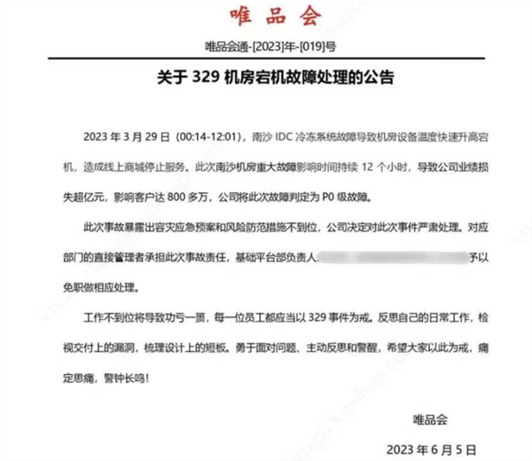
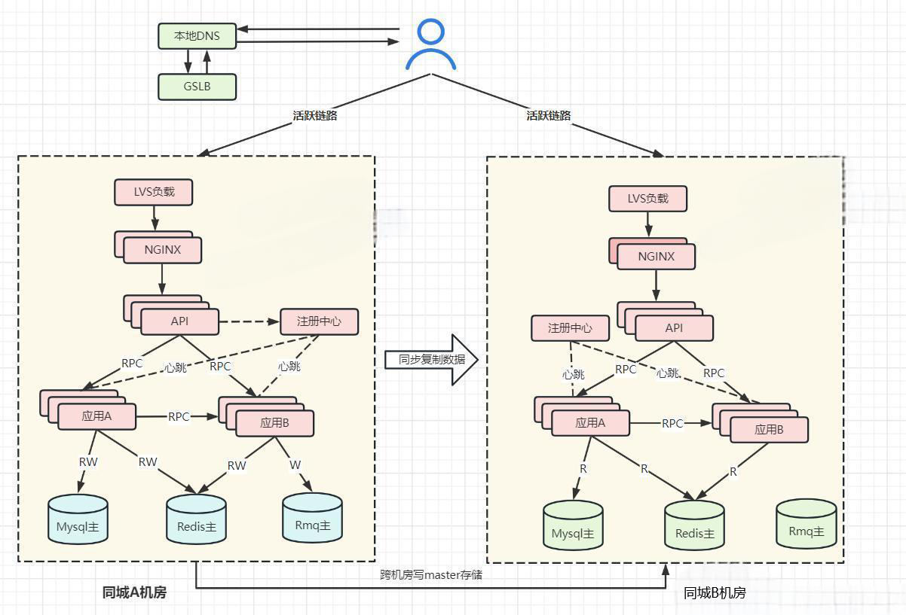
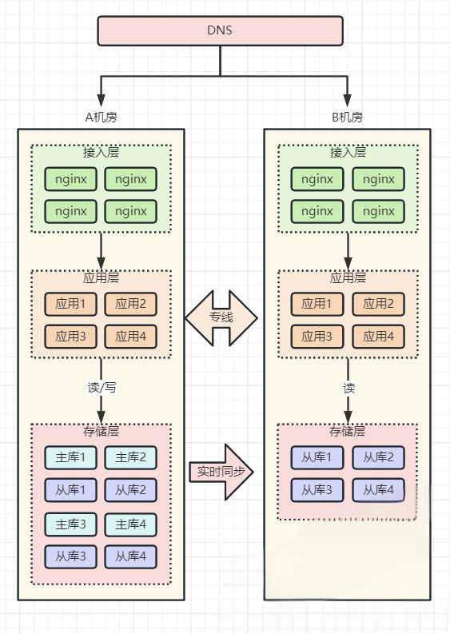
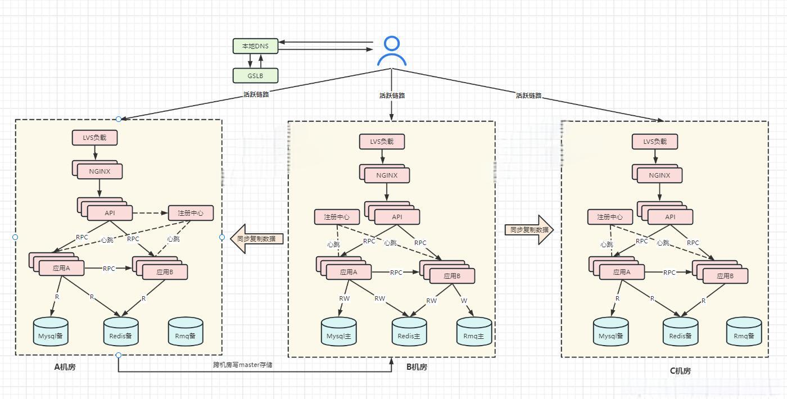
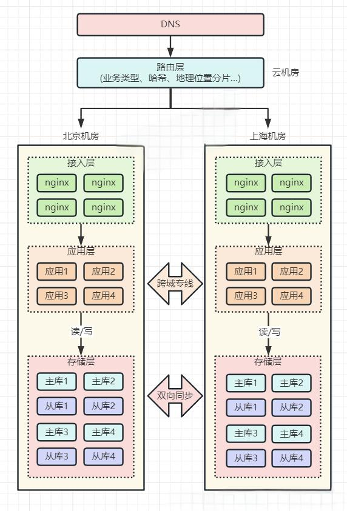
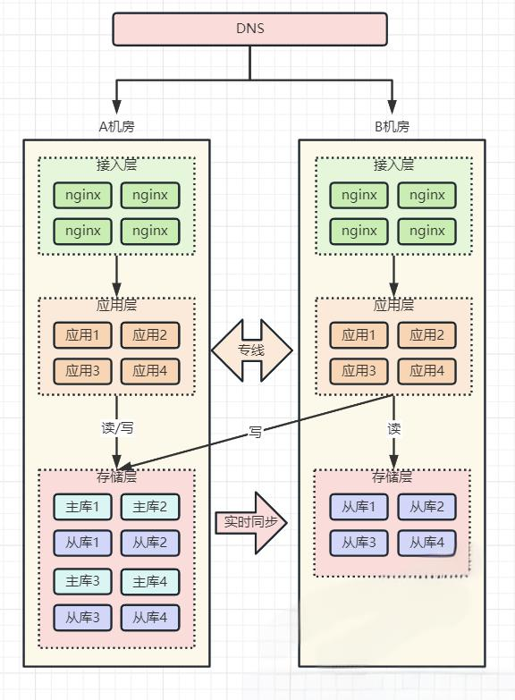
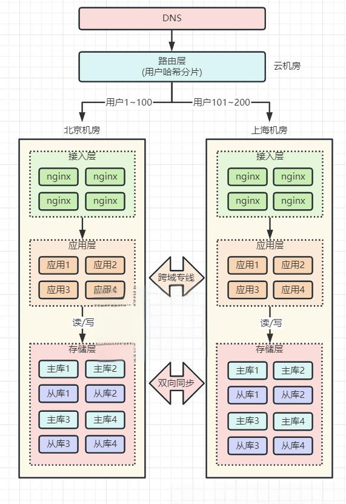
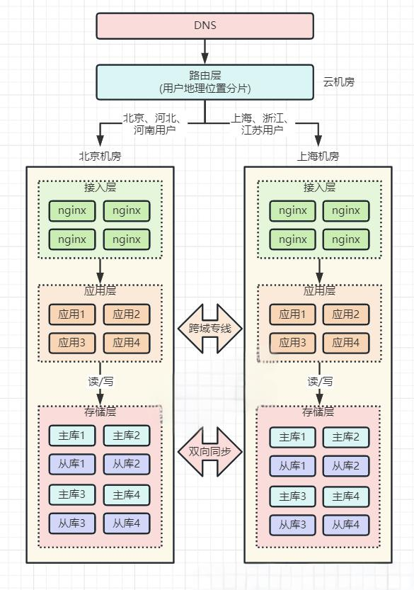
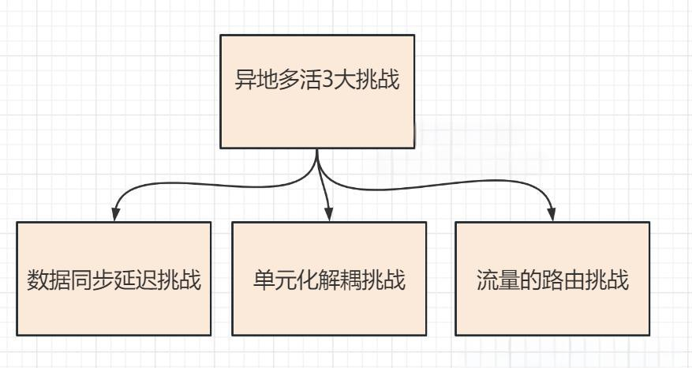

# 55.互联网大厂异地多活架构方案

**分享内容**

1. 高可用事故
2. 故障的根因分析
3. 什么是异地多活
4. 常见三种多活方案
5. 异地多活三大挑战

### 接二连三的 P0 级事故（高可用事故）
+ 3 月 5 日 B 站崩了
+ 3 月 29 日 唯品会又崩

#### P0 级事故：3 月 5 日 B 站崩了
3 月 5 日晚，有小伙伴发现，从 20:22 分开始 B 站的服务器就处于状态，用户无法观看视频和刷新推荐内容。直至 20:40 左右才恢复正常，持续时间近二十分钟。

##### 事故复盘
B 站 APP 端，用户可以在有缓存的情况下打开首页，

在没有缓存的情况下，会得到的是报错提示，访问视频资源时无法正常加载页面。


Web 端主站的用户点击 “换一换” 无法正常刷新，多尝试几次会得到提示“暂时没有新内容了”。

##### 事故原因
次日凌晨 2 点，B 站发布公告称，昨晚，B 站的部分服务器机房发生故障，造成无法访问。

技术团队随即进行了问题排查和修复，现在服务已经陆续恢复正常。


##### 影响范围
以 B 站 6000 万的日活、晚 8 点是传统的视频用户高活跃期来看，本次事故影响的用户量级超千万。

以互联网企业常规的事故评判标准来看，应该属于 P0 级事故，

对于这种严重的事故， 主要**技术负责人面临扣绩效甚至背锅走人**的风险。

#### P0 级事故：3 月 29 日 唯品会又崩
##### 事故复盘
3 月 29 日发生的突发事件，唯品会 App 崩了当天冲上热搜。

故障的现象：“加购” 等功能或出现异常。

故障的时长： 12 小时。

6 月 6 日消息，唯品会发布了一份处理公告，3 月 29 日 唯品会 App 崩了的事故，判定为 P0 级故障。



##### 什么是 P0 级 事故?
```plain
事故等级主要针对生产环境，划分依据类似于bug等级。

P0级 属于最高级别事故。  比如崩溃，页面无法访问，主流程不通，主功能未实现，或者在影响面上影响很大（即使bug本身不严重）。

P1级 属于高级别事故。 一般属于主功能上的分支，支线流程，核心次功能等

P2级 属于中级别事故。主要根据企业实际情况划分。

P3级 属于低级别事故。 主要根据企业实际情况划分。

PN级  ...级别越高。
```

P0 属于最高级别事故，比如崩溃、页面无法访问、主流程不通、主功能未实现，或在影响面上影响很大 (即使 Bug 本身不严重)。

**官方在公告中称，此次南沙机房重大故障影响时间持续 12 个小时，导致公司业绩损失超亿元，影响客户达 800 多万。**

唯品会表示，决定对此次事件严肃处理，对应部门的直接管理者承担此次事故责任。

关键是，主要**技术负责人面临扣绩效甚至背锅走人**：基础平台部负责人予以免职做相应处理。

### 架构师们，锅能不背么？
所以，架构师的视角，不是关注 B 站、唯品会损失了多少亿。

而是关注的是咱们架构师的职业生涯， 简单来说，就是一句话：

**架构师们，锅能不背么？**

这里，先把责任明确一下。

基础平台部负责人 虽然是 管理岗，本身也有一定的架构职责，所以，从一定意义上说，也是架构师。

当然，有的小伙伴会说， 架构师就是技术军师、技术师爷， 负责出方案，出主意的。基础平台部负责人 不是架构师。

如果一定要这么说，也行。

**既然老帅都丢了，军师会有好受的吗？ 同样要背锅走人**。

所以，还是同一个问题：架构师们，当如何拜托背锅走人的宿命？

### 什么是优秀的架构
如何不背锅呢？先得回到问题的本身。

#### 三高架构的三原则
**原则 1：高性能**意味着系统拥有更大流量的处理能力，更低的响应延迟。

例如 1 秒可处理 10W 并发请求，接口响应时间 5 ms 等等。

**原则 2：高并发**表示系统在迭代新功能时，能以最小的代价去扩展，系统遇到流量压力时，可以在不改动代码的前提下，去扩容系统。

**原则 3：高可用**通常用 2 个指标来衡量：

+ **平均故障间隔 MTBF**（Mean Time Between Failure）：表示两次故障的间隔时间，也就是系统「正常运行」的平均时间，这个时间越长，说明系统稳定性越高
+ **故障恢复时间 MTTR**（Mean Time To Repair）：表示系统发生故障后「恢复的时间」，这个值越小，故障对用户的影响越小

可用性与这两者的关系：

> 可用性（Availability）= MTBF / (MTBF + MTTR) * 100%
>

这个公式得出的结果是一个比例，通常我们会用「N 个 9」来描述一个系统的可用性。

| 系统可用性 | 年故障时间 | 日故障时间 |
| --- | --- | --- |
| 90% (1 个 9) | 36.5 天 | 2.4 小时 |
| 99% (2 个 9) | 3.65 天 | 14 分钟 |
| 99.9% (3 个 9) | 8 小时 | 86 秒 |
| 99.99%(4 个 9) | 52 分钟 | 8.6 秒 |
| 99.999%(5 个 9) | 5 分钟 | 0.86 秒 |
| 99.9999%(6 个 9) | 32 秒 | 86 毫秒 |


从这张图，大家最好是能耳熟能详。

从图中，可以看到，要想达到 4 个 9 以上的可用性，一年的不可以时间为 52 分钟，平均每天故障时间必须控制在 10 秒以内。

#### 什么是优秀的架构？
原则 1 告诉大家：要用最少的资源，得到最大的受益。

原则 2 告诉大家：要能高扩展、自伸缩，能够承担高吞吐、高并发，能够自动扩容缩容

原则 3 告诉大家： 一年的可用性要达到至少 4 个 9，不可用时间不能超过 52 分钟。

从这个角度来说， 前面的 B 站事故、唯品会事故，都说明了一个问题：

**B 站、唯品会，都没有实现原则 3 的高可用： 高可用都没有达到 4 个 9，更不用说 5 个 9。**

从这个维度来说： B 站、唯品会这么多人、这么大的技术团队，并没有做到架构的优秀。

他们的架构团队，到了应该好好反思的时刻了。

### 两个 P0 级故障的根因分析
首先强调的是：**根因分析**

一般来讲，无论 B 站还是唯品会，单机房内部的链路，一定是高可用的。

为啥？那么多架构师，如果单机房内部的高可用架构都实现不了，那就白混了。

单机房内部高可用，有架构师保障。

而机房的高可用，由机房厂商保障： 建设一个机房的要求其实是很高的，地理位置、温湿度控制、备用电源等等，机房厂商会在各方面做好防护。

关键是，怎么确保 地域维度的不出现基础设施问题呢？

比如：

+ 2015 年 5 月 27 日，杭州市某地光纤被挖断，近 3 亿用户长达 5 小时无法访问支付宝
+ 2021 年 7 月 13 日，B 站部分服务器机房发生故障，造成整站持续 3 个小时无法访问
+ 2021 年 10 月 9 日，富途证券服务器机房发生电力闪断故障，造成用户 2 个小时无法登陆、交易
+ 2023 年 3 月 29 日，唯品会遭遇了一场灾难性的机房故障， 南沙 IDC 冷冻系统故障导致机房设备温度快速升高宕机，造成线上商城停止服务。事故影响时间持续 12 个小时，导致唯品会业绩损失超亿元，影响客户达 800 多万
+ … 都是 P0 级事故

可见，**即使机房级别的防护已经做得足够好**，但只要 地域维度的基础设施问题（网络问题、电力问题、地震问题、水灾问题），咱们的系统，也就不可用了。

如何解决地域维度的基础设施问题 呢？

对不起， 这个神也搞不定。

咱们作为应用架构师，在这块只能规避，只能规避，只能规避。

如何规避呢？ 核心的措施就是 ：异地多活。

### 什么是异地多活
异地多活的概念很多，像什么同城双活、两地三中心、三地五中心等等概念。

要想理解异地多活，需要从架构设计的 3 高原则说起。

### 常见的多活方案
4 个 9 高可用的核心方案就是异地多活

异地多活指分布在异地的多个站点同时对外提供服务的业务场景。

异地多活是高可用架构设计的一种，与传统的灾备设计的最主要区别在于 “多活”，即所有站点都是同时在对外提供服务的。

常见的多活方案有同城双活、两地三中心、三地五中心等多种技术方案，

### 方案 1：同城双活
同城双活是在同城或相近区域内建立两个机房。

同城双机房距离比较近，通信线路质量较好，比较容易实现数据的同步复制 ，保证高度的数据完整性和数据零丢失。

同城两个机房各承担一部分流量，一般入口流量完全随机，内部 RPC 调用尽量通过就近路由闭环在同机房，相当于两个机房镜像部署了两个独立 cluster，数据仍然是单点写到主机房数据库，然后实时同步到另外一个机房。

下图展示了同城双活简单部署架构，当然一般真实部署和考虑问题要远远比下图复杂。



服务调用基本在同机房内完成闭环，数据仍然是单点写到主机房数据储存，然后实时同步复制到同城备份机房。

当机房 A 出现问题时候运维人员只需要通过 GSLB 或者其他方案手动更改路由方式将流量路由到 B 机房。

同城双活可有效用于防范火灾、建筑物破坏、供电故障、计算机系统及人为破坏引起的机房灾难。

> <font style="color:rgb(51, 51, 51);">GSLB（Global Server Load Balance）全局负载均衡：主要的目的是在整个网络范围内将用户的请求定向到最近的节点（或者区域）。因此，就近性判断是全局负载均衡的主要功能。本地负载均衡一般局限于一定的区域范围内，其目标是在特定的区域范围内寻找一台最适合的节点提供服务。</font><sup><font style="color:rgb(51, 102, 204);"> </font></sup>
>

#### 同城双活关键：
（1）如何双机房切流

（2）如何保证数据一致性

##### 如何双机房切流
那怎么让 B 机房也接入流量呢？

最为简单的措施，就是进行 DNS 切流。把 B 机房的接入层 IP 地址，加入到 DNS 中，这样，B 机房从上层就可以有流量进来了。



##### 如何保证数据一致性
业务应用在操作数据库时，需要区分「**读写分离**」, 假设 A 主 B 从，

+ 「读」流量，可以读任意机房的存储，
+ 「写」流量，只允许写 A 机房，因为主库在 A 机房。
+ 然后进行 A -B 机房的数据同步


这种架构，涉及用的所有存储，例如项目中用到了 MySQL、Redis、MongoDB 等等，

操作这些数据库，都需要区分读写请求，所以这块需要一定的业务「改造」成本。

最好的方式： **是通过 proxy 中间组件，完成 统一的 读写改造。**

#### 为啥不是立即做到异城多活？
上面的方案，仅仅是同城多活，不是异城多活。

同城多活可以解决 **机房级别的不可抗拒灾难**，但是 **地域级别的不可抗拒灾难**，就没有办法搞定。

**同城多活的机房，放到两个城市，不就变成异城多活了吗？**

没有那么简单，来看看问题吧。

一般来说，多活机房的网络是通过「**跨城专线**」连通的。

如果两个机房距离较远，受到物理距离的限制，现在，两地之间的网络延迟就变成了「**不可忽视**」的因素了。

比如：北京到上海的距离大约 1300 公里，即使架设一条高速的「网络专线」，光纤以光速传输，一个来回也需要近 10ms 的延迟。

况且，网络线路之间还会经历各种路由器、交换机等网络设备，实际延迟可能会达到 30ms ~ 100ms，如果网络发生抖动，延迟甚至会达到 1 秒。

此时两个机房都接入流量，那上海机房的请求，可能要去读写北京机房的存储，这里存在一个很大的问题：**网络延迟、用户体验差、数据存在丢失风险**。

也就是说，如果是异城多活，距离太远，网络延迟太大。

这个时候， 如果 A 机房挂了，而数据还没有完成同步，就会出现 1 秒的数据丢失。

再来个用户体验差的案例： 一个客户端请求打到上海机房，上海机房要去读写北京机房的存储，一次跨机房访问延迟就达到了 30ms，这大致是机房内网网络（0.5 ms）访问速度的 60 倍（30ms / 0.5ms），一次请求慢 60 倍，来回往返就要慢 100 倍以上。

而我们在 App 打开一个页面，可能会访问后端几十个 API，每次都跨机房访问，整个页面的响应延迟有可能就达到了**秒级**，这个性能简直惨不忍睹，难以接受。

所以：

**同城多活的机房，放到两个城市，不就变成异城多活了吗？** 这种想法，太肤浅了。

### 方案 2：两地三中心
所谓两地三中心是指 同城双中心 + 异地灾备中心。

异地灾备中心是指在异地的城市建立一个备份的灾备中心，用于双中心的数据备份，数据和服务平时都是冷的，

当双中心所在城市或者地区出现异常而都无法对外提供服务的时候，异地灾备中心可以用备份数据进行业务的恢复。



**两地三中心方案特点**

优势

> + 服务同城双活，数据同城灾备，同城不丢失数据情况下跨机房级别容灾。
> + 架构方案较为简单，核心是解决底层数据双活，由于双机房距离近，通信质量好，底层储存例如 mysql 可以采用同步复制，有效保证双机房数据一致性。
> + 灾备中心能防范同城双中心同时出现故障时候利用备份数据进行业务的恢复。
>

劣势

> + 数据库写数据存在跨机房调用，在复杂业务以及链路下频繁跨机房调用增加响应时间，影响系统性能和用户体验。
> + 服务规模足够大 (例如单体应用超过万台机器)，所有机器链接一个主数据库实例会引起连接不足问题。
> + 出问题不敢轻易将流量切往异地数据备份中心，异地的备份数据中心是冷的，平时没有流量进入，因此出问题需要较长时间对异地灾备机房进行验证。
>

同城双活和两地三中心建设方案建设复杂度都不高，两地三中心相比同城双活有效解决了异地数据灾备问题，但是依然不能解决同城双活存在的多处缺点，想要解决这两种架构存在的弊端就要引入更复杂的解决方案去解决这些问题。

### 方案 3：单元化 + 异地多活
阿里在实施这种方案时，给它起了个名字，叫做「**单元化**」。

单元化 + 异地多活结合的策略，是真正的异地多活策略，核心点有两个：

+ 用户单元化
+ 数据全局化

#### 什么是用户单元化
同一个用户只会落在同一个机房内。之后的所有业务操作，都在这一个机房内完成，从根源上避免「跨机房」。

正常情况下，但用户的请求处理不会在两个机房「漂移」。

用户单元化的核心措施：要在最上层就把用户「区分」开，部分用户请求固定打到北京机房，其它用户请求固定打到上海机房，进入某个机房的用户请求，之后的所有业务操作，都在这一个机房内完成，从根源上避免「跨机房」。

安全起见，每个机房在写存储时，还需要有一套机制，能够检测「数据归属」，应用层操作存储时，需要通过中间件来做「兜底」，避免不该写本机房的情况发生。

用户单元化之后，就可以进行用户分片。

分片的核心思路在于，**让同一个用户的相关请求，只在一个机房内完成所有业务「闭环」，不再出现「跨机房」访问。**

#### 什么是数据全局化
多个机房，数据都是全量数据。

当然，也可以部分全量，部分进行分区域存储。

架构的本质，都不是一刀切。

如果一刀切，就违背了架构精神。

怎么做到数据全局化呢？

多个机房在接收「读写」流量（做好分片的请求），底层存储保持「双向」同步，两个机房都拥有全量数据

当任意机房故障时，另一个机房就可以「接管」全部流量，实现快速切换

#### 用户单元化场景的流量路由
单元化 + 异地多活策略中，在接入层之上，再部署一个「路由层」（通常部署在云服务器上）

流量路由层的职责，就是把用户「分流」到不同的机房内。



#### 多机房流量路由的规则
但这个路由规则，具体怎么定呢？

大致的路由规则有：

1. 按业务类型分片
2. 直接哈希分片
3. 按地理位置分片

##### 1、按业务类型分片
假设有 4 个应用，北京和上海机房都部署这些应用。

但应用 1、2 只在北京机房接入流量，在上海机房只是热备。

应用 3、4 只在上海机房接入流量，在北京机房是热备。

这样一来，应用 1、2 的所有业务请求，只读写北京机房存储，应用 3、4 的所有请求，只会读写上海机房存储。



这里按业务类型在不同机房接入流量，还需要考虑多个应用之间的依赖关系，要尽可能的把完成「相关」业务的应用部署在同一个机房，避免跨机房调用。

##### 2、直接哈希分片
比如路由层会根据用户 ID 计算「哈希」取模，然后从路由表中找到对应的机房，之后把请求转发到指定机房内。

举例：一共 200 个用户，根据用户 ID 计算哈希值，然后根据路由规则，

用户 1 - 100 路由到北京机房，

用户 101 - 200 用户路由到上海机房，

这样，就避免了同一个用户修改同一条数据的情况发生。



##### 3、按地理位置分片
按地理位置分片方案，非常适合与地理位置密切相关的业务，例如打车、外卖服务就非常适合这种方案。

外卖肯定是「就近」点餐，整个业务范围相关的有商家、用户、骑手，它们都是在相同的地理位置内的。

针对这种特征，就可以在最上层，按用户的「地理位置」来做分片，分散到不同的机房。

举例：北京、河北地区的用户点餐，请求只会打到北京机房，而上海、浙江地区的用户，请求则只会打到上海机房。这样的分片规则，也能避免数据冲突。



总之，

至此，我们才算实现了真正的「**异地双活**」！

> 到这里你可以看出，完成这样一套架构，需要投入的成本是巨大的。
>
> 路由规则、路由转发、数据同步中间件、数据校验兜底策略，不仅需要开发强大的中间件，同时还要业务配合改造（业务边界划分、依赖拆分）等一些列工作，没有足够的人力物力，这套架构很难实施。
>

### 异地多活 3 大挑战


#### 1、数据同步延迟挑战
（1）应用要走向异地，首先要面对的便是物理距离带来的延时。

如果某个应用请求需要在异地多个单元对同一行记录进行修改，为满足异地单元间数据库数据的一致性和完整性，需要付出高昂的时间成本。

（2）解决异地高延时即要做到单元内数据读写封闭，不能出现不同单元对同一行数据进行修改，所以我们需要找到一个维度去划分单元。

（3）某个单元内访问其他单元数据需要能正确路由到对应的单元，例如 A 用户给 B 用户转账，A 用户和 B 用户数据不在一个单元内，对 B 用户的操作能路由到相应的单元。

（4）面临的数据同步挑战，对于单元封闭的数据需全部同步到对应单元，对于读写分离类型的，我们要把中心的数据同步到单元。

#### 2、单元化解耦挑战
所谓单元 (下面我们用 RZone 代替)，是指一个能完成所有业务操作的自包含集合，在这个集合中包含了所有业务所需的所有服务，以及分配给这个单元的数据。

单元化架构就是把单元作为系统部署的基本单位，在全站所有机房中部署数个单元，每个机房里的单元数目不定，任意一个单元都部署了系统所需的所有的应用。

单元化架构下，服务仍然是分层的，不同的是每一层中的任意一个节点都属于且仅属于某一个单元，上层调用下层时，仅会选择本单元内的节点。

选择什么维度来进行流量切分，要从业务本身入手去分析。

例如电商业务和金融的业务，最重要的流程即下单、支付、交易流程，通过对用户 id 进行数据切分拆分是最好的选择，买家的相关操作都会在买家所在的本单元内完成。

对于商家相关操作则无法进行单元化，需要按照下面介绍的非单元化模式去部署。

当然用户操作业务并非完全能避免跨单元甚至是跨机房调用，例如两个买家 A 和 B 转账业务，A 和 B 所属数据单元不一致的时候，对 B 进行操作就需要跨单元去完成

#### 3、流量的路由挑战
+ **流量调度**：系统部署过去后流量怎么跟着怎么过去。
+ **流量自闭环**：由于距离的原因，跨地域的物理延时是没法避免的，流量过去之后怎么保证所有的操作都在本地完成，如果做不到那怎么将这种延时影响降到最低。
+ **容灾切流**：当某个机房出现故障时，如何快速把流量无损地切至其他机房。这里并不是说简单把流量切过去就完事，由于数据在多区域同步，流量切过去之后能否保证数据的一致性？


> 更新: 2025-04-20 22:39:02  
> 原文: <https://www.yuque.com/aaron-wecc3/dhluml/uimorq7013aa3pzr>