# 56.电商微服务业务架构拆分技巧

**分享内容**

1. 流程分析整理
2. 从表开始拆分系统
3. 常用抽象拆分方法
4. 总结

下面基于一个案例来说明微服务架构拆分的方法。

假设你现在是某行业知名电商的供货商，供应链比较长，而且供应品类和规格复杂。为确保生产计划平滑运转，系统还需要调配多个子工厂和材料商的生产排期。

原本调配订单需要电话沟通，但这样太过随机。为了保证生产链稳定供货，同时提高协调效率，朋友基于订单预订系统增加了排期协商功能，具体就是将 “排期” 作为下订单主流程里的一个步骤，并将协商出的排期按照日历样式来展示，方便上游供应商和各个工厂以此协调生产周期。

整个供货协商流程如下图所示：

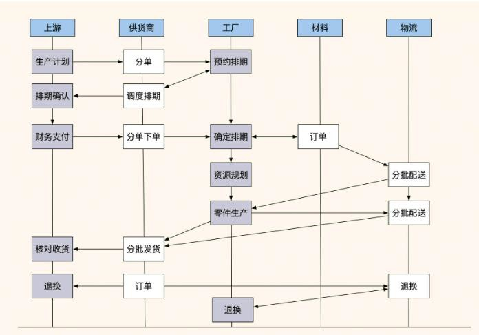

如图，上游项目会先发布生产计划（或采购计划），供货商根据计划拆分采购列表（分单），并联系不同的工厂协调做预排期（预约排期）。之后，上游采购方对工厂产品进行质量审核，然后下单支付、确认排期。

工厂根据确认好的排期制定采购材料计划，并通知材料供货商分批供货，开始分批生产制造产品。每当制造好一批产品后，工厂就会通知物流按批次发货到采购方（即供货商），同时更新供货商系统内的分批订单信息。接着，上游对产品进行验收，将不合格的产品走退换流程。

但系统运行了一段时间后朋友发现，由于之前系统是以订单为主体的，增加排期功能后还是以主订单作为聚合根（即主要实体），这就导致上游在发布计划时需要创建主订单。而主订单一直处于开启状态，随着排期不断调整和新排期的不断加入，订单数据就会持续增加，一年内订单数据量达到了一亿多条。因为数据过多、合作周期长，并且包含了售后环节，所以这些数据无法根据时间做归档，导致整个系统变得越来越慢。

考虑到这是核心业务，如果持续存在问题影响巨大，如何对数据进行分表拆分?

其实这不是分表分库维护的问题，而是系统功能设计不合理导致了系统臃肿。于是经过沟通，我们决定对系统订单系统做一次领域拆分。

## 1 流程分析整理
我先梳理了主订单的 API 和流程，从上到下简单绘制了流程和订单系统的关系，如下图所示：

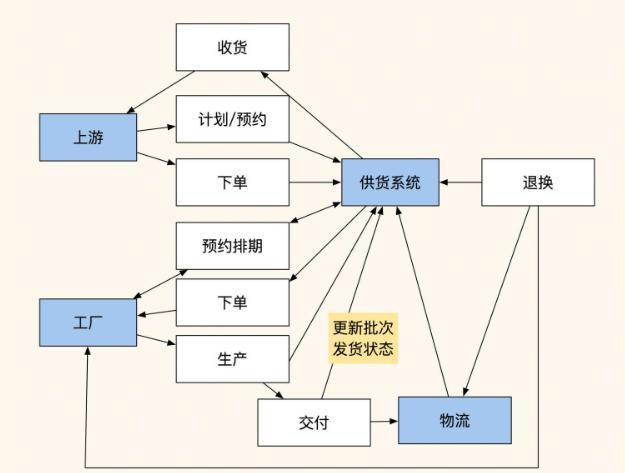

可以看到，有多个角色在使用这个“订单排期系统”。通过这张图与产品、研发团队进行沟通，来确认我理解的**主要流程的数据走向和系统数据依赖关系**都没有问题。

接着我们将目光放在了订单表上，订单表承载的职能过多，导致多个流程依赖订单表无法做数据维护，而且订单存在多个和订单业务无关的状态，比如排期周期很长，导致订单一直不能关闭。**一个数据实体不要承担太多职能，否则很难管理**，所以我们需要对订单和排期的主要实体职能进行拆分。

经过分析我们还发现了另一个问题，**现在系统的核心并不是订单，而是计划排期**。原订单系统在改造前是通过自动匹配功能实现上下游订单分单的，所以系统的主要模块都是围绕订单来流转的。而增加排期功能后，系统的核心就从围绕订单实现匹配分单，转变成了围绕排期产生订单的模式，这更符合业务需要。

排期和订单有关联关系，但职能上有不同的方向用途，排期只是计划，而订单只为工厂后续生产运输和上游核对结果使用。**这意味着系统的模块和表的设计核心已经发生了偏移**，我们需要拆分模块才能拥有更好的灵活性。

综上所述，我们总体的拆分思路是：要将排期流程和订单交付流程完全拆分开。要知道在创业公司，我们做的项目一开始的设计初衷常常会因为市场需求变化，逐渐偏离原有设计，这就需要我们不断重新审视我们的系统，持续改进，才能保证系统的完善。

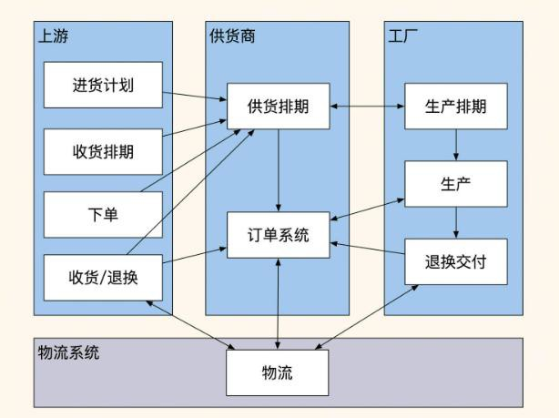

因为担心研发团队摆脱不了原有系统的思维定势，拆分做得不彻底，导致改版失败，所以我对角色和流程做了一次梳理，明确了各个角色的职责和流程之间的关系。我**按角色及其所需动作**画出多个框，将他们需要做的动作和数据流穿插起来，如下图所示：

基于这个图，我再次与研发、产品沟通，找出了订单与排期在功能和数据上的拆分点。具体来讲，就是将上游的职能拆分为：发布进货计划、收货排期、下单、收货/退换； 而供货商主要做协调排期分单，同时提供订单相关服务；工厂则主要负责生产排期、生产和售后。这样一来，**系统的流程就可以归类成几个阶段：**

1.计划排期协调阶段- 2.按排期生产供货+周期物流交付阶段- 3.售后服务调换阶段

可以看到，第一个阶段不牵扯订单，主要是上游和多个工厂的**排期协调；**第二、三阶段是工厂生产供货和售后，这些服务需要和**订单**交互，而上游、工厂和物流的视角是完全不同的。

基于这个结论，我们完全可以**根据数据的主要实体和主要业务流程**（订单 ID 做聚合根， 将流程分为订单和排期两个领域）将系统拆分成两个子系统：排期调度系统、订单交付系统。

**在计划排期协调阶段**，上游先在排期调度系统内提交进货计划和收货排期，然后供货商根据上游的排期情况和进货需求，与多家合作工厂协调分单和议价。多方达成一致后， 上游对计划排期和工厂生产排期进行预占。

待上游正式签署协议、支付生产批次定金后，排期系统会根据排期和工厂下单在订单系统中产生对应的订单。同时，**上游、供货商和工厂一旦达成合作，后续可以持续追加下单排期**，而不是将合作周期限制在订单内。

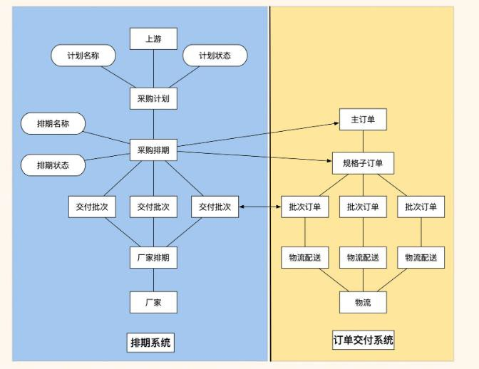

**在排期生产供货阶段，**排期系统在调用订单系统的同时，会传递具体的主订单号和订单明细。订单明细内包含着计划生产的品类、个数以及每期的交付量，工厂可以根据自己的情况调整生产排期。产品生产完毕后，工厂分批次发送物流进行派送，并在订单系统内记录交付时间、货物量和物流信息。同时，订单系统会生成财务信息，与上游财务和仓库分批次地对账。

这么拆分后，两个系统把采购排期和交付批次作为聚合根，进行了数据关联，这样一来， 整体的订单流程就简单了很多。

总体来讲，前面对业务的梳理都以流程、角色和关键动作这三个元素作为分析的切入点， 然后将不同流程划分出不同阶段来归类分析，根据不同阶段拆分出两个业务领域：排期和订单，同时找出两个业务领域的聚合根。经过这样大胆的拆分后，再与产品和研发论证可行性。

## 2 系统拆分从表开始
经历了上面的过程，相信你对按流程和阶段拆分实体职责的方法，已经有了一定的感觉， 这里我们再用代码和数据库表的视角复盘一下该过程。

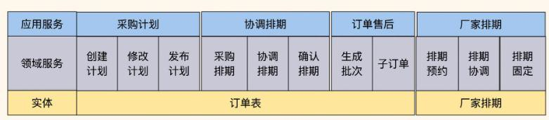一般来说，系统功能从表开始拆分，这是最容易实现的路径，因为我们的业务流程往往都会围绕一个主要的实体表运转，并关联多个实体进行交互。在这个案例中，我们将订单表内关于排期的数据和状态做了剥离，拆分之前的代码分层如下图所示：

拆分之后，代码分层变成了这样：

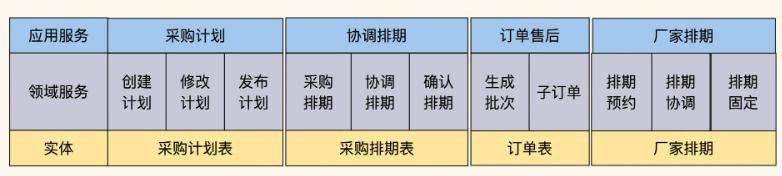

可以看到，最大的变化就是订单实体表的职责被拆分了，我们的系统代码随之变得更加简单，而且同一个订单实体被多个角色交叉调用的情况也完全消失了。在拆分过程中， 我们的依据有三个：

1. **数据实体职能只做最核心的一件事**，比如订单只管订单的生老病死（包括创建、流程状态更改、退货、订单结束）；
2. **业务流程归类按涉及实体进行归类**，看能否分为多个阶段，比如“协调排期流程进行中”、“生产流程”、“售后服务阶段”；
3. **由数据依赖交叉的频率决定把订单划分成几个模块**，如果两个模块业务流程上交互紧密，并且有数据关联关系，比如 Join、调用 A 必然调用 B 这种，就把这两个模块合并，同时保证短期内不会再做更进一步的拆分。

一个核心的系统，如果按实体表职责进行拆分整理，那么它的流程和修改难度都会大大降低。

而模块的拆分，也可以通过图 6，从下往上去看。如果它们之间的数据交互不是特别频繁，比如没有出现频繁的 Join，我们就将系统分成四个模块。如图 7 所示，可以看到这四个模块之间相对独立，各自承担一个核心的职责。同时，两个实体之间交互没有太大的数据关联，每个模块都维护着某个阶段所需的全部数据，这么划分比较清晰，也易于统一管理。

到这里，我们只需要将数据和流程关系都梳理一遍，确保它们之间的数据在后续的统计分析中没有频繁数据 Join，即可完成对表的拆分。

但如果要按业务划分模块，我还是建议从上到下去看业务流程，来决定数据实体拆分（领域模型设计 DDD）的领域范围，以及各个模块的职责范围。

## 3 越是底层服务越要抽象
除了系统的拆分外，我们还要注意一下服务的抽象问题。很多服务经常因业务细节变更需要经常修改，而越是底层服务，越要减少变更。如果服务的抽象程度不够，一旦底层服务变更，我们很难确认该变更对上游系统的影响范围。

所以，我们要搞清楚哪些服务可以抽象为底层服务，以及如何对这些服务做更好的抽象。因为电商类系统经常对服务做拆分和抽象，所以我就以这类系统为例为你进行讲解。你可能感到疑惑：电商系统为什么要经常做系统拆分和服务抽象呢？

这是因为电商系统最核心且最复杂的地方就是订单系统，电商商品有多种品类

（sku+spu），不同品类的筛选维度、服务、计量单位都不同，这就导致系统要记录大量的冗余品类字段，才能保存好用户下单时的交易快照。所以我们需要频繁拆分整理系统，避免这些独有特性影响到其他商品。

此外，电商系统不同业务的服务流程是不同的。比如下单购买食品，与下单定制一个柜子完全不同。在用户购买食品时，电商只需要通知仓库打包、打物流单、发货、签收即可；而用户定制柜子则需要厂家上门量尺寸、复尺、定做、运输、后续调整等。所以， 我们需要做服务抽象，让业务流程更标准、更通用，避免变更过于频繁。

正是由于业务服务形态存在不同的差异，订单系统需要将自己的职能控制在“一定范围”内。对此，我们应该考虑如何在满足业务需求的情况下，让订单表的数据职能最小。事实上，这没有绝对的答案，因为不同行业、不同公司的业务形态都是不同的，这里我举几个常见的抽象思路供你参考。

### 3.1 被动抽象法
如果两个或多个服务使用同一个业务逻辑，就把这个业务逻辑抽象成公共服务。比如业务 A 更新了逻辑 a，业务 B 也会同步使用新的逻辑 a，那么就将这个逻辑 a 放到底层抽象成一个公共服务供两个服务调用。这种属于比较被动的抽象方式，很常见，适合代码量不大、维护人员很少的系统。

对于创业初期主脉络不清晰的系统，利用被动抽象法很容易做抽象。不过，它的缺点是抽象程度不高，当业务需要大量变更时，需要一定规模的重构。

总的来说，虽然这种方式的代码结构很贴近业务，但是很麻烦，而且代码分层没有规律。所以，被动抽象法适用于新项目的探索阶段。

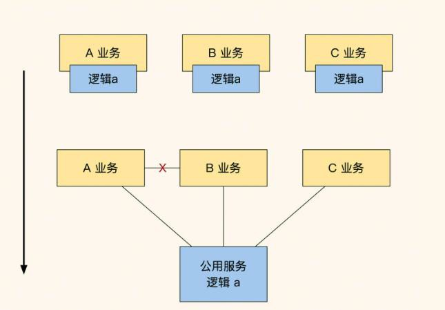

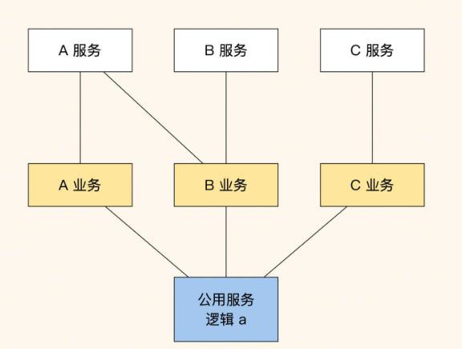  
这里说一个题外话，同层级之间的模块是禁止相互调用的。如果调用了，就需要将两个服务抽象成公共服务，让上层对两个服务进行聚合，如上图中的红 X，拆分后如下图所示：

这么做是为了让系统结构从上到下是一个倒置的树形，保证不会出现引用交叉循环的情况，否则会让项目难以排查问题，难以迭代维护，如果前期有大量这样的调用，当我们做系统改造优化时只能投入大量资源才能解决这个问题。

### 3.2 动态辅助表方式
这个方式适用于规模稍微大一点的团队或系统，它的具体实现是这样的：当订单系统被几个开发小组共同使用，而不同业务创建的主订单有不同的 type，不同的 type 会将业务特性数据存储在不同的辅助表内，比如普通商品保存在表 order 和表order_product_extra 中，定制类商品的定制流程状态保存在 order_customize_extra 中。

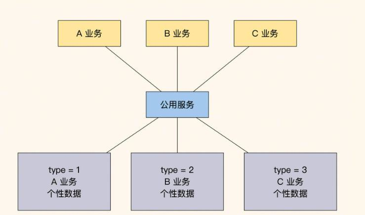这样处理的好处是更贴近业务，方便查询。但由于辅助表有其他业务数据，业务的隔离性比较差，所有依赖订单服务的业务常会受到影响，而且订单需要时刻跟着业务改版。所以，通过这种方式抽象出来的订单服务已经形同虚设，一般只有企业的核心业务才会做类似的定制。

### 3.4 强制标准接口方式
这种方式在大型企业比较常见，其核心点在于：底层服务只做标准的服务，业务的个性部分都由业务自己完成，比如订单系统只有下单、等待支付、支付成功、发货和收货功能，展示的时候用前端对个性数据和标准订单做聚合。

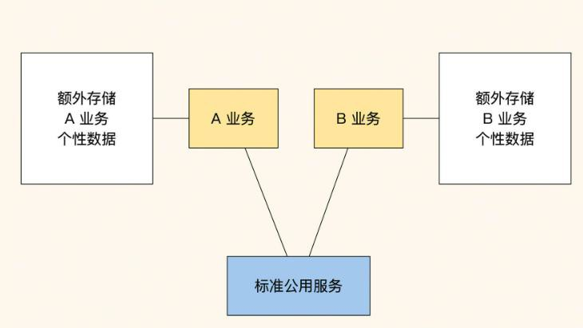用这种方式抽象出的公共服务订单对业务的耦合性是最小的，业务改版时不需要订单跟随改版，订单服务维护起来更容易。只是上层业务交互起来会很难受，因为需要在本地保存很多附加的信息，并且一些流转要自行实现。不过，从整体来看，对于使用业务多的系统来说，因为业务导致的修改会很少。

通过上面三种方式可以看出，业务的稳定性取决于服务的抽象程度。如果底层经常更改， 那么整个业务就需要不断修改，最终会导致业务混乱。所以，我个人还是推荐你使用**强制标准接口方式**，这也是很多公司的常见做法。虽然很难用，但比起经常重构整个系统总要好一些。

你可能很奇怪，**为什么不把第一种方式一口气设计好呢？**这是因为大部分的初创业务都不稳定，提前设计虽然能让代码结构保持统一，但是等两年后再回头看，你会发现当初的设计已经面目全非，我们最初信心满满的设计，最后会成为业务的绊脚石。

所以，这种拆分和架构设计需要我们不定期回看、自省、不断调整。毕竟技术是为业务服务的，业务更重要，没有人可以保证项目初期设计的个人中心不会被改成交友的个人门户。

总之，每一种方法并非绝对正确，我们需要根据业务需求来决策用哪一种方式。

## 4 总结
业务拆分的方法有很多，最简单便捷的方式是：先**从上到下**做业务流程梳理，将流程归类聚合；然后从不同的**领域聚合**中找出交互所需**主要实体**，根据流程中主要实体之间的数据依赖程度决定是否拆分（**从下到上看**）；把不同的实体和动作拆分成多个模块后， 再根据业务流程归类，划分出最终的模块（**最终汇总**）。

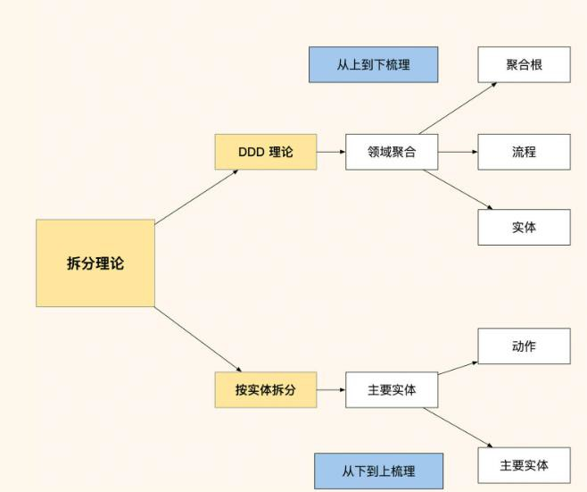

这个拆分过程用一句话总结就是：从上往下看流程，从下往上看模块，最后综合考虑流程和模块的产出结果。用这种方式能快速拆出模块范围，拆分出的业务也会十分清晰。

除了拆分业务外，我们还要关注如何抽象服务。如果底层业务变更频繁，就会导致上层业务频繁修改，甚至出现变更遗漏的情况。所以，我们要确保底层服务足够抽象，具体有很多种办法，比如被动拆分法、动态辅助表方式、标准抽象方式。这几种方式各有千秋，需要我们根据业务来决策。

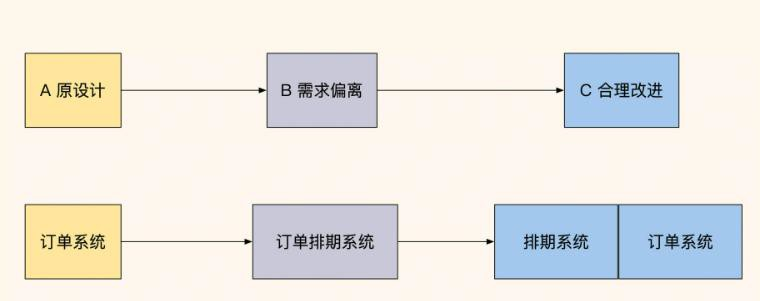

通常，我们的业务系统在初期都会按照一个特定的目标来设计，但是随着市场需求的变化，业务系统经过不断改版，往往会偏离原有的设计。

虽然我们每次改版都实现了既定需求，但也很容易带来许多不合理的问题。所以，在需求稳定后，一般都会做更合理的改造，保证系统的完整性，提高可维护性。很多时候， 第一版本不用做得太过精细，待市场验证后明确了接下来的方向，再利用留出足够的空间改进，这样设计的系统才会有更好的扩展性。

> 更新: 2025-04-20 22:39:02  
> 原文: <https://www.yuque.com/aaron-wecc3/dhluml/fnuohphwqinbwi1v>