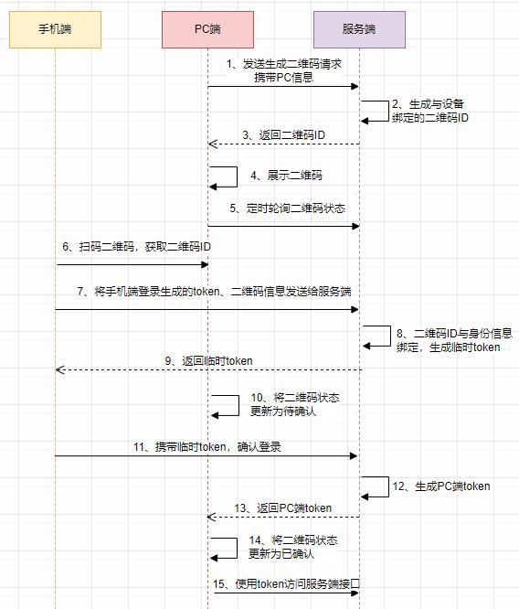
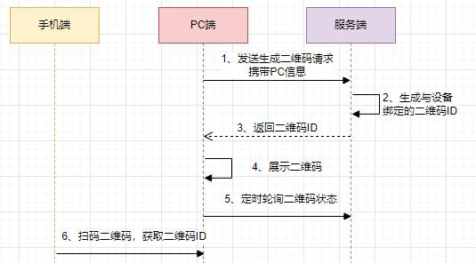
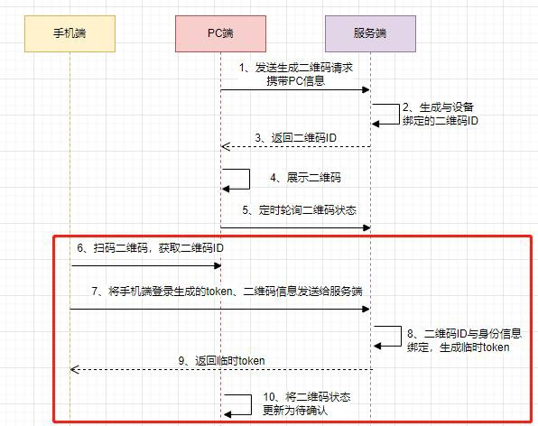
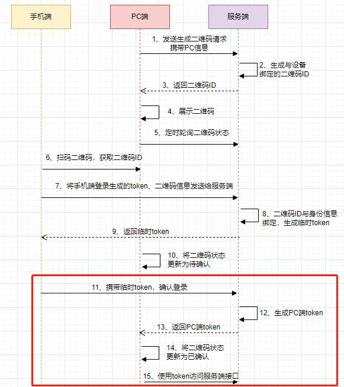

# 57.如何优雅实现扫码登录功能

**分享内容**

1. 待扫描阶段
2. 已扫描待确认阶段
3. 已确认

扫码登录功能主要分为三个阶段：**待扫描、已扫描待确认、已确认**。整体流程图如下

下面分阶段来看看设计原理。

## 1、待扫描阶段
首先是待扫描阶段，这个阶段是 PC 端跟服务端的交互过程。

每次用户打开 PC 端登陆请求，系统返回一个**唯一的二维码 ID**，并将二维码 ID 的信息绘制成二维码返回给用户。

这里的二维码 ID 一定是唯一的，后续流程会将二维码 ID 跟身份信息绑定，不唯一的话就会造成你登陆了其他用户的账号或者其他用户登陆你的账号。

此时在 PC 端会启动一个定时器，**轮询查询二维码是否被扫描**。如果移动端未扫描的话，那么一段时间后二维码将会失效。

这个阶段的交互过程如下图所示。

## 2、已扫描待确认阶段
第二个阶段是已扫描待确认阶段，主要是移动端跟服务端交互的过程。

首先移动端扫描二维码，获取二维码 ID，然后**将手机端登录的凭证（token）和 二维码 ID 作为参数发送给服务端**

此时的手机在之前已经是登录的，不存在没登录的情况。

服务端接受请求后，会将 token 与二维码 ID 关联，然后会生成一个临时 token，这个 token 会返回给移动端，临时 token 用作确认登录的凭证。

PC 端的定时器，会轮询到二维码的状态已经发生变化，会将 PC 端的二维码更新为已扫描，请在手机端确认。

**这里为什么要有手机端确认的操作？**

假设没有确认这个环节，很容易就会被坏人拦截 token 去冒充登录。所以二维码扫描一定要有这个确认的页面，让用户去确认是否进行登录。

另外，二维码扫描确认之后，再往用户 app 或手机等发送登录提醒的通知，告知如果不是本人登录的，则建议用户立即修改密码。

这个阶段是交互过程如下图所示。

## 3、已确认
扫码登录的最后阶段，用户点击确认登录，移动端携带上一步骤中获取的临时 token 访问服务端。

服务端校对完成后，会更新二维码状态，并且给 PC 端生成一个正式的 token。后续 PC 端就是持有这个 token 访问服务端。

这个阶段是交互过程如下图所示。

> 更新: 2025-04-20 22:39:02  
> 原文: <https://www.yuque.com/aaron-wecc3/dhluml/yeblfao43qm8cz1f>