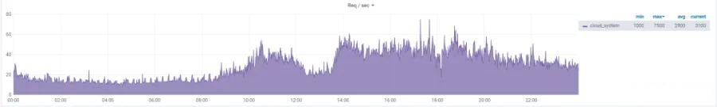
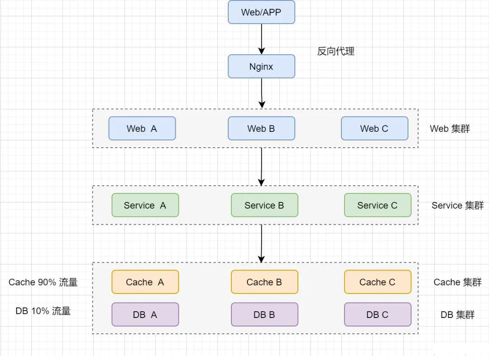

# 60.互联网架构，如何进行容量设计？

**分享内容**

1. 容量设计概念
2. 容量评估时机
3. 容量评估步骤
4. 案例分析
5. 总结

## 概念
何为设计容量，从技术上说就是运用一些策略对系统容量进行预估的过程。容量设计是架构师必备的技能之一。

他要求我们分析系统设计容量要求，尽可能给出具体数据描述的：数据量、并发量、带宽、注册用户规模、活跃用户规模、在线用户规模、消息长度，图片大小、网盘空间容量，内存 CPU 容量等。

下面的内容，我们以 **并发** 为例子，看看看具体的分析过程。

## 分析过程
### 理解一些原理
TPS（Transactions Per Second）：每秒事务数

QPS（Query Per Second）：每秒请求数，QPS 其实是衡量吞吐量的一个常用指标，就是说服务器在一秒的时间内处理了多少个请求。

并发数：并发数是指系统同时能处理的请求数量，这个也是反应了系统的负载能力。

峰值 QPS 计算：

1、原理：每天 80% 的访问集中在 20% 的时间里，这 20% 时间叫做峰值时间

2、公式：(总 PV 数 * 80%) / ( 每天秒数 * 20% ) = 峰值时间每秒请求数 (QPS)

PV（Page View）：页面访问量，即页面浏览量或点击量，用户每次刷新即被计算一次

UV（Unique Visitor）：独立访客，统计 1 天内访问某站点的用户数 (以 cookie 为依据)

吐吞量：吞吐量是指系统在单位时间内处理请求的数量

响应时间（RT）：响应时间是指系统对请求作出响应的时间，一般取平均响应时间

QPS（每秒查询数）、TPS（每秒事务数）是吞吐量的常用量化指标，另外还有 HPS（每秒 HTTP 请求数）。

QPS（TPS）、并发数、响应时间它们三者之间的关系是：

1、QPS（TPS）= 并发数 / 平均响应时间

2、并发数 = QPS * 平均响应时间

### 系统容量评估时机
主要在三种业务场景下需要及时考虑对系统容量进行评估。

1、临时的流量变化：比如 618、双 11，新年大促搞活动等场景，预估我们的流量会大涨，甚至到原来的数倍。这时候要做好应对的措施。

2、初始系统容量评估：假设我们开发了某个系统，这个系统初始上线，我们预估他的容量和负载会是多少。

3、容量基数的变化：比如某个系统，他的功能模块越来越多，数据流量越来越大，日活指数越来越高，迎来了第二波的增长曲线。我们原来定好的系统容量渐渐的不满足我们的需求，这时候我们也要重新评估和扩容。

我们系统容量评估包括数据量、并发量、带宽、CPU、MEMORY、DISK 等。以并发量为案例，我们来说明系统容量评估的方法和步骤。

### 评估的步骤
#### 1、分析日总访问量
分析可能的日访问量，一般系统都会提供比较真实的访问量数值，基于此，我们需要评估一个活动的访问量；如果是一个新上线的系统，我们也要评估可能的 PV、UV 值。

产品、运营部门也需要给出可能的访问预期值。

举个例子：

我们活动期间 (9 点~ 10 点) 会推送 2000W 的应用消息，假设用户实际点进去查看的比列为 1/10，那么这个活动期间 (1 小时) 新增的访问量就有 2000W * 1/10= 200W

#### 2、评估平均访问量 QPS
QPS 是每秒请求量, 假设我们一天正常活动时间一般是 11 个小时多一点, 那一天的时间长度以秒为单位: 60_60_11 ≈ 4W, 我们再使用日访问时间再去除以 4W 总时间即可.

举个例子：

我们上面说的一个小时的活动时间, 实际的总访问量最后确实是 200W,

那么平均访问量 QPS 为: 200W/(60*60)=555.5 QPS.

一个成熟系统日 QPS 也可以预估 , 比如 百度首页的日 PV 数量为 5000W, 按照我们说的常规活动时间 4W 秒算, 就是 5000W / 4W = 1250 QPS.

#### 3、评估高峰区间的 QPS
我们在做系统容量规划时，不仅仅是考虑平均 QPS，最重要的是要承受住高峰区间的 QPS，这个数据可以根据业务流量监控的曲线和 28 法则来评估, 我们来看下具体是怎么做的?

3.1 业务流量监控的曲线

以下面这个云系统作为例子：

日均 QPS 为 2900，业务访问趋势图如下图，我们来对峰值 QPS 做一下预估

从图中可以看出，峰值 QPS 大概是均值 QPS 的 2.58 倍，日均 QPS 为 2900，于是评估出峰值 QPS 为 2900*2.58=7482。

这种是日常流量情况, 如果遇到很特别的业务, 比如竞拍 \ 抢订 \ 秒杀情况, 流量幅度还是比较大的.

3.2 使用二八法则计算

何为二八法则: 80% 的业务基本都是发生在 20% 的时间里面, 所以有如下:

峰值 QPS 公式：(总 PV 数 * 80%) / ( 每天秒数 * 20% ) = 峰值时间每秒请求数 (QPS)

#### 4、评估单实例极限承受的 QPS
可以使用压测 (nGrinder 或者 jmeter) 方式来获取单个系统实例的 QPS 极限值, 我们团队的标准是当请求响应时间超过 2S 的时候, 已经达到了瓶颈值，并影响使用, 需要进行优化和扩容。

我们在一个系统上线前，一般来说是需要进行压力测试, 了解她实际的极限值在哪个地方，以我们上面流量图为例子（日平均 QPS 为 2900，峰值 QPS 为 7500），这个系统的架构可能是这样的：

1、经由 APP 和 Web 的的请求，会经过 Nginx 均衡到多台 Web 站点上去。

2、Web 集群会调用并落地到 Service 集群上

3、Service 集群向数据层请求数据，正常情况下其中 90% 会落到 Cache 集群中

4、Cache 集群中不存在（假设 10%），会进入 DB 集群去访问数据库。

我们通过压测数据发现，web 层是瓶颈，tomcat 压测单个实例只能支持 2500 的 QPS。

Cache 集群和 DB 集群足够强悍，能够轻松应对峰值 7500 的 QPS，按比例分别是 7500_0.9=6750 和 7500_0.1=750.

所以我们得到了 web 单实例极限的 QPS 是 2500。这边需要下调，因为我们不建议让请求响应时长接近 2S，最好是 1S 以内。所以下调至 2000。

#### 5、根据线上冗余度最终确认
通过上面的计算，我们已经得到了峰值 QPS 是 7500，单个实例能够顺畅承载 QPS 是 2000，那么 Web 集群中至少有 4 个实例能够承接这样的请求洪峰。

除此之外，其他类型的的容量预估，如数据量、带宽、CPU、MEMORY、DISK 等都可以采用类似策略。

### 案例分析
结合项目：如何计算图书系统的 QPS、峰值 QPS、N 个实例和并发数

1、图书预定系统的并发数计算：

1.1、二八法则定理：80% 的业务基本都是发生在 20% 的时间里面，如系统有早中晚高峰，历经 9 个小时（早上 10 点到晚上 19 点），9*3600=32400(秒)

1.2、获取峰值 QPS：公式：(总 PV 数 * 80%) / ( 每天秒数 * 20% ) = 峰值时间每秒请求数 (QPS)

即 (1500000 * 80%) / ( 32400 * 20% ) = 600000/6480≈185 / 秒

1.3、并发数 = QPS * 平均响应时间 = 0.5*185 = 92.5 ，矫正为 100

1.4、利用 343 估算法判定 154，向上矫正为 200

| **Pessimism 悲观** | 30% | 80 |
| :--- | :--- | :--- |
| **Normal 标准** | 40% | 100 |
| **Optimism 乐观** | 30% | 300 |

最后提供给性能测试 QA 的测试标准数据是 建议支持并发 200+，QA 最终的测试结果是 该并发下响应时间在 50~100ms

## 总结
系统设计容量评估时机：

1、临时的流量变化：比如 618、双 11，新年大促搞活动等场景，预估我们的流量会大涨，甚至到原来的数倍。这时候要做好应对的措施。

2、初始系统容量评估：假设我们开发了某个系统，这个系统初始上线，我们预估他的容量和负载会是多少。

3、容量基数的变化：比如某个系统，他的功能模块越来越多，数据流量越来越大，日活指数越来越高，迎来了第二波的增长曲线。我们原来定好的系统容量渐渐的不满足我们的需求，这时候我们也要重新评估和扩容。

系统设计容量评估的步骤：

1、分析日总访问量：产品、运营的评估和线上数据的收集

2、评估日平均访问量 QPS：评估运营时间内的平均 QPS

3、评估高峰区间的 QPS：流量曲线计算 或 28 法则估算

4、性能压力测试：评估实例能够承受的极限吞吐量

5、根据线上冗余度，与实际的差值进行调整，评估出能承载容量的实际结果值

类似运动会如果子报名结束后能够根据报名的人数对比，重新做容量设计，提早做好准备，情况就不会那么糟糕。

  
 

> 更新: 2025-04-20 22:38:58  
> 原文: <https://www.yuque.com/aaron-wecc3/dhluml/hirth6qp1g18rqr3>