# 61.大厂动态线程池落地与实践

**分享内容**

线程池管理在应用中至关重要，但其配置复杂，依赖于开发人员的个人经验和知识，难以适应多变的任务类型。线程池参数缺乏动态调整能力，且不支持任务监控、负载告警和操作监控，导致在发生故障或性能瓶颈时难以迅速定位问题并进行调整。

这使得线程池成为应用性能优化的黑盒，限制了系统的可维护性和可扩展性。因此，我们需要优化线程池的管理策略，提升系统的透明度和可监控性，以更好地满足应用的需求。针对如上问题，针对线程池做二次封装，打造自己的动态线程池。

## 一、问题背景
### 01 线程池的参数并不好配置
线程池的管理面临两大挑战。首先，其运行机制复杂，合理配置往往依赖于开发者的深厚经验和专业知识。其次，线程池的性能与任务类型紧密相关，IO 密集型和 CPU 密集型任务在运行时差异显著，这使得通用的配置策略难以制定。因此，开发人员在配置线程池时，需要深入理解其运行机制，并结合具体任务特性进行细致调整，以确保系统的高效稳定运行。

### 02 线程池参数不能动态化
线程池参数的配置是一个复杂且需要持续优化的过程。即使经过谨慎评估，也难以确保一次性得出最佳参数。因此，降低修改线程池参数的成本变得尤为重要。通过实现参数的动态调整机制，我们能够在故障发生时迅速调整参数，以缩短故障恢复时间，提升系统的灵活性和健壮性。这种策略不仅提高了系统的可维护性，也为应对不断变化的业务需求提供了有力支持。

### 03 无法进行任务监控
线程池监控的不足主要体现在缺乏多层次（应用、线程池、任务）的 Transaction 监控能力，无法实时掌握线程池的任务执行情况，包括最大、平均任务执行时间以及关键的性能指标如 95% 和 99% 线等。这些缺失的监控信息使得开发人员难以对线程池的性能进行精确分析和调优，从而可能影响到系统的稳定性和性能。因此，加强线程池的监控能力，提供全面的性能指标和详细的任务执行情况，对于提升系统性能至关重要。

### 04 不能负载告警
线程池在任务积压或负载过高时缺乏有效的告警机制，导致应用开发负责人无法及时获取关键信息。这使得线程池成为了一个 “黑盒”，其内部状态和运行状况难以被外部监控和管理。为了提升系统的可维护性和可靠性，我们需要引入更完善的监控和告警系统，确保在线程池出现问题时能够迅速响应并采取相应的调整措施。

### 05 修改线程池没有操作监控
创建、修改或删除线程池时缺乏通知机制，应用开发负责人无法及时获知相关变动，影响系统监控和管理效率。因此需要引入自动通知系统，确保关键操作能被及时追踪和处理。

## 二、目标
我们的目标就是解决我们遇到的问题，优化线程池管理，实现其动态调整的能力，以便更好地应对不同工作负载。同时，我们将引入全面的监控机制，确保能够实时掌握线程池的运行状态，并在负载过重时及时发出告警通知。此外，我们还将确保线程池的任何变更都能及时通知到相关的研发和运维团队，以提高系统的响应速度和可维护性。 

## 三、动态化线程池
**功能架构**

动态化线程池提供如下功能： 

**动态调参：**支持线程池参数动态调整：包括修改线程池核心大小、最大核心大小、队列长度等；参数修改后及时生效。 

**任务监控：**支持应用粒度、线程池粒度、任务粒度的监控；可以看到线程池的任务执行情况、最大任务执行时间、平均任务执行时间、95/99 线等。

**负载告警**：线程池队列任务积压到一定值的时候会通过钉钉告知应用开发负责人；当线程池负载数达到一定阈值的时候会通过钉钉告知应用开发负责人。

**操作监控：**创建 / 修改和删除线程池都会通知到应用的开发负责人。 

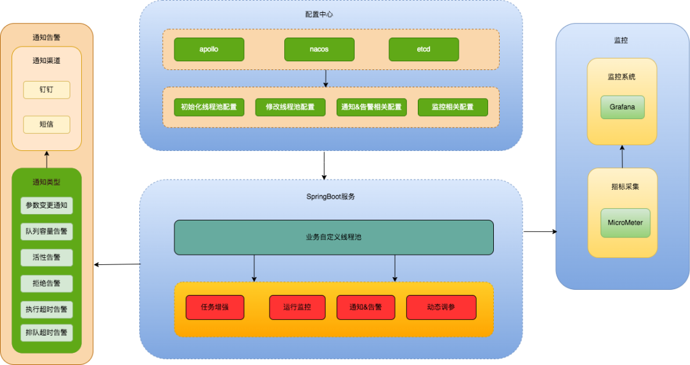

**逻辑架构图**

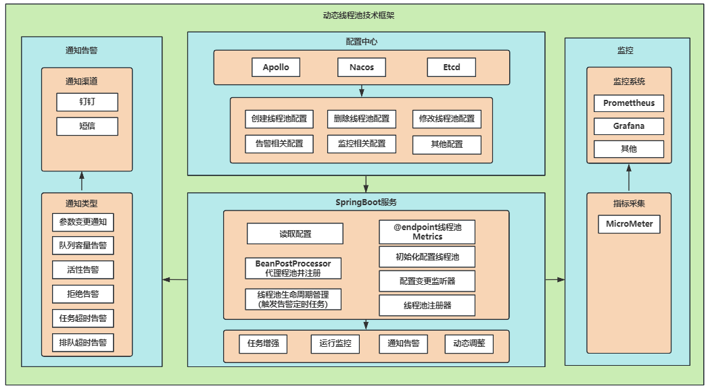

### 主要实现方式
#### 1 参数动态化
JDK 原生线程池 ThreadPoolExecutor 提供了如下几个 public 的 setter 方法，如下图所示： 

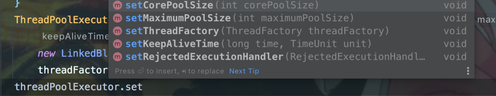

JDK 的 ThreadPoolExecutor 类允许线程池使用方在运行时动态调整其核心线程数。通过调用 setCorePoolSize 方法，可以更改线程池的核心线程数量。当新的 corePoolSize 值小于当前工作线程数时，线程池会尝试中断并回收多余的空闲工作线程，以优化资源使用。

若新的 corePoolSize 值大于原始值，并且任务队列中有待执行的任务，线程池会创建新的工作线程来处理这些任务，以提高吞吐量。这种动态调整策略使得线程池能够灵活地适应不同的工作负载，提高系统的响应性和资源利用率。setCorePoolSize 具体流程如下：

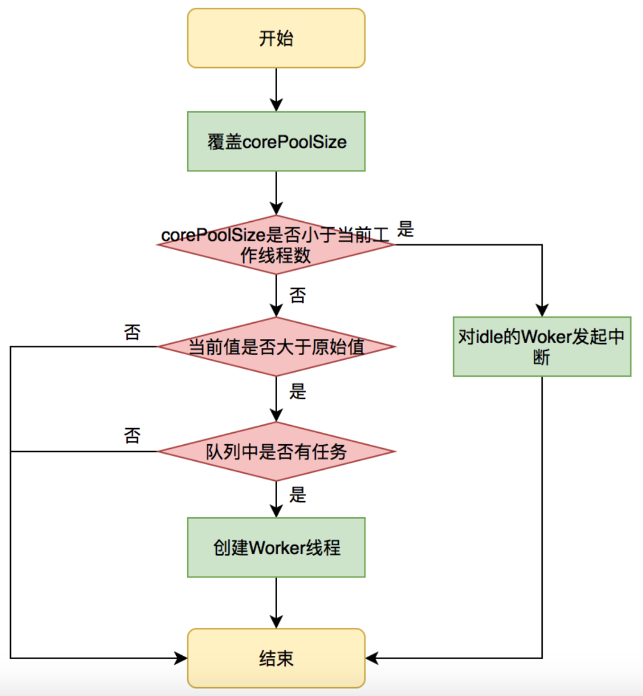

线程池内部会处理好当前状态做到平滑修改，其他几个方法限于篇幅，这里不一一介绍。重点是基于这几个 public 方法，我们只需要维护 ThreadPoolExecutor 的实例，并且在需要修改的时候拿到实例修改其参数即可。

#### 2 线程池监控
为了充分利用线程池并优化其性能，我们不仅需要实现参数的动态化调整，还需引入全面的监控和告警能力。动态化线程池允许我们根据实时工作负载调整核心线程数，确保资源的合理分配。但仅有参数的动态化并不足以满足所有需求，因为对于线程池的实际运行情况，我们还需要有深入的感知。

动态化线程池提供了多个维度的监控能力，涵盖了线程池活跃度、任务的执行 Transaction（包括任务频率、执行耗时等）、Reject 异常以及线程池内部统计信息等关键指标。这些监控数据不仅能帮助用户从多个角度分析线程池的使用情况，如任务的长度、资源的利用率等，还能在发现潜在问题时及时发出告警，确保用户能在第一时间得知并采取措施。

监控和告警功能的结合使得线程池的管理更为高效和安全。当负载过高或资源分配不足时，用户可以基于监控数据快速调整参数，避免系统崩溃或性能下降。同时，告警功能也能在故障发生时迅速通知用户，从而加速故障恢复过程。

**1. 负载监控和告警**

线程池负载关注的核心问题是：基于当前线程池参数分配的资源够不够。对于这个问题，我们可以从事前和事中两个角度来看。

事前，线程池引入了 “活跃度” 这一概念，通过计算活跃线程数与最大线程数（maximumPoolSize）的比例来评估线程池的负载状况。

公式 “线程池活跃度 = activeCount/maximumPoolSize” 提供了一个直观的指标，当活跃线程数接近或达到最大线程数时，表明线程池负载趋高，此时可能需要调整线程池参数或优化任务处理流程，以预防潜在的 Reject 异常。

事中，线程池的过载判定条件主要包括两个方面：一是发生 Reject 异常，这通常意味着线程池已无法处理更多的任务，需要立即采取措施；二是队列中有等待任务，并且等待任务数量超过预设的阈值，这同样是一个重要的过载信号。无论是发生 Reject 异常还是队列等待任务超过阈值，系统都会触发告警机制，通过钉钉等通信工具将告警信息推送给服务所关联的负责人，以便及时响应并处理。

**2. 运行时状态实时查看**

当用户基于 JDK 原生线程池 ThreadPoolExecutor 提供的几个公开（public）的 getter 方法时，他们可以读取到关于当前线程池运行状态以及配置参数的重要信息。这些 getter 方法为用户提供了线程池内部状态的直接访问，使得用户可以更好地理解和监控线程池的性能和行为。

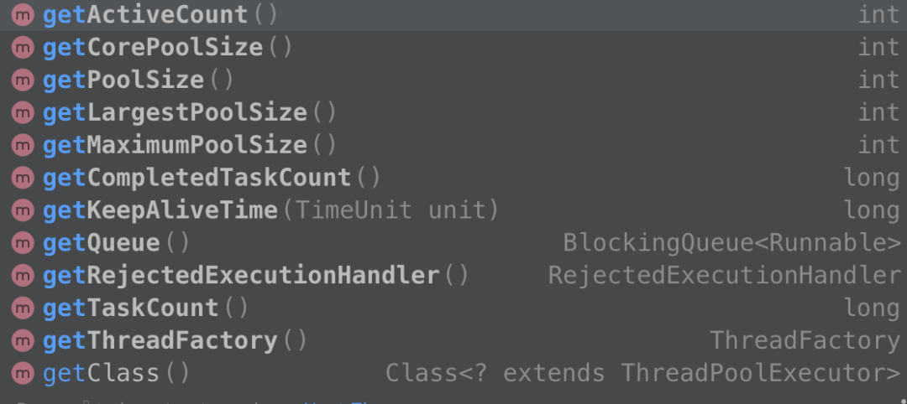

以下是一些关键的 getter 方法及其用途的总结：

**getPoolSize()**：

返回线程池中的当前线程数。这个值表示当前线程池中实际工作的线程数量，可能小于或等于 maximumPoolSize。

**getActiveCount()**：

返回线程池中当前正在执行任务的线程数。这个值反映了线程池的实时活跃度，即当前有多少线程正在忙碌。

**getTaskCount()**：

返回线程池已执行和待执行的任务总数。这个值有助于用户了解线程池的总体工作量。

**getCompletedTaskCount()**：

返回线程池已完成的任务数。这个值提供了已完成工作的数量，可以与 getTaskCount() 一起使用，计算待执行的任务数。

**getLargestPoolSize()**：

返回线程池曾经创建过的最大线程数。这个值有助于用户了解线程池是否曾经接近或超过其配置的最大容量。

**getQueue()**：

返回等待执行的任务队列。虽然返回的是 BlockingQueue 的接口，但通常用户不会直接操作这个队列，而是通过线程池提供的接口来管理任务。不过，在某些情况下，用户可能会检查队列的大小或剩余容量来了解任务积压的情况。

**getRejectedExecutionHandler()**：

返回当前线程池使用的拒绝策略处理器。这允许用户了解在无法执行任务时线程池将采取的行为。

**getCorePoolSize()** 和 **getMaximumPoolSize()**：

分别返回线程池的核心线程数和最大线程数。这两个值定义了线程池的基本大小和扩展能力。

**getKeepAliveTime(TimeUnit unit)**：

返回线程空闲时的存活时间。当线程数超过核心线程数时，多余的空闲线程在终止前会等待新任务的最长时间。

通过这些 getter 方法，用户可以获取线程池的全面信息，包括线程数量、任务数量、队列状态以及配置参数等。

**// 运行时状态实时查看 demo**

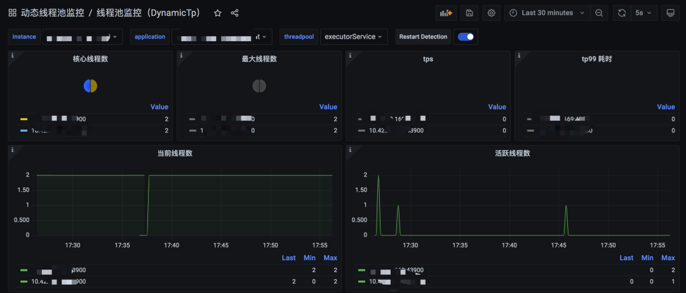

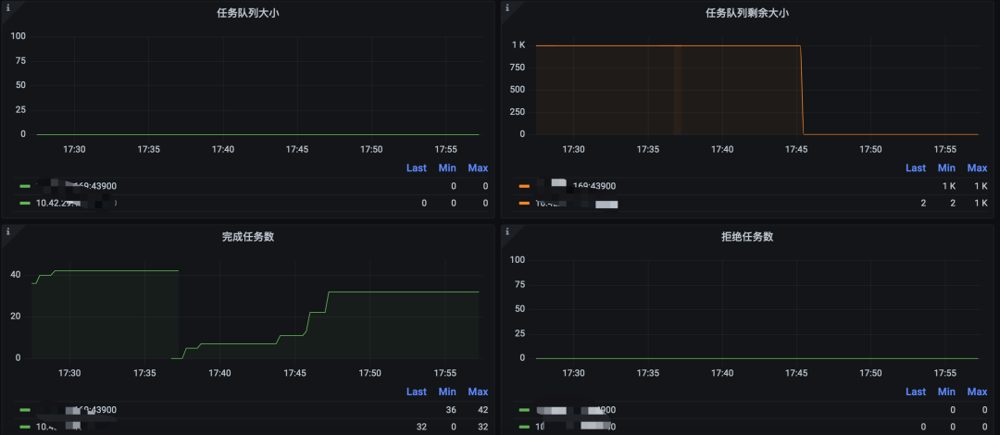

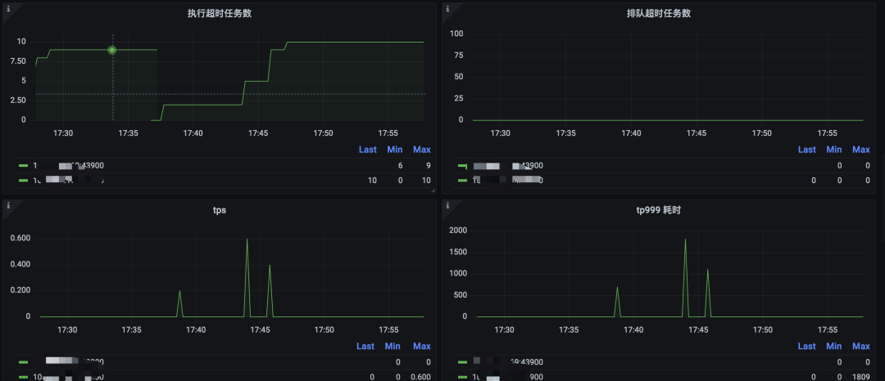

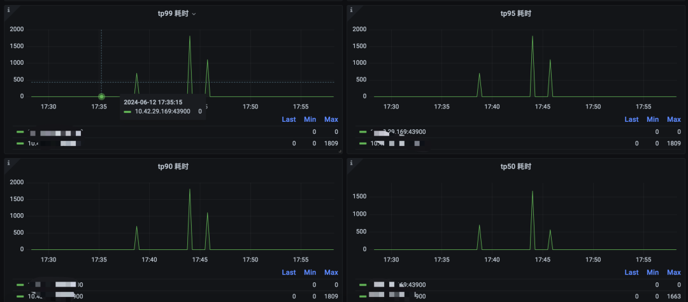

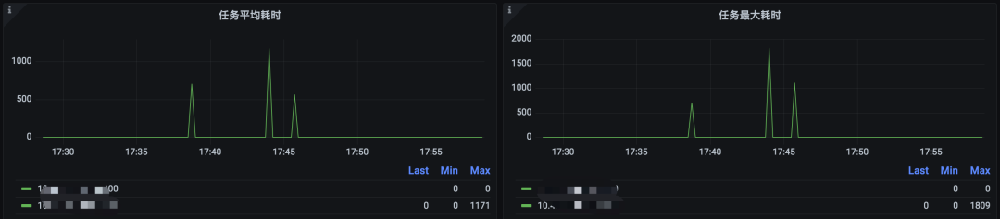

**// 线程池活跃度告警 demo**

活跃度 = (activeCount / maximumPoolSize) * 100 

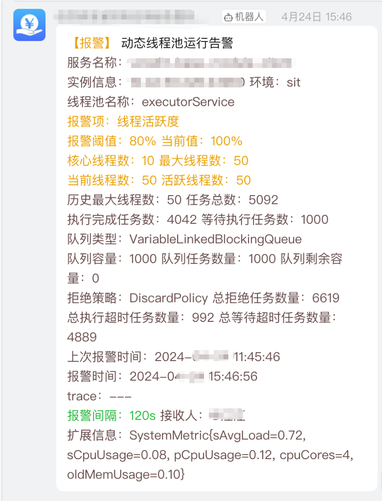

**//****队列容量告警 demo**

容量使用率 = (queueSize / queueCapacity) * 100 

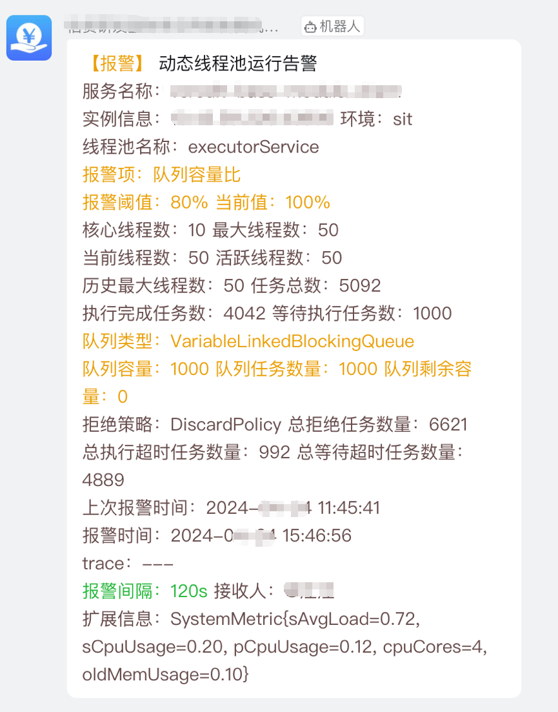

**//****拒绝策略告警 demo**

线程池线程数达到配置的最大线程数，且任务队列已满，再提交任务会触发拒绝策略

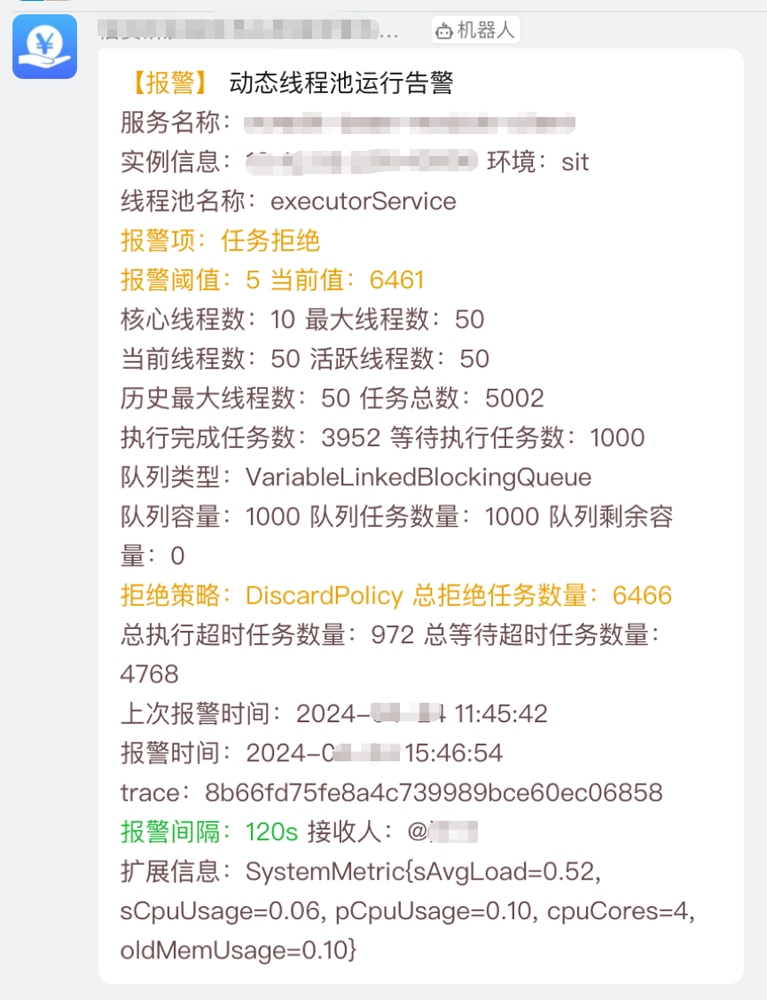

**//****任务排队超时告警 demo**

重写 ThreadPoolExecutor 的 execute() 方法和 beforeExecute() 方法，采用时间轮处理任务排队超时逻辑。

任务提交时用 queueTimeout 开启一个处理排队超时的 TimerTask，排队超时后执行 TimerTask 的 run 方法，累加排队超时任务数量（总数值累加、周期值累加）。且判断如果周期累计值达到配置的阈值， 则会触发一次告警通知（同时重置周期累加值为 0 及上次告警时间为当前时间），告警间隔内多次触发不会发送告警通知。

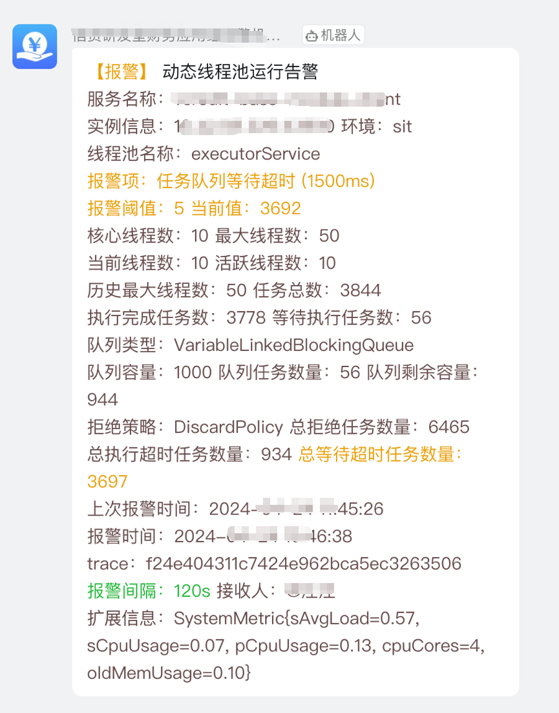

**//****任务执行超时告警 demo**

重写 ThreadPoolExecutor 的 beforeExecute() 和 afterExecute() 方法，采用时间轮处理任务执行超时逻辑。

beforeExecute() 阶段根据 runTimeout 开启一个处理执行超时的 TimerTask，超时后执行 TimerTask 的 run 方法， 累加执行超时任务数量（总数值累加、周期值累加）。且判断如果周期累计值达到配置的阈值，则会触发一次告警通知 （同时重置周期累加值为 0 及上次告警时间为当前时间），告警间隔内多次触发不会发送告警通知。

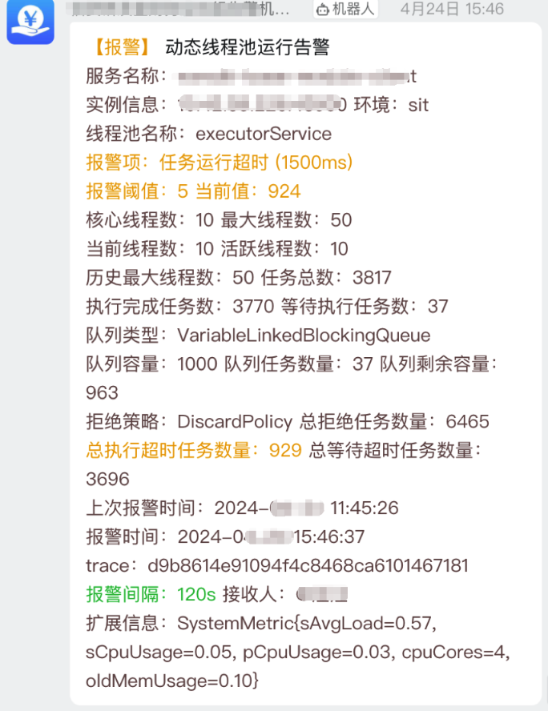

**//****参数变更 demo**

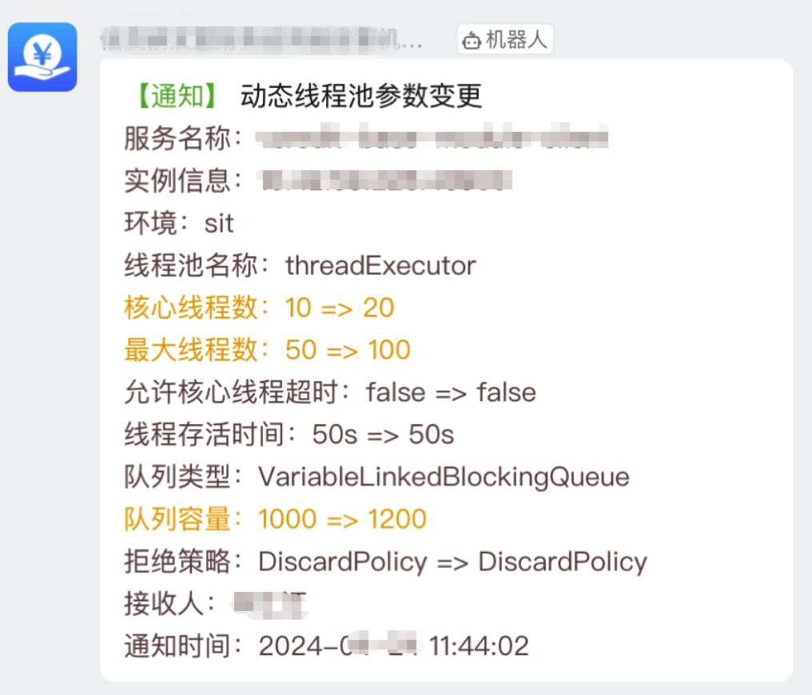

**//****流程图**

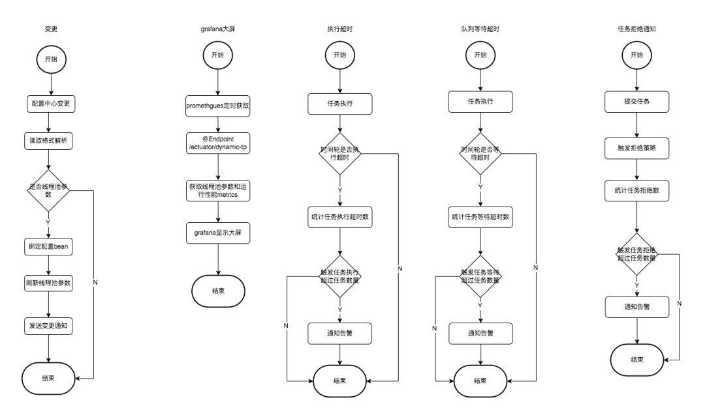

## 四、总结
其实我们是根据 ThreadPoolExecutor 暴露出来的方法进行扩展，加上我们可以统计的数据进行记录然后通知告警，完善监控体系，实现线程池的动态变更和监控告警，其实还有更多的功能需要补充，比如：防治消息爆炸，通知多渠道，后台管理页面，OA 审批权限管理等等。

后续我们会针对使用 ThreadPoolExecutor 组件进行开发，对 okhtttp3，tomcat，rocketMQ，rabbitMQ，grpc 等进行线程池监控。

  
 

> 更新: 2025-04-20 22:38:58  
> 原文: <https://www.yuque.com/aaron-wecc3/dhluml/uaxgnoev98uweb09>