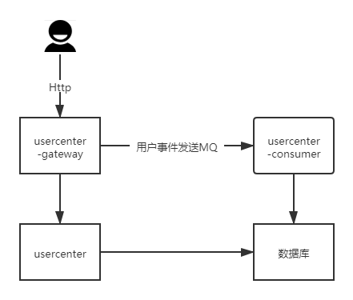
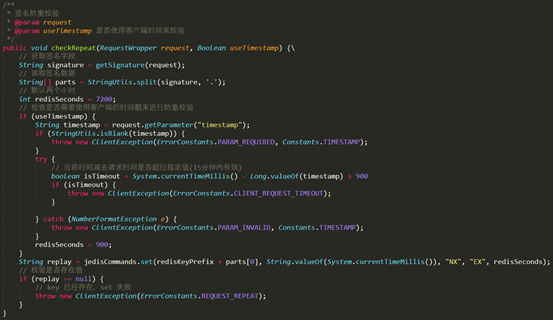
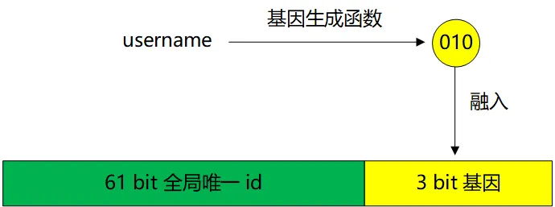
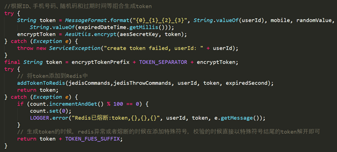

# 62.亿级用户中心的设计与实践

**分享内容**

用户中心是互联网最为基础的核心系统，随着业务和用户的增长，势必会带来不断的挑战。如何在亿级的情况下保证系统的高可用，高性能以及高安全，我们来分享下实践方案。

用户中心，顾名思义就是管理用户的地方，几乎是所有互联网公司最为核心的子系统之一。它的核心功能是登录与注册，主要功能是修改密码、换绑手机号码、获取用户信息、修改用户信息和一些延伸服务，同时还有登录之后生成 Token 以及校验 Token 的功能。下面我们从几个维度来拆解用户中心。

## 一、服务架构
用户中心既需要为用户提供服务，也会承担其他业务的频繁调用；既然需要为用户提供服务，它就会自带一些业务逻辑，比如用户在登录过程中需要风控或短信的校验，那么就会存在不可用的风险。而比如获取用户信息的接口，则没有那么多的依赖，可能只需要调用数据库或者缓存就可以。获取用户信息接口要求稳定，而核心的登录注册接口也需要稳定，但是当我们在接口层面加一些策略或者修改的时候，不希望因为上线问题导致整个服务不可用，而且上线后，需要对整个服务功能做全量的回归，导致资源严重浪费。

因此，基于业务特性，我们可以将用户中心拆成 3 个独立的微服务: 网关服务，核心服务，异步消费者服务。网关服务，提供 http 服务，聚合了各种业务逻辑和服务调用，比如登录时候需要校验的风控或者短信；核心服务，处理简单的业务逻辑以及数据存储，核心服务处在调用链路的终端，几乎不依赖调用其他服务，比如校验 Token 或者获取用户信息，他们就只依赖于 redis 或者数据库；而异步消费者服务，则处理并消费异步消息。

这样的设计之后，当有新功能上线时，核心服务和异步消费服务几乎不需要重新发布，只需要发布网关服务，依赖我们核心服务的第三方非常放心，层级也非常的清晰。当然，这样做的代价就是服务的调用链路变长了。由于涉及到网关和核心服务，就需要发布两个服务，而且要做兼容性测试。

## 二、接口设计
用户中心的接口涉及到用户的核心信息，安全性要求高；同时，承接了较多第三方的调用，可用性要求也高。因此，对用户中心的接口做以下设计：

首先，接口可以拆分为面向 Web 和面向 App 的接口。Web 接口需要做到跨域情况下的单点登录，加密、验签和 token 校验的方式也同 App 端的不一样。

其次，对核心接口做特殊处理。比如登录接口，在逻辑和链路上做了一些优化。为什么要对这些接口做特殊处理呢？假如用户不能登录，用户会非常恐慌，客诉量会立马上来。

那怎么做呢？一方面，我们将用户核心信息表做简单。用户的信息当中会包含 userId、手机号码、密码、头像、昵称等字段，假如把用户的这些所有信息都保存在一张表中，那么这张表将会异常庞大，变更字段变得异常困难。因此，需要将用户表拆分，将核心的信息保存在用户表中，比如 userId、username、手机号码、密码、盐值（随机生成）等；而一些如性别，头像，昵称等信息保存在用户资料表中。

另一方面，我们需要将登录的核心链路做短，短到只依赖于读库。一般情况下，用户登录后，需要记录用户登录信息，调用风控或者短信等服务。对于登录链路来说，任何一个环节出现问题都有可能导致用户无法登录，那么怎么样才能做到最短的链路呢？方法就是依赖的服务可自动降级。比如说反欺诈校验出问题了，那么它自动降级后使用它的默认策略，极端情况下只做密码校验，主库挂了之后还能到从库读取用户信息。

最后就是接口的安全性校验。对 App 接口我们需要做防重放和验签。验签可能大家比较熟悉，但是对防重放这个概念可能相对陌生。防重放，顾名思义就是防止请求重复发送。用户请求在特定时间段内只能请求一次。即使用户请求被攻击者挟持，在一段时间内也无法重复请求。如果攻击者想要篡改用户请求再发送，对不起，请求不会通过。得益于大数据的支持，结合终端，我们还可以把每个用户行为画像存储在系统中（或者调用第三方服务）。用户发起请求后，我们的接口会根据用户画像对用户进行诸如手机号码校验、实名认证、人脸或者活体校验。

## 三、分库分表
随着用户的增长，数据超过了 1 亿，怎么办？常见的办法就是分库分表。我们来分析一下用户中心常见的一些表结构：用户信息表，第三方登录关联表，用户事件表。从上述表中可以看出来，用户相关的数据表增长相对缓慢，因为用户增长是有天花板的。用户事件表的增长是呈指数级增长，因为每个用户登录、变更等密码及变更手机号码等操作是不限次数。

因此，首先我们可以先把用户信息表垂直切分。正如上面说的，将用户 ID、密码、手机号、盐值等常见字段从用户信息表中拆分，其他用户相关的信息用单独一张表。另外，把用户事件表迁移至其他库中。相比于水平切分，垂直切分的代价相对较少，操作起来相对简单。用户核心信息表由于数据量相对较少，即使是亿级别的数据，利用数据库缓存的机制，也能够解决性能问题。

其次，我们可以利用前后台业务的特性采用不同的方式来区别对待。对于用户侧前台访问：用户通过 username/mobile 登录或者通过 uid 来查询用户信息。用户侧信息的访问通常是单条数据的查询，我们可以通过索引多次查询来解决一致性和高可用问题。对于运营侧后台访问：根据年龄、性别、登录时间段、注册时间段等来进行查询，基本上都是批量分页查询。但是由于是内部系统，查询量低，对一致性要求低。如果用户侧和运营侧的查询采用同一个数据库，那么运营侧的排序查询会导致整个库的 CPU 上升，查询效率下降，影响到用户侧。因此，运营侧使用的数据库可以是和用户侧同样的 MySQL 离线库，如果想要增加运营侧的查询效率，可以采用 ES 非关系型数据库。ES 支持分片与复制，方便水平分割和扩展，复制保证了 ES 的高可用与高吞吐，同时能够满足运营侧的查询需求。

最后，如果还是要水平切分来保证系统的性能，那么我们采取什么样的切分方式呢？

常见的方法有**索引表法**和**基因法**。

**索引表法**的思路主要是 UID 能够直接定位到库，但是手机号码或者 username 是无法直接定位到库的，需要建立一个索引表来记录 mobile 与 UID 或者 username 与 UID 的映射关系的方式来解决这个问题。通常这类数据比较少，可以不用分库分表，但是相比直接查询，多了一次数据库查询的同时，在新增数据的时候还多了一次映射关系的插入，事务变大。

索引表属性少，可以容纳非常多数据，一般不需要分库；如果数据量过大，则可以通过username来分库；

索引表法有什么缺点呢？

会增加一次数据库查询，性能会有所下降。

**基因法**的思路是：不是直接用username来生成uid，但从username中抽取“基因”，融入uid中。

假设分8个库，采用 uid%8 路由。潜台词是，uid的最后3个bit决定这条数据落在哪个库上，这3个bit就是所谓的“基因”。

假设我们的uid是64 bit，那么我们可以：

（1）设计一个函数，输入username，得到一个3 bit 的“基因”：X

（2）新用户注册时，首先生成一个61 bit 的全局唯一 id，如上图绿色部分；

（3）拼接 id + X ，得到最终的64位的 uid。

用username来查询时，先通过函数再次计算出“基因”：X，再 X%8 直接定位到库；** **

## 四、Token 之柔性降级
用户登录之后，另一个重要的事情就是 Token 的生成与校验。用户的 Token 分为两类， 一类是 web 端登陆生成的 Token， 这个 Token 可以和 Cookie 结合， 达到单点登陆的效果，在此不细说了。另外一类就是 APP 端登录生成的 Token。用户在我们的 APP 输入用户名密码之后，服务端会对用户的用户名密码进行校验，成功之后从系统配置中心获取加密算法的版本以及秘钥，并按照一定的格式排列用户 ID，手机号、随机码以及过期时间，经过一系列的加密之后，生成了 Token 之后并将其存入 Redis 缓存。而 Token 的校验就是把用户 ID 和 Token 组合并校验是否在 Redis 中存在。那么假如 Redis 不可用了怎么办呢？这里有一个高可用和自动降级的设计。当 Redis 不可用的时候， 服务端会生成一个特殊格式的 Token。当校验 Token 的时候，会对 Token 的格式进行一个判断。

假如判断为 Redis 不可用时生成的 Token，那么服务端会对 Token 进行解密，而 Token 的生成是由用户 ID，手机号、随机码和过期时间等数据按照特定顺序排列并加密而来的， 那么解密出来的数据中也包含了 ID，手机号码，随机码和过期时间。服务端会根据获取到的数据查询数据库， 比对之后告诉用户是否登录成功。由于内存缓存 redis 和数据库缓存性能的差距，在 redis 不可用的情况下，降级有可能会导致数据库无法及时响应，因此需要在降级的方法上加入限流。

## 五、数据安全
数据安全对用户中心来说非常重要。敏感数据需要脱敏处理，对密码更是要做多重的加密处理。应用虽然有自己的安全策略，但如果把黑客限制在登录之前，那应用的安全性将得到大幅度的提升。互联网上用户明文数据遭到泄露的案件屡屡发生，因此各大企业对数据安全的认识也提到了前所未有的高度。而即使使用了 MD5 和 salt 的加密方式，依然可以使用彩虹表的方式来破解。那么用户中心对用户信息是怎么保存的呢？

首先，正如上面提到的用户密码、手机号等登录信息和其他的信息分离，而且在不同的数据库中。其次，对用户设置的密码进行了黑名单校验，只要符合条件的弱密码，都会拒绝提交，因为不管使用了什么加密方式的弱密码，都极其容易破解。为什么呢？因为人的记性很差，大部分人总是最倾向于选择生日，单词等来当密码。6 位纯数字可以生成 100 万个不同的密码，8 位小写字母和数字的组合大概可以生成 2.8 万亿个不同的密码。一个规模为 7.8 万亿的密码库足以覆盖大部分用户的密码，对于不同的加密算法都可以拥有这样一个密码库，这也就是为什么大部分网站都建议用户使用 8 位以上数字加字母密码的原因。当然，如果一方面加了盐值，另一方面对密钥分开保管，破解难度会指数级增加。

最后，可以用 bcrypt/scrypt 的方式来加密。bcrypt 算法是基于 Blowfish 块密钥算法来实现的，bcrypt 内部实现了随机加盐处理，使用 bcrypt 之后每次加密后的密文都不一样，同时还会使用内存初始化 hash 过程。由于使用内存，虽然在 CPU 上运行很快，但是在 GPU 上并行运算并不快。随着新的 FPGA 集成了大型 RAM，解决了内存密集 IO 的问题，但是破解难度依然不小。而 scrypt 算法弥补了 bcrypt 算法的不足，它将 CPU 计算与内存使用开销都指数级提升了。bcrypt 和 scrypt 算法能够有效抵御彩虹表，但是安全性的提升带来了用户登录性能的下降。用户登录注册并不是一个高并发的接口，所以影响并不会特别大。因此在安全和性能方面需要依据业务类型和大小来做平衡，并不是所有的应用都需要使用这种加密方式来保护用户密码。

## 六、异步消费设计
此处的异步消费，就是上面提到的异步消费服务。用户在做完登录注册等操作后，需要记录用户的操作日志。同时，用户注册登录完毕后，下游业务需要对用户增加积分，赠送礼券等奖励操作。这些系统如果都同步依赖于用户中心，那么整个用户中心将异常庞大，链路非常冗长，也不符合业内的 “大系统做小 “的原则。依赖的服务不可用之后将会造成用户无法登录注册。因此，用户中心在用户操作完之后，将用户事件入库后发送至 MQ，第三方业务监听用户事件。用户中心和下游业务解耦，同时用户操作事件入库后，在 MQ 不可用或者消息丢失的时候可做补偿处理。用户的画像数据也在很大程度上来源于此处的数据。

## 七、灵活多样的监控
用户中心涉及到用户的登录注册更改密码等核心功能，能否及时发现系统的问题成为关键指标，因此对业务的监控显得尤为重要。需要对用户中心重要接口的 QPS、机器的内存使用量、垃圾回收的时间、服务的调用时间等做详细的监控。当某个接口的调用量下降的时候，监控会及时发出报警。除了这些监控之外，还有对数据库 Binlog 的写入，前端组件，以及基于 ZipKin 全链路调用时间的监控，实现从用户发起端到结束端的全面监控，哪怕出现一点问题，监控随时会告诉你哪里出问题了。比如运营互动推广注册量下降的时候，用户中心就会发出报警，可以及时通知业务方改正问题，挽回损失。

## 八、总结
从服务架构设计，接口设计，token 降级，数据安全和监控等方面介绍了亿级用户中心的设计，当然用户中心的设计远不止这些，还会包含用户数据的分库分表，熔断限流，第三方登录等，在本次分享中就不一一赘述。尽管设计的用户中心能够满足大部分公司的需求，但是还存在一些比较大的挑战：在鉴权服务增长的情况下，如何平滑的从用户中心剥离；监控的侵入性以及监控的粒度的完善；另外服务的安全性、可用性、性能的提升永远都没有尽头，也是我们孜孜追求的目标。在未来的日子里，希望能够通过大家的努力，使用户中心的技术体系更上一层楼。

> 更新: 2025-04-20 22:38:58  
> 原文: <https://www.yuque.com/aaron-wecc3/dhluml/ptd4gwfindu9os2c>