# 63.小红书性能优化平台落地实践

**分享内容**

随着小红书业务的快速发展，资源消耗和成本压力显著增加。在降本增效的大背景下，我们建设了性能持续优化 & 追踪平台，来系统性辅助业务团队解决性能问题，在业务系统日常的演化过程中，持续跟进、追踪系统的性能退化并推动优化。

目前，这一平台已覆盖小红书搜索、推荐、广告的 S0 服务，运行两个多月以来，辅助业务团队存量优化超 1 万 CPU 核；发现性能退化超 1 万 CPU 核并跟进优化。

## 1.背景
当前，小红书正处在快速发展期间，流量的快速上涨和业务的快速迭代，显著增加了资源消耗和成本压力。

在存量的资源占用上，我们要求研发人员对应用做尽可能深度的性能优化。然而，**研发人员在对自己的模块做性能优化时，往往缺少工具来辅助分析**，工具的合理选择、环境配置、使用方式等各个方面，都有较高的学习成本。

**另一方面，当前性能优化主要依靠个人经验进行逐个分析，缺乏通用化的机制**，经验较难在团队间共享。即使有人发现一个通用的性能问题，也很难衡量其涉及的模块和整体的优化空间。

此外，**小红书业务的日常迭代往往会带来增量的资源消耗，即性能退化。**特别是对于频繁迭代的模块，如一些推荐应用，每天进行发版且每个版本涉及十多次不同的提交。在这些提交中，可能会隐藏着一些性能退化点。显著的性能退化点会在性能压测中被发现，而更多的性能退化往往是微小的，比如一个 commit 带来了整体 CPU 1% 左右的占用，这样微小的退化是隐蔽的，通过常规压测等手段比较难以发现。

随着业务的迭代，日积月累下，多个微小的性能退化会导致应用整体性能的显著恶化，进而积重难返。经过一段时间的积累后，在排查这种问题时，面对动辄上百次的代码提交历史，开发同学很难排查出真正导致性能退化的提交是什么。最终只能以稳定性的名义增加资源扩容，这样的情况多次发生。

针对此，我们尝试从整体上解决性能问题，设计开发了一套性能优化和持续追踪的平台，来辅助应用研发人员分析性能问题，同时在日常的业务系统演化过程中，持续跟进、追踪系统的性能退化并推动优化。

## 2.思路
我们的目标是从整体上解决性能问题。

_**问题主要聚焦在以下三个方面：**_

**存量性能优化：**对应用进行全方位的深入分析、诊断、优化；优化的经验积累后，横向扩展，做到通用的优化

**增量性能退化拦截：**业务迭代过程中，主动发现应用的增量资源占用，即性能退化

**性能稳定性问题：**对一些突发的性能恶化导致的稳定性问题，快速定位原因

_**对应的总体技术思路：**_

**分析手段：**基于 profiling 等采样手段，来对应用进行剖析

**产品化：**做到平台化来提高易用性，研发人员可以尽可能低门槛、高效的使用；

**持续优化：**在机制上做到持续优化，将采样分析做到常态化、例行化，将性能优化、分析、防退化，融入到业务应用的日常迭代中，关注应用的每一个版本、每一次代码提交、每一个策略实验进行，持续追踪业务应用的性能表现。

## 3.整体方案
我们的内部落地整体架构如下：

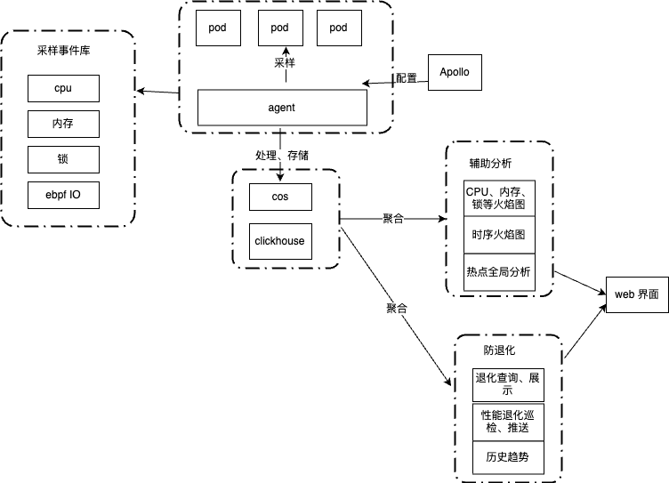

**核心思路是通过对业务进程进行持续性的采样、处理、存储，并基于采样数据做分析，来辅助性能优化和发现性能退化。**

数据采样上，我们用单机低频次持续采样，降低成本，减少对应用的影响。

在分析上，数据来自大数据存储，并从纵向、横向来对比分析：在纵向上，采用 merge + diff 分析，来发现退化点；在横向上，提供跨应用的通用查询能力，查询、分析函数粒度的资源占用。

### 3.1 数据采集、处理、存储
#### 3.1.1. 数据采集
当前主要的数据采集方式是通过对进程进行 profiling，profiling 的原理是基于一定的频率对运行进程进行采样，来了解进程的特征。当前，profiling 支持从多个方面对程序进行采样分析，如 CPU、Memory、Thread、Lock、I/O 等。日常使用中，对 CPU 进行 profiling 的应用最为广泛。

一般的 CPU profiling 是 On-CPU，也就是 CPU 时间花费在哪些代码执行上。在 On-CPU 之外，还有 Off-CPU，指的是进程不在 CPU 上运行的时间，比如进程因为 IO、锁等原因处于等待，花费了时间。所以，Off-CPU 是对 On-CPU 的补充，整体关系如下：

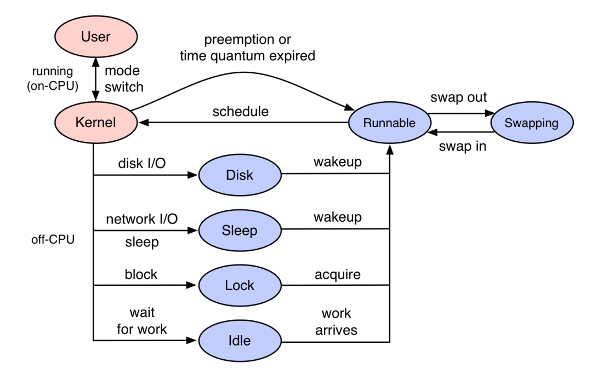

根据应用的实际情况，综合的对 On-CPU、Off-CPU 进行采样，更为全面地了解程序的运行情况。

在多语言支持方面，当前我们支持 C++、JAVA、Golang 等主流语言：

**C++ 应用：**通过 Linux perf

**JAVA 应用：**目前主流方案（如 IntelliJ IDEA 和阿里的 Arthas）是通过 Async-profiler 来实现 profiling。Async-profiler 是将 Perf 的堆栈追踪和 JDK 提供的 AsyncGetCallTrace 结合了起来，低开销的支持多种 Perf event。我们的方案里也借助了这个工具，并针对我们的需求进一步做了定制开发

**Golang 应用：**通过 Golang 内置的 pprof

在采样形式上，我们支持定时、主动和条件触发三大形式。当前，小红书的线上应用基本开启了常态化、定时的 profiling

#### 3.1.2 业务接入
采样的 agent 以 daemonset 方式部署，支持对物理机上的多个业务 pod 进行采样。对应用的采样开启、关闭是通过配置中心来下发。此外，支持更多的采样配置，如：单次采样的采样频率、采样时间配置；多次采样之间的采样周期；采样方式切换等。

因此，我们当前做到了业务无感知接入，接入在分钟级别生效。

#### 3.1.3 存储
在采样结束后，对采样后的数据进行解析、处理，如根据函数调用链统计 sample 数、过滤占比过低的函数调用链等。处理后，我们将数据进行存储，用于后续的分析。我们的存储方案选择的是 clickhouse，在存储 profiling 的数据之外，同时会把相关的环境变量信息一起存储，如应用名、应用版本、机房等。此外，采样后生成单 Pod 的火焰图，将火焰图压缩并保存在对象存储中，如腾讯云 cos。

#### 3.1.4 资源消耗
在成本上，单次采样的持续时间一般不超过一分钟，多次采样之间的周期间隔是小时级别，因此对应用程序基本没有影响；单次 pod 单次采样，经处理并保存到 clickhouse 的数据在千行的规模。所以整体的项目成本基本是存储成本，即 clickhouse 和对象存储，都很便宜，整体近乎零成本。

### 3.2 存量优化
#### 3.2.1 目标
根据我们的观察和经验，一线研发同学对生产服务的诊断分析诉求长期是被压制的，主要原因在：

**·****公司出于安全需要，会对生产环境的网络和权限进行管控。**

这导致一些诊断会非常麻烦，例如，小红书有一些系统采用了超大 Java Heap，如果要对此应用做堆分析需要的步骤：

1. dump 堆到本机指定为止；
2. 传输 hprof 文件到指定跳板机；
3. 从跳板机下载 hprof 文件到本地；
4. 本地需要花数小时对 hprof 文件建索引，对于几十 GB 的堆，本地往往由于机器性能不够，最终可能还是无法完成分析； 

**·****通过一些诊断工具，我们可以观测到很多系统运行指标，但对指标的解读往往需要很多经验和对业务的理解。**

如运行 free 命令，我们可以得到系统的内存使用指标（free/buffer/cache）。然而这些指标到底意味着什么？对一个特定的应用，当前水位是否合理？这对使用者是有较高的基础和业务背景知识要求。

由于这些限制和不便，使得我们一线资深研发同学日常对性能的关注逐渐变少，而一些新同学更是望而却步。最终系统由于缺乏 “体检”，既不能治于未病；又因缺乏对系统的足够认知，导致需要治疗时又无从下手。

为此，我们设定了一个小目标：把诊断变成一个日常触手可及的事：

**·****开箱即用：**

我们将一些常用的工具打包成一个工具箱，一键（或默认）安装到目标容器里；

**·****白屏化：**

所有操作都在网页上通过点击拖拽完成，研发同学不需要记住很多命令参数，同时对工具的输出做解析和解释；

**·****知识库：**

纵向上，我们会积累历史指标供参考。横向上，我们会总结一些共性的优化点供研发同学参考。

#### 3.2.2 工具
##### 3.2.2.1 基础信息展示
这部分主要展示一些进程和环境相关的基础信息，OS、JVM、机器配置、启动参数、环境变量等。方便用户迅速了解一些应用的基本信息。

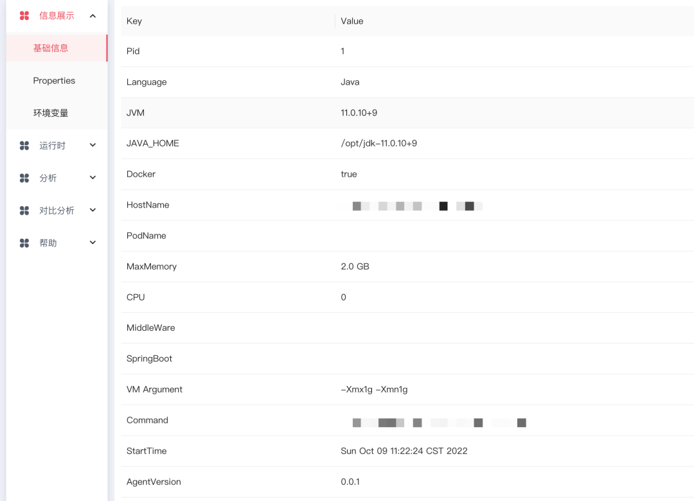

##### 3.2.2.2 运行时指标
这块主要涵盖一些秒级运行时的 Metrics（如 CPU 利用率，GC 信息），loaded class，线程池状态等。这块作为大盘指标的补充，在 agent 测内嵌了一个小型的时序数据库，直接在端上存储几个重要的秒级指标。帮助用户捕捉一些更细粒度的信号。

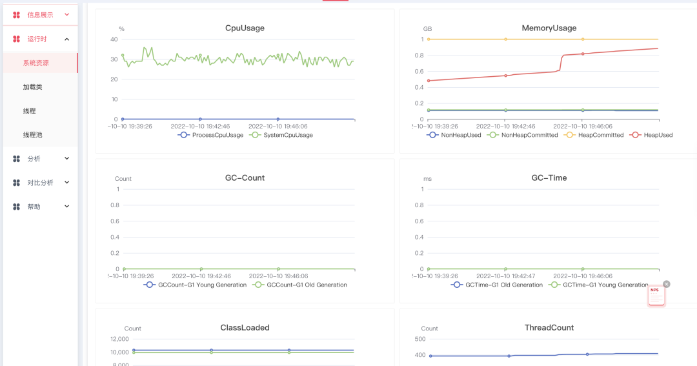

##### 3.2.2.3 采样 & 分析
目前我们主要提供了针对 Java 的一些在线分析能力。对于 Java 程序，目前使用频率最高的是堆分析，用户可以在平台上一键触发 Heap dump，dump 文件生成后会自动上传到内部部署的 apache-jifa worker 上，用户可以在列表里面找到对应的入口，跳转到 jifa 页面去做详细的堆分析。

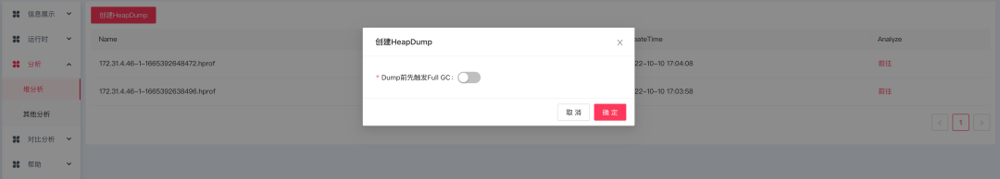

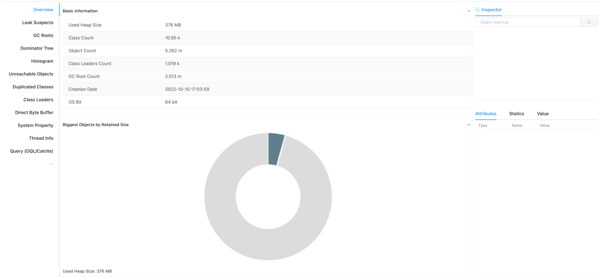

同时，基于 profiling 工具，如 async-profler，用户可以一键生成 cpu、alloc 及 lock 的火焰图，并在线展示。通过这些火焰图，能很方便找到系统的一些热点，从而有针对性的去优化。

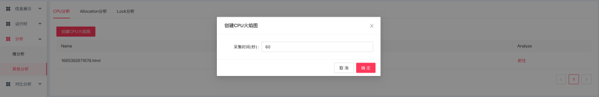

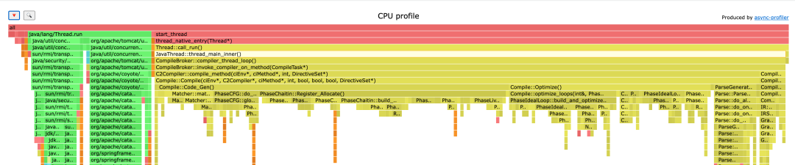

#### 3.2.3 通用优化机制
在存量优化方面，我们的一个创新点就是通用优化机制。在对各应用进行常态化的 profiling 后，我们有了所有应用的性能原始数据，进一步的想法就是大数据检索：经过众多的性能优化 case 后，将常见的基础库和已知的通用性能问题抽象成规则库，从而可以匹配其在线上所有模块的消耗占比和整体占用核数，来发现更多优化空间，达到批量优化并且追踪优化的效果。

下图所示，为线上一个基础库 SDK 在各个应用中的资源消耗情况，分别统计了 CPU 占比和对应的核数。在此基础上，批量的推动应用进行优化。

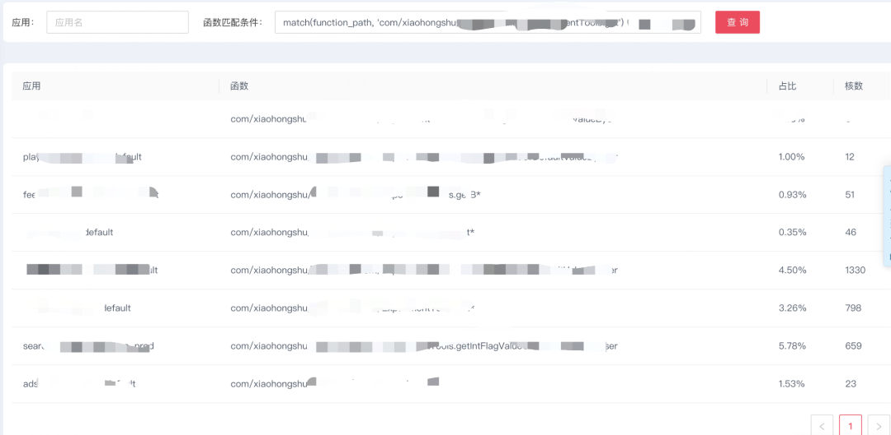

### 3.3 性能持续优化
#### 3.3.1 总体思路
针对业务迭代过程中发生的性能退化，持续跟进、追踪。

总体的思路是：首先是发现性能退化点，精确到函数级别；并进一步关联、发现对应的变更事件 (代码提交、算法实验等)；后续跟进整个性能退化的生命周期，推动优化，直到最终解决性能退化。

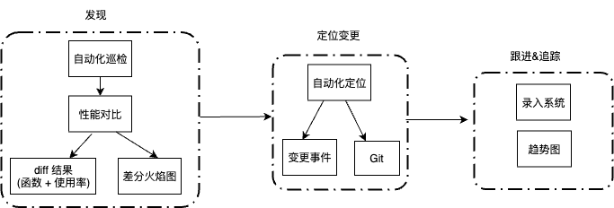

#### 3.3.2 发现
##### 3.3.2.1 机制
首先是自动化巡检，即每天会定期检查接入的服务是否存在潜在性能退化，通过昨天和前天晚高峰性能数据，检查各应用是否有性能退化情况，并推送到相关企微群。

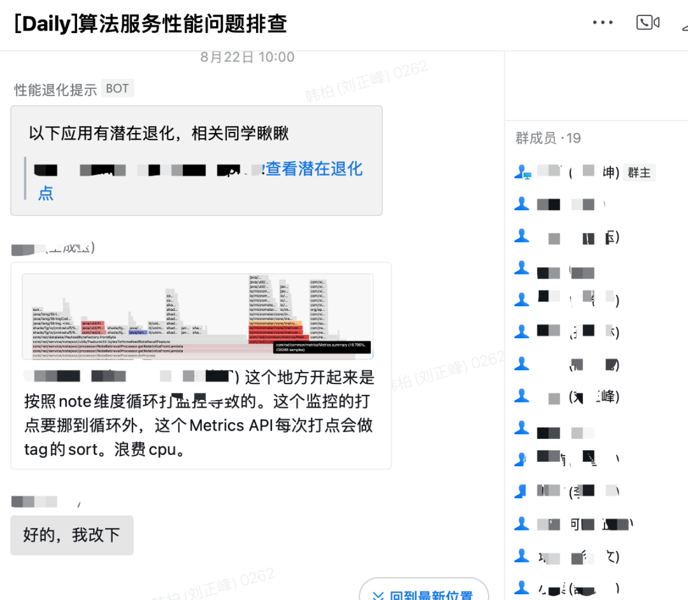

此外，通过接入 QA 流水线、上线平台等方式，在上线前、上线后回调，更早期拦截性能退化。

##### 3.3.2.2 发现方式
通过性能数据 merge + diff 分析：根据查询条件，在将新版本和基准版本分别进行数据聚合后，进行对比；通过分析对比后的 diff，发现异常变化点并判断是否有性能退（精确到函数）。当前支持机房、版本和时间区间等多种条件。

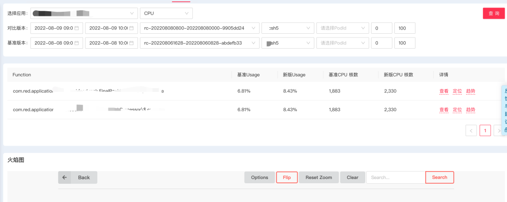

此外，为了衡量性能退化点的影响，将退化的程度与对应占用的 CPU 核数相关联，也可以让研发人员们了解对应退化点对于系统整体性能的影响，有更直观的感受。

##### 3.3.2.3. 退化点展示
火焰图是一种比较理想的展示函数调用关系的形式，同时也可以方便的定位其在整体中的位置。因此，我们通过定制化的差分火焰图，展示退化点对应的详细函数栈情况，并用颜色来标记、突出性能退化点，用不同的颜色来区分退化的程度；同时在火焰图上展示对应的 CPU 核数，来强化退化程度，增加火焰图的表达内容。

此外，为了支持版本间消失的代码逻辑，使用了消失火焰图。这样，组合起来，可以展示两个版本之间函数栈的新增、修改、消失等场景。

在技术实现上，我们在开源的 flamescope（[https://github.com/Netflix/flamescope](https://github.com/Netflix/flamescope)）基础上定制开发，进行实时进行处理和渲染，根据需求可以灵活的支持各种应用场景。所有的火焰图和 diff 计算均从 clickhouse 中读取数据处理。

线上的一个实际性能退化例子如下，其中差分火焰图中展示了退化点对应的函数调用、退化对应的 CPU 核数；消失火焰图展示了版本之间消失的代码逻辑。

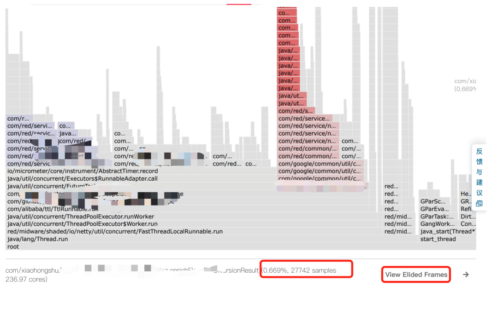

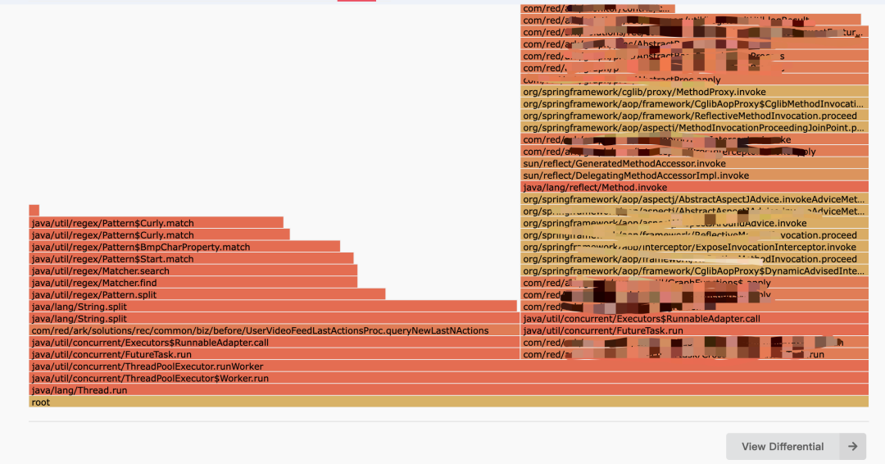

#### 3.3.3 定位变更
在确定性能退化后，根据性能退化的情况（如退化的时间点、函数栈），检索应用对应的变更事件，如算法实验变更、配置中心下发变更、上线记录等。未来，会进一步尝试根据函数栈来管理 git 的提交情况，关联可能代码提交。

#### 3.3.4 持续追踪
为了方便追踪性能退化问题的进度，我们会把核实过的信息推送至内部风险平台来录入留痕，并且通过趋势图追踪优化情况。

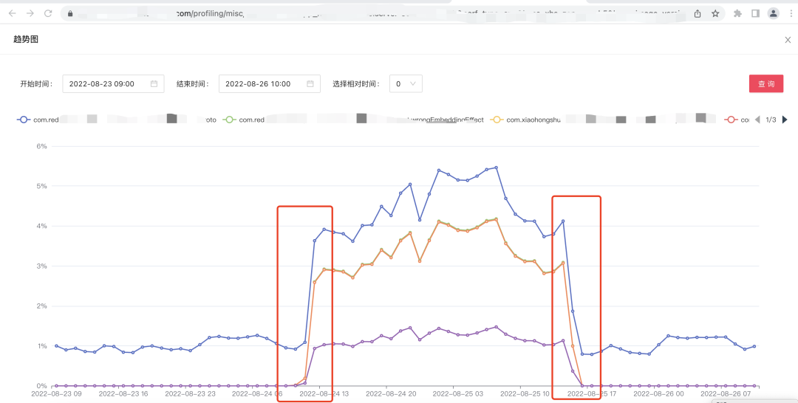

如上图所示，这是一个线上应用性能退化的实际 case，通过函数调用链的 CPU 使用率趋势图可以看出性能退化发生的起始点，同时可以看出该性能退化是否得到了修复、何时修复，这样可以清晰的看到性能退化问题的过程，方便持续追踪性能问题。

### 3.4 性能异常问题定位
在采样的方式上，支持条件触发方式，即配置描述异常态的触发条件 (比如 CPU 突涨等)，当满足条件时进行数据的采集和上报。再基于上述的 merge + diff 数据分析方法，将异常态和正常态的数据分别进行汇聚后，做对比分析，通过 diff 分析来定位出导致突涨的根因，同时关联对应的变更。

## 3.总结
性能优化手段有很多，我们都可以探索，如 PGO；以及基于 PMU 指标，探索 **“内存大页” 等技术落地**；同时，我们也希望能够收集**更多的性能指标**，如 walltime、cpu cache、mem bindwith 等，来覆盖更多的性能分析场景。

  
 

> 更新: 2025-04-20 22:38:58  
> 原文: <https://www.yuque.com/aaron-wecc3/dhluml/mtcgdgxgzwmb3ge3>