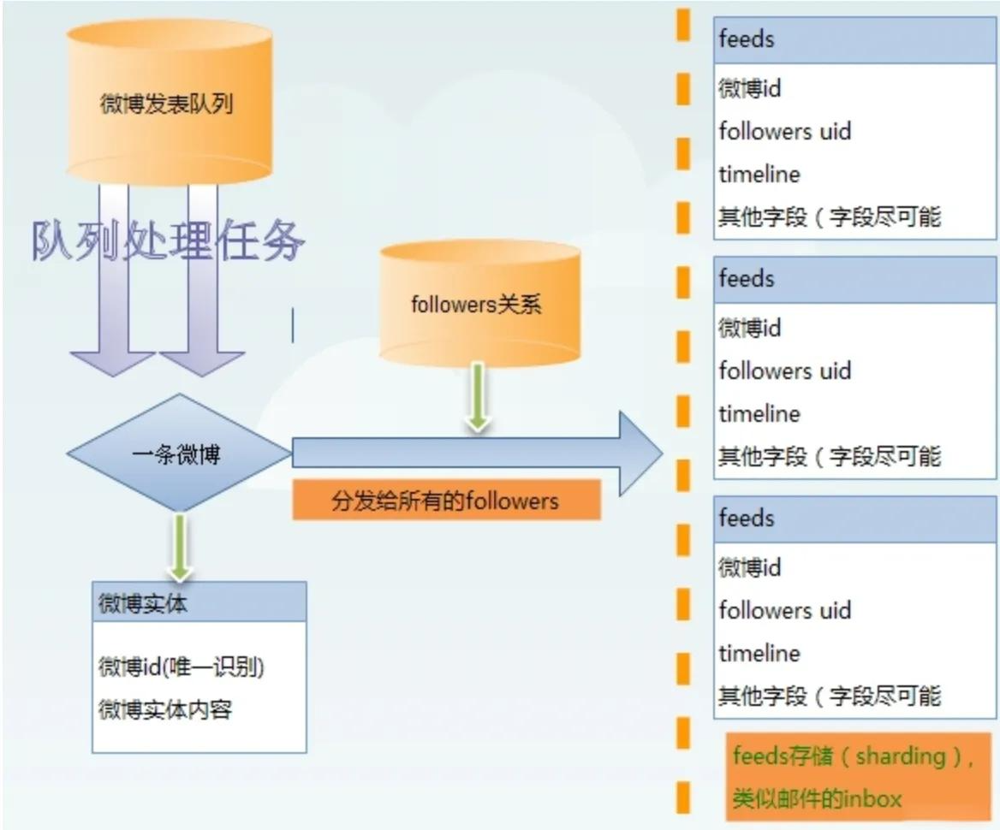
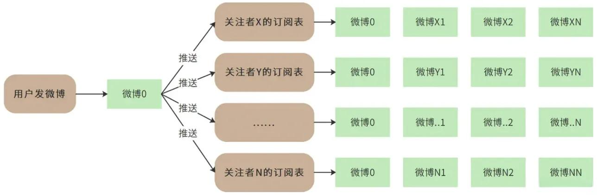
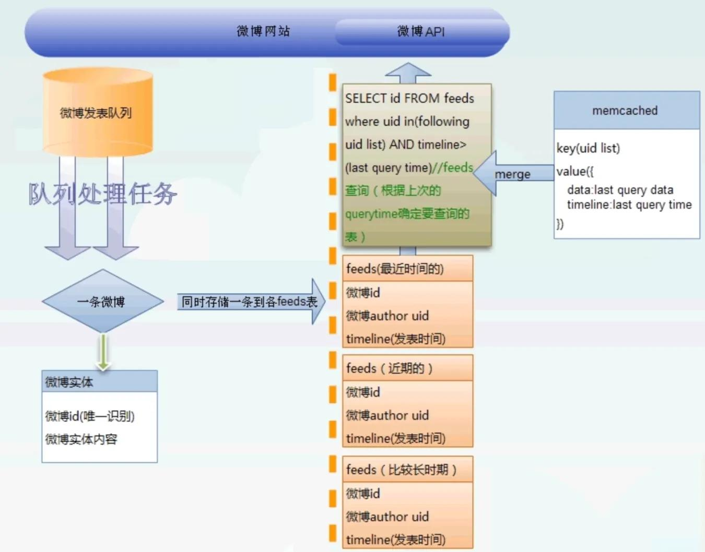
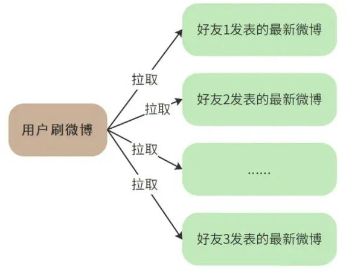
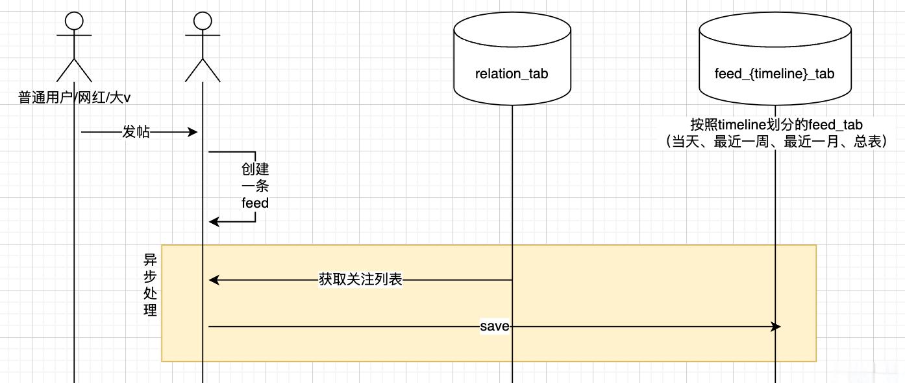
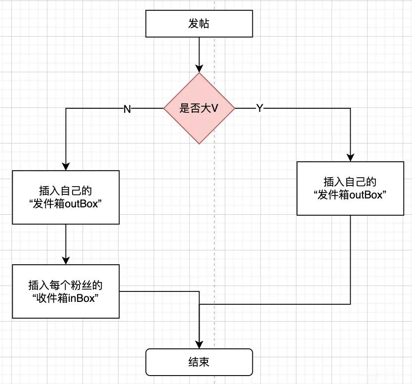

# 64.微博亿级Feed流系统设计

**<font style="color:rgb(51, 51, 51);">分享内容</font>**

1. <font style="color:rgb(51, 51, 51);">Feed流业务场景</font>
2. <font style="color:rgb(51, 51, 51);">Feed流推拉模式</font>
3. <font style="color:rgb(51, 51, 51);">Feed流数据排序方式</font>
4. <font style="color:rgb(51, 51, 51);">Feed流数据结构和存储</font>
5. <font style="color:rgb(51, 51, 51);">怎么解决大V发帖数据量大问题</font>

## <font style="color:rgb(51, 51, 51);">简介</font>
### <font style="color:rgb(51, 51, 51);">概念</font>
<font style="color:rgb(51, 51, 51);">Feed + 流（Feed 流将用户主动订阅的若干消息源组合在一起，形成</font>[<font style="color:rgb(51, 51, 51);">内容聚合</font>](https://so.csdn.net/so/search?q=%E5%86%85%E5%AE%B9%E8%81%9A%E5%90%88&spm=1001.2101.3001.7020)<font style="color:rgb(51, 51, 51);">器，帮助用户持续的获取最新的订阅内容，Feed 流即持续更新并呈现给用户内容的信息流）</font>

<font style="color:rgb(51, 51, 51);">Feed：投喂</font>

<font style="color:rgb(51, 51, 51);">流：给用户呈现信息的形式       </font>

### <font style="color:rgb(51, 51, 51);">场景</font>
<font style="color:rgb(51, 51, 51);">① 社交互动类：微信、微博、Instagram、Facebook ...</font>

<font style="color:rgb(51, 51, 51);">② </font>[<font style="color:rgb(51, 51, 51);">新闻资讯</font>](https://so.csdn.net/so/search?q=%E6%96%B0%E9%97%BB%E8%B5%84%E8%AE%AF&spm=1001.2101.3001.7020)<font style="color:rgb(51, 51, 51);">类：今日头条、腾讯新闻 ...</font>

<font style="color:rgb(51, 51, 51);">③ 视频直播类：抖音、快手 ...</font>

### <font style="color:rgb(51, 51, 51);">主要模式</font>
1. <font style="color:rgb(51, 51, 51);">推模式：用户发帖，对所有粉丝推送该消息（不适合大 V）</font>
2. <font style="color:rgb(51, 51, 51);">拉模式：主动拉取用户所有关注这的最近动态列表（不适合关注了很多用户的用户）</font>
3. <font style="color:rgb(51, 51, 51);">推拉模式结合</font>

### <font style="color:rgb(51, 51, 51);">排序方式</font>
1. <font style="color:rgb(51, 51, 51);">TimeLine 排序：按照发布时间顺序排序，先发布的先看到，后发布的排列在最顶端，类似于微信朋友圈（产品如果选择 Timeline 类型，那么就是认为 Feed 流中的 Feed 不多，但是每个 Feed 都很重要，都需要用户看到）</font>
2. <font style="color:rgb(51, 51, 51);">Rank 排序：按照非时间的因子排序，一般按照用户的喜爱好度排序（这种一般假定用户可能看到的 Feed 非常多，而用户花费在这里的时间有限，那么就为用户选择出用户最想看的 Top N 结果，场景的应用场景有微博、头条新闻推荐类、商品、视频推荐等）</font>
3. <font style="color:rgb(51, 51, 51);">智能排序：基于趋势 trending、热门 hot、编辑推荐 PGC 等因素综合考虑</font>

## <font style="color:rgb(51, 51, 51);">Feed流系统设计</font>
### <font style="color:rgb(51, 51, 51);">业务特点</font>
<font style="color:rgb(51, 51, 51);">海量数据、高访问量、非均匀</font>

1. <font style="color:rgb(51, 51, 51);">海量用户数据：亿级别的用户数量，每个用户千级别的帖子数量，平均千级别的 follower/attention 数量</font>
2. <font style="color:rgb(51, 51, 51);">高访问量：每秒十万量级的访问页面，每秒万量级别的帖子发布</font>
3. <font style="color:rgb(51, 51, 51);">用户分布非均匀：部分用户的帖子数量 / follower 数量，相关页面访问数量会超出其他用户几十个数量级</font>
4. <font style="color:rgb(51, 51, 51);">时间分布非均匀：某个用户在某个时间点成为热点用户，其 follower 可能徒增数个量级</font>

### <font style="color:rgb(51, 51, 51);">核心问题 1：“关注模型” 的存储</font>
<font style="color:rgb(51, 51, 51);">最简单的是基于 DB 的存储，只需要两张表 relation_tab \ user_info_tab</font>

**<font style="color:rgb(51, 51, 51);">user_info_tab 用户信息表</font>**<font style="color:rgb(51, 51, 51);">：自增 id、用户账号 user_id、用户信息（头像、名称、注册时间、大 v 认证、手机号等）</font>

**<font style="color:rgb(51, 51, 51);">relation_tab 关系表</font>**<font style="color:rgb(51, 51, 51);">：自增 id、关注者 id、被关注者 id</font>

<font style="color:rgb(51, 51, 51);">==> 所以，只需要查询 2 张表就可以查询出关注、粉丝、用户信息</font>

```sql
// 查询所有“关注者”关注的人
select count(*) from relation_tab where 关注者id='xx'
// 查询“被关注者”所有的粉丝
select count(*) from relation_tab where 被关注者id='xx'
// 根据用户账号，查询user_info
select * from user_info_tab where user_id='xx'
```

<font style="color:rgb(51, 51, 51);">随着用户的增多，relation_tab \ user_info_tab 表的行数增多。千万、亿级用户，每个用户相关关系百级，那么就需要水平拆分。</font>

**<font style="color:rgb(51, 51, 51);">user_info_tab 用户信息表</font>**<font style="color:rgb(51, 51, 51);">拆分规则：水平拆分</font>

1. <font style="color:rgb(51, 51, 51);">上亿的数据量，拆分成 10~20 张表，每张表保存约 500~1000 万个用户：表名 user_info</font>_<font style="color:rgb(51, 51, 51);">{idx}</font>_<font style="color:rgb(51, 51, 51);">tab</font>

<font style="color:rgb(51, 51, 51);">照 user_id，hash 取模，得到 idx，数据存放在 user_info</font>_<font style="color:rgb(51, 51, 51);">{idx}</font>_<font style="color:rgb(51, 51, 51);">tab</font>

**<font style="color:rgb(51, 51, 51);">relation_tab 关系表</font>**<font style="color:rgb(51, 51, 51);">拆分规则：垂直拆分 + 水平拆分</font>

<font style="color:rgb(51, 51, 51);">根据 2 种</font>[<font style="color:rgb(51, 51, 51);">业务场景</font>](https://edu.csdn.net/cloud/pm_summit?utm_source=blogglc&spm=1001.2101.3001.7020)<font style="color:rgb(51, 51, 51);">进行水平拆分</font>

1. <font style="color:rgb(51, 51, 51);">根据 follower 进行水平拆分：查询 follower 关注的列表很简单，但是查询 follower 的粉丝很难</font>
2. <font style="color:rgb(51, 51, 51);">根据 attention 进行水平拆分：查询 attention 的粉丝列表很简单，但是查询 attention 关注的人很难</font>

<font style="color:rgb(51, 51, 51);">针对上述问题，进行垂直拆分，</font>

1. <font style="color:rgb(51, 51, 51);">分为 follower 表和 attention 表，分别记录了某个用户的关注者和被关注者。表字段</font>
+ <font style="color:rgb(51, 51, 51);">follower 表：自增 id、user_id、follower_id</font>
+ <font style="color:rgb(77, 77, 77);">attention</font><font style="color:rgb(51, 51, 51);">表：自增 id、user_id、attention_id</font>
2. <font style="color:rgb(51, 51, 51);">接下来对 follower 表和 attention 表分别基于 user_id 进行水平拆分</font>

<font style="color:rgb(51, 51, 51);">==> 此时，实现查询 user_id 的关注列表、粉丝列表的 user_info</font>

```sql
// 查询user_id关注列表、粉丝列表
select count(*) from follower_{idx}_tab where user_id='xx'
select count(*) from attention_{idx}_tab where user_id='xx'
// 查询用户信息
select * from user_info_{idx}_tab where user_id In ('xx', 'yy', ...)
```

<font style="color:rgb(51, 51, 51);">分析：前 2 步可以落在相同的 mysql 分片上，执行 DB 操作次数为 2 次，但是第 3 步仍然需要查询多个 table（因为用户信息散落在不同的 user_info</font>_<font style="color:rgb(51, 51, 51);">{idx}</font>_<font style="color:rgb(51, 51, 51);">tab 表中，所以需要遍历各个分片查询）</font>

<font style="color:rgb(51, 51, 51);">优化：将 user_info</font>_<font style="color:rgb(51, 51, 51);">{idx}</font>_<font style="color:rgb(51, 51, 51);">tab 表中的用户基本信息，全部加载到 Redis 缓存中。除此之外，可以将① 每个 user_id 的粉丝数和关注数，也存在用户信息中。</font>

<font style="color:rgb(51, 51, 51);">②每个用户关注数量有上限，所以也可以将该用户关注列表存在 Redis 的 list 结构中。</font>

<font style="color:rgb(51, 51, 51);">③但是用户的粉丝列表不可以全部存储在 Redis 的 list 中，会出现大 key 问题（根据业务场景分析，可以保存用户最近新增的 100 个粉丝列表，即将新增的用户放在 list 的最后面）。</font>

### <font style="color:rgb(51, 51, 51);">核心问题 2：帖子（post）的设计实现与优化</font>
<font style="color:rgb(51, 51, 51);">一般存储帖子，通常都是在 MySQL 中进行存储，数据库字段：post_id、user_id、content、post_time，其中</font>

<font style="color:rgb(51, 51, 51);">post_id：帖子 id</font>

<font style="color:rgb(51, 51, 51);">user_id：发帖人</font>

<font style="color:rgb(51, 51, 51);">content：发帖内容</font>

<font style="color:rgb(51, 51, 51);">post_time：发帖时间，精确到秒（同一个用户在 1s 之内发送的帖子数通常不多余 1 条）</font>

<font style="color:rgb(51, 51, 51);">索引：对 user_id+post_time 建立联合级索引 ==> 查询某个用户按照时间排列的所有帖子</font>

```sql
// 查询某个用户在post_time时间段内发的帖子
select * from post_tab where user_id=? and post_time between ? and ?
// 查询某个帖子
select * from post_tab where post_id=?
```

### <font style="color:rgb(51, 51, 51);">核心问题 3：大 V 发帖了，应该如何设计？</font>
<font style="color:rgb(51, 51, 51);">业务场景：在微博平台，用户可以对喜欢的人进行关注，关注了之后，这些人发帖子了，用户就会看到，按照时间进行排序和分页。</font>

<font style="color:rgb(51, 51, 51);">核心问题：用户关注好友后，如何快速得到所有好友的最新发表的微博内容，即发表 / 订阅问题，是微博的核心业务问题！</font>


<font style="color:rgb(51, 51, 51);">简介：每个用户都有一个 “收件箱 inBox” 和“发件箱 outBox”</font>

1. <font style="color:rgb(51, 51, 51);">用户刷微博时，查看自己的 “收件箱 inBox”</font>
2. <font style="color:rgb(51, 51, 51);">用户发微博时，将邮件插入到 “发件箱 outBox”</font>

#### <font style="color:rgb(51, 51, 51);">方式 1：push 模式（推模式是在用户发微博的时候推送给所有的粉丝 / 关注者）</font>
**<font style="color:rgb(51, 51, 51);">业务场景</font>**

1. <font style="color:rgb(51, 51, 51);">用户发表的内容插入到所有粉丝的 “收件箱 inBox” 里，粉丝拉取关注流从自己的 “收件箱 inBox” 里拉取</font>
2. <font style="color:rgb(51, 51, 51);">用户户撤销发表，从每个粉丝的 “收件箱 inBox” 里删除掉</font>
3. <font style="color:rgb(51, 51, 51);">新粉丝新关注了此用户，将该用户的发表内容插入到新粉丝的 “收件箱 inBox” 里</font>
4. <font style="color:rgb(51, 51, 51);">粉丝取消关注了此用户，将该用户的有关内容，从该粉丝的 “收件箱 inBox” 里删除</font>





**<font style="color:rgb(51, 51, 51);">push 模式过程</font>**<font style="color:rgb(51, 51, 51);">：推模式需要把一篇微博推送给所有关注他的人（推给所有的粉丝</font>

<font style="color:rgb(51, 51, 51);">① 用户发微博后，push 模式，会将该微博推送给所有的粉丝，即在每个粉丝的 “收件箱 inBox” 中插入一条帖子记录</font>

<font style="color:rgb(51, 51, 51);">② 每当用户刷新微博时，只需要从收件箱 inBox 中，查询所有订阅的微博</font>

**<font style="color:rgb(51, 51, 51);">分析</font>**

<font style="color:rgb(51, 51, 51);">优点：消除了拉模式的 IO 集中点，每个用户都读自己的数据，高并发下锁竞争少</font>

<font style="color:rgb(51, 51, 51);">缺点：</font>

1. <font style="color:rgb(51, 51, 51);">（写放大）极大消耗存储资源，数据会存储很多分，比如大 V 的粉丝有一百万，他每次发表一次，数据会冗余一百万份，同时，插入到一百万的粉丝的</font>[<font style="color:rgb(51, 51, 51);">队列</font>](https://edu.csdn.net/course/detail/40020?utm_source=glcblog&spm=1001.2101.3001.7020)<font style="color:rgb(51, 51, 51);">中也比较费时。 ==> 拥有千万粉丝的网红 / 大 V 发帖，会导致上千万次数据库的插入操作，直接导致系统崩溃</font>
2. <font style="color:rgb(51, 51, 51);">新增关注，取消关，发布，取消发布的</font>[<font style="color:rgb(51, 51, 51);">业务流程</font>](https://edu.csdn.net/cloud/ml_summit?utm_source=glcblog&spm=1001.2101.3001.7020)<font style="color:rgb(51, 51, 51);">复杂</font>

#### <font style="color:rgb(51, 51, 51);">方式 2：pull 模式（拉模式是在用户刷微博的时候拉取他关注的所有好友的最新微博）</font>
**<font style="color:rgb(51, 51, 51);">业务场景</font>**

1. <font style="color:rgb(51, 51, 51);">用户发表的内容只插入到自己的 “发件箱 outBox” 里去，粉丝拉取关注流里需要从每个关注人的 “发件箱 outBox” 里各取几个，然后进行 rank。</font>
2. <font style="color:rgb(51, 51, 51);">用户撤销发表，只把自己的 “发件箱 outBox” 对应的删掉即可。</font>
3. <font style="color:rgb(51, 51, 51);">新粉丝新关注了此用户，因为是拉模式，不需要额外操作，刷新关注流的时候就会拉取。</font>
4. <font style="color:rgb(51, 51, 51);">粉丝取消关注了此用户，因为是拉模式，不需要额外操作。</font>





**<font style="color:rgb(51, 51, 51);">pull 模式过程：</font>**

<font style="color:rgb(51, 51, 51);">① 拉模式只需要用户发表微博时，存储一条微博数据到自己的 “发件箱 outBox”</font>

<font style="color:rgb(51, 51, 51);">② 用户需要查询所有关注者的 “发件箱 outBox”，组成列表返回</font>

**<font style="color:rgb(51, 51, 51);">分析：</font>**

**<font style="color:rgb(51, 51, 51);">优点：</font>**

1. <font style="color:rgb(51, 51, 51);">存储结构简单，数据存储量小，只存一份，无数据冗余。</font>
2. <font style="color:rgb(51, 51, 51);">关注，取关，发布，取消发布的业务流程非常简单。</font>
3. <font style="color:rgb(51, 51, 51);">存储结构，业务流程都比较容易理解，适合项目早期用户量、数据量、并发量不大时的快速实现。</font>

**<font style="color:rgb(51, 51, 51);">缺点：</font>**

1. <font style="color:rgb(51, 51, 51);">拉取业务流程比较复杂：需要查找到关注列表，然后依次查询 “发件箱 outBox”</font>
2. <font style="color:rgb(51, 51, 51);">（读放大）：因为所有用户都是关注网红 / 大 V，那么网红 / 大 V 的 “发件箱 outBox” 就会被读放大，直接导致系统的崩溃</font>

**<font style="color:rgb(51, 51, 51);">拉模式优化方案：时间分区</font>**

1. <font style="color:rgb(51, 51, 51);">发帖表（feed 表）可以按照时间区间分表，一天表、一周表、一个月表、总表等，简单来说就是做几份数据冗余</font>
2. <font style="color:rgb(51, 51, 51);">用户登录时，我们根据用户的上次登录的时间确定他适合查询那个区间表。</font>

<font style="color:rgb(51, 51, 51);">举例：</font>

<font style="color:rgb(51, 51, 51);">每天都登录的用户定位到一周表</font>

<font style="color:rgb(51, 51, 51);">半个月登录一次的定位到一个月表</font>

<font style="color:rgb(51, 51, 51);">依次类推</font>



#### <font style="color:rgb(51, 51, 51);">方式 3：push\pull 模式结合</font>
<font style="color:rgb(51, 51, 51);">推拉模式结合：实际上是根据用户是否为大 V，进行区别对待（推拉结合虽然很全面，但实现复杂，同时业务量很大时才有用）</font>

1. **<font style="color:rgb(51, 51, 51);">发帖</font>**



<font style="color:rgb(51, 51, 51);">1）. 发表内容先进入一个队列服务（异步处理）</font>

<font style="color:rgb(51, 51, 51);">2）. 从粉丝列表中读取到自己的粉丝列表，以及判断自己是否大 V</font>

<font style="color:rgb(51, 51, 51);">3）. 将发表内容写入个人的 “发件箱 inBox”（现在就是进入到动态发表库里），如果是大 V，就结束了</font>

<font style="color:rgb(51, 51, 51);">4）如果不是大 V 还需要将自己的发表数据插入到自己粉丝的 “收件箱 outBox” 里去</font>

2. **<font style="color:rgb(51, 51, 51);">拉取</font>**

<font style="color:rgb(51, 51, 51);">1）. 去关注表里拉取关注的人，并判断谁是大 V</font>

<font style="color:rgb(51, 51, 51);">2）. 去读自己的接收队列</font>

<font style="color:rgb(51, 51, 51);">3）. 如果是大 V，还要去遍历大 v 的发表队列</font>

<font style="color:rgb(51, 51, 51);">4）. 进行 rank</font>

3. **<font style="color:rgb(51, 51, 51);">取消关注</font>**

<font style="color:rgb(51, 51, 51);">1）取消的如果是大 v，见拉模式</font>

<font style="color:rgb(51, 51, 51);">2）取消的如果不是大 v，见推模式</font>

4. **<font style="color:rgb(51, 51, 51);">取消发布</font>**

<font style="color:rgb(51, 51, 51);">同取消关注</font>

5. **<font style="color:rgb(51, 51, 51);">增加新关注</font>**

<font style="color:rgb(51, 51, 51);">1）如果新关注的是大 v，见拉模式</font>

<font style="color:rgb(51, 51, 51);">2）如果关注的不是大 v，见推模式。</font>


> 更新: 2025-04-20 22:38:58  
> 原文: <https://www.yuque.com/aaron-wecc3/dhluml/xutk8thgg3ps3f1n>