# 65.哈啰出行分布式消息治理最佳实践

**分享内容**

1. 打造分布式消息治理平台
2. RocketMQ 实战踩坑和解决
3. 打造微服务高可用治理平台

# 介绍
哈啰已进化为包括两轮出行（哈啰单车、哈啰助力车、哈啰电动车、小哈换电）、四轮出行（哈啰顺风车、全网叫车、哈啰打车）等的综合化移动出行平台，并向酒店、到店团购等众多本地生活化生态探索。

随着公司业务的不断发展，流量也在不断增长。我们发现生产中的一些重大事故，往往是被突发的流量冲跨的，对流量的治理和防护，保障系统高可用就尤为重要。

服务之间的交互通常可以分为直接调用和通过消息队列解耦的异步调用。他们都可以归为流量调用范畴，本次分享就哈啰在消息流量和微服务调用的治理中踩过的坑、积累的经验一个分享。

# 聊聊治理这件事
**治理在干一件什么事？**

+ 让我们的环境变得美好一些

**需要知道哪些地方还不够好？**

+ 以往经验  
+ 用户反馈
+ 业内对比

**还需要知道是不是一直都是好的？**

+ 监控跟踪
+ 告警通知

**不好的时候如何再让其变好？**

+ 治理措施
+ 应急方案


# 背景
**裸奔的 RabbitMQ**

公司之前使用 RabbitMQ，下面在使用 RabbitMQ 时的痛点，其中很多事故由于 RabbitMQ 集群限流引起的。

+ 积压过多是清理还是不清理？这是个问题，我再想想
+ 积压过多触发集群流控？那是真的影响业务了
+ 想消费前两天的数据？请您重发一遍吧
+ 要统计哪些服务接入了？您要多等等了，我得去捞 IP 看看
+ 有没有使用风险比如大消息？这个我猜猜

**裸奔的服务**

曾经有这么一个故障，多个业务共用一个数据库。在一次晚高峰流量陡增，把数据库打挂了。

+ 数据库单机升级到最高配依然无法解决
+ 重启后缓一缓，不一会就又被打挂了
+ 如此循环着、煎熬着、默默等待着高峰过去

**思考：无论消息还是服务都需要完善的治理措施**

# 01 打造分布式消息治理平台
**设计指南**  

哪些是我们的关键指标，哪些是我们的次要指标，这是消息治理的首要问题

**设计目标**

旨在屏蔽底层各个中间件（RocketMQ/Kafka）的复杂性，通过唯一标识动态路由消息。同时打造集资源管控、检索、监控、告警、巡检、容灾、可视化运维等一体化的消息治理平台，保障消息中间件平稳健康运行。

## 消息治理平台设计需要考虑的点
+ 提供简单易用 API
+ 有哪些关键点能衡量客户端的使用没有安全隐患
+ 有哪些关键指标能衡量集群健康不健康
+ 有哪些常用的用户 / 运维操作将其可视化
+ 有哪些措施应对这些不健康

## 尽可能简单易用
**设计指南**

把复杂的问题搞简单，那是能耐

**极简统一 API**

提供统一的 SDK 封装了（Kafka/RocketMQ）两种消息中间件。

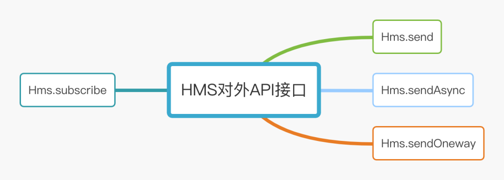

**一次申请**

主题消费组自动创建不适合生产环境，自动创建会导致失控，不利于整个生命周期管理和集群稳定。需要对申请流程进行控制，但是应尽可能简单。例如：一次申请各个环境均生效、生成关联告警规则等。

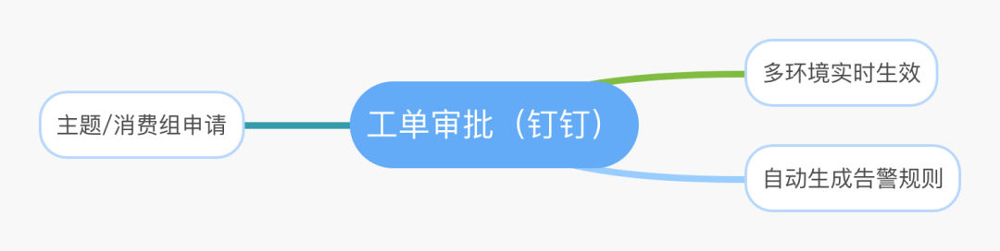

## 客户端治理
**设计指南**

监控客户端使用是否规范，找到合适的措施治理

#### 场景回放
**场景一 瞬时流量与集群的流控**

假设现在集群 Tps 有 1 万，瞬时翻到 2 万甚至更多，这种过度陡增的流量极有可能引发集群流控。针对这类场景需监控客户端的发送速度，在满足速度和陡增幅度阈值后将发送变的平缓一些。

**场景二 大消息与集群抖动**

当客户端发送大消息时，例如：发送几百 KB 甚至几兆的消息，可能造成 IO 时间过长与集群抖动。针对这类场景治理需监控发送消息的大小，我们采取通过事后巡检的方式识别出大消息的服务，推动使用同学压缩或重构，消息控制在 10KB 以内。

**场景三 过低客户端版本**

随着功能的迭代 SDK 的版本也会升级，变更除了功能外还有可能引入风险。当使用过低的版本时一个是功能不能得到支持，另外一个是也可能存在安全隐患。为了解 SDK 使用情况，可以采取将 SDK 版本上报，通过巡检的方式推动使用同学升级。

**场景四 消费流量摘除和恢复**

消费流量摘除和恢复通常有以下使用场景，第一个是发布应用时需要先摘流量，另外一个是问题定位时希望先把流量摘除掉再去排查。为了支持这种场景，需要在客户端监听摘除 / 恢复事件，将消费暂停和恢复。

**场景五 发送 / 消费耗时检测**

发送 / 消费一条消息用了多久，通过监控耗时情况，巡检摸排出性能过低的应用，针对性推动改造达到提升性能的目的。

**场景六 提升排查定位效率**

在排查问题时，往往需要检索发了什么消息、存在哪里、什么时候消费的等消息生命周期相关的内容。这部分可以通过 msgId 在消息内部将生命周期串联起来。另外是通过在消息头部埋入 rpcId/traceId 类似链路标识，在一次请求中将消息串起来。

#### 治理措施提炼
**需要的监控信息**

+ 发送 / 消费速度
+ 发送 / 消费耗时
+ 消息大小
+ 节点信息
+ 链路标识
+ 版本信息

**常用治理措施**

+ 定期巡检：有了埋点信息可以通过巡检将有风险的应用找出来。例如发送 / 消费耗时大于 800ms、消息大小大于 10KB、版本小于特定版本等
+ 发送平滑：例如检测到瞬时流量满足 1 万而且陡增了 2 倍以上，可以通过预热的方式将瞬时流量变的平滑一些
+ 消费限流：当第三方接口需要限流时，可以对消费的流量进行限流，这部分可以结合高可用框架实现
+ 消费摘除：通过监听摘除事件将消费客户端关闭和恢复

主题 / 消费组治理  

**设计指南**

监控主题消费组资源使用情况

#### 场景回放
**场景一  消费积压对业务的影响**

有些业务场景对消费堆积很敏感，有些业务对积压不敏感，只要后面追上来消费掉即可。例如单车开锁是秒级的事情，而信息汇总相关的批处理场景对积压不敏感。通过采集消费积压指标，对满足阈值的应用采取实时告警的方式通知到应用负责的同学，让他们实时掌握消费情况。

**场景二 消费 / 发送速度的影响**

发送 / 消费速度跌零告警？有些场景速度不能跌零，如果跌零意味着业务出现异常。通过采集速度指标，对满足阈值的应用实时告警。

**场景三 消费节点掉线**

消费节点掉线需要通知给应用负责的同学，这类需要采集注册节点信息，当掉线时能实时触发告警通知。

**场景四 发送 / 消费不均衡**

发送 / 消费的不均衡往往影响其性能。记得有一次咨询时有同学将发送消息的 key 设置成常量，默认按照 key 进行 hash 选择分区，所有的消息进入了一个分区里，这个性能是无论如何也上不来的。另外还要检测各个分区的消费积压情况，出现过度不均衡时触发实时告警通知。

#### 治理措施提炼
**需要的监控信息**

+ 发送 / 消费速度
+ 发送分区详情
+ 消费各分区积压
+ 消费组积压
+ 注册节点信息

**常用治理措施**

+ 实时告警：对消费积压、发送 / 消费速度、节点掉线、分区不均衡进行实时告警通知
+ 提升性能：对于有消费积压不能满足需求，可以通过增加拉取线程、消费线程、增加分区数量等措施加以提升
+ 自助排查：提供多维度检索工具，例如通过时间范围、msgId 检索、链路系统等多维度检索消息生命周期

集群健康治理  

**设计指南**

度量集群健康的核心指标有哪些？

#### 场景回放
**场景一  集群健康检测**

集群健康检测回答一个问题：这个集群是不是好的。通过检测集群节点数量、集群中每个节点心跳、集群写入 Tps 水位、集群消费 Tps 水位都是在解决这个问题。

**场景二 集群的稳定性**

集群流控往往体现出集群性能的不足，集群抖动也会引发客户端发送超时。通过采集集群中每个节点心跳耗时情况、集群写入 Tps 水位的变化率来掌握集群是否稳定。

**场景三 集群的高可用**

高可用主要针对极端场景中导致某个可用区不可用、或者集群上某些主题和消费组异常需要有一些针对性的措施。例如：MQ 可以通过同城跨可用区主从交叉部署、动态将主题和消费组迁移到灾备集群、多活等方式进行解决。

#### 治理措施提炼
**需要的监控信息**

+ 集群节点数量采集
+ 集群节点心跳耗时
+ 集群写入 Tps 的水位
+ 集群消费 Tps 的水位
+ 集群写入 Tps 的变化率

**常用治理措施**

+ 定期巡检：对集群 Tps 水位、硬件水位定期巡检
+ 容灾措施：同城跨可用区主从交叉部署、容灾动态迁移到灾备集群、异地多活
+ 集群调优：系统版本 / 参数、集群参数调优
+ 集群分类：按业务线分类、按核心 / 非核心服务分类

## 最核心指标聚焦
如果说这些关键指标中哪一个最重要？我会选择集群中每个节点的心跳检测，即：响应时间（RT），下面看看影响 RT 可能哪些原因。

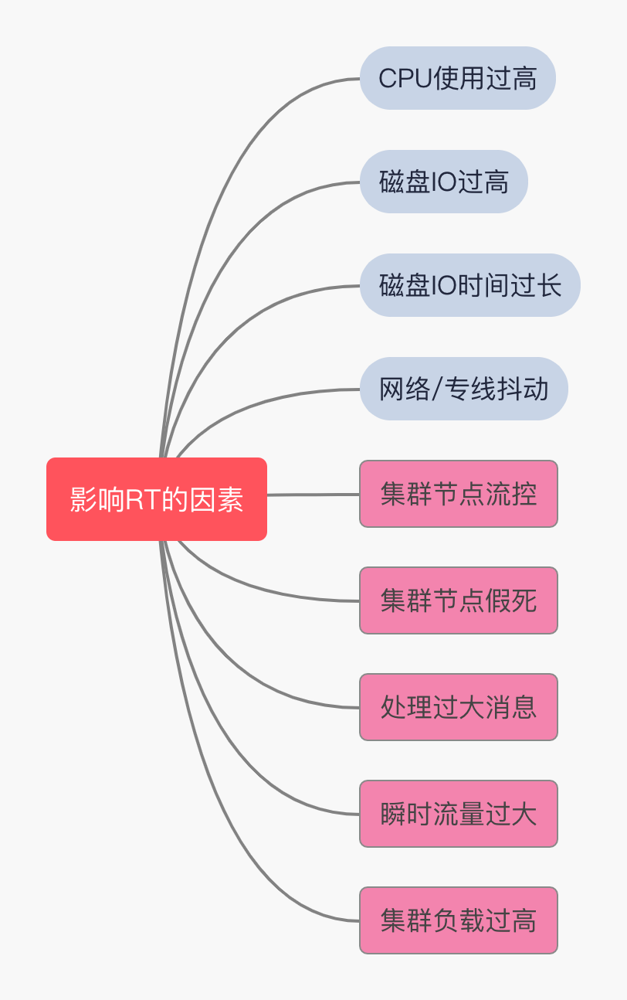

## 关于告警
+ 监控指标大多是秒级探测
+ 触发阈值的告警推送到公司统一告警系统、实时通知
+ 巡检的风险通知推送到公司巡检系统、每周汇总通知

## 消息平台图示
**架构图**

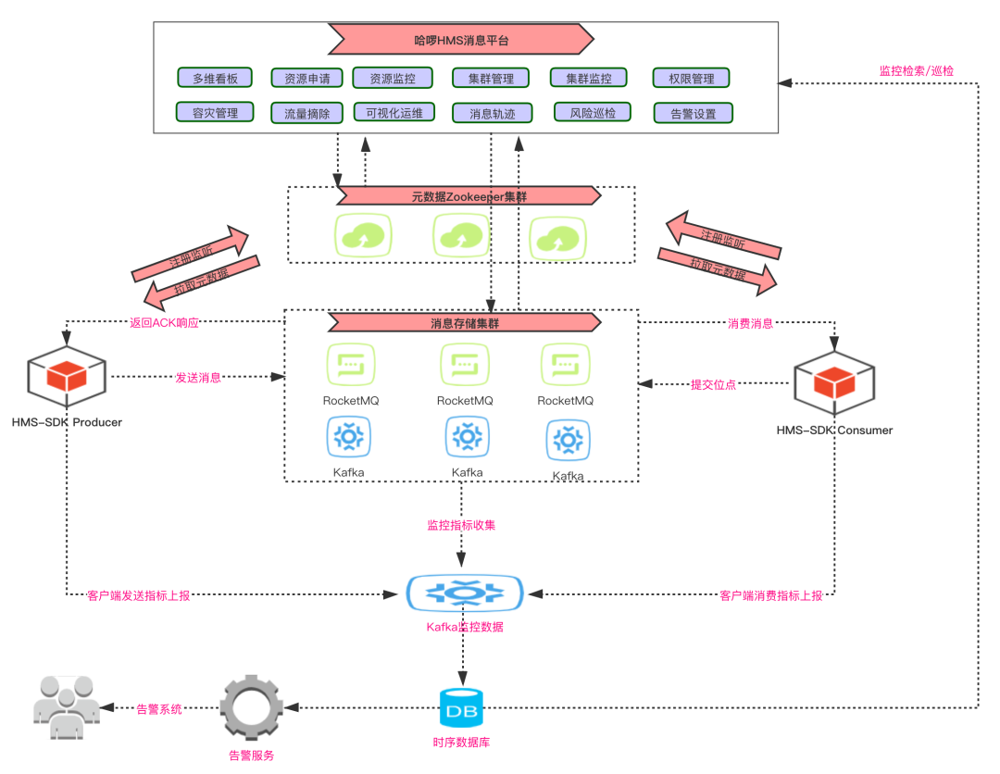

**看板图示**

+ 多维度：集群维度、应用维度
+ 全聚合：关键指标全聚合

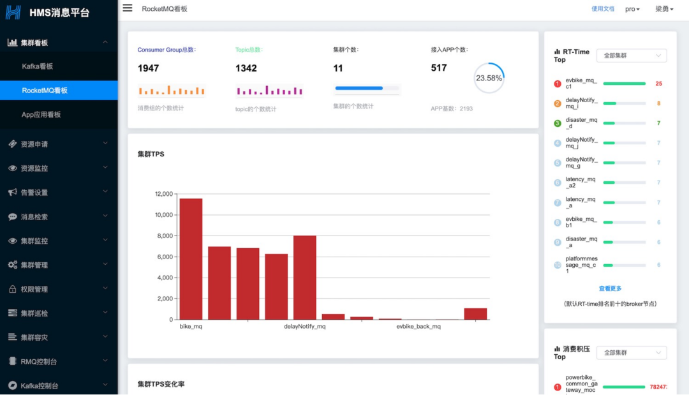

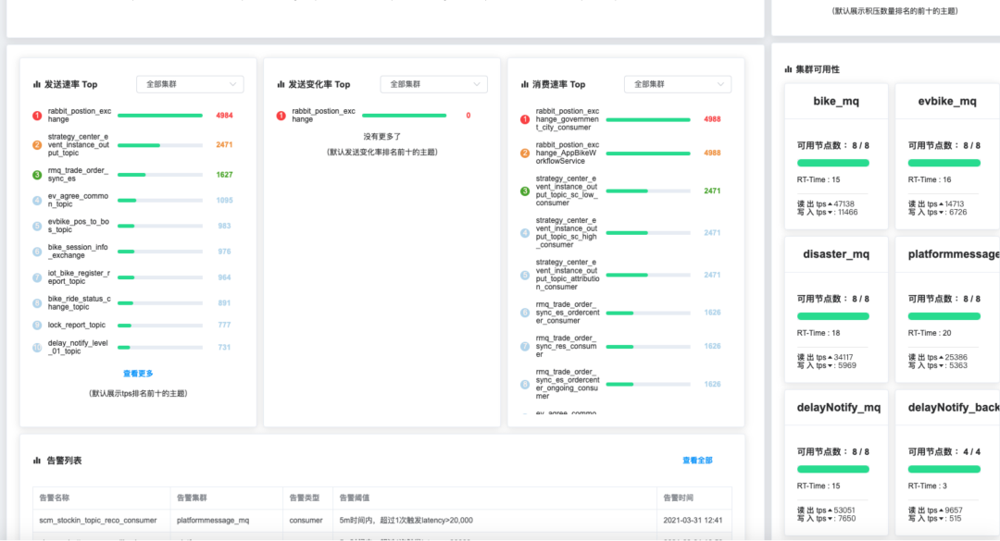

# 02 RocketMQ 实战中踩过的坑和解决方案
**行动指南**  

我们总会遇到坑，遇到就把它填了

**RocketMQ 集群 CPU 毛刺**

**问题描述**

问题描述：RocketMQ 从节点、主节点频繁 CPU 飙高，很明显的毛刺，很多次从节点直接挂掉了。

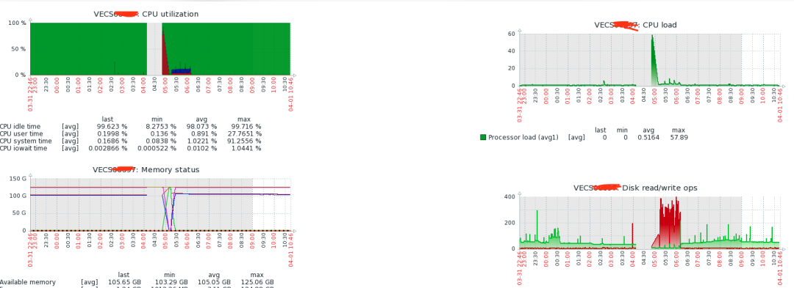

只有系统日志有错误提示

```plain
2020-03-16T17:56:07.505715+08:00 VECS0xxxx kernel: <IRQ>  [<ffffffff81143c31>] ? __alloc_pages_nodemask+0x7e1/0x960
2020-03-16T17:56:07.505717+08:00 VECS0xxxx kernel: java: page allocation failure. order:0, mode:0x20
2020-03-16T17:56:07.505719+08:00 VECS0xxxx kernel: Pid: 12845, comm: java Not tainted 2.6.32-754.17.1.el6.x86_64 #1
2020-03-16T17:56:07.505721+08:00 VECS0xxxx kernel: Call Trace:
2020-03-16T17:56:07.505724+08:00 VECS0xxxx kernel: <IRQ>  [<ffffffff81143c31>] ? __alloc_pages_nodemask+0x7e1/0x960
2020-03-16T17:56:07.505726+08:00 VECS0xxxx kernel: [<ffffffff8148e700>] ? dev_queue_xmit+0xd0/0x360
2020-03-16T17:56:07.505729+08:00 VECS0xxxx kernel: [<ffffffff814cb3e2>] ? ip_finish_output+0x192/0x380
2020-03-16T17:56:07.505732+08:00 VECS0xxxx kernel: [<ffffffff811862e2>] ? 
```

各种调试系统参数只能减缓但是不能根除，依然毛刺超过 50%

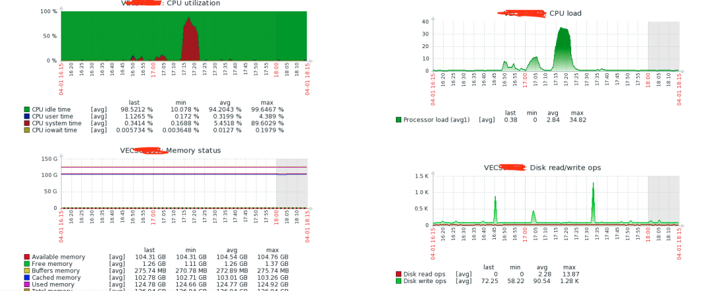

**解决方案**

将集群所有系统升级从 centos6 升级到 centos7，内核版本也从从 2.6 升级到 3.10，CPU 毛刺消失。

**RocketMQ 集群线上延迟消息失效**

**问题描述**

RocketMQ 社区版默认本支持 18 个延迟级别，每个级别在设定的时间都被会消费者准确消费到。为此也专门测试过消费的间隔是不是准确，测试结果显示很准确。然而，如此准确的特性居然出问题了，接到业务同学报告线上某个集群延迟消息消费不到，诡异！

**解决方案**

将 "delayOffset.json" 和 "consumequeue/SCHEDULE_TOPIC_XXXX" 移到其他目录，相当于删除；逐台重启 broker 节点。重启结束后，经过验证，延迟消息功能正常发送和消费。

## 深入研究 RocketMQ 源码为治理保驾护航
**阅读源码有啥用？**

+ 遇到问题不慌
+ 解决问题有思路
+ 能够链接到一些专业同学一起探讨
+ 为技术方案的设计提供素材
+ 知行合一（源码 + 实战）

# ‍‍‍‍‍‍‍‍‍‍‍‍‍‍‍‍‍‍03 打造微服务高可用治理平台
**设计指南**  

哪些是我们的核心服务，哪些是我们的非核心服务，这是服务治理的首要问题

**设计目标**

服务能应对突如其来的陡增流量，尤其保障核心服务的平稳运行。

## 应用分级和分组部署
**应用分级**

根据用户和业务影响两个纬度来进行评估设定的，将应用分成了四个等级。

+ 业务影响：应用故障时影响的业务范围
+ 用户影响：应用故障时影响的用户数量

S1：核心产品，产生故障会引起外部用户无法使用或造成较大资损，比如主营业务核心链路，如单车、助力车开关锁、顺风车的发单和接单核心链路，以及其核心链路强依赖的应用。

S2:  不直接影响交易，但关系到前台业务重要配置的管理与维护或业务后台处理的功能。

S3:  服务故障对用户或核心产品逻辑影响非常小，且对主要业务没影响，或量较小的新业务；面向内部用户使用的重要工具，不直接影响业务，但相关管理功能对前台业务影响也较小。

S4:  面向内部用户使用，不直接影响业务，或后续需要推动下线的系统。

**分组部署**

S1 服务是公司的核心服务，是重点保障的对象，需保障其不被非核心服务流量意外冲击。

+ S1 服务分组部署，分为 Stable 和 Standalone 两套环境
+ 非核心服务调用 S1 服务流量路由到 Standalone 环境
+ S1 服务调用非核心服务需配置熔断策略

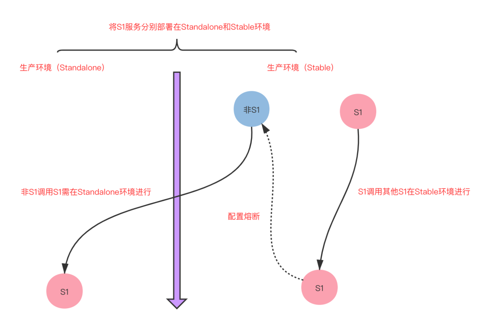

## 多种限流熔断能力建设
**我们建设的高可用平台能力**

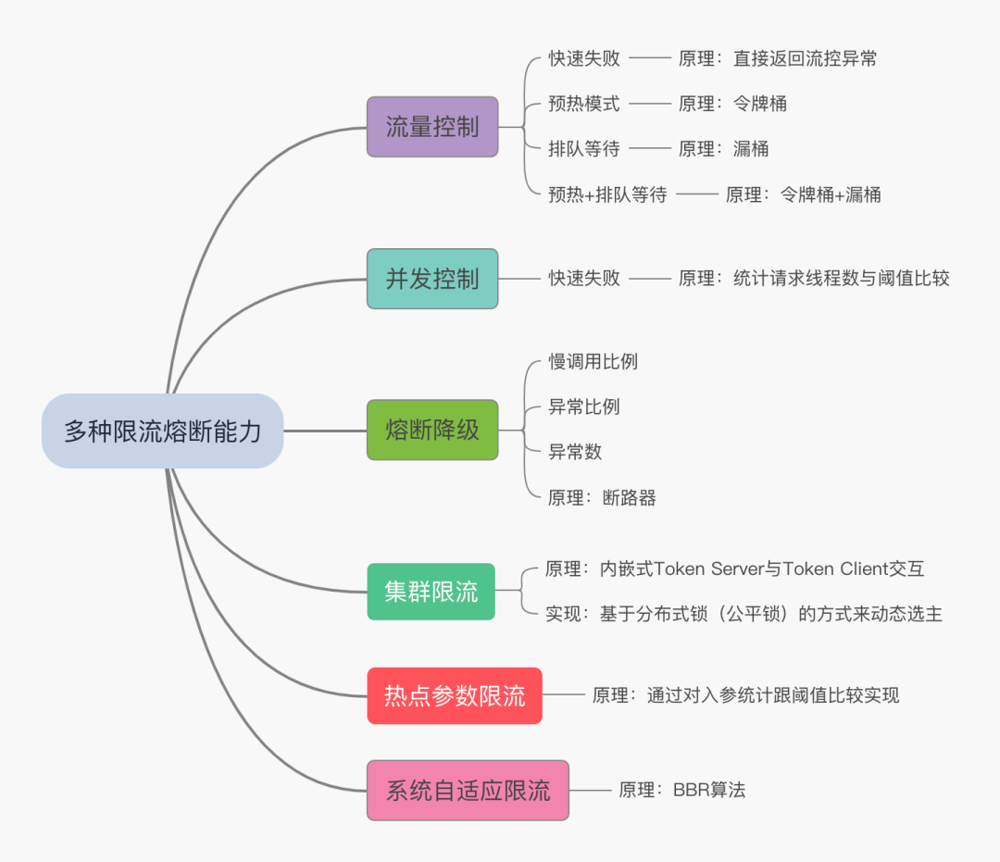

**部分限流效果图**

+ 预热图示

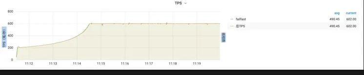

+ 排队等待

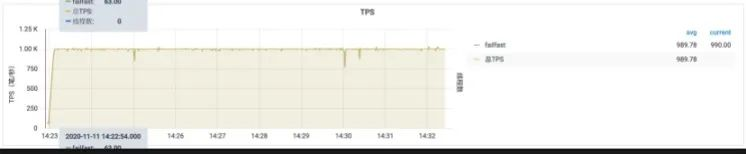

+ 预热 + 排队

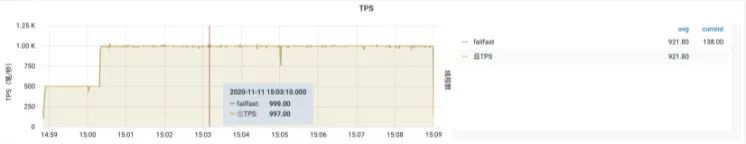

**高可用平台图示**

+ 中间件全部接入
+ 动态配置实时生效
+ 每个资源和 IP 节点详细流量

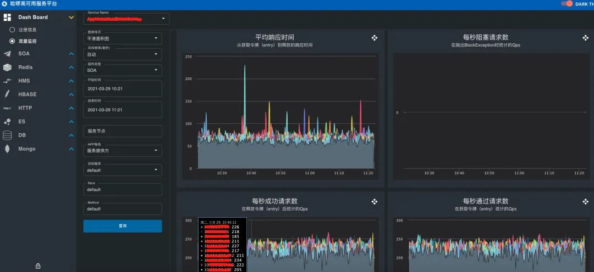

# 总结
+ 哪些是我们的**关键指标**，哪些是我们的次要指标，这是消息治理的首要问题
+ 哪些是我们的**核心服务**，哪些是我们的非核心服务，这是服务治理的首要问题
+ **源码 & 实战** 是一种比较好的工作学习方法


> 更新: 2025-04-20 22:38:57  
> 原文: <https://www.yuque.com/aaron-wecc3/dhluml/wvk4i4zr3pekez3b>