# 66.携程亿级网关架构设计

**分享内容**

1. <font style="color:rgb(51, 51, 51);">高性能网关之异步流程设计</font>
2. <font style="color:rgb(51, 51, 51);">高性能网关之流式转发 & 单线程</font>
3. <font style="color:rgb(51, 51, 51);">网关业务形态</font>
4. <font style="color:rgb(51, 51, 51);">网关治理：多协议兼容、路由模块、模块编排</font>


### <font style="color:rgb(51, 51, 51);">一、概述</font>
<font style="color:rgb(51, 51, 51);">类似于许多企业的做法，携程 API 网关是伴随着</font>[<font style="color:rgb(51, 51, 51);">微服务架构</font>](https://edu.csdn.net/cloud/sd_summit?utm_source=glcblog&spm=1001.2101.3001.7020)<font style="color:rgb(51, 51, 51);">一同引入的基础设施，其最初版本于 2014 年发布。随着服务化在公司内的迅速推进，网关逐步成为应用程序暴露在外网的标准解决方案。后续的 “ALL IN 无线”、国际化、异地多活等项目，网关都随着公司公共业务与基础架构的共同演进而不断发展。截至 2021 年 7 月，整体接入服务数量超过 3000 个，日均处理流量达到 200 亿。</font>

<font style="color:rgb(51, 51, 51);">在技术方案方面，公司</font>[<font style="color:rgb(51, 51, 51);">微服务</font>](https://edu.csdn.net/cloud/sd_summit?utm_source=glcblog&spm=1001.2101.3001.7020)<font style="color:rgb(51, 51, 51);">的早期发展深受 NetflixOSS 的影响，网关部分最早也是参考了 Zuul 1.0 进行的二次开发，其核心可以总结为以下四点：</font>

+ <font style="color:rgb(51, 51, 51);">server 端：Tomcat NIO + AsyncServlet</font>
+ <font style="color:rgb(51, 51, 51);">业务流程：独立线程池，分阶段的责任链模式</font>
+ <font style="color:rgb(51, 51, 51);">client 端：Apache HttpClient，同步调用</font>
+ <font style="color:rgb(51, 51, 51);">核心组件：Archaius（动态配置客户端），Hystrix（熔断限流），Groovy（热更新支持）</font>

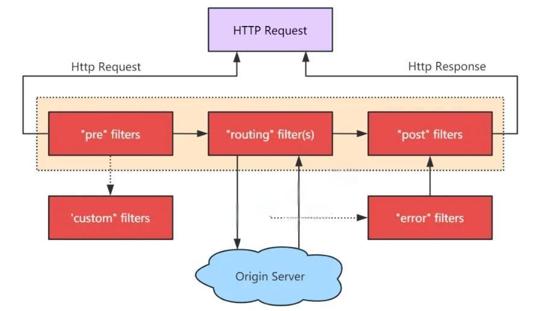

**<font style="color:rgb(119, 119, 119);"></font>**

<font style="color:rgb(51, 51, 51);">众所周知，同步调用会阻塞线程，系统的吞吐能力受 IO 影响较大。</font>

<font style="color:rgb(51, 51, 51);">作为行业的领先者，Zuul 在设计时已经考虑到了这个问题：通过引入 Hystrix，实现资源隔离和限流，将故障（慢 IO）限制在一定范围内；结合熔断策略，可以提前释放部分线程资源；最终达到局部异常不会影响整体的目标。</font>

<font style="color:rgb(51, 51, 51);">然而，随着公司业务的不断发展，上述策略的效果逐渐减弱，主要原因有两方面：</font>

+ <font style="color:rgb(51, 51, 51);">业务出海：网关作为海外接入层，部分流量需要转回国内，慢 IO 成为常态</font>
+ <font style="color:rgb(51, 51, 51);">服务规模增长：局部异常成为常态，加上微服务异常扩散的特性，线程池可能长期处于亚健康状态</font>


<font style="color:rgb(51, 51, 51);">全异步改造是携程 API 网关近年来的一项核心工作，我们探讨在网关方面的工作与实践经验。</font>

<font style="color:rgb(51, 51, 51);">重点包括：</font>[<font style="color:rgb(51, 51, 51);">性能优化</font>](https://edu.csdn.net/cloud/sd_summit?utm_source=glcblog&spm=1001.2101.3001.7020)<font style="color:rgb(51, 51, 51);">、业务形态、技术架构、治理经验等。</font>

### <font style="color:rgb(51, 51, 51);">二、高性能网关核心设计</font>
#### <font style="color:rgb(51, 51, 51);">2.1. 异步流程设计</font>
<font style="color:rgb(51, 51, 51);">全异步 = server 端异步 + 业务流程异步 + client 端异步</font>

<font style="color:rgb(51, 51, 51);">对于 server 与 client 端，我们采用了 Netty 框架，其 NIO/Epoll + Eventloop 的本质就是事件驱动的设计。</font>

<font style="color:rgb(51, 51, 51);">我们改造的核心部分是将业务流程进行异步化，常见的异步场景有：</font>

+ <font style="color:rgb(51, 51, 51);">业务 IO 事件：例如请求校验、身份验证，涉及远程调用</font>
+ <font style="color:rgb(51, 51, 51);">自身 IO 事件：例如读取到了报文的前 xx 字节</font>
+ <font style="color:rgb(51, 51, 51);">请求转发：包括 TCP 连接，HTTP 请求</font>

<font style="color:rgb(51, 51, 51);">从经验上看，异步编程在设计和读写方面相比同步会稍微困难一些，主要包括：</font>

+ <font style="color:rgb(51, 51, 51);">流程设计 & 状态转换</font>
+ <font style="color:rgb(51, 51, 51);">异常处理，包括常规异常与超时</font>
+ <font style="color:rgb(51, 51, 51);">上下文传递，包括业务上下文与 trace log</font>
+ <font style="color:rgb(51, 51, 51);">线程调度</font>
+ <font style="color:rgb(51, 51, 51);">流量控制</font>

<font style="color:rgb(51, 51, 51);">特别是在 Netty 上下文内，如果对 ByteBuf 的生命周期设计不完善，很容易导致内存泄漏。</font>

<font style="color:rgb(51, 51, 51);">围绕这些问题，我们设计了对应外围框架，最大努力对业务代码抹平同步 / 异步差异，方便开发；同时默认兜底与容错，保证程序整体安全。</font>

<font style="color:rgb(51, 51, 51);">在工具方面，我们使用了 RxJava，其主要流程如下图所示。</font>

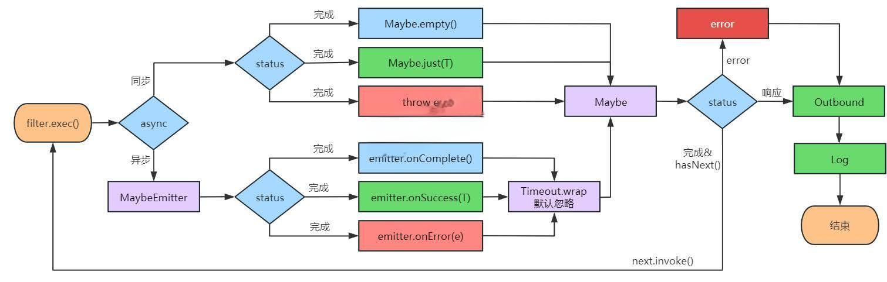

+ <font style="color:rgb(51, 51, 51);">Maybe</font>
    - <font style="color:rgb(51, 51, 51);">RxJava 的内置容器类，表示正常结束、有且仅有一个对象返回、异常三种状态</font>
    - <font style="color:rgb(51, 51, 51);">响应式，便于整体状态机设计，自带异常处理、超时、线程调度等封装</font>
    - <font style="color:rgb(51, 51, 51);">Maybe.empty()/Maybe.just(T)，适用同步场景</font>
    - <font style="color:rgb(51, 51, 51);">工具类 RxJavaPlugins，方便切面逻辑封装</font>
+ <font style="color:rgb(51, 51, 51);">Filter</font>
    - <font style="color:rgb(51, 51, 51);">代表一块独立的业务逻辑，同步 & 异步业务统一接口，返回 Maybe</font>
    - <font style="color:rgb(51, 51, 51);">异步场景（如远程调用）统一封装，如涉及线程切换，通过 maybe.obesrveOn(eventloop) 切回</font>
    - <font style="color:rgb(51, 51, 51);">异步 filter 默认增加超时，并按弱依赖处理，忽略错误</font>
+ <font style="color:rgb(51, 51, 51);">整体流程</font>
    - <font style="color:rgb(51, 51, 51);">沿用责任链的设计，分为 inbound、outbound、error、log 四阶段</font>
    - <font style="color:rgb(51, 51, 51);">各阶段由一或多个 filter 组成</font>
    - <font style="color:rgb(51, 51, 51);">filter 顺序执行，遇到异常则中断，inbound 期间任意 filter 返回 response 也触发中断</font>

#### <font style="color:rgb(51, 51, 51);">2.2. 流式转发 & 单线程</font>
<font style="color:rgb(51, 51, 51);">以 HTTP 为例，报文可划分为 initial line/header/body 三个组成部分。</font>

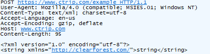

<font style="color:rgb(51, 51, 51);">在携程，网关层业务不涉及请求体 body。</font>

<font style="color:rgb(51, 51, 51);">因为无需全量存，所以解析完请求头 header 后可直接进入业务流程。</font>

<font style="color:rgb(51, 51, 51);">同时，如果收到请求体 body 部分：</font>

<font style="color:rgb(51, 51, 51);">①若已向 upstream 转发请求，则直接转发；</font>

<font style="color:rgb(51, 51, 51);">②否则，需要将其暂时存储，等待业务流程处理完毕后，再将其与 initial line/header 一并发送；</font>

<font style="color:rgb(51, 51, 51);">③对 upstream 端响应的处理方式亦然。</font>

<font style="color:rgb(51, 51, 51);">对比完整解析 HTTP 报文的方式，这样处理：</font>

+ <font style="color:rgb(51, 51, 51);">更早进入业务流程，意味着 upstream 更早接收到请求，可以有效地降低网关层引入的延迟</font>
+ <font style="color:rgb(51, 51, 51);">body 生命周期被压缩，可降低网关自身的内存开销</font>

<font style="color:rgb(51, 51, 51);">尽管性能有所提升，但流式处理也大大增加了整个流程的复杂性。</font>

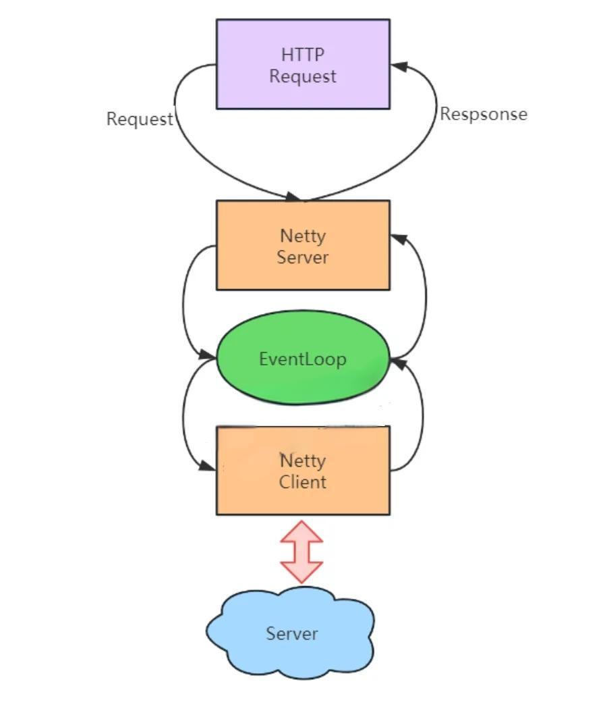

<font style="color:rgb(51, 51, 51);">在非流式场景下，Netty Server 端编解码、入向业务逻辑、Netty Client 端的编解码、出向业务逻辑，各个子流程相互独立，各自处理完整的 HTTP 对象。而采用流式处理后，请求可能同时处于多个流程中，这带来了以下三个挑战：</font>

+ <font style="color:rgb(51, 51, 51);">线程安全问题：如果各个流程使用不同的线程，那么可能会涉及到上下文的并发修改；</font>
+ <font style="color:rgb(51, 51, 51);">多阶段联动：比如 Netty Server 请求接收一半遇到了连接中断，此时已经连上了 upstream，那么 upstream 侧的协议栈是走不完的，也必须随之关闭连接；</font>
+ <font style="color:rgb(51, 51, 51);">边缘场景处理：比如 upstream 在请求未完整发送情况下返回了 404/413，是选择继续发送、走完协议栈、让连接能够复用，还是选择提前终止流程，节约资源，但同时放弃连接？再比如，upstream 已收到请求但未响应，此时 Netty Server 突然断开，Netty Client 是否也要随之断开？等等。</font>

<font style="color:rgb(51, 51, 51);">为了应对这些挑战，我们采用了单线程的方式，核心设计包括：</font>

+ <font style="color:rgb(51, 51, 51);">上下文绑定 Eventloop，Netty Server / 业务流程 / Netty Client 在同个 eventloop 执行；</font>
+ <font style="color:rgb(51, 51, 51);">异步 filter 如因 IO 库的关系，必须使用独立线程池，那在后置处理上必须切回；</font>
+ <font style="color:rgb(51, 51, 51);">流程内资源做必要的线程隔离（如连接池）；</font>

<font style="color:rgb(51, 51, 51);">单线程方式避免了并发问题，在处理多阶段联动、边缘场景问题时，整个系统处于确定的状态下，有效降低了开发难度和风险；此外，减少线程切换，也能在一定程度上提升性能。然而，由于 worker 线程数较少（一般等于 CPU 核数），eventloop 内必须完全避免 IO 操作，否则将对系统的吞吐量造成重大影响。</font>

#### <font style="color:rgb(51, 51, 51);">2.3 其他优化</font>
+ <font style="color:rgb(51, 51, 51);">内部变量懒加载</font>

<font style="color:rgb(51, 51, 51);">对于请求的 cookie/query 等字段，如果没有必要，不提前进行字符串解析</font>

+ <font style="color:rgb(51, 51, 51);">堆外内存 & 零拷贝</font>

<font style="color:rgb(51, 51, 51);">结合前文的流式转发设计，进一步减少系统内存占用。</font>

+ <font style="color:rgb(51, 51, 51);">ZGC</font>

<font style="color:rgb(51, 51, 51);">由于项目升级到 TLSv1.3，引入了 JDK11（JDK8 支持较晚，8u261 版本，2020.7.14），同时也尝试了新一代的垃圾回收算法，其实际表现确实如人们所期待的那样出色。尽管 CPU 占用有所增加，但整体 GC 耗时下降非常显著。</font>

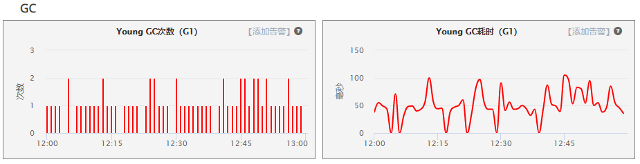

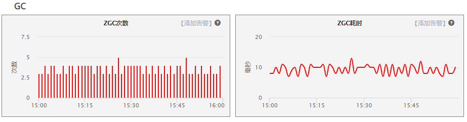

+ <font style="color:rgb(51, 51, 51);">定制的 HTTP 编解码</font>

<font style="color:rgb(51, 51, 51);">由于 HTTP 协议的历史悠久及其开放性，产生了很多 “不良实践”，轻则影响请求成功率，重则对网站安全构成威胁。</font>

+ <font style="color:rgb(51, 51, 51);">流量治理</font>

<font style="color:rgb(51, 51, 51);">对于请求体过大（413）、URI 过长（414）、非 ASCII 字符（400）等问题，一般的 Web 服务器会选择直接拒绝并返回相应的状态码。由于这类问题跳过了业务流程，因此在统计、服务定位和故障排查方面会带来一些麻烦。通过扩展编解码，让问题请求也能完成路由流程，有助于解决非标准流量的管理问题。</font>

+ <font style="color:rgb(51, 51, 51);">请求过滤</font>

<font style="color:rgb(51, 51, 51);">例如 request smuggling（Netty 4.1.61.Final 修复，2021.3.30 发布）。通过扩展编解码，增加自定义校验逻辑，可以让安全补丁更快地得以应用。</font>

### <font style="color:rgb(51, 51, 51);">三、网关</font>[<font style="color:rgb(51, 51, 51);">业务形态</font>](https://edu.csdn.net/cloud/pm_summit?utm_source=blogglc&spm=1001.2101.3001.7020)
<font style="color:rgb(51, 51, 51);">作为独立的、统一的入向流量收口点，网关对企业的价值主要展现在三个方面：</font>

+ <font style="color:rgb(51, 51, 51);">解耦不同网络环境：典型场景包括内网 & 外网、生产环境 & 办公区、IDC 内部不同安全域、专线等；</font>
+ <font style="color:rgb(51, 51, 51);">天然的公共业务切面：包括安全 & 认证 & 反爬、路由 & 灰度、限流 & 熔断 & 降级、监控 & 告警 & 排障等；</font>

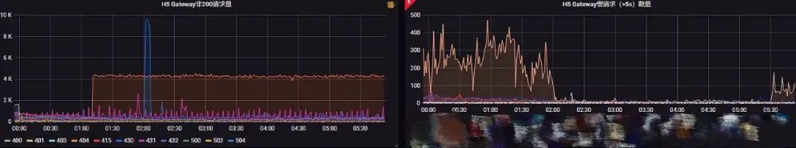

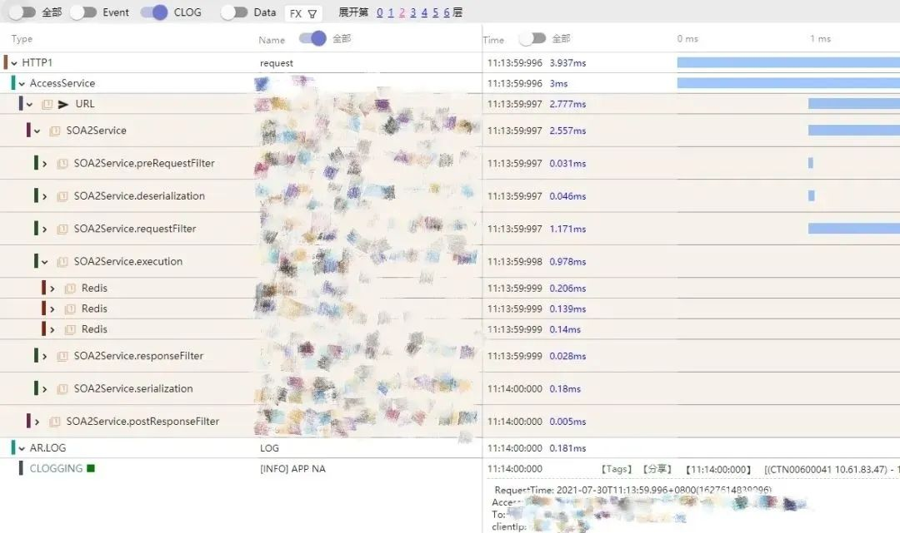

+ <font style="color:rgb(51, 51, 51);">高效、灵活的流量控制</font>

<font style="color:rgb(51, 51, 51);">这里展开讲几个细分场景：</font>

+ <font style="color:rgb(51, 51, 51);">私有协议</font>

<font style="color:rgb(51, 51, 51);">在收口的客户端（APP）中，框架层会拦截用户发起的 HTTP 请求，通过私有协议（SOTP）的方式传送到服务端。</font>

<font style="color:rgb(51, 51, 51);">选址方面：①通过服务端分配 IP，防止 DNS 劫持；②进行连接预热；③采用自定义的选址策略，可以根据网络状况、环境等因素自行切换。</font>

<font style="color:rgb(51, 51, 51);">交互方式上：①采用更轻量的协议体；②统一进行加密与压缩与多路复用；③在入口处由网关统一转换协议，对业务无影响。</font>

+ <font style="color:rgb(51, 51, 51);">链路优化</font>

<font style="color:rgb(51, 51, 51);">关键在于引入接入层，让远程用户就近访问，解决握手开销过大的问题。同时，由于接入层与 IDC 两端都是可控的，因此在网络链路选择、协议交互模式等方面都有更大的优化空间。</font>

+ <font style="color:rgb(51, 51, 51);">异地多活</font>

<font style="color:rgb(51, 51, 51);">与按比例分配、就近访问策略等不同，在异地多活模式下，网关（接入层）需要根据业务维度的 shardingKey 进行分流（如 userId），防止底层数据冲突。</font>

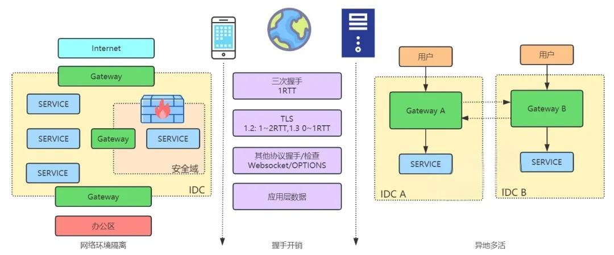

**<font style="color:rgb(119, 119, 119);"></font>**

### <font style="color:rgb(51, 51, 51);">四、网关治理</font>
<font style="color:rgb(51, 51, 51);">下所示的图表概括了网上网关的工作状态。纵向对应我们的业务流程：各种渠道（如 APP、H5、小程序、供应商）和各种协议（如 HTTP、SOTP）的流量通过负载均衡分配到网关，通过一系列业务逻辑处理后，最终被转发到后端服务。经过第二章的改进后，横向业务在性能和稳定性方面都得到了显著提升。</font>

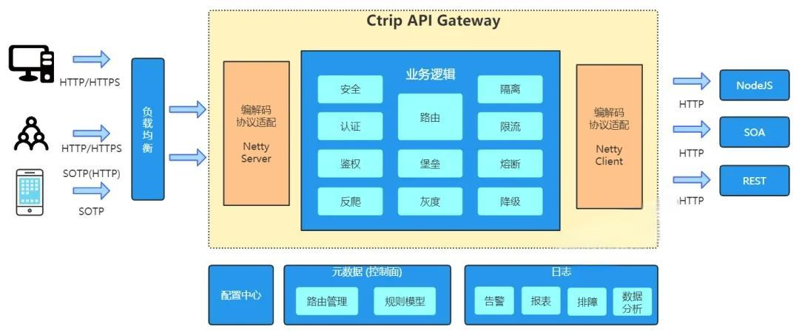

<font style="color:rgb(51, 51, 51);">另一方面，由于多渠道 / 协议的存在，网上网关根据业务进行了独立集群的部署。早期，业务差异（如路由数据、功能模块）通过独立的代码分支进行管理，但是随着分支数量的增加，整体运维的复杂性也在不断提高。在系统设计中，复杂性通常也意味着风险。因此，如何对多协议、多角色的网关进行统一管理，如何以较低的成本快速为新业务构建定制化的网关，成为了我们下一阶段的工作重点。</font>

<font style="color:rgb(51, 51, 51);">解决方案已经在图中直观地呈现出来，一是在协议上进行兼容处理，使网上代码在一个框架下运行；二是引入控制面，对网上网关的差异特性进行统一管理。</font>

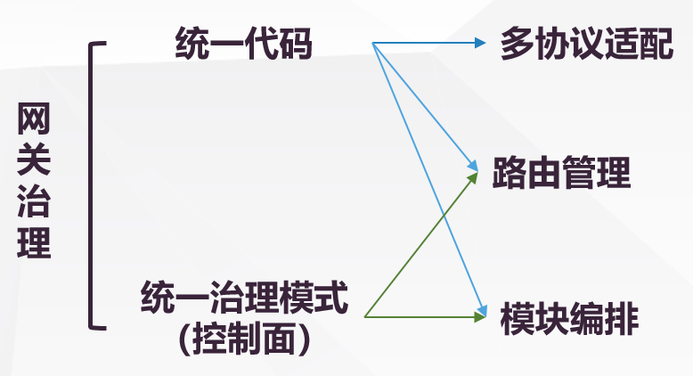

#### <font style="color:rgb(51, 51, 51);">4.1 多协议兼容</font>
<font style="color:rgb(51, 51, 51);">多协议兼容的方法并不新颖，可以参考 Tomcat 对 HTTP/1.0、HTTP/1.1、HTTP/2.0 的抽象处理。尽管 HTTP 在各个版本中增加了许多新特性，但在进行业务开发时，我们通常无法感知到这些变化，关键在于 HttpServletRequest 接口的抽象。</font>

<font style="color:rgb(51, 51, 51);">在携程网上，网关处理的都是请求 - 响应模式的无状态协议，报文结构也可以划分为元数据、扩展头、业务报文三部分，因此可以方便地进行类似的尝试。相关工作可以用以下两点来概括：</font>

+ <font style="color:rgb(51, 51, 51);">协议适配层：用于屏蔽不同协议的编解码、交互模式、对 TCP 连接的处理等</font>
+ <font style="color:rgb(51, 51, 51);">定义通用中间模型与接口：业务面向中间模型与接口进行编程，更好地关注到协议对应的业务属性上</font>

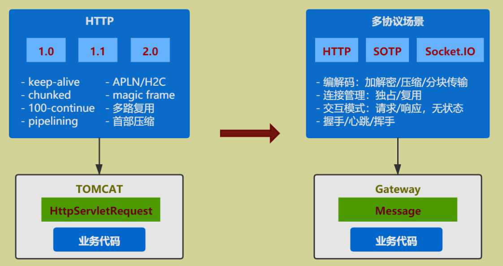

#### <font style="color:rgb(51, 51, 51);">4.2 路由模块</font>
<font style="color:rgb(51, 51, 51);">路由模块是控制面的两个主要组成部分之一，除了管理网关与服务之间的映射关系外，服务本身可以用以下模型来概括：</font>

```json
{
  //匹配方式
  "type": "uri",

  //HTTP默认采用uri前缀匹配，内部通过树结构寻址；私有协议（SOTP）通过服务唯一标识定位。
  "value": "/hotel/order",
  "matcherType": "prefix",

  //标签与属性
  //用于portal端权限管理、切面逻辑运行（如按核心/非核心）等
  "tags": [
    "owner_admin",
    "org_framework",
    "appId_123456"
  ],
  "properties": {
    "core": "true"
  },

  //endpoint信息
  "routes": [{
    //condition用于二级路由，如按app版本划分、按query重分配等
    "condition": "true",
    "conditionParam": {},
    "zone": "PRO",

    //具体服务地址，权重用于灰度场景
    "targets": [{
      "url": "http://test.ctrip.com/hotel",
      "weight": 100
    }
    ]
  }]
}
```

#### <font style="color:rgb(51, 51, 51);">4.3 模块编排</font>
<font style="color:rgb(51, 51, 51);">模块调度是控制面的另一个关键组成部分。我们在网关处理流程中设置了多个阶段。除了熔断、限流、日志等通用功能外，运行时，不同网关需要执行的业务功能由控制面统一分配。这些功能在网关内部有独立的代码模块，而控制面则额外定义了这些功能对应的执行条件、参数、灰度比例和错误处理方式等。这种调度方式也在一定程度上保证了模块之间的解耦。</font>

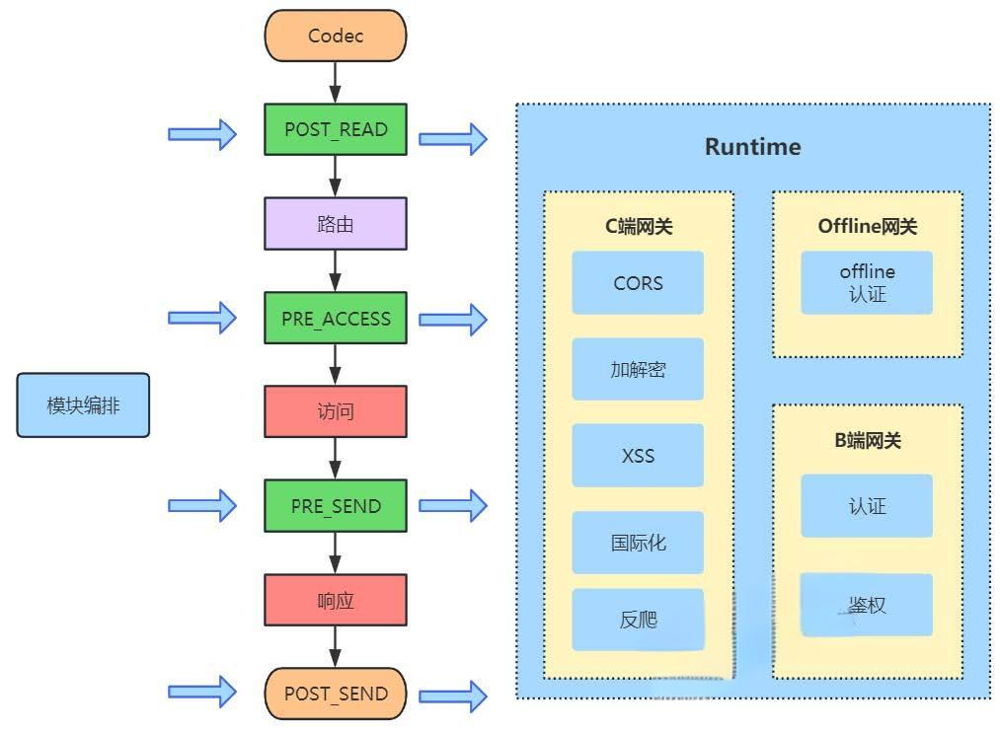

**<font style="color:rgb(119, 119, 119);"></font>**

```json
{
  //模块名称，对应网关内部某个具体模块
  "name": "addResponseHeader",

  //执行阶段
  "stage": "PRE_RESPONSE",

  //执行顺序
  "ruleOrder": 0,

  //灰度比例
  "grayRatio": 100,

  //执行条件
  "condition": "true",
  "conditionParam": {},

  //执行参数
  //大量${}形式的内置模板，用于获取运行时数据
"actionParam": {
  "connection": "keep-alive",
  "x-service-call": "${request.func.remoteCost}",
  "Access-Control-Expose-Headers": "x-service-call",
  "x-gate-root-id": "${func.catRootMessageId}"
},

//异常处理方式，可以抛出或忽略
"exceptionHandle": "return"
}
```

### <font style="color:rgb(51, 51, 51);">五、总结</font>
<font style="color:rgb(51, 51, 51);">网关在各种技术交流平台上一直是备受关注的话题，有很多成熟的解决方案：易于上手且发展较早的 Zuul 1.0、高性能的 Nginx、集成度高的 Spring Cloud Gateway、日益流行的 Istio 等等。</font>

<font style="color:rgb(51, 51, 51);">最终的选型还是取决于各公司的业务背景和技术生态。</font>

<font style="color:rgb(51, 51, 51);">因此，在携程，我们选择了自主研发的道路。</font>

<font style="color:rgb(51, 51, 51);">技术在不断发展，我们也在持续探索，包括公共网关与业务网关的关系、新协议（如 HTTP3）的应用、与 ServiceMesh 的关联等等。</font>


> 更新: 2025-04-20 22:38:57  
> 原文: <https://www.yuque.com/aaron-wecc3/dhluml/osnxlp9suyqbiqdl>