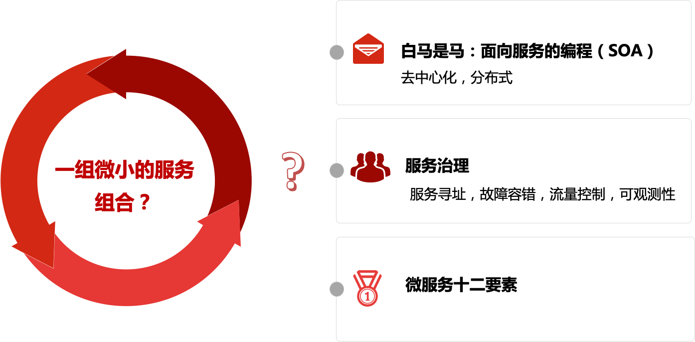
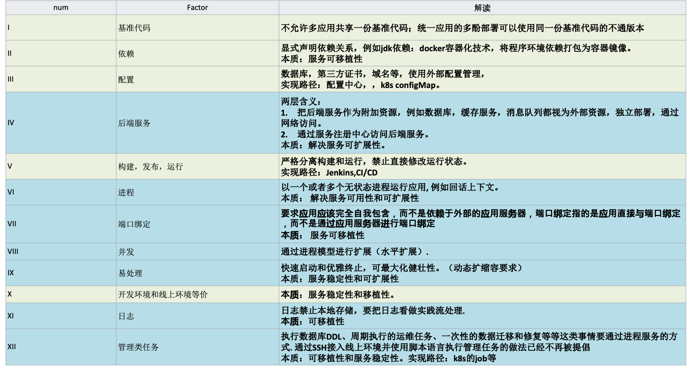
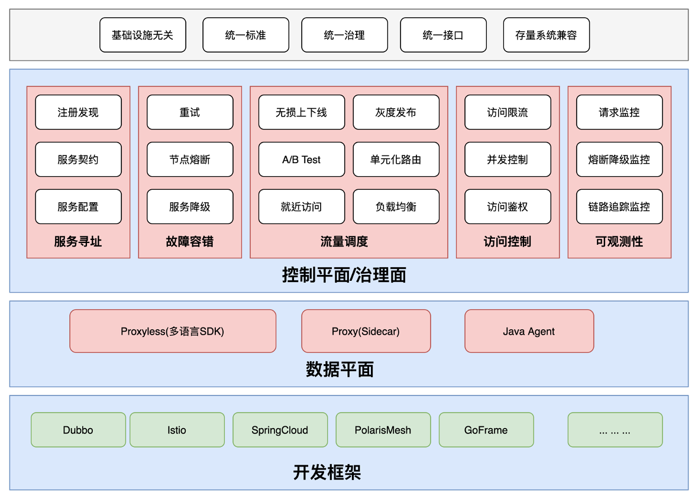
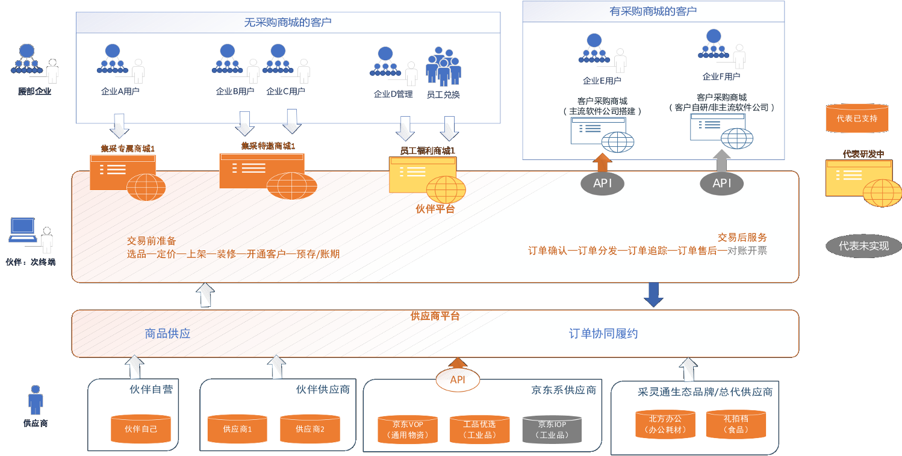
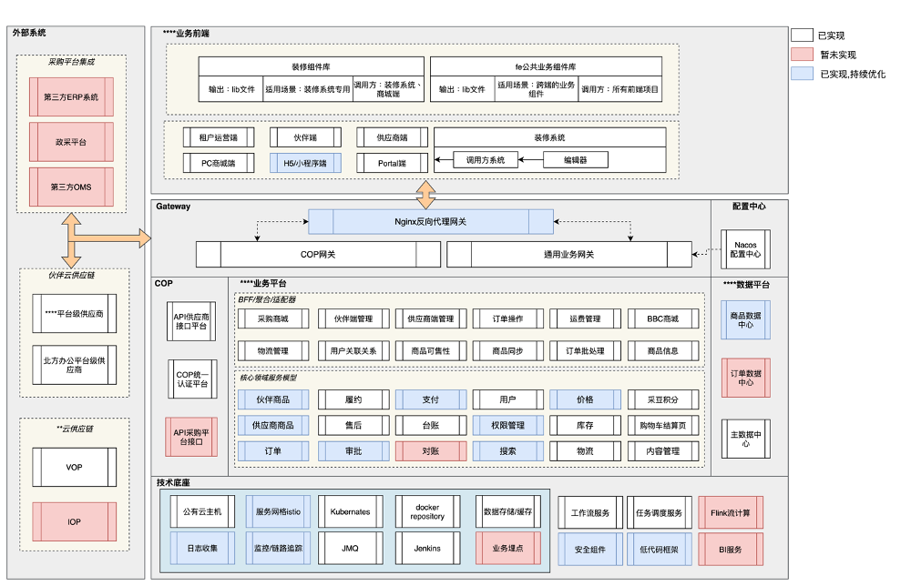
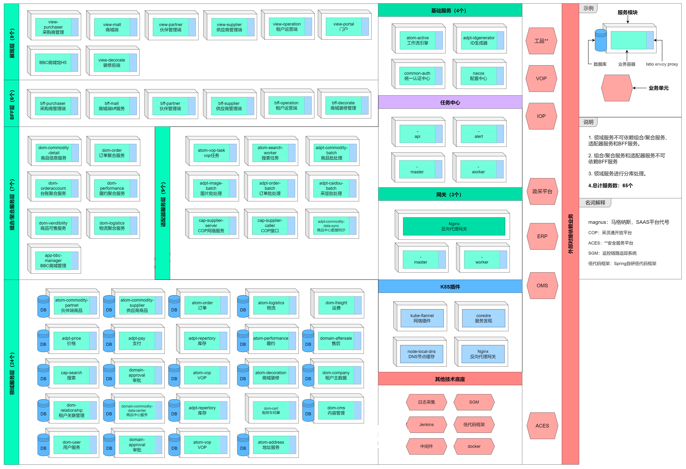

# 67.京东物流DDD微服务架构落地实践

**分享内容**

1. 微服务架构设计要素
2. 微服务的服务治理和流量治理
3. 微服务拆分的架构思想
4. 京东SAAS 云平台 DDD架构方案

# **一. 前言**
现在对于一个后端开发工程师来说，微服务，DDD 都是挂在嘴边的东西，感觉大家接触到多，也了解的多。但我个人的感受是，对微服务架构的理解就像我小时候读三国，在不同年龄读的时候感触都不一样。微服务对于开发人员来说亦是如此，一千个人有一千种解读，而随着每个人自己的业务经验和架构能力的提升，每个人看到的风景也会不一样的。今天我们分享一下基于微服务架构实践后的心路历程。

# **二. 首先，我们需要思考一下： 什么是微服务架构？**

在我看来，微服务架构并没有一个准确的定义，但他会有很多特征，通过描述他的特征用来把控它是什么。

### a. 白马是马。
这是一个哲学命题，表明个别和一般的关系。我认为，任何的技术和架构都不是凭空出现的，一定是发展而来，而微服务架构的前身就是 SOA，面向服务的编程。SOA 是一种架构设计模式，也是一种思想。所以微服务理应继承了 SOA 的这种架构思想，所以我认为微服务就是那个白马，他将一个复杂系统，以业务的视角，分成独立的模块，每个模块都有提供服务的能力，基于这些能力，去构建一个复杂的系统架构，在此基础上，再演化出去中心化，和分布式思想。

### b. 服务治理
以上说的是思想层级，在战术层级，微服务架构的核心诉求和能力是服务治理，包括服务寻址，流量管理，可观测性等。

### c. 十二要素
Heroku 创始人 Adam Wiggins 提出的微服务十二要素，下面，我贴出我对微服务十二要素的解读：

这十二要素可以说是微服务架构的方法论，有了思想，方法论和战术维度，我觉得就可以完整的描绘出一个微服务架构的全景图。然后，我将我理解的微服务架构总结成一句话：

微服务架构是 ： 一种去中心化的分布式服务架构，架构拥有服务寻址，故障容错，流量调度，控制访问和可观测性的服务治理能力，从而实现服务的隔离性，可移植性，可扩展性，稳定性。

# **三. 其次，我们的问题焦点：微服务架构的难点是什么？**
我认为，微服务的两个核心点正是他的难点：

## 第一个难点， 微服务的服务治理和流量治理。
对于这个难点，现阶段已经有了很好的解决，因为服务治理和流量治理是去业务场景化的，所以有很多前人通过他们的努力，以及贡献的开源框架，让我们可以直接可以拿来落地的，并且可以做到很好的兼容。下图是一个比较标准的微服务治理架构图：

## 第二个难点， 微服务拆分的架构思想
如何基于 DDD 方法论落地服务的分解。该处设计很多核心能力，包括子域划分，限界上下文定义，实体，聚合根的抽象，基于领域事件的事件驱动设计，除此之外，还有工厂模式，策略等等设计模式的应用。

这第二个难点是很难做到直接的迁移，因为我们面对的业务场景千差万别，前人的经验只能总结成思想来指导我们，但具体的落地就会考验每个架构师自己的过往经验和理解。 就像一为画家，对与同一片风景的理解不同，画出的画面也是不同的，所以，就会出现有的人是梵高，有的人是毕加索。而对于现阶段来说，可能只是一个刚入门的素描者，不过我愿意在此抛砖引玉，介绍一下采灵通项目对于微服务落地的经验，供大家做一个简单参考。

# **四.  采灵通系统 -- 微服务架构落地实践**
**采灵通业务是一个相对复杂的系统，带领了 20 人的开发团队总共历时 5 个月，完成从 0 到 1 的设计，开发和上线。该系统基本涵盖了一个 ToB 全供应链数字化相关的全场景业务。我将通过 业务场景分析， 技术架构解析，和服务落地几个方面对该系统的落地实践进行解读。**

1. 业务场景解析

理解 DDD 的前提是先要理解业务场景，业务场景是采灵通 SAAS 系统，在此简单做一个业务介绍：

**采灵通是一个标准的提供 B 商城触达的，同时解决企业数字化采购供应链的 SAAS 平台**，核心能力包括多供应商协同，订单管理，商品管理，客户管理，及 B 商城的搭建和管理，具体如下图所示：

2. 技术架构解析

基于以上业务场景，我们构建出我们的技术架构方案，如下图所示：

在技术架构上，整体分为四层，自上而下为： 业务前端层， 网关层， 业务服务层，技术底座层。

1. **业务前端层**：前端根于业务场景，有多个触达端，最主要的端有供应商管理端，伙伴管理端，PC 商城端，H5 商城端， 页面装修系统。前端封装有统一的组件库，保证了整个系统的前端交互风格一致性。
2. **网关层**：入口网关为 nginx 反向代理，主要功能是对不同域名的 SSL 解析和路径映射，部分前端静态资源的直接映射。入口网关下为业务网关，包括 COP 网关和通用业务域网关。

通用业务域网关：主要功能是将前端有状态的 HTTP 请求（header:jwt 信息加密和域名信息过滤），进行鉴权，过滤，路由。同时解析为明文上下文 Map, 存于 header 中，可供业务层服务使用。其中针对不同域名的路由信息是采用了 nacos 的配置中心进行统一管理，并下发至 gateway，实现一个动态的域名路由管理。

COP 网关：负责系统对外开放平台的 API 接口鉴权和路由代理。

3. **业务服务层。**

该层又有细分，分为 COP 服务，业务平台服务，数据平台服务。

**a. COP**：主要是封装对外开发接口统一认证服。通过 COP，SAAS 系统可以实现对下游来说，对接第三方供应链的接口平台；对上游来说，对接伙伴的客户 ERP 系统，政采平台，OMS 系统等。

**b. 业务平台：分为核心的领域服务层和聚合 / 适配器服务层。**

领域服务层是基于 DDD 领域驱动设计思想，对现有业务进行抽象，按照不同的子域划分不同的服务，每个领域服务内都有针对该子域的聚合根的抽象封装。而聚合服务是针对不同的业务场景，对领域服务调用进行一层聚合，使其可以更好的为前端提供接口服务。

应用聚合层主要是针对业务场景进行封装和聚合。

适配器层是针对不具有领域概念的但又有一定意义的服务封装，比如基于 CQRS 的设计理念下的查询服务；其次是一些后台异步任务服务，如数据导入导出，数据同步等等。

**以上这几层可以看成是对六边形架构的一个很好的分解和落地。**

**c. 数据平台层**：针对 SAAS 系统的产生核心数据，例如订单，商品，基于 CQRS 理念，将数据进行整合和同步，实现多场景下单数据复杂查询和 BI 数据分析。

**4. 技术底座层**

该层细分的话，可以分为 TPAAS 服务和 BPAAS 服务两部分。

TPAAS： 包括 k8s, 容器化编排， Istio 流量管理 , 日志采集和查看，链路追踪监控，中间件（数据存储，MQ），CI/CD 等

BPAAS：包含一些基础 jar 包，如低代码框架，安全组件。还有一些基础服务，工作流服务，任务调度服务，分布式 ID 生成器服务等。

1. 最终服务落地

---

**采灵通系统总计服务 65 个**，按照服务分类分层的概念，结合 DDD 的六边形架构思想，可以分为：

**前端服务，BFF 服务，组合服务，适配器服务，领域服务，基础服务，网关服务。**

其中这些服务有一些设计规约：

**1. 领域服务不可依赖组合 / 聚合服务、适配器服务和 BFF 服务。**

**2. 组合 / 聚合服务和适配器服务不可依赖 BFF 服务**

**3. 领域服务进行天然分库处理。**

# **五. 总结**
通过采灵通业务场景的落地实践，最大的感触是在前期子域拆分时候的纠结，在此，给大家讲个例子：

比如商品模块，前期会考虑到底是拆成一个商品子域呢，还是拆成两个子域：伙伴商品子域和供应商商品子域。如果是一个商品子域，业务实现上会简单一些，但未来业务场景拓展会受限。如果拆成两个子域，前期系统设计会增加复杂度，包括商品池的同步问题，数据一致性问题，等等。但后期来说，会更适配业务场景，所以最终的选择是跟产品经理充分沟通过业务需求后，选择了拆成两个子域。

**所以，作为一个业务架构师，第一要务是要有充分理解业务的能力，所以如何跟产品经理紧密配合，其实是一个业务架构师的核心能力。其次才是技术维度的能力，包括对六边形架构的把控，对多种设计模式的应用，对系统高并发和高可用性的应对经验等。后面所说的这些能力，对于一个技术宅来说是很好提升的，但对于前面的这个能力，可能就因人而异了。**

> 更新: 2025-04-20 22:38:56  
> 原文: <https://www.yuque.com/aaron-wecc3/dhluml/ynfwuuegkm0om8lx>