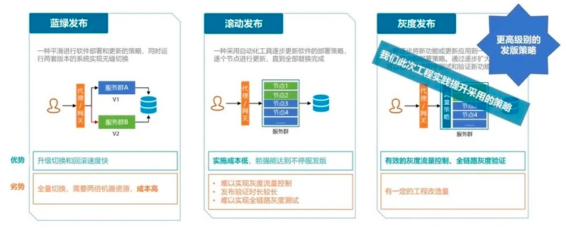
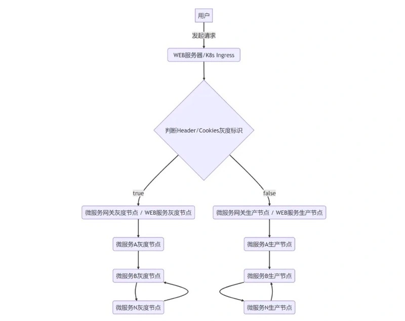
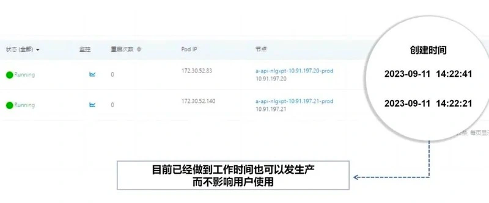

# 68.大厂全链路灰度发布最佳实践

**分享内容**

1. <font style="color:rgb(51, 51, 51);">版本发布策略的现状及存在的问题</font>
2. <font style="color:rgb(51, 51, 51);">业界常用的软件发布策略对比</font>
3. <font style="color:rgb(51, 51, 51);">为什么需要采用灰度发布</font>
4. <font style="color:rgb(51, 51, 51);">全链路灰度发布的实现思路</font>
5. <font style="color:rgb(51, 51, 51);">灰度发布逻辑工程实践与成果展示</font>
6. <font style="color:rgb(51, 51, 51);">总结</font>

# <font style="color:rgb(51, 51, 51);">引言</font>
<font style="color:rgb(51, 51, 51);">在日常发布中，如何保证系统的高可用及稳定性，是我们始终以来的重要任务。我们深知一个可靠、高效的系统对用户体验和业务运行的关键性作用。</font>

<font style="color:rgb(51, 51, 51);">在软件发布与功能验证的环节，我们仍然会面临许许多多的挑战，全链路灰度发布方案专为微服务架构设计，旨在应对微服务架构下的灰度发布挑战。</font>

# <font style="color:rgb(51, 51, 51);">1 版本发布策略的现状及存在的问题</font>
<font style="color:rgb(51, 51, 51);">目前，大部分系统都是应用了基于 </font>**<font style="color:rgb(51, 51, 51);">k8s 容器</font>**<font style="color:rgb(51, 51, 51);">的滚动发布方案，或者在滚动发布的逻辑上，</font>**<font style="color:rgb(51, 51, 51);">实现了优雅停机的逻辑。</font>**

## <font style="color:rgb(51, 51, 51);">1.1 现状</font>
+ <font style="color:rgb(51, 51, 51);">优雅停服 1 个节点，保留其他节点依然提供生产服务</font>
+ <font style="color:rgb(51, 51, 51);">通过日志，观察一段时间，看新的节点是否运行正常。如果不正常，就回滚版本</font>
+ <font style="color:rgb(51, 51, 51);">如果运行正常，继续 1、2 的步骤，一直到所有节点部署完成</font>
+ <font style="color:rgb(51, 51, 51);">测试人员上生产做基本验证</font>

## <font style="color:rgb(51, 51, 51);">1.2 存在问题</font>
+ <font style="color:rgb(51, 51, 51);">不能有效的控制灰度流量，导致测试人员要全部节点部署完，才可以做生产验证</font>
+ <font style="color:rgb(51, 51, 51);">目前的滚动发布逻辑，无法做到增量更新，一旦新版本出了问题，肯定会影响到生产的运行</font>
+ <font style="color:rgb(51, 51, 51);">难以实现全天候平滑稳定的发版</font>
+ <font style="color:rgb(51, 51, 51);">如果版本发布涉及不同服务之间的依赖关系，或者前后端都需要调整，当前策略无法一步到位满足全链路灰度测试场景</font>

# <font style="color:rgb(51, 51, 51);">2 业界常用的软件发布策略对比</font>


# <font style="color:rgb(51, 51, 51);">3 什么是灰度发布？为什么需要采用灰度发布？</font>
## <font style="color:rgb(51, 51, 51);">3.1 什么是灰度发布？</font>
**<font style="color:rgb(51, 51, 51);">灰度发布</font>**<font style="color:rgb(51, 51, 51);">，简单来说就是先小范围进行版本发布，充分验证功能符合预期后，再逐步扩大发布范围。如果出现负面反馈或功能异常时，则需要停止放量，回滚到原先的稳定版本。</font>

<font style="color:rgb(51, 51, 51);">从技术上来说，</font>**<font style="color:rgb(51, 51, 51);">灰度发布是一种流量控制方案</font>**<font style="color:rgb(51, 51, 51);">，对服务的请求流量</font>**<font style="color:rgb(51, 51, 51);">按用户</font>**<font style="color:rgb(51, 51, 51);">或者</font>**<font style="color:rgb(51, 51, 51);">其它特性</font>**<font style="color:rgb(51, 51, 51);">打标签，</font>**<font style="color:rgb(51, 51, 51);">保证特定标签的流量只经过特定标签的服务路径</font>**<font style="color:rgb(51, 51, 51);">。</font>

## <font style="color:rgb(51, 51, 51);">3.2 为什么采用灰度发布？</font>
### <font style="color:rgb(51, 51, 51);">1、降低发布风险</font>
<font style="color:rgb(51, 51, 51);">在新版本发布之前，通过灰度发布把新版本先部署到一小部分用户，以便能更快地发现并解决潜在的问题。</font>

### <font style="color:rgb(51, 51, 51);">2、提高发布质量</font>
<font style="color:rgb(51, 51, 51);">因为在灰度发布期间可以及时发现和解决问题，所以能够在全量发布之前不断完善代码质量，提高系统稳定性和可靠性。</font>

### <font style="color:rgb(51, 51, 51);">3、优化用户体验</font>
<font style="color:rgb(51, 51, 51);">在灰度发布期间，我们可以根据用户反馈来针对性地优化产品功能和界面，确保用户使用的体验最佳。</font>

### <font style="color:rgb(51, 51, 51);">4、降低对系统性能的影响</font>
<font style="color:rgb(51, 51, 51);">由于灰度发布只向部分用户发布新版本，所以能够限制新版本对整个系统的影响。</font>

# <font style="color:rgb(51, 51, 51);">4 全链路灰度发布的实现思路</font>
**<font style="color:rgb(51, 51, 51);">全链路流量路由目前有两种主流实现：</font>**

**<font style="color:rgb(51, 51, 51);">1、基于 Istio</font>**

<font style="color:rgb(51, 51, 51);">采用 Istio 这个开源 Service Mesh 组件，</font>**<font style="color:rgb(51, 51, 51);">通过在每个服务的容器中部署 Envoy 透明代理，拦截服务之间的网络通信并按指定规则转发</font>**<font style="color:rgb(51, 51, 51);">，从而实现了全链路流量路由，无需对现有代码进行修改。</font>

<font style="color:rgb(51, 51, 51);">2、</font>**<font style="color:rgb(51, 51, 51);">基于服务发现组件</font>**

**<font style="color:rgb(51, 51, 51);">通过支持为服务设置元数据的服务注册中心，如 Nacos，可以标记服务实例的特征</font>**<font style="color:rgb(51, 51, 51);">，例如灰度版本。每个服务可以通过注册中心获取其他服务实例的版本信息，并通过修改代码逻辑或 Java Agent 实现流量路由</font>

**<font style="color:rgb(51, 51, 51);">接下来，我们详细来讲基于服务发现组件来实现灰度发布逻辑的方案。</font>**

# <font style="color:rgb(51, 51, 51);">5 灰度发布逻辑工程实践</font>
## <font style="color:rgb(51, 51, 51);">5.1 灰度链路流程图</font>


## <font style="color:rgb(51, 51, 51);">5.2 后端代码改造</font>
**<font style="color:rgb(51, 51, 51);">代码改造原理</font>**<font style="color:rgb(51, 51, 51);">是通过 Spring Cloud 的默认负载均衡器 LoadBalancer，结合 nacos 提供的注册中心和配置中心，</font>**<font style="color:rgb(51, 51, 51);">实现基于微服务网关调用和服务间 OpenFeign 调用的生产和灰度隔离</font>**<font style="color:rgb(51, 51, 51);">。</font>

<font style="color:rgb(51, 51, 51);">以下代码是以 Loadbalancer 为例，扩展的灰度逻辑，如果目前系统基于 Ribbon, 可以考虑使用 Loadbalancer 替换掉 Ribbon, 也可以直接基于 Ribbon 定义自己的灰度负载均衡逻辑，实现方法在本文中不做详细描述。</font>

**<font style="color:rgb(51, 51, 51);">步骤 1：指定灰度启动节点</font>**

<font style="color:rgb(51, 51, 51);">指定灰度节点与生产节点，用于负载均衡器按规则选择不同的链路，用于区别流量，建设 jenkins 部署脚本时，设置在启动项里面。</font>

```plain
/**
* 指定灰度启动节点
*/
--spring.cloud.nacos.discovery.metadata.tag=gray
/**
* 指定生产启动节点
*/
--spring.cloud.nacos.discovery.metadata.tag=master
```

<font style="color:rgb(51, 51, 51);"></font>

**<font style="color:rgb(51, 51, 51);">步骤 2：灰度负载均衡逻辑的实现</font>**

<font style="color:rgb(51, 51, 51);">Spring Cloud 的负载均衡逻辑，无论负载均衡器是 LoadBalancer 或者是 Ribbon，默认逻辑都是轮循逻辑，可以保证每一个上线节点浏量的平均分配，但是无法保证灰度策略的实现，因此，必须得重新定义新的负载均衡逻辑。 </font>

```java
/**
  * 注册灰度规则负载逻辑，
  */
@EnableConfigurationProperties(LoadBalancerProperties.class)
@ConditionalOnProperty(value = LoadBalancerProperties.PROPERTIES_PREFIX + ".enabled", matchIfMissing = true)
public class CustomGrayBalancerConfiguration {
    @Bean
    ReactorLoadBalancer<ServiceInstance> grayLoadBalancer(Environment environment,LoadBalancerProperties loadBalancerProperties, LoadBalancerClientFactory loadBalancerClientFactory) {
        String name = environment.getProperty(LoadBalancerClientFactory.PROPERTY_NAME);
        return new GrayLoadBalancerRule(loadBalancerClientFactory.getLazyProvider(name, ServiceInstanceListSupplier.class),loadBalancerProperties, name);
    }
}
```

<font style="color:rgb(51, 51, 51);"></font>

```java
@Getter
@Setter
@RefreshScope
@ConfigurationProperties(LoadBalancerProperties.PROPERTIES_PREFIX)
public class LoadBalancerProperties {
    public static final String PROPERTIES_PREFIX = "bgyfw.gray";
    /**
     * 是否开启自定义负载均衡-后端
     */
    private boolean globalBackendSwitch = false;
    /**
     * 是否开启自定义负载均衡-前端
     */
    private boolean globalWebSwitch = false;
    /**
     * 灰度用户，当前名称可以随时根据业务场景定义，比如指定区域进行验证
     *，就可以定义成areaList或者其它
     */
    private Set<String> userList = new HashSet<>();
}
```

<font style="color:rgb(51, 51, 51);"></font>

```java
@Slf4j
public class GrayLoadBalancerRule implements ReactorServiceInstanceLoadBalancer {
    private final ObjectProvider<ServiceInstanceListSupplier> serviceInstanceListSupplierProvider;
    private final LoadBalancerProperties loadBalancerProperties;
    private final String serviceId;
    private final AtomicInteger position;
    public GrayLoadBalancerRule(ObjectProvider<ServiceInstanceListSupplier> serviceInstanceListSupplierProvider, LoadBalancerProperties loadBalancerProperties, String serviceId) {
        this.serviceId = serviceId;
        this.loadBalancerProperties = loadBalancerProperties;
        this.serviceInstanceListSupplierProvider = serviceInstanceListSupplierProvider;
        position = new AtomicInteger(RandomUtil.randomInt(1000));
    }
    @Override
    public Mono<Response<ServiceInstance>> choose(Request request) {
        HttpHeaders headers;
        Object o = request.getContext();
        if (o instanceof RequestDataContext) {
            //走全局通用配置逻辑
            RequestData requestData = ((RequestDataContext) o).getClientRequest();
            headers = requestData.getHeaders();
        } else {
            //走前置过滤器逻辑
            headers = (HttpHeaders) o;
        }
        if (serviceInstanceListSupplierProvider != null) {
            ServiceInstanceListSupplier supplier = serviceInstanceListSupplierProvider
              .getIfAvailable(NoopServiceInstanceListSupplier::new);
            return ((Flux) supplier.get()).next().map(list -> getInstanceResponse((List<ServiceInstance>) list, headers));
        }
        return null;
    }
    private Response<ServiceInstance> getInstanceResponse(List<ServiceInstance> instances, HttpHeaders headers) {
        if (instances.isEmpty()) {
            return getServiceInstanceEmptyResponse();
        } else {
            return getServiceInstanceResponseByTag(instances, headers);
        }
    }
    /**
     * 根据版本进行分发
     *
     * @param instances 获取的服务列表
     * @param headers   头数据
     * @return Response<ServiceInstance>
     */
    private Response<ServiceInstance> getServiceInstanceResponseByTag(List<ServiceInstance> instances, HttpHeaders headers) {
        // 指定ip则返回满足ip的服务
        Set<String> priorIpPattern = loadBalancerProperties.getPriorIpPattern();
        if (!priorIpPattern.isEmpty()) {
            String[] priorIpPatterns = priorIpPattern.toArray(new String[0]);
            List<ServiceInstance> priorIpInstances = instances.stream().filter((i -> PatternMatchUtils.simpleMatch(priorIpPatterns, i.getHost()))
            ).collect(Collectors.toList());
            if (!priorIpInstances.isEmpty()) {
                instances = priorIpInstances;
            }
        }
        //判断是否开启灰度逻辑
        boolean openGray = loadBalancerProperties.isGlobalBackendSwitch();
        //如果全局开头没有开启，默认就是不开启
        if (!openGray) {
            return roundService(instances, LoadBalanceConstant.MASTER_METADATA);
        }
        openGray = Boolean.parseBoolean(headers.getFirst(LoadBalanceConstant.API_GRAY_FLAG));
        if (!openGray) {
            return roundService(instances, LoadBalanceConstant.MASTER_METADATA);
        }
        return roundService(instances, LoadBalanceConstant.GRAY_METADATA);
    }
    /**
     * 循环调用service
     *
     * @param instances 服务列表
     * @return Response<ServiceInstance>
     */
    private Response<ServiceInstance> roundService(List<ServiceInstance> instances, String tag) {
        if (ObjectUtil.isEmpty(instances)) {
            return getServiceInstanceEmptyResponse();
        }
        List<ServiceInstance> serviceInstanceList = new ArrayList<>();
        if (ObjectUtil.isNotEmpty(tag)) {
            Map<String, String> versionMap = new HashMap<>(1);
            versionMap.put(LoadBalanceConstant.METADATA_TAG, tag);
            final Set<Map.Entry<String, String>> attributes = Collections.unmodifiableSet(versionMap.entrySet());
            for (ServiceInstance instance : instances) {
                Map<String, String> metadata = instance.getMetadata();
                if (metadata.entrySet().containsAll(attributes)) {
                    serviceInstanceList.add(instance);
                    break;
                }
            }
            if (ObjectUtil.isEmpty(serviceInstanceList)) {
                serviceInstanceList = instances;
            }
        } else {
            //如果没有tag,好表示不需要根据tag进行过滤
            serviceInstanceList = instances;
        }
        if (ObjectUtils.isEmpty(serviceInstanceList)) {
            return getServiceInstanceEmptyResponse();
        }
        int pos = Math.abs(position.incrementAndGet());
        return new DefaultResponse(serviceInstanceList.get(pos % serviceInstanceList.size()));
    }
    private Response<ServiceInstance> getServiceInstanceEmptyResponse() {
        log.warn("No servers available for service: " + serviceId);
        return new EmptyResponse();
    }
}
```

<font style="color:rgb(51, 51, 51);"></font>

```java
//判断是否为灰度用户，头参数添加灰度标识
//根据设置的userList进行判断，看一下是否需要走灰度，
if (loadBalancerProperties.isGlobalBackendSwitch()) {
    boolean isGrayFlag = Boolean.parseBoolean(exchange.getRequest().getHeaders().getFirst(LoadBalanceConstant.API_GRAY_FLAG));
    //如果设置的测试用户存在当前用户
    if (!isGrayFlag && loadBalancerProperties.getUserList().contains(loginUserInfo.getBipCode())) {
        isGrayFlag = true;
    }
    if (isGrayFlag) {
        return chain.filter(exchange.mutate().request(exchange.getRequest().mutate().header(LoadBalanceConstant.API_GRAY_FLAG, String.valueOf(isGrayFlag)).build()).build());
    }
}
```

<font style="color:rgb(51, 51, 51);"></font>

**<font style="color:rgb(51, 51, 51);">步骤 3：开启灰度负载均衡策略</font>**

```java
/**
*在Application启动配置上，开启负载均衡器的全局替换
（一般情况下是网关启动项中，
如果涉及服务与服务之间相互调用，在调用方启动项目中，添加如下代码
）
*/
@LoadBalancerClients(defaultConfiguration = {CustomGrayBalancerConfiguration.class})
public class GatewayServiceApplication {
    public static void main(String[] args) {
        System.setProperty("csp.sentinel.app.type", "1");
        LaunchApplication.run(ModuleConstant.GATEWAY_SERVICE, GatewayServiceApplication.class, args);
        log.info("************启动网关成功***********");
    }
}
```

<font style="color:rgb(51, 51, 51);"></font>

**<font style="color:rgb(51, 51, 51);">步骤 4：Feign 服务调用</font>**

<font style="color:rgb(51, 51, 51);">注意，feign 调用需要定义一个默认拦截器，将请求中的灰度标识继续往下传，另外，除此之外，调用的服务模块启动的时候，仍然需要在启动项上，添加开启灰度负载均衡代码，如上图。</font>

```java
@RequiredArgsConstructor
public class FeignConfiguration {
    /**
     * 创建Feign请求拦截器，将带上灰度标识，链路日志
     * @return
     */
    @Bean
    @ConditionalOnMissingBean
    public DefaultRequestInterceptor basicAuthRequestInterceptor() {
        return new DefaultRequestInterceptor();
    }
}
/**
 * 默认拦截器，添加一些必要的请示头数据
 */
@Slf4j
@RequiredArgsConstructor
public class DefaultRequestInterceptor implements RequestInterceptor {
    @Value("${spring.application.name}")
    private String appName;
    @Override
    public void apply(RequestTemplate requestTemplate) {
        /**
        *获取当前请求头中的参数，通过requestTemplate再往下带回去
        */
        ServletRequestAttributes attributes = (ServletRequestAttributes) RequestContextHolder.getRequestAttributes();
        if (ObjectUtils.isNotEmpty(attributes) && ObjectUtils.isNotEmpty(attributes.getRequest()) && ObjectUtils.isNotEmpty(attributes.getRequest().getHeader(LoadBalanceConstant.API_GRAY_FLAG))) {
            requestTemplate.header(LoadBalanceConstant.API_GRAY_FLAG, attributes.getRequest().getHeader(LoadBalanceConstant.API_GRAY_FLAG));
        }
    }
```

<font style="color:rgb(51, 51, 51);"></font>

## <font style="color:rgb(51, 51, 51);">5.3 前台灰度发布逻辑改造</font>
<font style="color:rgb(51, 51, 51);">前台灰度发布无需涉及到前台代码的改造，基于 ingress/nginx，通过对于 Cookies 的指定参数进行判断，判断是否访问灰度节点或者生产节点，所以，仍然只需要在登录的时候，判断一下当前登录用户的稳定标识，进行是否需要进行灰度验证。</font>

```java
if (loadBalancerProperties.isGlobalWebSwitch() && loadBalancerProperties.getUserList().contains(userLoginOutputVo.getBipCode())) {
    Cookie cookie = new Cookie(LoadBalanceConstant.API_GRAY_FLAG, "always");
    cookie.setMaxAge(-1); // 设置 cookie 的过期时间，单位为秒
    cookie.setPath("/"); // 设置 cookie 的作用路径，这里设置为根路径，表示在整个网站内有效
    response.addCookie(cookie);
}
```

<font style="color:rgb(51, 51, 51);"></font>

## <font style="color:rgb(51, 51, 51);">5.4 网关节点如何灰度发布？</font>
<font style="color:rgb(51, 51, 51);">以上后端服务各个节点的灰度方案，基本上都是基于</font>**<font style="color:rgb(51, 51, 51);">负载均衡规则</font>**<font style="color:rgb(51, 51, 51);">改写得以实现，对于网关节点的负载改造，其实也是类似于</font>**<font style="color:rgb(51, 51, 51);">前台灰度发布逻辑</font>**<font style="color:rgb(51, 51, 51);">，通过 </font>**<font style="color:rgb(51, 51, 51);">ingress/nginx</font>**<font style="color:rgb(51, 51, 51);"> 得以实现，我们只需要</font>**<font style="color:rgb(51, 51, 51);">在请求头中带上灰度节点标识，就可以请求到灰度网关节点</font>**<font style="color:rgb(51, 51, 51);">，完成功能性验证。</font>

# <font style="color:rgb(51, 51, 51);">6 成果展示</font>
**<font style="color:rgb(51, 51, 51);">全链路灰度发布方案</font>**<font style="color:rgb(51, 51, 51);">自创新部门应用并实施以来，首批试点项目（API 能力共享平台，数据交换总线）已经完成改造，</font>**<font style="color:rgb(51, 51, 51);">对业务产生了积极的促进作用</font>**<font style="color:rgb(51, 51, 51);">，为 A/B 测试打下坚实的技术底座：</font>

**<font style="color:rgb(51, 51, 51);">①可全天候实现系统用户零感知平滑升级。</font>**



**<font style="color:rgb(51, 51, 51);">②可以实现前后端一起发布验证，可以动态扩大灰度范围。</font>**

**<font style="color:rgb(51, 51, 51);">③可以极大的减少线上事故率，保证系统的稳定性与高可用，提升用户体验。</font>**

# <font style="color:rgb(51, 51, 51);">7 总结</font>
**<font style="color:rgb(51, 51, 51);">灰度发布是一种有效的软件发布策略，</font>**<font style="color:rgb(51, 51, 51);">能够在保证</font>**<font style="color:rgb(51, 51, 51);">系统稳定性</font>**<font style="color:rgb(51, 51, 51);">的同时，提高软件的</font>**<font style="color:rgb(51, 51, 51);">质量和可靠性</font>**<font style="color:rgb(51, 51, 51);">。通过逐步</font>**<font style="color:rgb(51, 51, 51);">扩大新版本服务的流量</font>**<font style="color:rgb(51, 51, 51);">，</font>**<font style="color:rgb(51, 51, 51);">实现平滑升级和容错处理，</font>**<font style="color:rgb(51, 51, 51);">微服务灰度发布设计为现代软件开发带来了诸多优势。然而，也需要注意其可能带来的性能下降、复杂性和开发成本增加等挑战。在进行微服务灰度发布设计时，</font>**<font style="color:rgb(51, 51, 51);">需要充分考虑实际业务需求和应用场景，制定合适的发布策略，并对潜在的风险进行有效控制</font>**<font style="color:rgb(51, 51, 51);">。</font>


> 更新: 2025-04-20 22:38:57  
> 原文: <https://www.yuque.com/aaron-wecc3/dhluml/aeorevqyg48x58el>