# 69.得物商家下载中心优化实践

**分享内容**

1. 集中式：流程扩展
2. 平台化：配置注册
3. 本地化：任务上报

# <font style="color:rgb(51, 51, 51);">一、背景</font>
<font style="color:rgb(51, 51, 51);">在电商平台上，二八定律尤为明显，20% 的高价值商家往往创造了 80% 以上的销售额。而这些商家通常拥有大量的订单、商品、出价等管理需求，推动了他们对批量操作功能的迫切需求。批量操作能够帮助这些商家高效地处理商品信息、库存和订单管理，显著提升运营效率。</font>

<font style="color:rgb(51, 51, 51);">通过批量操作，商户可以在短时间内对多个产品进行修改，如统一调价、调整促销策略等，从而快速响应市场变化，优化用户体验。此外，批量操作还降低了人工出错的风险，确保了数据的一致性，让商家能够更加专注于战略规划和客户关系管理。总之，对于这些商户而言，批量操作不仅是提升管理效率的关键工具，也是实现业务增长的重要保障。</font>

<font style="color:rgb(51, 51, 51);">在得物的商家后台中，商家的所有批量操作都承载在批处理系统（批处理中心），商家可以通过在功能页面操作批量导入或是批量导出来完成批量操作。操作后的文件将展示在下载中心。</font>

<font style="color:rgb(51, 51, 51);">此外，批处理中心还维护了交易后台、客服、汇金、门店等多个域的批量操作任务。截止目前，批处理中心维护了十个域的上千种批量任务，日均处理数万个相关任务，数亿条相关数据。</font>

<font style="color:rgb(51, 51, 51);">随着得物体量的不断上升，批处理系统也在不断演进。简单来说，批处理系统经历了从分散到耦合、再到集中与隔离的多个发展阶段。接下来，我们以批处理的开发者小王的视角，介绍批处理系统的这三种设计，并探讨它们各自的特点与适用场景。</font>

# <font style="color:rgb(51, 51, 51);">二、集中式：流程扩展</font>
<font style="color:rgb(51, 51, 51);">假设小王接到了一个批量操作的需求，要求在商家后台能进行批量出价。需求很简单，小王仅用时两天半就完成了基本流程的搭建。</font>


<font style="color:rgb(51, 51, 51);">业务上线后，商家反馈非常好，产品要求立刻上线一个批量修改出价的需求。于是小王照葫芦画瓢写又写了一条流程。</font>


<font style="color:rgb(51, 51, 51);">两条几乎一样的流程，有代码洁癖的小王表示无法接受。经过分析后，小王发现，不管是什么导入流程，有些步骤总是固定的，因此决定代码复用。</font>

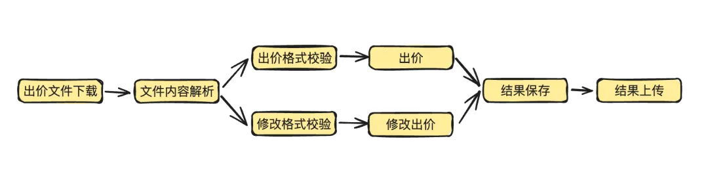

<font style="color:rgb(51, 51, 51);">代码复用后，出价和修改之间只有格式校验和业务逻辑不同。其余的文件下载、内容解析、结果保存和上传均使用相同的节点。既然各个业务之间的差异主要集中在数据处理，小王决定直接将其开成扩展点。不同的业务场景只需要实现各自的数据处理扩展，就能无缝接入批处理流程。业务扩展的示意图如下：</font>

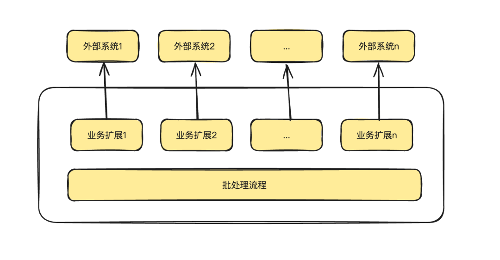

<font style="color:rgb(51, 51, 51);">在具体实现的时候，小王在代码里面通过业务身份来进行扩展点的选择，可以建立一个相关的工厂类进行。</font>

```java
@Component
public class BpcProcessHandlerFactory {
    @Autowired
    private ApplicationContext applicationContext;
    private static ConcurrentHashMap<String, BpcProcessDefine> templateMap = new ConcurrentHashMap<>();
    @PostConstruct
    private void init() {
        Map<String, ImportService> importServiceMap = applicationContext.getBeansOfType(ImportService.class);
        for (ImportService importService : importServiceMap.values()) {
            initImportService(importService);
        }
    }
    private void initImportService(ImportService importService) {
        // ...   
    }
    public BpcProcessHandler getBpcProcessHandler(String templateCode) {
        if (StringUtils.isBlank(templateCode)) {
            return null;
        }
        if(!templateMap.containsKey(templateCode)) {
            return null;
        }
        return templateMap.get(templateCode).newProcessHandler();
    }
}
```

<font style="color:rgb(51, 51, 51);"></font>

<font style="color:rgb(51, 51, 51);">对于导入的任务处理，简化的代码流程如下：</font>

```java
@Service
public class BpcProcessService {
    @Autowired
    private BpcProcessHandlerFactory bpcProcessHandlerFactory;
    public String doBpcProcess(BpcProcessReq req) throws BpcProcessException {
        // 获取扩展点 
        BpcProcessHandler bpcProcessHandler = bpcProcessHandlerFactory.getBpcProcessHandler(req.getTaskTemplateCode());
        if (bpcProcessHandler == null) {
            throw new BpcProcessException("找不到模版定义");
        }
        // 1. 创建任务 
        createTask();
        // 2. 文件下载 && 文件保存 
        downloadFromOss();
        // 3. 数据解析 
        int loopCnt = 0;
        int maxLoopCnt = bpcProcessHandler.getMaxLoopCnt();
        while(loopCnt++ < maxLoopCnt) {
            // 调用扩展点处理 
            bpcProcessHandler.process();
            // 更新任务
            updateTaskProcess();
        }
        // 更新任务
        updateTaskStatus();
        return taskId;
    }
}
```

<font style="color:rgb(51, 51, 51);"></font>

<font style="color:rgb(51, 51, 51);">在完成了流程扩展点后，小王心想，这下可算是高枕无忧了。后续有新的导入场景，只需要实现自己的校验逻辑和处理逻辑即可。</font>

<font style="color:rgb(51, 51, 51);">但是好景不长，随着商家体量的增长，小王发现对接的业务越来越多了；先是出价、再是商品然后是其他逆向、服务费的批量服务，小王一个人实在是写不过来了，只能让各个业务的开发到批处理系统开发自己的业务。各个人的编码习惯不一样，批处理系统对接的 Jar 也越来越多，系统已经变成了一个大杂烩。</font>

<font style="color:rgb(51, 51, 51);">怎么才能改变这个现状呢？</font>

# <font style="color:rgb(51, 51, 51);">三、平台化：配置注册</font>
<font style="color:rgb(51, 51, 51);">在集中式架构中：所有的业务处理流程是共用的，不同的业务通过实现各自的扩展点来完成各个业务的逻辑。这带来了一个最明显的问题，即系统的边界模糊，业务耦合重。</font>

_<font style="color:rgb(51, 51, 51);">这个扩展点能不能写在外部呢？</font>_

<font style="color:rgb(51, 51, 51);">小王灵光一现：SPI 不就可以吗。Java 的 SPI 机制能帮助我们获取各个业务的实现，因此批处理系统只需要基于 SPI 抽象出一套核心的导入 / 导出流程即可。由于各个业务要能准确找到 SPI，还需要加入一定业务配置能力。</font>

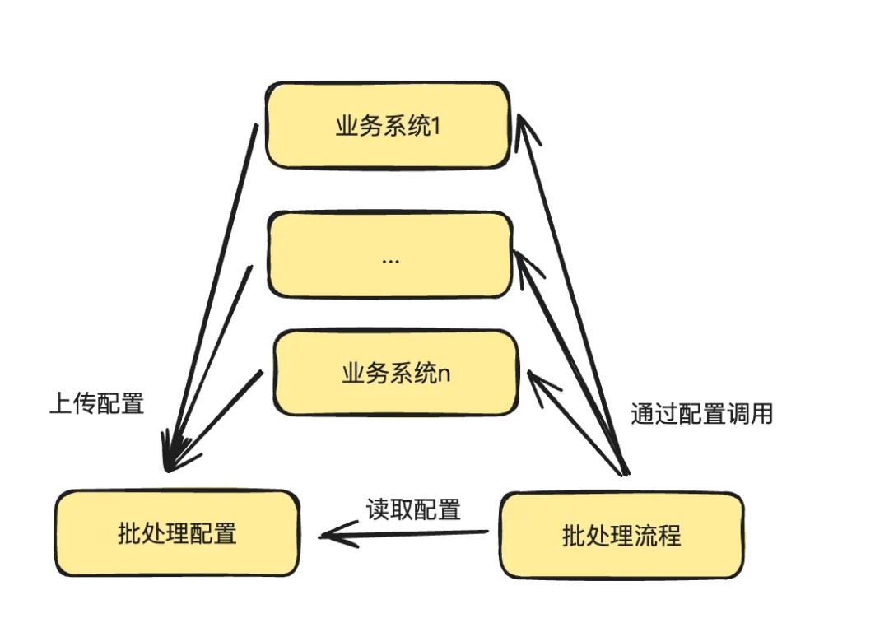

<font style="color:rgb(51, 51, 51);">和集中式架构对比，配置化方案的可扩展性更强，但是也不可避免的带来了一个缺点：开发人员需要去创建配置。</font>

<font style="color:rgb(51, 51, 51);">而批处理配置至少需要包含以下内容：</font>

+ <font style="color:rgb(51, 51, 51);">Excel 格式。</font>
+ <font style="color:rgb(51, 51, 51);">流程调用的 SPI 信息。</font>
+ <font style="color:rgb(51, 51, 51);">数据对象和 Excel 字段之间的映射关系。</font>

<font style="color:rgb(51, 51, 51);">其中字段的映射关系和 SPI 等信息的维护成本较高，为了减轻开发人员的工作量，小王还维护了一个 IDEA 插件。用于一键上传配置。</font>

<font style="color:rgb(51, 51, 51);">后端开发人员可以仅通过注解的方法一键上报自身的配置，大大减轻了业务的配置上传的工作量。</font>

## <font style="color:rgb(51, 51, 51);">同步执行 - 通用配置处理</font>
<font style="color:rgb(51, 51, 51);">在创建完配置后，可以利用 dubbo 的泛化调用来执行各个 SPI 的实现：</font>

```java
@Override
public String invoke(ServiceDefinition serviceDefinition, Object inputParam) {
    GenericService genericService = DubboConfig.buildService(serviceDefinition.getInterfaceName(), serviceDefinition.getTimeout());
    //参数list转换处理，由请求参数key转换成内部参数
    String[] parameterTypes = new String[] {serviceDefinition.getRequestType().getClassName()};
    Object[] args = new Object[] {inputParam};
    long startTime = System.currentTimeMillis();
    Object result;
    try {
        log.info("invoke service={}#{} with request={}", serviceDefinition.getInterfaceName(), serviceDefinition.getMethod(), JSON.toJSONString(args));
        result = genericService.$invoke(serviceDefinition.getMethod(), parameterTypes, args);
        long endTime = System.currentTimeMillis();
        digestLog(serviceDefinition,  true, endTime - startTime);
        log.info("invoke service={}#{} with result={}", serviceDefinition.getInterfaceName(), serviceDefinition.getMethod(), JSON.toJSONString(result));
    } catch (Exception ex) {
        long endTime = System.currentTimeMillis();
        digestLog(serviceDefinition,  false, endTime - startTime);
        log.info("failed to dubbo invoke：" + serviceDefinition.getInterfaceName() + "#" +serviceDefinition.getMethod() + " with error " + ex.getMessage());
        throw new DependencyException(ErrorCodeEnum.DEFAULT_DEPENDENCY_ERROR.getCode(), ex.getMessage(), ex);
    }
    if (result == null) {
        throw new DependencyException(ErrorCodeEnum.DEFAULT_BIZ_ERROR.getCode(), "the result is null");
    }
    Map resultMap = JSON.parseObject(JSON.toJSONString(result), Map.class);
    processError(resultMap);
    Object data = resultMap.get("data");
    return JSON.toJSONString(data);
}
```

<font style="color:rgb(51, 51, 51);"></font>

<font style="color:rgb(51, 51, 51);">简化版的执行流程如下所示：</font>

```java
@Service
public class BpcProcessService {
    @Autowired
    private BpcProcessHandlerFactory bpcProcessHandlerFactory;
    public String doBpcProcess(BpcProcessReq req) throws BpcProcessException {
        // 1. 获取配置 
        TaskTemplate template = getTemplate();
        // 2. 创建任务 
        Task task = createTask();
        // 3. 文件下载 && 文件保存 
        downloadFromOss();
        // 4. 数据解析 
        int loopCnt = 0;
        int maxLoopCnt = template.getMaxLoopCnt();
        while(loopCnt++ < maxLoopCnt) {
            // 调用SPI处理 
            invoke(template, task)
            // 更新任务
            updateTaskProcess();
        }
        // 更新任务
        updateTaskStatus();
        return taskId;
    }
}
```

<font style="color:rgb(51, 51, 51);"></font>

<font style="color:rgb(51, 51, 51);">可以看到配置化后的执行策略和之前流程扩展的执行策略是类似的，主要的变化就是从调用本地扩展点，切换成了调用配置后的 SPI。</font>

## <font style="color:rgb(51, 51, 51);">调度执行 - 业务针对调整</font>
<font style="color:rgb(51, 51, 51);">配置化完成之后，小王松了一口气，这下系统总算是干净了。业务的归业务，流程的归流程，两者互不打扰。然而凡事总不顺利、没过多久批处理系统就出了一次冒烟。简单来说，这次冒烟是由于批处理系统同时处理了大量任务导致的内存溢出。</font>

<font style="color:rgb(51, 51, 51);">针对这次冒烟，小王仔细分析系统数据后发现，商家下载中心的业务有着自己的业务特点：</font>

1. <font style="color:rgb(51, 51, 51);">不同任务之间的数量差异巨大（如，运营任务和商家任务的差距）；</font>
2. <font style="color:rgb(51, 51, 51);">商家操作的流量时间上分布不均，大部分商家操作集中在刚上班 (10 点左右) 和快下班(17 点左右)；</font>
3. <font style="color:rgb(51, 51, 51);">任务流量在商家上分布不均，重点商家会创建大量任务。</font>

<font style="color:rgb(51, 51, 51);">以下是小王分析的部分数据来源图：</font>

+ <font style="color:rgb(51, 51, 51);">任务流量分布不均，下面是各个任务类型的执行统计，其中不同颜色代表不同类型的任务。</font>

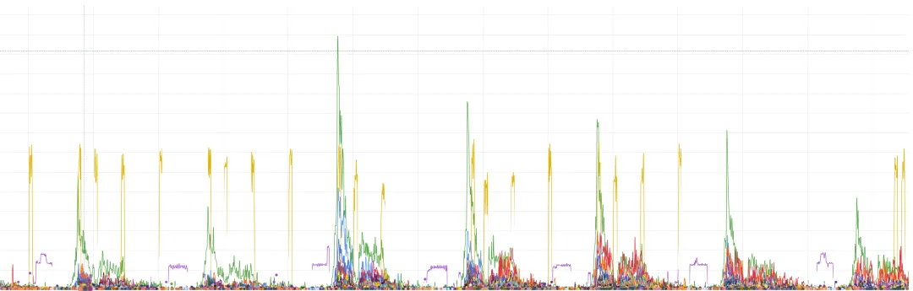

+ <font style="color:rgb(51, 51, 51);">时间流量分布不均，下面是导入导出任务流量的时间分布</font>

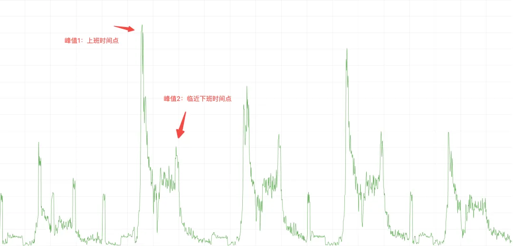

+ <font style="color:rgb(51, 51, 51);">商家流量分布不均</font>

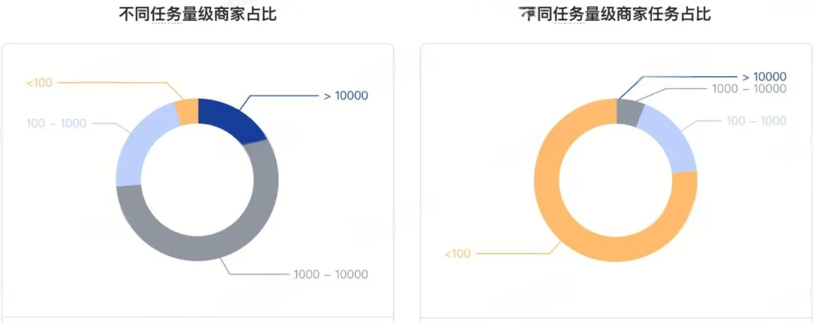

<font style="color:rgb(51, 51, 51);">这些特点在批处理系统中表现为：</font>

1. <font style="color:rgb(51, 51, 51);">系统稳定性风险高，出现过一次线上冒烟。因为系统资源是有限的，高峰期的大流量任务可能会占用过多系统内存，导致 OOM。</font>
2. <font style="color:rgb(51, 51, 51);">商家体验得不到保证，运营操作可能会导致商家长时间等待。</font>

<font style="color:rgb(51, 51, 51);">不就是资源导致的风险吗，小王觉得这是小 case 了，加个限流就搞定了，然后就对创建任务加上了限流。结果上线后情况不仅没有好转，还因为限流 “误杀” 了好多比较重要的导入任务，经过分析后小王终于找到了原因。在商家下载中心的业务中，限流并不能满足资源保护诉求。这实际上是由系统本身的内部架构决定的、因为批处理在大部分情况下是一个低 CPU 高内存占用的系统。如果对任务的提交进行限流，一方面容易误伤核心的订单 / 出价任务，另一个方面忽略了高耗时任务的影响。如下图所示：</font>

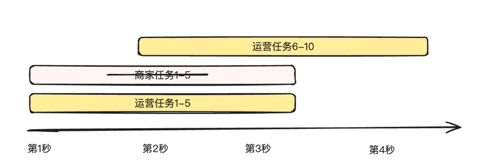

+ <font style="color:rgb(51, 51, 51);">运营任务 "恰好" 占用了流控的窗口，导致后续提交的商家任务都被限流。</font>
+ <font style="color:rgb(51, 51, 51);">长耗时任务会跨越多个时间窗口，导致限流不生效。</font>

<font style="color:rgb(51, 51, 51);">不能限流，那只能自己来了。只要把一切都拿到手里，任务啥时候执行不就是自己说了算了嘛。于是小王打算转变身份，从被动式执行到主动式调度。换言之，就是从同步流程切换成异步调度流程，由系统自己来解决资源的分配，并对业务进行隔离。小王很快画好了自己的核心流程。</font>

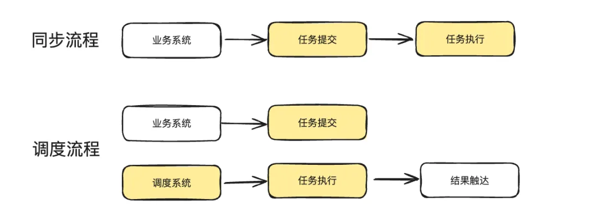

<font style="color:rgb(51, 51, 51);">流程很简单，创建任务的时候不再直接执行，而是等待系统调度后执行。然而小王在调度和隔离这里又犯了难，这俩该怎么做呢？</font>

### <font style="color:rgb(51, 51, 51);">业务隔离</font>
<font style="color:rgb(51, 51, 51);">隔离主要分为两大类，物理隔离和逻辑隔离。</font>

<font style="color:rgb(51, 51, 51);">物理隔离：不同的机器执行不同业务的调度。</font>

+ <font style="color:rgb(51, 51, 51);">集群隔离：类似于应用发布时的蓝绿集群，我们可以把集群分为核心集群 + 非核心集群，用核心集群来保障商家订单，出价等相关动作的稳定性，用非核心集群来保障其他链路；</font>
+ <font style="color:rgb(51, 51, 51);">机器隔离：机器隔离相较于集群隔离，其粒度更小。通过指定 IP 来控制不同业务之间的调度；</font>

<font style="color:rgb(51, 51, 51);">逻辑隔离：通过使用不同线程池的方式来完成业务的隔离。</font>

<font style="color:rgb(51, 51, 51);">凡事先易后难，小王决定先采用简单的方式来对业务进行隔离，线程池的方式已经能分离开可能造成资损的任务和不会造成资损的任务了。在调度方面，小王列举了业内常见的带优先级的调度方法</font>

### <font style="color:rgb(51, 51, 51);">任务调度</font>
1. <font style="color:rgb(51, 51, 51);">优先队列：利用线程池的等待队列来完成优先级的调度。</font>

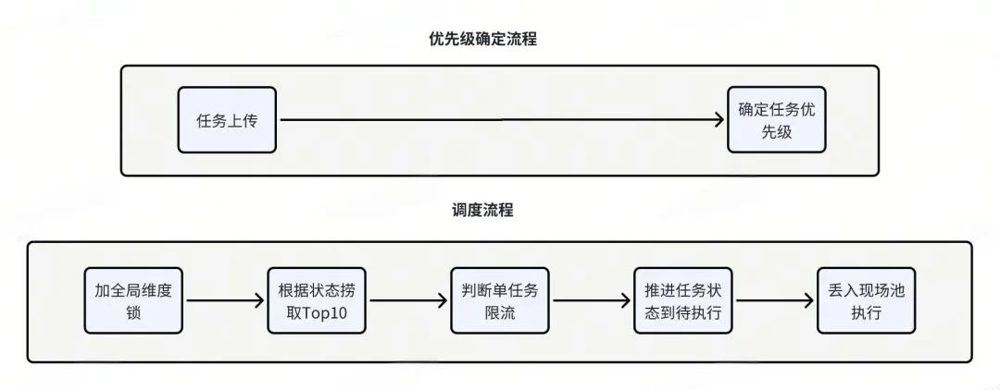

<font style="color:rgb(51, 51, 51);">优点：代码简单，易维护，只需要维护一个优先级队列即可。</font>

<font style="color:rgb(51, 51, 51);">缺点：需要额外增加一个状态来代表等待调度，有饥饿问题，存在一定稳定性风险，因为对线程池的等待队列缺少管控手段。</font>

1. <font style="color:rgb(51, 51, 51);">老化策略：利用老化策略，动态提升任务优先级。</font>

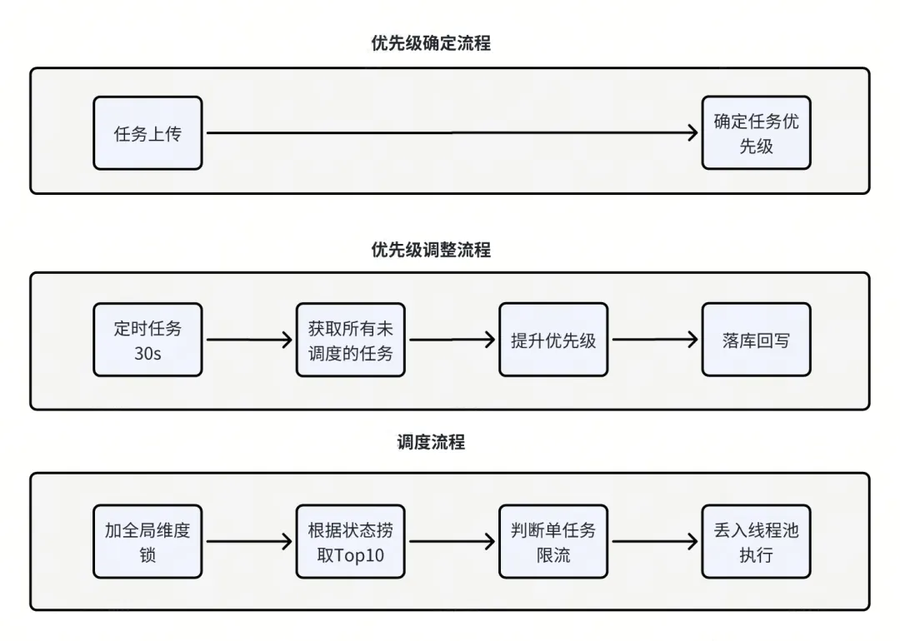

<font style="color:rgb(51, 51, 51);">优点：较大程度上避免饥饿问题，优先级的可扩展性高，对任务的管控能力强，状态机侵入少。</font>

<font style="color:rgb(51, 51, 51);">缺点：需要考虑并发问题，代码较复杂。</font>

1. <font style="color:rgb(51, 51, 51);">多级队列：利用多级队列来完成任务优先级。</font>

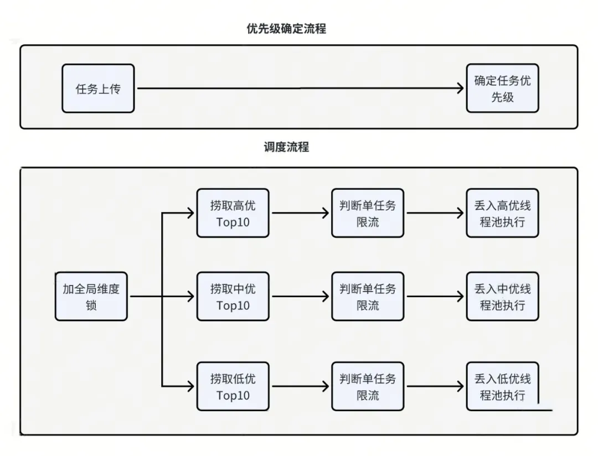

<font style="color:rgb(51, 51, 51);">优点：较大程度上避免饥饿问题，代码较为简洁，任务管控能力强，状态机改动少。</font>

<font style="color:rgb(51, 51, 51);">缺点：任务优先级可扩展性较差，如果新增一个优先级需要改动调度代码，没有高优任务时，系统吞吐性较差。</font>

<font style="color:rgb(51, 51, 51);">综合以上各种方案后，小王最终采用了多级队列 + 线程隔离的方式来进行任务的调度。在调度的具体实现上，采用定时任务来进行流程的触发。</font>

<font style="color:rgb(51, 51, 51);">此外，为了支持大任务量场景临时增加系统吞吐，小王还增加了分片的能力，通过接受分片参数，每台机器只取自己的分片。简化版本的代码如下：</font>

```java
@Service
@Slf4j
public class TaskScheduleServiceImpl implements TaskScheduleService {
    @Override
    @LogAnnotation
    public void schedule(int shared, int all) {
        StopWatch stopWatch = new StopWatch();
        stopWatch.start();
        // 丢线程池执行
        List<Long> highTaskIds = taskInstanceRepository.queryUnstartedTaskIdByPriority(TaskPriorityEnum.HIGH, all * arkConfig.highSize);
        highTaskIds = highTaskIds.stream().filter((id) -> id % all == shared).collect(Collectors.toList());
        log.info("优先级调度任务，待执行高优任务 Ids = {}", highTaskIds);
        process(highTaskIds, (id) -> taskThreadPool.executeHigh(() -> process(id)));
        // 丢线程池执行
        List<Long> mediumTaskIds = taskInstanceRepository.queryUnstartedTaskIdByPriority(TaskPriorityEnum.MEDIUM, all * arkConfig.mediumSize);
        mediumTaskIds = mediumTaskIds.stream().filter((id) -> id % all == shared).collect(Collectors.toList());
        log.info("优先级调度任务，待执行中优任务 Ids = {}", mediumTaskIds);
        process(mediumTaskIds, (id) -> taskThreadPool.executeMedium(() -> process(id)));
        // 丢线程池执行
        List<Long> lowTaskIds = taskInstanceRepository.queryUnstartedTaskIdByPriority(TaskPriorityEnum.LOW, all * arkConfig.lowSize);
        lowTaskIds = lowTaskIds.stream().filter((id) -> id % all == shared).collect(Collectors.toList());
        log.info("优先级调度任务，待执行低优任务 Ids = {}", lowTaskIds);
        process(lowTaskIds, (id) -> taskThreadPool.executeLow(() -> process(id)));
        log.info("优先级调度任务，执行完毕, cost = {}", stopWatch.getTime());
    }
    private void process(List<Long> idList, Consumer<Long> consumer) {
        if (CollectionUtils.isEmpty(idList)) {
            return;
        }
        for (Long id : idList) {
            consumer.accept(id);
        }
    }
    private void process(Long id) {
        // 任务处理逻辑。。。
    }
}
```

<font style="color:rgb(51, 51, 51);"></font>

<font style="color:rgb(51, 51, 51);">干完了这些事后，小王突然想起来，测试环境还需要走染色呢。</font>

<font style="color:rgb(51, 51, 51);">于是又在调度上增加了染色环境的路由。</font>

<font style="color:rgb(51, 51, 51);">这回总算是彻底解决了系统的稳定性问题了，以后系统存在吞吐风险时，只需要动态调整召回数量就好了。</font>

# <font style="color:rgb(51, 51, 51);">四、本地化：任务上报</font>
<font style="color:rgb(51, 51, 51);">做完上面的一切后，小王打开了 APM 的监控，发现系统的内存占用还是很高。明明复杂的业务流程都放到外面了，为啥性能还是一般呢？</font>

<font style="color:rgb(51, 51, 51);">小王思考了现在批处理存在的缺点：</font>

1. <font style="color:rgb(51, 51, 51);">配置维护成本高、业务需要上报 SPI 信息和映射关系，且配置完成后更改风险高。</font>
2. <font style="color:rgb(51, 51, 51);">全局资源利用率低，一份业务数据在多个系统都需要占用内存。</font>
3. <font style="color:rgb(51, 51, 51);">调度的隔离是基于线程池 or 物理机器，粒度较粗，无法完全避免业务之间的互相干扰。</font>

<font style="color:rgb(51, 51, 51);">此外，还有一个令他最难受的问题，就是业务咨询很多。很多业务虽然对接了他的系统，但是在执行失败时他们经常找不到错误原因，需要小王配合排查。如何解决这几个问题呢？</font>

<font style="color:rgb(51, 51, 51);">小王决定返璞归真，回归本源。批处理中心是为了解决商家批量导入导出的问题而生的，其产生的主要目的在于帮助业务平台减少文件解析、文件生成、文件上传、页面展示的成本。</font>

<font style="color:rgb(51, 51, 51);">这些问题一定需要一个系统来支持吗？文件解析和生成实际上是用 EasyExcel 的 SDK 完成的，文件上传是用 Oss 的 SDK 完成的，还有一个页面展示的功能是一个非常轻量的逻辑。换言之，完全可以在业务系统把前几件事都做了。构建一个批处理插件来完成批处理中心的大部分能力，批处理系统仅作为展示使用。小王产生了一个新的想法：把逻辑放到批处理 SDK 中去，批处理仅维护一两台机器用于承载展示逻辑即可。</font>

<font style="color:rgb(51, 51, 51);">整体的架构设计如下图所示：</font>

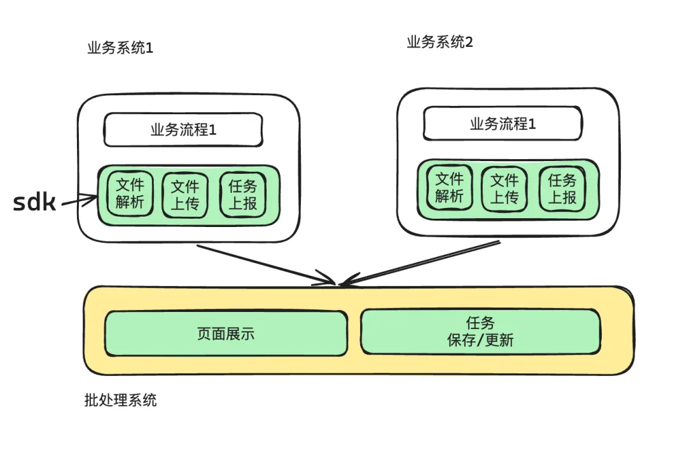

<font style="color:rgb(51, 51, 51);">在本地化的思路下：批处理中心类似于一个中心节点，各个业务系统作为其的叶子节点，只需要定时上报任务相关情况即可。批处理系统只负责页面的展示，和业务完全解耦。</font>

<font style="color:rgb(51, 51, 51);">本地化带来了以下几个明显的好处：</font>

1. <font style="color:rgb(51, 51, 51);">效率高，不再需要跨系统之间的逻辑调用，既能节约系统资源，又能减少网络传输时间。</font>
2. <font style="color:rgb(51, 51, 51);">维护成本低，业务方可随时调整业务映射，批处理只需要维护极小的配置 (模版和对应的展示名称、展示地方)。</font>
3. <font style="color:rgb(51, 51, 51);">迭代升级容易，平台化的改造由于影响面比较大，风险高。而 SDK 的升级是单应用升级的，因此影响小，风险可控。</font>
4. <font style="color:rgb(51, 51, 51);">流程扩展相对简单，SDK 可以提供相对较多的钩子函数。</font>

<font style="color:rgb(51, 51, 51);">当然，凡事没有银弹。本地化也不可避免带来了一些缺点：</font>

1. <font style="color:rgb(51, 51, 51);">业务需要维护部分配置，这其中主要是一些 oss 相关的配置。</font>

<font style="color:rgb(51, 51, 51);">本地化后，批处理中心不需要维护业务逻辑、也不需要任务调度、任务的隔离粒度最细。小王总算是能安心睡个好觉了。</font>

# <font style="color:rgb(51, 51, 51);">五、总结</font>
<font style="color:rgb(51, 51, 51);">上面我们以一个批处理系统普通开发者的视角，回归了商家批处理系统发展的三个阶段 (本地化正在进行中)。这三个阶段，体现了从厚到薄、从业务耦合到业务隔离的演进过程。从本地到平台再到本地，颇有种天下大势，分久必合合久必分的感觉。这三种方式并没有绝对的优劣之分，而是随着业务需求的变化而逐步演化的。</font>

<font style="color:rgb(51, 51, 51);">在初始阶段，系统功能较少，通常只有一两个简单的导入导出功能，此时使用流程扩展是最轻量、最灵活的选择，能够快速满足商家的基本需求。随着业务量的增长，系统之间的隔离性变得越来越重要，这时引入配置注册成为必要措施，以确保不同模块之间的自主性和稳定性。</font>

<font style="color:rgb(51, 51, 51);">进一步发展后，平台化改造的初步实现通常采用同步调用方式，但随之而来的稳定性要求推动了异步调度的引入。然而，到了后期，即使是异步调度也可能面临系统吞吐量不足的问题。因此，业务系统本地执行状态上报的模式逐渐成为更优的选择，能够有效提升系统的响应速度和处理能力。</font>

<font style="color:rgb(51, 51, 51);">随着业务的不断发展，商家的批处理系统必然会进行更新与迭代，以适应新的需求和挑战。系统设计没有银弹，所有设计的迭代实际上就是开发人员遇见问题、解决问题的能力体现。</font>


> 更新: 2025-04-20 22:38:56  
> 原文: <https://www.yuque.com/aaron-wecc3/dhluml/eb77uzbucv4nc2v6>