# 70.携程机票业务中台化落地实践

**分享内容**

1. <font style="color:rgb(51, 51, 51);">中台化的背景和面临的挑战</font>
2. <font style="color:rgb(51, 51, 51);">中台化设计的原则以及目标</font>
3. <font style="color:rgb(51, 51, 51);">中台化架构的关键技术实践</font>
4. <font style="color:rgb(51, 51, 51);">整体技术架构概览以及线上运行效果</font>

### <font style="color:rgb(51, 51, 51);">一、背景与挑战</font>
<font style="color:rgb(51, 51, 51);">随着携程国际机票业务的快速发展与全球化战略的深入推进，需要使用的数据种类以及对应的复杂度也随之显著增加。这一增长趋势不仅带来了数据管理的挑战，同样对数据准确性和实时性提出了更高的要求。</font>

<font style="color:rgb(51, 51, 51);">接下来，我们从生产者和消费者两个角度具体看下有哪些挑战。</font>

**<font style="color:rgb(51, 51, 51);">生产者视角下的挑战</font>**<font style="color:rgb(51, 51, 51);">：对于基础数据的生产者，每一种数据类型都有其独特的业务逻辑，涵盖数据的获取、处理、存储和匹配等环节。数据更新周期长，业务复杂性高，和基础数据相关的应用就达到了几十个，维护成本不断攀升。同时，还存在着数据访问效率低、上云过程复杂、数据回滚困难以及无法应对大规模机器重启或数据刷新等问题。</font>

**<font style="color:rgb(51, 51, 51);">消费者视角下的挑战</font>**<font style="color:rgb(51, 51, 51);">：对于基础数据的消费者，每一个应用都或多或少依赖于基础数据。任何一种数据的误差都可能引发广泛的线上问题，而且问题的发现往往滞后，导致生产问题被不断放大。此外，还存在着业务开发接入复杂、测试环境不稳定、服务启动缓慢、垃圾回收频繁、上云过程繁琐以及数据不一致等问题。</font>

### <font style="color:rgb(51, 51, 51);">二、原则与目标</font>
<font style="color:rgb(51, 51, 51);">面对上述问题，构建一套中台化系统是其中一个解决方案，我们希望实现数据资源的高效整合，消除数据孤岛，提高数据处理效率，确保数据质量标准。在系统设计的初期阶段，我们首先从数据生产者和消费者角度出发确立了一系列核心目标：</font>

**<font style="color:rgb(51, 51, 51);">数据生产者角度：</font>**

**<font style="color:rgb(51, 51, 51);">数据一致性</font>**<font style="color:rgb(51, 51, 51);">：确保数据在各个环节保持一致性，避免偏差。</font>

**<font style="color:rgb(51, 51, 51);">数据时效性</font>**<font style="color:rgb(51, 51, 51);">：保障数据的实时更新，满足业务对数据的即时性需求。</font>

**<font style="color:rgb(51, 51, 51);">系统健壮性</font>**<font style="color:rgb(51, 51, 51);">：构建稳定可靠的系统架构，以应对各种运行环境和负载条件。</font>

+ <font style="color:rgb(51, 51, 51);">数据可追溯性：实现数据的全流程追踪，便于问题定位和历史分析。</font>
+ <font style="color:rgb(51, 51, 51);">数据可回滚性：提供数据版本控制，允许在出现问题时快速回退至稳定状态。</font>
+ <font style="color:rgb(51, 51, 51);">监控完善性：建立全面的监控体系，实时监控数据流和系统状态。</font>

**<font style="color:rgb(51, 51, 51);">降低成本</font>**<font style="color:rgb(51, 51, 51);">：通过优化资源配置，降低机器和存储的成本；简化系统维护流程，减少人力和时间的投入。</font>

**<font style="color:rgb(51, 51, 51);">数据消费者角度：</font>**

**<font style="color:rgb(51, 51, 51);">优化消费流程</font>**<font style="color:rgb(51, 51, 51);">：简化数据消费流程，提高数据处理的便捷性和效率。</font>

+ <font style="color:rgb(51, 51, 51);">接入方式简化：提供直观易用的接入方式，降低数据使用的门槛。</font>
+ <font style="color:rgb(51, 51, 51);">统一数据模型：建立统一的数据模型，确保数据的一致性和可理解性。</font>

**<font style="color:rgb(51, 51, 51);">解决环境问题</font>**<font style="color:rgb(51, 51, 51);">：解决不同运行环境下的数据同步的问题。</font>

+ <font style="color:rgb(51, 51, 51);">测试环境完善：提供完善的测试环境，确保数据的准确性和稳定性。</font>
+ <font style="color:rgb(51, 51, 51);">云服务便捷性：优化云服务接入，提高数据服务的灵活性和可扩展性。</font>

**<font style="color:rgb(51, 51, 51);">提升服务性能</font>**<font style="color:rgb(51, 51, 51);">：通过技术优化，提升服务的响应速度和处理能力。</font>

+ <font style="color:rgb(51, 51, 51);">启动耗时降低：减少服务启动时间，提高系统的快速响应能力。</font>
+ <font style="color:rgb(51, 51, 51);">减少 GC 次数：优化内存管理，减少因数据更新引起的垃圾回收（GC）操作，提升系统性能。</font>

### <font style="color:rgb(51, 51, 51);">三、关键技术实践</font>
<font style="color:rgb(51, 51, 51);">在基础数据中台化建设的实践过程中，遇到了一系列的问题，我们介绍一些关键的技术实践。</font>

#### <font style="color:rgb(51, 51, 51);">3.1 数据一致性</font>
**<font style="color:rgb(51, 51, 51);">3.1.1 版本控制</font>**

<font style="color:rgb(51, 51, 51);">同一集群下不同的机器在更新缓存时由于调度时间不一致，会导致不同机器在同一时间使用的数据不一致，为解决此问题，我们使用数据版本控制策略来解决此问题。每当数据发生变更，我们便认定一个新的数据版本已经诞生。这个新版本可以是包含了变更和未变更数据的完整副本（以下简称为 "全量数据"），也可以是仅包含变更内容的更新（以下简称为 "增量数据"）。不论是全量数据还是增量数据，我们都会将数据记录在 BLOB（Binary Large Object）文件中，BLOB 文件将作为数据传输的媒介。</font>

<font style="color:rgb(51, 51, 51);">实施数据版本控制后，我们能够收获以下收益：</font>

**<font style="color:rgb(51, 51, 51);">版本追踪</font>**<font style="color:rgb(51, 51, 51);">：确保每一次数据更新都有迹可循，并且在新版本出现问题时能够迅速恢复到之前的版本。</font>

**<font style="color:rgb(51, 51, 51);">数据一致性</font>**<font style="color:rgb(51, 51, 51);">：保证所有数据消费者能访问到相同版本的数据，从而减少因数据版本不一致而引发的问题。</font>

**<font style="color:rgb(51, 51, 51);">容错与恢复</font>**<font style="color:rgb(51, 51, 51);">：能够快速识别出问题数据，并利用多种通知机制，促使产品或开发团队及时介入，解决问题。</font>

**<font style="color:rgb(51, 51, 51);">性能监控</font>**<font style="color:rgb(51, 51, 51);">：基于数据版本，构建性能监控体系，以评估数据传输和处理的效率。</font>

**<font style="color:rgb(51, 51, 51);">数据安全</font>**<font style="color:rgb(51, 51, 51);">：在数据传输和存储过程中，通过加密和访问控制机制，确保数据安全，防止未授权访问。</font>

**<font style="color:rgb(51, 51, 51);">3.1.2 去中心化</font>**

<font style="color:rgb(51, 51, 51);">在业界，如果某个服务想要消费基础数据时，主流解决方案是采用直连数据库或调用应用程序接口的方式，如下图 1 和图 2，这两者均属于 C/S 架构。C/S 架构虽被广泛采用，却面临着如数据库承载压力大、数据一致性难以保障、系统扩展性不足、开发与集成过程复杂、硬件成本高昂、缓存穿透、中心服务的读压力，以及难以应对流量高峰等问题。</font>

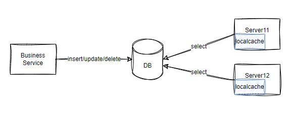

<font style="color:rgb(51, 51, 51);">图 1</font>

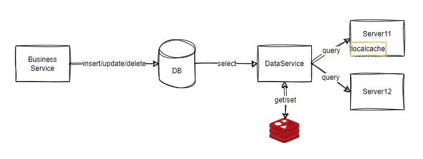

<font style="color:rgb(51, 51, 51);">图 2</font>

<font style="color:rgb(51, 51, 51);">为了克服以上问题，我们引入了 P2P 架构（Peer-to-Peer Architecture）。与 C/S 架构相比，P2P 架构实现了去中心化。在 P2P 网络中，每个节点都具备客户端和服务器的双重身份，能够直接与其他节点进行通信和数据交换，无需依赖中央服务器。同时，P2P 架构下的数据查询耗时并不会因为客户端数量的增加而线性增长。图 3 直观地展示了 C/S 架构与 P2P 架构的本质区别。</font>

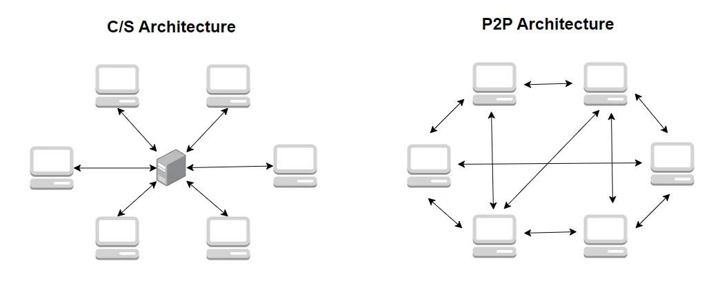

<font style="color:rgb(51, 51, 51);">图 3</font>

<font style="color:rgb(51, 51, 51);">基于前文提到的 BLOB 文件版本控制机制，我们选择了 BitTorrent 协议作为 P2P 网络中的文件共享与分发标准。BitTorrent 以其高效的数据传输能力，特别适用于大规模数据的快速分发，具体架构如图 4，客户端可以根据实际需求控制是否要加入 Peer 网络，如图 4 中的红色机器就仅仅下载数据，并不分享给其他 peer。</font>

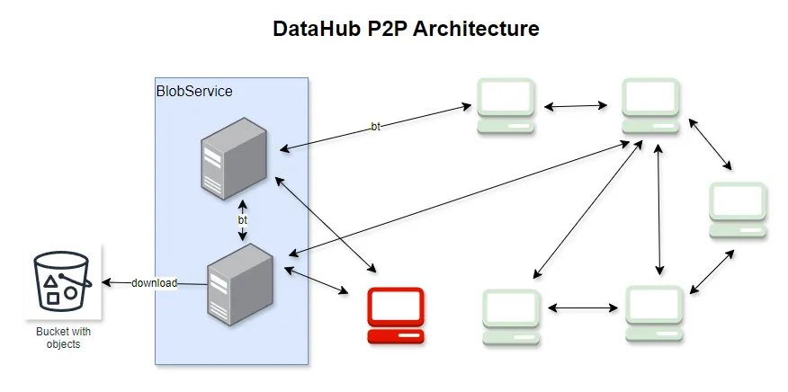

<font style="color:rgb(51, 51, 51);">图 4</font>

**<font style="color:rgb(51, 51, 51);">3.1.3 数据组合策略优化</font>**

<font style="color:rgb(51, 51, 51);">在业务实践中，我们有时候会需要处理多种基础数据的组合场景，比如想要在消费国家数据时一同消费国家所在大洲数据，当组合中的数据版本出现不一致时，会导致数据不准确。</font>

<font style="color:rgb(51, 51, 51);">为应对这一挑战，我们采取的方法是通过业务规则，将所有相关联的组合数据整合到单一的 torrent 文件中，消费方可以一次性下载到所有关联数据。这种整合方式的优势在于，它允许消费方一次性获取整个数据集合，而不需要分别从不同来源或版本中收集和协调数据。通过这种方式，我们不仅简化了数据获取过程，而且更重要的是确保了数据的一致性和准确性。</font>

**<font style="color:rgb(51, 51, 51);">3.1.4 单点数据生成策略</font>**

<font style="color:rgb(51, 51, 51);">集群内不同的机器间隔几秒钟查询同一数据库，查询结果便可能会有所不同，为保证消费方数据一致性，我们在生成全量和增量数据时采取了单点数据加载模式，如图 5。仅有单一的机器负责从数据库中查询数据，这种设计一方面显著降低了数据库的读取压力，其效果相当于将压力分散至消费方机器数量的 1/n（n 代表消费方机器的总数），另一方面结合版本控制策略，在同一时间内中台系统中仅仅有一个有效的版本数据可以被使用。</font>

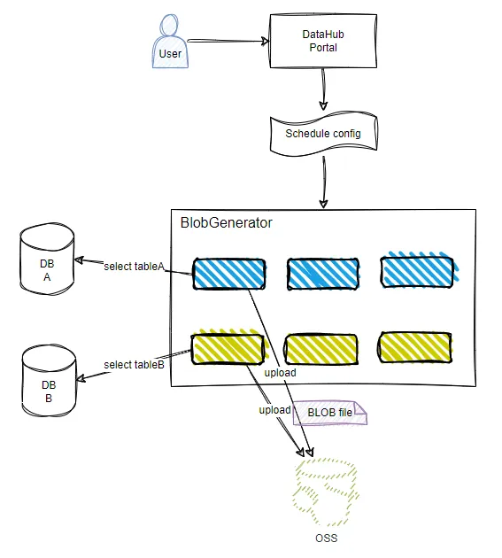

<font style="color:rgb(51, 51, 51);">图 5</font>

<font style="color:rgb(51, 51, 51);">此外，不同种类的数据更新频率各异，这通常由具体的业务需求所决定。因此，中台系统提供了自定义数据生成配置的功能，这种灵活性的好处在于：</font>

**<font style="color:rgb(51, 51, 51);">减少不必要的数据加载</font>**<font style="color:rgb(51, 51, 51);">：通过精确控制数据生成的频率和时机，避免了资源的浪费。</font>

**<font style="color:rgb(51, 51, 51);">降低客户端缓存刷新压力</font>**<font style="color:rgb(51, 51, 51);">：减少了因频繁数据更新导致的客户端垃圾回收（GC）操作，从而提高了客户端的性能。</font>

**<font style="color:rgb(51, 51, 51);">缓解网络带宽压力</font>**<font style="color:rgb(51, 51, 51);">：通过优化数据生成和传输策略，减轻了整个网络的带宽负担，确保了数据传输的高效性。</font>

#### <font style="color:rgb(51, 51, 51);">3.2 数据时效性</font>
**<font style="color:rgb(51, 51, 51);">3.2.1 推拉机制</font>**

<font style="color:rgb(51, 51, 51);">为确保数据生产至消费的全流程时效性，防止数据更新滞后对业务造成损失，我们在架构设计中引入了推拉结合模式。前序系统完成数据处理后，即通过消息中间件向后续系统发出通知，这一连贯流程在各子系统中依次触发，直至数据被消费。</font>

<font style="color:rgb(51, 51, 51);">为提高流程可靠性，我们引入了可配置的基于定时任务中间件的拉状态逻辑，确保了任何环节的延迟或异常都能被及时补偿。</font>

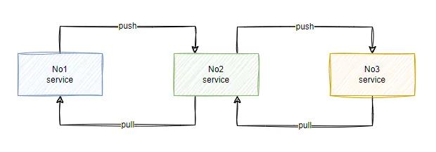

<font style="color:rgb(51, 51, 51);">图 6</font>

**<font style="color:rgb(51, 51, 51);">3.2.2 数据云端迁移</font>**

<font style="color:rgb(51, 51, 51);">随着携程国际业务的不断拓展，我们的系统架构正逐步向混合云模式转型。传统的基础数据上云是复制数据库到云端，虽然可行，但往往会带来成本上升和数据复制延迟等问题。为应对这些挑战，我们将 Blob 文件分发到不同的 Region，避免了对昂贵数据库实例的依赖，在保证数据时效性的前提下成本降低 98% 以上，与此同时使用此架构消费方在上云过程中可以做到无缝迁移。具体架构如图 7。</font>

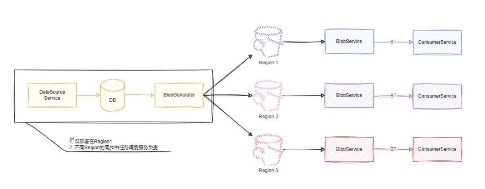

<font style="color:rgb(51, 51, 51);">图 7</font>

#### <font style="color:rgb(51, 51, 51);">3.3 系统健壮性</font>
**<font style="color:rgb(51, 51, 51);">3.3.1 数据校验和拦截</font>**

<font style="color:rgb(51, 51, 51);">在数据的生命周期中，无论是业务维护的数据，还是由外部数据提供商提供的数据，数据错误总是一个不可忽视的问题。这些错误表现为非法字符、数据缺失、数据重复等。为有效解决此问题，我们开发了一套数据校验机制，针对数据的每个字段执行严格的合规性检查。系统一旦监测到异常数据，将立即通过 TripPal（携程自研的 IM 系统）、电子邮件、短信等多种通信渠道，向数据负责人发出警报，这样可以迅速响应并处理问题。</font>

<font style="color:rgb(51, 51, 51);">在问题未解决前，系统会自动暂停出问题数据的更新，防止错误数据的扩散。此外，为了进一步提升数据校验的准确性，我们结合了统计学算法和人工智能（AI）预测模型，对数据变化进行分析和智能判断。具体的架构如图 8。</font>

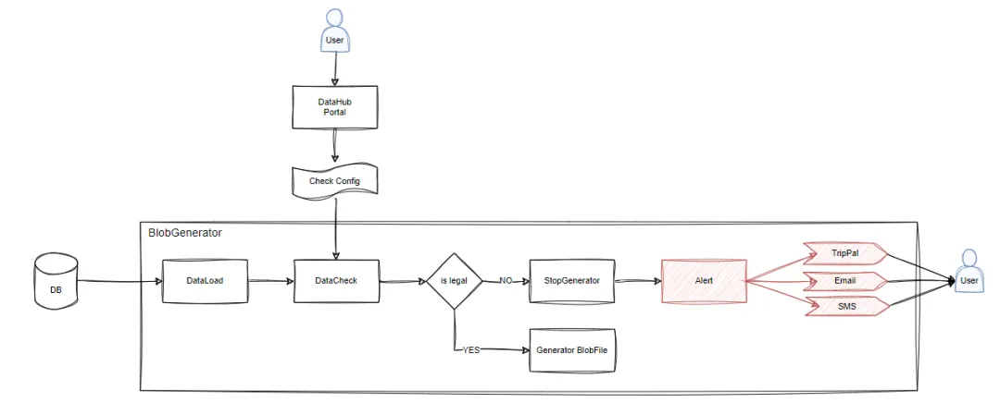

<font style="color:rgb(51, 51, 51);">图 8</font>

**<font style="color:rgb(51, 51, 51);">3.3.2 数据回滚</font>**

<font style="color:rgb(51, 51, 51);">在生产环境中，面对突发的系统故障，实施回滚操作是最迅速且有效的应对策略。中台系统为此提供了一套数据回滚功能，将回滚版本的数据视为一个完全正常的版本，通过中台的 Portal 界面，用户可以依据时间戳追溯并查询到所需的历史数据版本。其中，整个回滚过程无需对数据库进行任何数据层面的修改，这一点与依赖于二进制日志（binlog）的回滚方法相比，提高了效率和安全性。如图 9。</font>

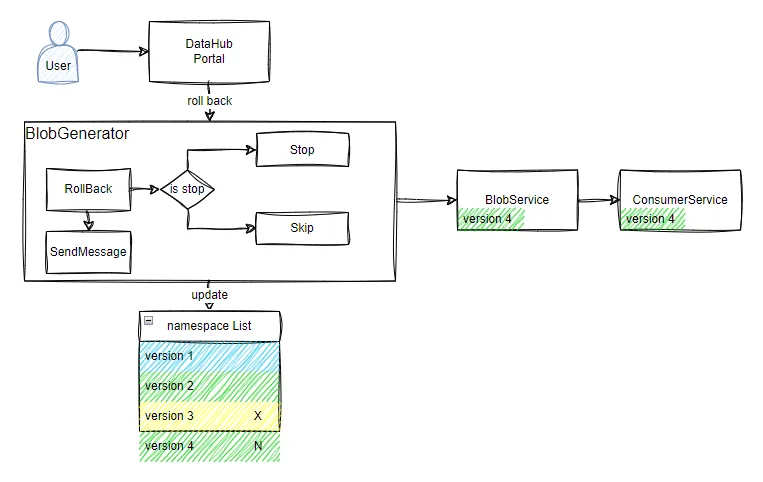

<font style="color:rgb(51, 51, 51);">图 9</font>

#### <font style="color:rgb(51, 51, 51);">3.4 消费流程优化</font>
**<font style="color:rgb(51, 51, 51);">3.4 1 统一数据模型</font>**

<font style="color:rgb(51, 51, 51);">数据模型会出现新增、修改和删除字段的场景，通常我们会通过编码的方式实现，不仅过程繁琐，而且随着时间推移，会显著增加系统的维护成本。为了降低消费方消费数据的复杂度，需要支持任意数据模型的自动化生产和消费。我们通过脚本化手段实现自动化构建（build）和部署（deploy）jar 包，从而简化流程。具体的流程如图 10。</font>

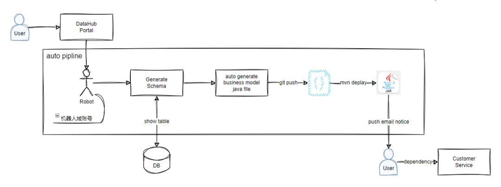

<font style="color:rgb(51, 51, 51);">图 10</font>

**<font style="color:rgb(51, 51, 51);">3.4.2 简化接入方式</font>**

<font style="color:rgb(51, 51, 51);">当需要消费某个数据时，引入通过图 10 流程生成的独立 model 包，通过以下代码即可获取全量数据集或者按条件查询的数据集。</font>

```plain
// 引入客户端
@DataResource
private CityClient cityClient;
// 全量查询
List<City> list = cityClient.queryList();
// 条件查询
List<City> list = cityClient.queryList(cityCode);
```

#### <font style="color:rgb(51, 51, 51);">3.5 统一数据治理</font>
<font style="color:rgb(51, 51, 51);">在实际的工作中，开发团队和产品团队常常面临一个共同的挑战：如何在种类繁多的基础数据中找到目前生产上实际使用的基础数据？一般会通过口口相传或维护共享文档的方式来解决，但是这种方法不仅效率低，而且容易因人为失误或信息更新不及时导致生产问题，为此，数据中台实现了一个统一的模型入口，简化了数据和模型的搜索和引用过程。用户可以在 Portal 中按照数据库名、数据表名、接口名等检索条件轻松搜索所需的数据类型，如果存在，可以直接引用；如果不存在，可以根据具体的业务需求新增。</font>

<font style="color:rgb(51, 51, 51);">对于新的业务接入中台，我们也进行了流程的优化。优化后，接入中台只需调整数据源，无需进行额外的开发工作。这一改进显著减少了业务接入的复杂性和工作量，最小化了接入流程。与直接连接数据库或调用应用程序接口的方式相比，中台系统在数据接入效率上实现了 90% 以上的提升。</font>

### <font style="color:rgb(51, 51, 51);">四、技术架构概览</font>
<font style="color:rgb(51, 51, 51);">在前文所述的基础上，本节从宏观的系统架构视角，阐述携程国际机票基础数据中台化建设的关键技术实现。我们的系统精心设计为若干个互相协作的核心模块，每个模块承担着特定的职责，共同构成了数据处理和分发的中台化平台。</font>

<font style="color:rgb(51, 51, 51);">1）DataSource 模块：作为数据流的起点，此模块负责数据的初始写入和确保数据一致性。它通过定时任务或消息通知机制触发数据操作流程。</font>

<font style="color:rgb(51, 51, 51);">2）BlobGenerator 模块：专注于数据的生产过程，提供全面的服务，包括数据校验、BLOB 文件生成、版本控制以及回滚操作的拦截。</font>

<font style="color:rgb(51, 51, 51);">3）BlobService 模块：作为数据分发的核心，处理来自 DataClient 的数据请求，充当 BlobGenerator 与 DataClient 之间的桥梁，确保数据流畅、高效地传递。</font>

<font style="color:rgb(51, 51, 51);">4）DataClient 模块：负责数据的消费端，提供包括 BitTorrent 下载、缓存管理、以及支持精确查询等多种功能，满足不同场景下的数据使用需求。</font>

<font style="color:rgb(51, 51, 51);">5）DataQuery 模块：为那些无法通过 BitTorrent 下载方式获取数据的消费者提供了 API 查询接口，支持全量数据输出、条件筛选输出以及逻辑计算等高级功能。</font>

<font style="color:rgb(51, 51, 51);">6）Dispatcher 模块：作为系统的调度协调中心，确保 DataSource、BlobGenerator、BlobService 等模块的任务有序执行，保障整个数据处理流程的顺畅和同步。</font>

<font style="color:rgb(51, 51, 51);">通过这些模块的紧密协作，我们的技术架构不仅提升了数据处理的效率和准确性，还增强了系统的可扩展性和可维护性。</font>

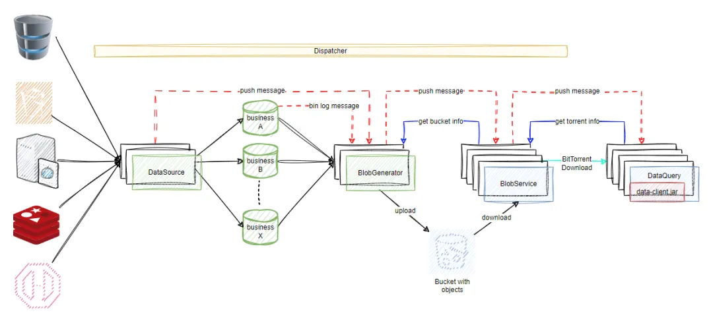

<font style="color:rgb(51, 51, 51);">图 11</font>

### <font style="color:rgb(51, 51, 51);">五、成效</font>
<font style="color:rgb(51, 51, 51);">数据中台实现了从数据生成到消费的全生命周期覆盖。系统化的数据治理举措提升了数据系统在治理、成本控制、安全性和运营效率方面的性能。</font>

**<font style="color:rgb(51, 51, 51);">数据生产者角度</font>**<font style="color:rgb(51, 51, 51);">：我们对分散的业务流程进行了梳理和优化，根据优先级分批整合至中台。在这一过程中，我们不仅重构了业务流程，还通过重写和优化，挖掘并解决了多个之前未被发现的问题。数据分发的效率实现了质的飞跃，平均分发时间降至 23 秒，对于小规模数据，我们更是实现了 5 秒内的端到端快速传输，极大提升了数据的实时性和新鲜度；整体服务器成本降低了 95% 以上；系统的维护成本降低 66%。</font>

**<font style="color:rgb(51, 51, 51);">数据消费者角度</font>**<font style="color:rgb(51, 51, 51);">：新数据源的接入效率提升了 90%，上云过程无需进行特殊改造，加快了研发进度，提高了开发效率。解决不同运行环境下的数据同步的问题，减少了对生产环境的依赖。优化了调度策略，减少了 98% 以上的无效调度任务，降低了 GC 的频率。</font>

### <font style="color:rgb(51, 51, 51);">六、总结</font>
<font style="color:rgb(51, 51, 51);">国际机票数据中台在上线体现了一些在研发效能、数据治理、性能优化、业务提升、降低成本等方面优势，从以下几个关键方面对数据中台进行深入迭代和优化：</font>

<font style="color:rgb(51, 51, 51);">1）</font>**<font style="color:rgb(51, 51, 51);">自动化</font>**<font style="color:rgb(51, 51, 51);">：进一步提升数据处理流程的自动化程度，减少人工干预，提高整体效率，特别会利用大语言模型等技术进行数据校验以及，增强数据准确性。</font>

<font style="color:rgb(51, 51, 51);">2）</font>**<font style="color:rgb(51, 51, 51);">稳定性</font>**<font style="color:rgb(51, 51, 51);">：加强系统的稳定性，确保数据中台在高并发和大数据量处理场景下的可靠性。</font>

<font style="color:rgb(51, 51, 51);">3）</font>**<font style="color:rgb(51, 51, 51);">健壮性</font>**<font style="color:rgb(51, 51, 51);">：构建更加健壮的系统架构，提高系统对异常情况的容错能力和自我恢复能力。</font>

<font style="color:rgb(51, 51, 51);">4）</font>**<font style="color:rgb(51, 51, 51);">时效性</font>**<font style="color:rgb(51, 51, 51);">：优化数据更新和分发机制，确保数据的实时性和时效性。</font>

<font style="color:rgb(51, 51, 51);">5）</font>**<font style="color:rgb(51, 51, 51);">可视化</font>**<font style="color:rgb(51, 51, 51);">：通过可视化技术，直观展示数据流动和处理过程，提高数据可读性和易用性。</font>

+ <font style="color:rgb(51, 51, 51);">更友好的 Portal 界面：设计和实现更加人性化的 Portal 界面，提升用户体验，简化用户操作。</font>
+ <font style="color:rgb(51, 51, 51);">处理流程可视化：实现数据处理流程的可视化展示，使用户能够清晰地追踪数据处理的每个环节。</font>


> 更新: 2025-04-20 22:38:56  
> 原文: <https://www.yuque.com/aaron-wecc3/dhluml/df0wxru97o200y8n>