# 72.得物自研API网关最佳实践

**分享内容**

[<font style="color:rgb(38, 38, 38);">一、业务背景</font>](https://www.yuque.com/u1945763/kb/lkxlzta8orrp4drk/edit?toc_node_uuid=w618_A3bvrjZCB7u#2dc11c61)

[二、技术痛点](https://www.yuque.com/u1945763/kb/lkxlzta8orrp4drk/edit?toc_node_uuid=w618_A3bvrjZCB7u#6e95577f)

[三、方案调研](https://www.yuque.com/u1945763/kb/lkxlzta8orrp4drk/edit?toc_node_uuid=w618_A3bvrjZCB7u#0d42402a)

[四、自研架构](https://www.yuque.com/u1945763/kb/lkxlzta8orrp4drk/edit?toc_node_uuid=w618_A3bvrjZCB7u#10739da0)

[五、核心设计](https://www.yuque.com/u1945763/kb/lkxlzta8orrp4drk/edit?toc_node_uuid=w618_A3bvrjZCB7u#ba98b979)

[六、投产收益](https://www.yuque.com/u1945763/kb/lkxlzta8orrp4drk/edit?toc_node_uuid=w618_A3bvrjZCB7u#72fb4219)

[七、思考总结](https://www.yuque.com/u1945763/kb/lkxlzta8orrp4drk/edit?toc_node_uuid=w618_A3bvrjZCB7u#c07e52c2)


# <font style="color:rgb(51, 51, 51);">一、业务背景</font>
<font style="color:rgb(51, 51, 51);">老网关使用 Spring Cloud Gateway （下称 SCG）技术框架搭建，SCG 基于 webflux 编程范式，webflux 是一种响应式编程理念，响应式编程对于提升系统吞吐率和性能有很大帮助; webflux 的底层构建在 netty 之上性能表现优秀；SCG 属于 spring 生态的产物，具备开箱即用的特点，以较低的使用成本助力得物早期的业务快速发展；但是随着公司业务的快速发展，流量越来越大，网关迭代的业务逻辑越来越多，以及安全审计需求的不断升级和稳定性需求的提高，SCG 在以下几个方面逐步暴露了一系列的问题。</font>

## <font style="color:rgb(51, 51, 51);">网络安全</font>
<font style="color:rgb(51, 51, 51);">从网络安全角度来讲，对公网暴露接口无疑是一件风险极高的事情，网关是对外网络流量的重要桥梁，早期的接口暴露采用泛化路由的模式，即通过正则形式（ /api/v1/app/order/** ）的路由规则开放接口，单个应用服务往往只配置一个泛化路由，后续上线新接口时外部可以直接访问；这带来了极大的安全风险，很多时候业务开发的接口可能仅仅是内部调用，但是一不小心就被泛化路由开放到了公网，甚至很多时候没人讲得清楚某个服务具体有多少接口属于对外，多少对内；另一方面从监控数据来看，黑产势力也在不断对我们的接口做渗透试探。</font>

## <font style="color:rgb(51, 51, 51);">协同效率</font>
<font style="color:rgb(51, 51, 51);">引入了接口注册机制，所有对外暴露接口逐一注册到网关，未注册接口不可访问，安全的问题得到了解决但同时带来了性能问题，SCG 采用遍历方式匹配路由规则，接口注册模式推广后路由接口注册数量迅速提升到 3W+，路由匹配性能出现严重问题；泛化路由的时代，一个服务只有一个路由配置，变动频率很低，配置工作由网关关开发人员负责，效率尚可，接口注册模式将路由工作转移到了业务开发同学的身上，这就得引入一套完整的路由审核流程，以提升协同效率；由于路由信息早期都存在配置中心，同时这么大的数据量给配置中心也带来极大的压力和稳定性风险。</font>

## <font style="color:rgb(51, 51, 51);">性能与维护成本</font>
<font style="color:rgb(51, 51, 51);">业务迭代的不断增多，也使得 API 网关堆积了很多的业务逻辑，这些业务逻辑分散在不同的 filter 中，为了降低开发成本，网关只有一套主线分支，不同集群部署的代码完全相同，但是不同集群的业务属性不同，所需要的 filter 逻辑是不一样的；如内网网关集群几乎没什么业务逻辑，但是 App 集群可能需要几十个 filter 的逻辑协同工作；这样的一套代码对内网网关而言，存在着大量的性能浪费；如何平衡维护成本和运行效率是个需要思考的问题。</font>

## <font style="color:rgb(51, 51, 51);">稳定性风险</font>
<font style="color:rgb(51, 51, 51);">API 网关作为基础服务，承载全站的流量出入，稳定性无疑是第一优先级，但其定位决定了绝不可能是一个简单的代理层，在稳定运行的同时依然需要承接大量业务需求，例如 C 端用户登录下线能力，App 强升能力，B 端场景下的鉴权能力等；很难想象较长一段时间以来，网关都保持着双周一次的发版频率；频繁的发版也带来了一些问题，实例启动初期有很多资源需要初始化，此时承接的流量处理时间较长，存在着明显的接口超时现象；早期的每次发版几乎都会导致下游服务的接口短时间内超时率大幅提高，而且往往涉及多个服务一起出现类似情况；为此甚至拉了一个网关发版公告群，提前置顶发版公告，让业务同学和 NOC 有一个心里预期；在发布升级期间尽可能让业务服务无感知这是个刚需。</font>

## <font style="color:rgb(51, 51, 51);">定制能力</font>
<font style="color:rgb(51, 51, 51);">流量灰度是网关最常见的功能之一，对于新版本迭代，业务服务的某个节点发布新版本后希望引入少部分流量试跑观察，但很遗憾 SCG 原生并不支持，需要对负载均衡算法进行手动改写才可以，此外基于流量特征的定向节点路由也需要手动开发，在 SCG 中整个负载均衡算法属于比较核心的模块，不对外直接暴露，存在较高的改造成本。</font>

<font style="color:rgb(51, 51, 51);">B 端业务和 C 端业务存在着很大的不同，例如对接口的响应时间的忍受度是不一样的，B 端场景下下载一个报表用户可以接受等待 10s 或者 1 分钟，但是 C 端用户现在没有这个耐心。作为代理层针对以上的场景，我们需要针对不同接口定制不同的超时时间，原生的 SCG 显然也不支持。</font>

<font style="color:rgb(51, 51, 51);">诸如此类的定制需求还有很多，我们并不寄希望于开源产品能够开箱即用满足全部需求，但至少定制性拓展性足够好。上手改造成本低。</font>

# <font style="color:rgb(51, 51, 51);">二、技术痛点</font>
<font style="color:rgb(51, 51, 51);">SCG 主要使用了 webflux 技术，webflux 的底层构建在 reactor-netty 之上，而 reactor-netty 构建于 netty 之上；SCG 能够和 spring cloud 的技术栈的各组件，完美适配，做到开箱即用，以较低的使用成本助力得物早期的业务快速发展；但是使用 webflux 也是需要付出一定成本，首先它会额外增加编码人员的心智负担，需要理解流的概念和常用的操作函数，诸如 map, flatmap, defer 等等；其次异步非阻塞的编码形式，充斥着大量的回调函数，会导致顺序性业务逻辑被割裂开来，增加代码阅读理理解成本；此外经过多方面评估我们发现 SCG 存在以下缺点：</font>

## <font style="color:rgb(51, 51, 51);">内存泄露问题</font>
<font style="color:rgb(51, 51, 51);">SCG 存在较多的内存泄漏问题，排查困难，且官方迟迟未能修复，长期运行会导致服务触发 OOM 并宕机；以下为 github 上 SCG 官方开源仓库的待解决的内存泄漏问题，大约有 16 个之多。</font>

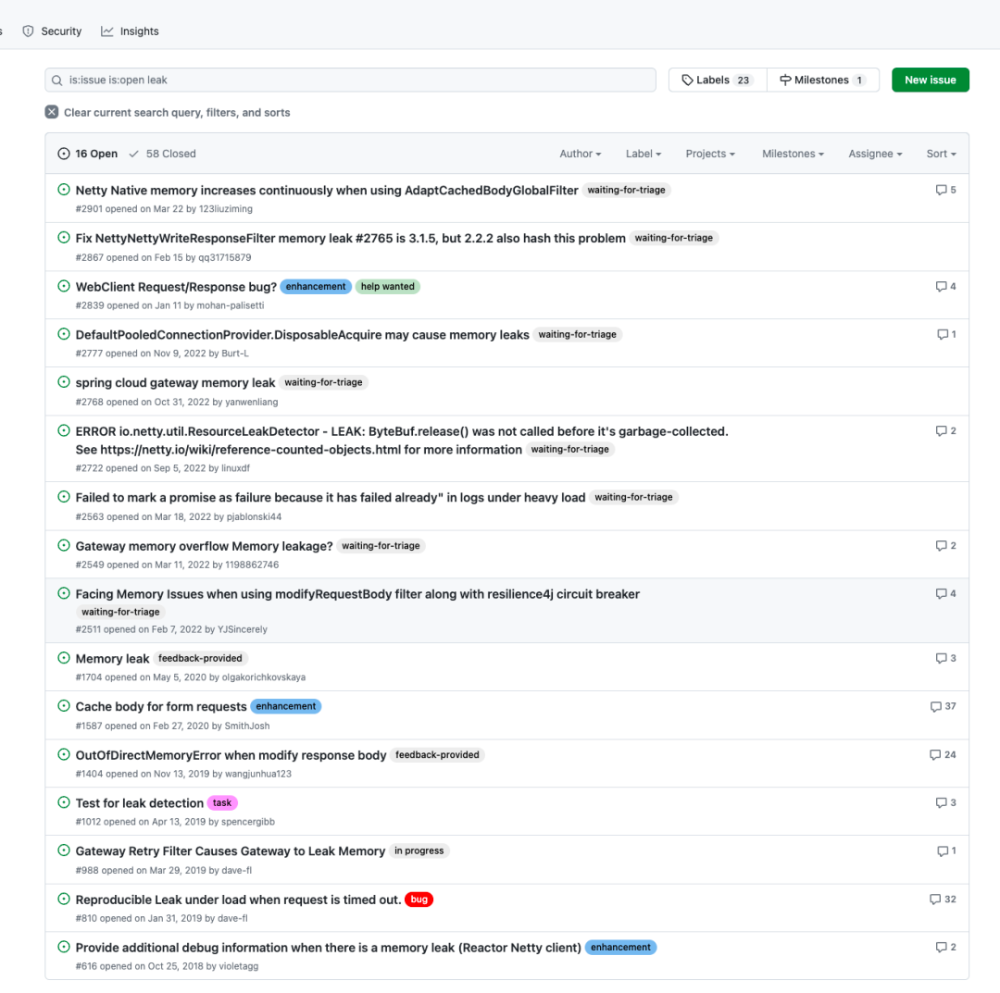

**<font style="color:rgb(51, 51, 51);">SCG 内存泄漏 BUG</font>**

<font style="color:rgb(51, 51, 51);">下图可以看到 SCG 在长期运行的过程中内存使用一直在增长，++ 当增长到机器内存上限时当前节点将不可用，联系到网关单节点所承接的 QPS 在几千，可想而知节点宕机带来的危害有多大 ++；一段时间以来我们需要对 SCG 网关做定期重启。</font>

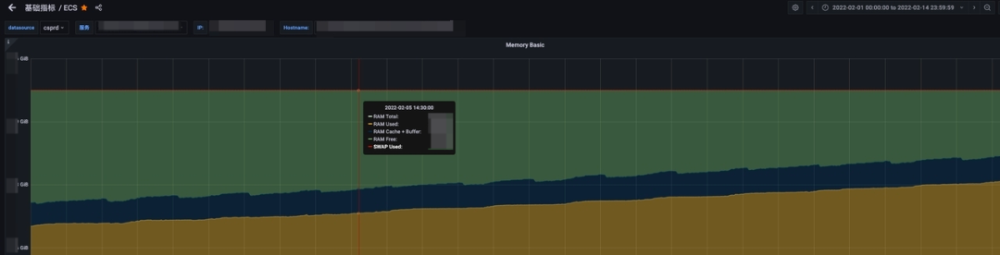

<font style="color:rgb(51, 51, 51);">SCG 生产实例内存增长趋势</font>

## <font style="color:rgb(51, 51, 51);">响应式编程范式复杂</font>
<font style="color:rgb(51, 51, 51);">基于 webflux 中的 flux 和 mono ，在对 request 和 response 信息读取修改时，编码复杂度高，代码理解困难</font>

## <font style="color:rgb(51, 51, 51);">多层抽象的性能损耗</font>
<font style="color:rgb(51, 51, 51);">尽管相比于传统的阻塞式网关，SCG 的性能已经足够优秀，但相比原生的 netty 仍然比较低下，SCG 依赖于 webflux 编程范式，webflux 构建于 reactor-netty 之上，reactor-netty 构建于 netty 之上，多层抽象存在较大的性能损耗。</font>

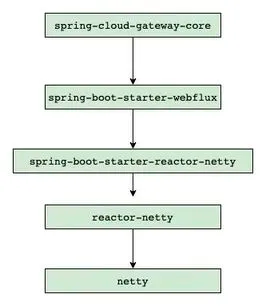

<font style="color:rgb(51, 51, 51);">SCG 依赖层级</font>

<font style="color:rgb(51, 51, 51);">一般认为程序调用栈越深性能越差；下图为只有一个 filter 的情况下的调用栈，可以看到存在大量的 webflux 中的 subscribe() 和 onNext() 方法调用, 这些方法的执行不关联任何业务逻辑，属于纯粹的框架运行层代码，粗略估算下没有引入任何逻辑的情况下 SCG 的调用栈深度在 90+ ，如果引入多个 filter 处理不同的业务逻辑，线程栈将进一步加深，</font>**<font style="color:rgb(51, 51, 51);">当前网关的业务复杂度实际栈深度会达到 120 左右，也就是差不多有四分之三的非业务栈损耗，这个比例是有点夸张的。</font>**

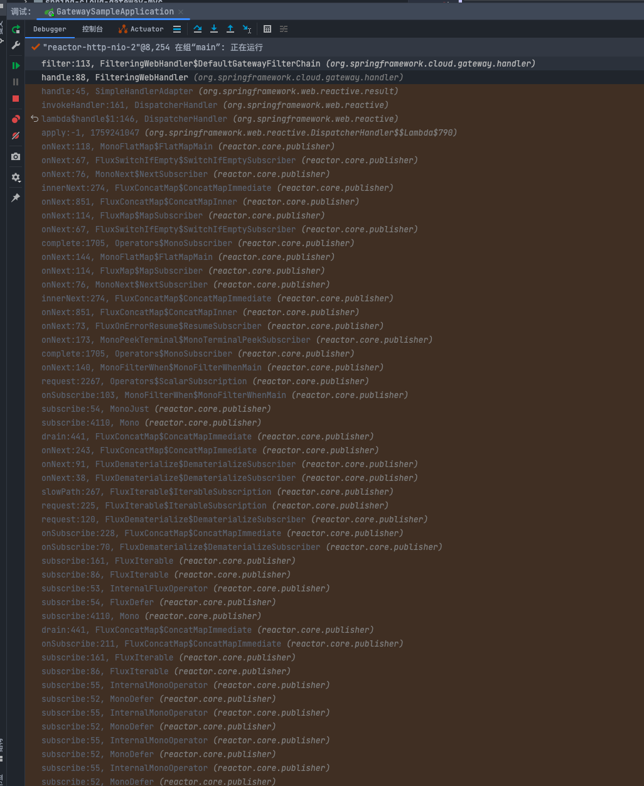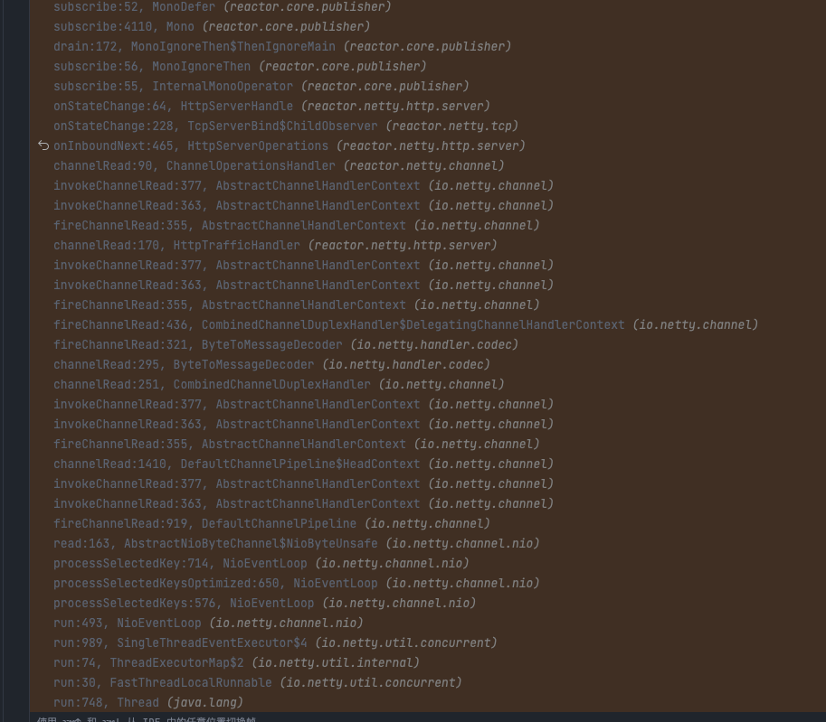

<font style="color:rgb(51, 51, 51);">SCG filter 调用栈深度</font>

## <font style="color:rgb(51, 51, 51);">路由能力不完善</font>
<font style="color:rgb(51, 51, 51);">原生的的 SCG 并不支持动态路由管理，路由的配置信息通过大量的 KV 配置来做，平均一个路由配置需要三到四条 KV 配置信息来支撑，这些配置数据一般放在诸如 Apollo 或者 ark 这样的配置中心，即使是添加了新的配置 SCG 并不能动态识别，需要引入动态刷新路由配置的能力。另一方面路由匹配算法通过遍历所有的路由信息逐一匹配的模式，当接口级别的路由数量急剧膨胀时，性能是个严重问题。</font>

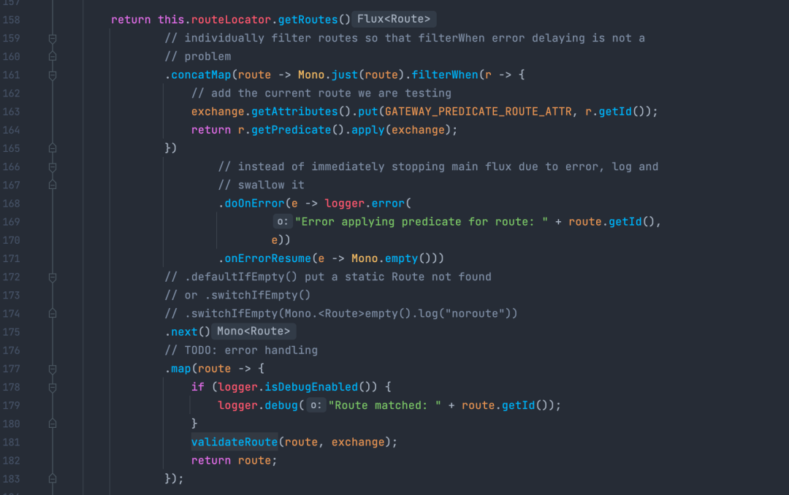

<font style="color:rgb(51, 51, 51);">SCG 路由匹配算法为 On 时间复杂度</font>


# <font style="color:rgb(51, 51, 51);">三、方案调研</font>
## <font style="color:rgb(51, 51, 51);">理想中的网关</font>
<font style="color:rgb(51, 51, 51);">综合业务需求和技术痛点，我们发现理想型的网关应该是这个样子的：</font>

+ <font style="color:rgb(51, 51, 51);">支持海量接口注册，并能够在运行时支持动态添加修改路由信息，具备出色路由匹配性能</font>
+ <font style="color:rgb(51, 51, 51);">编程范式尽可能简单，降低开发人员心智负担，同时最好是开发人员较为熟悉的语言</font>
+ <font style="color:rgb(51, 51, 51);">性能足够好，至少要等同于目前 SCG 的性能，RT99 线和 ART 较低</font>
+ <font style="color:rgb(51, 51, 51);">稳定性好，无内存泄漏，能够长时间持续稳定运行，发布升级期间要尽可能下游无感</font>
+ <font style="color:rgb(51, 51, 51);">拓展能力强，支持超时定制，多网络协议支持，http，Dubbo 等，生态完善</font>
+ <font style="color:rgb(51, 51, 51);">架构设计清晰，数据流与控制流分离，集成 UI 控制面</font>

## <font style="color:rgb(51, 51, 51);">开源网关对比</font>
<font style="color:rgb(51, 51, 51);">基于以上需求，我们对市面上的常见网关进行了调研，以下几个开源方案对比。</font>

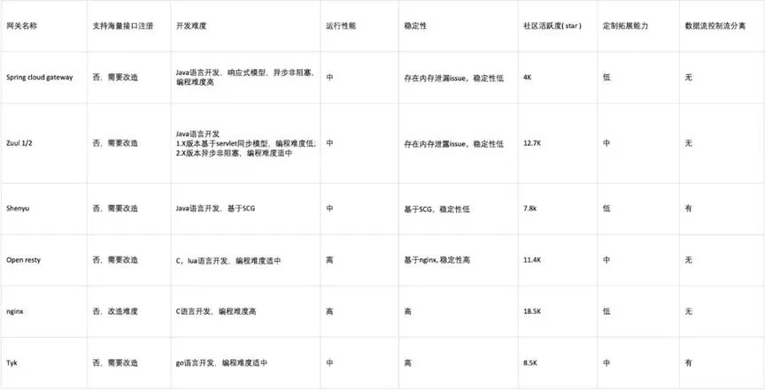

<font style="color:rgb(51, 51, 51);">结合当前团队的技术栈，我们倾向于选择 Java 技术栈的开源产品，唯一可选的只有 zuul2 ，但是 zuul2 路由注册和稳定性方面也不能够满足我们的需求，也没有实现数控分离的架构设计。因此唯有走上自研之路。</font>

# <font style="color:rgb(51, 51, 51);">四、自研架构</font>
<font style="color:rgb(51, 51, 51);">通常而言代理网关分为透明代理与非透明代理，其主要区别在于对于流量是否存在侵入性，这里的侵入性主要是指对请求和响应数据的修改；显然 API Gateway 的定位决定了必然会对流量进行数据调整，常见的调整主要有 添加或者修改 head 信息，加密或者解密 query params head , 以及 requestbody 或者 responseBody，可以说 http 请求的每一个部分数据都存在修改的可能性，这要求代理层必须要完全解析数据包信息，而非简单的做一个路由器转发功能。</font>

<font style="color:rgb(51, 51, 51);">传统的服务器架构，以 reactor 架构为主。boss 线程和 worker 线程的明确分工，boss 线程负责连接建立创建；worker 线程负责已经建立的连接的读写事件监听处理，同时会将部分复杂业务的处理放到独立的线程池中，进而避免 worker 线程的执行时间过长影响对网络事件处理的及时性；由于网关是 IO 密集型服务，相对来说计算内容较少，可以不必引入这样的业务线程池；直接基于 netty 原生 reactor 架构实现。</font>

## <font style="color:rgb(51, 51, 51);">Reactor 多线程架构</font>
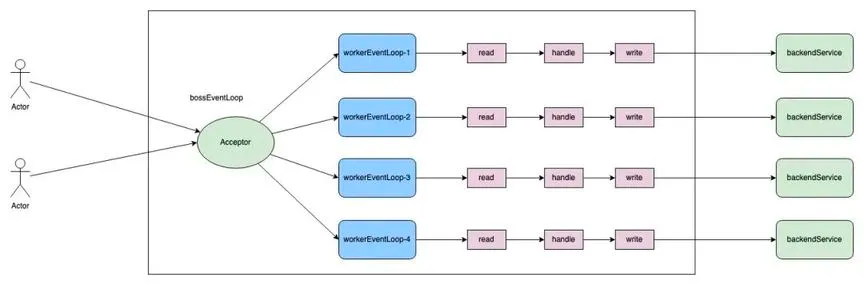

<font style="color:rgb(51, 51, 51);">为了只求极致性能和降低多线程编码的数据竞争，单个请求从接收到转发后端，再到接收后端服务响应，以及最终的回写给 client 端，这一系列操作被设计为完全闭合在一个 workerEventLoop 线程中处理；这需要 worker 线程中执行的 IO 类型操作全部实现异步非阻塞化，确保 worker 线程的高速运转；这样的架构和 NGINX 很类似；我们称之为 thread-per-core 模式。</font>

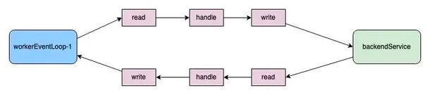

## <font style="color:rgb(51, 51, 51);">API 网关组件架构</font>
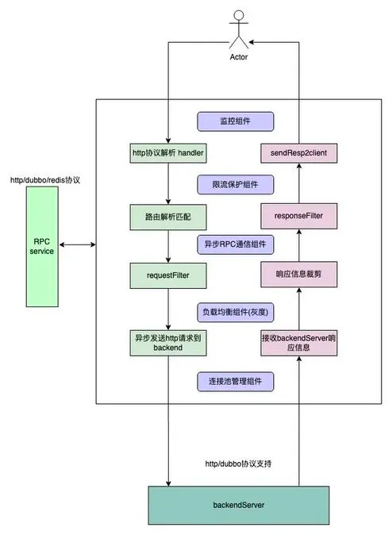

## <font style="color:rgb(51, 51, 51);">数据流控制流分离</font>
<font style="color:rgb(51, 51, 51);">数据面板专注于流量代理，不处理任何 admin 类请求，控制流监听独立的端口，接收管理指令。</font>

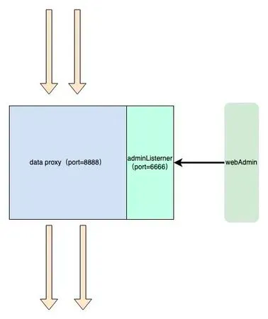

# <font style="color:rgb(51, 51, 51);">五、核心设计</font>
## <font style="color:rgb(51, 51, 51);">请求上下文封装</font>
<font style="color:rgb(51, 51, 51);">新的 API 网关底层仍然基于 Netty，其自带的 http 协议解析 handler 可以直接使用。基于 netty 框架的编程范式，需要在初始化时逐一注册用到的 Handler。</font>

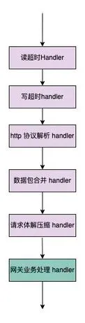

<font style="color:rgb(51, 51, 51);">Client 到 Proxy 链路 Handler 执行顺序</font>

<font style="color:rgb(51, 51, 51);">HttpServerCodec 负责 HTTP 请求的解析；对于体积较大的 Http 请求，客户端可能会拆成多个小的数据包进行发送，因此在服务端需要适当的封装拼接，避免收到不完整的 http 请求；HttpObjectAggregator 负责整个请求的拼装组合。</font>

<font style="color:rgb(51, 51, 51);">拿到 HTTP 请求的全部信息后在业务 handler 中进行处理；如果请求体积过大直接抛弃；使用 ServerWebExchange 对象封装请求上下文信息，其中包含了 client2Proxy 的 channel, 以及负责处理该 channel 的 eventLoop 线程等信息，考虑到整个请求的处理过程中可能在不同阶段传递一些拓展信息，引入了 getAttributes 方法 用于存储需要传递的数据；此外 ServerWebExchange 接口的基本遵循了 SCG 的设计规范，保证了在迁移业务逻辑时的最小化改动；具体到实现类，可以参考如下代码：</font>

```java
@Getter
public class DefaultServerWebExchange implements ServerWebExchange {
    private final Channel client2ProxyChannel;
    private final Channel proxy2ClientChannel;
    private final EventLoop executor;
    private ServerHttpRequest request;
    private ServerHttpResponse response;
    private final Map<String, Object> attributes;
}
```

<font style="color:rgb(51, 51, 51);"></font>

<font style="color:rgb(51, 51, 51);">DefaultServerWebExchange</font>

<font style="color:rgb(51, 51, 51);">Client2ProxyHttpHandler 作为核心的入口 handler 负责将接收到的 FullHttpRequest 进行封装和构建 ServerWebExchange 对象，其核心逻辑如下。可以看到对于数据读取封装的逻辑较为简单，并没有植入常见的业务逻辑，封装完对象后随即调用 Request filter chain。</font>

```java
@Override
protected void channelRead0(ChannelHandlerContext ctx, FullHttpRequest fullHttpRequest) {
    try {
        Channel client2ProxyChannel = ctx.channel();
        DefaultServerHttpRequest serverHttpRequest = new DefaultServerHttpRequest(fullHttpRequest, client2ProxyChannel);
        ServerWebExchange serverWebExchange = new DefaultServerWebExchange(client2ProxyChannel,(EventLoop) ctx.executor(), serverHttpRequest, null);
        // request filter chain
        this.requestFilterChain.filter(serverWebExchange);
    }catch (Throwable t){
        log.error("Exception caused before filters!\n {}",ExceptionUtils.getStackTrace(t));
        ByteBufHelper.safeRelease(fullHttpRequest);
        throw t;
    }
}
```


## <font style="color:rgb(51, 51, 51);">路由管理与匹配</font>
<font style="color:rgb(51, 51, 51);">以 SCG 网关注册的路由数量为基准，网关节点的需要支撑的路由规则数量是上万级别的，按照得物目前的业务量，上限不超过 5W，为了保证匹配性能，路由规则放在分布式缓存中显然是不合适的，需要保存在节点的内存中。类似于在 nginx 上配置上万条 location 规则，手动维护难度可想而知，即使在配置中心管理起来也很麻烦，所以需要引入独立路由管理模块。</font>

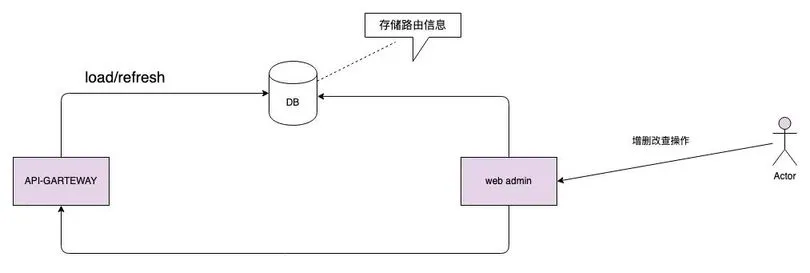

<font style="color:rgb(51, 51, 51);">在匹配的效率上也需要进一步优化，SCG 的路由匹配策略为普通的循环迭代逐一匹配，时间效率为 On，在路由规则膨胀到万级别后，性能急剧拉胯，结合得物的接口规范，新网关采用 Hash 匹配模式，将匹配效率提升到 O1；hash 的 key 为接口的 path, 需要强调的是在同一个网关集群中，path 是唯一的，这里的 path 并不等价于业务服务的接口 path, 绝大多数时候存在一些剪裁，例如在业务服务的编写的 / order/detail 接口，在网关实际注册的接口可能为 / api/v1/app/order/detail；由于使用了 path 作为 key 进行 hash 匹配。常见的 restful 接口显然是不支持的，确切的讲基于 path 传参数模式的接口均不支持；出于某些历史原因，网关保留了类似 nginx 的前缀匹配的支持，但是这部分功能不对外开放。</font>

```java
public class Route implements Ordered {
    private final String id;
    private final int skipCount;
    private final URI uri;
}
```

<font style="color:rgb(51, 51, 51);"></font>

<font style="color:rgb(51, 51, 51);">route 类设计</font>

<font style="color:rgb(51, 51, 51);">route 的 URI 字段中包含了，需要路由到的具体服务名，这里也可以称之为 host ，route 信息会暂存在 exchange 对象的 attributes 属性中, 在后续的 loadbalance 阶段 host 信息会被进一步替换为真实的 endpoint。</font>

```java
private Route lookupRoute(ServerWebExchange exchange) {
String path = exchange.getRequest().getPath();
CachingRouteLocator locator = (CachingRouteLocator) routeLocator;
Route exactRoute = pathRouteMap.getOrDefault(path, null);
if (exactRoute != null) {
    exchange.getAttributes().put(DAGApplicationConfig.GATEWAY_ROUTE_CACHE, route);
    return exactRoute;
}
}
```

<font style="color:rgb(51, 51, 51);">路由匹配逻辑</font>

## <font style="color:rgb(51, 51, 51);">单线程闭环</font>
<font style="color:rgb(51, 51, 51);">为了更好地利用 CPU，以及减少不必要的数据竞争，</font>**<font style="color:rgb(51, 51, 51);">将单个请求的处理全部闭合在一个线程当中</font>**<font style="color:rgb(51, 51, 51);">；这意味着这个请求的业务逻辑处理，RPC 调用，权限验证，限流 token 获取都将始终由某个固定线程处理。netty 中 网络连接被抽象为 channel，channel 与 eventloop 线程的对应关系为 N 对 1，一个 channel 仅能被一个 eventloop 线程所处理，这在处理用户请求时没有问题，但是在接收请求完毕向下游转发请求时，我们碰到了一些挑战，下游的连接往往是连接池在管理，连接池的管理是另一组 eventLoop 线程在负责，</font>**<font style="color:rgb(51, 51, 51);">为了保持闭环需要将连接池的线程设定为处理当前请求的线程</font>**<font style="color:rgb(51, 51, 51);">，并且只能是这一个线程；这样一来，默认状态下启动的 N 个线程（N 与机器核心数相同），分别需要管理一个连接池；thread-per-core 模式的性能已经在 nginx 开源组件上得到验证。</font>

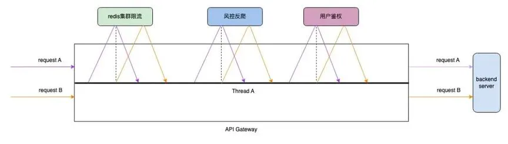

## <font style="color:rgb(51, 51, 51);">连接管理优化</font>
<font style="color:rgb(51, 51, 51);">为了满足单线程闭环，需要将连接池的管理线程设置为当前的 eventloop 线程，最终我们通过 threadlocal 进行线程与连接池的绑定；通常情况下 netty 自带的连接池 FixedChannelPool 可以满足我们大部分场景下的需求，这样的连接池也是适用于多线程的场景；由于新网关使用 thread-per-core 模式并将请求处理的全生命周期闭合在单个线程中，所有为了线程安全的额外操作不再必要且存在性能浪费；为此需要对原生连接池做一些优化, 连接的获取和释放简化为对链表结构的简单 getFirst , addLast。</font>

<font style="color:rgb(51, 51, 51);">对于 RPC 而言，无论是 HTTP，还是 Dubbo，Redis 等最终底层都需要用到 TCP 连接，将构建在 TCP 连接上的数据解析协议与连接剥离后，我们发现这种纯粹的连接管理是可以复用的，对于连接池而言不需要知道具体连接的用途，只需要维持到特定 endpoint 的连接稳定即可，那么这里的 RPC 服务的连接仍然可以放入连接池中进行托管；最终的连接池设计架构图。</font>

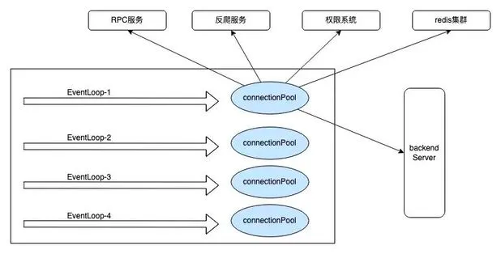


# <font style="color:rgb(51, 51, 51);">六、投产收益</font>
## <font style="color:rgb(51, 51, 51);">安全性提升</font>
**<font style="color:rgb(51, 51, 51);">完善的接口级路由管理</font>**

<font style="color:rgb(51, 51, 51);">基于接口注册模式的全新路由上线，包含了接口注册的申请人，申请时间，接口场景备注信息等，接口管理更加严谨规范；结合路由组功能可以方便的查询当前服务的所有对外接口信息，某种程度上具备一定的 API 查询管理能力；同时为了缓解用户需要检索的接口太多的尴尬，引入了一键收藏功能，大部分时候用户只需要切换到已关注列表即可。</font>

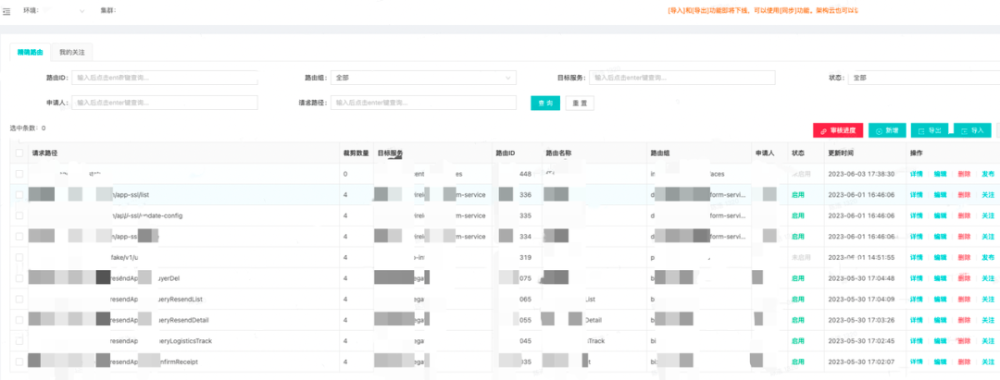

<font style="color:rgb(51, 51, 51);">注册接口列表</font>

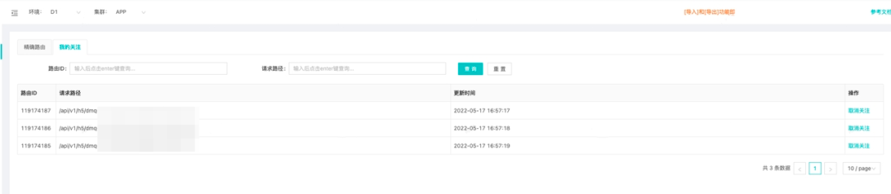

<font style="color:rgb(51, 51, 51);">接口收藏</font>

**<font style="color:rgb(51, 51, 51);">防渗透能力极大增强</font>**

<font style="color:rgb(51, 51, 51);">早期的泛化路由，给黑产的渗透带来了极大的想象空间和安全隐患，甚至可以在外网直接访问某些业务的配置信息。</font>

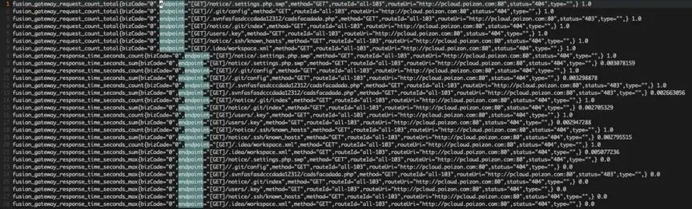

<font style="color:rgb(51, 51, 51);">黑产接口渗透</font>

<font style="color:rgb(51, 51, 51);">接口注册模式启用后，所有未注册的接口均无法访问，防渗透能力提升一个台阶，同时自动推送异常接口访问信息。</font>

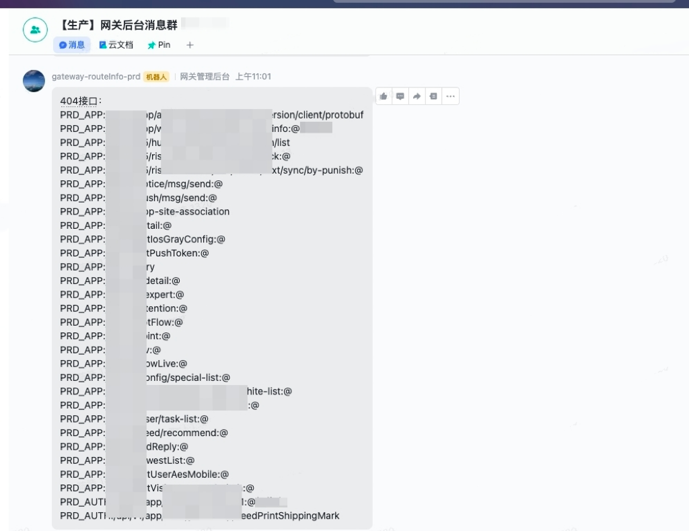

<font style="color:rgb(51, 51, 51);">404 接口访问异常推送</font>

## <font style="color:rgb(51, 51, 51);">稳定性增强</font>
**<font style="color:rgb(51, 51, 51);">内存泄漏问题解决</font>**

<font style="color:rgb(51, 51, 51);">通过一系列手段改进优化和严格的测试，新网关的内存使用更加稳健，内存增长曲线直接拉平，彻底解决了泄漏问题。</font>

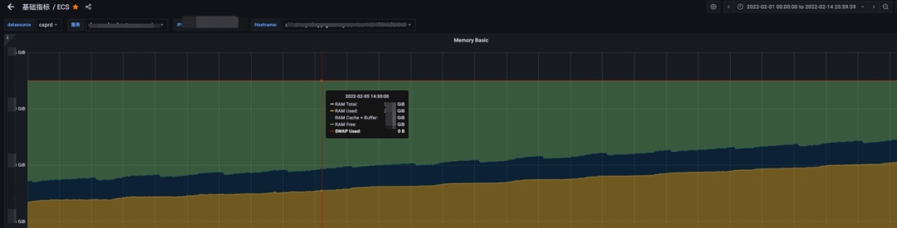

<font style="color:rgb(51, 51, 51);">老网关内存增长趋势</font>

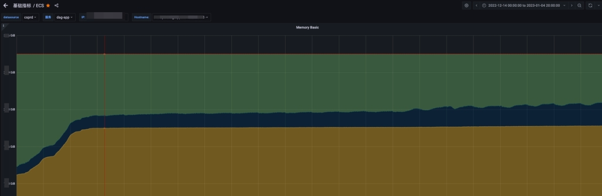

<font style="color:rgb(51, 51, 51);">新网关内存增长趋势</font>

**<font style="color:rgb(51, 51, 51);">响应时间尖刺消除</font>**

<font style="color:rgb(51, 51, 51);">通过预先初始化 & context 共用等手段，去除了运行时并发创建多个 context 抢占全局锁的开销，冷启动 RT 尖刺降低 99% ；关于 spring load balance 模块的更多优化细节可以参考这篇博客：Spring LoadBalance 存在问题与优化。</font>

**<font style="color:rgb(51, 51, 51);">压测数据对比</font>**

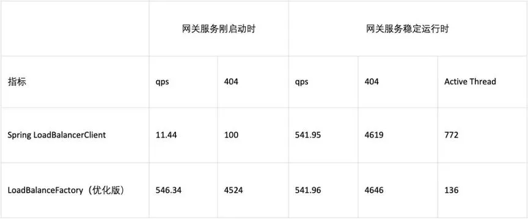

**<font style="color:rgb(51, 51, 51);">实际生产监控</font>**

<font style="color:rgb(51, 51, 51);">趋势图上略有差异，但是从非 200 请求的绝对值上看，这种差异可以忽略, </font>**<font style="color:rgb(51, 51, 51);">对比发布期间和非发布期间异常请求的数量，发现基本没有区别，这代表着以往的发布期间的响应时间尖刺基本消除，做到了发布期间业务服务彻底无感知。</font>**

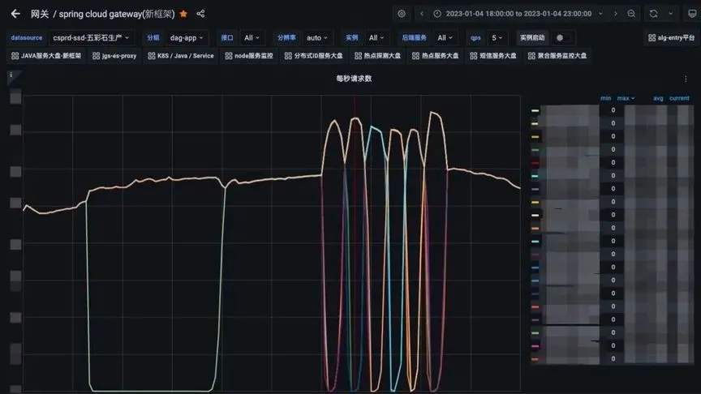

<font style="color:rgb(51, 51, 51);">1 月 4 日发布期间各节点流量变化</font>

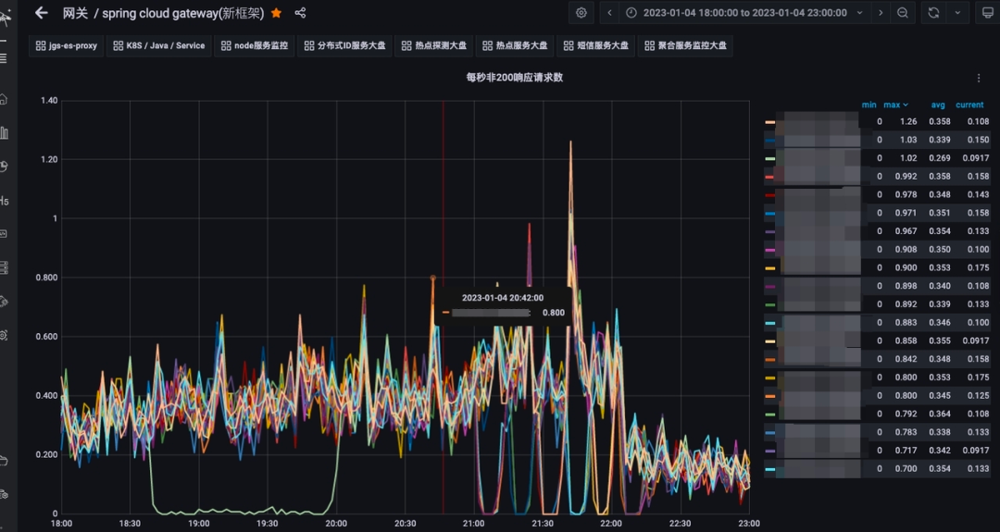

<font style="color:rgb(51, 51, 51);">1 月 4 日异常请求状态数量监控 (发布期间)</font>

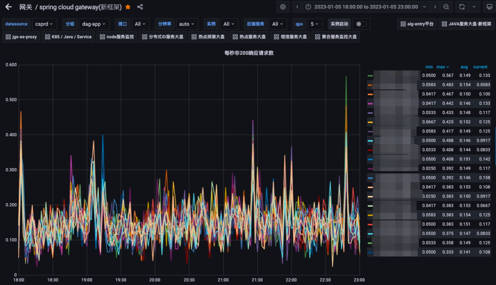

<font style="color:rgb(51, 51, 51);">1 月 5 日异常请求状态数量监控（无发布）</font>

## <font style="color:rgb(51, 51, 51);">降本增效</font>
**<font style="color:rgb(51, 51, 51);">资源占用下降 50%</font>**

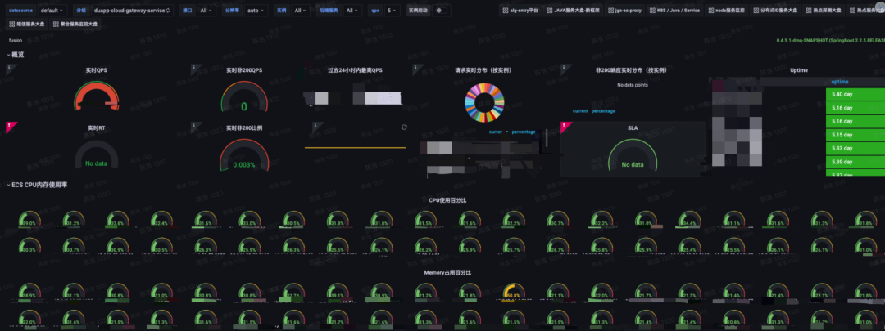

<font style="color:rgb(51, 51, 51);">SCG 平均 CPU 占用</font>

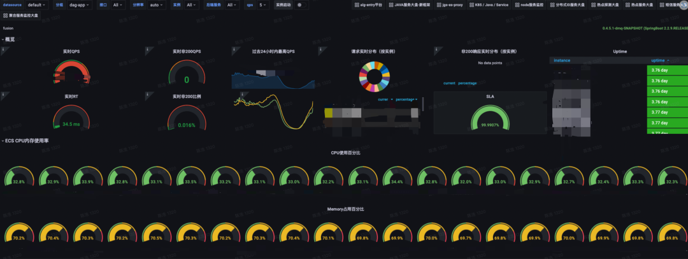

<font style="color:rgb(51, 51, 51);">DAG 资源占用</font>

# <font style="color:rgb(51, 51, 51);">七、思考总结</font>
## <font style="color:rgb(51, 51, 51);">架构演进</font>
<font style="color:rgb(51, 51, 51);">API 网关的自研并非一蹴而就，而是经历了多次业务迭代循序渐进的过程；从早期的泛化路由引发的安全问题处理，到后面的大量路由注册，带来的匹配性能下降 ，以及最终压垮老网关最后一根稻草的内存泄漏问题；在不同阶段需要使用不同的应对策略，早期业务快速迭代，大量的需求堆积，最快的时候一个功能点的改动需要三四天内上线 ，我们很难有足够的精力去做一些深层次的改造，这个时候需求导向为优先，功能性建设完善优先，是一个快速奔跑的建设期；伴随体量的增长安全和稳定性的重视程度逐步拔高，继而推进了这些方面的大量建设；从拓展 SCG 的原有功能到改进框架源码，以及最终的自研重写，可以说新的 API 网关是一个业务推进而演化出来的产物，也只有这样 ” 生长 “ 出来的架构产品才能更好的契合业务发展的需要。</font>

## <font style="color:rgb(51, 51, 51);">技术思考</font>
<font style="color:rgb(51, 51, 51);">开源的 API 网关有很多，但是自研的案例并不多，我们能够参考的方案也很有限。除了几个业界知名的产品外，很多开源的项目参考的价值并不大；从自研的目标来看，我们最基本的要求是性能和稳定性要优于现有的开源产品，至少 Java 的生态是这样；这就要求架构设计和代码质量上必须比现有的开源产品更加优秀，才有可能；为此我们深度借鉴了流量代理界的常青树 Nginx，发现基于 Linux 多进程模型下的 OS，如果要发挥出最大效能，单 CPU 核心支撑单进程（线程）是效率最高的模式。可以将 OS 的进程调度开销最小化同时将高速缓存 miss 降到最低，此外还要尽可能减少或者消除数据竞争，避免锁等待和自旋带来的性能浪费；DAG 的整个技术架构可以简化的理解为引入了独立控制流的多线程版的 Nginx。</font>

<font style="color:rgb(51, 51, 51);">中间件的研发创新存在着较高的难度和复杂性，更何况是在业务不断推进中换引擎。在整个研发过程中，为了尽可能适配老的业务逻辑，对原有的业务逻辑的改动最小化，新网关对老网关的架构层接口做了全面适配；换句话说新引擎的对外暴露的核心接口与老网关保持一致，让老的业务逻辑在 0 改动或者仅改动少量几行代码后就能在新网关上直接跑，能够极大幅度降低我们的测试回归成本，因为这些代码本身的逻辑正确性，已经在生产环境得到了大量验证。这样的适配器模式同样适用于其他组件和业务开发。</font>

<font style="color:rgb(51, 51, 51);">作为底层基础组件的开发人员，要对自己写下的每一行代码都有清晰的认识，不了解的地方一定要多翻资料，多读源码，模棱两可的理解是绝对不够的；常见的开源组件虽然说大部分代码都是资深开发人员写出来的，但是有程序员的地方就有 bug ，要带着审慎眼光去看到这些组件，而不是一味地使用盲从，所谓尽信书不如无书；很多中间件的基本原理都是相通的，如常见 Raft 协议，基于 epoll 的 reactor 网络架构，存储领域的零拷贝技术，预写日志，常见的索引技术，hash 结构，B + 树，LSM 树等等。一个成熟的中间件往往会涉及多个方向的技术内容。研发人员并不需要每一个组件都涉猎极深，也不现实，掌握常见的架构思路和技巧以及一些基本的技术点，做到对一两个组件做到熟稔于心。思考和理解到位了，很容易触类旁通。</font>

## <font style="color:rgb(51, 51, 51);">稳定性把控</font>
<font style="color:rgb(51, 51, 51);">自研基础组件是一项浩大的工程，可以预见代码量会极为庞大，如何有效管理新项目的代码质量是个棘手的问题; 原有业务逻辑的改造也需要回归测试；现实的情况是中间件团队没有专职的测试，质量保证完全依赖开发人员；这就对开发人员的代码质量提出了极高的要求，一方面我们通过与老网关适配相同的代理引擎接口，降低迁移成本和业务逻辑出现 bug 的概率；另一方面还对编码质量提出了高标准，平均每周两到三次的 CodeReview；80% 的单元测试行覆盖率要求。</font>

<font style="color:rgb(51, 51, 51);">网关作为流量入口，承接全司最高流量，对稳定性的要求极为苛刻。最理想的状态是在业务服务没有任何感知的情况下，我们将新网关逐步替换上去；为此我们对新网关上线的过程做了充分的准备，严格控制上线过程；具体来看整个上线流程分为以下几个阶段：</font>

**<font style="color:rgb(51, 51, 51);">第一阶段</font>**

<font style="color:rgb(51, 51, 51);">我们在压测环境长时间高负载压测，持续运行时间 24 小时以上，以检测内存泄漏等稳定性问题。同时利用性能检测工具抓取热点火焰图，做针对性优化。</font>

**<font style="color:rgb(51, 51, 51);">第二阶段</font>**

<font style="color:rgb(51, 51, 51);">发布测试环境试跑，采用并行试跑的方式，新老网关同时对外提供服务（流量比例 1 ：1，初期新网关承接流量可能只有十分之一），一旦用户反馈的问题可能跟新网关有关，或者发现异常 case，立即关停新网关的流量。待查明原因并确认修复后，重新引流。</font>

**<font style="color:rgb(51, 51, 51);">第三阶段</font>**

<font style="color:rgb(51, 51, 51);">上线预发，小得物环境试跑，由于这些环境流量不大，依然可以并行长时间试跑，发现问题解决问题。</font>

**<font style="color:rgb(51, 51, 51);">第四阶段</font>**

<font style="color:rgb(51, 51, 51);">生产引流，单节点从万分之一比例开始灰度，逐步引流放大，每个阶段停留 24 小时以上，观察修正后再放大，循环此过程；基于单节点承担正常比例流量后，再次抓取火焰图，基于真实流量场景下的性能热点做针对性优化。</font>


> 更新: 2025-04-20 22:38:56  
> 原文: <https://www.yuque.com/aaron-wecc3/dhluml/zbh6zbgbbwi8628q>