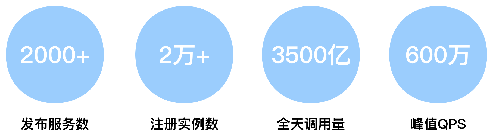
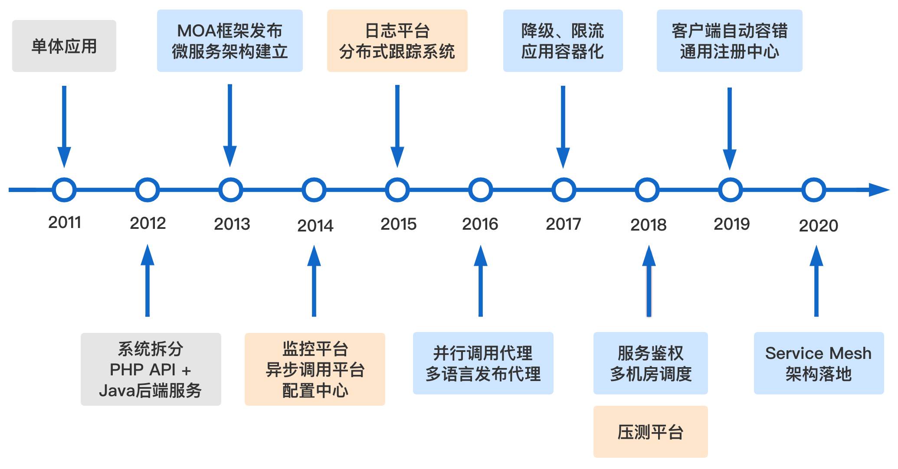
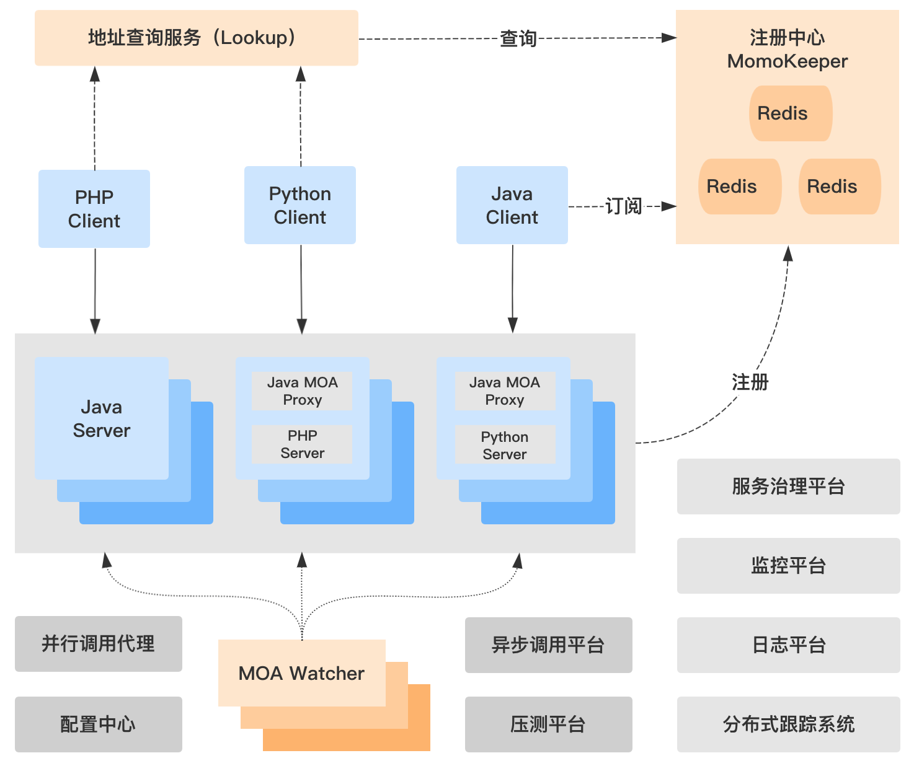
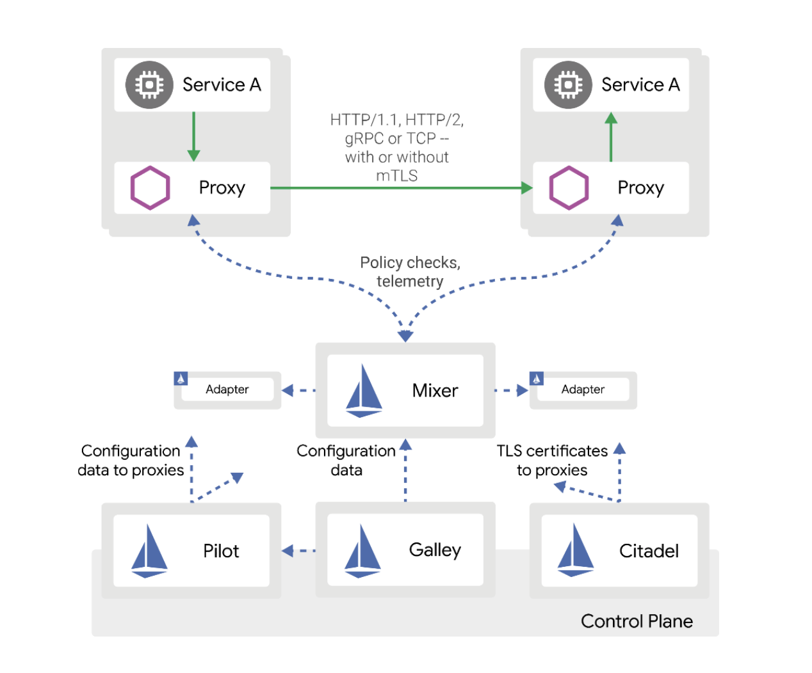
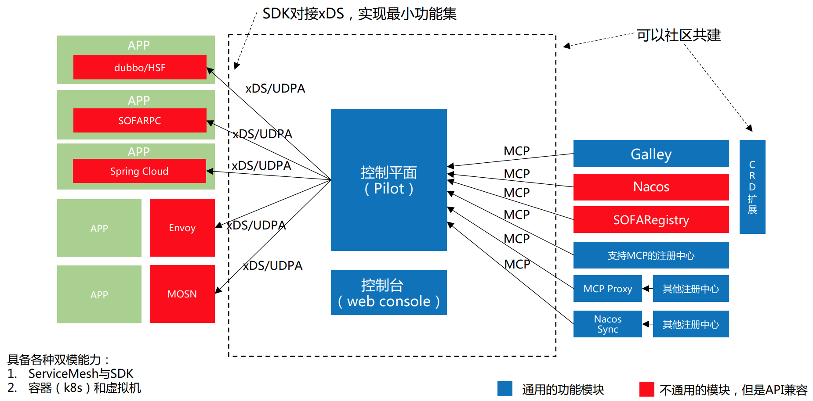
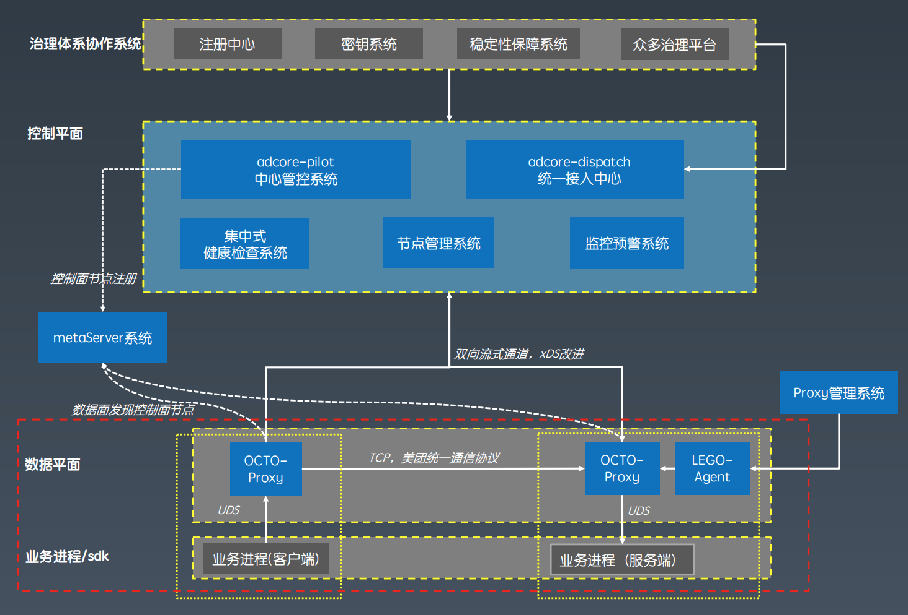
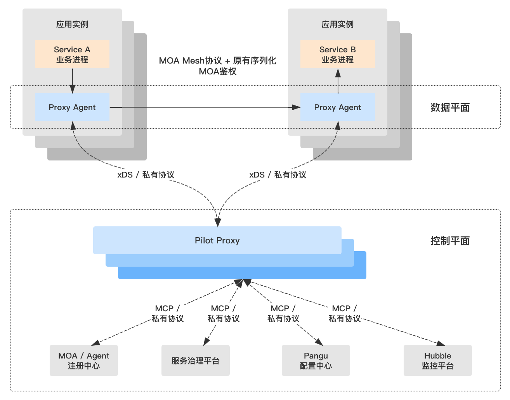
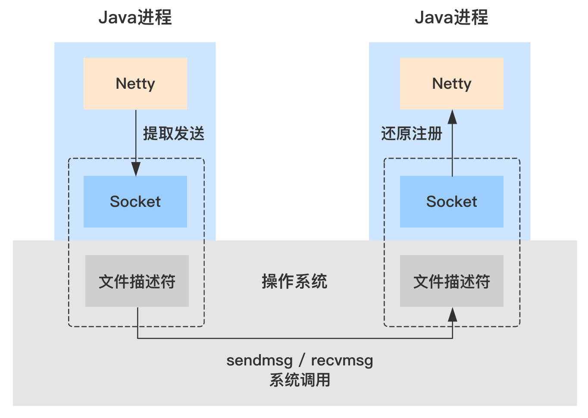
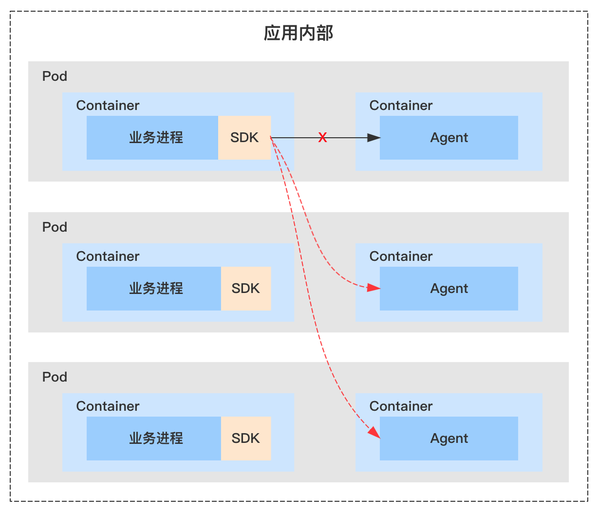
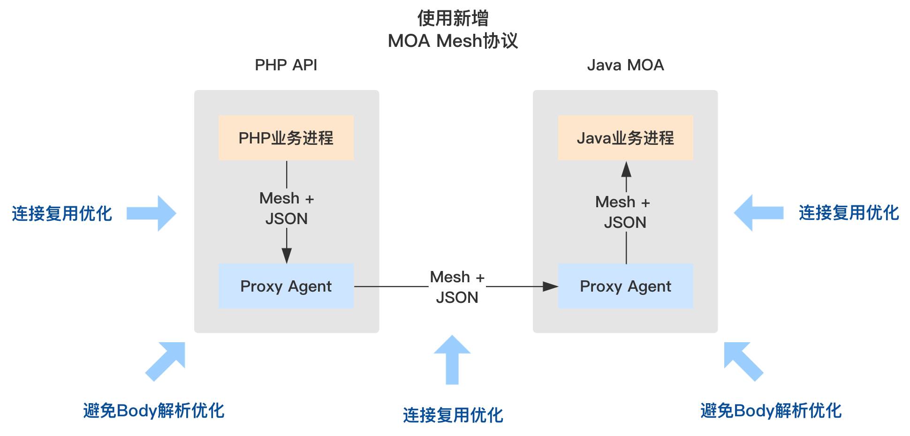

# 73.陌陌Service Mesh落地实践

**分享内容**

1. 陌陌微服务架构演进

2. 架构痛点与 Service Mesh

3. 陌陌 Service Mesh 架构实践

4. 总结

## 背景
2016 年，Service Mesh 进入公众视野之后一直保持着高速发展的状态，目前已成为业内广泛认可的下一代[微服务架构](https://cloud.tencent.com/product/tse?from=20067&from_column=20067)，并且被 CNCF 列入构建容错性好、易于管理与观察的云原生应用所依赖的关键技术。

2019 年底，经过多年微服务架构实践积累、对现有架构痛点总结分析以及多个阶段的思考与评估后，陌陌正式启动了 Service Mesh 落地项目 MOA Mesh。本次分享将从原有微服务架构谈起，详细讲述陌陌 Service Mesh 架构的探索过程，希望能给业内同样关注如何落地 Service Mesh 的技术人员提供参考。

## 陌陌微服务架构演进
2013 年，陌陌架构团队完成了微服务架构的研发与推广，考虑到当时业内还没有成熟的开源产品，陌陌自研了服务框架 MOA（Momo service Oriented Architecture），并应用到了多条业务线，例如附近动态、直播、IM、短视频等。

随着业务的不断增长，MOA 完成了对自身能力与稳定性的验证，发布服务 2000+，注册实例 2 万 +，全天调用量 3500 亿，峰值时 QPS 达到 600 万。

### 发展历程
为了支撑大规模业务服务运行，MOA 除了需要不断完善自身之外，还需要与其他基础架构产品协同运作，如：监控、异步、配置、日志、分布式跟踪、压测等平台与系统。

回顾陌陌整个微服务体系的发展历程，2011 年还是在使用单体应用，2012 年开始拆分系统，2013 年自研了微服务框架 MOA，2017 年实现了应用容器化，2020 年落地 Service Mesh 架构。

陌陌微服务体系发展历程

### 多语言支持
陌陌服务端架构采用了 PHP API + Java 后端服务的多语言架构，以同时获得 PHP 的开发效率与 Java 的高性能优势。这也使得 MOA 从一开始就要应对跨语言调用带来的挑战。

MOA 的核心组件是 Java 语言的 SDK，在微服务体系中我们又进一步引入以下机制简化其他语言 SDK 的开发工作

+ 能够复用成熟 Redis 客户端的 Redis GET 跨语言传输协议
+ 通过域名访问、与普通服务调用方式一致的地址查询服务 Lookup
+ 由 Java 开发、以 sidecar 方式部署、作为入流量代理的 MOA Proxy，支持非 Java 语言发布服务、接入整体微服务体系

### 整体架构
在融入相关基础架构产品以及多语言支持机制后，MOA 1.0 微服务体系已具备较为全面的服务治理能力。

MOA 整体架构如下图所示，其中 MOA Watcher 是中心化的健康检测系统，同时 MOA 客户端也具备自动容错机制；并行调用代理是为了支持 PHP 语言实现并行调用的中心化出流量代理。

## 架构痛点与 Service Mesh
### 架构痛点分析
在业务规模不断扩大、微服务架构持续演进的过程中，存在一些始终无法彻底得到解决的问题，它们可以统一归纳为 “服务治理能力滞后” 问题。

#### 非 Java 应用能力滞后
原有架构中采取了很多简化开发多语言 SDK 的机制，但在[中间件](https://cloud.tencent.com/product/message-queue-catalog?from=20067&from_column=20067)团队以 Java 工程师为主导的情况下，其他语言 SDK 的迭代速度还是会远落后于 Java SDK，导致其他语言 SDK 缺少很多关键的功能，并且无法快速完成修复与补充。

#### Java 应用能力滞后
Java SDK 具备最完善的服务治理能力，但当 Java 应用的数量达到数千规模，SDK 的升级会成为极其困难的工作，使新开发的功能同样无法快速在每个应用上得以运用。即使在一些紧急情况下集中进行推广，每个应用修改版本依赖、重新发布的过程也会耗费业务团队和基础架构团队大量的时间精力，对整体业务迭代效率产生负面影响。

#### 滞后问题危害
服务治理能力滞后问题使整体的微服务架构无法实现统一。缺失的能力会使应用的稳定性受损，甚至引发故障。在进行重大架构变更时，缺失以及无法快速补充的能力会成为理想方案的阻碍，从而被迫选择其他存在缺陷的方案。

### 引入 Service Mesh
Service Mesh 将服务框架核心逻辑剥离到本地代理进程的方式，能够使 Java SDK 升级和多语言 SDK 重复开发问题得到彻底解决。但是否应该引入这项全新的架构方案，还需要对以下问题进行深入、全面的评估：

+ 是否足够成熟、不对稳定性造成影响
+ 是否有其他方案能够达成相同的目标
+ 是否投入有限、可以接受的成本
+ 是否能真正解决问题、带来期望的价值

经过慎重的思考，我们决定引入 Service Mesh 来解决原有架构的痛点。

#### 观察阶段
对于一项新技术方案我们没有额外的人力去 “试错”。这一阶段我们首先对 Service Mesh 的发展保持密切关注，同时也在等待公司内部的一些基础设施成熟，如：应用容器化部署推进、日志监控类 Agent 方案日趋完善等。

#### 试验阶段
对现有问题尝试通过其他方案解决。例如非 Java 语言 SDK 最急需的是流量调度能力，我们尝试采用无流量代理 Agent 的方案，仅将路由选址机制下沉到 Agent。但发现业务进程与 Agent 之间存在复杂的交互逻辑，并且无法做到彻底解耦。

#### 评估阶段
对 Service Mesh 方案进行全面评估，包括调用耗时增长问题、[服务器](https://cloud.tencent.com/product/cvm/?from=20067&from_column=20067)成本、人力投入等。确保方案带来的成本及影响在可接受范围内。

#### 启动阶段
在现有业务规模下，提升业务团队开发效率、减轻业务团队负担是基础架构部门的首要工作目标。保持服务治理能力高速迭代、并且使业务团队从 SDK 升级的工作中解放出来，是我们决定引入 Service Mesh 方案时最关注的价值。

## 陌陌 Service Mesh 架构实践
### 业内方案调研
#### Istio
目前最具影响力的开源产品 Istio 提供了一套完整、具体的解决方案，包括代理流量的数据平面、管理代理层的各个控制平面组件等，各公司的落地方案几乎都会参考 Istio 的设计。但 Istio 目前还是一个在高速演进中的产品，与 k8s 的某些机制绑定、存在性能瓶颈等问题使得很多公司并没有直接使用 Istio。

#### 蚂蚁金服
蚂蚁金服选择用 Go 语言自研数据平面产品 SOFA MOSN，并在过去的一年完成了大规模的落地实践验证。其中的平滑升级机制取得了非常理想的效果，值得作为数据平面追求的目标。自研的控制平面 SOFA Mesh 目前在与 Istio 进行融合。

#### 美团
美团基于 Istio 的数据平面产品 Envoy 进行了二次开发，以支持与现有内部系统融合和存量服务接入。美团原有的服务框架产品 OCTO 具备非常完善的服务治理功能，这部分经验被运用于自研的控制平面之中。

### 陌陌方案选型
从各个公司的方案来看，使用开源产品、二次开发、自研方向都有实践的案例。如果是构建一个全新的应用，采用开源产品方案、持续跟进社区是比较理想的选择。陌陌当前的目标是使存量服务升级为 Service Mesh 架构，最终采用了数据平面与控制平面均自研的方案，并使用 Java 语言来开发数据平面代理流量的 Agent。在方案选型过程中我们重点考虑以下三方面的因素

#### 与现有架构的兼容性
MOA 框架使用的是私有协议，而非标准的 HTTP、gRPC 协议，直接使用开源的数据平面产品需要进行较多的适配改造；同时接入其他内部系统也需要进行大量改造。

#### 现阶段的关键需求
当前架构的痛点是 SDK 升级与跨语言，而不是缺少控制平面功能；直接引入开源控制平面产品会大幅增加方案的复杂度，并且社区的控制平面产品还在逐步完善的过程中。

#### 技术储备与原则类因素
出于技术储备、人才储备等原因暂不希望技术体系内引入 Go 语言；公司内开发服务端应用最成熟的是 Java 语言；自研 MOA 框架积累了较为丰富的经验。

### 整体架构
现阶段我们关注的核心收益均由数据平面产生，因此整体方案中将着重进行数据平面 Agent 的建设。在控制平面方案中，通过增加一层轻量的 Pilot Proxy 实现数据平面 Agent 与其他内部系统之间的解耦。控制平面优先采用 Istio 的标准协议（如 xDS、MCP 等）实现组件间的通信，为后续逐步向社区靠拢提供可能。基于 Service Mesh 的 MOA 2.0 整体架构如下图所示

### 数据平面架构方案
数据平面是与业务进程直接交互的层面，关系到业务团队的直观体验与应用整体的稳定性。在设计数据平面方案时，我们重点关注平滑升级、Agent 容灾、代理性能三方面的内容。

#### 平滑升级
为了实现 Agent 迭代升级过程无需业务团队参与，该过程对业务开发人员必须是无感知的，“平滑升级” 流程需要满足

+ 业务进程不重启
+ 业务进程的流量保持不变

常规的流量切换方案，需要借助新的 Agent IP 或端口、经过复杂的流量调度过程，才能接近实现业务进程流量保持不变。我们选择采用业务感知更为友好的 “FD 迁移方案”。通过调用 Linux 操作系统的 sendmsg / recvmsg 接口，旧进程能够将所持有连接的的 FD（文件描述符）发送给新进程，新进程能够将接收的 FD 还原成连接继续进行读写操作。

Java 本身的 JDK 并未暴露操作系统的底层接口，需要通过 JNI 的方式进行调用。Java 的网络框架 Netty 已经实现了相关接口的封装，在 Netty 提供的 Java API 基础上开发即可实现 FD 迁移的相关机制。

#### Agent 容灾
引入数据平面转发流量后，整体架构会变得更加复杂。在设计针对 Agent 的容灾方案时，遵循的原则是简单、依赖尽可能少的资源。

对于大多数服务类型的应用，Agent 代理的出流量均由入流量产生。此时可借助微服务体系原有的健康检测机制进行容灾，在 Agent 发生异常时摘除实例流量，使整个服务不再受异常 Agent 的影响。

对于少数 Agent 仅代理出流量的场景，在 Agent 发生异常时 SDK 可以将流量切换至本应用的其他 Agent。由于同应用内的 Agent 具有相同的配置、资源、鉴权要求，这一切换过程具有最小的切换代价和最高的稳定性。

#### 代理性能
在众多影响 Agent 流量代理性能的因素中，通信协议是最关键的环节之一。MOA 原有的协议不支持可扩展的 header 字段，在转发请求时需要 decode 整个 Request 的字节数据才能获得服务名等路由信息。这种情况下需要新增一种传输协议，使请求转发时能够避免解析 Request Body 产生的开销。新协议同时需要对原 Redis GET 协议不支持单连接并行处理请求的问题进行连接复用优化，使代理转发性能达到最优。

## 总结
陌陌的 Service Mesh 架构实践仍处于起步阶段。当前数据平面已完成研发，开始逐步进行线上服务的灰度验证。接下来我们将进一步完成控制平面建设、完善数据平面功能、解决线上业务大规模推广中遇到的问题。

> 更新: 2025-04-20 22:38:56  
> 原文: <https://www.yuque.com/aaron-wecc3/dhluml/zme7dpz71hmak6nb>