# 74.小红书在线场景Pulsar技术实践

**分享内容**

本次分享结合消息队列进行选型介绍，就 Pulsar 和 RocketMQ 的特性作对比，介绍 Pulsar 在小红书在线消息队列的场景下如何落地，以及企业可以获得哪些实际收益。同时，结合小红书消息队列的实际情况、经验进行了整理和数据汇总。

### 01 背景
#### 1.1 消息队列的定义
消息队列（简称：MQ）是分布式架构中的重要组件，提供异步通信的基础能力，通过应用解耦降低系统复杂度，提升系统可用性和可扩展性。

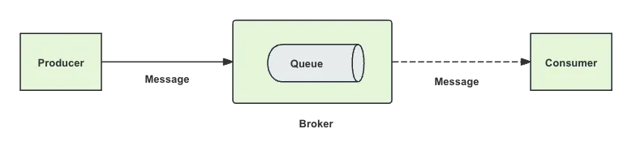

消息队列核心组成：

+ **Producer：**生产者，负责产生和发送消息到 Broker；
+ **Consumer：**消费者，负责从 Broker 中获取消息，并进行相应处理；
+ **Queue：**保存消息的数据结构，提供消息队列先进先出特性；
+ **Message：**实际数据内容，包含了生产者发送给消费者的信息；
+ **Broker：**消息引擎，负责消息存储、确认、重试等。

消息队列是不同应用之间异步通信的中间产品，其本质特征：

+ **解耦：**解除上、下游系统的依赖，达到解耦目的；
+ **削峰：**通过使用消息队列作为缓冲，将多余的请求存放在队列中，避免系统因瞬时高并发请求而崩溃。当系统处理能力恢复时，再从队列中取出请求进行处理；
+ **异步：**解耦合 + 转存，消息的处理结果不需要被即时依赖，上、下游系统可以异步进行，而异步本身直接带来了缓冲、削峰、最终一致性等能力。

#### 1.2 行业趋势
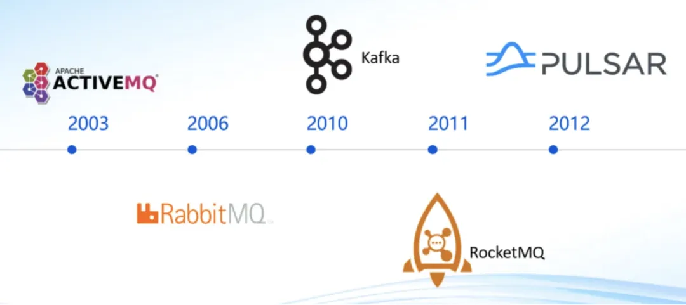

**行业公司消息队列选型：**

业界选型上，Kafka 是离线大数据重要组成，在线消息因为丰富的业务功能诉求（事务消息、延迟消息、死信消息等）选择 RocketMQ 或 Pulsar。

### 02 现状分析
#### 2.1 现状及规模
Red Events MQ 基于 DDMQ 在小红书落地的一套 Discovery + Proxy + RocketMQ 引擎的架构，其架构如下：

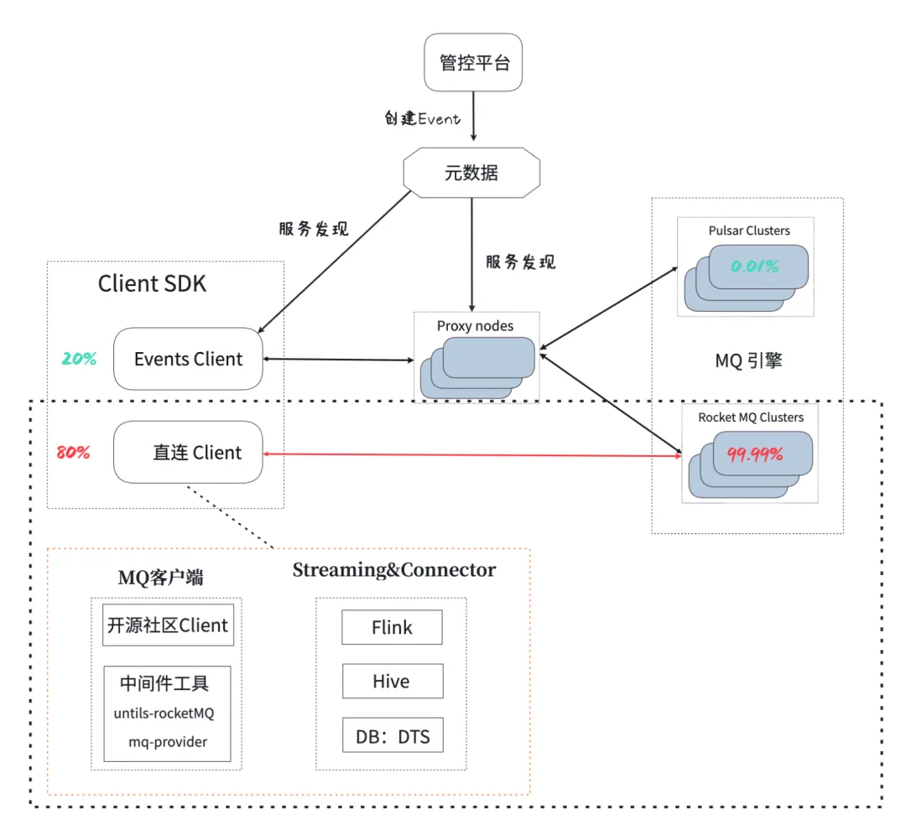

当前形态：

1. **管控平台：**Topic 在管控平台创建和维护；
2. **服务发现：**服务发现同步管控平台信息，对 SDK 提供元数据信息（集群信息）；
3. **Proxy：**屏蔽用户对底层 MQ 的依赖，提供数据服务；
4. **Client SDK：**客户端，由于客户端场景覆盖不足，导致各类客户端、各种连接方式共存，数据平台类的接入均覆盖不到。

#### 2.2 存在问题
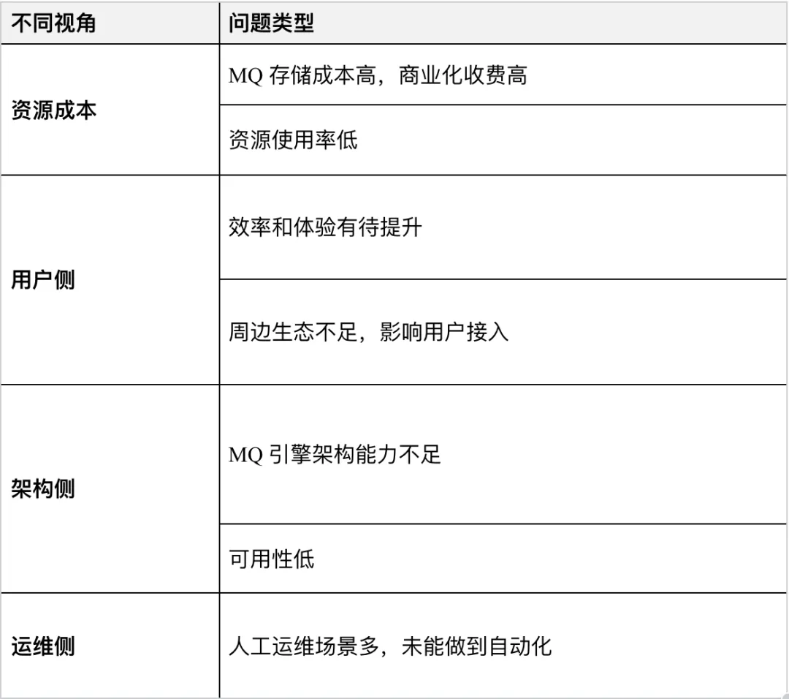

### 03 演进路线
#### 3.1  选型决策：Pulsar 或 RocketMQ5.x
RocketMQ 和 Pulsar 都是 Apache 的顶级项目，同样优秀；但是如下几点还是让我们决策 Pulsar 成为未来我们新的架构引擎：

**Pulsar 独有的优势：**

**汇总成本收益：**当前流量情况下，成本降低 48%；在未来 10 倍增长量的情况下，成本会持续降低。

在小红书当前场景，当前集群和流量规模情况下（RocketMQ 采用了 2 副本、承载同等流量的情况），如果使用 Pulsar 能带来如下收益：

**1、存储成本下降：**存储成本更低，Pulsar 多盘部署架构，部署架构实现让存储成本下降 27%.

+ RocketMQ 2 副本和 Pulsar 3 副本消耗资源都是：32 核 + 128GB 内存 + 16TB 磁盘，但是 Pulsar 可以借助**多盘特性、用更廉价的盘拼出更高的性能：**
+ 基于新架构，设计更合理的部署架构，拿到的收益.
+ [前提] CPU、内存、存储容量保持不变的前提，拿到了其他的收益；
+ [收益] 磁盘总带宽上升：经过多盘的拼接，磁盘带宽从 350MB/s 上升 600MB/s，提升 71%；
+ [收益] 成本下降：从现有架构的 RocketMQ2 副本（Master/Slave Broker）到 Pulsar3 副本（1_Broker+3_BookKeeper），成本下降 27%.

**2、CPU 利用率提升：**提升资源利用率，通过实现副本流量对等，有效规避 RocketMQ Slave 副本资源浪费的情况，可降低 21.5% 的 CPU 资源成本。

+ 追赶读（Catch-up Reads）：消费者落后，在线业务场景很少，RocketMQ 的 Master/Slave 都会承载流量，线上追赶读的峰值流量：流量占比：3.5%；
+ 追尾读（Tailing Reads）：写完立刻读，在线业务此场景偏多，**RocketMQ 此架构只有 Master 才会承载，**线上追尾读的峰值流量：流量占比：**96.5%**，此场景下存在 CPU 的资源浪费：
+ Master 节点：16 核 CPU 峰值使用率高达 50%，计算资源主要消耗在 Client 数据的写、读、Slave 的同步；
+ Slave 节点：16 核 CPU 峰值使用率只有 7%，计算资源主要消耗在从 Master 拉取数据；
+ 按 RocketMQ 的 Master 节点的 CPU 使用率 50% 满足集群扩容需求，但是 Slave 节点的 CPU 利用率确很低，Pulsar 可实现副本完全对等，如果换成 Pulsar，可提升这 43% 的 CPU 使用率，在缩容降本情况下，**可降低 21.5% 的成本。**

**3、弹性伸缩、按量计费：**基于这个特性， 让成本降低 30%

+ 核心逻辑：
+ **配额：**为了满足指定指定 TPS 需要提供的资源，当前集群评估水位的标准是**峰值 TPS；**
+ **实际使用量：**用户实际使用的资源，用**平均 TPS** 代替；
+ **冗余率：**（配额 - 实际使用量)  /  配额，得到资源冗余率，这部分冗余资源就是弹性伸缩架构理论上可以获得的最大收益；
+ 小红书在线消息现状，弹性伸缩可得最大收益：按 2 小时调度一次，可节约 30% 左右的资源用量。

**4、运维友好：**云化部署、弹性伸缩更加平滑。

+ **云化部署：**借助 Ones/K8s 云部署优势，减少重复的运维能力建设；
+ **扩容平滑：**无需做扩容分区、迁移分区等运维操作；
+ 计算层（Broker 无状态）：扩容后，无需运维，流量自动均衡；
+ 存储层（BookKeeper 有状态）：扩容后，无需要干预，新 Ledger 创建后，流量自动覆盖新节点；
+ **缩容平滑：**做到无损，不改变顺序读写，更加优雅；
+ 计算层（Broker 无状态）：缩容后，自动卸载流量，流量自动均衡到其他节点；
+ 存储层（BookKeeper 有状态）：缩容后，无需要干预，流量自动均衡（策略有：非紧急的缩容，节点直接隔离待数据失效 + 紧急下线数据迁移）。

**Pulsar VS RocketMQ 5.0 核心能力（绿色块：代表优势； 橘色块：代表劣势）**

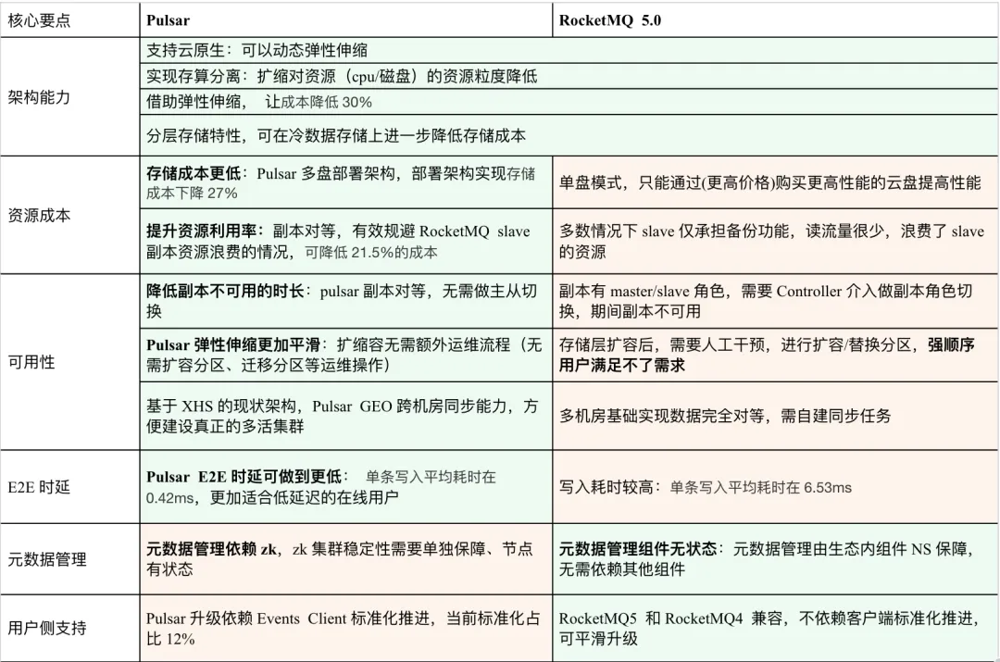

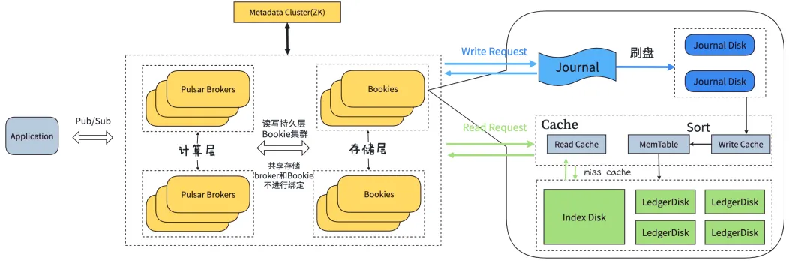

**Pulsar 架构图**

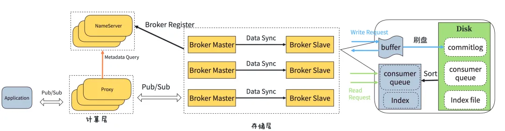

**RocketMQ 5.0 架构图**

#### 3.2 演进方向
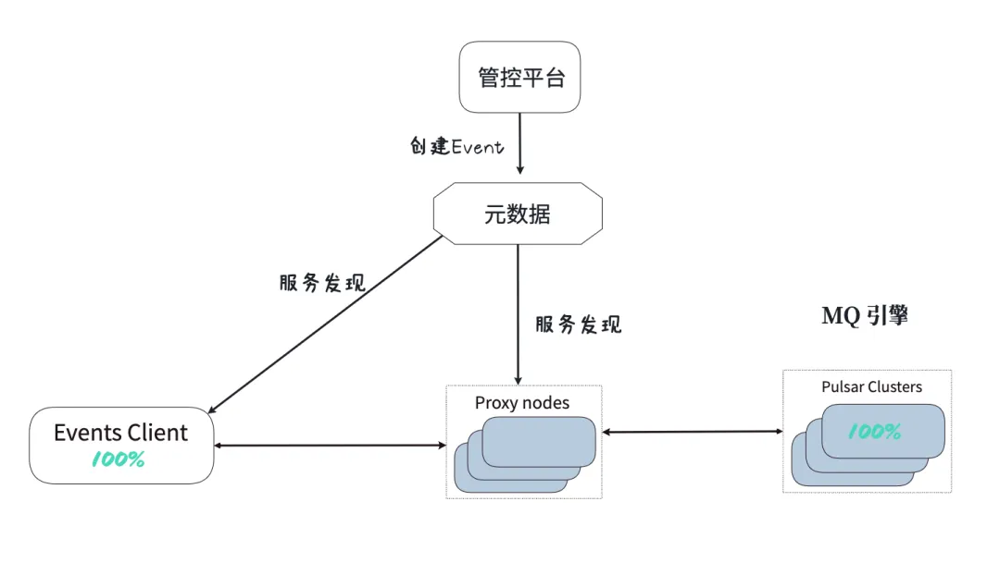

**核心名词解释：**

+ 设计思想：Red Events（事件总线）本质上是一个 MQ 代理，目的是对用户屏蔽底层 MQ 的实现，提供统一的接入方式、集群的运维和治理；
+ Topic：是数据发布和订阅的基本单位，它代表了相同类型的消息流；
+ Event：是对 Topic 的抽象，提供了集群和 Topic 的绑定关系，可动态调整，更便于用户使用；
+ 元数据：Topic 的元数据服务，供 Events Client 感知集群等信息；
+ Events Client：标准化的客户端，提供统一的接入方式，用户发送、消费消息的工具；
+ Proxy：MQ 代理，提供统一的集群运维和治理；
+ Pulsar Clusters：MQ 的引擎，一套存算分离的云原生架构。

**设计目标：**

1. Events 客户端标准化、可观测、功能轻量：作为统一接入的客户端，各类语言（http 兜底）客户端、各类场景（flink 等）全量覆盖，让用户接入 MQ 更加稳定、可控
2. Events Proxy：MQ 的代理，屏蔽用户对底层 MQ 引擎选择，只需要关注核心问题：RT / 吞吐 / 功能 / 成本
3. MQ 新引擎的方向：替换原有的 RocketMQ4.x，构建一套存算分离的云原生架构，新引擎做到 100% 流量全部覆盖

通过客户端标准化和平滑迁移这两种手段，让 Pulsar 在小红书落地成为可能。

#### 3.3 客户端标准化
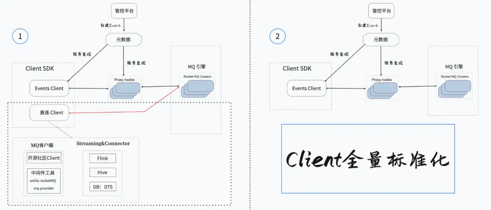

客户端标准化让客户端接入都收敛，实现标准化接入：

+ 用户客户端改造，使用标准化接入方式 EventClient；
+ 客户端改造过程中触发自动化灰度切流；
+ 客户端改造完成，观察业务指标是否符合预期。及时发现并解决客户端改造过程中的问题。

#### 3.4 架构升级到 Pulsar
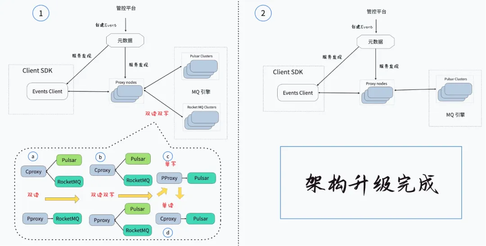

**Pulsar 迁移路径：**

+ **按优迁移、平滑无感：**按业务优先级，从低优到高优逐步迁移，旨在平滑迁移，用户无感；
+ **Pulsar 迁移最终覆盖到 100%：**依赖客户端标准化的推动进度，首先推动 11% 上下游均标准化的部分，之后随标准化桥接推进，共同推进到 71%，最终实现 Pulsar 100% 的覆盖；
+ **迁移同时对资源使用率的治理：**Pulsar 迁移过程也将逐步实现资源使用率的提升，从观察期 30%，最终提升资源使用率到 50%.

### 04 在线消息规划设计
整体架构设计点：

+ 以 Pulsar 为底座，构建一个存算分离的云原生架构；
+ 构建更多特色功能：跨云多活、实时队列、延迟队列、分层存储能力、弹性伸缩及弹性计费的功能，分阶段让用户享受到架构的红利。

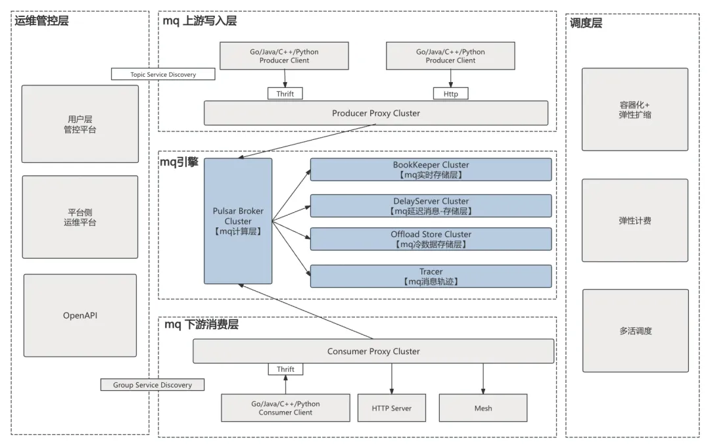

整个架构的设计维度：

+ 创建 Topic 入口统一：所有 Topic / 消费组都在管控平台创建；
+ Client 所有场景覆盖：Events 客户端标准化、可观测、功能轻量：各类语言（http 兜底）客户端、各类场景（flink 等）全量覆盖；
+ Events 客户端标准化、可观测、功能轻量：操作均通过 Events Proxy 做数据通信；
+ Events Proxy：MQ 的代理，屏蔽用户对底层 MQ 引擎选择，只需要关注核心问题：RT / 吞吐 / 功能 / 成本；
+ MQ 全链路能力对齐：支持云原生，容器化、弹性扩缩、具备弹性计费能力（按量计费）、支持各维度多活。

### 05 总结与展望
#### 5.1 阶段性总结
演进计划当前进度：

+ 新架构（Pulsar）流量占比 11.8%.

当前已经拿到的收益：

+ **成本：**降低 42%（主要是存储成本下降，使用了同容量、多块更廉价的盘）；
+ **资源利用率**（CPU 使用率）：34%（主 62%、从 7%）提升到 60%；
+ **RT 耗时**（客户端 E2E ）：max(P99) 20.2ms 降到 5.7ms；
+ **人工运维量：**当前都部署在云上，借助云调度 + 自动卸载 + 注册，降低运维工作。

#### 5.2 展望
长远规划：完成 Pulsar 规划，制定客户端标准化、平滑迁移计划，同时做到稳定性建设。

1. **Pulsar 落地：**
2. 继续完善功能完备性、生产稳定性、可观测 、运维能力；
3. 按照集群重保等级逐一迁移到 Pulsar；
4. 新 Topic 收口：新申请 Topic 直接创建在 Pulsar；
5. 100% 平滑迁移到 Pulsar，下线 RocketMQ.
6. **客户端标准化推进：**
7. 通过直接客户端改造和间接标准化（框架底层代码桥接，间接实现标准化）两种方式共同推进客户段标准化的覆盖；
8. 同时也逐步扩大 Pulsar 迁移范围；
9. 最终实现客户端标准化的 100% 覆盖。
10. **稳定性建设：**
11. 快速止损预案应对（共同的目标）：去应对未知场景的 Bug，快速止损，这不仅是未来引擎，也是当前引擎所要具备的能力；
12. Monitor 全链路探针：端到端的探针，核心链路全覆盖，及时发现故障节点。

> 更新: 2025-04-20 22:38:56  
> 原文: <https://www.yuque.com/aaron-wecc3/dhluml/wyymvhlgaxhhnsu3>