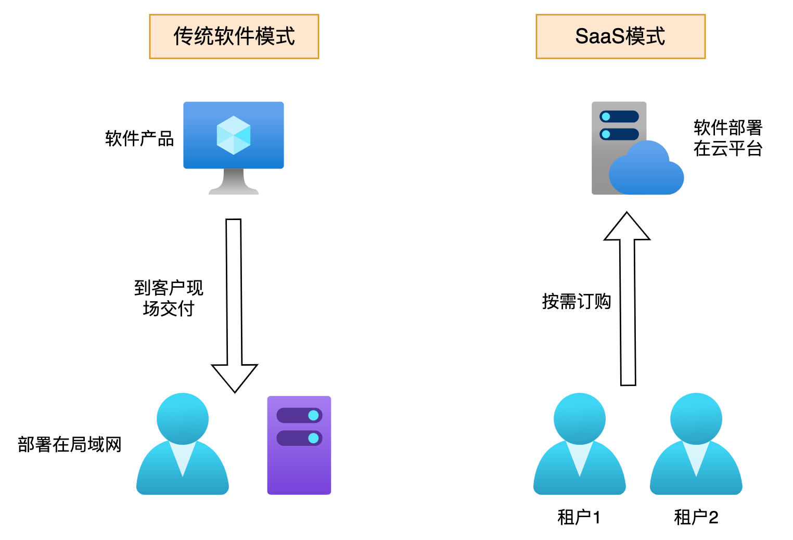
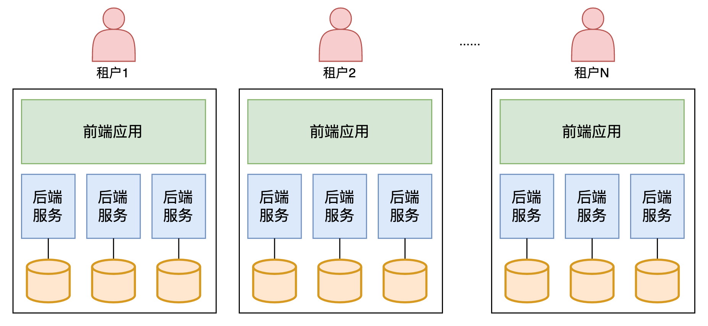
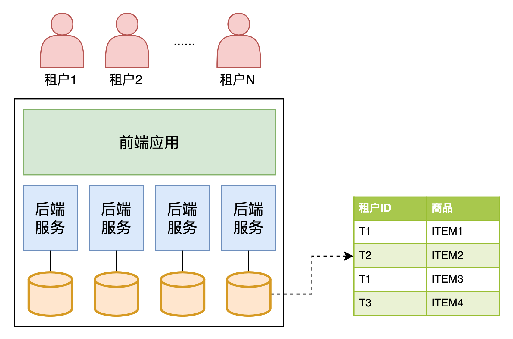
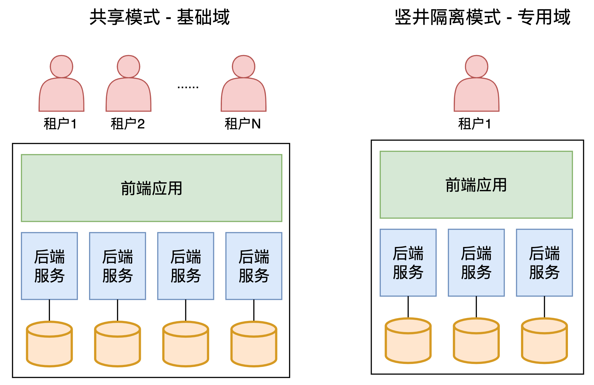
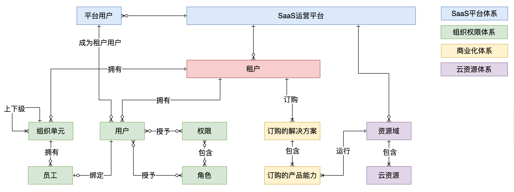
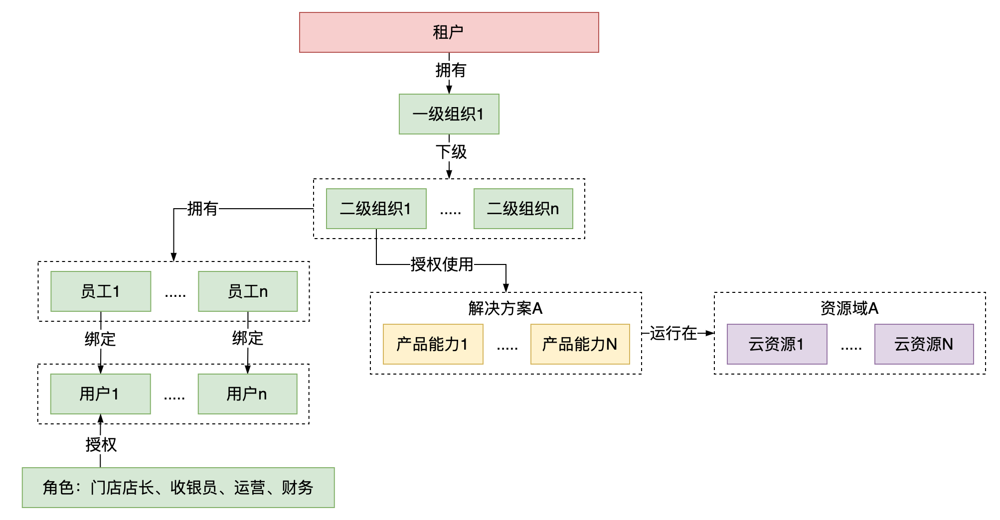
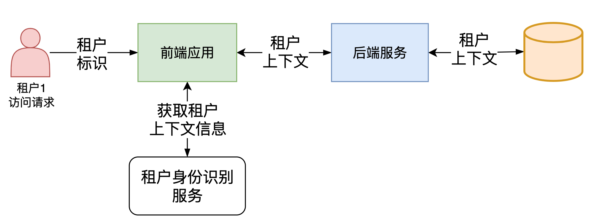
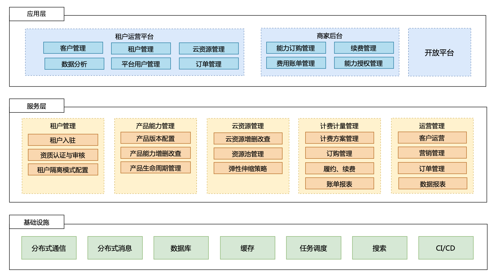

# 75.大厂多租户系统架构设计

### 什么是多租户？
多租户是 SaaS 领域的特有产物，在 SaaS 服务中，租户是指使用 SaaS 系统的客户，租户不同于用户，例如，B 端 SaaS 产品，用户可能是某个组织下的员工，但整个企业组织是 SaaS 系统的租户。多租户技术是一种软件架构技术，可以实现多个租户共享系统实例，并且租户间能够实现数据与行为的隔离。

### 传统软件模式 VS SaaS 模式
传统软件项目一般是指，面向客户开发一套特定的软件系统，并部署在独立的环境中，通常是企业内部环境。而 SaaS 模式，是将软件服务部署到云端环境，可以面向不同的客户提供相同的软件服务。

### SaaS 多租户隔离模式
对于 SaaS 模式，多租户间的资源隔离是非常基础的能力，出于成本和运营效率考虑，SaaS 服务商需要构建多租户可同时访问软件的环境，不同租户虽然访问同一套 SaaS 产品服务，但资源访问需要严格隔离开。

#### SaaS 资源隔离包含几个层次：
+ 第一层是 SaaS 系统底层所涉及到的计算、存储、网络等资源的隔离。
+ 第二层是系统基础数据的隔离，主要包括组织，用户，角色，权限，产品能力授权关系等。
+ 第三层是系统使用过程中，各类业务动态数据的隔离，例如业务单据、操作记录等。

多租户架构主要是解决第一层的隔离问题，即计算、存储、网络等资源的隔离。为了实现多租户隔离架构，我们先要搞清楚常见的几种多租户隔离模式。

#### 竖井隔离模式

有些 SaaS 服务商会选择竖井隔离模式，即每个租户都运行在隔离的一套资源中。有人会说，这不就是传统软件模式吗，为什么会是 SaaS 模式呢？但如果这些竖井式的资源，拥有标准化的租户身份识别、入驻流程、计费体系、部署流程、运营流程，那边它依然是 SaaS 模式，只不过每个客户都有一套端到端的基础设施。

##### 优势
+ 满足强隔离需求：一些客户为了系统和数据的安全性，可能提出非常严格的隔离需求，期望软件产品能够部署在一套完全独立的环境中，不和其他租户的应用实例、数据放在一起。
+ 计费逻辑简单：SaaS 服务商需要针对租户使用资源进行计费，对于复杂的业务场景，计算、存储、网络资源间的关系同样也会非常复杂，计费模型是很有挑战的，但在竖井模式下，计费模型相对来说是比较简单的。
+ 降低故障影响面：因为每个客户的系统都部署在自己的环境中，如果其中一个环境出现故障，并不会影响其他客户使用软件服务。

##### 劣势
+ 规模化问题：由于租户的 SaaS 环境是独立的，所以每入驻一个租户，就需要创建和运营一套 SaaS 环境，如果只是少量的租户，还可能可以管理，但如果是成千上万的租户，管理和运营这些环境将会是非常大的挑战。
+ 成本问题：每个租户都有独立的环境，花费在单个客户上的成本将非常高，会大幅削弱 SaaS 软件服务的盈利能力。
+ 敏捷迭代问题：SaaS 模式的一个优势是能够快速响应市场需求，迭代产品功能。但竖井隔离策略会阻碍这种敏捷迭代能力，因为更新、管理、支撑这些租户的 SaaS 环境，会变得非常复杂和低效。
+ 系统管理与监控：在同一套环境中，对部署的基础设施进行管理与监控，是较为简单的。但每个租户都有独立的环境，在这种非中心化的模式下，对每个租户的基础设施进行管理与监控，同样也是非常复杂、困难的。

#### 共享模式

相信很多 SaaS 服务商会优先选择共享模式，即多租户共享一套基础设施资源，这样能让 SaaS 软件服务更加高效、敏捷、低成本。

##### 优势
+ 高效管理：在共享策略下，能够集中化地管理、运营所有租户，管理效率非常高。同时，对基础设施配置管理、监控，也将更加容易。相比竖井策略，产品的迭代更新会更快。
+ 成本低：SaaS 服务商的成本结构中，很大一块是基础设施的成本。在共享模型下，服务商可以根据租户们的实际资源负载情况，动态伸缩系统，这样基础设施的利用率将非常高。

##### 劣势
+ 租户相互影响：由于所有租户共享一套资源，当其中一个租户大量占用机器资源，其他租户的使用体验很可能受到影响，在这种场景下，需要在技术架构上设计一些限制措施（限流、降级、服务器隔离等），让影响面可控。
+ 租户计费困难：在竖井模型下，非常容易统计租户的资源消耗。然而，在共享模型下，由于所有租户共享一套资源，需要投入更多的精力统计单个租户的合理费用。

### 分域隔离模式

传统大企业更喜欢私有化部署、个性化交付的传统模式，因为他们需要更强的管控和更高的安全性。然而，中小企业付费能力有限，需求往往也更加标准化，所以更喜欢价格更低的、订购更简单的 SaaS 产品。为了满足不同客户的需求，还有一种混合了竖井模型与共享模型的模式，即分域隔离模式。

在该模式下，会细分基础域、专用域，基础域是使用共享模型，所有租户共享一套资源；而专用域是使用竖井模型，每个租户都有独立的资源环境。

对于大多数中小客户来说，他们都是在基础域环境使用 SaaS 产品，只有少量的大客户会在专用域使用 SaaS 产品，通常他们付费能力强，有强烈的强隔离需求。

但需要注意的是，为了避免多套产品版本出现，SaaS 服务商需要保证基础域、专用域的产品版本一致，个性化的部分尽可能通过构建 PaaS 平台，让 ISV 参与建设。否则，一旦 SaaS 产品的标准化程度降低，后续各版本的维护将变成灾难。

### 多租户系统的定位
了解各种多租户隔离模式后，我们来总结下多租户系统的定位。多租户系统是为了满足多用户使用一套产品，并实现用户间的数据与行为隔离，但根据用户需求不同，可以共享或隔离软硬件资源，系统架构上能够灵活支持多种隔离模式。

#### 多租户系统需要具备的能力
+ 多个租户支持共享一套云资源，如计算、存储、网络资源等。单个租户也可以独占一套云资源。
+ 多个租户间能够实现数据与行为的隔离，能够对租户进行分权分域控制。
+ 租户内部能够支持基于组织架构的管理，可以对产品能力进行授权和管理。
+ 不同的产品能力可以根据客户需求，支持运行在不同的云资源上。

### 多租户概念模型
#### 多租户核心概念
+ 租户：一般指一个企业客户或个人客户，租户之间数据与行为是隔离的。
+ 用户：在某个租户内的具体使用者，可以通过使用账户名、密码等登录信息，登录到 SaaS 系统使用软件服务。
+ 组织：如果租户是一个企业客户，通常会拥有自己的组织架构。
+ 员工：是指组织内部具体的某位员工。
+ 解决方案：为了解决客户的某类型业务问题，SaaS 服务商将产品与服务组合在一起，为商家提供整体的打包方案。
+ 产品能力：指的是 SaaS 服务商对客户售卖的产品应用，特指能够帮助客户实现端到端场景解决方案闭环的能力。
+ 资源域：用来运行 1 个或多个产品应用的一套云资源环境。
+ 云资源：SaaS 产品一般都部署在各种云平台上，例如阿里云、腾讯云、华为云等。对这些云平台提供的计算、存储、网络、容器等资源，抽象为云资源。

#### 概念模型设计

+ SaaS 平台可以创建与管理多个平台用户、多个租户、多个资源域。
+ 单个平台用户可以关联到多个租户下，例如，平台用户张三，可以是租户 A 的用户，也可以是租户 B 的用户。单个租户下可以拥有多个用户。
+ 单个租户可以订购多个解决方案，解决方案可以包多个产品能力，产品能力运行在某个资源域上。
+ 组织单元间有上下级关系，单个组织下可以有多个员工，员工与单个用户进行绑定。

### 多租户核心场景
#### 租户内部模型关系
对 SaaS 产品来说，租户是最顶层的概念，租户内部拥有组织、用户、产品能力、云资源等模型，租户就像租了一套大房子，其他模型都是房子内部的家具或设施。

#### 租户身份识别
在各种隔离模式下，识别租户身份，获取租户的资源配置，是非常关键的。当一个用户登录 SaaS 系统后，系统会返回租户上下文信息，上下文会包含用户绑定的租户信息，以及隔离模式。租户上下文信息会被附加在每一次系统交互中，贯穿整个系统调用链路，让上游调用方知道路由到哪些下游资源。

#### 租户计费计量管理
在竖井隔离模式下，由于资源本身就是隔离的，所以可以根据占用的计算、存储、网络资源来计费计量，逻辑相对简单。在共享模式下，计费计量就比较复杂，我们要能准确地采集到各个租户对实际资源的使用情况，一般会根据请求并发量、存储容量、数据对象数量等数据来进行组合计费。

### 多租户系统应用架构

### 总结
本次分享首先介绍了什么是多租户，对比传统软件模式与 SaaS 模式的区别。通过分析多租户的三种隔离模式，逐步梳理出多租户的系统架构设计，包括概念模型、场景推演、应用架构等。

  
 

> 更新: 2025-04-20 22:38:56  
> 原文: <https://www.yuque.com/aaron-wecc3/dhluml/renrddgsg1gge21l>