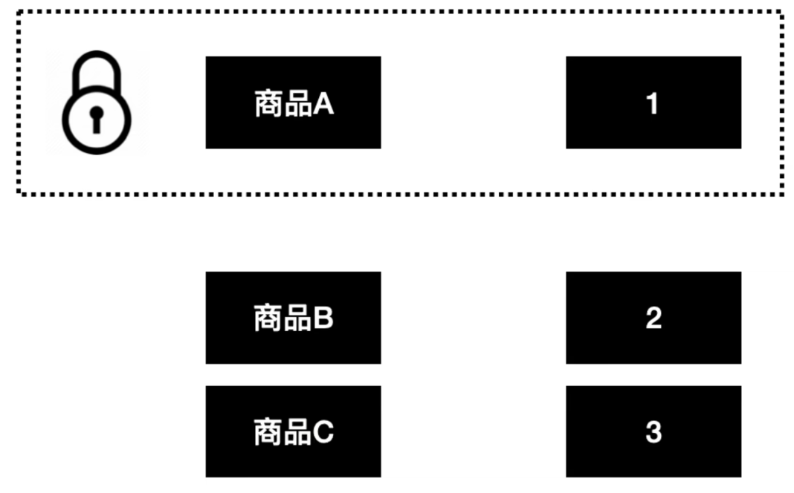
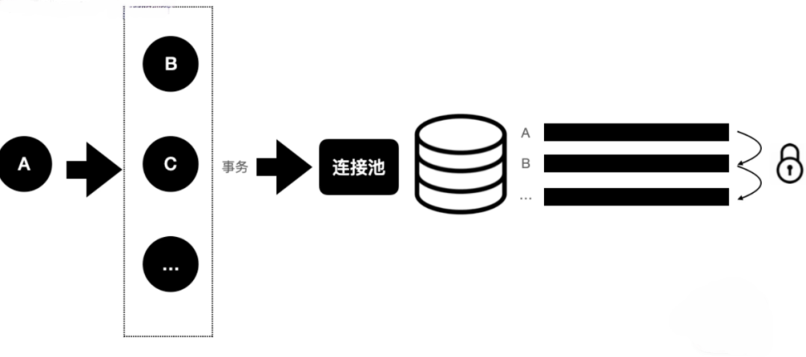
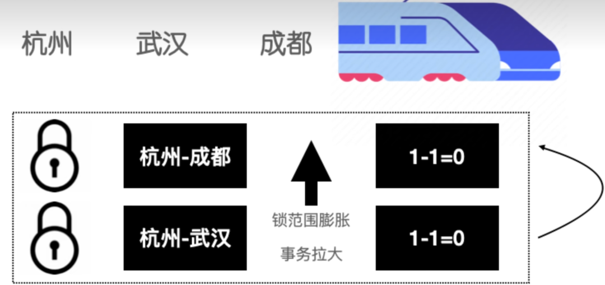
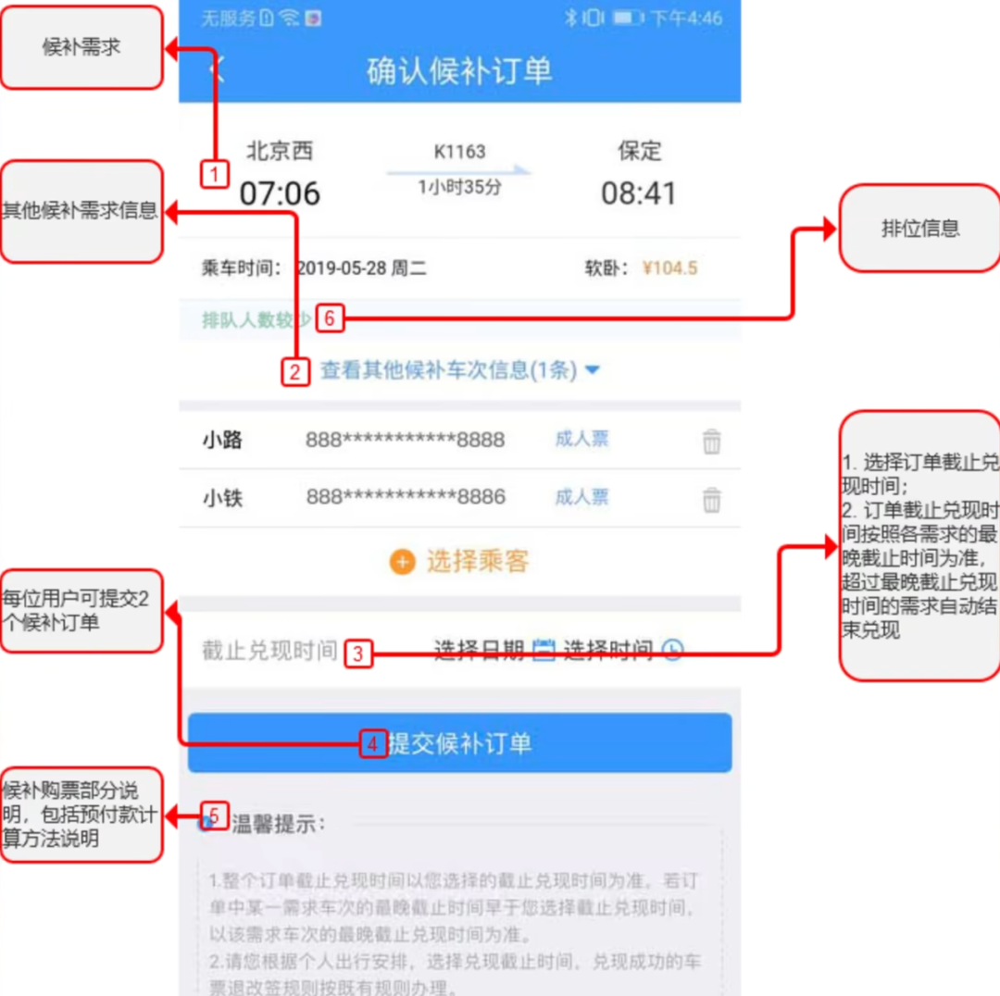
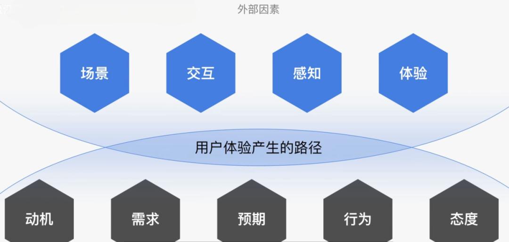
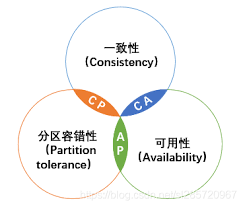
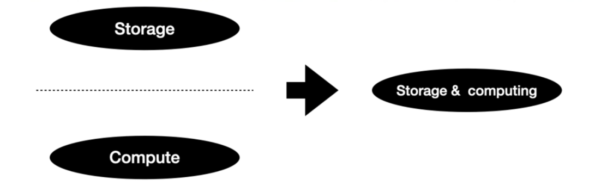
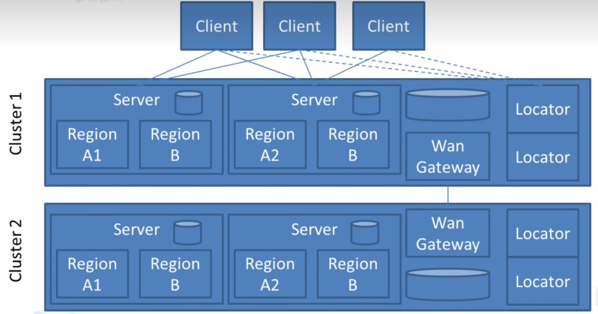

# 76.12306超高并发如何保证数据一致性

# 12306 系统挑战

* 创下全球最大实时票务交易系统世界记录，春运一个月抵欧洲一年。
* 最高可达百万并发，承受了这个世界上能秒杀任何系统的 QPS。
* 网站浏览量一天最高超 1500 亿次，峰值是双 11 的三倍。

# 12306 系统特点

* 跟淘宝天猫等相比，业务简单（卖票）。
* 流量极大。
* 动态库存。

# 12306 系统难点

目前 12306 最大的难点，在于库存扣减。

它跟传统的电商网站，可能最大的不同在于它的库存， 它的库存是动态变化的，库存之间会互相影响。

比如现在有一个组合品的需求，A 品是由 B 品和 C 品通过不同的比例混合而成，用户下单的时候传过来的是 A 品这个 SKU，但是库存扣减的时候是把它的组合品的单品（B 和 C），都去扣一遍的。

我们平时各种商品 sku 库存的话，它是表里面的一行行记录。

某个行程是：杭州 -> 武汉 -> 成都。

杭州 -> 成都 ，武汉 -> 成都。这两个是一个车次。那么每卖出一张 武汉 -> 成都 的票，杭州 -> 成都 的票也会少一张。

举个极端的例子，火车上就一个座位，车次是从 A -> B -> C。

如果卖出 B -> C 的车票，不去扣减 A-> C 库存的话，那么假设有两个用户分别买了 A-> C 和 B -> C 。那么当车行至站点 B 的时候，车上会有两个人，但是座位就一个。

所以不同车次之间的库存是会互相影响的。

A -> B -> C -> D 共 4 个车站，假如乘客买了 B -> C 的车票，那么同时会影响到 A->C，A->D，B->C，B->D。

这里不会影响 A -> B 的行程，因为乘客买的是 B -> C 的车票，站点 B 才上车，不占用 A -> B 行程的座位，我下车你上车，不冲突。

**计算耗费性能**

一些长途，中间会经过十几个站点，而且有些城市是没有直达的车次的，中间只能换乘。涉及了多个车站的排列组合，这里计算是比较耗费性能的。

**行锁竞争会非常激烈**

购买一个行程会涉及多个站点的扣减库存，有可能这些多个站点的库存扣减是放在一个事务中的，如果是在一个事务中，那么一次下单行为，可能要涉及到几十次库存扣减。

锁范围膨胀，事务就会被拉大，线程数可能迅速被占满，导致数据库可能成为性能瓶颈，并且接口性能也会有所下降。

**热点问题**

火车站不同的站之间都是一个具体库存，中间的库存扣了之后，那么远的这个站的库存也要扣减。

极端情况下，一些热门城市，中间一些站点可能比较火爆，那两端的人是不是永远买不到票。

所以说像 12306 这种库存，其实涉及到非常多的一个行锁竞争，而且事务是非常大的。一列火车之间的库存其实是互相影响的，动态变化的。

另外还会涉及到其他维度，比如 硬座、硬卧、软卧、无座 这种业务逻辑在里面。

业务逻辑加上库存之间相互影响，就导致库存扣减逻辑异常复杂。

# 解决思路

## 产品角度

* 早期的 12306 是通过整点去抢票，整点就会产生非常高的流量峰值，对系统造成非常大的压力，后面采取了分时段售票，比如今天开抢 15 天之后的车票，将抢票的压力按照时间区间分散开，大大减低了峰值。
* 候补车票。

在 2019 年 5 月份，12306 新增了 “候补购票” 功能，在 “候补购票” 功能没出来之前，放票时间一到，千万人同时刷新抢票，这便是春运火车票秒光的原因。

候补车票堪称抢了一票第三方软件的 “饭碗”。

**“黄牛” 的秘密武器是外挂，用最快的服务器不断地刷新和监控 12306，刷票速度往往是正常购票的几十倍。**

实际上，市面上通行的 “抢票软件”，原理与“黄牛” 并无本质区别。

以前，合肥到上海的车票卖光了，有人退票或改签，车票会回到票池可供购买。抢票软件实时刷新监控，第一时间购买，这便是抢票软件比人快的原因。

现在，有了候补车票，合肥到上海的车票卖光了，**乘客可以候补登记，有人退票或改签，车票按顺序优先卖给候补登记的人，而不是回到票池公开出售。这便是抢票软件无效的原因。**

现在很多抢票软件反而没有 “候补购票” 功能抢票来得快。

候补车票在整个系统上相当于是一个异步过程。先排队，后面抢没抢到票再通知你。只要异步了，就可以通过消息，或者定时任务慢慢去消费，大大降低系统的压力。

12306 是有非常多的灰色流量的，像是一些抢票软件或者脚本。因为这里面涉及到的利益非常巨大，滋生了很多灰色流量，给 12306 本身带来了很多额外的压力。

“候补购票” 功能可以降低黄牛刷票行为，拦截部分灰色流量。

* 验证码机制。BT 的验证码机制，可以过滤非常大的灰色流量。

12306 的验证码，是所有验证码中的一股绝对的 “清流”。

2013 年起，铁道部为了应对黄牛抢票，以及各类抢票软件和插件，升级了购票验证码系统。

在 12306 官方网站上，从购票到付款，都需要输入验证码。从最开始的字母数字验证码，再到后来升级后的图形验证码，成为了一道 “难过” 的关卡。

各类奇葩验证码出现在了 12306 上。

到了 2015 年底，根据有关网站统计，12306 上的图形验证码多达接近 600 种。再经过排列组合，总共有多达 300000 种。**一次性输入准确的比例仅仅是 8%，两次输入准确比例 27%，三次以上输入准确的比例才勉强超过 60%，如果一次性输入成功的平均用时为 5 秒的话，按照热门车票 “秒光” 的情况计算，每输错一次验证码，就意味着当次购票成功率下降 80% 左右。**

直到 2018 年，各类奇葩验证码才陆续开始 “下岗”。

上面的候补抢票和验证码机制，主要是为了对抗黄牛。

道高一尺，魔高一丈。黄牛也在不断进步。

比如我是一个搞黑灰产的人，我可以雇佣一批大学生，去做图形验证码识别。简单验证码还是机器去执行。

那这样的话其实还是没办法防止，但是这样增加了灰产的成本，毕竟人工比机器成本高，从一定程度上还是能够降低灰产的流量占比。

12306 之所以能够使用如此变态的验证码机制的大前提是：**没有把用户体验放在首位**。

**12306 比较特殊，市面上几乎不存在竞争对手，而且火车票对于逢年过节，旅行返乡的人来说，几乎可以等同于必需品。**

**在这种情况下，12306 不必将用户体验放在首位，对于 12306 来说是可以牺牲部分用户体验来换取系统稳定性。**

* 12306 是读多写少的情况，查询流量占大头。

天量的火车票查询是影响 12306 性能的重要原因之一，大概占了 90% 以上的访问流量。更棘手的是：峰谷的查询有天壤之别，平时工作日跟这种节假日，春运。流量相差是巨大的，时间区间是非常明显的。

如果说完全用机器去堆，可能就会造成一个资源浪费。

还有至关重要一点是，假如完全用机器去堆，在实际业务峰值超出了初始评估量时，服务将面临无法完全承载而瘫痪，**因为大规模服务器的采购、交付、部署到应用上线所耗费时间以月计，根本无法在业务量激增时 "即插即用"**。

几乎没有办法在成本和并发能力之间做一个好的平衡。以往的一个做法是从几个关键入口流量控制，保障系统可用性，但是会影响用户体验。

淘宝 / 天猫大促的时候，也会增加服务器，但阿里的业务盘子大，这些新增的机器很快会被其他业务 (包括阿里云) 消化掉，可能还不够。但是对于 12306 来说，就比较难做到这一点。

在 2015 年的时候，12306 跟阿里云达成合作，通过云的弹性和 “按量付费” 的计量方式，来支持巨量的查询业务，把架构中比较 “重”(高消耗、低周转) 的部分放在云上，将 75% 的余票查询业务切换到了阿里云上。

**将余票查询模块和 12306 现有系统做分离，在云上独立部署一套余票查询系统。**

通过动态的云计算，在高峰时段动态去扩容，可以达到分钟级的扩容，这样就避免在平时浪费大量的机器。

合作后，提高了网站的负载能力。2019 年的春运，12306 挺过了流量的高峰 297 亿次的日访问量。

## 技术角度

历史背景：12306 是在 2010 年左右上线的，11 年到 12 年之间，基本上一到节假日系统就崩溃。当时也是被喷的不行。12 年之后在 7、8 月份进行了大规模的重构，到了 13 年的春节，整个系统就比较稳定了，基本没有 down 机的情况发生。

面对 12306 这种读多写少的场景，可能我们平时会采用 Redis 这种缓存机制，12306 具体选择的解决方案，可能跟我们常见的解决方案有一些不一样。

12306 通过充分调研，并没有选择 Redis，而是选择了名叫 **Pivotal GemFire** 的产品。

没听过 Pivotal ，学 Java 的肯定都听过 Spring。

Spring 框架它归属于 Spring 团队。没错框架名和团队名是一样的，这个团队归属于 Pivotal 公司。

很多银行、投行，实时交易方面的系统都采用 Pivotal GemFire 作为解决方案。

GemFire 基于开源项目 Geode 进行研发的。Redis 是在 2010 年左右才发行的第一个版本，Geode 是更早的一个开源项目。

GemFire 本身是 Geode 的商用版本，可以理解为收费的 Redis（Redis 的作者现在就在 GemFire 打工）。就像 Oracle 和 MySQL。

**为什么选择 Pivotal GemFire 而不是 Redis？**

[https://redis.io/comparisons/redis-vs-gemfire/](https://redis.io/comparisons/redis-vs-gemfire/)

Redis 是开源的缓存解决方案，而 GemFire 是商用的，我们在互联网项目中为什么使用 Redis 比较多呢，很大原因就是因为 Redis 是开源的，不要钱。

开源对应的也就是稳定性不是那么的强，并且开源社区也不会给你提供解决方案，毕竟你是白嫖的。

而在银行以及 12306 这些系统中，它们对可靠性要求非常的高，因此会选择商用的 GemFire，不仅性能强、高可用，而且 GemFire 还会提供一系列的解决方案。

12306 本身不缺钱，在资金预算充足的情况下，追求系统的稳定性和交易的绝对可靠，追求的是最好的解决方案。

而 GemFire 类似 Oracle 是一套完整的解决方案，不只是给你一套工具，让你私有化部署就不管了，而是需要后面持续去维护的。

据说 GemFire 同时做到了分布式系统里的 CAP，违背了架构的一个常识。

当时 12306 也尝试了许多其他的解决方案，都扛不住查询的流量，而使用 GemFire 之后扛住了流量，因此就使用了 GemFire。

Redis 主要用作缓存存储，而当时 （12 年左右） 12306 最大的瓶颈主要是在 IO 上面。

为什么 12306 最大的瓶颈会在 IO 上面呢？这跟 12306 使用读扩散有关。\*

读扩散和写扩散常见于 订阅 / 聊天 / 群聊 系统。

读扩散，一般指牺牲了读的性能，去提升写的性能。

写扩散，一般指牺牲了写的性能，去提升读的性能。

对应 12306 来说：

* 读扩散：扣减只需要关注列车站点之间的扣减，关注车次，查询的时候再去动态计算。

优点：扣减简单；缺点：计算余票复杂。

* 写扩散：扣减直接把各个站点之间票都扣减，关注站点。

优点：扣减复杂；缺点：查询余票简单。

个人猜测 12306 使用读扩散的原因是对数据实时性有要求，当扩散队列很长的时候，写入时间存在延时，可能导致不同行程的余票对不齐。

而且涉及排列组合过多，使用写扩散，数据冗余会比较严重，浪费存储成本。

计算余票是一个数据密集型的运算，要关联很多的数据进行计算。一方面需要数据，一方面又要频繁的计算。计算跟数据本身是分开的（计算在 CPU，数据存储在内存）。

GemFire 的定位是**实时存储网格**。

一般分布式缓存，比如 Redis，查询数据就算再快，还是要从缓存里取出数据，再 CPU 进行计算。

GemFire 最大的特点是将存储和计算放在了一起，它的存储和实时计算的性能目前还没有其他中间件可以取代。

扣减库存数据库选用的是 Sybase（收费，关系型数据库），相比查询的流量，扣减库存的流量是完全可以承载的。

db-engines.com 这个网站可以对比主流数据库之间的差异

扣减库存之后再同步至 GemFire，然后在 GemFire 里进行动态计算，整个 GemFire 承载的是查询的流量。引入 GemFire 之后，整个系统的查询扩散瓶颈基本上就解决了。

GemFire 将很多机器内存汇总成一个大的节点，作为整体去管理，尽量保证业务运算和业务数据是在同一个节点，尽量避免多节点的网络通信。

但是 GemFire 也存在不足的地方，对于扩容的支持不太友好。在 12306 中，也有过测试，需要几十个 T 的内存就可以将业务数据全部放到内存中来，因此直接将内存给加够，也就不需要很频繁的扩容。

### 余票库存的表如何设计？

这里的设计思路都是猜测的，并不一定是 12306 真实的设计方案。

**12306 余票库存的表的设计是非常特色并且重要的**

首先说一下需要哪几个表来表示余票的库存信息：

1、基础的车次表：表示车次的编号以及发车时间等具体的车次信息，属于比较稳定的数据。

2、车的座位表：表示每个座位的具体信息，包括在几车厢、几行、几列，以及该座位的售卖情况。

3、车的余票表：通过座位表可以计算出每个车位在各个车站区间还有多少余票，但是动态计算比较浪费性能，因此再添加余票表，通过定时计算余票信息放入到余票表中，提高查询的性能。

（其实还应该有站点表和车厢表，不过不太重要，这里直接就省略了）

**这里说一下这 3 个表的对应关系：**

比如车次为 K123，该车上有很多的座位，每个座位对应座位表中的一条数据。

而余票表指的是 K123 车次上，硬座、硬卧、软卧、无座各有多少张余票，余票表的信息可以由座位表来计算得到。

**接下来说一下如何通过座位表来表示用户购买的车票：**

12306 中的车票信息其实是比较复杂的，因为各个车站之间是有依赖关系的，比如 4 个车站 A->B->C->D

如果乘客购买 B->C 的车票的话，不仅 B->C 的库存要减一，B->D 的库存也要减一，这是排列组合的情况，**可以考虑通过二进制去简化车票的表示。**

在座位表中，我们设置一个字段 <code>sell varchar(50)</code> 表示该座位的售卖情况，如果该车次有 4 个站 A->B->C->D，那么 sell 字段的长度就为 3，sell 字段的第一位表示该座位 A->B 的票是否已经被买了，第二位表示 B->C 的票是否已经被买了...

如果乘客购买 B->C 的车票，则 sell 字段的值为：<code>010</code>。

如果乘客购买 B->D 的车票，此时发现该座位在 B->C 已经被卖出去了，因此不能将该座位出售给这位乘客。

如果乘客购买 C->D 的车票，则 sell 字段的值为：<code>011</code> ，表示 B->C，C->D 都已经有人了。

通过座位表来计算出余票，得到余票表。

**通过余票表提升查询性能**

这里余票表就相当于是数据库中的视图。

如果要去查询一个车次中某一个类型的余票还有多少，还需要去对座位表进行计算，这个消耗是比较大的 ，因此通过余票表来加快对于余票的查询。

可以定时去计算座位表中的数据，将每种类型的座位的余票给统计出来，比如：

硬卧：xx 张

硬座：xx 张

软卧：xx 张

...

再将余票表的信息给放入到缓存中，大大提高查询的性能。

我们在使用 12306 的时候，也会发现，有时候显示的有票，但是真正去买的时候发现已经没有余票了，**这就说明 12306 没有保证实时的一致性，只要保证了最终一致性即可，也就是用户真正去买的时候，保证对于余票数量的查询是准确的就可以了。**

个人推测 12306 使用的是缓存 + 动态计算结合的方式，查询的时候使用的是缓存（最终一致性），等到真正下单的时候会再去动态计算一遍（实时一致性）。这样利用缓存就能隔绝掉很大的查询的流量，并且也能保证最终下单的准确性。

对于电商，如果商品销售小份额的超出库存，部分场景下可以通过补充库存进行弥补，仅要求弱一致性。而 12306 属于实时的交易型系统，库存资源的数量固定，对分布式事务要求强一致性。

**中间的站点如果太过火爆，导致两边的站点买不到票怎么办？**

比如 A->B->C->D，对于一个车次中的座位来说，如果 B->C 的乘客非常多，那么是不是就会导致 A->D 买不到票了？

这个是通过运营部来进行设计，首先考虑的肯定是要盈利，远途票价比较贵，因此比较倾向于远途的旅客，营业部根据具体的实际情况以及盈利情况来定一下各个区间预留多少票，给每个车站区间都留有一些余票，那么就不会因为某一个区间非常火爆，而导致其他乘客买不到长途的票了。

> 更新: 2025-04-20 22:38:54  
> 原文: <https://www.yuque.com/aaron-wecc3/dhluml/qpmdvo9x4tzu5yfk>