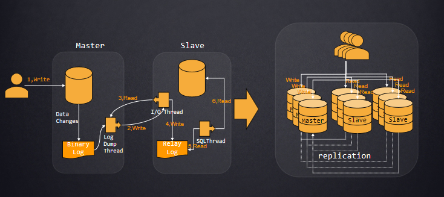
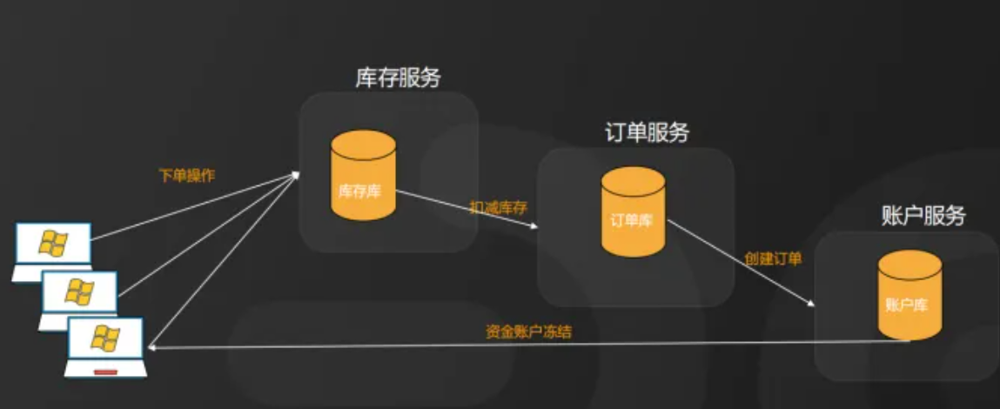
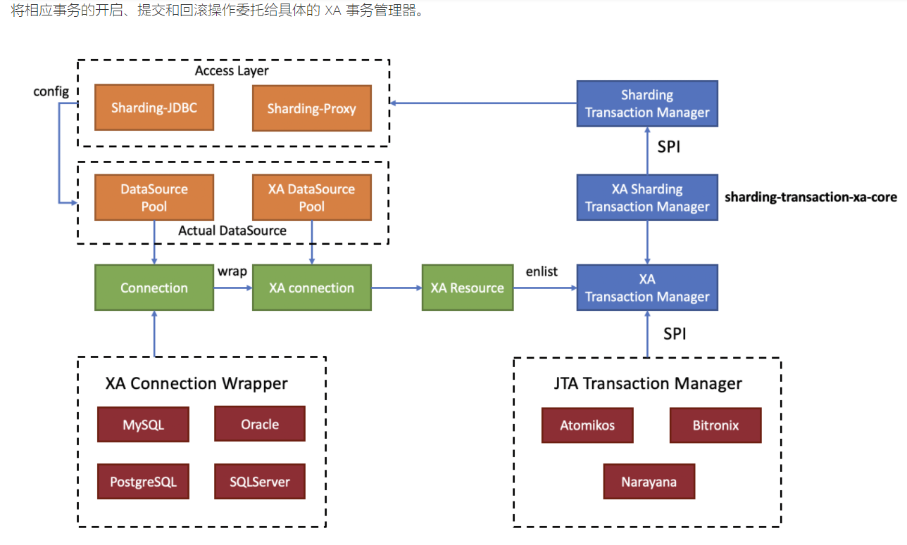
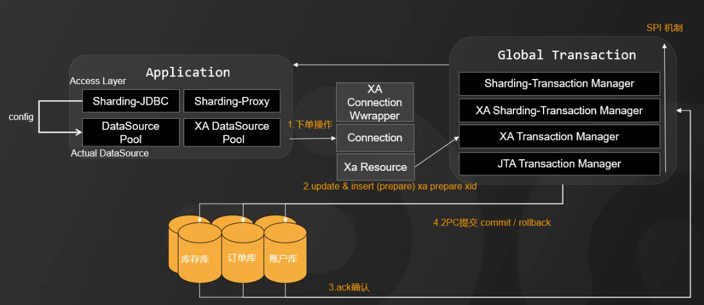
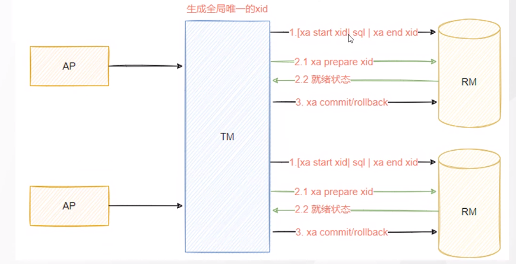
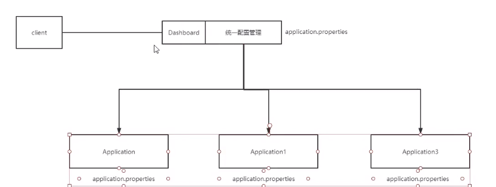
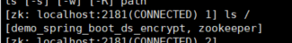
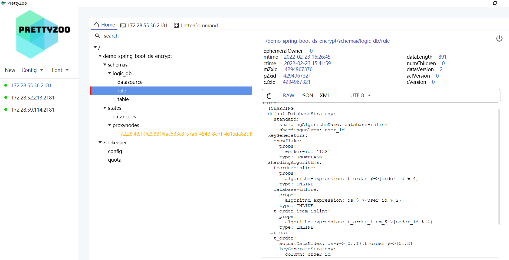

# 02_Sharding-Sphere 读写分离 分布式事务原理 及 实战

**内容提要：**

**(读写分离****原理 图解 PPT)**

 基于binlog + relaylog

实战：

配置：1。master主节点 开启binlog

默认关闭。开启1%性能损耗，cnf配置文件指定 log-bin=binlog-name 或者默认主机名用set sql_log_bin=1 命令开启

show global variables like "%log_bin%";  查看相关参数情况

binlog 的三种 类型

show global variables like "binlog_format"

参数开启 binlog_format=row | statement | mixed

**Binary Logging Formats API查看**

[https://dev.mysql.com/doc/refman/5.7/en/binary-log-formats.html](https://dev.mysql.com/doc/refman/5.7/en/binary-log-formats.html)

建议生产环境用row每行(默认：修改的行。更好恢复但量大少用alter table) ，

statement(会修改的sql。特殊情况会出问题比如 sleep() ;last_insert_id(); user-defined function) 

 mixed自动选择

2.

slave节点指定某个binlog 文件，以及同步的offset , 以及主节点IP 用户名密码

在MySQL 5.7.7之前，默认的格式是STATEMENT。 在MySQL 5.7.7及以上版本中，默认为ROW。 异常:在NDB集群中，默认是MIXED; NDB集群不支持基于语句的复制。

**具体操作：**

我这里的 主从虚拟机 分别是 172.31.26.120 和 172.31.23.118

开启 主节点的binlog

 我这 虚拟机 安装路径cd /var/lib/mysql/ 

修改 my.cnf 目录在 vi /etc/my.cnf

加入	 log-bin=/var/lib/mysql/mysql-bin

服务标记 server-id=1001 

然后重启服务：

systemctl restart mysqld

 当然你也到安装目录去重启

监测是否主已 OK

ls /var/lib/mysql/ 查看是否已有bin.前缀的 文件  当然你也可以通过命令查看参数 show global variables like "%log_bin%";

设置白名单 用户：系统库mysql里面的user表加入 tianming IP地址为 172.31.23.118

-- 创建用户和授权

GRANT REPLICATION SLAVE ON*.* TO 'gp'@'172.31.23.118'IDENTIFIED BY 'Admin_123';

--刷新权限

flush privileges;

接下来slave 节点 连上slave节点的 mysql 

mysql -uroot -pAdmin_123

配置 ：my.conf 添加 server-id=1002

否则会报错：ERROR 1794 (HY000): Slave is not configured or failed to initialize properly. You must at least set --server-id to enable either a master or a slave. Additional error messages can be found in the MySQL error log

然后重启服务：systemctl restart mysqld 当然你也到安装目录去重启

再执行 脚本命令 . 设置主节点的IP 连上去的用户名密码 以及master 节点的

show master status\G;

 的file 和position 文件和位置 11278 206215

再到从节点执行如下命令：注意修改 ip 用户名密码以及 主节点查的 position

change master to master_host='172.28.55.36',master_user='root', master_password='Admin_123', master_port=3306, master_log_file='mysql-bin.000001', master_log_pos=206215;

可能异常 ：STOP SLAVE IO_THREAD FOR CHANNEL ''； 执行如上命令 

启动 slave 同步进程

start slave; 查看slave 同步状态 show slave status\G; -- 可见Slave_IO_Running 和 Slave_SQL_Running 是否YES 可能异常 连接失败：可在IO_Error Master command COM_REGISTER_SLAVE failed: Access denied for user 'tm'@'%' (using password: YES) (Errno: 1045) 当权限显示为 REPLICATION是方才正确。此时，登陆从服务器再次执行 start slave命令即可。 可能异常：Could not execute Delete_rows event on table mysql.user; Can't find record in 'user', Error_code: 1032; handler error HA_ERR_KEY_NOT_FOUND; the event's master log mysql-bin.000001, end_log_pos 5551 原因：master需要删除 从不存在出错 可能节点位置变更了 方案1尝试跳过：stop slave;set global sql_slave_skip_counter=1;start slave; 方案2修改配置的post：重新查看 主节点的status 修改post change master to master_host='172.31.26.120',master_user='tm', master_password='Admin_123', master_port=3306, master_log_file='mysql-bin.000001', master_log_pos=8784; 注意如果主从库原本库不同，需要新建否则binlog中没有此 是无法同步的。

测试 主库新建数据库，刷新从 即可见到同步的情况

**主从不同步怎么办？**

可能异常：不能同步 原因同步已不一致 。重新拿到master的 position 207888

stop slave； 再次 

change master to master_host='172.28.55.36',master_user='root', master_password='Admin_123', master_port=3306, master_log_file='mysql-bin.000001', master_log_pos=207888;

再次开启 start slave；

问题： 从库也可新增和修改。

方案：

set global read_only=1; 

   #1是只读，0是读写

查看状态 ：

show global variables like "%read_only%";

注意：read_only=1只读模式，不影响同步主库的新增和修改。 以及可以限定普通用户进行数据修改的操作，但不会限定具有super权限的用户的数据修改操作；在MySQL中设置read_only=1后，普通的应用用户进行insert、update、delete等会产生数据变化的DML操作时，都会报出数据库处于只读模式不能发生数据变化的错误，但具有super权限的用户，例如在本地或远程通过root用户登录到数据库，还是可以进行数据变化的DML操作；

如果需要设置root 的super权限用户也不能修改 可以 

set global super_read_only=1; 

如此：修改就会 ：ERROR 1290 (HY000): The MySQL server is running with the --super-read-only option so it cannot execute this statement

不推荐使用毕竟以防万一，还有个领导可以越权纠正问题。

当然如果搭建集群 

多个从节点的话 也提供了 负载均衡 的算法。

代码实战 ：

先主库手动创建 ：readwritedb 并选择utf8

 并创建表 ：

DROP TABLE IF EXISTS t_order;

CREATE TABLE t_order (

order_id bigint NOT NULL AUTO_INCREMENT,

user_id int NOT NULL,

address_id bigint NOT NULL,

status varchar(50) DEFAULT NULL,

PRIMARY KEY (order_id)

) ENGINE=InnoDB DEFAULT CHARSET=utf8;

启动服务 

测试地址：[http://localhost:8080/swagger-ui.html](http://localhost:8080/swagger-ui.html)

这里配置集成了 swagger /ˈswæɡər/

进入 /order 根据example 改下ID 为1 可见结果200

可以到控制台搜（Ctrl+K）write-ds 看到时写到哪里。 当然也可到数据库确认 是否都OK

再试试查询：/order/{id} 

可见控制台 的 read-ds

应用场景不多，毕竟数据量很大分库分表拆分，除非写压力也很大避免主宕机。需要安装不少插件我这里就没做演示了

[https://blog.csdn.net/cs729298/article/details/70255245](https://blog.csdn.net/cs729298/article/details/70255245)

**分布式事务：**

分库分表后，假设两个表在不同的数据库，那么本地事务已经无效啦，需要使用分布式事务了。

常用的分布式事务解决方案有：

+ 两阶段提交
+ 三阶段提交
+ TCC
+ 本地消息表
+ 最大努力通知
+ saga

分布式数据一致性的问题 。 （实际上后续的Redis也能很好的解决这个问题）

现在跨库 比如：下单 订单库 账户库 库存库 三个不同的库。

分布式事务的理解： 案例 一个业务处理的分布在多个,需要全局考虑 (**分布式事务一致性问题 PPT)**。

**API：**[https://shardingsphere.apache.org/document/current/cn/reference/transaction/2pc-xa-transaction/](https://shardingsphere.apache.org/document/current/cn/reference/transaction/2pc-xa-transaction/)

 XA事务和Seata柔性事务

这次主讲XA ，Seata /sita/ 阿里的开源中间件 (在alibaba的时候会讲到至少2天 ：三角色 事务协调者 事务管理器 资源管理器 四种事务方案：XA TCC AT SAGA模式)

理解全局事务：全局事务是一个DTP模型的事务，所谓DTP模型指的是 X/Open组织定义的一个分布式的标准 。

全局的视角多个库的操作要么成功要么都失败。

（ 官网PDF 第256页 原理图）

**分布式事务实现原理 PPT**

根据多个库的ack返回 判断所有库的commit与rollback 。 2阶段提交 1prepare阶段，2commit阶段。

（我们之前讲redolog的时候也有这个2pc,需要bin-log OK才去标记commit）

globalTransaction 不能用直接传统的事务，需要XA 协议

（API 搜XA可见：

13.3.7.2 XA Transaction States

）

为了大家更好的理解 详细过程图解

Seata的 XA机制 整体流程图解 

[https://seata.io/zh-cn/docs/dev/mode/xa-mode.html](https://seata.io/zh-cn/docs/dev/mode/xa-mode.html)

ShardingJDBC 对应的API 开发者手册-分布式事务

实战代码 其实很简单 123的事。配置多库 分片规则前面已经讲过

分布式事务 引入xa-core的包 service一个注解即可

@Transactional(rollbackFor = Exception.class) @ShardingTransactionType(TransactionType.XA) //当然 这个枚举的type类型 分为 XA强一致性 ，通过ThreadLocal切换当前事务类型 BASE 柔性事务 ， basically 基本可用 softstate 柔性状态 eventually最终一致性 区别上面的主要适应于 互联网的高并发或复杂系统的事务场景，接入成本增加需要自行实现资源占用和反向补偿 通过SCTL（sharding-ctl即ShardingSphere提供的数据库管理命令）切换当前事务类型 目前只有sharding-transaction-saga模块 LOCAL 

测试 先删除表，启动访问

[http://localhost:8080/swagger-ui.html](http://localhost:8080/swagger-ui.html)

 正常 分库的01 02 分别插入数据。

如果 有（放开 1/0）异常情况 两边都不能插 

可以看到项目 logs目录 下生产的日志信息 i=4的时候回滚了全部 

背景：

随着数据规模的不断膨胀，使用多节点集群的分布式方式成为趋势。这种情况下，如何高效，自动化管理集群节点，实现不同节点的协同工作，配置一致性，状态一致性，高可用性，可观测性等，就成为一个重要的挑战。

**ZK 介绍**： 分布式协调中间件。 （扩服务的多个节点的一致性 paxos一致性算法）

配置中心 

注册中心

zk 作为SpringCloud 注册中心 配置中心也会用到 。 kafka也借助zk来(当然目前版本也可以不借助下个模块)

实战： sharding-jdbc-readwrite-zookeeper项目

集成zk zk-curator 和 governance jar包 pom.xml 加入

shardingsphere-governance-repository-zookeeper-curator 

shardingsphere-jdbc-governance-spring-boot-starter

以及properties 配置的 zk 注册中心信息

#指定的zk 的节点名 spring.shardingsphere.governance.name=demo_spring_boot_ds_encrypt #本地配置是否 覆盖远程配置 spring.shardingsphere.governance.overwrite=false # Zookeeper 配置中心 spring.shardingsphere.governance.registry-center.type=ZooKeeper spring.shardingsphere.governance.registry-center.server-lists=172.28.55.36:2181 spring.shardingsphere.governance.registry-center.props.maxRetries=4 spring.shardingsphere.governance.registry-center.props.retryIntervalMilliseconds=6000

 ZK 的环境 

 cd /usr/local/zk/apache-zookeeper-3.6.3-bin/bin 

启动ZK服务: ./zkServer.sh start

查看ZK服务状态: ./zkServer.sh status

停止ZK服务:  ./zkServer.sh stop

重启ZK服务: ./zkServer.sh restart

连接服务器: ./zkCli.sh 			 或加上参数 -timeout 0 -r -server ip:port

ls / 查看节点 。

可见代码中 定义的节点名

也可客户端 （PrettyZoo 或者 ZooInspector 漂亮的猪 和 猪检察员看你选哪个） 查看 配置中心的信息： 目录 代理 

schemas / logic_db 里面的 rule规则 和 datasource 数据源等 

 就是项目中propertis 转换的 yml 格式 

统一管理 维护。 除了table的规则其他的都可以动态修改 （原因是？ 表结构必然设计到代码）

[http://localhost:8080/swagger-ui.html#/t-order-controller](http://localhost:8080/swagger-ui.html#/t-order-controller)

删表 测试 主库01里面2个表 

从库02里面2个表

修改之后 可见代码运行状态打印的 变更消息

当然理论上改了规则 原有数据需要迁移。

总结： 及 相关面试题

1，为什么要分库分表？单表数据多大时考虑分库分表？

	500W 或者 2G 推荐使用分库分表。 3年预估 250W

						磁盘IO 网络瓶颈 SQL优化

2，有哪些中间件，优缺点？

分库分表插件比较

像 Sharding-JDBC（当当开源捐献给Apache） MyCat（基于cobar改造） TDDL（淘宝团队） atlas（360开源） cobar（阿里b2b团队） 等

Sharding-JDBC 优点在于不用部署，运维成本低，不需要代理层的二次转发请求，性能高，

MyCat 需要安装部署，自己运维一套中间件，成本高， 好处在于对各个项目是透明的。

与MyCat 的区别 ：

理论上基本一致。主要流程都是 SQL 解析> 解析树改写> SQL 路由 > SQL 执行 > 结果归并。

架构上MyCat基于Proxy 复写了MySQL协议，相当于一个伪MySQL数据库。 而Sharding-JDBC基于JDBC接口拓展以jar包形式提供轻量级的服务

还有就是 SQL解析这一块。两者都是使用 Druid 作为 SQL 解析的基础类库。但 Sharding-JDBC 正在重写 SQL 解析这块，是去掉 Duird 的完全自研版本。不可否认 Druid 是一个优秀的连接池，而且 SQL 解析这块做得也很强，但它毕竟不是一个专门为了 Sharding 而做的 SQL 解析器，它的大致解析流程是 **Lexer -> Parser -> AST -> Vistor**，使用者需要实现它的 Vistor 接口，将自己的业务逻辑在 Vistor 中实现，因此需要通过 Vistor 再生成 SharidingContext，而抽象语法树 AST，也需要对 SQL 完全理解。Sharding-JDBC 自研的 SQL 解析器，对于 Sharding 不相关的关键词采用跳过的方法，整体解析流程简化为 **Lexer -> Parser -> SharidingContext**，在性能以及实现复杂度上都有所突破。

3，如何垂直&水平拆分？

业务 数量

4，如何动态扩容平均分配？

各种分片算法 边界范围，容量范围，行表达式，时间范围，哈希取模，自定义等

5，读写分离如何实现，主从同步延时问题如何处理？

 基于bin+redo log start slave; position 更新 

6，老系统 **如何切换成分库分表**？

low 公告0点停机维护，提前备份，再跑批读出老库备份之后的更新，再封装个批量导入新库。 简单但很low

up 双写迁移 。先**备**份， 分库**分**表， 更新代码 线上系统除了之前的库，**同**时加上新库的增删改。 再用封装的批量**导**入老库备份的数据 到新库，根据表最后修改时间（必备create modified 时间 ）判断是否需要**补**充更新新库。最后肯定还少补了**测**试一波。

为确保一致性：上面过程之后再跑个批 定时任务 之类自动检验下再次更新。

7, 分库分表 ，（关联业务）关联查询怎么办呢？** 跨库查询怎么办？**

问题继续：如果没有这么配置的表要做关联查询怎么办呢？ 首先推荐用上面的binding-tables 指定 关系绑定，避免扩库join。

 但是木已成舟的方案有：

1.全局表 多表依赖的广播出去不同库都有。

 2。字段冗余 虽然违背三范式但空间换时间用起来确实爽，基本都这么玩。

3. 建立零时表或者视图 记录经常查询的关联情况，查出结果放到缓存。

4.实时性不是太高的话可以定时任务同步 到缓存 或者 做成视图，避免复杂的扩库查询。

5.借助 ES 大数据 hadoop [hædu:p]之类的工具进行统计分析

8，ShardingJDBC实现原理/工作流程是什么？ 10分钟 与 1-2小时

代理的 Adaptor ，通过内存集群，功能层对SQL解析，执行器优化，路由，改写，路由 执行接入不同的库和表

9，ShardingJDBC有哪些分片算法？分布式id如何处理， 雪花算法实现原理？怎么自定义分片策略？

边界范围，容量范围，行表达式，时间范围，哈希取模，自定义等 64bit划分 

实现 ShandardShardingAlgorithm接口重写 doSharding方法

10，聊聊SPI机制？ 

服务发现机制。它通过在ClassPath路径下的META-INF/services文件夹查找文件，自动加载文件里所定义的类。 

这一机制为很多框架扩展提供了可能，比如在JDBC,Dubbo,spring的SpringFactoriesLoader,shardingSphere,Sentinel/ˈsentɪnl/中都使用到了SPI机制。

> 更新: 2025-04-20 22:38:58  
> 原文: <https://www.yuque.com/aaron-wecc3/dhluml/pe9y9suqi7g803xs>