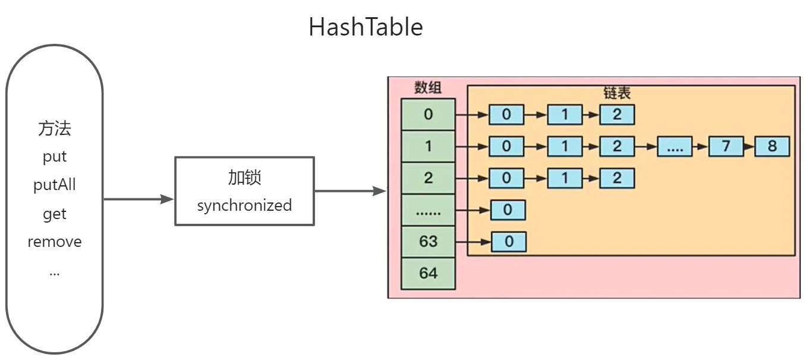
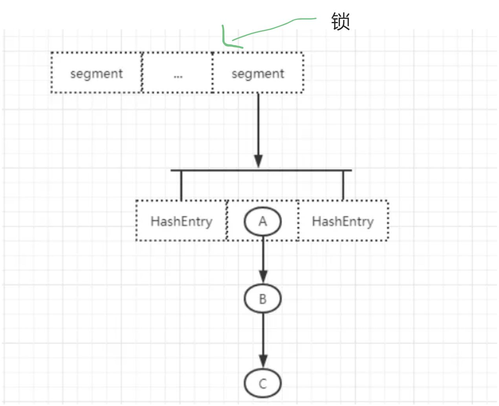
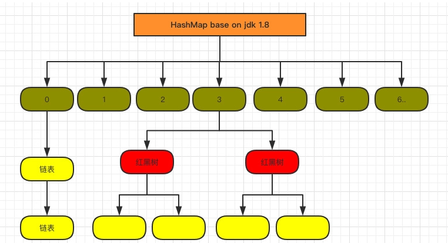
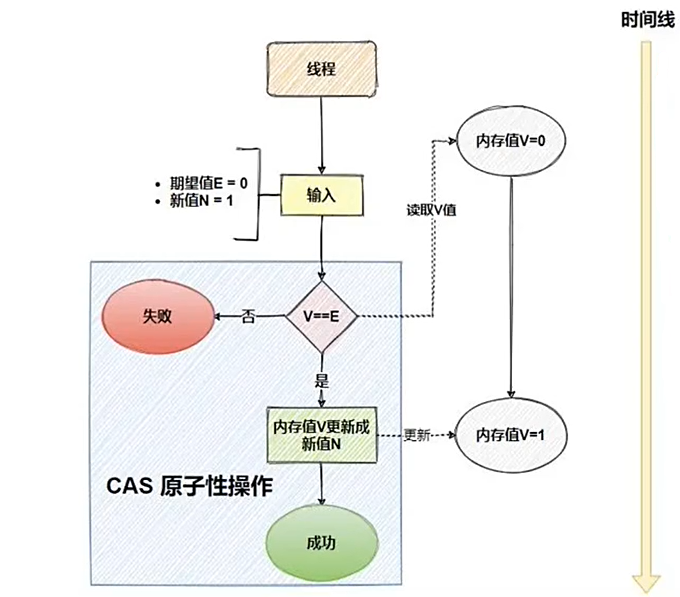

# 1.ConcurrentHashMap为什么是线程安全的？

ConcurrentHashMap是线程安全的，主要得益于其独特的‌分段锁和内部数据结构设计。‌‌

HashTable的实现方式

JDK1.7版本的具体实现方式

在JDK1.7版本中，ConcurrentHashMap采用了分段锁机制，每个Segment内部的操作都是线程安全的。每个Segment继承自‌ReentrantLock，通过对每个Segment加锁来实现线程安全。这种设计允许多个线程同时访问不同的Segment，从而提高了并发性能。

JDK1.8版本的具体实现方式

在JDK1.8版本中，ConcurrentHashMap的底层数据结构为数组+链表+红黑树。它通过‌CAS（Compare and Swap）操作和synchronized关键字来实现线程安全。CAS操作保证了原子性，而synchronized用于锁住链表或红黑树的头节点，从而在插入、删除和更新操作时保证线程安全。

优势和特点

ConcurrentHashMap的优势在于其高并发性能、可伸缩性和可靠性。

它通过读写分离策略、无锁读取以及通过调整Segment数量来控制并发度，适应了高并发场景的需求。此外，ConcurrentHashMap还实现了预测性的‌重新哈希算法，提高了扩容时的性能。

从1.7到1.8版本，由于HashEntry从链表 变成了红黑树所以 concurrentHashMap的时间复杂度从O(n)到O(log(n))

HashEntry最小的容量为2

Segment的初始化容量是16;

HashEntry在1.8中称为Node,链表转红黑树的值是8 ,当Node链表的节点数大于8时Node会自动转化为TreeNode,会转换成红黑树的结构。

什么是CAS？

CAS（Compare-And-Swap）乐观锁是一种在多线程环境下实现同步功能的机制，它通过比较并替换操作来实现数据的同步。具体来说，CAS操作包含三个操作数：需要更新的内存值V、进行比较的预期值A和要写入的新值B。CAS的逻辑是将需要更新的内存值V和预期值A进行比较，当且仅当V的值等于A时，CAS会通过原子方式用新值B来更新V的值（“比较+更新”整体是一个原子操作），否则不会执行任何操作。一般情况下，“更新”是一个不断重试的操作，直到满足条件为止。

CAS乐观锁的核心思想在于，它乐观地认为程序中的并发情况不那么严重，因此让线程不断尝试更新，而不是立即锁定资源。这种机制在不使用传统互斥锁的情况下，通过不断重试的方式保证了多线程对共享变量的安全访问，从而提高了系统的并发性能和吞吐量，同时保证了数据的一致性和线程安全性。

  

> 更新: 2025-04-20 22:39:01  
> 原文: <https://www.yuque.com/aaron-wecc3/dhluml/trq0sgn1xsf2y80f>